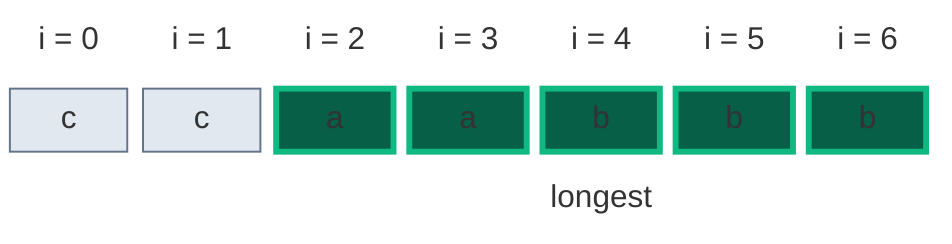
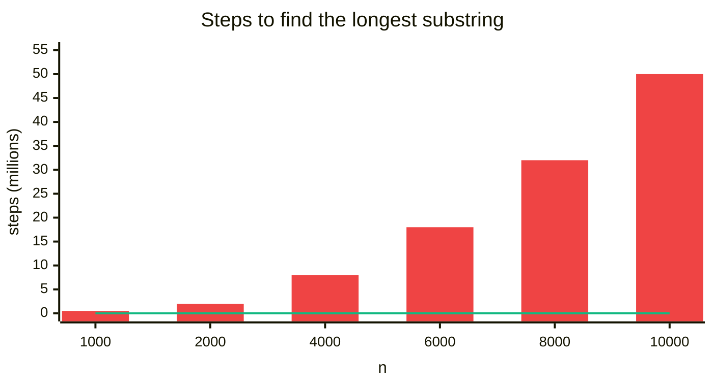
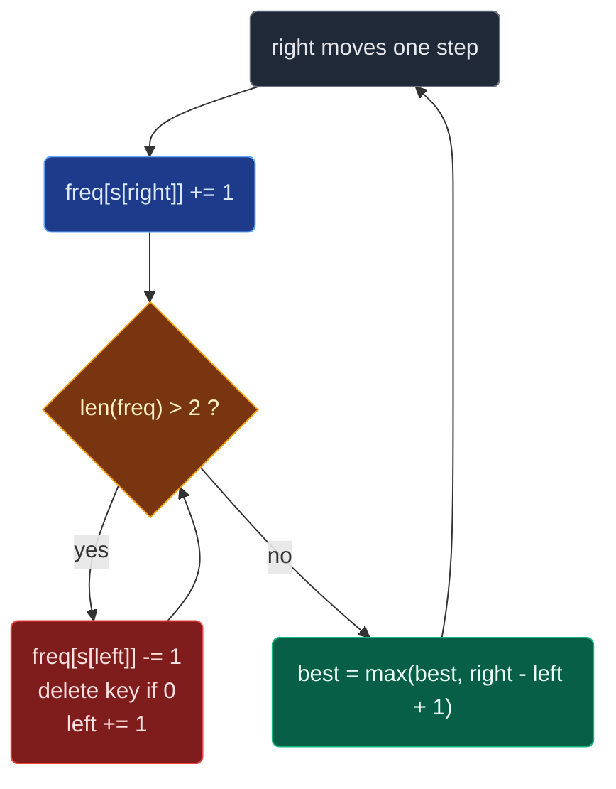
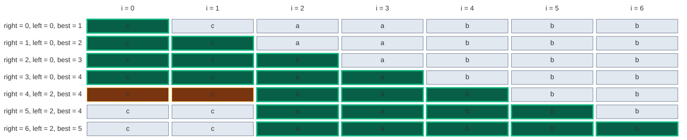

# 02. 159. Longest Substring with At Most Two Distinct Characters

| Difficulty | Pattern | Source | Time | Space |
|:---:|:---:|:---:|:---:|:---:|
| **Medium** | At-Most-K Count Map (`k = 2`) | [159. Longest Substring with At Most Two Distinct Characters](https://leetcode.com/problems/longest-substring-with-at-most-two-distinct-characters/) | `O(n)` | `O(1)` |

## 1. Problem Statement

Given a string `s`, return the length of the **longest substring** that has **at most two different characters**.

### Example

```text
Input:  s = "ccaabbb"
Output: 5   ("aabbb" has only 'a' and 'b')
```



We use this same example in every section below.

Another LeetCode example:

```text
s = "eceba"  -> 3   ("ece")
```

### Constraints

- `1 <= s.length <= 10^5`
- `s` has English letters

### What the constraints tell us (simple theory)

A **constraint** is the biggest input the judge will ever give you. A computer does about **100 million (10^8) simple steps per second**.

| Biggest input `n` | Steps you can afford | Ideas that fit |
|:---:|:---:|:---|
| up to ~5,000 | about `n^2` | Two nested loops |
| up to ~1,000,000 | about `n` | One loop, sliding window |

**For this problem:** `n` can be `10^5`.

- Trying every start is about `n^2 / 2` = `5 × 10^9` steps in the worst case (a string of only two letters never stops early).
- The sliding window: at most `2n` = `2 × 10^5` steps.

**How the work grows** (worst case: only two letters; counted by running code). Red bars = brute force steps, green line = sliding window steps.



| `n` | Brute force steps | Sliding window steps |
|:---:|:---:|:---:|
| 1,000 | 500,500 | 1,000 |
| 2,000 | 2,001,000 | 2,000 |
| 4,000 | 8,002,000 | 4,000 |
| 6,000 | 18,003,000 | 6,000 |
| 8,000 | 32,004,000 | 8,000 |
| 10,000 | 50,005,000 | 10,000 |

## 2. Core Theory

### This is 340 with `k = 2`

The previous note, [340](01.%20340.%20Longest%20Substring%20With%20At%20Most%20K%20Distinct%20Characters.md), builds the general "at most `k` different characters" template. This problem is that template with `k` fixed at `2`. [904 Fruit Into Baskets](../02.%20Basic/04.%20904.%20Fruit%20Into%20Baskets.md) is the same `k = 2` case again, on numbers.

```text
340:  longest substring with at most k different characters
159:  longest substring with at most 2 different characters   (k = 2)
```

In an interview, say this first: "this is the `k = 2` case of at-most-`k`-distinct, a variable sliding window with a count map". That sentence shows you know the pattern, not just this one problem.

### The two rules from 340 still hold

1. **Use a count map, not a set.** When `left` leaves a character, another copy may still be inside. The count map knows; a set does not.
2. **Delete a key when its count reaches 0.** Otherwise `len(freq)` counts a character that already left, and the window keeps shrinking for no reason.



### It is not LeetCode 3

Only the **number of different** characters is limited. Repeats are fine: `"aaaaabbbbb"` is valid as a whole (length `10`). Solving it like LeetCode 3 (no repeats) would wrongly return `2`.

### A special trick only for `k = 2`: no map at all

With just two allowed characters, you can skip the map. Remember the two characters and the **last index** where each was seen. When a third character arrives, drop the one seen **less recently**, and move `left` to just after its last index. This is `O(1)` space with no dictionary. It does not generalise to bigger `k` nicely, so the map version stays the default.

## 3. Edge Cases

| Case | Input | Expected | Why it matters |
|:---|:---|:---:|:---|
| One character | `"a"` | `1` | Smallest input |
| All the same | `"aaaa"` | `4` | Never shrinks |
| Exactly two letters | `"abab"` | `4` | Must not shrink at 2 different |
| Whole string | `"aabb"` | `4` | Answer is all of `s` |
| All different | `"abcde"` | `2` | Capped at 2 |
| Shrink needs several steps | `"aabbc"` | `4` | Two `a`s must leave before `a` is gone |
| Many repeats | `"aaaaabbbbb"` | `10` | Not LeetCode 3 |

## 4. Brute Force: Try Every Start

### Idea

From each start, move right and collect characters in a set. When the set has 3 characters, stop. Keep the longest valid length.

### Code

```python
# Brute force: every start, extend until a third character appears
class SolutionBrute:

    # Main method
    def lengthOfLongestSubstringTwoDistinct(self, s: str) -> int:

        # Length of the string
        n = len(s)

        # Longest valid length so far
        best = 0

        # Every start index
        for start in range(n):

            # Different characters from this start
            seen = set()

            # Extend to the right
            for end in range(start, n):

                # Add this character
                seen.add(s[end])

                # A third character: stop this start
                if len(seen) > 2:

                    # Try the next start
                    break

                # Keep the longest
                best = max(best, end - start + 1)

        # Longest valid length
        return best
```

### Complexity

| Measure | Complexity | Why |
|:---|:---:|:---|
| **Time** | `O(n^2)` | Every start may scan far |
| **Space** | `O(1)` | The set has at most 3 characters |

## 5. Optimal Approach: Sliding Window + Count Map

### Idea

The 340 template with `k = 2`: add the new character; while there are 3 different characters, remove from the left (delete a key at 0); then record the length.

### Visual Walkthrough (Story Version)

**The story:** A train is being loaded with boxes, one at a time from the right. Each box has a colour letter (`c`, `a`, `b`). The train may carry **at most 2 colours**. If a third colour arrives, boxes are unloaded from the **front** (left) until one colour is completely gone.

**How to read the pictures:** green = boxes on the train, orange = boxes just unloaded, grey = not on the train. The label row shows colour counts.


| Step (`right`) | New box | Unloaded | Colour counts | Train | Best |
|:---:|:---:|:---|:---|:---:|:---:|
| 0 | c | – | {c: 1} | c | 1 |
| 1 | c | – | {c: 2} | cc | 2 |
| 2 | a | – | {a: 1, c: 2} | cca | 3 |
| 3 | a | – | {a: 2, c: 2} | ccaa | 4 |
| 4 | b | c, c | {a: 2, b: 1} | aab | 4 |
| 5 | b | – | {a: 2, b: 2} | aabb | 4 |
| 6 | b | – | {a: 2, b: 3} | aabbb | **5** |

At step 4 **two** `c` boxes had to be unloaded before colour `c` was gone. That is why the shrink is a `while`.

**What the story teaches**

| In the story | In the code |
|:---|:---|
| Box colours | characters |
| At most 2 colours | `len(freq) <= 2` |
| Colour counts | `freq` |
| Unload from the front | `freq[s[left]] -= 1`, `left += 1` |
| A colour fully gone | `del freq[ch]` |
| Longest train | `best` |

### Step-by-Step Example

Green = window after the step, orange = removed this step, grey = outside.



**Same example with the no-map trick** (remember the two characters and their last indexes):

| `right` | char | First (char, last) | Second (char, last) | `left` | Best |
|:---:|:---:|:---:|:---:|:---:|:---:|
| 0 | c | (c, 0) | – | 0 | 1 |
| 1 | c | (c, 1) | – | 0 | 2 |
| 2 | a | (c, 1) | (a, 2) | 0 | 3 |
| 3 | a | (c, 1) | (a, 3) | 0 | 4 |
| 4 | b | `c` was seen less recently (1 < 3): drop it → (b, 4) | (a, 3) | `1 + 1 = 2` | 4 |
| 5 | b | (b, 5) | (a, 3) | 2 | 4 |
| 6 | b | (b, 6) | (a, 3) | 2 | **5** |

### Code

```python
# Optimal: sliding window with a count map (340 with k = 2)
class Solution:

    # Main method (trace is optional and only used by the tests)
    def lengthOfLongestSubstringTwoDistinct(self, s: str, trace: list = None) -> int:

        # Character -> count inside the window
        freq = {}

        # Left edge of the window
        left = 0

        # Longest valid length so far
        best = 0

        # Add one character at a time
        for right in range(len(s)):

            # Count the new character
            freq[s[right]] = freq.get(s[right], 0) + 1

            # Three different characters: shrink from the left
            while len(freq) > 2:

                # The character leaving the window
                out = s[left]

                # One fewer copy inside
                freq[out] -= 1

                # No copies left: the character is gone
                if freq[out] == 0:

                    # Required, or len(freq) stays too big
                    del freq[out]

                # Move the left edge
                left += 1

            # The window is valid: record its length
            best = max(best, right - left + 1)

            # Save (right, left, counts, best) for the tests
            if trace is not None:

                # One entry per step
                trace.append((right, left, dict(sorted(freq.items())), best))

        # Longest valid length
        return best


# Special k = 2 trick: two characters and their last indexes, no map
class SolutionNoMap:

    # Main method
    def lengthOfLongestSubstringTwoDistinct(self, s: str) -> int:

        # The two characters allowed in the window
        first_char = second_char = None

        # Last index where each of them was seen
        first_last = second_last = -1

        # Left edge of the window
        left = 0

        # Longest valid length so far
        best = 0

        # Look at each character with its index
        for right, c in enumerate(s):

            # Same as the first character: update its last index
            if c == first_char:

                # Newest position of the first character
                first_last = right

            # Same as the second character: update its last index
            elif c == second_char:

                # Newest position of the second character
                second_last = right

            # First slot is still empty
            elif first_char is None:

                # Take the first slot
                first_char, first_last = c, right

            # Second slot is still empty
            elif second_char is None:

                # Take the second slot
                second_char, second_last = c, right

            # Third character, and the first one was seen less recently
            elif first_last < second_last:

                # Window starts just after the first character's last copy
                left = first_last + 1

                # The new character replaces the first one
                first_char, first_last = c, right

            # Third character, and the second one was seen less recently
            else:

                # Window starts just after the second character's last copy
                left = second_last + 1

                # The new character replaces the second one
                second_char, second_last = c, right

            # The window is valid: record its length
            best = max(best, right - left + 1)

        # Longest valid length
        return best


# Import random for the agreement tests
import random

# Our example, traced step by step
trace = []

# Run with the trace on
assert Solution().lengthOfLongestSubstringTwoDistinct("ccaabbb", trace) == 5

# (right, left, counts, best) after each step
assert trace == [(0, 0, {"c": 1}, 1), (1, 0, {"c": 2}, 2), (2, 0, {"a": 1, "c": 2}, 3), (3, 0, {"a": 2, "c": 2}, 4), (4, 2, {"a": 2, "b": 1}, 4), (5, 2, {"a": 2, "b": 2}, 4), (6, 2, {"a": 2, "b": 3}, 5)]

# LeetCode example 2
assert Solution().lengthOfLongestSubstringTwoDistinct("eceba") == 3

# One character
assert Solution().lengthOfLongestSubstringTwoDistinct("a") == 1

# All the same
assert Solution().lengthOfLongestSubstringTwoDistinct("aaaa") == 4

# Exactly two letters
assert Solution().lengthOfLongestSubstringTwoDistinct("abab") == 4

# All different
assert Solution().lengthOfLongestSubstringTwoDistinct("abcde") == 2

# Shrink needs several steps
assert Solution().lengthOfLongestSubstringTwoDistinct("aabbc") == 4

# Repeats are fine (not LeetCode 3)
assert Solution().lengthOfLongestSubstringTwoDistinct("aaaaabbbbb") == 10

# All versions agree on random strings
for _ in range(500):

    # Random string with few letters
    s = "".join(random.choice("abcd") for _ in range(random.randint(1, 16)))

    # Brute force answer
    expected = SolutionBrute().lengthOfLongestSubstringTwoDistinct(s)

    # Both fast versions must match
    assert Solution().lengthOfLongestSubstringTwoDistinct(s) == SolutionNoMap().lengthOfLongestSubstringTwoDistinct(s) == expected

# Biggest input runs fast
assert Solution().lengthOfLongestSubstringTwoDistinct("ab" * 50000) == 100000

# All checks passed
print("All tests passed")
```

**About `trace`:** it is only for the tests. LeetCode calls `lengthOfLongestSubstringTwoDistinct(s)` and the code works the same.

### Complexity

| Approach | Time | Space | Works for any `k`? |
|:---|:---:|:---:|:---:|
| Brute force | `O(n^2)` | `O(1)` | yes |
| **Sliding window + count map** | **`O(n)`** | **`O(1)`** (at most 3 keys) | **yes** |
| No-map trick | `O(n)` | `O(1)` | no |

## 6. Common Mistakes

| Mistake | What goes wrong | Fix |
|:---|:---|:---|
| Not deleting a key at 0 | `len(freq)` counts characters that left; answer too small | `if freq[ch] == 0: del freq[ch]` |
| Using a set | Cannot tell if another copy is still inside | Count map |
| Shrinking at `len(freq) >= 2` | Two different characters are allowed | Shrink only at `> 2` |
| Recording before the shrink | Records an invalid window | Record after the loop |
| Solving it like LeetCode 3 | `"aaaaabbbbb"` gives `2` instead of `10` | Only the number of different characters is limited |
| No-map trick: dropping the more recent character | `left` jumps too far | Drop the character with the **smaller** last index |

## 7. Interview Follow-ups

### Q1. How do you handle `k` different characters?

**Answer:**
- Replace `2` with `k`: `while len(freq) > k`. That is LeetCode 340.
- Space becomes `O(k)`.

### Q2. Can you do it without a hash map?

**Answer:**
- Yes, only because `k = 2`: keep the two characters and their last indexes.
- When a third arrives, drop the one seen less recently and set `left` to its last index plus one.
- See `SolutionNoMap` above.

### Q3. How do you count substrings with at most 2 different characters?

**Answer:**
- Same window. After shrinking, add `right - left + 1` each step.
- This needs the strict `while` version: the window must be valid every step.

### Q4. What if the string has Unicode characters?

**Answer:**
- Nothing changes: the dictionary works with any character, and it still holds at most 3 keys.

### Q5. How do you return the substring itself?

**Answer:**
- When `best` improves, store `best_left = left`.
- Return `s[best_left : best_left + best]`.

## 8. Interview Explanation

> This is LeetCode 340 with k equal to 2: the longest substring with at most two different characters, a variable sliding window with a count map. I add each new character to the map. While the map has more than two keys, I lower the count of s[left], delete the key when it reaches zero, and move left. Then I record the window length. Each pointer moves at most n times, so it is O(n) time, and the map never holds more than three keys, so O(1) space. Because k is 2, I can also drop the map: keep the two characters and their last indexes, and when a third arrives, cut the window just after the less recent one.
