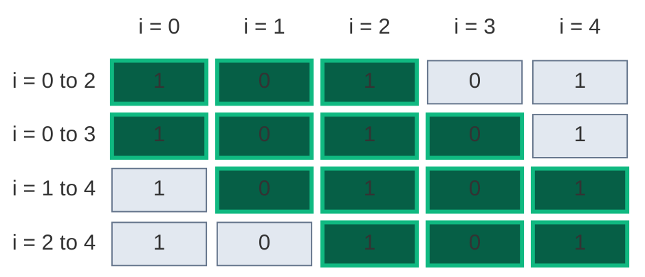
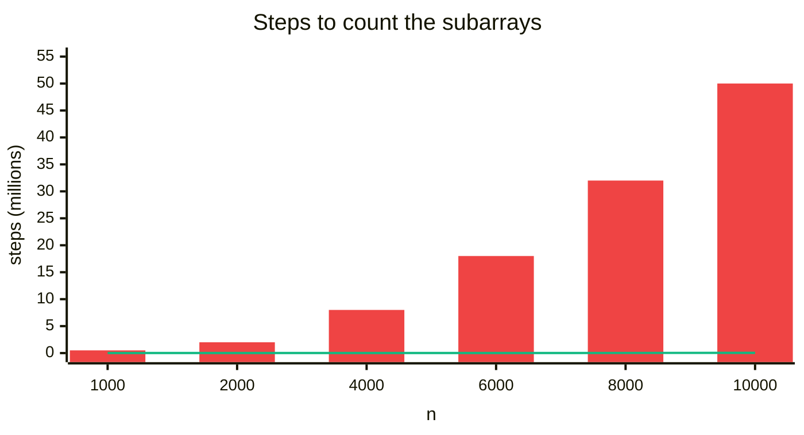
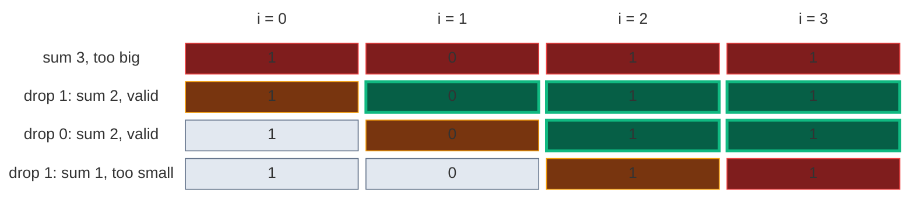
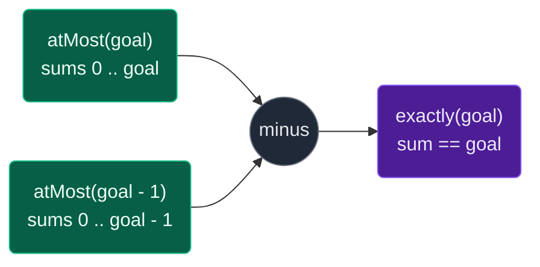
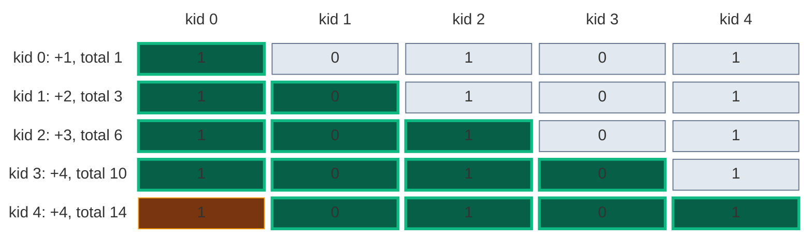
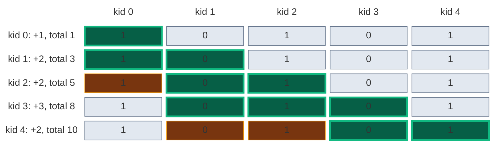
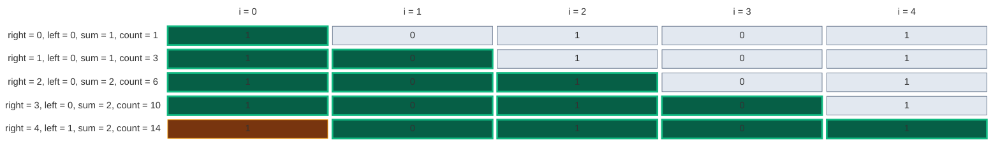
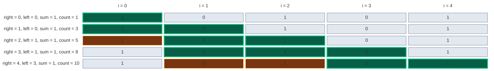

# 01. 930. Binary Subarrays With Sum

| Difficulty | Pattern | Source | Time | Space |
|:---:|:---:|:---:|:---:|:---:|
| **Medium** | At-Most Trick | [930. Binary Subarrays With Sum](https://leetcode.com/problems/binary-subarrays-with-sum/) | `O(n)` | `O(1)` |

## 1. Problem Statement

You get a **binary array** `nums` (only `0`s and `1`s) and a number `goal`. Return **how many** non-empty subarrays have a sum **exactly equal** to `goal`.

### Example

```text
Input:  nums = [1, 0, 1, 0, 1], goal = 2
Output: 4
```

The 4 subarrays with sum 2:



We use this same example in every section below.

Another LeetCode example:

```text
nums = [0, 0, 0, 0, 0], goal = 0  -> 15   (every subarray has sum 0: 5 + 4 + 3 + 2 + 1)
```

### Constraints

- `1 <= nums.length <= 3 * 10^4`
- `nums[i]` is `0` or `1`
- `0 <= goal <= nums.length`

### What the constraints tell us (simple theory)

A **constraint** is the biggest input the judge will ever give you. A computer does about **100 million (10^8) simple steps per second**.

| Biggest input `n` | Steps you can afford | Ideas that fit |
|:---:|:---:|:---|
| up to ~5,000 | about `n^2` | Two nested loops |
| up to ~1,000,000 | about `n` | One loop, sliding window, prefix sums |

**For this problem:** `n` can be `3 × 10^4`.

- Trying every subarray is `n(n + 1) / 2` ≈ `4.5 × 10^8` steps. Several seconds in Python.
- The at-most trick runs two sliding windows: at most `4n` = `1.2 × 10^5` steps.

**How the work grows** (random 0/1 arrays with `goal = n / 4`; counted by running code). Red bars = brute force steps, green line = at-most trick steps (two windows).



| `n` | Brute force steps | At-most trick steps (both windows) |
|:---:|:---:|:---:|
| 1,000 | 500,500 | 2,957 |
| 2,000 | 2,001,000 | 6,011 |
| 4,000 | 8,002,000 | 11,831 |
| 6,000 | 18,003,000 | 17,883 |
| 8,000 | 32,004,000 | 24,195 |
| 10,000 | 50,005,000 | 30,027 |

The brute force always checks every subarray. The two windows each move `right` `n` times and `left` at most `n` times.

## 2. Core Theory

### The trick in one line

This is the first problem of the **at-most trick** family. Every problem here counts subarrays with an **exact** condition, and every one is solved like this:

```text
exactly(k) = atMost(k) - atMost(k - 1)
answer     = atMost(goal) - atMost(goal - 1)
```

### Why one window cannot count "exactly"

A sliding window needs a clear rule for shrinking: "the window is too big, move `left`". That works for **at most `k`**:

- "sum at most `k`": if the sum is too big, removing from the left only lowers it. Keep shrinking until it fits. Simple.

It does **not** work for **exactly `k`**:



With `goal = 2`, the window `[1, 0, 1, 1]` (sum 3) is too big. Drop the `1`: sum 2, valid. Drop the `0`: still 2, valid again. Drop the next `1`: sum 1, too small. Shrinking went **through** the valid zone and out the other side. From the window alone you cannot know when to stop.

### Subtraction gives the exact count

- `atMost(goal)` counts every subarray with sum `0, 1, ..., goal`.
- `atMost(goal - 1)` counts every subarray with sum `0, 1, ..., goal - 1`.
- Subtract: what is left is exactly the subarrays with sum `goal`.



For our example: `atMost(2) = 14`, `atMost(1) = 10`, answer `14 - 10 = 4`.

### Counting inside `atMost`

Inside `atMost(k)`, after shrinking, the window `[left .. right]` has sum `<= k`. Every suffix of it (drop some from the left) has a smaller or equal sum, so it is valid too. That is `right - left + 1` subarrays ending at `right`:

```text
count += right - left + 1
```

Every subarray has exactly one end index, so nothing is counted twice. (Same trick as [713](../02.%20Basic/06.%20713.%20Subarray%20Product%20Less%20Than%20K.md).)

### The `goal = 0` guard

When `goal = 0`, the second call is `atMost(-1)`. No subarray has a negative sum, so `atMost(-1)` must return `0`. Check `if k < 0: return 0` first; otherwise the shrink loop would run `left` off the array.

### Why the window works here

All values are `0` or `1`, never negative. So expanding never lowers the sum and shrinking never raises it. That is what lets `atMost` use a sliding window.

## 3. Edge Cases

| Case | Input | Expected | Why it matters |
|:---|:---|:---:|:---|
| `goal = 0`, all zeros | `[0,0,0,0,0]`, `0` | `15` | Needs `atMost(-1) = 0` |
| `goal = 0`, no zeros | `[1,1,1]`, `0` | `0` | Nothing has sum 0 |
| `goal` too big | `[1,0,1]`, `5` | `0` | Sum can be at most 2 |
| One element equal to goal | `[1]`, `1` | `1` | Smallest real case |
| All ones | `[1,1,1,1]`, `2` | `3` | Each pair of neighbours |
| Zeros around ones | `[0,1,0]`, `1` | `4` | `[0,1]`, `[1]`, `[1,0]`, `[0,1,0]` |

## 4. Brute Force: Try Every Subarray

### Idea

For every start, add elements one by one and count the subarrays whose sum equals `goal`.

### Code

```python
# Import List for type hints
from typing import List


# Brute force: every subarray, keep a running sum
class SolutionBrute:

    # Main method
    def numSubarraysWithSum(self, nums: List[int], goal: int) -> int:

        # Number of elements
        n = len(nums)

        # Subarrays with sum exactly goal
        count = 0

        # Every start index
        for start in range(n):

            # Running sum from start
            current_sum = 0

            # Every end index
            for end in range(start, n):

                # Add the next element
                current_sum += nums[end]

                # Exactly the goal
                if current_sum == goal:

                    # Count this subarray
                    count += 1

        # Total
        return count
```

### Complexity

| Measure | Complexity | Why |
|:---|:---:|:---|
| **Time** | `O(n^2)` | Every subarray is checked |
| **Space** | `O(1)` | A few counters |

## 5. Better Approach: Prefix Sum + Hash Map

### Idea

Let `prefix` be the running sum. A subarray ending here has sum `goal` when an **earlier** prefix equals `prefix - goal`. Keep a map of how many times each prefix value has appeared, and add `seen[prefix - goal]` each step. Start with `seen[0] = 1` (the empty prefix).

| Index | `nums[i]` | prefix | look for `prefix - 2` | found | total | map after |
|:---:|:---:|:---:|:---:|:---:|:---:|:---|
| start | – | 0 | – | – | 0 | {0: 1} |
| 0 | 1 | 1 | -1 | 0 | 0 | {0: 1, 1: 1} |
| 1 | 0 | 1 | -1 | 0 | 0 | {0: 1, 1: 2} |
| 2 | 1 | 2 | 0 | 1 | 1 | {0: 1, 1: 2, 2: 1} |
| 3 | 0 | 2 | 0 | 1 | 2 | {0: 1, 1: 2, 2: 2} |
| 4 | 1 | 3 | 1 | 2 | **4** | {0: 1, 1: 2, 2: 2, 3: 1} |

### Code

```python
# Better: prefix sums and a hash map of counts
class SolutionPrefix:

    # Main method
    def numSubarraysWithSum(self, nums: List[int], goal: int) -> int:

        # How many times each prefix sum has appeared
        seen = {0: 1}

        # Running prefix sum
        prefix = 0

        # Subarrays with sum exactly goal
        count = 0

        # Walk through the array
        for x in nums:

            # Extend the prefix sum
            prefix += x

            # Earlier prefixes equal to prefix - goal each give one subarray
            count += seen.get(prefix - goal, 0)

            # Record this prefix
            seen[prefix] = seen.get(prefix, 0) + 1

        # Total
        return count
```

### Complexity

| Measure | Complexity | Why |
|:---|:---:|:---|
| **Time** | `O(n)` | One pass |
| **Space** | `O(n)` | The map can hold up to `n + 1` prefix values |

This also works with negative numbers. The at-most trick below uses `O(1)` space instead.

## 6. Optimal Approach: Sliding Window with the At-Most Trick

### Idea

1. Write `atMost(k)`: count subarrays with sum `<= k` using a counting window.
2. If `k < 0`, return `0`.
3. Answer = `atMost(goal) - atMost(goal - 1)`.

### Visual Walkthrough (Story Version)

**The story:** Five kids stand in a line holding cards: `1, 0, 1, 0, 1` (a `1` means "I have a candy"). A **group** is kids standing next to each other. The teacher wants the number of groups with **exactly 2 candies**. That is hard to count directly, so she counts twice:

1. Groups with **at most 2** candies.
2. Groups with **at most 1** candy.

The difference is the groups with exactly 2.

**How to read the pictures:** green = the longest allowed group ending at the new kid, orange = kids who stepped out, grey = not in the group. The label says how many groups were counted this step.

**Count 1: at most 2 candies**



**Count 2: at most 1 candy**



| New kid (`right`) | at most 2: added | total | at most 1: added | total |
|:---:|:---:|:---:|:---:|:---:|
| 0 | 1 | 1 | 1 | 1 |
| 1 | 2 | 3 | 2 | 3 |
| 2 | 3 | 6 | 2 (kid 0 stepped out) | 5 |
| 3 | 4 | 10 | 3 | 8 |
| 4 | 4 (kid 0 stepped out) | **14** | 2 (kids 1, 2 stepped out) | **10** |

`14 - 10 = 4` groups with exactly 2 candies.

**What the story teaches**

| In the story | In the code |
|:---|:---|
| Candies in a group | `current_sum` |
| "At most `k` candies" | `atMost(k)` |
| Kid steps out on the left | `current_sum -= nums[left]`, `left += 1` |
| Groups ending at the new kid | `right - left + 1` |
| Two counts, then subtract | `atMost(goal) - atMost(goal - 1)` |

### Step-by-Step Example

Each row is one step of the window. Green = window after the step, orange = removed this step.

**`atMost(2)`:**



**`atMost(1)`:**



### Code

```python
# Optimal: at-most trick with two sliding windows
class Solution:

    # Count subarrays with sum at most k (trace is only for the tests)
    def atMost(self, nums: List[int], k: int, trace: list = None) -> int:

        # No subarray has a negative sum
        if k < 0:

            # Also stops left from running off the array
            return 0

        # Left edge of the window
        left = 0

        # Sum of the window
        current_sum = 0

        # Subarrays with sum at most k
        count = 0

        # Add one element at a time
        for right in range(len(nums)):

            # Grow the window
            current_sum += nums[right]

            # Too big: shrink from the left
            while current_sum > k:

                # Remove the leftmost element
                current_sum -= nums[left]

                # Move the left edge
                left += 1

            # Every subarray ending at right inside the window is valid
            count += right - left + 1

            # Save (right, left, sum, count) for the tests
            if trace is not None:

                # One entry per step
                trace.append((right, left, current_sum, count))

        # Total with sum at most k
        return count

    # Main method
    def numSubarraysWithSum(self, nums: List[int], goal: int) -> int:

        # exactly(goal) = atMost(goal) - atMost(goal - 1)
        return self.atMost(nums, goal) - self.atMost(nums, goal - 1)


# Import random for the agreement tests
import random

# Trace for atMost(2)
t2 = []

# Run atMost(2) on our example
assert Solution().atMost([1, 0, 1, 0, 1], 2, t2) == 14

# (right, left, sum, count) after each step
assert t2 == [(0, 0, 1, 1), (1, 0, 1, 3), (2, 0, 2, 6), (3, 0, 2, 10), (4, 1, 2, 14)]

# Trace for atMost(1)
t1 = []

# Run atMost(1) on our example
assert Solution().atMost([1, 0, 1, 0, 1], 1, t1) == 10

# (right, left, sum, count) after each step
assert t1 == [(0, 0, 1, 1), (1, 0, 1, 3), (2, 1, 1, 5), (3, 1, 1, 8), (4, 3, 1, 10)]

# The answer: 14 - 10
assert Solution().numSubarraysWithSum([1, 0, 1, 0, 1], 2) == 4

# LeetCode example 2: goal = 0
assert Solution().numSubarraysWithSum([0, 0, 0, 0, 0], 0) == 15

# goal = 0 with no zeros
assert Solution().numSubarraysWithSum([1, 1, 1], 0) == 0

# goal too big
assert Solution().numSubarraysWithSum([1, 0, 1], 5) == 0

# One element
assert Solution().numSubarraysWithSum([1], 1) == 1

# All ones
assert Solution().numSubarraysWithSum([1, 1, 1, 1], 2) == 3

# Zeros around a one
assert Solution().numSubarraysWithSum([0, 1, 0], 1) == 4

# All versions agree on random inputs
for _ in range(500):

    # Random binary array
    arr = [random.randint(0, 1) for _ in range(random.randint(1, 15))]

    # Random goal
    g = random.randint(0, len(arr))

    # Brute force answer
    expected = SolutionBrute().numSubarraysWithSum(arr, g)

    # Both faster versions must match
    assert SolutionPrefix().numSubarraysWithSum(arr, g) == Solution().numSubarraysWithSum(arr, g) == expected

# Biggest input runs fast: all zeros, goal 0 counts every subarray
assert Solution().numSubarraysWithSum([0] * 30000, 0) == 30000 * 30001 // 2

# All checks passed
print("All tests passed")
```

**About `trace`:** it is only for the tests. LeetCode calls `numSubarraysWithSum(nums, goal)` and the code works the same.

### Complexity

| Approach | Time | Space |
|:---|:---:|:---:|
| Brute force | `O(n^2)` | `O(1)` |
| Prefix sum + hash map | `O(n)` | `O(n)` |
| **At-most trick (two windows)** | **`O(n)`** (two passes, each at most `2n` moves) | **`O(1)`** |

## 7. Common Mistakes

| Mistake | What goes wrong | Fix |
|:---|:---|:---|
| Trying one window for "exactly" | No clear rule for when to stop shrinking; misses or double-counts | Use `atMost(goal) - atMost(goal - 1)` |
| No `k < 0` check | `atMost(-1)` runs `left` off the array | `if k < 0: return 0` |
| Adding `1` per step instead of `right - left + 1` | Counts only the full window | Count all suffixes |
| Prefix version without `seen[0] = 1` | Misses subarrays that start at index 0 | Start the map with `{0: 1}` |
| Using the window with negative numbers | The sum is no longer predictable | Use the prefix-sum + hash map version |

## 8. Interview Follow-ups

### Q1. Why can't one window count "sum exactly `goal`"?

**Answer:**
- Shrinking can pass through the valid zone (sum too big → equal → too small).
- The window alone cannot tell when to stop. "At most" has a clear rule, so count two "at most"s and subtract.

### Q2. Where else does this trick work?

**Answer:**
- Any "count subarrays with exactly `k` of something" where "at most `k`" is easy with a window.
- [1248](02.%201248.%20Count%20Number%20of%20Nice%20Subarrays.md): exactly `k` odd numbers.
- [992](03.%20992.%20Subarrays%20with%20K%20Different%20Integers.md): exactly `k` different integers.

### Q3. Two passes instead of one: is that slower?

**Answer:**
- Each pass is `O(n)`, so two passes are still `O(n)`. Only the constant doubles.

### Q4. What if the array had negative numbers?

**Answer:**
- The window breaks, because the sum is no longer predictable.
- The prefix-sum + hash map version still works (that is LeetCode 560).

### Q5. How big can the answer be?

**Answer:**
- At most `n(n + 1) / 2` (all zeros with `goal = 0`). For `n = 3 × 10^4` that is about `4.5 × 10^8`, which fits in a 64-bit integer.

## 9. Interview Explanation

> Counting subarrays with sum exactly goal is hard with one window, because when the window is too big I cannot tell how far to shrink: it can pass through the valid sums and out the other side. "Sum at most k" is easy: all values are 0 or 1, so I keep a window, shrink while the sum is more than k, and add right minus left plus one each step, since every subarray ending at right inside the window is valid. Then the answer is atMost(goal) minus atMost(goal minus 1), and atMost of a negative number returns 0. That is two O(n) passes and O(1) space. A prefix-sum hash map also works in O(n) time and O(n) space, and it handles negative numbers.
