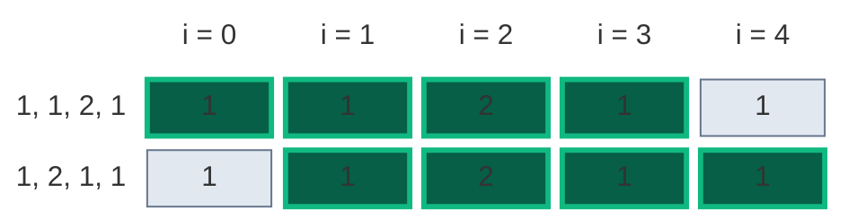
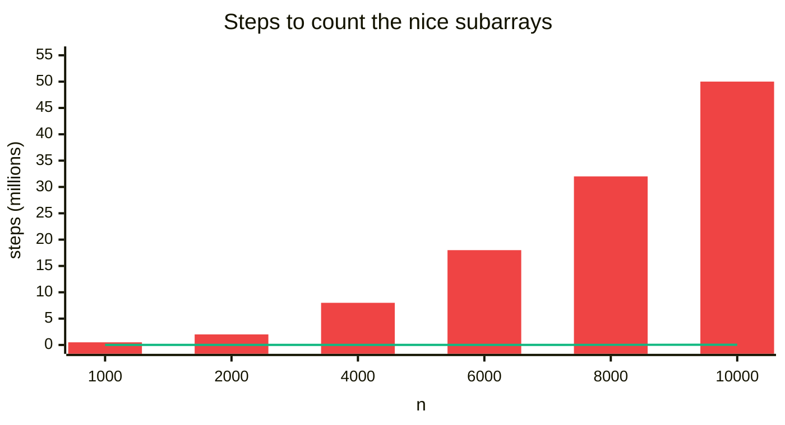
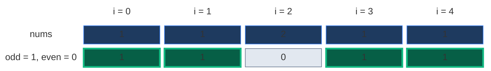
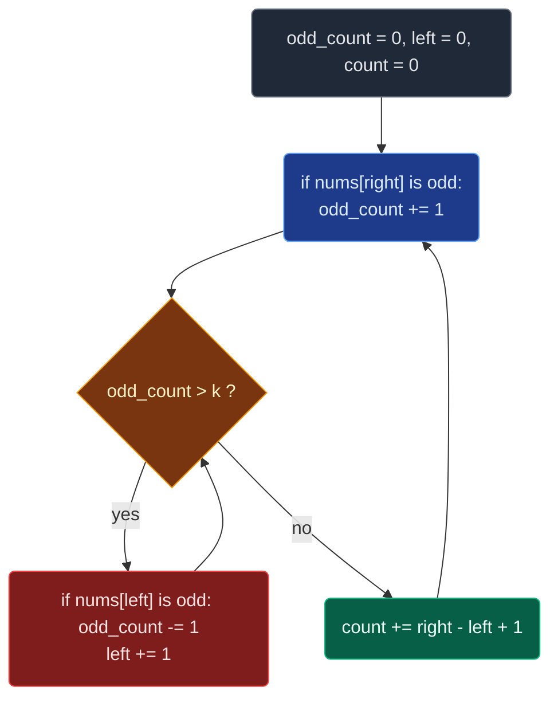
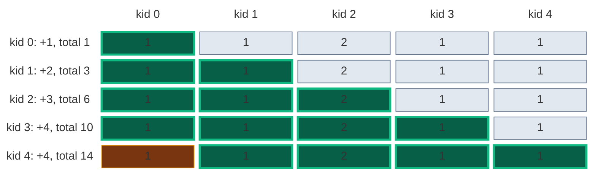
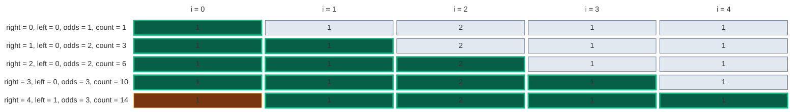
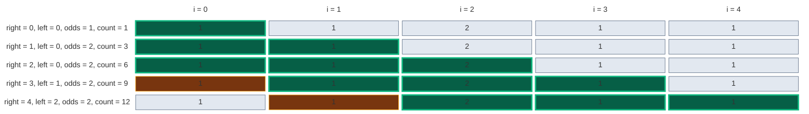

# 02. 1248. Count Number of Nice Subarrays

| Difficulty | Pattern | Source | Time | Space |
|:---:|:---:|:---:|:---:|:---:|
| **Medium** | At-Most Trick | [1248. Count Number of Nice Subarrays](https://leetcode.com/problems/count-number-of-nice-subarrays/) | `O(n)` | `O(1)` |

## 1. Problem Statement

You get an array `nums` and a number `k`. A subarray is **nice** if it has **exactly `k` odd numbers**. Return how many nice subarrays there are.

### Example

```text
Input:  nums = [1, 1, 2, 1, 1], k = 3
Output: 2   ([1, 1, 2, 1] and [1, 2, 1, 1])
```



We use this same example in every section below.

Other LeetCode examples:

```text
[2, 4, 6], k = 1                        -> 0    (no odd numbers)
[2, 2, 2, 1, 2, 2, 1, 2, 2, 2], k = 2   -> 16
```

### Constraints

- `1 <= nums.length <= 50000`
- `1 <= nums[i] <= 10^5`
- `1 <= k <= nums.length`

### What the constraints tell us (simple theory)

A **constraint** is the biggest input the judge will ever give you. A computer does about **100 million (10^8) simple steps per second**.

| Biggest input `n` | Steps you can afford | Ideas that fit |
|:---:|:---:|:---|
| up to ~5,000 | about `n^2` | Two nested loops |
| up to ~1,000,000 | about `n` | One loop, sliding window, prefix sums |

**For this problem:** `n` can be `5 × 10^4`.

- Trying every subarray is `n(n + 1) / 2` ≈ `1.25 × 10^9` steps. Too slow.
- The at-most trick runs two sliding windows: at most `4n` = `2 × 10^5` steps.

**How the work grows** (random arrays with `k = n / 4`; counted by running code). Red bars = brute force steps, green line = at-most trick steps (both windows).



| `n` | Brute force steps | At-most trick steps |
|:---:|:---:|:---:|
| 1,000 | 500,500 | 3,015 |
| 2,000 | 2,001,000 | 5,895 |
| 4,000 | 8,002,000 | 11,875 |
| 6,000 | 18,003,000 | 18,247 |
| 8,000 | 32,004,000 | 24,069 |
| 10,000 | 50,005,000 | 30,273 |

## 2. Core Theory

### This is problem 930 in disguise

Values go up to `10^5`, but the problem only cares whether each number is **odd or even**. So turn every odd into `1` and every even into `0`:



"Exactly `k` odd numbers" becomes "sum exactly `k`" on a 0/1 array. That is exactly [930. Binary Subarrays With Sum](01.%20930.%20Binary%20Subarrays%20With%20Sum.md). You do not even need to build the new array: just check `nums[i] % 2` as you go.

### The at-most trick again

```text
exactly(k) = atMost(k) - atMost(k - 1)
```

`atMost(k)` counts subarrays with **at most** `k` odd numbers, using a counting window.

**Why not count "exactly" directly?** With `k = 2`, a window `[1, 2, 1, 2, 1]` has 3 odds (too many). Drop `1` → 2 odds (nice). Drop `2` → still 2 (nice). Drop `1` → 1 odd (too few). Shrinking passes through the nice zone and out again, so one window has no clear stop rule. "At most" does.

### Counting inside `atMost`

After shrinking, the window has at most `k` odds. Every suffix of it has the same or fewer odds, so all `right - left + 1` subarrays ending at `right` are counted:

```text
count += right - left + 1
```

### Only lower the count for odd numbers

When `left` moves past an **even** number, the odd count does not change. Only `if nums[left] % 2 == 1: odd_count -= 1`.

### The negative guard

`atMost(k - 1)` with `k = 0` would be `atMost(-1)`. The constraints say `k >= 1`, but keep `if max_odds < 0: return 0` anyway; then the helper also works for 930, where `0` is allowed.



## 3. Edge Cases

| Case | Input | Expected | Why it matters |
|:---|:---|:---:|:---|
| No odd numbers | `[2,4,6]`, `k = 1` | `0` | Both at-most counts are equal |
| One odd, `k = 1` | `[1]`, `1` | `1` | Smallest nice subarray |
| One even, `k = 1` | `[2]`, `1` | `0` | No odd number |
| All odd, `k = 1` | `[1,3,5]`, `1` | `3` | Each single element |
| All odd, `k = n` | `[1,3,5]`, `3` | `1` | Only the whole array |
| `k` more than the odd count | `[1,2,1]`, `3` | `0` | Both counts saturate |
| Evens around one odd | `[2,1,2]`, `1` | `4` | 2 choices on each side: `2 × 2` |

## 4. Brute Force: Try Every Subarray

### Idea

For each start, count odd numbers as you extend right. Count every subarray with exactly `k` odds.

### Code

```python
# Import List for type hints
from typing import List


# Brute force: every subarray, keep a running odd count
class SolutionBrute:

    # Main method
    def numberOfSubarrays(self, nums: List[int], k: int) -> int:

        # Number of elements
        n = len(nums)

        # Nice subarrays found
        total = 0

        # Every start index
        for start in range(n):

            # Odd numbers from start to end
            odds = 0

            # Every end index
            for end in range(start, n):

                # Add 1 if this number is odd
                odds += nums[end] % 2

                # Exactly k odd numbers
                if odds == k:

                    # Count this subarray
                    total += 1

        # Total nice subarrays
        return total
```

### Complexity

| Measure | Complexity | Why |
|:---|:---:|:---|
| **Time** | `O(n^2)` | Every subarray is checked |
| **Space** | `O(1)` | A few counters |

## 5. Better Approach: Prefix Count + Hash Map

### Idea

Let `prefix` = number of odd numbers so far. A subarray ending here has exactly `k` odds when an earlier prefix equals `prefix - k`. Keep a map of how often each prefix appeared, starting with `{0: 1}`.

| Index | `nums[i]` | odd? | prefix | look for `prefix - 3` | found | total |
|:---:|:---:|:---:|:---:|:---:|:---:|:---:|
| 0 | 1 | yes | 1 | -2 | 0 | 0 |
| 1 | 1 | yes | 2 | -1 | 0 | 0 |
| 2 | 2 | no | 2 | -1 | 0 | 0 |
| 3 | 1 | yes | 3 | 0 | 1 | 1 |
| 4 | 1 | yes | 4 | 1 | 1 | **2** |

### Code

```python
# Better: prefix count of odd numbers with a hash map
class SolutionPrefix:

    # Main method
    def numberOfSubarrays(self, nums: List[int], k: int) -> int:

        # How many times each prefix count has appeared
        seen = {0: 1}

        # Odd numbers seen so far
        prefix = 0

        # Nice subarrays found
        total = 0

        # Walk through the array
        for x in nums:

            # Add 1 if x is odd
            prefix += x % 2

            # Earlier prefixes equal to prefix - k each give one nice subarray
            total += seen.get(prefix - k, 0)

            # Record this prefix
            seen[prefix] = seen.get(prefix, 0) + 1

        # Total nice subarrays
        return total
```

### Complexity

| Measure | Complexity | Why |
|:---|:---:|:---|
| **Time** | `O(n)` | One pass |
| **Space** | `O(n)` | The map |

## 6. Optimal Approach: At-Most Trick

### Idea

1. `atMost(max_odds)`: counting window that keeps at most `max_odds` odd numbers; adds `right - left + 1` each step.
2. Return `0` for a negative `max_odds`.
3. Answer = `atMost(k) - atMost(k - 1)`.

### Visual Walkthrough (Story Version)

**The story:** Five kids stand in a line. Kids with an **odd** number wear a red hat. A team (kids side by side) is "nice" if it has **exactly 3 red hats**. The coach counts twice:

1. Teams with **at most 3** red hats.
2. Teams with **at most 2** red hats.

The difference is the nice teams.

**How to read the pictures:** green = the longest allowed team ending at the new kid, orange = kids who stepped out, grey = not in the team.

**Count 1: at most 3 red hats**



**Count 2: at most 2 red hats**


| New kid (`right`) | at most 3: added | total | at most 2: added | total |
|:---:|:---:|:---:|:---:|:---:|
| 0 | 1 | 1 | 1 | 1 |
| 1 | 2 | 3 | 2 | 3 |
| 2 | 3 | 6 | 3 | 6 |
| 3 | 4 | 10 | 3 (kid 0 out) | 9 |
| 4 | 4 (kid 0 out) | **14** | 3 (kid 1 out) | **12** |

`14 - 12 = 2` nice teams.

**What the story teaches**

| In the story | In the code |
|:---|:---|
| Red hat | odd number (`nums[i] % 2 == 1`) |
| Red hats in the team | `odd_count` |
| A kid without a hat leaves | `odd_count` does not change |
| Teams ending at the new kid | `right - left + 1` |
| Two counts, then subtract | `atMost(k) - atMost(k - 1)` |

### Step-by-Step Example

**`atMost(3)`:** green = window after the step, orange = removed this step.



**`atMost(2)`:**



### Code

```python
# Optimal: at-most trick on the count of odd numbers
class Solution:

    # Count subarrays with at most max_odds odd numbers (trace only for tests)
    def atMost(self, nums: List[int], max_odds: int, trace: list = None) -> int:

        # A negative limit allows nothing
        if max_odds < 0:

            # No valid subarrays
            return 0

        # Left edge of the window
        left = 0

        # Odd numbers inside the window
        odd_count = 0

        # Valid subarrays found
        count = 0

        # Add one element at a time
        for right in range(len(nums)):

            # The new number is odd
            if nums[right] % 2 == 1:

                # One more odd inside
                odd_count += 1

            # Too many odds: shrink from the left
            while odd_count > max_odds:

                # Only a leaving odd number lowers the count
                if nums[left] % 2 == 1:

                    # One fewer odd inside
                    odd_count -= 1

                # Move the left edge
                left += 1

            # Every subarray ending at right inside the window is valid
            count += right - left + 1

            # Save (right, left, odd_count, count) for the tests
            if trace is not None:

                # One entry per step
                trace.append((right, left, odd_count, count))

        # Total with at most max_odds odds
        return count

    # Main method
    def numberOfSubarrays(self, nums: List[int], k: int) -> int:

        # exactly(k) = atMost(k) - atMost(k - 1)
        return self.atMost(nums, k) - self.atMost(nums, k - 1)


# Import random for the agreement tests
import random

# Trace for atMost(3)
t3 = []

# Run atMost(3) on our example
assert Solution().atMost([1, 1, 2, 1, 1], 3, t3) == 14

# (right, left, odd_count, count) after each step
assert t3 == [(0, 0, 1, 1), (1, 0, 2, 3), (2, 0, 2, 6), (3, 0, 3, 10), (4, 1, 3, 14)]

# Trace for atMost(2)
t2 = []

# Run atMost(2) on our example
assert Solution().atMost([1, 1, 2, 1, 1], 2, t2) == 12

# (right, left, odd_count, count) after each step
assert t2 == [(0, 0, 1, 1), (1, 0, 2, 3), (2, 0, 2, 6), (3, 1, 2, 9), (4, 2, 2, 12)]

# The answer: 14 - 12
assert Solution().numberOfSubarrays([1, 1, 2, 1, 1], 3) == 2

# LeetCode example 2: no odd numbers
assert Solution().numberOfSubarrays([2, 4, 6], 1) == 0

# LeetCode example 3
assert Solution().numberOfSubarrays([2, 2, 2, 1, 2, 2, 1, 2, 2, 2], 2) == 16

# One odd
assert Solution().numberOfSubarrays([1], 1) == 1

# One even
assert Solution().numberOfSubarrays([2], 1) == 0

# All odd, k = 1
assert Solution().numberOfSubarrays([1, 3, 5], 1) == 3

# All odd, k = n
assert Solution().numberOfSubarrays([1, 3, 5], 3) == 1

# k more than the odd count
assert Solution().numberOfSubarrays([1, 2, 1], 3) == 0

# Evens around one odd: 2 x 2 choices
assert Solution().numberOfSubarrays([2, 1, 2], 1) == 4

# All versions agree on random inputs
for _ in range(500):

    # Random array with a mix of odd and even numbers
    arr = [random.randint(1, 8) for _ in range(random.randint(1, 14))]

    # Random k
    k = random.randint(1, len(arr))

    # Brute force answer
    expected = SolutionBrute().numberOfSubarrays(arr, k)

    # Both faster versions must match
    assert SolutionPrefix().numberOfSubarrays(arr, k) == Solution().numberOfSubarrays(arr, k) == expected

# Biggest input runs fast
assert Solution().numberOfSubarrays([1] * 50000, 1) == 50000

# All checks passed
print("All tests passed")
```

**About `trace`:** it is only for the tests. LeetCode calls `numberOfSubarrays(nums, k)` and the code works the same.

### Complexity

| Approach | Time | Space |
|:---|:---:|:---:|
| Brute force | `O(n^2)` | `O(1)` |
| Prefix count + hash map | `O(n)` | `O(n)` |
| **At-most trick** | **`O(n)`** (two passes) | **`O(1)`** |

## 7. Common Mistakes

| Mistake | What goes wrong | Fix |
|:---|:---|:---|
| Looking at the values instead of odd/even | Values do not matter, only `% 2` | Check `nums[i] % 2` |
| Building a 0/1 copy of the array | Correct, but wastes `O(n)` space | Check parity on the fly |
| One window for "exactly `k`" | No clear stop rule | `atMost(k) - atMost(k - 1)` |
| Lowering `odd_count` for every leaving number | Even numbers wrongly lower the count | Only `if nums[left] % 2 == 1` |
| Adding `1` per step | Counts one subarray instead of all suffixes | `count += right - left + 1` |
| Removing the `max_odds < 0` guard | Breaks if reused where `k = 0` is allowed | Keep it |

## 8. Interview Follow-ups

### Q1. How does this reduce to 930?

**Answer:**
- Odd → `1`, even → `0`. "Exactly `k` odds" becomes "sum exactly `k`" on a binary array.
- The code only changes `nums[right]` to `nums[right] % 2`.

### Q2. Does calling the helper twice hurt?

**Answer:**
- No: `O(n) + O(n)` is still `O(n)`, and we save the `O(n)` space of the hash map.

### Q3. When is the prefix + hash map version better?

**Answer:**
- When the thing you count can go down as the window grows, for example sums with negative numbers. Then the window has no shrink rule, but prefix + hash map still works.

### Q4. What would `k = 0` mean?

**Answer:**
- Subarrays with no odd numbers: runs of even numbers.
- The formula needs `atMost(-1)`, and the guard returns `0`, so it still works.

### Q5. How big can the answer be?

**Answer:**
- Up to `n(n + 1) / 2` ≈ `1.25 × 10^9` for `n = 50000`. That does not fit in a 32-bit int; use `long` in Java or C++. Python is fine.

## 9. Interview Explanation

> Only odd or even matters, so I think of each odd number as 1 and each even number as 0; then a nice subarray is one with sum exactly k, which is LeetCode 930. Counting "exactly k" with one window has no clear shrink rule, so I count subarrays with at most k odds and subtract those with at most k minus 1. atMost uses a window: add the new number's parity, while the odd count is more than the limit move left (lowering the count only for odd numbers), then add right minus left plus one. A negative limit returns 0. Two O(n) passes, O(1) space.
