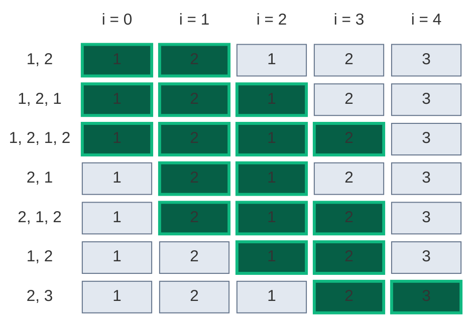
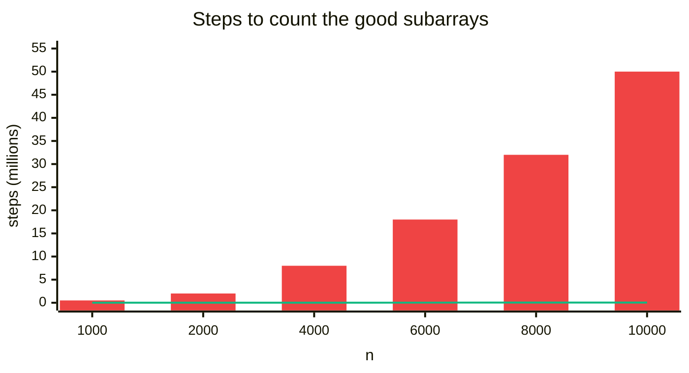
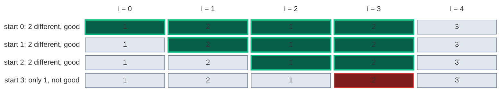
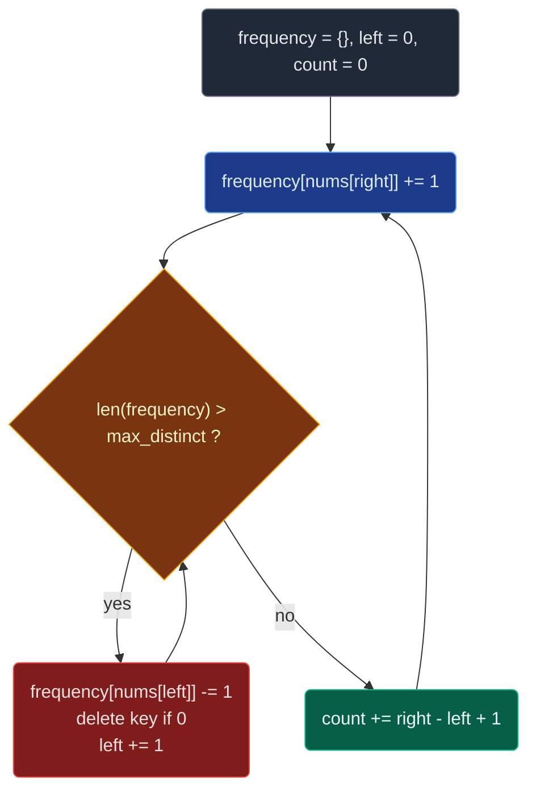
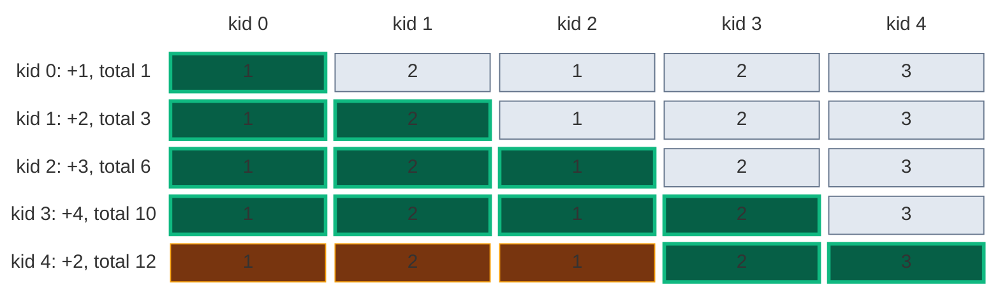
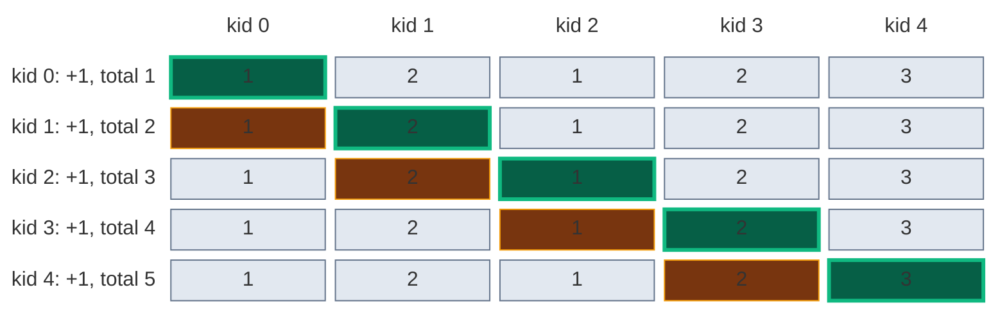
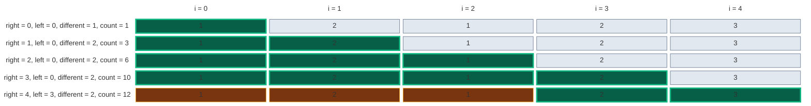
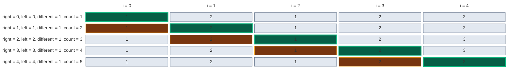

# 03. 992. Subarrays with K Different Integers

| Difficulty | Pattern | Source | Time | Space |
|:---:|:---:|:---:|:---:|:---:|
| **Hard** | At-Most Trick + Count Map | [992. Subarrays with K Different Integers](https://leetcode.com/problems/subarrays-with-k-different-integers/) | `O(n)` | `O(k)` |

## 1. Problem Statement

You get an array `nums` and a number `k`. A subarray is **good** if it has **exactly `k` different integers**. Return how many good subarrays there are.

For example, `[1, 2, 3, 1, 2]` has 3 different integers: `1`, `2` and `3`.

### Example

```text
Input:  nums = [1, 2, 1, 2, 3], k = 2
Output: 7
Good subarrays: [1,2], [2,1], [1,2], [2,3], [1,2,1], [2,1,2], [1,2,1,2]
```



We use this same example in every section below.

Another LeetCode example:

```text
nums = [1, 2, 1, 3, 4], k = 3  -> 3   ([1,2,1,3], [2,1,3], [1,3,4])
```

### Constraints

- `1 <= nums.length <= 2 * 10^4`
- `1 <= nums[i], k <= nums.length`

### What the constraints tell us (simple theory)

A **constraint** is the biggest input the judge will ever give you. A computer does about **100 million (10^8) simple steps per second**.

| Biggest input `n` | Steps you can afford | Ideas that fit |
|:---:|:---:|:---|
| up to ~5,000 | about `n^2` | Two nested loops |
| up to ~1,000,000 | about `n` | One loop, sliding window |

**For this problem:** `n` can be `2 × 10^4`.

- Trying every subarray is up to `n(n + 1) / 2` ≈ `2 × 10^8` steps, each also updating a set. Too slow in Python.
- The at-most trick runs two sliding windows: at most `4n` = `8 × 10^4` steps.

**How the work grows** (random arrays with values 1–50 and `k = 20`; counted by running code). Red bars = brute force steps, green line = at-most trick steps (both windows).



| `n` | Brute force steps (worst case) | At-most trick steps |
|:---:|:---:|:---:|
| 1,000 | 500,500 | 3,954 |
| 2,000 | 2,001,000 | 7,943 |
| 4,000 | 8,002,000 | 15,947 |
| 6,000 | 18,003,000 | 23,951 |
| 8,000 | 32,004,000 | 31,953 |
| 10,000 | 50,005,000 | 39,951 |

## 2. Core Theory

### Same trick as 930 and 1248, harder state

```text
exactly(k) = atMost(k) - atMost(k - 1)
```

In [930](01.%20930.%20Binary%20Subarrays%20With%20Sum.md) the window tracked a sum; in [1248](02.%201248.%20Count%20Number%20of%20Nice%20Subarrays.md) a count of odd numbers. Here it tracks **how many different integers** are inside, using a **count map** (the [340](../03.%20At%20Most/01.%20340.%20Longest%20Substring%20With%20At%20Most%20K%20Distinct%20Characters.md) template).

### Why one window cannot count "exactly `k`"

At a fixed `right`, the good subarrays ending there do not start at one place; they start anywhere inside a **band** of positions:



For `right = 3` (the second `2`) and `k = 2`: starts at index 0, 1 and 2 all give exactly 2 different integers (`[1,2,1,2]`, `[2,1,2]`, `[1,2]`), but start 3 (`[2]`) has only 1. One `left` pointer cannot describe a whole band. Two "at most" windows can: one finds the far edge of the band, the other the near edge.

### Why subtraction is exact

- `atMost(k)` counts subarrays with `1, 2, ..., k` different integers.
- `atMost(k - 1)` counts those with `1, 2, ..., k - 1`.
- The difference is exactly those with `k`.

For our example: `atMost(2) = 12`, `atMost(1) = 5`, answer `12 - 5 = 7`.

### Counting inside `atMost`

After shrinking, the window has at most `max_distinct` different integers. Every suffix has the same or fewer, so add `right - left + 1` each step.

### The trap: delete keys at count 0

`len(frequency)` is the number of different integers **only if** every key in the map is really inside the window. If a count reaches `0` and you do not delete the key, `len(frequency)` stays too big, `left` overshoots, and every count comes out too small.

### Why `while`, not `if`

At `right = 4` in `atMost(2)` below, **three** elements (`1, 2, 1`) must leave before only 2 different integers remain. One step is not enough.



## 3. Edge Cases

| Case | Input | Expected | Why it matters |
|:---|:---|:---:|:---|
| One element | `[1]`, `1` | `1` | Smallest good subarray |
| All the same, `k = 1` | `[5,5,5]`, `1` | `6` | Every subarray: `3 + 2 + 1` |
| All the same, `k = 2` | `[5,5,5]`, `2` | `0` | Only 1 different integer exists |
| All different, `k = 1` | `[1,2,3]`, `1` | `3` | Only single elements |
| All different, `k = n` | `[1,2,3]`, `3` | `1` | Only the whole array |
| `k` more than the different count | `[1,2,1,2]`, `3` | `0` | Both counts saturate |

## 4. Brute Force: Try Every Subarray

### Idea

For each start, add elements to a set. When the set has exactly `k` integers, count the subarray. When it has more than `k`, stop.

### Code

```python
# Import List for type hints
from typing import List


# Brute force: every start, grow a set
class SolutionBrute:

    # Main method
    def subarraysWithKDistinct(self, nums: List[int], k: int) -> int:

        # Number of elements
        n = len(nums)

        # Good subarrays found
        total = 0

        # Every start index
        for start in range(n):

            # Different integers from start
            seen = set()

            # Every end index
            for end in range(start, n):

                # Add this integer
                seen.add(nums[end])

                # Exactly k different
                if len(seen) == k:

                    # Count this subarray
                    total += 1

                # More than k: longer subarrays only get worse
                elif len(seen) > k:

                    # Try the next start
                    break

        # Total good subarrays
        return total
```

### Complexity

| Measure | Complexity | Why |
|:---|:---:|:---|
| **Time** | `O(n^2)` | Every start may scan far |
| **Space** | `O(k)` | The set |

## 5. Optimal Approach: At-Most Trick

### Idea

1. `atMost(max_distinct)`: counting window with a count map; shrink while there are more than `max_distinct` keys (deleting keys at 0); add `right - left + 1`.
2. Return `0` for a negative limit.
3. Answer = `atMost(k) - atMost(k - 1)`.

### Visual Walkthrough (Story Version)

**The story:** Five kids stand in a line wearing jerseys `1, 2, 1, 2, 3`. A team (kids side by side) is "good" if it shows **exactly 2 different jersey numbers**. The coach counts twice:

1. Teams with **at most 2** different numbers.
2. Teams with **at most 1** number.

The difference is the good teams.

**How to read the pictures:** green = the longest allowed team ending at the new kid, orange = kids who stepped out, grey = not in the team.

**Count 1: at most 2 different numbers**



**Count 2: at most 1 number**



| New kid (`right`) | at most 2: added | total | at most 1: added | total |
|:---:|:---:|:---:|:---:|:---:|
| 0 | 1 | 1 | 1 | 1 |
| 1 | 2 | 3 | 1 (kid 0 out) | 2 |
| 2 | 3 | 6 | 1 (kid 1 out) | 3 |
| 3 | 4 | 10 | 1 (kid 2 out) | 4 |
| 4 | 2 (kids 0, 1, 2 out) | **12** | 1 (kid 3 out) | **5** |

`12 - 5 = 7` good teams.

**What the story teaches**

| In the story | In the code |
|:---|:---|
| Jersey numbers in the team | `frequency` map |
| Different numbers | `len(frequency)` |
| A number disappears from the team | `del frequency[x]` at count 0 |
| Teams ending at the new kid | `right - left + 1` |
| Two counts, then subtract | `atMost(k) - atMost(k - 1)` |

### Step-by-Step Example

**`atMost(2)`:** green = window after the step, orange = removed this step.



**`atMost(1)`:**



### Code

```python
# Optimal: at-most trick with a count map
class Solution:

    # Count subarrays with at most max_distinct different integers (trace only for tests)
    def atMost(self, nums: List[int], max_distinct: int, trace: list = None) -> int:

        # A negative limit allows nothing
        if max_distinct < 0:

            # No valid subarrays
            return 0

        # Integer -> count inside the window
        frequency = {}

        # Left edge of the window
        left = 0

        # Valid subarrays found
        count = 0

        # Add one element at a time
        for right in range(len(nums)):

            # Count the new integer
            frequency[nums[right]] = frequency.get(nums[right], 0) + 1

            # Too many different integers: shrink from the left
            while len(frequency) > max_distinct:

                # The integer leaving the window
                out = nums[left]

                # One fewer copy inside
                frequency[out] -= 1

                # No copies left: it is gone
                if frequency[out] == 0:

                    # Required, or len(frequency) stays too big
                    del frequency[out]

                # Move the left edge
                left += 1

            # Every subarray ending at right inside the window is valid
            count += right - left + 1

            # Save (right, left, counts, count) for the tests
            if trace is not None:

                # One entry per step
                trace.append((right, left, dict(sorted(frequency.items())), count))

        # Total with at most max_distinct different integers
        return count

    # Main method
    def subarraysWithKDistinct(self, nums: List[int], k: int) -> int:

        # exactly(k) = atMost(k) - atMost(k - 1)
        return self.atMost(nums, k) - self.atMost(nums, k - 1)


# Import random for the agreement tests
import random

# Trace for atMost(2)
t2 = []

# Run atMost(2) on our example
assert Solution().atMost([1, 2, 1, 2, 3], 2, t2) == 12

# (right, left, counts, count) after each step
assert t2 == [(0, 0, {1: 1}, 1), (1, 0, {1: 1, 2: 1}, 3), (2, 0, {1: 2, 2: 1}, 6), (3, 0, {1: 2, 2: 2}, 10), (4, 3, {2: 1, 3: 1}, 12)]

# Trace for atMost(1)
t1 = []

# Run atMost(1) on our example
assert Solution().atMost([1, 2, 1, 2, 3], 1, t1) == 5

# (right, left, counts, count) after each step
assert t1 == [(0, 0, {1: 1}, 1), (1, 1, {2: 1}, 2), (2, 2, {1: 1}, 3), (3, 3, {2: 1}, 4), (4, 4, {3: 1}, 5)]

# The answer: 12 - 5
assert Solution().subarraysWithKDistinct([1, 2, 1, 2, 3], 2) == 7

# LeetCode example 2
assert Solution().subarraysWithKDistinct([1, 2, 1, 3, 4], 3) == 3

# One element
assert Solution().subarraysWithKDistinct([1], 1) == 1

# All the same, k = 1
assert Solution().subarraysWithKDistinct([5, 5, 5], 1) == 6

# All the same, k = 2
assert Solution().subarraysWithKDistinct([5, 5, 5], 2) == 0

# All different, k = 1
assert Solution().subarraysWithKDistinct([1, 2, 3], 1) == 3

# All different, k = n
assert Solution().subarraysWithKDistinct([1, 2, 3], 3) == 1

# k more than the different count
assert Solution().subarraysWithKDistinct([1, 2, 1, 2], 3) == 0

# Both versions agree on random inputs
for _ in range(500):

    # Random array with repeats
    arr = [random.randint(1, 5) for _ in range(random.randint(1, 14))]

    # Random k
    k = random.randint(1, len(arr))

    # Brute force and at-most trick must match
    assert Solution().subarraysWithKDistinct(arr, k) == SolutionBrute().subarraysWithKDistinct(arr, k)

# Summing over every k counts each subarray exactly once
arr = [1, 2, 1, 3, 2, 2, 4]

# n(n + 1) / 2 subarrays in total
assert sum(Solution().subarraysWithKDistinct(arr, k) for k in range(1, 8)) == 7 * 8 // 2

# Biggest input runs fast: all the same, k = 1
assert Solution().subarraysWithKDistinct([1] * 20000, 1) == 20000 * 20001 // 2

# All checks passed
print("All tests passed")
```

**About `trace`:** it is only for the tests. LeetCode calls `subarraysWithKDistinct(nums, k)` and the code works the same.

### Complexity

| Approach | Time | Space |
|:---|:---:|:---:|
| Brute force | `O(n^2)` | `O(k)` |
| **At-most trick** | **`O(n)`** (two passes) | **`O(k)`** (at most `k + 1` keys) |

## 6. Common Mistakes

| Mistake | What goes wrong | Fix |
|:---|:---|:---|
| Not deleting keys at 0 | `len(frequency)` too big; counts too small | `if frequency[x] == 0: del frequency[x]` |
| One window for "exactly `k`" | Valid starts form a band; one pointer cannot show it | `atMost(k) - atMost(k - 1)` |
| `if` instead of `while` | One removal may not fix the window (3 were needed above) | `while len(frequency) > max_distinct` |
| Counting inside the shrink loop | Window is still invalid | Count after the loop |
| Adding `1` per step | Misses the suffixes | `count += right - left + 1` |
| Using a set | Cannot tell if another copy is still inside | Count map |
| Shrinking at `>=` | `max_distinct` different integers are allowed | Shrink only at `>` |

## 7. Interview Follow-ups

### Q1. Why can't one window count "exactly `k` different"?

**Answer:**
- At each `right`, the good starts form a **band**, not a single point.
- One `left` cannot describe a band. Two "at most" windows give its two edges.

### Q2. Can you do it in one pass?

**Answer:**
- Yes: keep two left pointers at once, `left_far` (for at most `k`) and `left_near` (for at most `k - 1`), each with its own count map.
- Add `left_near - left_far` each step. It is the same subtraction, done inside one loop.

### Q3. Does calling the helper twice change the complexity?

**Answer:**
- No: `O(n) + O(n)` is `O(n)`. Space stays `O(k)`, since the calls run one after the other.

### Q4. Why is space `O(k)` and not `O(n)`?

**Answer:**
- The shrink runs right after each insert, so the map never holds more than `k + 1` keys.

### Q5. How does this relate to 930 and 1248?

**Answer:**
- Same identity, different window state: a sum (930), a count of odds (1248), the number of map keys (992).

## 8. Interview Explanation

> Counting subarrays with exactly k different integers is hard with one window, because at each right end the good starts form a band, not a single point. So I count subarrays with at most k different integers and subtract those with at most k minus 1. The atMost helper keeps a count map of the window: add nums[right]; while the map has more than the limit keys, lower the count of nums[left], delete it at zero, and move left; then add right minus left plus one, since every subarray ending at right inside the window is valid. Each call is O(n), and the map never has more than k plus one keys, so O(n) time and O(k) space.
