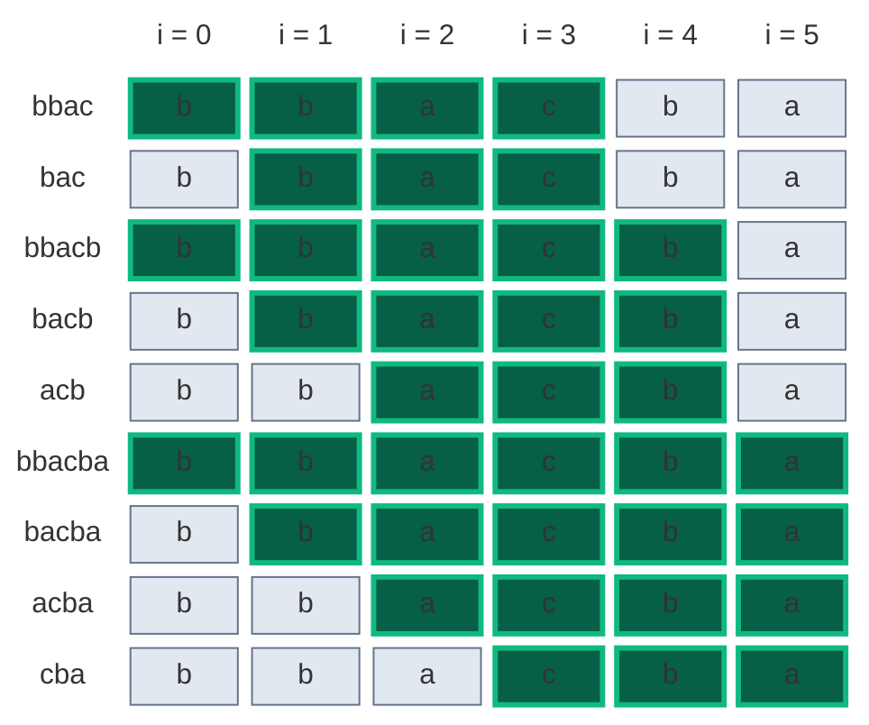
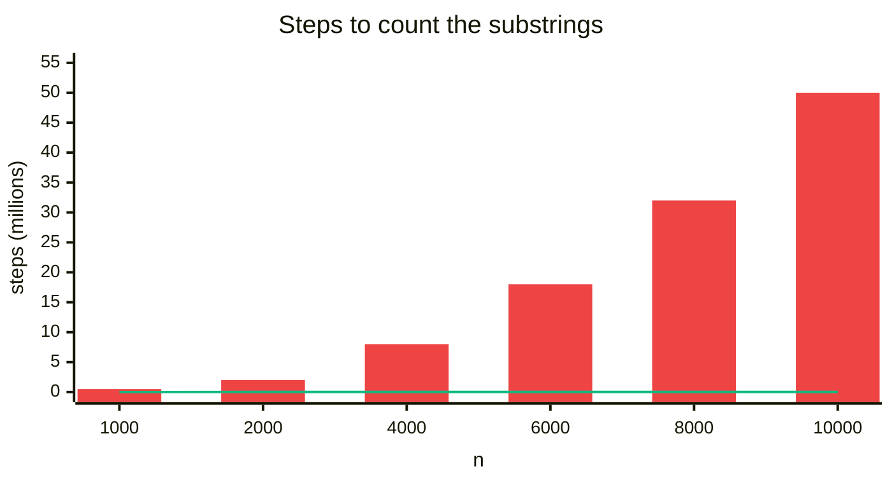
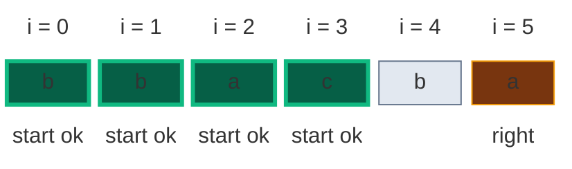
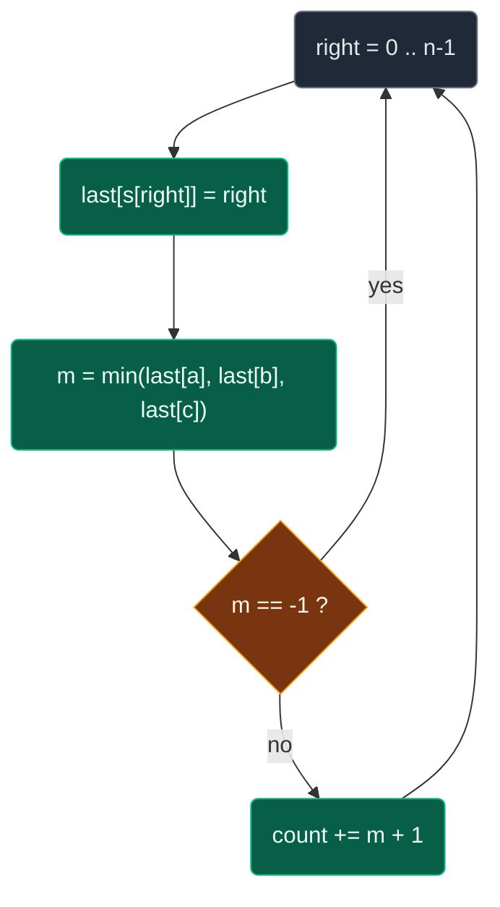
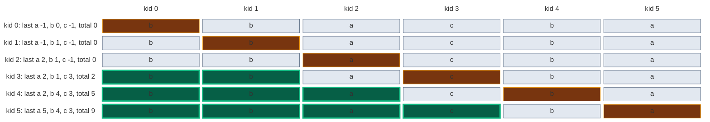
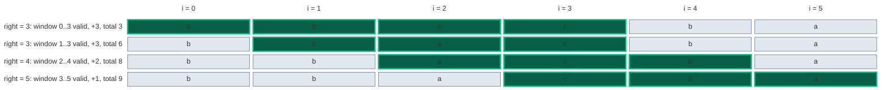

# 01. 1358. Number of Substrings Containing All Three Characters

| Difficulty | Pattern | Source | Time | Space |
|:---:|:---:|:---:|:---:|:---:|
| **Medium** | Counting Window / Last Seen Index | [1358. Number of Substrings Containing All Three Characters](https://leetcode.com/problems/number-of-substrings-containing-all-three-characters/) | `O(n)` | `O(1)` |

## 1. Problem Statement

You get a string `s` made only of the letters `a`, `b` and `c`. Return how many substrings contain **at least one** `a`, **at least one** `b` and **at least one** `c`.

### Example (from the lecture)

```text
Input:  s = "bbacba"
Output: 9
```

The 9 valid substrings:



We use this same example in every section below.

LeetCode examples:

```text
"abcabc"  -> 10
"aaacb"   -> 3    ("aaacb", "aacb", "acb")
"abc"     -> 1
```

### Constraints

- `3 <= s.length <= 5 * 10^4`
- `s` has only `a`, `b` and `c`

### What the constraints tell us (simple theory)

A **constraint** is the biggest input the judge will ever give you. A computer does about **100 million (10^8) simple steps per second**.

| Biggest input `n` | Steps you can afford | Ideas that fit |
|:---:|:---:|:---|
| up to ~5,000 | about `n^2` | Two nested loops |
| up to ~1,000,000 | about `n` | One loop |

**For this problem:** `n` can be `5 × 10^4`.

- Checking every substring is `n(n + 1) / 2` ≈ `1.25 × 10^9` steps. Too slow.
- The last-seen-index solution does exactly `n` steps: one per character.

**How the work grows** (counted by running code). Red bars = brute force steps, green line = last-seen-index steps.



| `n` | Brute force steps | Last-seen steps |
|:---:|:---:|:---:|
| 1,000 | 500,500 | 1,000 |
| 2,000 | 2,001,000 | 2,000 |
| 4,000 | 8,002,000 | 4,000 |
| 6,000 | 18,003,000 | 6,000 |
| 8,000 | 32,004,000 | 8,000 |
| 10,000 | 50,005,000 | 10,000 |

## 2. Core Theory

### Count by the last character

This is a **counting** problem. The key idea from the lecture: **"With every character, there is a substring that ends."** Every substring has exactly one last character. So for each position `right`, count the valid substrings that **end** at `right`, and add them up.

### The last-seen idea

Keep the **last index** where each letter appeared (`-1` if never seen yet):

```text
last[a], last[b], last[c]
```

A substring `s[start .. right]` has an `a` only if `start <= last[a]` (the newest `a` must still be inside). Same for `b` and `c`. So it is valid when:

```text
start <= min(last[a], last[b], last[c])
```

The valid starts are `0, 1, ..., min(...)`, which is **`min(...) + 1`** substrings ending at `right`. If any letter is still `-1`, the min is `-1` and we add `0`.



At `right = 5` in `"bbacba"`: `last = {a: 5, b: 4, c: 3}`, min is `3`. Starts `0, 1, 2, 3` all work (green): 4 substrings.



### The same idea as a sliding window

There is also a window version. Grow `right`. **While** the window has all three letters:

- It is valid, and so is every longer substring that starts at `left` and ends anywhere from `right` to `n - 1`. That is **`n - right`** substrings. Add them.
- Then remove `s[left]` and move `left`, to see if a shorter start is still valid.

**Why `n - right`, not `right - left + 1`?** Here, making a valid substring **longer** keeps it valid (it still has all three letters). So one valid window certifies all its extensions to the right. In "at most" problems it is the opposite: shorter stays valid, so you count `right - left + 1`.

Each `left` is counted exactly once: when it first becomes valid, we count all its extensions, then move past it.

## 3. Edge Cases

| Case | Input | Expected | Why it matters |
|:---|:---|:---:|:---|
| Shortest valid | `"abc"` | `1` | Only the whole string |
| Any order | `"cba"` | `1` | Order does not matter |
| A letter is missing | `"aaabbb"` | `0` | `last[c]` stays `-1` |
| All the same | `"aaaaa"` | `0` | Two letters missing |
| Valid only at the end | `"aaacb"` | `3` | Starts `0, 1, 2` |
| Long run first | `"aaaaabc"` | `5` | Starts `0` to `4` |

## 4. Brute Force: Check Every Substring

### Idea

For each start, grow the substring and count letters. Count every substring that has all three.

### Code

```python
# Brute force: every substring, keep letter counts
class SolutionBrute:

    # Main method
    def numberOfSubstrings(self, s: str) -> int:

        # Length of the string
        n = len(s)

        # Valid substrings found
        total = 0

        # Every start index
        for start in range(n):

            # Letter counts from start
            freq = {"a": 0, "b": 0, "c": 0}

            # Every end index
            for end in range(start, n):

                # Count this letter
                freq[s[end]] += 1

                # All three letters present
                if freq["a"] and freq["b"] and freq["c"]:

                    # Count this substring
                    total += 1

        # Total valid substrings
        return total
```

### Complexity

| Measure | Complexity | Why |
|:---|:---:|:---|
| **Time** | `O(n^2)` | Every substring is checked |
| **Space** | `O(1)` | Three counters |

## 5. Better Approach: Stop Early, Count in Bulk

### Idea

For each start, grow until all three letters appear at some `end`. Every longer substring from this start is valid too, so add `n - end` and stop this start.

### Code

```python
# Better: stop at the first valid end and count all its extensions
class SolutionBetter:

    # Main method
    def numberOfSubstrings(self, s: str) -> int:

        # Length of the string
        n = len(s)

        # Valid substrings found
        total = 0

        # Every start index
        for start in range(n):

            # Letter counts from start
            freq = {"a": 0, "b": 0, "c": 0}

            # Grow to the right
            for end in range(start, n):

                # Count this letter
                freq[s[end]] += 1

                # First moment all three are present
                if freq["a"] and freq["b"] and freq["c"]:

                    # This end and every later end are valid
                    total += n - end

                    # Nothing more to learn from this start
                    break

        # Total valid substrings
        return total
```

### Complexity

| Measure | Complexity | Why |
|:---|:---:|:---|
| **Time** | `O(n^2)` worst case | A start may scan far before all three appear |
| **Space** | `O(1)` | Three counters |

## 6. Optimal Approach: Last Seen Index (and the Window Version)

### Idea

1. `last = {a: -1, b: -1, c: -1}`, `count = 0`.
2. For each `right`: set `last[s[right]] = right`.
3. `m = min(last)`; if `m != -1`, add `m + 1`.

### Visual Walkthrough (Story Version)

**The story:** Kids stand in a line wearing caps of three colours: `b, b, a, c, b, a`. A group (kids side by side) wins a prize if it has **all three colours**. As each new kid joins the end, a helper remembers **where each colour was last seen**. Every group that ends at the new kid and starts at or before the **oldest** of those three spots wins.

**How to read the pictures:** green = the winning start positions for groups ending at the new kid, orange = the new kid, grey = cannot be a start. The label shows the last-seen spots.



| New kid (`right`) | Cap | last `a`, `b`, `c` | min | Groups ending here | Total |
|:---:|:---:|:---:|:---:|:---:|:---:|
| 0 | b | -1, 0, -1 | -1 | 0 | 0 |
| 1 | b | -1, 1, -1 | -1 | 0 | 0 |
| 2 | a | 2, 1, -1 | -1 | 0 | 0 |
| 3 | c | 2, 1, 3 | 1 | 2 | 2 |
| 4 | b | 2, 4, 3 | 2 | 3 | 5 |
| 5 | a | 5, 4, 3 | 3 | 4 | **9** |

**What the story teaches**

| In the story | In the code |
|:---|:---|
| Last spot of each colour | `last[ch]` |
| Oldest of the three spots | `min(last)` |
| Winning starts | `0 .. min(last)` |
| Groups ending at the new kid | `min(last) + 1` |
| A colour never seen | `-1`, adds nothing |

### Step-by-Step Example (window version)

The window version on the same string. Green = valid window being counted, orange = removed. When the window is valid it adds `n - right`:



| `right` | Valid windows counted | Added | Total |
|:---:|:---|:---:|:---:|
| 0 | – | 0 | 0 |
| 1 | – | 0 | 0 |
| 2 | – | 0 | 0 |
| 3 | `[0..3]` adds `6 - 3 = 3`; `[1..3]` adds `3` | 6 | 6 |
| 4 | `[2..4]` adds `6 - 4 = 2` | 2 | 8 |
| 5 | `[3..5]` adds `6 - 5 = 1` | 1 | **9** |

Both versions give 9.

### Code

```python
# Optimal 1: last seen index of each letter
class Solution:

    # Main method (trace is optional and only used by the tests)
    def numberOfSubstrings(self, s: str, trace: list = None) -> int:

        # Last index of each letter (-1 = not seen yet)
        last = {"a": -1, "b": -1, "c": -1}

        # Valid substrings found
        count = 0

        # Look at each character with its index
        for right, ch in enumerate(s):

            # Newest position of this letter
            last[ch] = right

            # Oldest of the three newest positions
            earliest = min(last["a"], last["b"], last["c"])

            # All three letters have been seen
            if earliest != -1:

                # Starts 0 .. earliest all give a valid substring ending here
                count += earliest + 1

            # Save (right, earliest, count) for the tests
            if trace is not None:

                # One entry per character
                trace.append((right, earliest, count))

        # Total valid substrings
        return count


# Optimal 2: counting window that adds n - right
class SolutionWindow:

    # Main method
    def numberOfSubstrings(self, s: str) -> int:

        # Length of the string
        n = len(s)

        # Letter counts inside the window
        freq = {"a": 0, "b": 0, "c": 0}

        # Left edge of the window
        left = 0

        # Valid substrings found
        count = 0

        # Add one character at a time
        for right in range(n):

            # Count the new letter
            freq[s[right]] += 1

            # While the window has all three letters
            while freq["a"] and freq["b"] and freq["c"]:

                # This window and every extension to the right are valid
                count += n - right

                # Remove the leftmost letter
                freq[s[left]] -= 1

                # Move the left edge
                left += 1

        # Total valid substrings
        return count


# Import random for the agreement tests
import random

# Our example, traced step by step
trace = []

# Run with the trace on
assert Solution().numberOfSubstrings("bbacba", trace) == 9

# (right, min last index, total) after each character
assert trace == [(0, -1, 0), (1, -1, 0), (2, -1, 0), (3, 1, 2), (4, 2, 5), (5, 3, 9)]

# Window version on the same example
assert SolutionWindow().numberOfSubstrings("bbacba") == 9

# LeetCode examples
assert Solution().numberOfSubstrings("abcabc") == 10

# Valid only at the end
assert Solution().numberOfSubstrings("aaacb") == 3

# Shortest valid
assert Solution().numberOfSubstrings("abc") == 1

# Any order
assert Solution().numberOfSubstrings("cba") == 1

# A letter is missing
assert Solution().numberOfSubstrings("aaabbb") == 0

# All the same
assert Solution().numberOfSubstrings("aaaaa") == 0

# Long run first
assert Solution().numberOfSubstrings("aaaaabc") == 5

# All versions agree on random strings
for _ in range(500):

    # Random string of a, b and c
    s = "".join(random.choice("abc") for _ in range(random.randint(1, 15)))

    # Brute force answer
    expected = SolutionBrute().numberOfSubstrings(s)

    # Every other version must match
    assert SolutionBetter().numberOfSubstrings(s) == SolutionWindow().numberOfSubstrings(s) == Solution().numberOfSubstrings(s) == expected

# Biggest input runs fast, and the answer is above 10^9
big = "abc" * 16666 + "ab"

# Both fast versions agree on it
assert Solution().numberOfSubstrings(big) == SolutionWindow().numberOfSubstrings(big) > 10 ** 9

# All checks passed
print("All tests passed")
```

**About `trace`:** it is only for the tests. LeetCode calls `numberOfSubstrings(s)` and the code works the same.

### Complexity

| Approach | Time | Space |
|:---|:---:|:---:|
| Brute force | `O(n^2)` | `O(1)` |
| Stop early, count in bulk | `O(n^2)` worst case | `O(1)` |
| **Last seen index** | **`O(n)`** (one pass) | **`O(1)`** |
| Counting window | `O(n)` (each pointer moves at most `n` times) | `O(1)` |

## 7. Common Mistakes

| Mistake | What goes wrong | Fix |
|:---|:---|:---|
| Adding `right - left + 1` in the window version | That is the "at most" formula; here longer stays valid | Add `n - right` |
| Adding `min(last)` instead of `min(last) + 1` | Off by one: starts `0 .. m` are `m + 1` values | `count += m + 1` |
| Forgetting the `-1` case | Adds `0` correctly only if you check or use `m + 1` with `m = -1` | Check `m != -1` |
| Counting after removing in the window version | You count a window that may no longer be valid | Count first, then remove |
| `if` instead of `while` in the window version | Misses shorter valid starts | `while all three present` |

## 8. Interview Follow-ups

### Q1. Why add `n - right` and not `right - left + 1`?

**Answer:**
- Here, making a valid substring **longer** keeps it valid. So a valid `s[left .. right]` also certifies `s[left .. right + 1]`, ..., `s[left .. n - 1]`: that is `n - right` substrings.
- In "at most" problems, **shorter** stays valid, so you count the suffixes: `right - left + 1`.

### Q2. How do you handle any required set of `k` letters?

**Answer:**
- Keep a count map and a number `have` = how many required letters are present.
- Valid when `have == k`. Same window, same `n - right` counting.

### Q3. What about "each letter exactly once"?

**Answer:**
- That is not "longer stays valid" any more, so bulk counting breaks.
- A valid substring must have length exactly 3 and be a mix of `a, b, c`: a fixed window of size 3.

### Q4. Can the answer overflow?

**Answer:**
- In Python, no. In Java or C++, yes: about `n(n - 1) / 2` ≈ `1.25 × 10^9` at the limit, which can pass a signed 32-bit int. Use `long`.

### Q5. Why is the window version `O(n)` with a `while` inside?

**Answer:**
- `left` never goes back; over the whole run it moves at most `n` times. Each character enters and leaves at most once.

## 9. Interview Explanation

> I count by the last character of each substring. For each position right, I keep the last index where a, b and c appeared. A substring ending at right contains all three exactly when its start is at or before the smallest of those three indexes, so it adds min plus one substrings, or nothing if a letter has not appeared yet. One pass, O(n) time, O(1) space. There is also a window version: while the window has all three letters, every extension to the right is valid, so I add n minus right, then shrink from the left. Note it is n minus right here, not right minus left plus one, because a longer substring stays valid.
