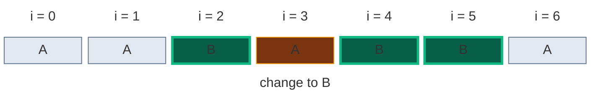
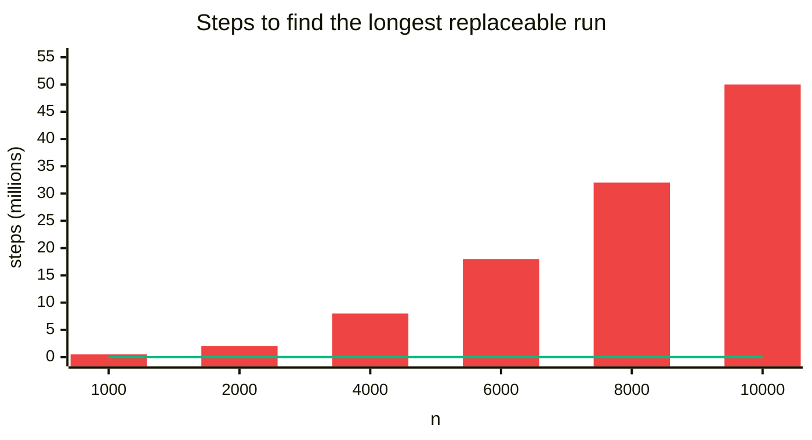
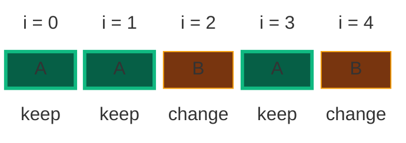
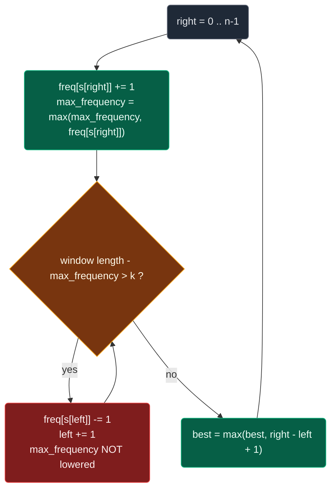
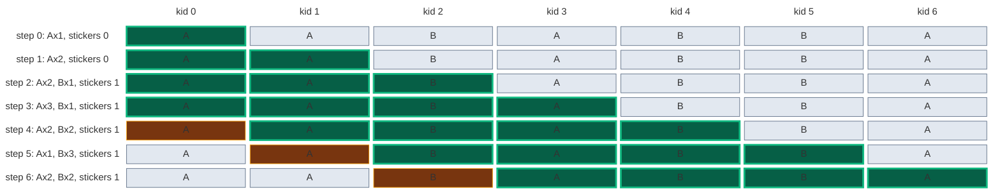

# 02. 424. Longest Repeating Character Replacement

| Difficulty | Pattern | Source | Time | Space |
|:---:|:---:|:---:|:---:|:---:|
| **Medium** | Variable Window + Max Frequency | [424. Longest Repeating Character Replacement](https://leetcode.com/problems/longest-repeating-character-replacement/) | `O(n)` | `O(1)` |

## 1. Problem Statement

You get a string `s` of uppercase letters and a number `k`. You may change **at most `k`** characters into any other uppercase letter. Return the length of the **longest substring of one repeated letter** you can get.

### Example

```text
Input:  s = "AABABBA", k = 1
Output: 4   (change the middle 'A' at index 3 to 'B': "AABBBBA" has "BBBB")
```



We use this same example in every section below.

Another LeetCode example:

```text
s = "ABAB", k = 2  -> 4   (change both A's to B, or both B's to A)
```

### Constraints

- `1 <= s.length <= 10^5`
- `s` has only uppercase English letters
- `0 <= k <= s.length`

### What the constraints tell us (simple theory)

A **constraint** is the biggest input the judge will ever give you. A computer does about **100 million (10^8) simple steps per second**.

| Biggest input `n` | Steps you can afford | Ideas that fit |
|:---:|:---:|:---|
| up to ~5,000 | about `n^2` | Two nested loops |
| up to ~1,000,000 | about `n` | One loop, sliding window |

**For this problem:** `n` can be `10^5`.

- Checking every substring is `n(n + 1) / 2` ≈ `5 × 10^9` steps (and each step looks at up to 26 counts). Too slow.
- The sliding window: at most `2n` = `2 × 10^5` steps.

**How the work grows** (counted by running code). Red bars = brute force steps, green line = sliding window steps.



| `n` | Brute force steps | Sliding window steps |
|:---:|:---:|:---:|
| 1,000 | 500,500 | 1,000 |
| 2,000 | 2,001,000 | 2,000 |
| 4,000 | 8,002,000 | 4,000 |
| 6,000 | 18,003,000 | 6,000 |
| 8,000 | 32,004,000 | 8,000 |
| 10,000 | 50,005,000 | 10,000 |

## 2. Core Theory

### You never actually change the string

For each window, ask one question: **could this window become all the same letter with at most `k` changes?**

### How many changes does a window need?

Keep the letter that appears **most often** and change all the others:

```text
changes needed = window length - max_frequency
```



`"AABAB"`: `A` appears 3 times (green, keep), `B` 2 times (orange, change). Changes needed `5 - 3 = 2`. With `k = 2` it is valid; with `k = 1` it is not.

So the window is valid when:

```text
(right - left + 1) - max_frequency <= k
```

This is the same "budget" idea as [1004](../02.%20Basic/03.%201004.%20Max%20Consecutive%20Ones%20III.md): the cost is the number of characters that are not the majority letter.

### The famous part: `max_frequency` is never lowered

When `left` moves, we lower `frequency[s[left]]` but we do **not** lower `max_frequency`. It can become **stale** (bigger than the real current maximum). Why is that safe?

- `max_frequency` only goes up, so it can only make a window look **cheaper** than it is. The window may then fail to shrink, but it never shrinks too much.
- The answer can only improve when a window is **longer** than the best so far. For that, some letter must reach a frequency **higher** than any before, and then `max_frequency` is updated to the true value. So a stale `max_frequency` never creates a wrong bigger answer.

In our example at `right = 4` the window `"ABAB"` has real max frequency `2` (needs 2 changes), but the stale `max_frequency` is `3`, so it looks like it needs only 1. The window keeps width 4 instead of shrinking, but the answer stays 4, which is still correct.

### `if` would also work here

Because the window width never needs to shrink for a "longest" answer, shrinking at most one step per new character (`if`) also works (same idea as the `if` version in 1004). This works only because we want the **longest** length; it does not work for counting problems like [1358](01.%201358.%20Number%20of%20Substrings%20Containing%20All%20Three%20Characters.md).

### Space `O(1)`

The count map holds at most 26 uppercase letters.



## 3. Edge Cases

| Case | Input | Expected | Why it matters |
|:---|:---|:---:|:---|
| One letter, `k = 0` | `"A"`, `0` | `1` | Smallest input |
| No changes allowed | `"ABAB"`, `0` | `1` | Longest run of one letter |
| `k = 0`, a long run | `"AABBBCC"`, `0` | `3` | `"BBB"` |
| All the same | `"AAAA"`, `2` | `4` | Never shrinks |
| Budget covers everything | `"ABCD"`, `3` | `4` | `k >= n - 1` gives `n` |
| `k` bigger than the string | `"AB"`, `5` | `2` | The answer is capped by `len(s)`, not by `k` |
| Whole string | `"AABA"`, `1` | `4` | Window reaches full length |

## 4. Brute Force: Check Every Substring

### Idea

For each substring, count letters, find the most frequent, and check `length - max_frequency <= k`.

### Code

```python
# Brute force: every substring, check the change cost
class SolutionBrute:

    # Main method
    def characterReplacement(self, s: str, k: int) -> int:

        # Length of the string
        n = len(s)

        # Longest valid length so far
        best = 0

        # Every start index
        for start in range(n):

            # Letter counts from start
            freq = {}

            # Every end index
            for end in range(start, n):

                # Count this letter
                freq[s[end]] = freq.get(s[end], 0) + 1

                # Changes needed: length minus the most common letter
                if (end - start + 1) - max(freq.values()) <= k:

                    # Keep the longest affordable window
                    best = max(best, end - start + 1)

        # Longest valid length
        return best
```

### Complexity

| Measure | Complexity | Why |
|:---|:---:|:---|
| **Time** | `O(26 · n^2)` | Every substring, and `max` over up to 26 counts |
| **Space** | `O(1)` | At most 26 counts |

## 5. Optimal Approach: Sliding Window With a Carried `max_frequency`

### Idea

1. Add `s[right]`; update `max_frequency` with its new count.
2. While `window length - max_frequency > k`: lower `freq[s[left]]`, move `left` (do **not** lower `max_frequency`).
3. Record the window length.

### Visual Walkthrough (Story Version)

**The story:** Kids stand in a line holding letter cards `A, A, B, A, B, B, A`. The teacher wants the longest group of neighbours that can all show the **same letter**, and she has **1 sticker** to cover one card with a different letter. She remembers the highest count of one letter she has ever seen in a group (`max_frequency`).

**How to read the pictures:** green = the group, orange = kids who stepped out, grey = not in the group. The label shows the letter counts and the stickers needed.



| Step (`right`) | New card | Counts | `max_frequency` | Stickers needed | Stepped out | Group | Best |
|:---:|:---:|:---|:---:|:---:|:---|:---:|:---:|
| 0 | A | A:1 | 1 | 0 | – | A | 1 |
| 1 | A | A:2 | 2 | 0 | – | AA | 2 |
| 2 | B | A:2, B:1 | 2 | 1 | – | AAB | 3 |
| 3 | A | A:3, B:1 | 3 | 1 | – | AABA | **4** |
| 4 | B | A:2, B:2 | 3 | 1 | A (index 0) | ABAB | 4 |
| 5 | B | A:1, B:3 | 3 | 1 | A (index 1) | BABB | 4 |
| 6 | A | A:2, B:2 | 3 | 1 | B (index 2) | ABBA | 4 |

From step 4 on, the group keeps width 4 and just slides. At step 4 the real count of the top letter is only 2, but the teacher's remembered `max_frequency` is 3, so she thinks 1 sticker is enough. That stale number never makes the answer wrong: the best stays 4.

**What the story teaches**

| In the story | In the code |
|:---|:---|
| Stickers | `k` |
| Letter counts | `freq` |
| Highest count ever seen | `max_frequency` (never lowered) |
| Stickers needed | `window length - max_frequency` |
| Kid steps out on the left | `freq[s[left]] -= 1`, `left += 1` |
| Longest group | `best` |

### Step-by-Step Example

Green = window after the step, orange = removed this step, grey = outside.

```mermaid
block-beta
  columns 8
  hx[" "] h0["i = 0"] h1["i = 1"] h2["i = 2"] h3["i = 3"] h4["i = 4"] h5["i = 5"] h6["i = 6"]
  l0["right = 0, left = 0, max_frequency = 1, best = 1"] r0c0["A"] r0c1["A"] r0c2["B"] r0c3["A"] r0c4["B"] r0c5["B"] r0c6["A"]
  l1["right = 1, left = 0, max_frequency = 2, best = 2"] r1c0["A"] r1c1["A"] r1c2["B"] r1c3["A"] r1c4["B"] r1c5["B"] r1c6["A"]
  l2["right = 2, left = 0, max_frequency = 2, best = 3"] r2c0["A"] r2c1["A"] r2c2["B"] r2c3["A"] r2c4["B"] r2c5["B"] r2c6["A"]
  l3["right = 3, left = 0, max_frequency = 3, best = 4"] r3c0["A"] r3c1["A"] r3c2["B"] r3c3["A"] r3c4["B"] r3c5["B"] r3c6["A"]
  l4["right = 4, left = 1, max_frequency = 3, best = 4"] r4c0["A"] r4c1["A"] r4c2["B"] r4c3["A"] r4c4["B"] r4c5["B"] r4c6["A"]
  l5["right = 5, left = 2, max_frequency = 3, best = 4"] r5c0["A"] r5c1["A"] r5c2["B"] r5c3["A"] r5c4["B"] r5c5["B"] r5c6["A"]
  l6["right = 6, left = 3, max_frequency = 3, best = 4"] r6c0["A"] r6c1["A"] r6c2["B"] r6c3["A"] r6c4["B"] r6c5["B"] r6c6["A"]
  classDef head fill:none,stroke:none,color:#64748b
  class hx,h0,h1,h2,h3,h4,h5,h6,l0,l1,l2,l3,l4,l5,l6 head
  classDef new fill:#065f46,stroke:#10b981,color:#ecfdf5,stroke-width:3px
  class r0c0,r1c0,r1c1,r2c0,r2c1,r2c2,r3c0,r3c1,r3c2,r3c3,r4c1,r4c2,r4c3,r4c4,r5c2,r5c3,r5c4,r5c5,r6c3,r6c4,r6c5,r6c6 new
  classDef old fill:#e2e8f0,stroke:#64748b,color:#0f172a
  class r0c1,r0c2,r0c3,r0c4,r0c5,r0c6,r1c2,r1c3,r1c4,r1c5,r1c6,r2c3,r2c4,r2c5,r2c6,r3c4,r3c5,r3c6,r4c5,r4c6,r5c0,r5c6,r6c0,r6c1 old
  classDef read fill:#78350f,stroke:#f59e0b,color:#fef3c7
  class r4c0,r5c1,r6c2 read
```



### Code

```python
# Optimal: sliding window with a carried max_frequency
class Solution:

    # Main method (trace is optional and only used by the tests)
    def characterReplacement(self, s: str, k: int, trace: list = None) -> int:

        # Letter -> count inside the window
        freq = {}

        # Left edge of the window
        left = 0

        # Highest count of one letter seen so far (never lowered)
        max_frequency = 0

        # Longest valid length so far
        best = 0

        # Add one letter at a time
        for right in range(len(s)):

            # Count the new letter
            freq[s[right]] = freq.get(s[right], 0) + 1

            # Update the highest count with the new letter
            max_frequency = max(max_frequency, freq[s[right]])

            # Too many changes needed: shrink from the left
            while (right - left + 1) - max_frequency > k:

                # One fewer of the leaving letter
                freq[s[left]] -= 1

                # Move the left edge (max_frequency stays as it is)
                left += 1

            # Record the window length
            best = max(best, right - left + 1)

            # Save (right, left, max_frequency, best) for the tests
            if trace is not None:

                # One entry per step
                trace.append((right, left, max_frequency, best))

        # Longest valid length
        return best


# Alternative: recompute the real maximum every step (simpler to trust)
class SolutionRecompute:

    # Main method
    def characterReplacement(self, s: str, k: int) -> int:

        # Letter -> count inside the window
        freq = {}

        # Left edge of the window
        left = 0

        # Longest valid length so far
        best = 0

        # Add one letter at a time
        for right in range(len(s)):

            # Count the new letter
            freq[s[right]] = freq.get(s[right], 0) + 1

            # Shrink using the real current maximum (at most 26 counts)
            while (right - left + 1) - max(freq.values()) > k:

                # One fewer of the leaving letter
                freq[s[left]] -= 1

                # Move the left edge
                left += 1

            # Record the window length
            best = max(best, right - left + 1)

        # Longest valid length
        return best


# Import random for the agreement tests
import random

# Our example, traced step by step
trace = []

# Run with the trace on
assert Solution().characterReplacement("AABABBA", 1, trace) == 4

# (right, left, max_frequency, best) after each step
assert trace == [(0, 0, 1, 1), (1, 0, 2, 2), (2, 0, 2, 3), (3, 0, 3, 4), (4, 1, 3, 4), (5, 2, 3, 4), (6, 3, 3, 4)]

# LeetCode example 2
assert Solution().characterReplacement("ABAB", 2) == 4

# One letter
assert Solution().characterReplacement("A", 0) == 1

# No changes allowed
assert Solution().characterReplacement("ABAB", 0) == 1

# k = 0, a long run
assert Solution().characterReplacement("AABBBCC", 0) == 3

# All the same
assert Solution().characterReplacement("AAAA", 2) == 4

# Budget covers everything
assert Solution().characterReplacement("ABCD", 3) == 4

# k bigger than the string
assert Solution().characterReplacement("AB", 5) == 2

# Whole string
assert Solution().characterReplacement("AABA", 1) == 4

# All versions agree on random strings
for _ in range(500):

    # Random string with few letters
    s = "".join(random.choice("ABC") for _ in range(random.randint(1, 15)))

    # Random budget
    k = random.randint(0, len(s))

    # Brute force answer
    expected = SolutionBrute().characterReplacement(s, k)

    # Both window versions must match
    assert Solution().characterReplacement(s, k) == SolutionRecompute().characterReplacement(s, k) == expected

# Biggest input runs fast
assert Solution().characterReplacement("AB" * 50000, 10) == 21

# All checks passed
print("All tests passed")
```

**About `trace`:** it is only for the tests. LeetCode calls `characterReplacement(s, k)` and the code works the same.

### Complexity

| Approach | Time | Space |
|:---|:---:|:---:|
| Brute force | `O(26 · n^2)` | `O(1)` |
| Window, recompute the max | `O(26 · n)` | `O(1)` |
| **Window, carried `max_frequency`** | **`O(n)`** | **`O(1)`** |

## 6. Common Mistakes

| Mistake | What goes wrong | Fix |
|:---|:---|:---|
| Lowering `max_frequency` when a letter leaves | `s[left]` is often not the top letter; the value becomes wrong and too small | Never lower it; it is safe to leave it stale |
| Forgetting to update `max_frequency` with the new letter | The window never grows | `max_frequency = max(max_frequency, freq[s[right]])` |
| Using `< k` instead of `<= k` | Off by one; `k` changes are allowed | Shrink only while `> k` |
| Thinking `k` caps the answer | `"AB"`, `k = 5` must return `2` | The answer is a window length, at most `len(s)` |
| Recording before the shrink | Records a window that needs too many changes | Record after the loop |
| Using the `if` / stale trick on a counting problem | Counting needs the exact valid window every step | Use the strict `while` with true values |

## 7. Interview Follow-ups

### Q1. Why is a stale `max_frequency` safe?

**Answer:**
- It only goes up, so it can only make a window look cheaper. The window may not shrink, but it never shrinks too far.
- The answer only grows when some letter reaches a new highest count, and then `max_frequency` is exact again.

### Q2. What happens when `k = 0`?

**Answer:**
- The window must be all one letter: the answer is the longest run of one repeated letter.
- No special code is needed.

### Q3. What if the alphabet were any Unicode?

**Answer:**
- The carried-max version is unchanged: still `O(n)` time, space `O(min(n, charset))`.
- The recompute version gets slow, because `max(freq.values())` looks at every letter.

### Q4. How do you return the substring itself?

**Answer:**
- When `best` improves, store `best_start = left` and return `s[best_start : best_start + best]`.
- Careful: with the stale version the current window may not be valid, but at the moment `best` improves it is.

### Q5. How is this related to 1004?

**Answer:**
- 1004 is the special case with two letters: the cost there is the number of zeros, which equals `length - count(ones)`.

## 8. Interview Explanation

> To make a window all one letter, the cheapest plan is to keep its most frequent letter and change the rest, so a window needs length minus max frequency changes. I use a variable sliding window with a count map and a running max frequency. For each new letter I update its count and the max frequency; while length minus max frequency is more than k, I remove letters from the left. I never lower the max frequency when shrinking: it only makes windows look cheaper, and the answer only grows when some letter reaches a new highest count, at which point the value is exact again. That gives O(n) time and O(1) space, since there are only 26 letters.
