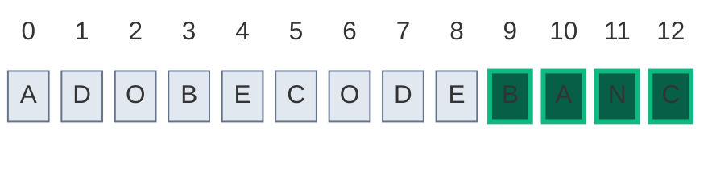
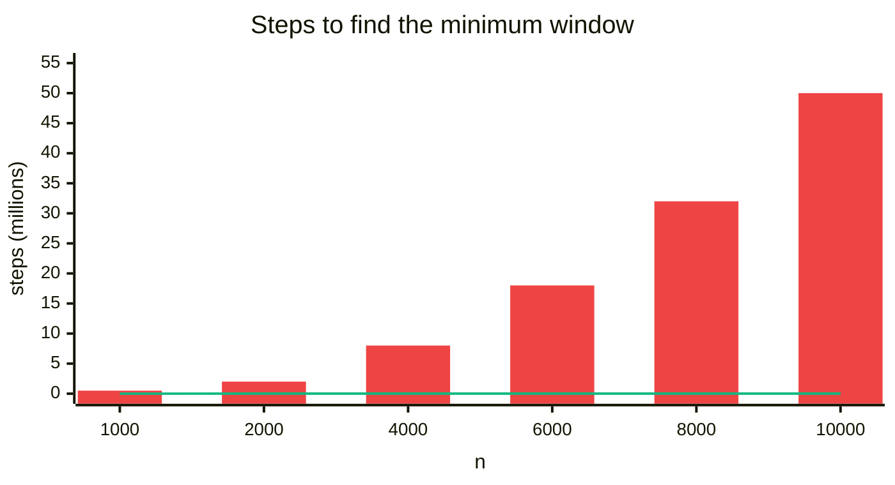
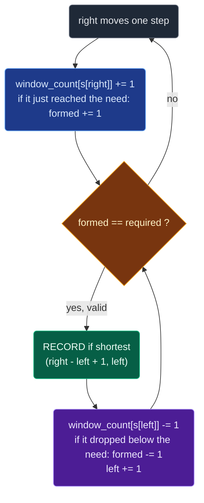

# 01. 76. Minimum Window Substring

| Difficulty | Pattern | Source | Time | Space |
|:---:|:---:|:---:|:---:|:---:|
| **Hard** | Shortest Window + Need/Have Counter | [76. Minimum Window Substring](https://leetcode.com/problems/minimum-window-substring/) | `O(m + n)` | `O(charset)` |

## 1. Problem Statement

You get two strings `s` and `t`. Return the **shortest substring of `s`** that contains **every character of `t`, including duplicates**. If there is none, return `""`. The answer is unique.

### Example

```text
Input:  s = "ADOBECODEBANC", t = "ABC"
Output: "BANC"
```



We use this same example in every section below.

Other LeetCode examples:

```text
s = "a", t = "a"    -> "a"
s = "a", t = "aa"   -> ""    (t needs two 'a's, s has only one)
```

### Constraints

- `1 <= s.length, t.length <= 10^5`
- `s` and `t` have uppercase and lowercase English letters

### What the constraints tell us (simple theory)

A **constraint** is the biggest input the judge will ever give you. A computer does about **100 million (10^8) simple steps per second**.

| Biggest input `n` | Steps you can afford | Ideas that fit |
|:---:|:---:|:---|
| up to ~5,000 | about `n^2` | Two nested loops |
| up to ~1,000,000 | about `n` | One loop, sliding window |

**For this problem:** `s` can have `10^5` characters.

- Checking every substring is up to `n(n + 1) / 2` ≈ `5 × 10^9` steps (when no window is valid, nothing stops early), and each check compares up to 52 letter counts. Far too slow.
- The sliding window: `right` moves `n` times and `left` at most `n` times, plus `m` steps to count `t`.

**How the work grows** (worst case: no valid window; counted by running code). Red bars = brute force steps, green line = sliding window steps.



| `n` | Brute force steps | Sliding window steps |
|:---:|:---:|:---:|
| 1,000 | 500,500 | 1,000 |
| 2,000 | 2,001,000 | 2,000 |
| 4,000 | 8,002,000 | 4,000 |
| 6,000 | 18,003,000 | 6,000 |
| 8,000 | 32,004,000 | 8,000 |
| 10,000 | 50,005,000 | 10,000 |

## 2. Core Theory

This is the hardest problem in the topic. Three ideas must work together.

### Idea 1: count characters, do not just check if they appear

If `t` has duplicates, the window must have them too:

```text
t = "AABC"  needs  A: 2,  B: 1,  C: 1
A window with only one 'A' is NOT valid.
```

So keep a **count** for each character. A window is valid when every character of `t` appears **at least** as many times as in `t`. Extra copies and extra characters are fine: `"BANC"` has an `N` that `t` never asked for.

### Idea 2: the `formed` counter (no need to compare whole maps)

Comparing every count at every step is slow. Instead keep two numbers:

- `required` = number of **different** characters in `t` (for `"ABC"`, 3)
- `formed` = how many of them currently have **enough** copies in the window

The window is valid exactly when `formed == required`.

- **Add a character:** increase its count. If the count just became **equal** to what `t` needs, `formed += 1`. (Going from 1 to 2 copies of something that needs 1 does not count again, because `2 != 1`.)
- **Remove a character:** decrease its count. If it just dropped **below** what `t` needs, `formed -= 1`. (Removing an extra copy does not break the window.)

### Idea 3: shortest window, so record **inside** the shrink loop

This is the **shortest window** template from [209](../02.%20Basic/05.%20209.%20Minimum%20Size%20Subarray%20Sum.md):

1. Expand `right` until the window is valid.
2. **While** it is valid: record its length (if it is the shortest so far), then remove `s[left]` and move `left`.

Record **before** removing, because that is the moment the window is still valid. And use `while`, not `if`: after removing one character the window may still be valid and shorter. In our example at `right = 12`, four removals happen, and the last valid window (`"BANC"`) is the answer.



### The lecture's one-map version

The lecture uses one map `hash` with the remaining need of each character and one counter `cnt`:

- Add `s[right]`: if `hash[s[right]] > 0`, it was still needed, so `cnt += 1`. Then `hash[s[right]] -= 1` (it can go negative for extra copies).
- Valid when `cnt == len(t)` (counts every copy, not every distinct character).
- Remove `s[left]`: `hash[s[left]] += 1`; if it became `> 0`, it is needed again, so `cnt -= 1`.

Same idea, one map instead of two. Both versions are in the code below.

## 3. Edge Cases

| Case | Input | Expected | Why it matters |
|:---|:---|:---:|:---|
| `t` longer than `s` | `"A"`, `"AA"` | `""` | Not enough characters |
| No valid window | `"ABC"`, `"D"` | `""` | Return empty when the answer stays infinite |
| Whole string | `"ABC"`, `"ABC"` | `"ABC"` | Window reaches full length |
| Extra copies to trim | `"AAABC"`, `"ABC"` | `"ABC"` | Needs `while`, not `if` |
| Duplicates in `t` | `"AAABBC"`, `"AABC"` | `"AABBC"` | Counts, not a set |
| Upper vs lower case | `"aA"`, `"A"` | `"A"` | `a` and `A` are different |
| Same as `t` | `"a"`, `"a"` | `"a"` | Smallest input |

## 4. Brute Force: Try Every Substring

### Idea

For each start, grow the substring and keep counts. As soon as it covers `t`, record it if it is the shortest and stop (longer windows from this start are worse).

### Code

```python
# Import Counter for letter counts
from collections import Counter


# Brute force: every start, grow until t is covered
class SolutionBrute:

    # Main method
    def minWindow(self, s: str, t: str) -> str:

        # Counts that t needs
        need = Counter(t)

        # Shortest valid substring so far
        best = ""

        # Every start index
        for start in range(len(s)):

            # Letter counts from start
            window = Counter()

            # Grow to the right
            for end in range(start, len(s)):

                # Count this letter
                window[s[end]] += 1

                # Covers every letter of t with enough copies
                if all(window[c] >= need[c] for c in need):

                    # Shorter than the best so far
                    if best == "" or end - start + 1 < len(best):

                        # Keep it
                        best = s[start:end + 1]

                    # Longer windows from this start cannot be shorter
                    break

        # Shortest valid substring (or "")
        return best
```

### Complexity

| Measure | Complexity | Why |
|:---|:---:|:---|
| **Time** | `O(n^2 · charset)` | Every start may scan far, and each check compares up to 52 counts |
| **Space** | `O(charset)` | The counters |

## 5. Optimal Approach: Shortest Window With `formed` and `required`

### Idea

1. Count `t` into `target_count`; `required = len(target_count)`.
2. Grow `right`; update `window_count` and `formed`.
3. While `formed == required`: record the window if shortest; remove `s[left]` (update `formed`); move `left`.
4. Return the best window, or `""`.

### Visual Walkthrough (Story Version)

**The story:** Riya walks along a shelf of letter blocks `A D O B E C O D E B A N C`. She needs a run of neighbouring blocks that holds an `A`, a `B` and a `C`. Each time her run has all three, she writes down its length, then drops blocks from the **left** to see if a shorter run still works.

**How to read the pictures:** each row is a moment when the run is complete (or the final state). Green = the complete run being written down, grey = outside.

```mermaid
block-beta
  columns 14
  hx[" "] h0["0"] h1["1"] h2["2"] h3["3"] h4["4"] h5["5"] h6["6"] h7["7"] h8["8"] h9["9"] h10["10"] h11["11"] h12["12"]
  l0["right = 5: ADOBEC, length 6"] r0c0["A"] r0c1["D"] r0c2["O"] r0c3["B"] r0c4["E"] r0c5["C"] r0c6["O"] r0c7["D"] r0c8["E"] r0c9["B"] r0c10["A"] r0c11["N"] r0c12["C"]
  l1["right = 10: DOBECODEBA, length 10"] r1c0["A"] r1c1["D"] r1c2["O"] r1c3["B"] r1c4["E"] r1c5["C"] r1c6["O"] r1c7["D"] r1c8["E"] r1c9["B"] r1c10["A"] r1c11["N"] r1c12["C"]
  l2["right = 10: OBECODEBA, length 9"] r2c0["A"] r2c1["D"] r2c2["O"] r2c3["B"] r2c4["E"] r2c5["C"] r2c6["O"] r2c7["D"] r2c8["E"] r2c9["B"] r2c10["A"] r2c11["N"] r2c12["C"]
  l3["right = 10: BECODEBA, length 8"] r3c0["A"] r3c1["D"] r3c2["O"] r3c3["B"] r3c4["E"] r3c5["C"] r3c6["O"] r3c7["D"] r3c8["E"] r3c9["B"] r3c10["A"] r3c11["N"] r3c12["C"]
  l4["right = 10: ECODEBA, length 7"] r4c0["A"] r4c1["D"] r4c2["O"] r4c3["B"] r4c4["E"] r4c5["C"] r4c6["O"] r4c7["D"] r4c8["E"] r4c9["B"] r4c10["A"] r4c11["N"] r4c12["C"]
  l5["right = 10: CODEBA, length 6"] r5c0["A"] r5c1["D"] r5c2["O"] r5c3["B"] r5c4["E"] r5c5["C"] r5c6["O"] r5c7["D"] r5c8["E"] r5c9["B"] r5c10["A"] r5c11["N"] r5c12["C"]
  l6["right = 12: ODEBANC, length 7"] r6c0["A"] r6c1["D"] r6c2["O"] r6c3["B"] r6c4["E"] r6c5["C"] r6c6["O"] r6c7["D"] r6c8["E"] r6c9["B"] r6c10["A"] r6c11["N"] r6c12["C"]
  l7["right = 12: DEBANC, length 6"] r7c0["A"] r7c1["D"] r7c2["O"] r7c3["B"] r7c4["E"] r7c5["C"] r7c6["O"] r7c7["D"] r7c8["E"] r7c9["B"] r7c10["A"] r7c11["N"] r7c12["C"]
  l8["right = 12: EBANC, length 5"] r8c0["A"] r8c1["D"] r8c2["O"] r8c3["B"] r8c4["E"] r8c5["C"] r8c6["O"] r8c7["D"] r8c8["E"] r8c9["B"] r8c10["A"] r8c11["N"] r8c12["C"]
  l9["right = 12: BANC, length 4"] r9c0["A"] r9c1["D"] r9c2["O"] r9c3["B"] r9c4["E"] r9c5["C"] r9c6["O"] r9c7["D"] r9c8["E"] r9c9["B"] r9c10["A"] r9c11["N"] r9c12["C"]
  classDef head fill:none,stroke:none,color:#64748b
  class hx,h0,h1,h2,h3,h4,h5,h6,h7,h8,h9,h10,h11,h12,l0,l1,l2,l3,l4,l5,l6,l7,l8,l9 head
  classDef new fill:#065f46,stroke:#10b981,color:#ecfdf5,stroke-width:3px
  class r0c0,r0c1,r0c2,r0c3,r0c4,r0c5,r1c1,r1c2,r1c3,r1c4,r1c5,r1c6,r1c7,r1c8,r1c9,r1c10,r2c2,r2c3,r2c4,r2c5,r2c6,r2c7,r2c8,r2c9,r2c10,r3c3,r3c4,r3c5,r3c6,r3c7,r3c8,r3c9,r3c10,r4c4,r4c5,r4c6,r4c7,r4c8,r4c9,r4c10,r5c5,r5c6,r5c7,r5c8,r5c9,r5c10,r6c6,r6c7,r6c8,r6c9,r6c10,r6c11,r6c12,r7c7,r7c8,r7c9,r7c10,r7c11,r7c12,r8c8,r8c9,r8c10,r8c11,r8c12,r9c9,r9c10,r9c11,r9c12 new
  classDef old fill:#e2e8f0,stroke:#64748b,color:#0f172a
  class r0c6,r0c7,r0c8,r0c9,r0c10,r0c11,r0c12,r1c0,r1c11,r1c12,r2c0,r2c1,r2c11,r2c12,r3c0,r3c1,r3c2,r3c11,r3c12,r4c0,r4c1,r4c2,r4c3,r4c11,r4c12,r5c0,r5c1,r5c2,r5c3,r5c4,r5c11,r5c12,r6c0,r6c1,r6c2,r6c3,r6c4,r6c5,r7c0,r7c1,r7c2,r7c3,r7c4,r7c5,r7c6,r8c0,r8c1,r8c2,r8c3,r8c4,r8c5,r8c6,r8c7,r9c0,r9c1,r9c2,r9c3,r9c4,r9c5,r9c6,r9c7,r9c8 old
```



| Moment | Complete run | Length | Shortest so far |
|:---:|:---|:---:|:---:|
| `right = 5` | `ADOBEC` (0–5) | 6 | 6 |
| `right = 10` | `DOBECODEBA` (1–10) | 10 | 6 |
| `right = 10` | `OBECODEBA` (2–10) | 9 | 6 |
| `right = 10` | `BECODEBA` (3–10) | 8 | 6 |
| `right = 10` | `ECODEBA` (4–10) | 7 | 6 |
| `right = 10` | `CODEBA` (5–10) | 6 | 6 |
| `right = 12` | `ODEBANC` (6–12) | 7 | 6 |
| `right = 12` | `DEBANC` (7–12) | 6 | 6 |
| `right = 12` | `EBANC` (8–12) | 5 | 5 |
| `right = 12` | `BANC` (9–12) | 4 | **4** |

At `right = 10` she wrote down **five** runs in a row, dropping one block each time, until dropping `C` broke the run. That is the `while` loop.

**What the story teaches**

| In the story | In the code |
|:---|:---|
| Blocks she needs | `target_count` |
| Letters with enough blocks | `formed` |
| Run is complete | `formed == required` |
| Write down the length | record `right - left + 1` inside the loop |
| Drop the leftmost block | `window_count[s[left]] -= 1`, `left += 1` |

### Step-by-Step Example

Every `right` step. `formed` is shown after adding `s[right]` and shrinking. Green = window after the step, orange = removed this step, grey = outside.

```mermaid
block-beta
  columns 14
  hx[" "] h0["0"] h1["1"] h2["2"] h3["3"] h4["4"] h5["5"] h6["6"] h7["7"] h8["8"] h9["9"] h10["10"] h11["11"] h12["12"]
  l0["right = 0 (A): left = 0, formed = 1"] r0c0["A"] r0c1["D"] r0c2["O"] r0c3["B"] r0c4["E"] r0c5["C"] r0c6["O"] r0c7["D"] r0c8["E"] r0c9["B"] r0c10["A"] r0c11["N"] r0c12["C"]
  l1["right = 1 (D): left = 0, formed = 1"] r1c0["A"] r1c1["D"] r1c2["O"] r1c3["B"] r1c4["E"] r1c5["C"] r1c6["O"] r1c7["D"] r1c8["E"] r1c9["B"] r1c10["A"] r1c11["N"] r1c12["C"]
  l2["right = 2 (O): left = 0, formed = 1"] r2c0["A"] r2c1["D"] r2c2["O"] r2c3["B"] r2c4["E"] r2c5["C"] r2c6["O"] r2c7["D"] r2c8["E"] r2c9["B"] r2c10["A"] r2c11["N"] r2c12["C"]
  l3["right = 3 (B): left = 0, formed = 2"] r3c0["A"] r3c1["D"] r3c2["O"] r3c3["B"] r3c4["E"] r3c5["C"] r3c6["O"] r3c7["D"] r3c8["E"] r3c9["B"] r3c10["A"] r3c11["N"] r3c12["C"]
  l4["right = 4 (E): left = 0, formed = 2"] r4c0["A"] r4c1["D"] r4c2["O"] r4c3["B"] r4c4["E"] r4c5["C"] r4c6["O"] r4c7["D"] r4c8["E"] r4c9["B"] r4c10["A"] r4c11["N"] r4c12["C"]
  l5["right = 5 (C): left = 1, formed = 2"] r5c0["A"] r5c1["D"] r5c2["O"] r5c3["B"] r5c4["E"] r5c5["C"] r5c6["O"] r5c7["D"] r5c8["E"] r5c9["B"] r5c10["A"] r5c11["N"] r5c12["C"]
  l6["right = 6 (O): left = 1, formed = 2"] r6c0["A"] r6c1["D"] r6c2["O"] r6c3["B"] r6c4["E"] r6c5["C"] r6c6["O"] r6c7["D"] r6c8["E"] r6c9["B"] r6c10["A"] r6c11["N"] r6c12["C"]
  l7["right = 7 (D): left = 1, formed = 2"] r7c0["A"] r7c1["D"] r7c2["O"] r7c3["B"] r7c4["E"] r7c5["C"] r7c6["O"] r7c7["D"] r7c8["E"] r7c9["B"] r7c10["A"] r7c11["N"] r7c12["C"]
  l8["right = 8 (E): left = 1, formed = 2"] r8c0["A"] r8c1["D"] r8c2["O"] r8c3["B"] r8c4["E"] r8c5["C"] r8c6["O"] r8c7["D"] r8c8["E"] r8c9["B"] r8c10["A"] r8c11["N"] r8c12["C"]
  l9["right = 9 (B): left = 1, formed = 2"] r9c0["A"] r9c1["D"] r9c2["O"] r9c3["B"] r9c4["E"] r9c5["C"] r9c6["O"] r9c7["D"] r9c8["E"] r9c9["B"] r9c10["A"] r9c11["N"] r9c12["C"]
  l10["right = 10 (A): left = 6, formed = 2"] r10c0["A"] r10c1["D"] r10c2["O"] r10c3["B"] r10c4["E"] r10c5["C"] r10c6["O"] r10c7["D"] r10c8["E"] r10c9["B"] r10c10["A"] r10c11["N"] r10c12["C"]
  l11["right = 11 (N): left = 6, formed = 2"] r11c0["A"] r11c1["D"] r11c2["O"] r11c3["B"] r11c4["E"] r11c5["C"] r11c6["O"] r11c7["D"] r11c8["E"] r11c9["B"] r11c10["A"] r11c11["N"] r11c12["C"]
  l12["right = 12 (C): left = 10, formed = 2"] r12c0["A"] r12c1["D"] r12c2["O"] r12c3["B"] r12c4["E"] r12c5["C"] r12c6["O"] r12c7["D"] r12c8["E"] r12c9["B"] r12c10["A"] r12c11["N"] r12c12["C"]
  classDef head fill:none,stroke:none,color:#64748b
  class hx,h0,h1,h2,h3,h4,h5,h6,h7,h8,h9,h10,h11,h12,l0,l1,l2,l3,l4,l5,l6,l7,l8,l9,l10,l11,l12 head
  classDef new fill:#065f46,stroke:#10b981,color:#ecfdf5,stroke-width:3px
  class r0c0,r1c0,r1c1,r2c0,r2c1,r2c2,r3c0,r3c1,r3c2,r3c3,r4c0,r4c1,r4c2,r4c3,r4c4,r5c1,r5c2,r5c3,r5c4,r5c5,r6c1,r6c2,r6c3,r6c4,r6c5,r6c6,r7c1,r7c2,r7c3,r7c4,r7c5,r7c6,r7c7,r8c1,r8c2,r8c3,r8c4,r8c5,r8c6,r8c7,r8c8,r9c1,r9c2,r9c3,r9c4,r9c5,r9c6,r9c7,r9c8,r9c9,r10c6,r10c7,r10c8,r10c9,r10c10,r11c6,r11c7,r11c8,r11c9,r11c10,r11c11,r12c10,r12c11,r12c12 new
  classDef old fill:#e2e8f0,stroke:#64748b,color:#0f172a
  class r0c1,r0c2,r0c3,r0c4,r0c5,r0c6,r0c7,r0c8,r0c9,r0c10,r0c11,r0c12,r1c2,r1c3,r1c4,r1c5,r1c6,r1c7,r1c8,r1c9,r1c10,r1c11,r1c12,r2c3,r2c4,r2c5,r2c6,r2c7,r2c8,r2c9,r2c10,r2c11,r2c12,r3c4,r3c5,r3c6,r3c7,r3c8,r3c9,r3c10,r3c11,r3c12,r4c5,r4c6,r4c7,r4c8,r4c9,r4c10,r4c11,r4c12,r5c6,r5c7,r5c8,r5c9,r5c10,r5c11,r5c12,r6c0,r6c7,r6c8,r6c9,r6c10,r6c11,r6c12,r7c0,r7c8,r7c9,r7c10,r7c11,r7c12,r8c0,r8c9,r8c10,r8c11,r8c12,r9c0,r9c10,r9c11,r9c12,r10c0,r10c11,r10c12,r11c0,r11c1,r11c2,r11c3,r11c4,r11c5,r11c12,r12c0,r12c1,r12c2,r12c3,r12c4,r12c5 old
  classDef read fill:#78350f,stroke:#f59e0b,color:#fef3c7
  class r5c0,r10c1,r10c2,r10c3,r10c4,r10c5,r12c6,r12c7,r12c8,r12c9 read
```



### Code

```python
# Optimal: shortest window with formed / required
class Solution:

    # Main method (trace is optional and only used by the tests)
    def minWindow(self, s: str, t: str, trace: list = None) -> str:

        # Nothing to find, or not enough characters
        if not s or not t or len(t) > len(s):

            # No window can exist
            return ""

        # How many of each character t needs
        target_count = {}

        # Count t
        for ch in t:

            # One more of this character needed
            target_count[ch] = target_count.get(ch, 0) + 1

        # Number of different characters that must be satisfied
        required = len(target_count)

        # Counts inside the window
        window_count = {}

        # Different characters currently satisfied
        formed = 0

        # Left edge of the window
        left = 0

        # Length of the shortest valid window (infinity = none yet)
        min_length = float("inf")

        # Start of the shortest valid window
        min_start = 0

        # Add one character at a time
        for right in range(len(s)):

            # The character entering the window
            right_char = s[right]

            # Count it
            window_count[right_char] = window_count.get(right_char, 0) + 1

            # It just reached what t needs (== so extra copies do not count twice)
            if right_char in target_count and window_count[right_char] == target_count[right_char]:

                # One more character satisfied
                formed += 1

            # Valid: record, then try a shorter window
            while formed == required:

                # Shorter than the best so far
                if right - left + 1 < min_length:

                    # Remember its length
                    min_length = right - left + 1

                    # Remember where it starts
                    min_start = left

                # The character leaving the window
                left_char = s[left]

                # One fewer copy inside
                window_count[left_char] -= 1

                # It dropped below what t needs (< so extra copies are fine)
                if left_char in target_count and window_count[left_char] < target_count[left_char]:

                    # One fewer character satisfied
                    formed -= 1

                # Move the left edge
                left += 1

            # Save (right, left, formed) for the tests
            if trace is not None:

                # One entry per step
                trace.append((right, left, formed))

        # No valid window found
        if min_length == float("inf"):

            # Empty answer
            return ""

        # The shortest valid window
        return s[min_start:min_start + min_length]


# The lecture's version: one map of remaining need plus a counter
class SolutionOneMap:

    # Main method
    def minWindow(self, s: str, t: str) -> str:

        # Nothing to find, or not enough characters
        if not s or not t or len(t) > len(s):

            # No window can exist
            return ""

        # Remaining need of each character
        need = {}

        # Count t
        for ch in t:

            # One more of this character needed
            need[ch] = need.get(ch, 0) + 1

        # Left edge of the window
        left = 0

        # Copies of t's characters currently covered
        cnt = 0

        # Length of the shortest valid window
        min_length = float("inf")

        # Start of the shortest valid window (-1 = none)
        start_index = -1

        # Add one character at a time
        for right in range(len(s)):

            # Still needed: it covers one copy of t
            if need.get(s[right], 0) > 0:

                # One more copy covered
                cnt += 1

            # Use up one need (can go below 0 for extra copies)
            need[s[right]] = need.get(s[right], 0) - 1

            # All copies covered: record, then shrink
            while cnt == len(t):

                # Shorter than the best so far
                if right - left + 1 < min_length:

                    # Remember its length
                    min_length = right - left + 1

                    # Remember where it starts
                    start_index = left

                # Give back the leaving character's need
                need[s[left]] += 1

                # Needed again: one copy is no longer covered
                if need[s[left]] > 0:

                    # One fewer copy covered
                    cnt -= 1

                # Move the left edge
                left += 1

        # The shortest window, or "" if none
        return "" if start_index == -1 else s[start_index:start_index + min_length]


# Import random for the agreement tests
import random

# Our example, traced step by step
trace = []

# Run with the trace on
assert Solution().minWindow("ADOBECODEBANC", "ABC", trace) == "BANC"

# (right, left, formed) after each step
assert trace == [(0, 0, 1), (1, 0, 1), (2, 0, 1), (3, 0, 2), (4, 0, 2), (5, 1, 2), (6, 1, 2), (7, 1, 2), (8, 1, 2), (9, 1, 2), (10, 6, 2), (11, 6, 2), (12, 10, 2)]

# Lecture version on the same example
assert SolutionOneMap().minWindow("ADOBECODEBANC", "ABC") == "BANC"

# LeetCode example 2
assert Solution().minWindow("a", "a") == "a"

# LeetCode example 3: t needs two a's
assert Solution().minWindow("a", "aa") == ""

# No valid window
assert Solution().minWindow("ABC", "D") == ""

# Whole string
assert Solution().minWindow("ABC", "ABC") == "ABC"

# Extra copies must be trimmed
assert Solution().minWindow("AAABC", "ABC") == "ABC"

# Duplicates in t
assert Solution().minWindow("AAABBC", "AABC") == "AABBC"

# Case matters
assert Solution().minWindow("aA", "A") == "A"

# All versions agree on random inputs (same length; the window itself may tie)
for _ in range(500):

    # Random s from a small alphabet
    s = "".join(random.choice("abc") for _ in range(random.randint(1, 14)))

    # Random t from the same alphabet
    t = "".join(random.choice("abc") for _ in range(random.randint(1, 4)))

    # Brute force answer
    expected = SolutionBrute().minWindow(s, t)

    # Fast answers
    got = Solution().minWindow(s, t)

    # Lecture version answer
    got_one = SolutionOneMap().minWindow(s, t)

    # Same shortest length from all three
    assert len(got) == len(got_one) == len(expected)

# Biggest input runs fast
assert Solution().minWindow("ADOBECODEBANC" * 7000, "ABC") == "BANC"

# All checks passed
print("All tests passed")
```

**About `trace`:** it is only for the tests. LeetCode calls `minWindow(s, t)` and the code works the same.

### Complexity

| Approach | Time | Space |
|:---|:---:|:---:|
| Brute force | `O(n^2 · charset)` | `O(charset)` |
| **Shortest window with `formed`** | **`O(m + n)`** (count `t`, then each pointer moves at most `n` times) | **`O(charset)`** |
| Lecture's one-map version | `O(m + n)` | `O(charset)` |

## 6. Common Mistakes

| Mistake | What goes wrong | Fix |
|:---|:---|:---|
| Treating `t` as a set | Duplicates in `t` are ignored | Count every character |
| `formed += 1` whenever the count is `>=` the need | Extra copies count again; `formed` gets too big | Increase only when the count becomes **equal** to the need |
| `formed -= 1` on every removal of a needed character | Removing an extra copy wrongly breaks the window | Decrease only when it drops **below** the need |
| `if` instead of `while` | Misses shorter windows (`"AAABC"`) | `while formed == required` |
| Recording after removing | Measures a window that may be invalid | Record first, then remove |
| Returning infinity or a wrong slice when nothing is valid | Wrong answer | Return `""` when `min_length` is still infinity |

## 7. Interview Follow-ups

### Q1. Why use a `formed` counter instead of comparing two maps?

**Answer:**
- Comparing maps is `O(charset)` every step.
- `formed` changes by at most 1 per add or remove, so the validity check is `O(1)`.

### Q2. How do duplicates in `t` work?

**Answer:**
- `target_count` stores how many of each are needed.
- A character counts as satisfied only when the window has **at least** that many; `formed` changes exactly when the count crosses that line.

### Q3. What if the characters can be any Unicode?

**Answer:**
- Use dictionaries (already done). Space becomes `O(number of different characters)`.

### Q4. How do you return all minimum windows?

**Answer:**
- Keep a list. When a window equals the current minimum length, add its start; when a shorter one appears, clear the list.

### Q5. What if `t` is short but `s` is huge?

**Answer:**
- A trick: first build a filtered list of `(index, char)` for characters of `s` that are in `t`, then run the window on that list. Same answer, fewer steps when most of `s` is irrelevant.

## 8. Interview Explanation

> I count the characters of t, and let required be how many different characters it has. I use a shortest sliding window over s with a count map and a formed counter: when a character's count in the window becomes exactly what t needs, formed goes up. While formed equals required, the window is valid, so I record it if it is the shortest so far, then remove s[left], lowering formed only if that character drops below its need, and move left. Recording happens inside the loop, before the removal, and it must be a while loop to find shorter windows. Each pointer moves at most n times, so it is O(m + n) time and O(charset) space.
