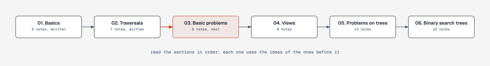

# 08. Trees

A tree stores things in a hierarchy: one root at the top, and every other node hangs below exactly one parent. A **binary tree** lets each node have at most two children, left and right. Trees are where recursion starts to feel natural: almost every tree problem is solved by asking the same question at the root and at every subtree.

Read the sections in order. Every note follows the same shape as the rest of this repo: it says which tree it uses, walks through it one step at a time with a picture for every step, explains the limits in plain words, and ends with clean code you can paste into LeetCode.

## Chapter plan

| # | Section | What it teaches | Notes | Status |
|:---:|:---|:---|:---:|:---:|
| 01 | Basics | What a tree is, its parts, the five types, and how to store one in code | 2 | Written |
| 02 | Tree Traversals | Visiting every node: preorder, inorder, postorder, level order and zigzag | 7 | Written |
| 03 | Basic Problems | First recursive problems: depth, balance, diameter, path sum, same tree | 5 | Planned |
| 04 | Views | What you see from the side, top or bottom, and the boundary walk | 6 | Planned |
| 05 | Problems on Trees | Symmetry, paths, ancestors, width, distances, building and flattening trees | 13 | Planned |
| 06 | Binary Search Trees | Trees kept in sorted order: search, floor, ceil, insert, delete, validate, iterate, recover | 15 | Planned |

## 01. Basics

What a tree is, its parts, the five types, and how to store one in code.

| # | Note / Problem | Key idea | Source | Status |
|:---:|:---|:---|:---:|:---:|
| 1 | [Introduction to Trees](01.%20Basics/01.%20Introduction%20to%20Trees.md) | Root, leaf, level, height and the five types: full, complete, perfect, balanced, degenerate | Lecture notes | Written |
| 2 | [Tree Representation](01.%20Basics/02.%20Tree%20Representation.md) | Each node holds a value and two links; LeetCode list and array forms | Lecture notes | Written |

## 02. Tree Traversals

Visiting every node: preorder, inorder, postorder, level order and zigzag.

| # | Note / Problem | Key idea | Source | Status |
|:---:|:---|:---|:---:|:---:|
| 1 | [Binary Tree Traversals](02.%20Tree%20traversals/03.%20Binary%20Tree%20Traversals.md) | BFS and DFS; preorder, inorder, postorder and level order, and writing them by hand | Lecture notes | Written |
| 2 | [144. Binary Tree Preorder Traversal](02.%20Tree%20traversals/04.%20144.%20Binary%20Tree%20Preorder%20Traversal.md) | Root, left, right; with a stack, push right before left; Morris for `O(1)` space | [144](https://leetcode.com/problems/binary-tree-preorder-traversal/) | Written |
| 3 | [94. Binary Tree Inorder Traversal](02.%20Tree%20traversals/05.%2094.%20Binary%20Tree%20Inorder%20Traversal.md) | Go left as far as possible, visit on the way back, then turn right | [94](https://leetcode.com/problems/binary-tree-inorder-traversal/) | Written |
| 4 | [145. Binary Tree Postorder Traversal](02.%20Tree%20traversals/06.%20145.%20Binary%20Tree%20Postorder%20Traversal.md) | Visit a node after both subtrees; one stack needs a `prev` pointer | [145](https://leetcode.com/problems/binary-tree-postorder-traversal/) | Written |
| 5 | [102. Binary Tree Level Order Traversal](02.%20Tree%20traversals/07.%20102.%20Binary%20Tree%20Level%20Order%20Traversal.md) | A queue holds one level; take out `len(queue)` nodes per round | [102](https://leetcode.com/problems/binary-tree-level-order-traversal/) | Written |
| 6 | [103. Binary Tree Zigzag Level Order Traversal](02.%20Tree%20traversals/08.%20103.%20Binary%20Tree%20Zigzag%20Level%20Order%20Traversal.md) | Level order with a direction flag; write each level at the back or the front of a deque | [103](https://leetcode.com/problems/binary-tree-zigzag-level-order-traversal/) | Written |
| 7 | [All in One Traversal](02.%20Tree%20traversals/09.%20All%20in%20One%20Traversal.md) | A stack of (node, state): states 1, 2, 3 give preorder, inorder, postorder in one pass | Lecture notes | Written |

## 03. Basic Problems

First recursive problems: depth, balance, diameter, path sum, same tree.

| # | Note / Problem | Key idea | Source | Status |
|:---:|:---|:---|:---:|:---:|
| 1 | 104. Maximum Depth of Binary Tree | Key idea is added when this note is written | LeetCode problem 104 | Planned |
| 2 | 110. Balanced Binary Tree | Key idea is added when this note is written | LeetCode problem 110 | Planned |
| 3 | 543. Diameter of Binary Tree | Key idea is added when this note is written | LeetCode problem 543 | Planned |
| 4 | 124. Binary Tree Maximum Path Sum | Key idea is added when this note is written | LeetCode problem 124 | Planned |
| 5 | 100. Same Tree | Key idea is added when this note is written | LeetCode problem 100 | Planned |

## 04. Views

What you see from the side, top or bottom, and the boundary walk.

| # | Note / Problem | Key idea | Source | Status |
|:---:|:---|:---|:---:|:---:|
| 1 | 545. Boundary of Binary Tree | Key idea is added when this note is written | LeetCode problem 545 | Planned |
| 2 | 987. Vertical Order Traversal of a Binary Tree | Key idea is added when this note is written | LeetCode problem 987 | Planned |
| 3 | Top View of Binary Tree | Key idea is added when this note is written | Lecture notes (GfG style) | Planned |
| 4 | Bottom View of Binary Tree | Key idea is added when this note is written | Lecture notes (GfG style) | Planned |
| 5 | 199. Binary Tree Right Side View | Key idea is added when this note is written | LeetCode problem 199 | Planned |
| 6 | 199. Binary Tree Left Side View | Key idea is added when this note is written | LeetCode problem 199 | Planned |

## 05. Problems on Trees

Symmetry, paths, ancestors, width, distances, building and flattening trees.

| # | Note / Problem | Key idea | Source | Status |
|:---:|:---|:---|:---:|:---:|
| 1 | 101. Symmetric Tree | Key idea is added when this note is written | LeetCode problem 101 | Planned |
| 2 | 257. Binary Tree Paths | Key idea is added when this note is written | LeetCode problem 257 | Planned |
| 3 | 236. Lowest Common Ancestor of a Binary Tree | Key idea is added when this note is written | LeetCode problem 236 | Planned |
| 4 | 662. Maximum Width of Binary Tree | Key idea is added when this note is written | LeetCode problem 662 | Planned |
| 5 | Children Sum Property | Key idea is added when this note is written | Lecture notes (GfG style) | Planned |
| 6 | 863. All Nodes Distance K in Binary Tree | Key idea is added when this note is written | LeetCode problem 863 | Planned |
| 7 | Time To Burn Tree | Key idea is added when this note is written | Lecture notes (GfG style) | Planned |
| 8 | 222. Count Complete Tree Nodes | Key idea is added when this note is written | LeetCode problem 222 | Planned |
| 9 | Requirements needed to construct a Unique Binary Tree | Key idea is added when this note is written | Lecture notes (GfG style) | Planned |
| 10 | 105. Construct Binary Tree from Preorder and Inorder Traversal | Key idea is added when this note is written | LeetCode problem 105 | Planned |
| 11 | 106. Construct Binary Tree from Inorder and Postorder Traversal | Key idea is added when this note is written | LeetCode problem 106 | Planned |
| 12 | 297. Serialize and Deserialize Binary Tree | Key idea is added when this note is written | LeetCode problem 297 | Planned |
| 13 | 114. Flatten Binary Tree to Linked List | Key idea is added when this note is written | LeetCode problem 114 | Planned |

## 06. Binary Search Trees

Trees kept in sorted order: search, floor, ceil, insert, delete, validate, iterate, recover.

| # | Note / Problem | Key idea | Source | Status |
|:---:|:---|:---|:---:|:---:|
| 1 | Introduction to Binary Search Tree | Key idea is added when this note is written | Lecture notes (GfG style) | Planned |
| 2 | 700. Search in a Binary Search Tree | Key idea is added when this note is written | LeetCode problem 700 | Planned |
| 3 | Ceil in BST | Key idea is added when this note is written | Lecture notes (GfG style) | Planned |
| 4 | Floor in BST | Key idea is added when this note is written | Lecture notes (GfG style) | Planned |
| 5 | 701. Insert into a Binary Search Tree | Key idea is added when this note is written | LeetCode problem 701 | Planned |
| 6 | 450. Delete Node in a BST | Key idea is added when this note is written | LeetCode problem 450 | Planned |
| 7 | 230. Kth Smallest Element in a BST | Key idea is added when this note is written | LeetCode problem 230 | Planned |
| 8 | 98. Validate Binary Search Tree | Key idea is added when this note is written | LeetCode problem 98 | Planned |
| 9 | 235. Lowest Common Ancestor of a Binary Search Tree | Key idea is added when this note is written | LeetCode problem 235 | Planned |
| 10 | 1008. Construct Binary Search Tree from Preorder Traversal | Key idea is added when this note is written | LeetCode problem 1008 | Planned |
| 11 | 285. Inorder Successor in BST | Key idea is added when this note is written | LeetCode problem 285 | Planned |
| 12 | 173. Binary Search Tree Iterator | Key idea is added when this note is written | LeetCode problem 173 | Planned |
| 13 | 653. Two Sum IV - Input is a BST | Key idea is added when this note is written | LeetCode problem 653 | Planned |
| 14 | 99. Recover Binary Search Tree | Key idea is added when this note is written | LeetCode problem 99 | Planned |
| 15 | Largest BST | Key idea is added when this note is written | Lecture notes (GfG style) | Planned |
