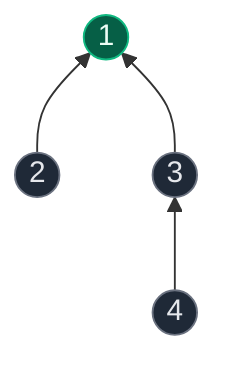
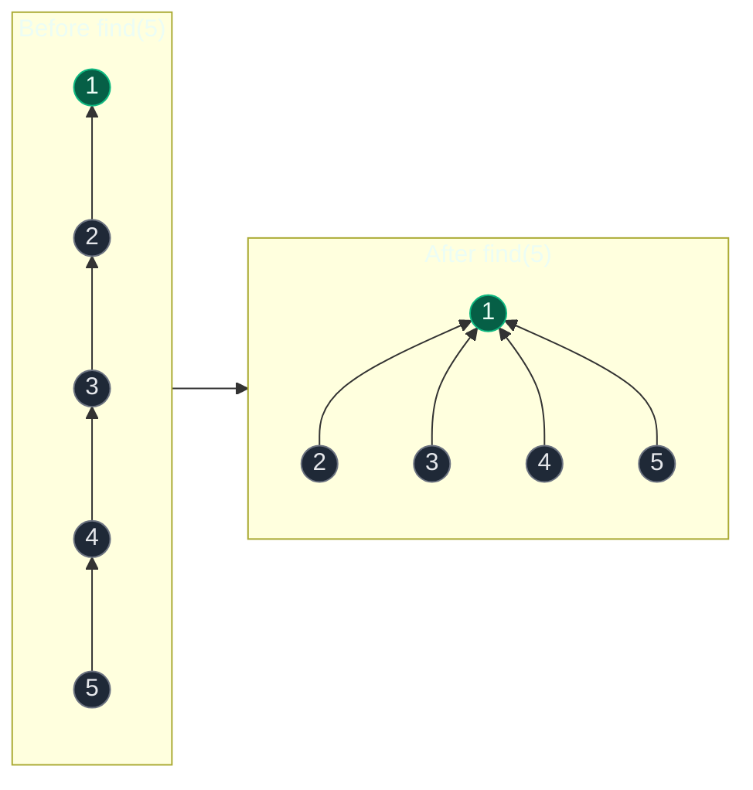
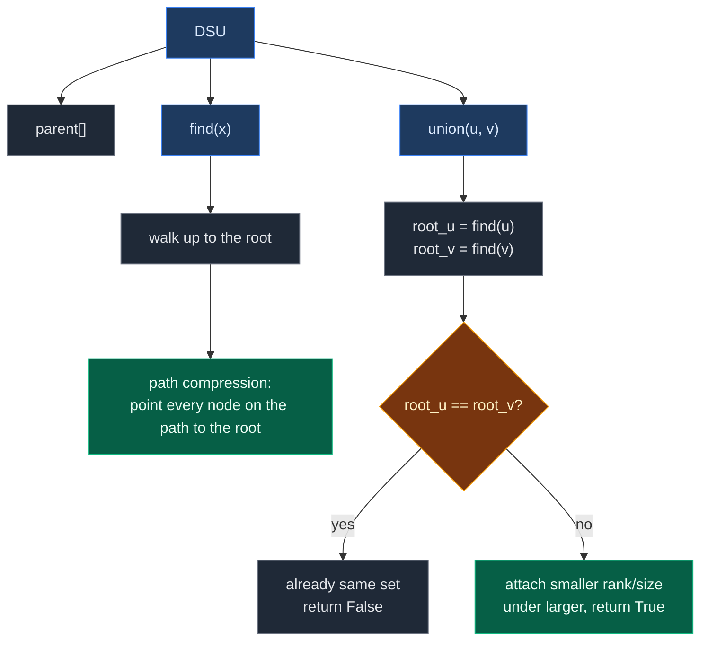

# 01. Disjoint Set Union (Rank, Size, Path Compression)

| Difficulty | Pattern | Source | Time | Space |
|:---:|:---:|:---:|:---:|:---:|
| **Medium** | Disjoint Set Union | [Disjoint set (Union-Find)](https://www.geeksforgeeks.org/problems/disjoint-set-union-find/1) | `O(α(N))` amortized per operation | `O(N)` |

## 1. Problem Statement

Implement a **Disjoint Set Union** (DSU, also called Union-Find) data structure over `N` elements. It must support two operations:

- `find(x)`: return the **representative** (ultimate parent) of the set that contains `x`.
- `union(u, v)`: merge the set that contains `u` with the set that contains `v`.

Two elements `a` and `b` are in the same set exactly when `find(a) == find(b)`.

### Examples

```text
N = 7, elements 1..7, every element starts in its own set:
{1} {2} {3} {4} {5} {6} {7}

union(1, 2), union(2, 3), union(4, 5), union(6, 7)
{1,2,3} {4,5} {6,7}

find(1) == find(3)  ->  true   (same set)
find(3) == find(5)  ->  false  (different sets)

union(5, 6)
{1,2,3} {4,5,6,7}

union(3, 7)
{1,2,3,4,5,6,7}

find(1) == find(5)  ->  true
```

### Constraints

- `1 <= N <= 10^5` (typical)
- Up to `10^5` mixed `find` / `union` calls
- Elements are `0..N-1`, or `1..N` on many GfG problems

## 2. Core Theory

### Why DSU exists: a graph that keeps changing

Take the edges from the lecture notes, arriving one at a time:

```text
(1,2)  (2,3)  (4,5)  (6,7)  (5,6)  (3,7)
```

After every new edge, someone asks: "Are `1` and `5` in the same component now?"

- **Brute force:** run BFS/DFS from scratch after every edge. Each query costs `O(N + E)`. With `Q` queries that is `O(Q * (N + E))`.
- **DSU:** keep the components up to date as edges arrive. Each `find` and `union` costs `O(α(N))`, which is effectively constant.

DSU answers only two questions: "Are these two in the same set?" and "Merge these two sets." It does **not** store the path, the distance, or edge direction. That narrow job is why it is so fast.

### The parent array

Every set is stored as a tree. Each node points to its parent. The root points to itself and is the set's representative.

```text
Initially (every node is its own root):
node:    0 1 2 3 4 5 6
parent:  0 1 2 3 4 5 6
```

After some unions, parent pointers form trees:



```text
parent[1] = 1   <- root, representative of {1,2,3,4}
parent[2] = 1
parent[3] = 1
parent[4] = 3
find(4) = 1, find(3) = 1, find(2) = 1
```

Which node becomes the representative does not matter. Only one rule matters: all nodes in one set must reach the **same** root.

### Naive find and the tall-tree problem

```python
def find(node):
    if parent[node] == node:      # am I my own parent? then I am the root
        return node
    return find(parent[node])     # otherwise ask my parent
```

If unions happen in an unlucky order, the tree becomes a chain:

```text
1 <- 2 <- 3 <- 4 <- 5 <- 6

find(6): 6 -> 5 -> 4 -> 3 -> 2 -> 1   = O(N) per call
```

Two optimizations fix this:

| Optimization | When it acts | What it does |
|:---|:---|:---|
| **Path compression** | During `find` | Re-points every node on the search path directly to the root |
| **Union by rank / size** | During `union` | Attaches the shorter / smaller tree under the taller / larger one |

### Optimization 1: Path compression

```python
def find(node):
    if parent[node] == node:
        return node
    parent[node] = find(parent[node])   # the magic line
    return parent[node]
```

The magic line does two jobs at once: (1) it finds the root, and (2) on the way back from recursion, it rewires each node directly to that root.



Recursion goes `find(5) -> find(4) -> find(3) -> find(2) -> find(1)`. Node `1` is the root. On return, `parent[2] = parent[3] = parent[4] = parent[5] = 1`. The next `find(5)` is one step.

### Optimization 2a: Union by rank

`rank[root]` is an **upper bound on tree height**. Every single-node tree starts at rank `0`.

```text
root_u = find(u), root_v = find(v)

rank[root_u] <  rank[root_v]   ->  parent[root_u] = root_v
rank[root_u] >  rank[root_v]   ->  parent[root_v] = root_u
rank[root_u] == rank[root_v]   ->  parent[root_v] = root_u, rank[root_u] += 1
```

**Why rank goes up only on a tie.** Put a height-2 tree under a height-4 root: the result is still height 4, so no change. Put a height-4 tree under another height-4 root: the result is height 5. Height can only grow when both trees are equally tall.

**Rank is not the exact height.** Path compression can flatten a tree, but rank is never lowered. Treat rank as a balancing heuristic, not as the real current height.

### Optimization 2b: Union by size

`size[root]` is the **number of nodes** in that set. Every set starts at size `1`.

```text
Component A size = 3, component B size = 7
Attach A's root under B's root
size[root_B] = 7 + 3 = 10
```

Size changes on **every** successful union. Rank changes only on ties.

### Rank vs size

| | Union by Rank | Union by Size |
|:---|:---|:---|
| Tracks | Upper bound on tree height | Number of nodes in the set |
| Starts at | `rank = [0] * n` | `size = [1] * n` |
| Changes when | Only when two equal ranks merge | Every successful union |
| Rule | Smaller rank goes under larger | Smaller size goes under larger |
| Complexity with path compression | `O(α(N))` | `O(α(N))` |
| Pick it when | Interviewer asks for rank explicitly | Problem needs component sizes (largest group, merge sizes) |

Use **one** of rank or size together with path compression. You never need both.

### What α(N) means

`α(N)` is the **inverse Ackermann function**. It grows so slowly that `α(N) <= 4` for any input that fits in the universe. So DSU operations are "almost constant time".

Say it this way in an interview: "`find` and `union` are amortized `O(α(N))` with path compression plus union by rank or size. That is effectively constant for real input sizes." Do not say exactly `O(1)`, because `α(N)` does grow, only absurdly slowly.

### Mental model: companies and CEOs

| DSU idea | Company analogy |
|:---|:---|
| Set | A company |
| Root | The company's CEO |
| `find(x)` | "Who is your ultimate CEO?" |
| `union(a, b)` | Merge two companies and keep one CEO |
| Path compression | Every employee saves the CEO's number directly |
| Union by rank / size | The smaller organization joins the larger one |

## 3. Edge Cases

| Case | Input | Expected | Why it matters |
|:---|:---|:---:|:---|
| `union` on two nodes already in one set | `union(1,2)` then `union(2,1)` | returns `False`, nothing changes | Without the equal-root check, rank or size gets corrupted (size would double-count) |
| Direct parents differ, roots match | `4 -> 3 -> 1`, `5 -> 2 -> 1` | `find(4) == find(5)` is `True` | `parent[4] != parent[5]`, so comparing parents directly gives the wrong answer |
| `union(x, x)` | `union(3,3)` | returns `False` | Same root on both sides; handled by the equal-root check |
| 1-indexed input | Nodes `1..N` | Works | Allocate `n + 1` slots: `parent = list(range(n + 1))` |
| Long chain of unions | `union(0,1), union(1,2), ... , union(n-2,n-1)` | Still fast | The case that breaks naive DSU; rank/size keeps height `O(log N)` even before compression |
| Very deep tree with recursive `find` | `N = 10^5` without union by rank/size | Possible `RecursionError` in Python | Use rank/size (keeps depth small), or the iterative `find` below |

## 4. Brute Force: BFS/DFS per Query

### Intuition

Rebuild nothing. Keep an adjacency list. For each "same component?" question, run BFS from one node and check if the other is reached.

### Code

```python
# Import deque for the BFS queue
from collections import deque


def connected_bfs(adj, u, v):
    # Track nodes already reached from u
    seen = {u}
    queue = deque([u])
    # Standard BFS from u
    while queue:
        node = queue.popleft()
        # Stop early as soon as v is reached
        if node == v:
            return True
        # Push every unseen neighbor
        for nxt in adj[node]:
            if nxt not in seen:
                seen.add(nxt)
                queue.append(nxt)
    # v never reached: different components
    return False
```

### Complexity

| Measure | Complexity | Why |
|:---|:---:|:---|
| **Time** | `O(N + E)` per query | Every query can walk the whole graph again |
| **Space** | `O(N + E)` | Adjacency list plus the BFS `seen` set |

Fine for one query on a fixed graph. Too slow when edges and queries interleave thousands of times.

## 5. Better Approach: Naive DSU (no optimizations)

### Intuition

Store the parent array. `union` just links one root under the other, with no balancing rule. `find` walks up without compression.

### Code

```python
class NaiveDSU:
    def __init__(self, n):
        # Every node starts as its own root
        self.parent = list(range(n))

    def find(self, node):
        # Walk up until a node points to itself
        while self.parent[node] != node:
            node = self.parent[node]
        return node

    def union(self, u, v):
        # Link roots, never raw nodes
        root_u, root_v = self.find(u), self.find(v)
        if root_u == root_v:
            return False
        # No balancing rule: always hang root_v under root_u
        self.parent[root_v] = root_u
        return True
```

### Complexity

| Measure | Complexity | Why |
|:---|:---:|:---|
| **Time** | `O(N)` per operation, worst case | Unions in a bad order build a chain, so `find` walks `N` nodes |
| **Space** | `O(N)` | One parent array |

Correct, but one bad sequence of unions turns it back into linear time.

## 6. Optimal Approach: Path Compression + Union by Rank or Size

### Intuition

Two rules that work together. Union by rank/size stops tall trees from forming in the first place. Path compression flattens whatever height is left every time `find` runs. Together they give amortized `O(α(N))`.



### Approach

1. `parent = list(range(n))`; `rank = [0] * n` (or `size = [1] * n`).
2. `find(x)`: if `parent[x] == x`, return `x`. Else set `parent[x] = find(parent[x])` and return it.
3. `union(u, v)`:
   - Find both roots first. Never link `u` and `v` directly.
   - If the roots are equal, return `False`. They are already connected.
   - Rank version: lower rank goes under higher rank. On a tie, pick one parent and increase its rank by 1.
   - Size version: smaller size goes under larger size. Add the child's size to the new root.
   - Return `True`.
4. Connectivity query: `find(u) == find(v)`.

### Dry Run (Union by Rank)

```text
n = 5
parent = [0,1,2,3,4]   rank = [0,0,0,0,0]
```

| Step | Call | Roots | Ranks | Action | `parent` after | `rank` after |
|:---:|:---|:---:|:---:|:---|:---|:---|
| 1 | `union(0,1)` | 0, 1 | 0, 0 (tie) | `parent[1] = 0`, `rank[0] += 1` | `[0,0,2,3,4]` | `[1,0,0,0,0]` |
| 2 | `union(2,3)` | 2, 3 | 0, 0 (tie) | `parent[3] = 2`, `rank[2] += 1` | `[0,0,2,2,4]` | `[1,0,1,0,0]` |
| 3 | `union(0,2)` | 0, 2 | 1, 1 (tie) | `parent[2] = 0`, `rank[0] += 1` | `[0,0,0,2,4]` | `[2,0,1,0,0]` |
| 4 | `find(3)` | – | – | Path `3 -> 2 -> 0`; compress `parent[3] = 0` | `[0,0,0,0,4]` | `[2,0,1,0,0]` |
| 5 | `union(1,3)` | 0, 0 | – | Same root: return `False` | unchanged | unchanged |
| 6 | `union(4,3)` | 4, 0 | 0, 2 | Lower rank under higher: `parent[4] = 0` | `[0,0,0,0,0]` | `[2,0,1,0,0]` |

Tree after step 3, then after step 4:

```text
After step 3:          After find(3):
      0                       0
     / \                   / | \
    1   2                 1  2  3
        |
        3
```

Note `rank[2]` stays `1` after step 4 even though node `2` now has no children. Rank is never lowered.

### Code

```python
# Define the Disjoint Set Union class (rank version)
class DisjointSetRank:
    def __init__(self, n):
        # Every node starts as the root of its own set
        self.parent = list(range(n))
        # Every single-node tree starts with rank 0
        self.rank = [0] * n

    def find(self, node):
        # Root condition: node points to itself
        if self.parent[node] == node:
            return node
        # Path compression: find the root and point node straight at it
        self.parent[node] = self.find(self.parent[node])
        return self.parent[node]

    def union(self, u, v):
        # Always work with representatives, never raw nodes
        root_u = self.find(u)
        root_v = self.find(v)
        # Already in the same set: nothing to merge
        if root_u == root_v:
            return False
        # Shallower tree goes under the deeper tree
        if self.rank[root_u] < self.rank[root_v]:
            self.parent[root_u] = root_v
        elif self.rank[root_u] > self.rank[root_v]:
            self.parent[root_v] = root_u
        else:
            # Equal ranks: pick root_u as the parent
            self.parent[root_v] = root_u
            # Only a tie can increase the height
            self.rank[root_u] += 1
        return True


# Define the Disjoint Set Union class (size version)
class DisjointSetSize:
    def __init__(self, n):
        # Every node starts as the root of its own set
        self.parent = list(range(n))
        # Every set starts with exactly one element
        self.size = [1] * n

    def find(self, node):
        # Root condition: node points to itself
        if self.parent[node] == node:
            return node
        # Path compression
        self.parent[node] = self.find(self.parent[node])
        return self.parent[node]

    def union(self, u, v):
        # Find both representatives
        root_u = self.find(u)
        root_v = self.find(v)
        # Already connected
        if root_u == root_v:
            return False
        # Make root_u the root of the larger set
        if self.size[root_u] < self.size[root_v]:
            root_u, root_v = root_v, root_u
        # Attach the smaller set under the larger one
        self.parent[root_v] = root_u
        # Only the surviving root's size matters
        self.size[root_u] += self.size[root_v]
        return True
```

**Iterative `find` (no recursion limit in Python):**

```python
def find(self, node):
    # First pass: walk up to the root
    root = node
    while self.parent[root] != root:
        root = self.parent[root]
    # Second pass: point every node on the path at the root
    while self.parent[node] != root:
        self.parent[node], node = root, self.parent[node]
    return root
```

### Complexity

| Measure | Complexity | Why |
|:---|:---:|:---|
| **Time** | `O(α(N))` amortized per `find` / `union` | Rank/size keeps trees `O(log N)` tall; path compression flattens them further. The combination gives inverse Ackermann |
| **Space** | `O(N)` | `parent[]` plus one of `rank[]` / `size[]` |

| Variant | `find` cost |
|:---|:---:|
| No optimization | `O(N)` |
| Rank or size only | `O(log N)` |
| Path compression only | `O(log N)` amortized |
| Both | `O(α(N))` amortized |

## 7. Classic Application: Cycle Detection in an Undirected Graph

Process edges one at a time. For edge `u -- v`:

- `find(u) != find(v)`: different sets. Add the edge with `union(u, v)`. No cycle yet.
- `find(u) == find(v)`: a path between `u` and `v` already exists. This edge is a second path, so it closes a **cycle**.

```text
Edges: 1--2, 2--3, 3--1

{1} {2} {3}
1--2  different roots -> union -> {1,2} {3}
2--3  different roots -> union -> {1,2,3}
3--1  find(3) == find(1) -> CYCLE (3--2--1 already exists)
```

This is why `union` returns a boolean: `False` means "this edge was redundant". It is the whole solution to [684. Redundant Connection](../03.%20Cycle%20Detection%20and%20Redundant%20Connections/01.%20684.%20Redundant%20Connection.md).

**Undirected only.** DSU ignores direction. For directed graphs, use DFS with `path_visited` or Kahn's algorithm instead.

## 8. Common Mistakes

| Mistake | Why it breaks | Fix |
|:---|:---|:---|
| `parent[u] = v` (linking raw nodes) | Splits or corrupts trees when `u` or `v` is not a root | Always link `find(u)` and `find(v)` |
| Comparing `parent[a] == parent[b]` | Direct parents can differ while roots match (`4 -> 3 -> 1`, `5 -> 2 -> 1`) | Compare `find(a) == find(b)` |
| `return self.find(self.parent[x])` without assigning | Finds the root but skips compression | Write `self.parent[x] = self.find(self.parent[x])` |
| Increasing rank on every union | Rank inflates and stops meaning anything | Increase rank only when the two ranks are equal |
| Adding size to the child root | The surviving root keeps the wrong size | `size[new_root] += size[child_root]` |
| Skipping the equal-root check | Size double-counts; rank can increase for no reason | Return `False` early if `root_u == root_v` |
| Treating rank as exact height | Compression lowers height but not rank | Treat rank as a balancing heuristic only |
| Allocating `n` slots for 1-indexed nodes | `IndexError` on node `n` | Allocate `n + 1` |
| Using DSU for directed cycle detection | DSU has no direction; reports false cycles | Use DFS path tracking or Kahn's algorithm |

## 9. Interview Follow-ups

**Q: What is DSU?**

A: A data structure that keeps a collection of non-overlapping sets. `find` returns a set's representative, and `union` merges two sets. With path compression and union by rank or size, both run in amortized `O(α(N))`.

**Q: What does path compression do?**

A: After `find` locates the root, every node on the search path is re-pointed straight at the root. That flattens the tree, so later `find` calls are close to one step.

**Q: Why union by rank or size?**

A: Without a balancing rule, an unlucky union order builds a chain of length `N`. Attaching the shorter or smaller tree under the taller or larger one keeps height at `O(log N)` even before compression.

**Q: Why call `find` before `union`?**

A: `u` and `v` can be deep inside their trees. Linking two internal nodes would break the structure. So `union(u, v)` really means `union(find(u), find(v))`.

**Q: Can DSU give me the actual path between two nodes?**

A: No. It only answers "connected or not". It throws away edge structure. For the path, use BFS/DFS, or keep a separate adjacency list.

**Q: Can DSU split a set (delete an edge)?**

A: Not directly. Standard DSU only merges. If deletions are needed, a common trick is to process the operations in reverse, so deletions become unions. Fully dynamic connectivity needs more advanced structures.

**Q: How do you count components?**

A: Start with `components = n`. Decrease it by 1 on every `union` that returns `True`. Or count nodes with `find(i) == i` at the end.

**Q: Why is it called "disjoint" set?**

A: At every moment each element is in exactly one set, so any two different sets have empty intersection (`A ∩ B = ∅`). A union turns two disjoint sets into one larger set.

## 10. Interview Explanation

> Disjoint Set Union tracks connected components that change over time. Each component is a tree stored in a parent array, and the root is the representative. `find(x)` walks up to the root, and I use path compression so every node on that path points directly to the root afterward. `union(u, v)` first finds both roots. If they are equal, the nodes are already connected, so I return false. Otherwise I attach the smaller or shallower tree under the larger one, using union by size or rank. With both optimizations, each operation is amortized O(α(N)), which is effectively constant, and space is O(N). The classic use is undirected cycle detection: if an edge joins two nodes that already share a root, that edge closes a cycle.

## 11. Verify

```python
# Union by rank with path compression
class DisjointSetRank:
    def __init__(self, n):
        # Every node starts as its own root
        self.parent = list(range(n))
        # Every single-node tree has rank 0
        self.rank = [0] * n

    def find(self, node):
        # Root points to itself
        if self.parent[node] == node:
            return node
        # Path compression
        self.parent[node] = self.find(self.parent[node])
        return self.parent[node]

    def union(self, u, v):
        # Work with roots only
        root_u, root_v = self.find(u), self.find(v)
        # Already connected
        if root_u == root_v:
            return False
        # Lower rank goes under higher rank
        if self.rank[root_u] < self.rank[root_v]:
            self.parent[root_u] = root_v
        elif self.rank[root_u] > self.rank[root_v]:
            self.parent[root_v] = root_u
        else:
            # Tie: root_u becomes parent, height grows by 1
            self.parent[root_v] = root_u
            self.rank[root_u] += 1
        return True


# Union by size with path compression
class DisjointSetSize:
    def __init__(self, n):
        # Every node starts as its own root
        self.parent = list(range(n))
        # Every set starts with one element
        self.size = [1] * n

    def find(self, node):
        # Root points to itself
        if self.parent[node] == node:
            return node
        # Path compression
        self.parent[node] = self.find(self.parent[node])
        return self.parent[node]

    def union(self, u, v):
        # Work with roots only
        root_u, root_v = self.find(u), self.find(v)
        # Already connected
        if root_u == root_v:
            return False
        # Keep root_u as the larger set
        if self.size[root_u] < self.size[root_v]:
            root_u, root_v = root_v, root_u
        # Smaller set goes under larger set
        self.parent[root_v] = root_u
        self.size[root_u] += self.size[root_v]
        return True


# Undirected cycle detection built on DSU
def has_cycle(n, edges):
    ds = DisjointSetSize(n)
    for u, v in edges:
        # union returns False when u and v already share a root
        if not ds.union(u, v):
            return True
    return False


# Dry run from the note: exact parent and rank arrays
ds = DisjointSetRank(5)
assert ds.union(0, 1) and ds.parent == [0, 0, 2, 3, 4] and ds.rank == [1, 0, 0, 0, 0]
assert ds.union(2, 3) and ds.parent == [0, 0, 2, 2, 4] and ds.rank == [1, 0, 1, 0, 0]
assert ds.union(0, 2) and ds.parent == [0, 0, 0, 2, 4] and ds.rank == [2, 0, 1, 0, 0]
assert ds.find(3) == 0 and ds.parent == [0, 0, 0, 0, 4]       # path compressed
assert ds.union(1, 3) is False                                  # same set
assert ds.union(4, 3) and ds.parent[4] == 0                     # rank 0 under rank 2

# Lecture example, 1-indexed (allocate n + 1)
for DS in (DisjointSetRank, DisjointSetSize):
    ds = DS(8)
    for u, v in [(1, 2), (2, 3), (4, 5), (6, 7)]:
        ds.union(u, v)
    assert ds.find(1) == ds.find(3)
    assert ds.find(3) != ds.find(5)
    ds.union(5, 6)
    assert ds.find(4) == ds.find(7)
    assert ds.find(1) != ds.find(7)
    ds.union(3, 7)
    assert len({ds.find(i) for i in range(1, 8)}) == 1

# Size bookkeeping: root holds the full count
ds = DisjointSetSize(10)
for i in range(1, 7):
    ds.union(0, i)
assert ds.size[ds.find(3)] == 7
assert ds.union(2, 5) is False                                  # no double count
assert ds.size[ds.find(0)] == 7

# Long chain stays shallow and correct
n = 2000
ds = DisjointSetRank(n)
for i in range(n - 1):
    ds.union(i, i + 1)
assert all(ds.find(i) == ds.find(0) for i in range(n))
assert max(ds.rank) <= 11                                       # rank stays O(log n)

# Cycle detection
assert has_cycle(4, [(1, 2), (2, 3), (3, 1)]) is True
assert has_cycle(5, [(0, 1), (0, 2), (1, 3), (1, 4)]) is False  # a tree
assert has_cycle(2, [(0, 0)]) is True                            # self-loop
assert has_cycle(3, []) is False

print("All tests passed")
```
