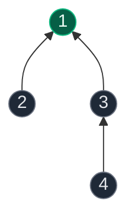
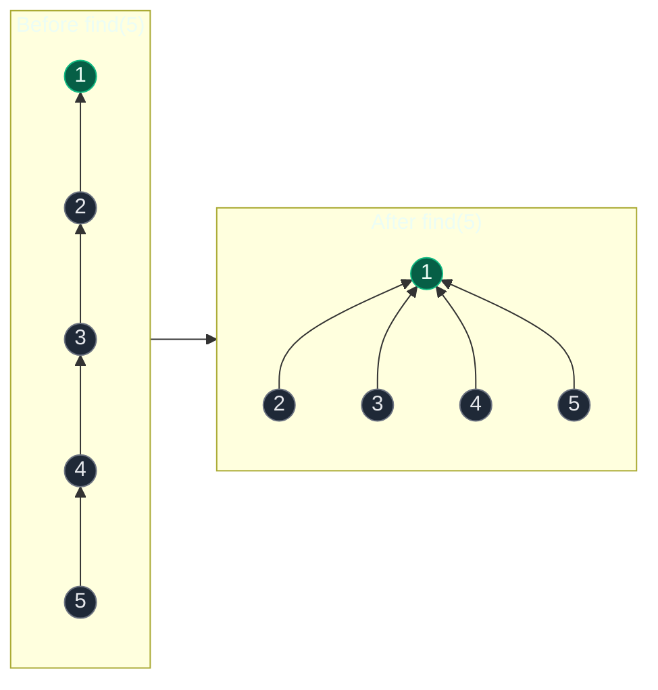
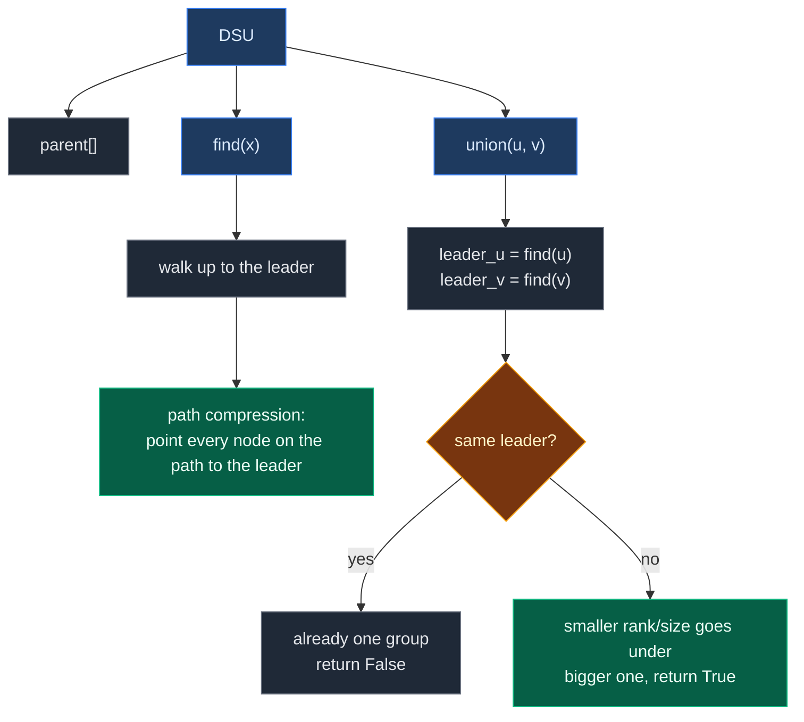
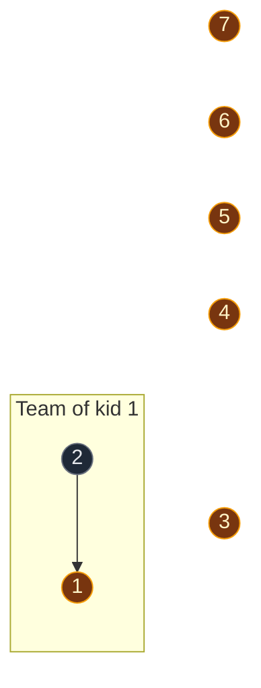
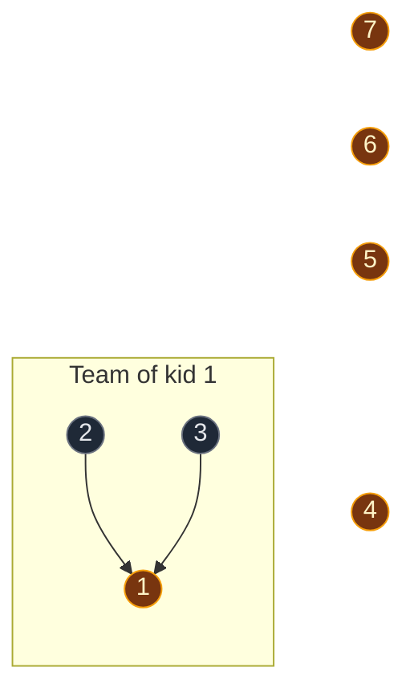
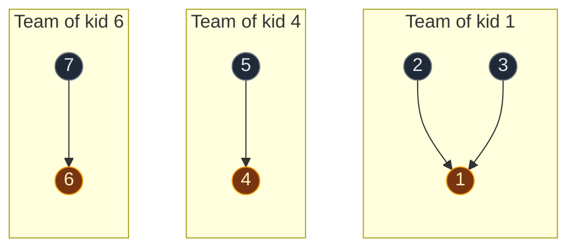
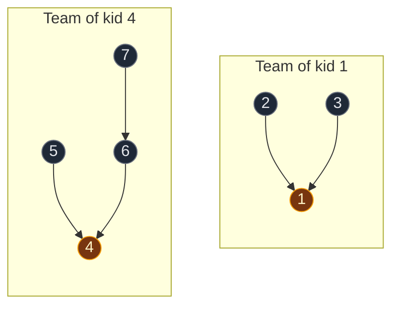
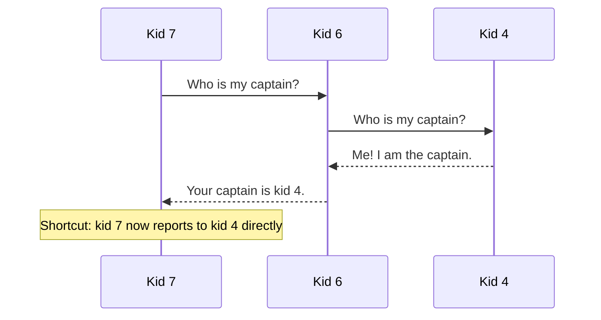
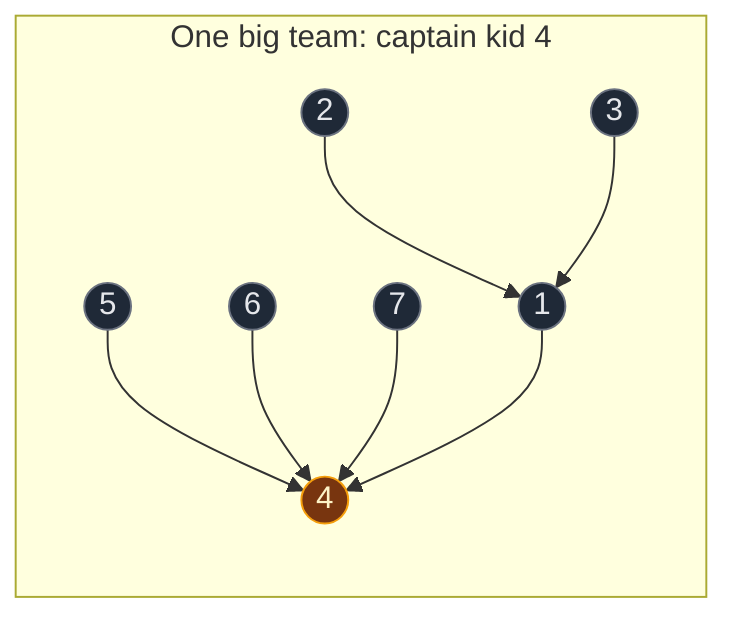
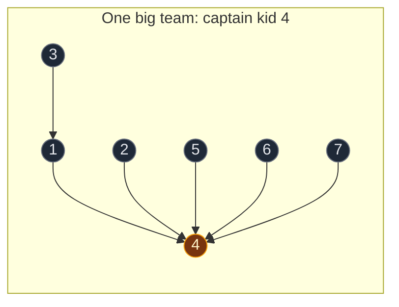

# 01. Disjoint Set Union (Rank, Size, Path Compression)

| Difficulty | Pattern | Source | Time | Space |
|:---:|:---:|:---:|:---:|:---:|
| **Medium** | Disjoint Set Union | [Disjoint set (Union-Find)](https://www.geeksforgeeks.org/problems/disjoint-set-union-find/1) | `O(α(N))` amortized per operation | `O(N)` |

## 1. Problem Statement

Build a data structure called **Disjoint Set Union** (DSU). People also call it **Union-Find**.

It holds `N` nodes. Each node belongs to exactly one group. It needs two operations:

| Operation | What it does |
|:---|:---|
| `find(x)` | Tells you the **leader** of the group that `x` is in |
| `union(u, v)` | Joins the group of `u` and the group of `v` into one group |

Two nodes are in the same group when they have the same leader: `find(a) == find(b)`.

### Example

```text
7 nodes: 1 2 3 4 5 6 7
At the start, every node is alone:  {1} {2} {3} {4} {5} {6} {7}

Edges arrive one by one:
(1,2)  (2,3)  (4,5)  (6,7)  (5,6)  (3,7)

After the first 4 edges:  {1,2,3}  {4,5}  {6,7}
After (5,6):              {1,2,3}  {4,5,6,7}
After (3,7):              {1,2,3,4,5,6,7}
```

We use this same example in every section below.

### Constraints

- `1 <= N <= 10^5`
- Up to `10^5` calls to `find` and `union`
- Nodes are `0..N-1`, or `1..N` on many GfG problems

## 2. Core Theory

### Why do we need DSU?

Edges keep arriving. After each edge, someone asks: **"Are node 1 and node 5 connected yet?"**

- **Without DSU:** run BFS or DFS again after every edge. One question costs `O(N + E)`. Many questions get very slow.
- **With DSU:** keep the groups updated as edges arrive. One question costs almost `O(1)`.

DSU only answers two things: "Same group?" and "Join these groups." It does not know the path, the distance, or the edge direction. That small job is why it is so fast.

### The parent array

Every group is stored as a small tree.

- Each node points to its **parent**.
- The **root** points to itself.
- The root is the **leader** of the group.

```text
At the start, every node is its own parent (its own leader):

node:    1 2 3 4 5 6 7
parent:  1 2 3 4 5 6 7
```

After some unions, the parent pointers make trees:



```text
parent[1] = 1   <- root, so 1 is the leader
parent[2] = 1
parent[3] = 1
parent[4] = 3

find(4): 4 -> 3 -> 1, so the leader is 1
```

It does not matter which node is the leader. It only matters that every node in one group reaches the **same** leader.

### The problem with a simple find

The simple `find` just walks up until it reaches the root.

If unions happen in a bad order, the tree becomes a long chain:

```text
1 <- 2 <- 3 <- 4 <- 5 <- 6

find(6) walks 6 -> 5 -> 4 -> 3 -> 2 -> 1
That is O(N) steps for one call.
```

Two tricks fix this:

| Trick | When it runs | What it does |
|:---|:---|:---|
| **Path compression** | Inside `find` | Makes every node on the path point straight to the root |
| **Union by rank / size** | Inside `union` | Puts the smaller tree under the bigger tree |

### Trick 1: Path compression

When `find` reaches the root, it goes back down the path. On the way back, it sets each node's parent to the root.



The next `find(5)` takes only one step.

### Trick 2a: Union by rank

`rank[root]` is a rough measure of how tall a tree is. Every node starts with rank `0`.

When we join two groups, we first find both leaders. Then:

| Case | What we do |
|:---|:---|
| `rank[leader_u] < rank[leader_v]` | Put `leader_u` under `leader_v` |
| `rank[leader_u] > rank[leader_v]` | Put `leader_v` under `leader_u` |
| Ranks are equal | Put `leader_v` under `leader_u`, then `rank[leader_u] += 1` |

**Why does rank go up only when ranks are equal?**

- A short tree under a tall tree: the tall tree's height does not change.
- Two trees of the same height: the new tree is one level taller.

**Rank is not the exact height.** Path compression makes trees shorter, but we never lower the rank. Rank is only a guide for joining.

### Trick 2b: Union by size

`size[root]` is how many nodes are in that group. Every node starts with size `1`.

When we join two groups, the group with **fewer nodes** goes under the group with **more nodes**. Then we add the sizes together.

```text
Group A has 3 nodes. Group B has 7 nodes.
Put A's leader under B's leader.
size[B's leader] = 7 + 3 = 10
```

### Rank or size?

| | Union by Rank | Union by Size |
|:---|:---|:---|
| Stores | Rough tree height | Number of nodes |
| Starts at | `0` | `1` |
| Changes | Only when two equal ranks join | On every successful join |
| Rule | Lower rank goes under higher rank | Smaller group goes under bigger group |
| Speed with path compression | `O(α(N))` | `O(α(N))` |
| Use it when | Interviewer asks for rank | Problem needs group sizes |

Pick **one** of them, plus path compression. You never need both.

### What is α(N)?

`α(N)` is the **inverse Ackermann function**. It grows extremely slowly. For any real input, `α(N)` is at most `4`.

So each DSU operation is **almost constant time**. In an interview, say: "amortized `O(α(N))`, which is almost `O(1)`."

### Easy way to remember

| DSU idea | Company example |
|:---|:---|
| Group | A company |
| Leader (root) | The CEO |
| `find(x)` | "Who is your CEO?" |
| `union(a, b)` | Two companies merge and keep one CEO |
| Path compression | Every employee saves the CEO's phone number directly |
| Union by rank / size | The smaller company joins the bigger one |

## 3. Edge Cases

| Case | Example | Expected | Why it matters |
|:---|:---|:---:|:---|
| Join two nodes already in one group | `union(1,2)`, then `union(2,1)` | Second call returns `False` | Without this check, size gets counted twice |
| Same leader but different parents | `4 -> 3 -> 1` and `5 -> 2 -> 1` | `find(4) == find(5)` is `True` | `parent[4] != parent[5]`, so comparing parents gives the wrong answer |
| Join a node with itself | `union(3,3)` | Returns `False` | Both leaders are the same |
| Nodes numbered `1..N` | GfG input | Works | Make arrays of size `N + 1` |
| Very long chain in Python | `N = 10^5`, no rank/size | Can hit `RecursionError` | Use rank/size, or the loop version of `find` |

## 4. Brute Force: BFS for Every Question

### Idea

Keep a normal adjacency list. For every "same group?" question, run BFS from `u` and check if `v` is reached.

### Code

```python
# Import deque for the BFS queue
from collections import deque


# Check if u and v are in the same group using BFS
def connected_bfs(adj, u, v):

    # Remember the nodes we have already reached
    seen = {u}

    # Start the queue with u
    queue = deque([u])

    # Keep going while there are nodes to visit
    while queue:

        # Take the next node from the front
        node = queue.popleft()

        # If we reached v, they are connected
        if node == v:
            return True

        # Look at every neighbor of this node
        for nxt in adj[node]:

            # Visit the neighbor only if it is new
            if nxt not in seen:

                # Mark it as reached
                seen.add(nxt)

                # Add it to the queue
                queue.append(nxt)

    # We never reached v, so they are not connected
    return False
```

### Complexity

| Measure | Complexity | Why |
|:---|:---:|:---|
| **Time** | `O(N + E)` per question | Each question can walk the whole graph again |
| **Space** | `O(N + E)` | Adjacency list plus the `seen` set |

Fine for one question. Too slow when edges and questions keep coming.

## 5. Better Approach: Simple DSU (no tricks)

### Idea

Use the parent array. `union` puts one leader under the other with no rule. `find` walks up with no compression.

### Code

```python
# Simple DSU with no speed tricks
class NaiveDSU:

    # Set up the parent array
    def __init__(self, n):

        # Every node starts as its own leader
        self.parent = list(range(n))

    # Find the leader of a node
    def find(self, node):

        # Walk up until a node points to itself
        while self.parent[node] != node:

            # Move one step up
            node = self.parent[node]

        # This node is the leader
        return node

    # Join the groups of u and v
    def union(self, u, v):

        # Find the leader of u
        leader_u = self.find(u)

        # Find the leader of v
        leader_v = self.find(v)

        # Same leader means already in one group
        if leader_u == leader_v:
            return False

        # No rule: always put leader_v under leader_u
        self.parent[leader_v] = leader_u

        # Join was done
        return True
```

### Complexity

| Measure | Complexity | Why |
|:---|:---:|:---|
| **Time** | `O(N)` per call, worst case | A bad join order makes a long chain |
| **Space** | `O(N)` | One parent array |

Correct, but slow in the worst case.

## 6. Optimal Approach: Path Compression + Union by Rank or Size

### Idea

- Union by rank/size stops tall trees from forming.
- Path compression flattens the tree every time `find` runs.
- Together, each call costs `O(α(N))`, which is almost `O(1)`.



### Steps

1. Make `parent = [0, 1, 2, ..., n-1]`. Make `rank = [0] * n` (or `size = [1] * n`).
2. `find(x)`:
   - If `parent[x] == x`, then `x` is the leader. Return `x`.
   - Else, find the leader of `parent[x]`, save it in `parent[x]`, and return it.
3. `union(u, v)`:
   - Find `leader_u` and `leader_v`. Never join `u` and `v` directly.
   - If the leaders are the same, return `False`.
   - Put the smaller one under the bigger one (by rank or by size).
   - Return `True`.
4. To check "same group?", compare `find(u) == find(v)`.

### Visual Walkthrough (Story Version)

Before the arrays, let us see the idea as a story.

**The story:** 7 kids are in a playground. Kids make teams. Every team has one **captain**.

**The rules:**

- Every kid points to one kid they **report to**. This is their parent.
- The captain reports to themself.
- To find your captain, keep asking "Who do you report to?" until someone says "Me!"
- When two teams join, one captain starts reporting to the other captain. The **shorter team joins under the taller team**.

**How to read the pictures:** gold circle = captain. Arrow = "reports to".

**Start: every kid is alone**

Nobody is friends yet. 7 kids, 7 teams, 7 captains.


**Step 1: kids 1 and 2 become friends**

- Kid 1 asks: "Who is my captain?" Answer: kid 1.
- Kid 2 asks: "Who is my captain?" Answer: kid 2.
- Two different captains, so the teams join.
- Both teams are the same height. We pick kid 1 as the captain.
- Kid 2 now reports to kid 1. Kid 1's team got one floor taller.



**Step 2: kids 2 and 3 become friends**

- Kid 2 asks kid 1. Kid 1 says "Me!" So kid 2's captain is kid 1.
- Kid 3's captain is kid 3.
- Kid 1's team is taller. Kid 3 joins under kid 1.



**Step 3: kids 4 and 5 become friends**

- Same as step 1. Same height, so kid 4 becomes captain. Kid 5 reports to kid 4.

**Step 4: kids 6 and 7 become friends**

- Same again. Kid 6 becomes captain. Kid 7 reports to kid 6.



Now we have 3 teams. Are kids 1 and 5 on the same team? Kid 1's captain is 1. Kid 5's captain is 4. Different captains, so **no**.

**Step 5: kids 5 and 6 become friends**

- Kid 5's captain is kid 4.
- Kid 6's captain is kid 6.
- Both teams are the same height. Kid 4 becomes the captain of the joined team.
- Kid 6 now reports to kid 4. Kid 7 still reports to kid 6. That is fine: kid 7 can still reach kid 4 through kid 6.



**Step 6: kids 3 and 7 become friends (watch the shortcut)**

First, kid 3 finds the captain: kid 3 asks kid 1, and kid 1 says "Me!"

Then kid 7 finds the captain. Kid 7 has to ask two kids:



That shortcut is **path compression**. Next time, kid 7 asks only once.

Now the two captains are kid 1 and kid 4. Kid 4's team is taller, so kid 1 joins under kid 4. Kids 2 and 3 come along, because they still report to kid 1.



Are kids 1 and 5 on the same team now? Both captains are kid 4, so **yes**.

**One more question: who is kid 2's captain?**

- Kid 2 asks kid 1. Kid 1 asks kid 4. Kid 4 says "Me!"
- Shortcut again: kid 2 now reports to kid 4 directly.



**What the story teaches**

| In the story | In the code |
|:---|:---|
| Kid | Node |
| "Who do you report to?" | `parent[x]` |
| Captain | Leader (root) |
| Asking up the chain | `find(x)` |
| Two friends join their teams | `union(u, v)` |
| Shorter team joins under taller team | Union by rank |
| Kid remembers the captain directly | Path compression |
| Same captain = same team | `find(a) == find(b)` |

Now the same steps again, this time with the exact arrays.

### Step-by-Step Example (Union by Rank)

We use the example from Section 1. Nodes are `1..7`, so the arrays have size `8` and index `0` is not used.

Edges: `(1,2)  (2,3)  (4,5)  (6,7)  (5,6)  (3,7)`

**Start**

```text
node:    1 2 3 4 5 6 7
parent:  1 2 3 4 5 6 7
rank:    0 0 0 0 0 0 0

Groups: {1} {2} {3} {4} {5} {6} {7}
```

**Step 1: `union(1, 2)`**

1. `find(1)`: `parent[1] = 1`, so the leader is `1`.
2. `find(2)`: `parent[2] = 2`, so the leader is `2`.
3. Leaders are different, so we join.
4. `rank[1] = 0` and `rank[2] = 0`. Ranks are equal.
5. Put `2` under `1`: `parent[2] = 1`.
6. Ranks were equal, so `rank[1]` goes from `0` to `1`.

```text
node:    1 2 3 4 5 6 7
parent:  1 1 3 4 5 6 7
rank:    1 0 0 0 0 0 0

  1
  |
  2
```

**Step 2: `union(2, 3)`**

1. `find(2)`: `parent[2] = 1`, not itself. Go up to `1`.
2. `find(1)`: `parent[1] = 1`, so the leader is `1`. On the way back, `parent[2] = 1` (already `1`, no change).
3. `find(3)`: `parent[3] = 3`, so the leader is `3`.
4. Leaders `1` and `3` are different, so we join.
5. `rank[1] = 1` and `rank[3] = 0`. `rank[1]` is bigger.
6. Put `3` under `1`: `parent[3] = 1`.
7. Ranks were not equal, so no rank changes.

```text
node:    1 2 3 4 5 6 7
parent:  1 1 1 4 5 6 7
rank:    1 0 0 0 0 0 0

    1
   / \
  2   3
```

**Step 3: `union(4, 5)`**

1. `find(4)`: leader is `4`.
2. `find(5)`: leader is `5`.
3. `rank[4] = 0` and `rank[5] = 0`. Equal.
4. Put `5` under `4`: `parent[5] = 4`.
5. `rank[4]` goes from `0` to `1`.

```text
node:    1 2 3 4 5 6 7
parent:  1 1 1 4 4 6 7
rank:    1 0 0 1 0 0 0

    1        4
   / \       |
  2   3      5
```

**Step 4: `union(6, 7)`**

1. `find(6)`: leader is `6`.
2. `find(7)`: leader is `7`.
3. `rank[6] = 0` and `rank[7] = 0`. Equal.
4. Put `7` under `6`: `parent[7] = 6`.
5. `rank[6]` goes from `0` to `1`.

```text
node:    1 2 3 4 5 6 7
parent:  1 1 1 4 4 6 6
rank:    1 0 0 1 0 1 0

Groups: {1,2,3}  {4,5}  {6,7}

    1        4        6
   / \       |        |
  2   3      5        7
```

**Question now: are `1` and `5` connected?**

1. `find(1)` = `1`.
2. `find(5)`: `parent[5] = 4`, then `parent[4] = 4`. Leader is `4`.
3. `1 != 4`, so **not connected**.

**Step 5: `union(5, 6)`**

1. `find(5)`: `parent[5] = 4`, go up. `parent[4] = 4`. Leader is `4`.
2. `find(6)`: `parent[6] = 6`. Leader is `6`.
3. `rank[4] = 1` and `rank[6] = 1`. Equal.
4. Put `6` under `4`: `parent[6] = 4`.
5. `rank[4]` goes from `1` to `2`.

```text
node:    1 2 3 4 5 6 7
parent:  1 1 1 4 4 4 6
rank:    1 0 0 2 0 1 0

Groups: {1,2,3}  {4,5,6,7}

    1          4
   / \        / \
  2   3      5   6
                 |
                 7
```

Note: `7` still points to `6`, not to `4`. That is fine. `find(7)` still reaches `4`.

**Step 6: `union(3, 7)`** (path compression happens here)

1. `find(3)`: `parent[3] = 1`, go up. `parent[1] = 1`. Leader is `1`.
2. `find(7)`: `parent[7] = 6`, not itself. Go up to `6`.
3. `find(6)`: `parent[6] = 4`, not itself. Go up to `4`.
4. `find(4)`: `parent[4] = 4`. Leader is `4`.
5. Coming back: `parent[6] = 4` (already `4`, no change).
6. Coming back: `parent[7] = 4`. **This changed from `6` to `4`.** This is path compression.
7. Leaders `1` and `4` are different, so we join.
8. `rank[1] = 1` and `rank[4] = 2`. `rank[1]` is smaller.
9. Put `1` under `4`: `parent[1] = 4`.
10. Ranks were not equal, so no rank changes.

```text
node:    1 2 3 4 5 6 7
parent:  4 1 1 4 4 4 4
rank:    1 0 0 2 0 1 0

Groups: {1,2,3,4,5,6,7}

          4
       / | | \
      1  5  6  7
     / \
    2   3
```

**Question now: are `1` and `5` connected?**

1. `find(1)`: `parent[1] = 4`, then `parent[4] = 4`. Leader is `4`.
2. `find(5)`: `parent[5] = 4`. Leader is `4`.
3. `4 == 4`, so **connected**.

**One more `find(2)`** (path compression again)

1. `find(2)`: `parent[2] = 1`, go up to `1`.
2. `find(1)`: `parent[1] = 4`, go up to `4`.
3. `find(4)`: leader is `4`.
4. Coming back: `parent[1] = 4` (no change).
5. Coming back: `parent[2] = 4`. **Changed from `1` to `4`.**

```text
node:    1 2 3 4 5 6 7
parent:  4 4 1 4 4 4 4
rank:    1 0 0 2 0 1 0
```

Now `2` reaches the leader in one step. `rank[1]` stays `1` even though `1` now has fewer children. Rank never goes down.

### Same Example with Union by Size

Same edges. `size` starts at `1` for every node. On a tie, the first leader stays on top.

| Step | Call | Leaders (size) | What happens | `size` of new leader |
|:---:|:---|:---|:---|:---:|
| 1 | `union(1,2)` | 1 (1), 2 (1) | Tie, put `2` under `1` | `size[1] = 2` |
| 2 | `union(2,3)` | 1 (2), 3 (1) | `3` is smaller, put `3` under `1` | `size[1] = 3` |
| 3 | `union(4,5)` | 4 (1), 5 (1) | Tie, put `5` under `4` | `size[4] = 2` |
| 4 | `union(6,7)` | 6 (1), 7 (1) | Tie, put `7` under `6` | `size[6] = 2` |
| 5 | `union(5,6)` | 4 (2), 6 (2) | Tie, put `6` under `4` | `size[4] = 4` |
| 6 | `union(3,7)` | 1 (3), 4 (4) | `find(7)` compresses `parent[7] = 4`. Group of `1` is smaller, put `1` under `4` | `size[4] = 7` |

Final: one group of 7 nodes, leader `4`, `size[4] = 7`.

### Code

```python
# DSU with union by rank and path compression
class DisjointSetRank:

    # Set up the arrays
    def __init__(self, n):

        # Every node starts as its own leader
        self.parent = list(range(n))

        # Every tree starts with rank 0
        self.rank = [0] * n

    # Find the leader of a node
    def find(self, node):

        # A node that points to itself is the leader
        if self.parent[node] == node:
            return node

        # Find the leader and point this node straight at it (path compression)
        self.parent[node] = self.find(self.parent[node])

        # Return the leader
        return self.parent[node]

    # Join the groups of u and v
    def union(self, u, v):

        # Find the leader of u
        leader_u = self.find(u)

        # Find the leader of v
        leader_v = self.find(v)

        # Same leader means already in one group
        if leader_u == leader_v:
            return False

        # Lower rank goes under higher rank
        if self.rank[leader_u] < self.rank[leader_v]:
            self.parent[leader_u] = leader_v

        # Higher rank stays on top
        elif self.rank[leader_u] > self.rank[leader_v]:
            self.parent[leader_v] = leader_u

        # Equal ranks
        else:

            # Put leader_v under leader_u
            self.parent[leader_v] = leader_u

            # The tree got one level taller
            self.rank[leader_u] += 1

        # Join was done
        return True


# DSU with union by size and path compression
class DisjointSetSize:

    # Set up the arrays
    def __init__(self, n):

        # Every node starts as its own leader
        self.parent = list(range(n))

        # Every group starts with 1 node
        self.size = [1] * n

    # Find the leader of a node
    def find(self, node):

        # A node that points to itself is the leader
        if self.parent[node] == node:
            return node

        # Find the leader and point this node straight at it (path compression)
        self.parent[node] = self.find(self.parent[node])

        # Return the leader
        return self.parent[node]

    # Join the groups of u and v
    def union(self, u, v):

        # Find the leader of u
        leader_u = self.find(u)

        # Find the leader of v
        leader_v = self.find(v)

        # Same leader means already in one group
        if leader_u == leader_v:
            return False

        # Make sure leader_u has the bigger group
        if self.size[leader_u] < self.size[leader_v]:
            leader_u, leader_v = leader_v, leader_u

        # Put the smaller group under the bigger group
        self.parent[leader_v] = leader_u

        # Add the smaller group's size to the new leader
        self.size[leader_u] += self.size[leader_v]

        # Join was done
        return True


# Check the example from this note, step by step
ds = DisjointSetRank(8)

# Step 1: union(1, 2)
assert ds.union(1, 2) is True
assert ds.parent[1:] == [1, 1, 3, 4, 5, 6, 7] and ds.rank[1:] == [1, 0, 0, 0, 0, 0, 0]

# Step 2: union(2, 3)
assert ds.union(2, 3) is True
assert ds.parent[1:] == [1, 1, 1, 4, 5, 6, 7] and ds.rank[1:] == [1, 0, 0, 0, 0, 0, 0]

# Step 3: union(4, 5)
assert ds.union(4, 5) is True
assert ds.parent[1:] == [1, 1, 1, 4, 4, 6, 7] and ds.rank[1:] == [1, 0, 0, 1, 0, 0, 0]

# Step 4: union(6, 7)
assert ds.union(6, 7) is True
assert ds.parent[1:] == [1, 1, 1, 4, 4, 6, 6] and ds.rank[1:] == [1, 0, 0, 1, 0, 1, 0]

# Question: 1 and 5 are not connected yet
assert ds.find(1) != ds.find(5)

# Step 5: union(5, 6)
assert ds.union(5, 6) is True
assert ds.parent[1:] == [1, 1, 1, 4, 4, 4, 6] and ds.rank[1:] == [1, 0, 0, 2, 0, 1, 0]

# Step 6: union(3, 7), parent[7] is compressed from 6 to 4
assert ds.union(3, 7) is True
assert ds.parent[1:] == [4, 1, 1, 4, 4, 4, 4] and ds.rank[1:] == [1, 0, 0, 2, 0, 1, 0]

# Question: 1 and 5 are connected now
assert ds.find(1) == ds.find(5) == 4

# find(2) compresses parent[2] from 1 to 4
assert ds.find(2) == 4
assert ds.parent[1:] == [4, 4, 1, 4, 4, 4, 4]

# Joining two nodes already in one group returns False
assert ds.union(2, 7) is False

# Same example with union by size
ds = DisjointSetSize(8)

# Run all six edges
for u, v in [(1, 2), (2, 3), (4, 5), (6, 7), (5, 6), (3, 7)]:
    ds.union(u, v)

# One group of 7 nodes with leader 4
assert ds.find(1) == 4 and ds.size[4] == 7

# Joining again does not count nodes twice
assert ds.union(1, 7) is False and ds.size[4] == 7

# A long chain still works and rank stays small
n = 2000
ds = DisjointSetRank(n)

# Join 0-1, 1-2, 2-3, ... in a chain
for i in range(n - 1):
    ds.union(i, i + 1)

# Every node has the same leader
assert all(ds.find(i) == ds.find(0) for i in range(n))

# Rank stays tiny, so trees stay short
assert max(ds.rank) <= 11

# All checks passed
print("All tests passed")
```

**Loop version of `find`** (use it if Python's recursion limit is a worry):

```python
# Find the leader without recursion
def find(self, node):

    # Start at the node
    leader = node

    # First pass: walk up until we reach the leader
    while self.parent[leader] != leader:
        leader = self.parent[leader]

    # Second pass: walk the path again
    while self.parent[node] != leader:

        # Remember the next node up
        next_node = self.parent[node]

        # Point this node straight at the leader
        self.parent[node] = leader

        # Move up
        node = next_node

    # Return the leader
    return leader
```

### Complexity

| Measure | Complexity | Why |
|:---|:---:|:---|
| **Time** | `O(α(N))` per call, amortized | Rank/size keeps trees short, path compression makes them flat |
| **Space** | `O(N)` | `parent[]` plus `rank[]` or `size[]` |

| Version | Cost of `find` |
|:---|:---:|
| No tricks | `O(N)` |
| Only rank or size | `O(log N)` |
| Only path compression | `O(log N)` amortized |
| Both | `O(α(N))` amortized |

## 7. Main Use: Find a Cycle in an Undirected Graph

Add edges one by one. For each edge `u -- v`:

- **Different leaders:** join them. No cycle yet.
- **Same leader:** `u` and `v` are already connected. This edge makes a second path, so it makes a **cycle**.

```text
Edges: 1--2, 2--3, 3--1

{1} {2} {3}
1--2: different leaders -> join -> {1,2} {3}
2--3: different leaders -> join -> {1,2,3}
3--1: same leader       -> CYCLE (path 3--2--1 already exists)
```

This is why `union` returns `True` or `False`. `False` means "this edge was extra". It is the full idea behind [684. Redundant Connection](../03.%20Cycle%20Detection%20and%20Redundant%20Connections/01.%20684.%20Redundant%20Connection.md).

```python
# Return True if the undirected graph has a cycle
def has_cycle(n, edges):

    # Make a DSU for n nodes
    ds = DisjointSetSize(n)

    # Add the edges one by one
    for u, v in edges:

        # union returns False when u and v already share a leader
        if not ds.union(u, v):
            return True

    # No extra edge was found
    return False


# Triangle has a cycle
assert has_cycle(4, [(1, 2), (2, 3), (3, 1)]) is True

# A tree has no cycle
assert has_cycle(5, [(0, 1), (0, 2), (1, 3), (1, 4)]) is False
```

**Only for undirected graphs.** DSU ignores direction. For directed graphs, use DFS with a path set, or Kahn's algorithm.

## 8. Common Mistakes

| Mistake | What goes wrong | Fix |
|:---|:---|:---|
| `parent[u] = v` | Joins inner nodes and breaks the trees | Always join `find(u)` and `find(v)` |
| `parent[a] == parent[b]` to check a group | Parents can differ while leaders match | Use `find(a) == find(b)` |
| `return self.find(self.parent[x])` | Finds the leader but skips compression | Write `self.parent[x] = self.find(self.parent[x])` |
| Adding 1 to rank on every join | Rank stops meaning anything | Add 1 only when ranks are equal |
| Adding size to the wrong node | New leader has the wrong size | `size[new_leader] += size[old_leader]` |
| No same-leader check | Size is counted twice | Return `False` if leaders are equal |
| Thinking rank is the real height | Compression lowers height, not rank | Treat rank as a guide only |
| Array of size `n` for nodes `1..n` | `IndexError` on node `n` | Use size `n + 1` |
| Using DSU for directed cycles | Reports wrong cycles | Use DFS path tracking or Kahn's algorithm |

## 9. Interview Follow-ups

### Q1. What is DSU?

**Answer:**
- A data structure that keeps nodes in separate groups.
- `find(x)` gives the leader of `x`'s group.
- `union(u, v)` joins two groups.
- With both tricks, each call is `O(α(N))`, almost `O(1)`.

### Q2. What does path compression do?

**Answer:**
- After `find` reaches the leader, every node on the path is pointed straight at the leader.
- The tree becomes flat.
- The next `find` on those nodes takes one step.

### Q3. Why do we need union by rank or size?

**Answer:**
- Without a rule, a bad join order makes a long chain.
- A chain makes `find` take `O(N)`.
- Putting the smaller tree under the bigger one keeps the height at `O(log N)`.

### Q4. Rank or size: which one should I use?

**Answer:**
- Both give the same speed.
- Use **size** if the problem asks about group sizes (for example, "largest group").
- Use **rank** if the interviewer asks for it.
- Never use both at once.

### Q5. Why call `find` before joining?

**Answer:**
- `u` and `v` can be deep inside their trees.
- Joining inner nodes breaks the structure.
- So `union(u, v)` really joins `find(u)` and `find(v)`.

### Q6. Can DSU give the actual path between two nodes?

**Answer:**
- No. It only says "connected" or "not connected".
- It does not keep the edges.
- For the path, use BFS or DFS.

### Q7. Can DSU remove an edge or split a group?

**Answer:**
- No. Normal DSU can only join.
- Trick: if all operations are known up front, process them in reverse. Then every removal becomes a join.

### Q8. How do you count the number of groups?

**Answer:**
- Start with `groups = n`.
- Subtract 1 every time `union` returns `True`.
- Or, at the end, count the nodes where `find(i) == i`.

### Q9. Why is it called "disjoint" set?

**Answer:**
- Every node is in exactly one group at any time.
- Two different groups never share a node.
- `union` turns two separate groups into one bigger group.

## 10. Interview Explanation

> DSU keeps nodes in groups that can be joined over time. Each group is a tree stored in a parent array, and the root is the leader. `find(x)` walks up to the leader, and with path compression every node on that path then points straight to the leader. `union(u, v)` first finds both leaders. If they are the same, the nodes are already connected, so I return false. If not, I put the smaller tree under the bigger one, using rank or size. With both tricks, each call is amortized O(α(N)), which is almost constant, and space is O(N). The classic use is cycle detection in an undirected graph: if an edge joins two nodes that already share a leader, that edge makes a cycle.
