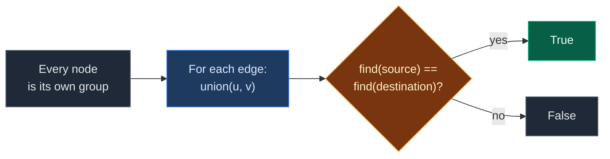
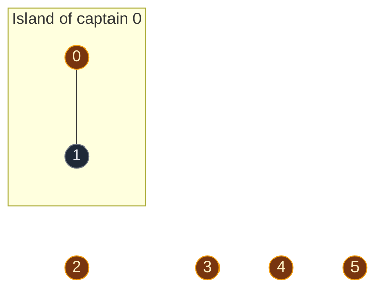
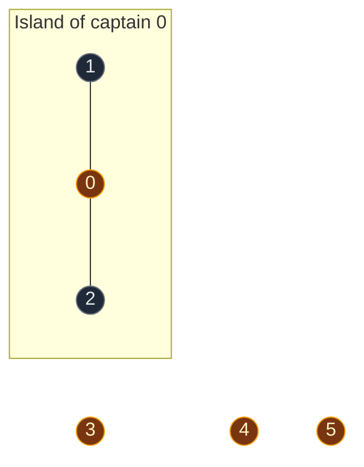
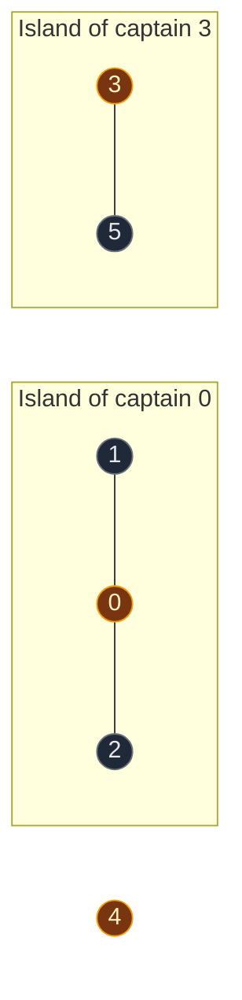
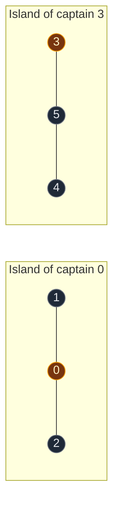
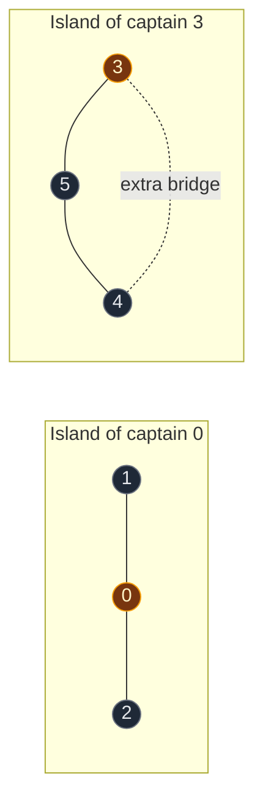

# 02. 1971. Find if Path Exists in Graph

| Difficulty | Pattern | Source | Time | Space |
|:---:|:---:|:---:|:---:|:---:|
| **Easy** | DSU: Connectivity Check | [1971. Find if Path Exists in Graph](https://leetcode.com/problems/find-if-path-exists-in-graph/) | `O((V + E) · α(V))` | `O(V)` |

## 1. Problem Statement

There is an undirected graph with `n` nodes, numbered `0` to `n - 1`.

You get a list `edges`. Each `edges[i] = [u, v]` is an edge between `u` and `v`.

You also get two nodes: `source` and `destination`.

Return `True` if there is any path from `source` to `destination`. Otherwise return `False`.

### Example

```text
n = 6
edges = [[0,1], [0,2], [3,5], [5,4], [4,3]]
source = 0
destination = 5

Graph:
    1           3
    |          / \
    0         4---5
    |
    2

Group A: {0,1,2}
Group B: {3,4,5}

0 is in group A. 5 is in group B. No edge joins the two groups.
Output: False
```

We use this same example in every section below.

### Constraints

- `1 <= n <= 2 * 10^5`
- `0 <= edges.length <= 2 * 10^5`
- `edges[i].length == 2`
- `0 <= u, v <= n - 1`, `u != v`
- `0 <= source, destination <= n - 1`
- No duplicate edges, no self-loops

## 2. Core Theory

### What the problem really asks

"Is there a path from `source` to `destination`?" means "Are they in the **same connected component**?"

We do not need the path itself. We only need yes or no.

### Why DSU fits

- Join the two ends of every edge.
- At the end, nodes in one connected piece share one leader.
- So: **path exists if and only if `find(source) == find(destination)`**.



### Why same leader means a path exists

- Every `union` comes from a real edge.
- So if two nodes ended up in one group, a chain of real edges links them.
- That chain is the path.

### How this connects to other DSU problems

| Problem | What we ask after the joins |
|:---|:---|
| 684. Redundant Connection | Did this edge join two nodes that already had the same leader? |
| **1971. Find if Path Exists** | Do `source` and `destination` have the same leader? |
| 547. Number of Provinces | How many leaders are there? |

Same DSU. Only the final question changes.

## 3. Edge Cases

| Case | Input | Expected | Why it matters |
|:---|:---|:---:|:---|
| `source == destination` | `source = 3, destination = 3` | `True` | `find(3) == find(3)` is always true. No special code needed |
| No edges | `n = 3, edges = []`, `0 -> 2` | `False` | Every node stays alone |
| One edge | `n = 2, edges = [[0,1]]`, `0 -> 1` | `True` | Smallest connected case |
| Cycle in the graph | `[[0,1],[1,2],[2,0]]` | `True` for `0 -> 2` | The last edge joins nodes already in one group. `union` returns `False` and nothing breaks |
| Big input | `n = 2 * 10^5` | Works | Union by size keeps trees short, so recursion stays shallow |

## 4. Brute Force: BFS from Source

### Idea

Build an adjacency list. Run BFS from `source`. If we reach `destination`, return `True`.

### Code

```python
# Import deque for the BFS queue
from collections import deque

# Import List for type hints
from typing import List


# Check for a path using BFS
class SolutionBFS:

    # Main method
    def validPath(self, n: int, edges: List[List[int]], source: int, destination: int) -> bool:

        # Make an empty neighbor list for every node
        graph = [[] for _ in range(n)]

        # Fill the neighbor lists from the edges
        for u, v in edges:

            # Edge goes from u to v
            graph[u].append(v)

            # And from v to u, because the graph is undirected
            graph[v].append(u)

        # Track nodes we have already reached
        visited = [False] * n

        # Mark the source as reached
        visited[source] = True

        # Start the queue with the source
        queue = deque([source])

        # Keep going while there are nodes to visit
        while queue:

            # Take the next node from the front
            node = queue.popleft()

            # We reached the destination
            if node == destination:
                return True

            # Look at every neighbor
            for nxt in graph[node]:

                # Visit it only if it is new
                if not visited[nxt]:

                    # Mark it as reached
                    visited[nxt] = True

                    # Add it to the queue
                    queue.append(nxt)

        # The destination was never reached
        return False
```

### Complexity

| Measure | Complexity | Why |
|:---|:---:|:---|
| **Time** | `O(V + E)` | Build the list once, visit every node and edge at most once |
| **Space** | `O(V + E)` | Adjacency list plus `visited` and the queue |

BFS is fine for one question. DSU needs no adjacency list, and it shines when many "same group?" questions come in.

## 5. Optimal Approach: DSU

### Idea

1. Make a DSU for `n` nodes.
2. For every edge `[u, v]`, call `union(u, v)`.
3. Return `find(source) == find(destination)`.

### Visual Walkthrough (Story Version)

Before the arrays, let us see the idea as a story.

**The story:** there are 6 houses in the sea: house 0 to house 5. At the start, every house is on its own tiny island. Workers build bridges one by one. At the end, we want to know: **can you walk from house 0 to house 5?**

**The rules:**

- A bridge between two houses joins their islands into one bigger island.
- Every island has one **captain** house.
- If a new bridge connects two houses that are **already** on the same island, the island does not change. The bridge is extra.
- You can walk between two houses only if they are on the same island. Same captain = same island.

**How to read the pictures:** gold circle = captain house. Line = bridge. Box = one island.

**Start: every house is alone**


6 islands.

**Bridge 1: between house 0 and house 1**

- House 0's captain is house 0. House 1's captain is house 1.
- Different captains, so the two islands join.
- Same size, so house 0 stays the captain.



**Bridge 2: between house 0 and house 2**

- House 0's captain is house 0. House 2's captain is house 2.
- Different captains, so the islands join.
- House 0's island is bigger (2 houses vs 1), so house 0 stays the captain.



**Bridge 3: between house 3 and house 5**

- House 3's captain is house 3. House 5's captain is house 5.
- Different captains, so the islands join.
- Same size, so house 3 becomes the captain.



**Bridge 4: between house 5 and house 4**

- House 5 asks: "Who is my captain?" Answer: house 3.
- House 4's captain is house 4.
- Different captains, so the islands join.
- House 3's island is bigger (2 houses vs 1), so house 3 stays the captain.



**Bridge 5: between house 4 and house 3**

- House 4's captain is house 3. House 3's captain is house 3.
- **Same captain.** They are already on the same island.
- The bridge is built, but no islands join. Nothing changes for DSU.



**Question: can you walk from house 0 to house 5?**

- House 0's captain is house 0.
- House 5's captain is house 3.
- Different captains, so they are on different islands.
- No bridge joins the two islands. **No, you cannot walk there.** Answer: `False`.

**Extra question: can you walk from house 1 to house 2?**

- House 1's captain is house 0. House 2's captain is house 0.
- Same captain, so same island. **Yes.** Walk `1 -> 0 -> 2`. Answer: `True`.

**All bridges at a glance**

| Bridge | Captain of first house | Captain of second house | Same? | What happens | Islands |
|:---:|:---:|:---:|:---:|:---|:---:|
| start | – | – | – | Every house alone | 6 |
| 0 - 1 | 0 | 1 | No | Islands join | 5 |
| 0 - 2 | 0 | 2 | No | Islands join | 4 |
| 3 - 5 | 3 | 5 | No | Islands join | 3 |
| 5 - 4 | 3 | 4 | No | Islands join | 2 |
| 4 - 3 | 3 | 3 | Yes | Extra bridge, no change | 2 |

**What the story teaches**

| In the story | In the code |
|:---|:---|
| House | Node |
| Bridge | Edge `[u, v]` |
| Island | DSU group (connected component) |
| Captain house | Leader, `find(x)` |
| Build a bridge | `union(u, v)` |
| Extra bridge | `union(u, v)` returns `False` |
| Can I walk from A to B? | `find(A) == find(B)` |

Now the same steps again, this time with the exact arrays.

### Step-by-Step Example

```text
n = 6
edges = [[0,1], [0,2], [3,5], [5,4], [4,3]]
source = 0, destination = 5
```

**Start**

```text
node:    0 1 2 3 4 5
parent:  0 1 2 3 4 5
size:    1 1 1 1 1 1

Groups: {0} {1} {2} {3} {4} {5}
```

**Step 1: edge `[0, 1]`, call `union(0, 1)`**

1. `find(0)`: `parent[0] = 0`. Leader is `0`.
2. `find(1)`: `parent[1] = 1`. Leader is `1`.
3. Leaders are different, so we join.
4. `size[0] = 1` and `size[1] = 1`. Equal, so no swap. `0` stays on top.
5. Put `1` under `0`: `parent[1] = 0`.
6. `size[0] = 1 + 1 = 2`.

```text
node:    0 1 2 3 4 5
parent:  0 0 2 3 4 5
size:    2 1 1 1 1 1

Groups: {0,1} {2} {3} {4} {5}
```

**Step 2: edge `[0, 2]`, call `union(0, 2)`**

1. `find(0)`: leader is `0`.
2. `find(2)`: leader is `2`.
3. Leaders are different, so we join.
4. `size[0] = 2` and `size[2] = 1`. `0` is bigger, no swap.
5. Put `2` under `0`: `parent[2] = 0`.
6. `size[0] = 2 + 1 = 3`.

```text
node:    0 1 2 3 4 5
parent:  0 0 0 3 4 5
size:    3 1 1 1 1 1

Groups: {0,1,2} {3} {4} {5}
```

**Step 3: edge `[3, 5]`, call `union(3, 5)`**

1. `find(3)`: leader is `3`.
2. `find(5)`: leader is `5`.
3. Leaders are different, so we join.
4. `size[3] = 1` and `size[5] = 1`. Equal, no swap. `3` stays on top.
5. Put `5` under `3`: `parent[5] = 3`.
6. `size[3] = 1 + 1 = 2`.

```text
node:    0 1 2 3 4 5
parent:  0 0 0 3 4 3
size:    3 1 1 2 1 1

Groups: {0,1,2} {3,5} {4}
```

**Step 4: edge `[5, 4]`, call `union(5, 4)`**

1. `find(5)`: `parent[5] = 3`, not itself. Go up to `3`.
2. `find(3)`: `parent[3] = 3`. Leader is `3`. On the way back, `parent[5] = 3` (no change).
3. `find(4)`: `parent[4] = 4`. Leader is `4`.
4. Leaders `3` and `4` are different, so we join.
5. `size[3] = 2` and `size[4] = 1`. `3` is bigger, no swap.
6. Put `4` under `3`: `parent[4] = 3`.
7. `size[3] = 2 + 1 = 3`.

```text
node:    0 1 2 3 4 5
parent:  0 0 0 3 3 3
size:    3 1 1 3 1 1

Groups: {0,1,2} {3,4,5}
```

**Step 5: edge `[4, 3]`, call `union(4, 3)`**

1. `find(4)`: `parent[4] = 3`, go up. `parent[3] = 3`. Leader is `3`.
2. `find(3)`: leader is `3`.
3. Same leader. They are already in one group.
4. `union` returns `False`. Nothing changes.

```text
node:    0 1 2 3 4 5
parent:  0 0 0 3 3 3
size:    3 1 1 3 1 1

    0          3
   / \        / \
  1   2      4   5
```

**Final question: is there a path from `0` to `5`?**

1. `find(0)`: `parent[0] = 0`. Leader is `0`.
2. `find(5)`: `parent[5] = 3`, then `parent[3] = 3`. Leader is `3`.
3. `0 != 3`. Different groups.
4. **Answer: `False`.**

**Extra question on the same DSU: is there a path from `1` to `2`?**

1. `find(1)`: `parent[1] = 0`. Leader is `0`.
2. `find(2)`: `parent[2] = 0`. Leader is `0`.
3. `0 == 0`. Same group.
4. **Answer: `True`** (path `1 -> 0 -> 2`).

### Code

```python
# Import List for type hints
from typing import List


# Reusable DSU with union by size and path compression
class DSU:

    # Set up the arrays
    def __init__(self, n: int):

        # Every node starts as its own leader
        self.parent = list(range(n))

        # Every group starts with 1 node
        self.size = [1] * n

    # Find the leader of a node
    def find(self, node: int) -> int:

        # A node that points to itself is the leader
        if self.parent[node] == node:
            return node

        # Find the leader and point this node straight at it (path compression)
        self.parent[node] = self.find(self.parent[node])

        # Return the leader
        return self.parent[node]

    # Join the groups of u and v
    def union(self, u: int, v: int) -> bool:

        # Find the leader of u
        leader_u = self.find(u)

        # Find the leader of v
        leader_v = self.find(v)

        # Same leader means already in one group
        if leader_u == leader_v:
            return False

        # Make sure leader_u has the bigger group
        if self.size[leader_u] < self.size[leader_v]:
            leader_u, leader_v = leader_v, leader_u

        # Put the smaller group under the bigger group
        self.parent[leader_v] = leader_u

        # Add the smaller group's size to the new leader
        self.size[leader_u] += self.size[leader_v]

        # Join was done
        return True


# Solution for 1971. Find if Path Exists in Graph
class Solution:

    # Main method
    def validPath(self, n: int, edges: List[List[int]], source: int, destination: int) -> bool:

        # Make a DSU for all nodes
        dsu = DSU(n)

        # Join the two ends of every edge
        for u, v in edges:
            dsu.union(u, v)

        # A path exists only if both nodes have the same leader
        return dsu.find(source) == dsu.find(destination)


# Check the example from this note, step by step
dsu = DSU(6)

# Step 1: edge [0, 1]
assert dsu.union(0, 1) is True
assert dsu.parent == [0, 0, 2, 3, 4, 5] and dsu.size == [2, 1, 1, 1, 1, 1]

# Step 2: edge [0, 2]
assert dsu.union(0, 2) is True
assert dsu.parent == [0, 0, 0, 3, 4, 5] and dsu.size == [3, 1, 1, 1, 1, 1]

# Step 3: edge [3, 5]
assert dsu.union(3, 5) is True
assert dsu.parent == [0, 0, 0, 3, 4, 3] and dsu.size == [3, 1, 1, 2, 1, 1]

# Step 4: edge [5, 4]
assert dsu.union(5, 4) is True
assert dsu.parent == [0, 0, 0, 3, 3, 3] and dsu.size == [3, 1, 1, 3, 1, 1]

# Step 5: edge [4, 3] is inside one group already
assert dsu.union(4, 3) is False
assert dsu.parent == [0, 0, 0, 3, 3, 3]

# Final question: 0 and 5 have different leaders
assert dsu.find(0) == 0 and dsu.find(5) == 3

# Extra question: 1 and 2 have the same leader
assert dsu.find(1) == dsu.find(2) == 0

# Full solution on the example
edges = [[0, 1], [0, 2], [3, 5], [5, 4], [4, 3]]
assert Solution().validPath(6, edges, 0, 5) is False

# LeetCode example 1: triangle
assert Solution().validPath(3, [[0, 1], [1, 2], [2, 0]], 0, 2) is True

# Source equals destination
assert Solution().validPath(6, edges, 3, 3) is True

# No edges
assert Solution().validPath(3, [], 0, 2) is False

# One edge
assert Solution().validPath(2, [[0, 1]], 0, 1) is True

# BFS brute force gives the same answers
assert SolutionBFS().validPath(6, edges, 0, 5) is False
assert SolutionBFS().validPath(3, [[0, 1], [1, 2], [2, 0]], 0, 2) is True

# All checks passed
print("All tests passed")
```

### Complexity

| Measure | Complexity | Why |
|:---|:---:|:---|
| **Time** | `O((V + E) · α(V))` | `O(V)` to set up, one `union` per edge, each almost `O(1)` |
| **Space** | `O(V)` | `parent[]` and `size[]`. No adjacency list needed |

## 6. Common Mistakes

| Mistake | What goes wrong | Fix |
|:---|:---|:---|
| Checking `parent[source] == parent[destination]` | Two nodes can share a leader but have different parents | Use `find` on both |
| Joining `u` and `v` directly with `parent[u] = v` | Breaks the trees | Always join the leaders inside `union` |
| Adding the edge only one way in BFS | BFS misses half the connections | Add `v` to `graph[u]` and `u` to `graph[v]` |
| Special-casing `source == destination` | Extra code, easy to get wrong | Not needed. `find(x) == find(x)` is already `True` |
| Deep recursion with no union by size | `RecursionError` on long chains | Use union by size, or the loop version of `find` |

## 7. Interview Follow-ups

### Q1. Can DSU return the path itself?

**Answer:**
- No. DSU only knows "same group" or "not same group".
- For the actual path, use BFS and store the parent of each node.

### Q2. BFS or DSU: which is better here?

**Answer:**
- For one question on a fixed graph, both are fine. BFS is `O(V + E)`.
- DSU is better when there are many questions, because each question is almost `O(1)` after the joins.
- DSU also needs no adjacency list.

### Q3. What if edges arrive over time and questions come in between?

**Answer:**
- Call `union` when an edge arrives.
- Call `find(a) == find(b)` when a question comes.
- No need to rebuild anything. This is the main reason DSU exists.

### Q4. What if the graph were directed?

**Answer:**
- DSU does not work. It ignores direction.
- `u -> v` does not mean you can go from `v` to `u`.
- Use BFS or DFS that only follows edges forward.

### Q5. Can we stop early?

**Answer:**
- Yes. After each `union`, check `find(source) == find(destination)`.
- If it is already `True`, return right away.
- The worst case does not change, but it often saves time.

## 8. Interview Explanation

> The question "is there a path between source and destination" is the same as "are they in the same connected component". I make a DSU where every node starts as its own group, then I call union on the two ends of every edge. Each union comes from a real edge, so two nodes in the same group are linked by a chain of real edges. At the end I return whether find(source) equals find(destination). Setup and all unions take O((V + E) · α(V)), which is almost linear, and the DSU uses O(V) space with no adjacency list.
