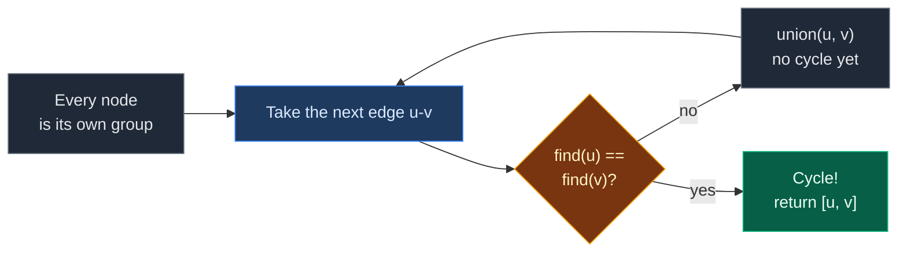
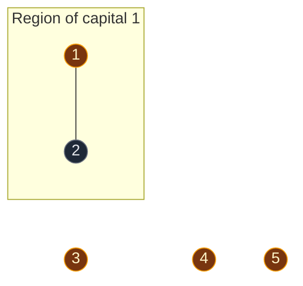
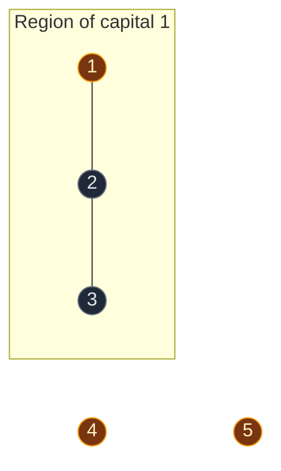
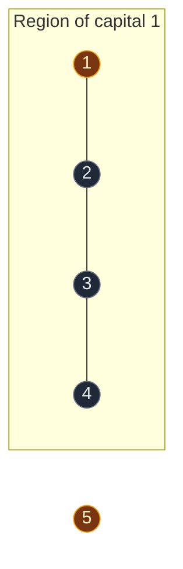
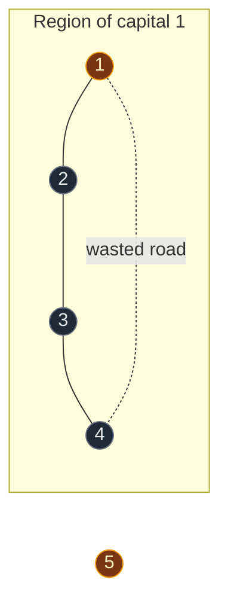

# 01. 684. Redundant Connection

| Difficulty | Pattern | Source | Time | Space |
|:---:|:---:|:---:|:---:|:---:|
| **Medium** | DSU: Undirected Cycle Detection | [684. Redundant Connection](https://leetcode.com/problems/redundant-connection/) | `O(n · α(n))` | `O(n)` |

## 1. Problem Statement

You start with a **tree** of `n` nodes, labeled `1` to `n`. A tree has no cycles and has exactly `n - 1` edges.

Then **one extra edge** is added. Now there are `n` edges and exactly one cycle.

You get the edges as a list `edges`, where `edges[i] = [a, b]`.

Return the edge you can remove so the graph becomes a tree again. If more than one edge works, return the one that comes **last** in the input.

### Example

```text
edges = [[1,2], [2,3], [3,4], [1,4], [1,5]]
n = 5

Graph:
1 --- 2
|     |
4 --- 3

1 --- 5

The cycle is 1 - 2 - 3 - 4 - 1.
Any edge on the cycle can be removed: [1,2], [2,3], [3,4] or [1,4].
The one that comes last in the input is [1,4].

Output: [1,4]
```

We use this same example in every section below.

### Constraints

- `n == edges.length`
- `3 <= n <= 1000`
- `edges[i].length == 2`
- `1 <= a < b <= n`
- No repeated edges
- The graph is connected

## 2. Core Theory

### What the problem really asks

"Which edge makes the cycle?"

An edge `u -- v` makes a cycle when `u` and `v` are **already connected** before the edge is added. There is already a path `u -> ... -> v`, and the new edge closes it into a loop.

### Why DSU fits

- Add the edges one by one, in input order.
- Before adding `u -- v`, ask DSU: "Do `u` and `v` already have the same leader?"
- **Different leaders:** the edge joins two separate groups. No cycle. Call `union(u, v)`.
- **Same leader:** a path already exists. This edge closes a cycle. **This is the answer.**



Our `union` already returns `False` when the leaders are the same. So the whole check is: `if not dsu.union(u, v): return [u, v]`.

### Why the first failing edge is the "last" one

The problem wants the cycle edge that comes **last** in the input. Why does the **first** failing `union` give exactly that?

- There is only one extra edge, so there is only one cycle.
- Edges **not** on the cycle never fail. They always join two separate groups.
- Edges **on** the cycle: every one of them joins two separate groups, until the very last cycle edge in input order arrives. By then, all the other cycle edges are in, so its two ends are already connected.
- So the first `union` that fails is the last cycle edge in the input. That is exactly what the problem asks for.

### How this connects to other DSU problems

| Problem | What we ask |
|:---|:---|
| **684. Redundant Connection** | Which edge joined two nodes that already had the same leader? |
| Detect Cycle using DSU | Did **any** edge join two nodes that already had the same leader? |
| 1971. Find if Path Exists | Do `source` and `destination` have the same leader? |

## 3. Edge Cases

| Case | Input | Expected | Why it matters |
|:---|:---|:---:|:---|
| Smallest cycle (triangle) | `[[1,2],[1,3],[2,3]]` | `[2,3]` | The cycle is closed by the last edge |
| Extra edge in the middle of the list | `[[1,2],[2,3],[3,4],[1,4],[1,5]]` | `[1,4]` | We return early; `[1,5]` is never read |
| Extra edge at the end | `[[1,2],[2,3],[3,4],[4,1]]` | `[4,1]` | The last edge closes the cycle |
| Nodes start at `1` | Any input | Works | Make DSU arrays of size `n + 1` |
| Cycle edges far apart in the list | `[[1,4],[3,4],[1,3],[1,2],[4,5]]` | `[1,3]` | The cycle `1-4-3-1` closes at `[1,3]`, even though more edges come after |

## 4. Brute Force: DFS Before Every Edge

### Idea

Build the graph edge by edge. Before adding `u -- v`, run DFS from `u` on the edges added so far. If DFS reaches `v`, they are already connected, so this edge closes a cycle.

### Code

```python
# Import List for type hints
from typing import List


# Find the extra edge using DFS before every edge
class SolutionDFS:

    # Check if target can be reached from start
    def can_reach(self, graph, start, target):

        # Use a list as a stack for DFS
        stack = [start]

        # Remember nodes we have already seen
        seen = {start}

        # Keep going while there are nodes to visit
        while stack:

            # Take the top node
            node = stack.pop()

            # We reached the target
            if node == target:
                return True

            # Look at every neighbor
            for nxt in graph[node]:

                # Visit it only if it is new
                if nxt not in seen:

                    # Mark it as seen
                    seen.add(nxt)

                    # Push it on the stack
                    stack.append(nxt)

        # Target was never reached
        return False

    # Main method
    def findRedundantConnection(self, edges: List[List[int]]) -> List[int]:

        # Number of nodes equals number of edges in this problem
        n = len(edges)

        # Empty neighbor list for nodes 1..n
        graph = [[] for _ in range(n + 1)]

        # Add the edges one by one
        for u, v in edges:

            # If u can already reach v, this edge closes a cycle
            if self.can_reach(graph, u, v):
                return [u, v]

            # Otherwise add the edge from u to v
            graph[u].append(v)

            # And from v to u, because the graph is undirected
            graph[v].append(u)

        # Never reached for valid input
        return []
```

### Complexity

| Measure | Complexity | Why |
|:---|:---:|:---|
| **Time** | `O(n^2)` | One DFS (up to `O(n)`) for each of the `n` edges |
| **Space** | `O(n)` | Adjacency list, stack and `seen` |

It works, but it walks the graph again for every edge. DSU answers "already connected?" in almost `O(1)`.

## 5. Optimal Approach: DSU

### Idea

1. Make a DSU of size `n + 1` (nodes are `1..n`).
2. Go through the edges in order.
3. For each `[u, v]`, call `union(u, v)`.
4. If `union` returns `False`, `u` and `v` were already connected. Return `[u, v]`.

### Visual Walkthrough (Story Version)

Before the arrays, let us see the idea as a story.

**The story:** there are 5 towns: town 1 to town 5. Workers build roads one by one, in the order on their list. The mayor wants to save money: **"Never build a road between two towns that can already reach each other."** Our job is to find the first road that breaks this rule.

**The rules:**

- Towns that can reach each other form one **region**.
- Every region has one **capital** town (the leader).
- Before building a road, ask both towns: "What is your capital?"
- **Different capitals:** the road joins two regions. Build it.
- **Same capital:** the towns can already reach each other. This road is **wasted**. Report it.

**How to read the pictures:** gold circle = capital. Line = road. Box = one region.

**Start: every town is alone**


5 regions.

**Road 1: between town 1 and town 2**

- Town 1's capital is town 1. Town 2's capital is town 2.
- Different capitals, so the road is useful. Build it.
- Both regions have 1 town. Town 1 stays the capital.



**Road 2: between town 2 and town 3**

- Town 2 asks: "What is my capital?" Answer: town 1.
- Town 3's capital is town 3.
- Different capitals. Build it.
- Region of town 1 is bigger (2 towns vs 1), so town 1 stays the capital.



**Road 3: between town 3 and town 4**

- Town 3's capital is town 1.
- Town 4's capital is town 4.
- Different capitals. Build it.
- Region of town 1 is bigger (3 towns vs 1), so town 1 stays the capital.



**Road 4: between town 1 and town 4 (the wasted road)**

- Town 1's capital is town 1.
- Town 4's capital is town 1.
- **Same capital!** Town 1 can already reach town 4: `1 -> 2 -> 3 -> 4`.
- This road would make a loop. It is the wasted road. **Report `[1, 4]` and stop.**



**Road 5: between town 1 and town 5**

- We already found the answer, so we never look at this road.

**All roads at a glance**

| Road | Capital of first town | Capital of second town | Same? | What happens |
|:---:|:---:|:---:|:---:|:---|
| 1 - 2 | 1 | 2 | No | Build, regions join |
| 2 - 3 | 1 | 3 | No | Build, regions join |
| 3 - 4 | 1 | 4 | No | Build, regions join |
| 1 - 4 | 1 | 1 | **Yes** | Wasted road, answer `[1,4]` |
| 1 - 5 | – | – | – | Never checked |

**What the story teaches**

| In the story | In the code |
|:---|:---|
| Town | Node |
| Road | Edge `[u, v]` |
| Region | DSU group |
| Capital | Leader, `find(x)` |
| Build a useful road | `union(u, v)` returns `True` |
| Wasted road | `union(u, v)` returns `False`, the answer |

Now the same steps again, this time with the exact arrays.

### Step-by-Step Example

```text
edges = [[1,2], [2,3], [3,4], [1,4], [1,5]]
n = 5, so the arrays have size 6. Index 0 is not used.
```

**Start**

```text
node:    1 2 3 4 5
parent:  1 2 3 4 5
size:    1 1 1 1 1
```

**Step 1: edge `[1, 2]`, call `union(1, 2)`**

1. `find(1)`: `parent[1] = 1`. Leader is `1`.
2. `find(2)`: `parent[2] = 2`. Leader is `2`.
3. Leaders are different, so we join.
4. `size[1] = 1` and `size[2] = 1`. Equal, no swap. `1` stays on top.
5. Put `2` under `1`: `parent[2] = 1`.
6. `size[1] = 1 + 1 = 2`.
7. `union` returns `True`. Keep going.

```text
node:    1 2 3 4 5
parent:  1 1 3 4 5
size:    2 1 1 1 1
```

**Step 2: edge `[2, 3]`, call `union(2, 3)`**

1. `find(2)`: `parent[2] = 1`, not itself. Go up to `1`.
2. `find(1)`: `parent[1] = 1`. Leader is `1`. On the way back, `parent[2] = 1` (no change).
3. `find(3)`: `parent[3] = 3`. Leader is `3`.
4. Leaders `1` and `3` are different, so we join.
5. `size[1] = 2` and `size[3] = 1`. `1` is bigger, no swap.
6. Put `3` under `1`: `parent[3] = 1`.
7. `size[1] = 2 + 1 = 3`.
8. `union` returns `True`. Keep going.

```text
node:    1 2 3 4 5
parent:  1 1 1 4 5
size:    3 1 1 1 1
```

**Step 3: edge `[3, 4]`, call `union(3, 4)`**

1. `find(3)`: `parent[3] = 1`, go up. `parent[1] = 1`. Leader is `1`.
2. `find(4)`: `parent[4] = 4`. Leader is `4`.
3. Leaders `1` and `4` are different, so we join.
4. `size[1] = 3` and `size[4] = 1`. `1` is bigger, no swap.
5. Put `4` under `1`: `parent[4] = 1`.
6. `size[1] = 3 + 1 = 4`.
7. `union` returns `True`. Keep going.

```text
node:    1 2 3 4 5
parent:  1 1 1 1 5
size:    4 1 1 1 1

      1          5
    / | \
   2  3  4
```

**Step 4: edge `[1, 4]`, call `union(1, 4)`**

1. `find(1)`: `parent[1] = 1`. Leader is `1`.
2. `find(4)`: `parent[4] = 1`, go up. `parent[1] = 1`. Leader is `1`.
3. **Same leader.** `1` and `4` are already connected.
4. `union` returns `False`. Nothing in the arrays changes.
5. **Return `[1, 4]`.**

```text
node:    1 2 3 4 5
parent:  1 1 1 1 5
size:    4 1 1 1 1
```

**Step 5: edge `[1, 5]`**

1. Never reached. We already returned.

**Answer: `[1, 4]`.**

### Code

```python
# Import List for type hints
from typing import List


# Reusable DSU with union by size and path compression
class DSU:

    # Set up the arrays
    def __init__(self, n: int):

        # Every node starts as its own leader
        self.parent = list(range(n))

        # Every group starts with 1 node
        self.size = [1] * n

    # Find the leader of a node
    def find(self, node: int) -> int:

        # A node that points to itself is the leader
        if self.parent[node] == node:
            return node

        # Find the leader and point this node straight at it (path compression)
        self.parent[node] = self.find(self.parent[node])

        # Return the leader
        return self.parent[node]

    # Join the groups of u and v
    def union(self, u: int, v: int) -> bool:

        # Find the leader of u
        leader_u = self.find(u)

        # Find the leader of v
        leader_v = self.find(v)

        # Same leader means already in one group
        if leader_u == leader_v:
            return False

        # Make sure leader_u has the bigger group
        if self.size[leader_u] < self.size[leader_v]:
            leader_u, leader_v = leader_v, leader_u

        # Put the smaller group under the bigger group
        self.parent[leader_v] = leader_u

        # Add the smaller group's size to the new leader
        self.size[leader_u] += self.size[leader_v]

        # Join was done
        return True


# Solution for 684. Redundant Connection
class Solution:

    # Main method
    def findRedundantConnection(self, edges: List[List[int]]) -> List[int]:

        # Number of nodes equals number of edges in this problem
        n = len(edges)

        # Nodes are 1..n, so make n + 1 slots
        dsu = DSU(n + 1)

        # Add the edges in input order
        for u, v in edges:

            # A failed join means u and v were already connected
            if not dsu.union(u, v):
                return [u, v]

        # Never reached for valid input
        return []


# Check the example from this note, step by step
dsu = DSU(6)

# Step 1: edge [1, 2]
assert dsu.union(1, 2) is True
assert dsu.parent[1:] == [1, 1, 3, 4, 5] and dsu.size[1:] == [2, 1, 1, 1, 1]

# Step 2: edge [2, 3]
assert dsu.union(2, 3) is True
assert dsu.parent[1:] == [1, 1, 1, 4, 5] and dsu.size[1:] == [3, 1, 1, 1, 1]

# Step 3: edge [3, 4]
assert dsu.union(3, 4) is True
assert dsu.parent[1:] == [1, 1, 1, 1, 5] and dsu.size[1:] == [4, 1, 1, 1, 1]

# Step 4: edge [1, 4] fails, arrays do not change
assert dsu.union(1, 4) is False
assert dsu.parent[1:] == [1, 1, 1, 1, 5] and dsu.size[1:] == [4, 1, 1, 1, 1]

# Full solution on the example
assert Solution().findRedundantConnection([[1, 2], [2, 3], [3, 4], [1, 4], [1, 5]]) == [1, 4]

# LeetCode example 1: triangle
assert Solution().findRedundantConnection([[1, 2], [1, 3], [2, 3]]) == [2, 3]

# Extra edge at the very end
assert Solution().findRedundantConnection([[1, 2], [2, 3], [3, 4], [4, 1]]) == [4, 1]

# Cycle edges far apart in the list
assert Solution().findRedundantConnection([[1, 4], [3, 4], [1, 3], [1, 2], [4, 5]]) == [1, 3]

# DFS brute force gives the same answers
assert SolutionDFS().findRedundantConnection([[1, 2], [2, 3], [3, 4], [1, 4], [1, 5]]) == [1, 4]
assert SolutionDFS().findRedundantConnection([[1, 2], [1, 3], [2, 3]]) == [2, 3]

# All checks passed
print("All tests passed")
```

### Complexity

| Measure | Complexity | Why |
|:---|:---:|:---|
| **Time** | `O(n · α(n))` | One `union` per edge, each almost `O(1)` |
| **Space** | `O(n)` | `parent[]` and `size[]` |

## 6. Common Mistakes

| Mistake | What goes wrong | Fix |
|:---|:---|:---|
| Making DSU of size `n` | `IndexError` on node `n`, because nodes start at `1` | Use size `n + 1` |
| Comparing `parent[u] == parent[v]` | Two nodes can share a leader but have different parents | Compare leaders with `find` (inside `union`) |
| Reading edges in reverse to get the "last" one | Not needed, and easy to get wrong | The first failing `union` in normal order is already the last cycle edge |
| Calling `union` and then a separate `find` check | Double work, and the check runs after the join | Use the `True` / `False` that `union` returns |
| Using this for a directed graph | DSU ignores direction, gives wrong answers | That is 685. Redundant Connection II, which needs extra checks |

## 7. Interview Follow-ups

### Q1. Why does "same leader" prove a cycle?

**Answer:**
- Same leader means `u` and `v` are already in one group.
- So a path `u -> ... -> v` already exists.
- Adding `u -- v` gives a second way between them. That is a loop.

### Q2. The problem says "return the last one". Why do we return the first one we find?

**Answer:**
- Only one extra edge means only one cycle.
- Edges on the cycle all join fine until the last cycle edge in the input.
- So the first failing `union` is the last cycle edge. Same thing.

### Q3. Why DSU instead of DFS?

**Answer:**
- DFS must walk the graph again before every edge. That is `O(n^2)`.
- DSU answers "already connected?" in almost `O(1)`. Total is almost `O(n)`.

### Q4. Can I use union by rank instead of size?

**Answer:**
- Yes. Both give `O(α(n))` with path compression.
- Size is a little easier to understand, so we use it.

### Q5. What if the graph were directed?

**Answer:**
- That is a different problem: 685. Redundant Connection II.
- DSU alone is not enough. You must also check for a node with two parents.

## 8. Interview Explanation

> The graph is a tree plus one extra edge, so there is exactly one cycle. An edge closes a cycle when its two ends are already connected. I make a DSU of size n plus one, because nodes start at one, and I add the edges in input order. For each edge I call union. If union returns false, both ends already had the same leader, so a path already existed and this edge closes the cycle. I return it right away. The first failing union is also the last cycle edge in the input, which is what the problem asks for. Each union is almost constant, so the total is O(n · α(n)) time and O(n) space.
