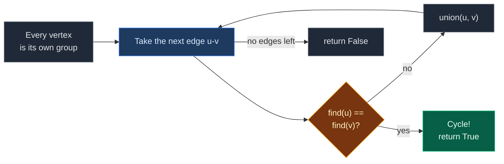
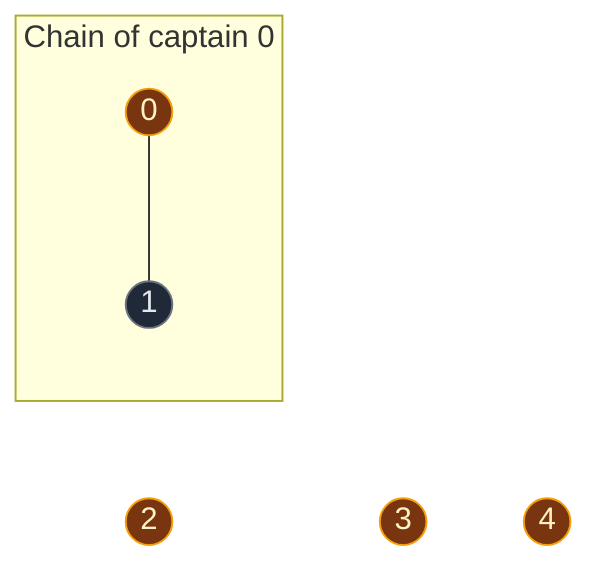
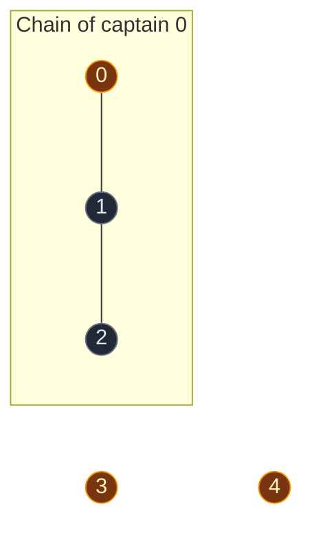
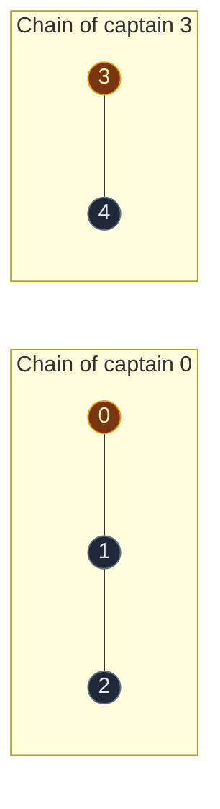
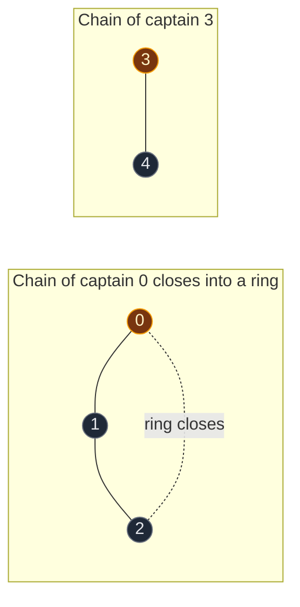

# 02. Detect Cycle using DSU

| Difficulty | Pattern | Source | Time | Space |
|:---:|:---:|:---:|:---:|:---:|
| **Medium** | DSU: Undirected Cycle Detection | [Detect Cycle using DSU](https://www.geeksforgeeks.org/problems/detect-cycle-using-dsu/1) | `O((V + E) · α(V))` | `O(V)` |

## 1. Problem Statement

You get an **undirected** graph with `V` vertices, numbered `0` to `V - 1`, and a list of edges. There are no self-loops.

Return `True` if the graph has a cycle. Otherwise return `False`.

Use Disjoint Set Union (DSU) to solve it.

### Example

```text
V = 5
edges = [[0,1], [1,2], [3,4], [2,0]]

Graph:
  0           3
 / \          |
1---2         4

The edges 0-1, 1-2 and 2-0 make a loop: 0 -> 1 -> 2 -> 0.
Output: True
```

We use this same example in every section below.

**Note on input:** some GfG versions give an adjacency list instead of an edge list. The DSU idea is the same. Only the loop that reads the edges changes (see Q4 below).

### Constraints

- `1 <= V <= 10^4`
- `0 <= E <= 10^4`
- `0 <= u, v <= V - 1`
- No self-loops

## 2. Core Theory

### What the problem really asks

A cycle exists when some edge `u -- v` joins two vertices that are **already connected** by another path.

### Why DSU fits

- Add the edges one by one.
- Before adding `u -- v`, ask: "Do `u` and `v` already have the same leader?"
- **Different leaders:** the edge joins two groups. No cycle yet. Call `union(u, v)`.
- **Same leader:** a path already exists, so this edge closes a loop. Return `True`.
- If every edge joins two different groups, there is no cycle. Return `False`.



### How this differs from 684

| Problem | When `union` fails | At the end |
|:---|:---|:---|
| [684. Redundant Connection](01.%20684.%20Redundant%20Connection.md) | Return that edge `[u, v]` | Never reached |
| **Detect Cycle using DSU** | Return `True` | Return `False` |

Same DSU, same check. Only the return value changes.

## 3. Edge Cases

| Case | Input | Expected | Why it matters |
|:---|:---|:---:|:---|
| No edges | `V = 3, edges = []` | `False` | Nothing to join |
| A tree | `V = 5, edges = [[0,1],[0,2],[1,3],[1,4]]` | `False` | Every edge joins two groups. Must not report a false cycle |
| A straight line | `V = 4, edges = [[0,1],[1,2],[2,3]]` | `False` | Long path, still no loop |
| Cycle in one part only | `V = 5, edges = [[0,1],[1,2],[3,4],[2,0]]` | `True` | A cycle in any part makes the answer `True` |
| Edge list given both ways | `[[0,1],[1,0]]` (adjacency-list style) | `False` | The same edge read twice looks like a cycle. Read each edge once (see Q4) |

## 4. Brute Force: BFS with Parent Tracking

### Idea

Run BFS from every unvisited vertex. Store `(node, parent)` in the queue. If a neighbor is already visited and is **not** the parent we came from, there are two paths to it, so there is a cycle.

This is the approach in the [BFS cycle note](../../02.%20BFS%20and%20DFS/03.%20Undirected%20Cycle%20Detection/01.%20Detect%20Cycle%20in%20an%20Undirected%20Graph%20using%20BFS.md).

### Code

```python
# Import deque for the BFS queue
from collections import deque

# Import List for type hints
from typing import List


# Detect a cycle using BFS with parent tracking
class SolutionBFS:

    # Run BFS from one start vertex, return True if a cycle is found
    def bfs_has_cycle(self, graph, visited, start):

        # Mark the start vertex as visited
        visited[start] = True

        # Queue holds (node, the node we came from)
        queue = deque([(start, -1)])

        # Keep going while there are nodes to visit
        while queue:

            # Take the next node and its parent
            node, parent = queue.popleft()

            # Look at every neighbor
            for nxt in graph[node]:

                # New neighbor: visit it and remember where we came from
                if not visited[nxt]:

                    # Mark it as visited
                    visited[nxt] = True

                    # Add it with the current node as its parent
                    queue.append((nxt, node))

                # Visited neighbor that is not our parent means a second path
                elif nxt != parent:
                    return True

        # No cycle in this part of the graph
        return False

    # Main method
    def detectCycle(self, V: int, edges: List[List[int]]) -> bool:

        # Make an empty neighbor list for every vertex
        graph = [[] for _ in range(V)]

        # Fill the neighbor lists from the edges
        for u, v in edges:

            # Edge goes from u to v
            graph[u].append(v)

            # And from v to u, because the graph is undirected
            graph[v].append(u)

        # Track visited vertices
        visited = [False] * V

        # Start a BFS from every vertex not visited yet
        for start in range(V):

            # Skip vertices already covered by an earlier BFS
            if not visited[start]:

                # Any part with a cycle makes the answer True
                if self.bfs_has_cycle(graph, visited, start):
                    return True

        # No part had a cycle
        return False
```

### Complexity

| Measure | Complexity | Why |
|:---|:---:|:---|
| **Time** | `O(V + E)` | Every vertex and edge is visited once |
| **Space** | `O(V + E)` | Adjacency list, `visited` and the queue |

BFS is also fast. DSU is shorter, needs no adjacency list, and works when edges arrive one at a time.

## 5. Optimal Approach: DSU

### Idea

1. Make a DSU for `V` vertices.
2. For each edge `[u, v]`, call `union(u, v)`.
3. If `union` returns `False`, `u` and `v` were already connected. Return `True`.
4. If all edges are added with no failure, return `False`.

### Visual Walkthrough (Story Version)

Before the arrays, let us see the idea as a story.

**The story:** 5 kids are in a playground: kid 0 to kid 4. The teacher calls out pairs, and each pair holds hands. Kids holding hands, directly or through other kids, form a **chain**. The teacher wants to know: **does any chain close into a ring?**

**The rules:**

- Every chain has one **captain**.
- Before two kids hold hands, each asks: "Who is my captain?"
- **Different captains:** the two chains join into one longer chain. No ring.
- **Same captain:** the two kids are already in the same chain. Holding hands now closes it into a **ring**. That is a cycle.

**How to read the pictures:** gold circle = captain. Line = holding hands. Box = one chain.

**Start: every kid stands alone**


5 chains, 5 captains.

**Pair 1: kid 0 and kid 1 hold hands**

- Kid 0's captain is kid 0. Kid 1's captain is kid 1.
- Different captains. The chains join. No ring.
- Both chains have 1 kid. Kid 0 stays the captain.



**Pair 2: kid 1 and kid 2 hold hands**

- Kid 1 asks: "Who is my captain?" Answer: kid 0.
- Kid 2's captain is kid 2.
- Different captains. The chains join. No ring.
- Chain of kid 0 is bigger (2 kids vs 1), so kid 0 stays the captain.



**Pair 3: kid 3 and kid 4 hold hands**

- Kid 3's captain is kid 3. Kid 4's captain is kid 4.
- Different captains. The chains join. No ring.
- Both chains have 1 kid. Kid 3 becomes the captain.



**Pair 4: kid 2 and kid 0 hold hands (the ring)**

- Kid 2 asks: "Who is my captain?" Answer: kid 0.
- Kid 0's captain is kid 0.
- **Same captain!** Kid 2 and kid 0 are already in the same chain: `0 - 1 - 2`.
- When they hold hands, the chain closes into a ring. **Cycle found. Answer: `True`.**



**All pairs at a glance**

| Pair | Captain of first kid | Captain of second kid | Same? | What happens |
|:---:|:---:|:---:|:---:|:---|
| 0 - 1 | 0 | 1 | No | Chains join |
| 1 - 2 | 0 | 2 | No | Chains join |
| 3 - 4 | 3 | 4 | No | Chains join |
| 2 - 0 | 0 | 0 | **Yes** | Ring! Return `True` |

**What the story teaches**

| In the story | In the code |
|:---|:---|
| Kid | Vertex |
| Holding hands | Edge `[u, v]` |
| Chain | DSU group (connected component) |
| Captain | Leader, `find(x)` |
| Two chains join | `union(u, v)` returns `True` |
| Ring closes | `union(u, v)` returns `False`, so return `True` |
| No ring after all pairs | Return `False` |

Now the same steps again, this time with the exact arrays.

### Step-by-Step Example

```text
V = 5
edges = [[0,1], [1,2], [3,4], [2,0]]
```

**Start**

```text
vertex:  0 1 2 3 4
parent:  0 1 2 3 4
size:    1 1 1 1 1
```

**Step 1: edge `[0, 1]`, call `union(0, 1)`**

1. `find(0)`: `parent[0] = 0`. Leader is `0`.
2. `find(1)`: `parent[1] = 1`. Leader is `1`.
3. Leaders are different, so we join.
4. `size[0] = 1` and `size[1] = 1`. Equal, no swap. `0` stays on top.
5. Put `1` under `0`: `parent[1] = 0`.
6. `size[0] = 1 + 1 = 2`.
7. `union` returns `True`. No cycle yet.

```text
vertex:  0 1 2 3 4
parent:  0 0 2 3 4
size:    2 1 1 1 1
```

**Step 2: edge `[1, 2]`, call `union(1, 2)`**

1. `find(1)`: `parent[1] = 0`, not itself. Go up to `0`.
2. `find(0)`: `parent[0] = 0`. Leader is `0`. On the way back, `parent[1] = 0` (no change).
3. `find(2)`: `parent[2] = 2`. Leader is `2`.
4. Leaders `0` and `2` are different, so we join.
5. `size[0] = 2` and `size[2] = 1`. `0` is bigger, no swap.
6. Put `2` under `0`: `parent[2] = 0`.
7. `size[0] = 2 + 1 = 3`.
8. `union` returns `True`. No cycle yet.

```text
vertex:  0 1 2 3 4
parent:  0 0 0 3 4
size:    3 1 1 1 1
```

**Step 3: edge `[3, 4]`, call `union(3, 4)`**

1. `find(3)`: `parent[3] = 3`. Leader is `3`.
2. `find(4)`: `parent[4] = 4`. Leader is `4`.
3. Leaders are different, so we join.
4. `size[3] = 1` and `size[4] = 1`. Equal, no swap. `3` stays on top.
5. Put `4` under `3`: `parent[4] = 3`.
6. `size[3] = 1 + 1 = 2`.
7. `union` returns `True`. No cycle yet.

```text
vertex:  0 1 2 3 4
parent:  0 0 0 3 3
size:    3 1 1 2 1

    0         3
   / \        |
  1   2       4
```

**Step 4: edge `[2, 0]`, call `union(2, 0)`**

1. `find(2)`: `parent[2] = 0`, go up. `parent[0] = 0`. Leader is `0`.
2. `find(0)`: `parent[0] = 0`. Leader is `0`.
3. **Same leader.** `2` and `0` are already connected through `1`.
4. `union` returns `False`. Nothing in the arrays changes.
5. **Return `True`. The graph has a cycle.**

```text
vertex:  0 1 2 3 4
parent:  0 0 0 3 3
size:    3 1 1 2 1
```

### Code

```python
# Import List for type hints
from typing import List


# Reusable DSU with union by size and path compression
class DSU:

    # Set up the arrays
    def __init__(self, n: int):

        # Every vertex starts as its own leader
        self.parent = list(range(n))

        # Every group starts with 1 vertex
        self.size = [1] * n

    # Find the leader of a vertex
    def find(self, node: int) -> int:

        # A vertex that points to itself is the leader
        if self.parent[node] == node:
            return node

        # Find the leader and point this vertex straight at it (path compression)
        self.parent[node] = self.find(self.parent[node])

        # Return the leader
        return self.parent[node]

    # Join the groups of u and v
    def union(self, u: int, v: int) -> bool:

        # Find the leader of u
        leader_u = self.find(u)

        # Find the leader of v
        leader_v = self.find(v)

        # Same leader means already in one group
        if leader_u == leader_v:
            return False

        # Make sure leader_u has the bigger group
        if self.size[leader_u] < self.size[leader_v]:
            leader_u, leader_v = leader_v, leader_u

        # Put the smaller group under the bigger group
        self.parent[leader_v] = leader_u

        # Add the smaller group's size to the new leader
        self.size[leader_u] += self.size[leader_v]

        # Join was done
        return True


# Solution for GfG Detect Cycle using DSU
class Solution:

    # Main method
    def detectCycle(self, V: int, edges: List[List[int]]) -> bool:

        # Make a DSU for all vertices
        dsu = DSU(V)

        # Add the edges one by one
        for u, v in edges:

            # A failed join means u and v were already connected: cycle
            if not dsu.union(u, v):
                return True

        # Every edge joined two separate groups: no cycle
        return False


# Check the example from this note, step by step
dsu = DSU(5)

# Step 1: edge [0, 1]
assert dsu.union(0, 1) is True
assert dsu.parent == [0, 0, 2, 3, 4] and dsu.size == [2, 1, 1, 1, 1]

# Step 2: edge [1, 2]
assert dsu.union(1, 2) is True
assert dsu.parent == [0, 0, 0, 3, 4] and dsu.size == [3, 1, 1, 1, 1]

# Step 3: edge [3, 4]
assert dsu.union(3, 4) is True
assert dsu.parent == [0, 0, 0, 3, 3] and dsu.size == [3, 1, 1, 2, 1]

# Step 4: edge [2, 0] fails, arrays do not change
assert dsu.union(2, 0) is False
assert dsu.parent == [0, 0, 0, 3, 3] and dsu.size == [3, 1, 1, 2, 1]

# Full solution on the example
assert Solution().detectCycle(5, [[0, 1], [1, 2], [3, 4], [2, 0]]) is True

# No edges
assert Solution().detectCycle(3, []) is False

# A tree has no cycle
assert Solution().detectCycle(5, [[0, 1], [0, 2], [1, 3], [1, 4]]) is False

# A straight line has no cycle
assert Solution().detectCycle(4, [[0, 1], [1, 2], [2, 3]]) is False

# Square cycle
assert Solution().detectCycle(4, [[0, 1], [1, 2], [2, 3], [3, 0]]) is True

# BFS brute force gives the same answers
assert SolutionBFS().detectCycle(5, [[0, 1], [1, 2], [3, 4], [2, 0]]) is True
assert SolutionBFS().detectCycle(5, [[0, 1], [0, 2], [1, 3], [1, 4]]) is False

# All checks passed
print("All tests passed")
```

### Complexity

| Measure | Complexity | Why |
|:---|:---:|:---|
| **Time** | `O((V + E) · α(V))` | `O(V)` to set up, one `union` per edge, each almost `O(1)` |
| **Space** | `O(V)` | `parent[]` and `size[]`. No adjacency list needed |

## 6. Common Mistakes

| Mistake | What goes wrong | Fix |
|:---|:---|:---|
| Reading each edge twice from an adjacency list | Second read of `u-v` finds the same leader and reports a fake cycle | Only use pairs with `u < v` |
| Using DSU on a directed graph | DSU ignores direction and reports wrong cycles | Use DFS with a path set, or Kahn's algorithm |
| Comparing `parent[u] == parent[v]` | Two vertices can share a leader but have different parents | Compare leaders with `find` (inside `union`) |
| Returning `False` as soon as one `union` succeeds | Stops before seeing the edge that makes the cycle | Return `False` only after all edges |
| Forgetting that the graph can be in pieces | A cycle in a later piece is missed | DSU reads every edge, so all pieces are covered automatically |

## 7. Interview Follow-ups

### Q1. Why does "same leader" mean a cycle?

**Answer:**
- Same leader means `u` and `v` are already in one group.
- So there is already a path between them.
- The new edge gives a second path. Two paths between the same two vertices make a loop.

### Q2. BFS/DFS or DSU: which one is better here?

**Answer:**
- Both are about `O(V + E)`.
- DSU code is shorter and needs no adjacency list.
- DSU also works when edges come one at a time.
- BFS/DFS can also tell you **which** vertices are on the cycle. DSU cannot.

### Q3. Does this work for directed graphs?

**Answer:**
- No. In a directed graph, `0 -> 1`, `0 -> 2`, `1 -> 2` has no cycle, but DSU would say "same leader" on the last edge.
- Use DFS with a path set, or Kahn's algorithm.

### Q4. What if the input is an adjacency list?

**Answer:**
- Every edge appears twice: `v` in `adj[u]` and `u` in `adj[v]`.
- Only call `union(u, v)` when `u < v`. That reads each edge once.

### Q5. How would you count how many extra edges there are?

**Answer:**
- Do not return early.
- Count every `union` that returns `False`.
- That count equals `E - V + (number of groups)`.

## 8. Interview Explanation

> A cycle in an undirected graph means some edge joins two vertices that are already connected. I make a DSU where every vertex starts as its own group, then I add the edges one by one with union. If union returns true, the edge joined two separate groups, so there is no cycle yet. If union returns false, both ends already had the same leader, so a path already existed and this edge closes a loop, and I return true. If all edges go in without a failure, I return false. Each union is almost constant, so the total is O((V + E) · α(V)) time and O(V) space.
