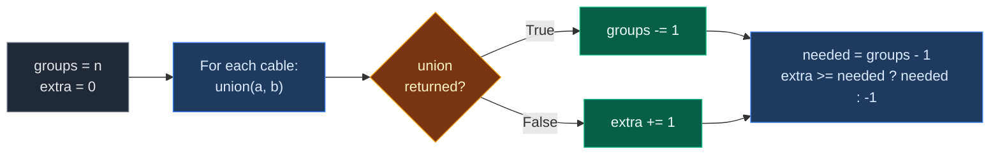
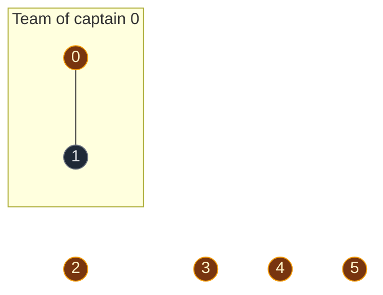
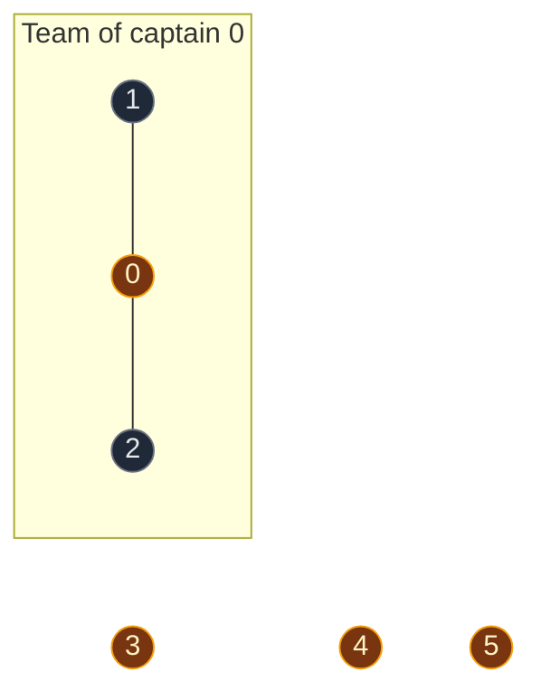
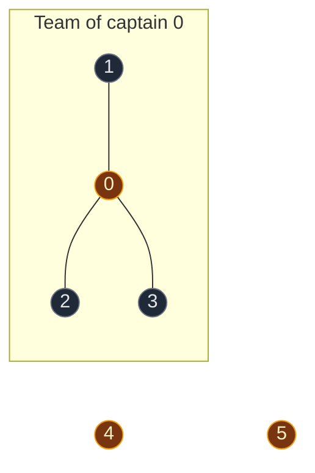
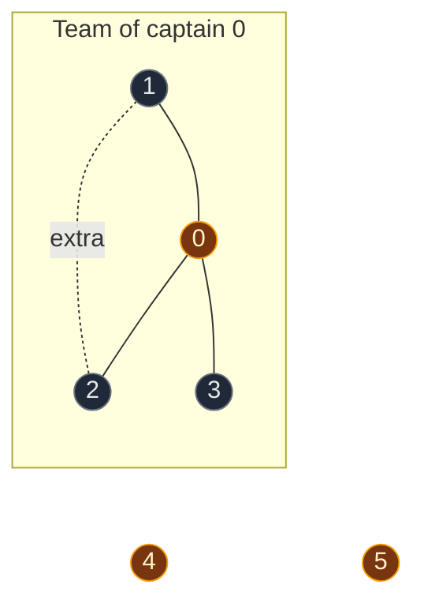
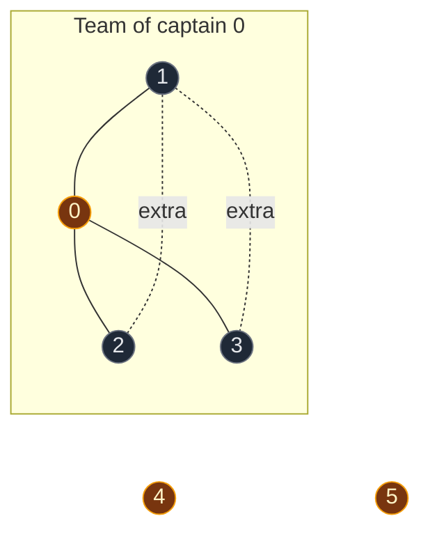
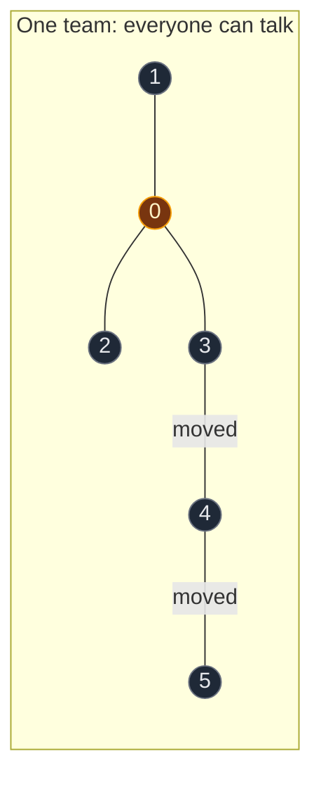

# 03. 1319. Number of Operations to Make Network Connected

| Difficulty | Pattern | Source | Time | Space |
|:---:|:---:|:---:|:---:|:---:|
| **Medium** | DSU: Components + Extra Edges | [1319. Number of Operations to Make Network Connected](https://leetcode.com/problems/number-of-operations-to-make-network-connected/) | `O((n + E) · α(n))` | `O(n)` |

## 1. Problem Statement

There are `n` computers, numbered `0` to `n - 1`.

You get a list `connections`. Each `connections[i] = [a, b]` is a cable between computer `a` and computer `b`.

In one operation, you can **unplug** one cable and **plug** it between any two computers that are not connected.

Return the **minimum number of operations** needed to connect all computers. If it is not possible, return `-1`.

### Example

```text
n = 6
connections = [[0,1], [0,2], [0,3], [1,2], [1,3]]

Network:
    0 ---- 1
    | \  / |
    |  \/  |
    |  /\  |
    | /  \ |
    2    3          4      5

Group {0,1,2,3}: 4 computers, 5 cables.
Only 3 cables are needed to keep 4 computers connected.
So 2 cables are extra.

Computers 4 and 5 are alone.
3 groups need 2 cables to join them.
We have 2 extra cables. Enough.

Output: 2
```

We use this same example in every section below.

### Constraints

- `1 <= n <= 10^5`
- `1 <= connections.length <= min(n * (n - 1) / 2, 10^5)`
- `connections[i].length == 2`
- `0 <= a, b < n`, `a != b`
- No repeated connections

## 2. Core Theory

### Two simple facts

**Fact 1: `k` groups need `k - 1` cables to join.**

```text
4 groups:  A    B    C    D
Join them: A -- B -- C -- D
That is 3 cables.
```

**Fact 2: we cannot buy new cables.** We can only move cables we do not need. A cable is not needed when its two computers are already connected another way. We call it an **extra cable**.

So the answer is:

```text
needed = groups - 1

If extra cables >= needed:  answer = needed
Otherwise:                  answer = -1
```

### How DSU finds both numbers

Go through every cable and call `union(a, b)`:

| `union(a, b)` returns | Meaning | What we count |
|:---|:---|:---|
| `True` | Two different groups joined | Groups go down by 1 |
| `False` | `a` and `b` were already in one group | This cable is **extra** |

This is the same idea as [684. Redundant Connection](01.%20684.%20Redundant%20Connection.md): a cable inside one group is redundant. And it is the same group counter as [547. Number of Provinces](../02.%20Basic%20Connectivity%20and%20Components/01.%20547.%20Number%20of%20Provinces%20%28DSU%29.md).



### A quick shortcut

To connect `n` computers you need at least `n - 1` cables in total. So:

```text
If len(connections) < n - 1:  return -1 right away
```

If there are enough cables in total, there are always enough extra cables. Then the answer is just `groups - 1`. We still count extra cables in the main code, because it shows clearly why the answer works.

## 3. Edge Cases

| Case | Input | Expected | Why it matters |
|:---|:---|:---:|:---|
| Too few cables | `n = 6`, `[[0,1],[0,2],[0,3],[1,2]]` | `-1` | 4 cables, but 6 computers need at least 5 |
| Already connected | `n = 4`, `[[0,1],[1,2],[2,3]]` | `0` | One group, nothing to move |
| Extra cable in a small group | `n = 4`, `[[0,1],[0,2],[1,2]]` | `1` | Cable `1-2` is extra. Move it to join computer `3` |
| Exactly enough extras | Our example | `2` | `extra == needed` is still enough, so use `>=`, not `>` |
| Two groups, no extras | `n = 4`, `[[0,1],[2,3]]` | `-1` | 2 groups need 1 cable, but every cable is in use |

## 4. Brute Force: DFS to Count Groups

### Idea

1. If there are fewer than `n - 1` cables, return `-1`.
2. Build an adjacency list.
3. Count groups with DFS.
4. Return `groups - 1`.

This works because of the shortcut: enough cables in total means enough extra cables.

### Code

```python
# Import List for type hints
from typing import List


# Solve with DFS group counting
class SolutionDFS:

    # Main method
    def makeConnected(self, n: int, connections: List[List[int]]) -> int:

        # Not enough cables in total to connect n computers
        if len(connections) < n - 1:
            return -1

        # Make an empty neighbor list for every computer
        graph = [[] for _ in range(n)]

        # Fill the neighbor lists
        for a, b in connections:

            # Cable goes from a to b
            graph[a].append(b)

            # And from b to a
            graph[b].append(a)

        # Track visited computers
        visited = [False] * n

        # Number of groups found
        groups = 0

        # Try every computer as a start
        for start in range(n):

            # Skip computers already in a found group
            if visited[start]:
                continue

            # A new group starts here
            groups += 1

            # Mark the start as visited
            visited[start] = True

            # Use a stack for DFS
            stack = [start]

            # Visit the whole group
            while stack:

                # Take the top computer
                node = stack.pop()

                # Look at every neighbor
                for nxt in graph[node]:

                    # Visit it only if it is new
                    if not visited[nxt]:

                        # Mark it as visited
                        visited[nxt] = True

                        # Add it to the stack
                        stack.append(nxt)

        # k groups need k - 1 moves
        return groups - 1
```

### Complexity

| Measure | Complexity | Why |
|:---|:---:|:---|
| **Time** | `O(n + E)` | Build the list once, visit every computer and cable once |
| **Space** | `O(n + E)` | Adjacency list, `visited`, and the stack |

This is already fast. DSU shows the "extra cable" idea directly and needs no adjacency list.

## 5. Optimal Approach: DSU (Groups + Extra Cables)

### Idea

1. Make a DSU for `n` computers. `groups = n`, `extra = 0`.
2. For every cable, call `union(a, b)`.
   - `True`: `groups -= 1`.
   - `False`: `extra += 1`.
3. `needed = groups - 1`.
4. Return `needed` if `extra >= needed`, else `-1`.

### Visual Walkthrough (Story Version)

Before the arrays, let us see the idea as a story.

**The story:** 6 kids each have a toy phone: phone 0 to phone 5. Two phones joined by a string can talk. A phone can also talk through other phones on the same string chain. We want **every phone to reach every other phone**.

**The rules:**

- Phones that can reach each other make one **team**. Every team has one **captain** phone.
- When a string joins two **different** teams, the teams join. Teams go down by 1.
- When a string joins two phones **already on one team**, it is an **extra string**. We can untie it and use it somewhere else.
- At the end: `k` teams need `k - 1` strings to join. Do we have enough extra strings?

**How to read the pictures:** gold circle = captain phone. Line = string. Box = one team. Dotted line = extra string.

**Start: every phone is alone**


Teams: **6**. Extra strings: **0**.

**String 1: phone 0 and phone 1**

- Phone 0's captain is phone 0. Phone 1's captain is phone 1.
- Different captains, so the teams join. Phone 0 stays captain.
- Teams: 6 - 1 = **5**. Extra strings: **0**.



**String 2: phone 0 and phone 2**

- Phone 0's captain is phone 0. Phone 2's captain is phone 2.
- Different captains, so the teams join. Phone 0's team is bigger, so phone 0 stays captain.
- Teams: 5 - 1 = **4**. Extra strings: **0**.



**String 3: phone 0 and phone 3**

- Phone 0's captain is phone 0. Phone 3's captain is phone 3.
- Different captains, so the teams join. Phone 0 stays captain.
- Teams: 4 - 1 = **3**. Extra strings: **0**.



**String 4: phone 1 and phone 2**

- Phone 1's captain is phone 0. Phone 2's captain is phone 0.
- **Same captain.** Phones 1 and 2 can already talk through phone 0.
- This string is **extra**. Teams stay **3**. Extra strings: 0 + 1 = **1**.



**String 5: phone 1 and phone 3**

- Phone 1's captain is phone 0. Phone 3's captain is phone 0.
- **Same captain.** This string is **extra** too.
- Teams stay **3**. Extra strings: 1 + 1 = **2**.



**Now move the extra strings**

- 3 teams need 3 - 1 = **2** strings to join.
- We have **2** extra strings. Enough!
- Untie string `1-2` and tie it to `3-4`. Untie string `1-3` and tie it to `4-5`.



Answer: **2 moves**.

**All strings at a glance**

| String | Captain of first phone | Captain of second phone | Same? | What happens | Teams | Extra |
|:---:|:---:|:---:|:---:|:---|:---:|:---:|
| start | – | – | – | Every phone alone | 6 | 0 |
| 0 - 1 | 0 | 1 | No | Teams join | 5 | 0 |
| 0 - 2 | 0 | 2 | No | Teams join | 4 | 0 |
| 0 - 3 | 0 | 3 | No | Teams join | 3 | 0 |
| 1 - 2 | 0 | 0 | Yes | Extra string | 3 | 1 |
| 1 - 3 | 0 | 0 | Yes | Extra string | 3 | 2 |

**What the story teaches**

| In the story | In the code |
|:---|:---|
| Toy phone | Computer (node) |
| String | Cable `[a, b]` |
| Team | DSU group |
| Captain phone | Leader, `find(x)` |
| Tie a string | `union(a, b)` |
| Teams join | `union` returns `True`, `groups -= 1` |
| Extra string | `union` returns `False`, `extra += 1` |
| Strings needed to join all teams | `groups - 1` |

Now the same steps again, this time with the exact arrays.

### Step-by-Step Example

```text
n = 6
connections = [[0,1], [0,2], [0,3], [1,2], [1,3]]
```

**Start**

```text
node:    0 1 2 3 4 5
parent:  0 1 2 3 4 5
size:    1 1 1 1 1 1
groups = 6, extra = 0
```

**Step 1: cable `[0, 1]`, call `union(0, 1)`**

1. `find(0)`: `parent[0] = 0`. Leader is `0`.
2. `find(1)`: `parent[1] = 1`. Leader is `1`.
3. Leaders are different, so we join.
4. `size[0] = 1` and `size[1] = 1`. Equal, so no swap. `0` stays on top.
5. Put `1` under `0`: `parent[1] = 0`.
6. `size[0] = 1 + 1 = 2`.
7. `union` returns `True`, so `groups` goes from `6` to `5`.

```text
node:    0 1 2 3 4 5
parent:  0 0 2 3 4 5
size:    2 1 1 1 1 1
groups = 5, extra = 0
```

**Step 2: cable `[0, 2]`, call `union(0, 2)`**

1. `find(0)`: leader is `0`.
2. `find(2)`: leader is `2`.
3. Leaders are different, so we join.
4. `size[0] = 2` and `size[2] = 1`. `0` is bigger, no swap.
5. Put `2` under `0`: `parent[2] = 0`.
6. `size[0] = 2 + 1 = 3`.
7. `union` returns `True`, so `groups` goes from `5` to `4`.

```text
node:    0 1 2 3 4 5
parent:  0 0 0 3 4 5
size:    3 1 1 1 1 1
groups = 4, extra = 0
```

**Step 3: cable `[0, 3]`, call `union(0, 3)`**

1. `find(0)`: leader is `0`.
2. `find(3)`: leader is `3`.
3. Leaders are different, so we join.
4. `size[0] = 3` and `size[3] = 1`. `0` is bigger, no swap.
5. Put `3` under `0`: `parent[3] = 0`.
6. `size[0] = 3 + 1 = 4`.
7. `union` returns `True`, so `groups` goes from `4` to `3`.

```text
node:    0 1 2 3 4 5
parent:  0 0 0 0 4 5
size:    4 1 1 1 1 1
groups = 3, extra = 0
```

**Step 4: cable `[1, 2]`, call `union(1, 2)`**

1. `find(1)`: `parent[1] = 0`, go up. `parent[0] = 0`. Leader is `0`.
2. `find(2)`: `parent[2] = 0`, go up. `parent[0] = 0`. Leader is `0`.
3. Same leader. They are already in one group.
4. `union` returns `False`, so `extra` goes from `0` to `1`.

```text
node:    0 1 2 3 4 5
parent:  0 0 0 0 4 5
size:    4 1 1 1 1 1
groups = 3, extra = 1
```

**Step 5: cable `[1, 3]`, call `union(1, 3)`**

1. `find(1)`: leader is `0`.
2. `find(3)`: `parent[3] = 0`. Leader is `0`.
3. Same leader. Already in one group.
4. `union` returns `False`, so `extra` goes from `1` to `2`.

```text
node:    0 1 2 3 4 5
parent:  0 0 0 0 4 5
size:    4 1 1 1 1 1
groups = 3, extra = 2

    0          4      5
  / | \
 1  2  3
```

**End**

1. `needed = groups - 1 = 3 - 1 = 2`.
2. `extra = 2`. Is `2 >= 2`? Yes.
3. **Answer: `2`.**

### Code

```python
# Import List for type hints
from typing import List


# Reusable DSU with union by size and path compression
class DSU:

    # Set up the arrays
    def __init__(self, n: int):

        # Every node starts as its own leader
        self.parent = list(range(n))

        # Every group starts with 1 node
        self.size = [1] * n

    # Find the leader of a node
    def find(self, node: int) -> int:

        # A node that points to itself is the leader
        if self.parent[node] == node:
            return node

        # Find the leader and point this node straight at it (path compression)
        self.parent[node] = self.find(self.parent[node])

        # Return the leader
        return self.parent[node]

    # Join the groups of u and v
    def union(self, u: int, v: int) -> bool:

        # Find the leader of u
        leader_u = self.find(u)

        # Find the leader of v
        leader_v = self.find(v)

        # Same leader means already in one group
        if leader_u == leader_v:
            return False

        # Make sure leader_u has the bigger group
        if self.size[leader_u] < self.size[leader_v]:
            leader_u, leader_v = leader_v, leader_u

        # Put the smaller group under the bigger group
        self.parent[leader_v] = leader_u

        # Add the smaller group's size to the new leader
        self.size[leader_u] += self.size[leader_v]

        # Join was done
        return True


# Solution for 1319. Number of Operations to Make Network Connected
class Solution:

    # Main method
    def makeConnected(self, n: int, connections: List[List[int]]) -> int:

        # Make a DSU for all computers
        dsu = DSU(n)

        # At the start, every computer is its own group
        groups = n

        # No extra cables found yet
        extra = 0

        # Go through every cable
        for a, b in connections:

            # The cable joined two different groups
            if dsu.union(a, b):
                groups -= 1

            # The cable was inside one group already
            else:
                extra += 1

        # k groups need k - 1 cables to join
        needed = groups - 1

        # Enough extra cables to move
        if extra >= needed:
            return needed

        # Not enough cables
        return -1


# Check the example from this note, step by step
dsu = DSU(6)

# Step 1: cable [0, 1] joins two groups
assert dsu.union(0, 1) is True
assert dsu.parent == [0, 0, 2, 3, 4, 5] and dsu.size == [2, 1, 1, 1, 1, 1]

# Step 2: cable [0, 2] joins two groups
assert dsu.union(0, 2) is True
assert dsu.parent == [0, 0, 0, 3, 4, 5] and dsu.size == [3, 1, 1, 1, 1, 1]

# Step 3: cable [0, 3] joins two groups
assert dsu.union(0, 3) is True
assert dsu.parent == [0, 0, 0, 0, 4, 5] and dsu.size == [4, 1, 1, 1, 1, 1]

# Step 4: cable [1, 2] is extra
assert dsu.union(1, 2) is False

# Step 5: cable [1, 3] is extra
assert dsu.union(1, 3) is False
assert dsu.parent == [0, 0, 0, 0, 4, 5]

# Leaders at the end: 0, 4, 5 (3 groups)
assert [c for c in range(6) if dsu.find(c) == c] == [0, 4, 5]

# Full solution on the example
example = [[0, 1], [0, 2], [0, 3], [1, 2], [1, 3]]
assert Solution().makeConnected(6, example) == 2

# LeetCode example 1
assert Solution().makeConnected(4, [[0, 1], [0, 2], [1, 2]]) == 1

# Too few cables
assert Solution().makeConnected(6, [[0, 1], [0, 2], [0, 3], [1, 2]]) == -1

# Already connected
assert Solution().makeConnected(4, [[0, 1], [1, 2], [2, 3]]) == 0

# Two groups but no extra cable
assert Solution().makeConnected(4, [[0, 1], [2, 3]]) == -1

# DFS brute force gives the same answers
assert SolutionDFS().makeConnected(6, example) == 2
assert SolutionDFS().makeConnected(4, [[0, 1], [0, 2], [1, 2]]) == 1
assert SolutionDFS().makeConnected(6, [[0, 1], [0, 2], [0, 3], [1, 2]]) == -1

# All checks passed
print("All tests passed")
```

### Complexity

| Measure | Complexity | Why |
|:---|:---:|:---|
| **Time** | `O((n + E) · α(n))` | `O(n)` setup, one `union` per cable, each almost `O(1)` |
| **Space** | `O(n)` | `parent[]` and `size[]`. No adjacency list |

## 6. Common Mistakes

| Mistake | What goes wrong | Fix |
|:---|:---|:---|
| Returning `groups` instead of `groups - 1` | Off by one. `k` groups need `k - 1` links | Return `groups - 1` |
| Forgetting the `-1` case | Returns a number even when cables are too few | Check `extra >= needed`, or `len(connections) >= n - 1` |
| Counting extra cables with `parent[a] == parent[b]` | Misses cables whose ends share a leader but not a parent | Use the result of `union` (it uses `find`) |
| Counting groups as "number of cables + 1" | Ignores cables inside one group | Count only `True` joins |
| Thinking you must choose which cable to move | Not needed. Any extra cable works | Just count extras |

## 7. Interview Follow-ups

### Q1. Why do `k` groups need exactly `k - 1` cables?

**Answer:**
- Think of each group as one big node.
- Joining `k` nodes into one piece with no waste is a tree.
- A tree with `k` nodes has `k - 1` edges.

### Q2. Why is `len(connections) < n - 1` enough to return `-1`?

**Answer:**
- Any connected network of `n` computers needs at least `n - 1` cables.
- Moving cables does not add new ones.
- So with fewer than `n - 1` cables, it can never work.

### Q3. If there are at least `n - 1` cables, are there always enough extras?

**Answer:**
- Yes.
- The groups use `n - groups` cables that are really needed.
- The rest are extra: `E - (n - groups)`.
- If `E >= n - 1`, then extra `>= groups - 1`. That is exactly what we need.

### Q4. Which cables should we move?

**Answer:**
- Any extra cable. Each one is inside a group that stays connected without it.
- The problem only asks for the count, so we do not need to pick.

### Q5. How does this connect to other DSU problems?

**Answer:**
- 684: a cable with `union == False` is the redundant one.
- 547: count groups with a counter.
- 1319 uses both at once.

## 8. Interview Explanation

> To connect k separate groups I need k minus 1 cables, and I can only get cables by moving extra ones. So I need two numbers: the number of groups and the number of extra cables. I make a DSU and go through every cable. If union returns true, two groups joined, so the group count goes down by one. If it returns false, both computers were already connected, so that cable is extra. At the end, the answer is groups minus 1 if I have at least that many extra cables, otherwise minus 1. It runs in O((n + E) · α(n)) time and O(n) space.
