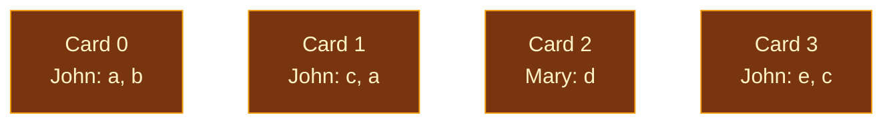
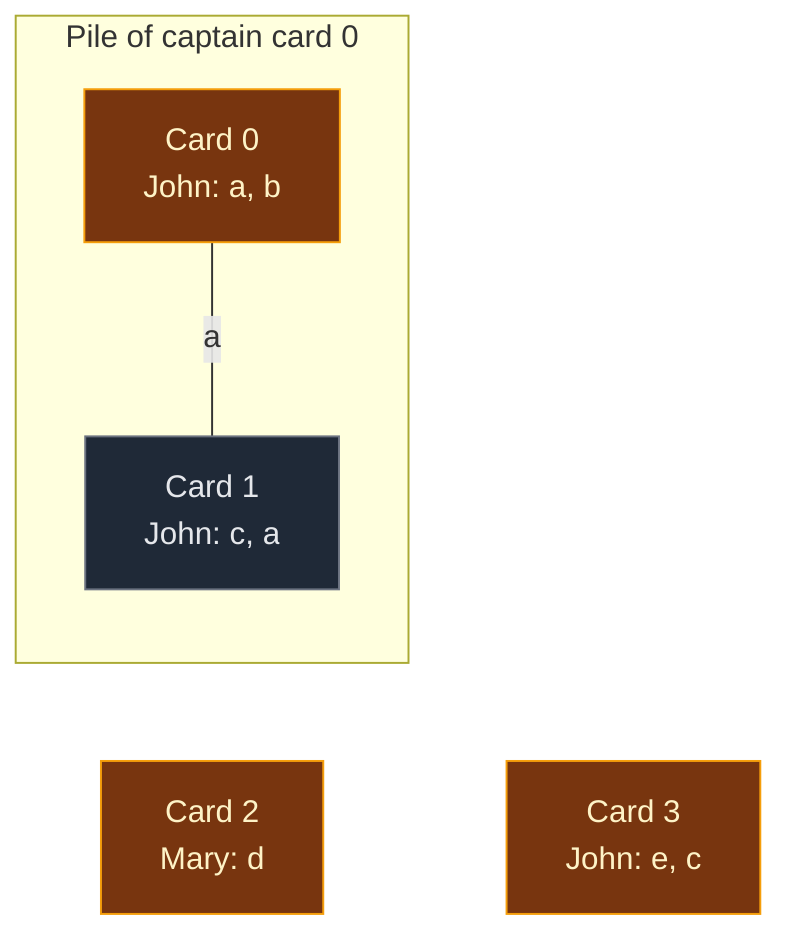
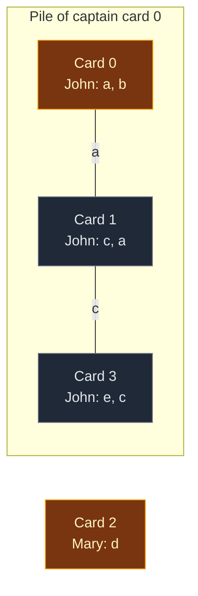
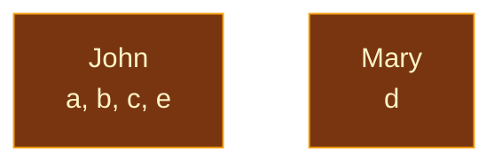

# 01. 721. Accounts Merge

| Difficulty | Pattern | Source | Time | Space |
|:---:|:---:|:---:|:---:|:---:|
| **Medium** | DSU: Merge by Shared Key | [721. Accounts Merge](https://leetcode.com/problems/accounts-merge/) | `O(NK log(NK))` | `O(NK)` |

`N` = number of accounts, `K` = most emails in one account.

## 1. Problem Statement

You get a list of `accounts`. Each account is a list of strings:

- `accounts[i][0]` is a **name**.
- The rest are **emails** of that account.

Two accounts belong to the **same person** if they share at least one email. This can also happen through a chain: if account A shares an email with B, and B shares an email with C, then A, B and C are one person.

Two people can have the same name. Same name does **not** mean same person.

Merge the accounts. Return each person as `[name, email1, email2, ...]` with the emails **sorted**. The people can be in any order.

### Example

```text
accounts = [
    ["John", "a@mail.com", "b@mail.com"],   # account 0
    ["John", "c@mail.com", "a@mail.com"],   # account 1
    ["Mary", "d@mail.com"],                 # account 2
    ["John", "e@mail.com", "c@mail.com"]    # account 3
]

Account 0 and 1 share a@mail.com  -> same person
Account 1 and 3 share c@mail.com  -> same person
So accounts 0, 1, 3 are one John (0 and 3 share no email directly).
Account 2 is Mary, alone.

Output:
[
    ["John", "a@mail.com", "b@mail.com", "c@mail.com", "e@mail.com"],
    ["Mary", "d@mail.com"]
]
```

We use this same example in every section below.

### Constraints

- `1 <= accounts.length <= 1000`
- `2 <= accounts[i].length <= 10`
- `1 <= accounts[i][j].length <= 30`
- `accounts[i][0]` is English letters
- Every email is a valid email

## 2. Core Theory

### What the problem really asks

- Each **account** is a node.
- Two accounts are linked when they **share an email**.
- Each **person** is one connected group of accounts.

So we need to group accounts into connected groups. That is DSU.

### Why the name cannot be used

```text
["John", "john@gmail.com"]
["John", "john@yahoo.com"]
```

These can be two different people who are both called John. Only a shared email proves it is the same person.

### The notebook: `email_owner`

We need to know: "Have I seen this email before? In which account?"

We keep a dictionary called `email_owner`:

- Key: an email.
- Value: the first account where we saw it.

When we see an email again in a new account, we join the new account with the old owner account.

### The three phases


**Why Phase 2 uses `find(owner)` and not `owner`:** an owner account may have joined a bigger group later. Only the leader tells us the final group.

### How this connects to other DSU problems

| Problem | DSU nodes | What links two nodes |
|:---|:---|:---|
| 547. Number of Provinces | Cities | A `1` in the matrix |
| [1971. Find if Path Exists](../02.%20Basic%20Connectivity%20and%20Components/02.%201971.%20Find%20if%20Path%20Exists%20in%20Graph.md) | Graph nodes | An edge |
| **721. Accounts Merge** | Accounts | A shared email |

## 3. Edge Cases

| Case | Input | Expected | Why it matters |
|:---|:---|:---|:---|
| Same name, no shared email | `[["John","x@m"],["John","y@m"]]` | Two separate Johns | Never join by name |
| Join through a chain | 0 shares with 1, 1 shares with 3 | 0, 1, 3 merged | DSU handles chains for free |
| Same email twice in one account | `["John","a@m","a@m"]` | `a@m` appears once | `email_owner` keeps each email once |
| One account | `[["Mary","d@m"]]` | `[["Mary","d@m"]]` | No joins happen |
| Emails need sorting | `c@m`, `a@m` | `a@m`, `c@m` | Sort every group's emails |

## 4. Brute Force: Graph of Emails + DFS

### Idea

- Make each **email** a node.
- In each account, link the first email to every other email of that account.
- Run DFS from each unvisited email. One DFS collects one person's emails.

### Code

```python
# Import defaultdict for the email graph
from collections import defaultdict

# Import List for type hints
from typing import List


# Merge accounts with DFS on an email graph
class SolutionDFS:

    # Main method
    def accountsMerge(self, accounts: List[List[str]]) -> List[List[str]]:

        # Neighbors of every email
        graph = defaultdict(list)

        # Name for every email
        email_name = {}

        # Build the graph account by account
        for account in accounts:

            # Name of this account
            name = account[0]

            # First email of this account
            first = account[1]

            # Go through every email of the account
            for email in account[1:]:

                # Remember the name for this email
                email_name[email] = name

                # Link the first email and this email
                graph[first].append(email)

                # Link back, because links go both ways
                graph[email].append(first)

        # Emails already collected
        seen = set()

        # Final answer
        result = []

        # Start a DFS from every email
        for email in email_name:

            # Skip emails that already belong to a person
            if email in seen:
                continue

            # Mark the start email
            seen.add(email)

            # Stack for DFS
            stack = [email]

            # Emails of this person
            group = []

            # Keep going while the stack has emails
            while stack:

                # Take the top email
                cur = stack.pop()

                # Add it to this person's list
                group.append(cur)

                # Look at every linked email
                for nxt in graph[cur]:

                    # Visit it only if it is new
                    if nxt not in seen:

                        # Mark it
                        seen.add(nxt)

                        # Push it on the stack
                        stack.append(nxt)

            # Save the name plus sorted emails
            result.append([email_name[email]] + sorted(group))

        # Return all people
        return result
```

### Complexity

| Measure | Complexity | Why |
|:---|:---:|:---|
| **Time** | `O(NK log(NK))` | Build and walk the graph in `O(NK)`, then sort the emails |
| **Space** | `O(NK)` | Graph, name map and `seen` set |

DFS works fine. DSU is shorter to reason about: join accounts, then group emails by leader.

## 5. Optimal Approach: DSU on Accounts

### Idea

1. Make a DSU with one node per account.
2. **Phase 1:** for each account `i` and each email in it:
   - Email is new: write `email_owner[email] = i`.
   - Email was seen before: `union(email_owner[email], i)`.
3. **Phase 2:** for each email, find its group: `leader = find(email_owner[email])`. Put the email in `groups[leader]`.
4. **Phase 3:** for each group, the answer is `[accounts[leader][0]] + sorted(emails)`.

### Visual Walkthrough (Story Version)

Before the arrays, let us see the idea as a story.

**The story:** a teacher finds 4 name cards on the floor. Each card has a name and some secret codes. The teacher wants to put the cards into piles, **one pile per real kid**.

**The rules:**

- Two cards with the **same secret code** belong to the same kid.
- Same name is **not** enough. Two different kids can both be called John.
- Every pile has one **captain card** on top.
- The teacher keeps a **notebook**. For every code, it says which card showed that code first.

**How to read the pictures:** gold box = captain card. Line = "these two cards share a code" (the code is on the line). Big box = one pile.

**The 4 cards**

```text
Card 0: John   codes a, b
Card 1: John   codes c, a
Card 2: Mary   code  d
Card 3: John   codes e, c
```

**Start: every card is its own pile**



Notebook: empty.

**Read card 0 (codes a, b)**

- Code `a`: not in the notebook. Write "a -> card 0".
- Code `b`: not in the notebook. Write "b -> card 0".
- No code was seen before, so no piles join.

Notebook: `a -> 0`, `b -> 0`.

**Read card 1 (codes c, a)**

- Code `c`: not in the notebook. Write "c -> card 1".
- Code `a`: **already in the notebook**, it says card 0.
- So card 1 and card 0 belong to the same kid. Join their piles.
- Both piles have 1 card. Card 0 stays the captain.



Notebook: `a -> 0`, `b -> 0`, `c -> 1`.

**Read card 2 (code d)**

- Code `d`: not in the notebook. Write "d -> card 2".
- Nothing joins. Mary stays alone.

Notebook: `a -> 0`, `b -> 0`, `c -> 1`, `d -> 2`.

**Read card 3 (codes e, c)**

- Code `e`: not in the notebook. Write "e -> card 3".
- Code `c`: **already in the notebook**, it says card 1.
- Card 1's captain is card 0. Card 3's captain is card 3. Different, so join.
- Card 0's pile is bigger (2 cards vs 1), so card 0 stays the captain.
- Card 3 and card 0 share no code directly. They are joined through card 1.



Notebook: `a -> 0`, `b -> 0`, `c -> 1`, `d -> 2`, `e -> 3`.

**Sort the codes into piles**

For every code in the notebook, ask "Which pile is your card in now?"

| Code | Notebook says card | Captain of that card | Goes to pile |
|:---:|:---:|:---:|:---:|
| a | 0 | 0 | 0 |
| b | 0 | 0 | 0 |
| c | 1 | 0 | 0 |
| d | 2 | 2 | 2 |
| e | 3 | 0 | 0 |

Note code `c`: the notebook says card 1, but card 1 is now in card 0's pile. That is why we ask for the **captain**, not just the card.

**Write the final cards**



- Pile 0: name from card 0 is John. Codes sorted: a, b, c, e.
- Pile 2: name from card 2 is Mary. Code: d.

**All cards at a glance**

| Card | New codes written | Code seen before? | Join with | Piles left |
|:---:|:---|:---:|:---:|:---:|
| start | – | – | – | 4 |
| 0 | a, b | No | – | 4 |
| 1 | c | Yes, `a` (card 0) | card 0 | 3 |
| 2 | d | No | – | 3 |
| 3 | e | Yes, `c` (card 1, captain 0) | card 0 | 2 |

**What the story teaches**

| In the story | In the code |
|:---|:---|
| Name card | Account |
| Secret code | Email |
| Notebook | `email_owner` dictionary |
| Pile | DSU group |
| Captain card | Leader, `find(i)` |
| Code seen before | `union(email_owner[email], i)` |
| Sort codes into piles | `groups[find(email_owner[email])]` |
| Name on the final card | `accounts[leader][0]` |

Now the same steps again, this time with the exact arrays.

### Step-by-Step Example

```text
accounts = [
    ["John", "a@mail.com", "b@mail.com"],   # account 0
    ["John", "c@mail.com", "a@mail.com"],   # account 1
    ["Mary", "d@mail.com"],                 # account 2
    ["John", "e@mail.com", "c@mail.com"]    # account 3
]
```

Short names below: `a` means `a@mail.com`, and so on.

**Start**

```text
account:  0 1 2 3
parent:   0 1 2 3
size:     1 1 1 1

email_owner = {}
```

**Phase 1, account 0: `["John", a, b]`**

1. Email `a`: not in `email_owner`. Set `email_owner[a] = 0`.
2. Email `b`: not in `email_owner`. Set `email_owner[b] = 0`.

```text
parent:   0 1 2 3
size:     1 1 1 1
email_owner = {a: 0, b: 0}
```

**Phase 1, account 1: `["John", c, a]`**

1. Email `c`: not in `email_owner`. Set `email_owner[c] = 1`.
2. Email `a`: already in `email_owner`, owner is `0`. Call `union(0, 1)`.
3. `find(0)`: `parent[0] = 0`. Leader is `0`.
4. `find(1)`: `parent[1] = 1`. Leader is `1`.
5. Leaders are different, so we join.
6. `size[0] = 1` and `size[1] = 1`. Equal, no swap. `0` stays on top.
7. Put `1` under `0`: `parent[1] = 0`.
8. `size[0] = 1 + 1 = 2`.

```text
parent:   0 0 2 3
size:     2 1 1 1
email_owner = {a: 0, b: 0, c: 1}
```

**Phase 1, account 2: `["Mary", d]`**

1. Email `d`: not in `email_owner`. Set `email_owner[d] = 2`.

```text
parent:   0 0 2 3
size:     2 1 1 1
email_owner = {a: 0, b: 0, c: 1, d: 2}
```

**Phase 1, account 3: `["John", e, c]`**

1. Email `e`: not in `email_owner`. Set `email_owner[e] = 3`.
2. Email `c`: already in `email_owner`, owner is `1`. Call `union(1, 3)`.
3. `find(1)`: `parent[1] = 0`, not itself. Go up to `0`.
4. `find(0)`: `parent[0] = 0`. Leader is `0`. On the way back, `parent[1] = 0` (no change).
5. `find(3)`: `parent[3] = 3`. Leader is `3`.
6. Leaders `0` and `3` are different, so we join.
7. `size[0] = 2` and `size[3] = 1`. `0` is bigger, no swap.
8. Put `3` under `0`: `parent[3] = 0`.
9. `size[0] = 2 + 1 = 3`.

```text
parent:   0 0 2 0
size:     3 1 1 1
email_owner = {a: 0, b: 0, c: 1, d: 2, e: 3}

      0          2
    /   \
   1     3
```

**Phase 2: group every email by its leader**

1. Email `a`: owner `0`. `find(0) = 0`. Add `a` to `groups[0]`.
2. Email `b`: owner `0`. `find(0) = 0`. Add `b` to `groups[0]`.
3. Email `c`: owner `1`. `find(1)`: `parent[1] = 0`, then `parent[0] = 0`. Leader `0`. Add `c` to `groups[0]`.
4. Email `d`: owner `2`. `find(2) = 2`. Add `d` to `groups[2]`.
5. Email `e`: owner `3`. `find(3)`: `parent[3] = 0`, then `parent[0] = 0`. Leader `0`. Add `e` to `groups[0]`.

```text
groups = {
    0: [a, b, c, e],
    2: [d]
}
```

**Phase 3: build the answer**

1. Group `0`: name is `accounts[0][0] = "John"`. Sorted emails: `a, b, c, e`.
2. Group `2`: name is `accounts[2][0] = "Mary"`. Sorted emails: `d`.

```text
[
    ["John", "a@mail.com", "b@mail.com", "c@mail.com", "e@mail.com"],
    ["Mary", "d@mail.com"]
]
```

### Code

```python
# Import defaultdict to group emails by leader
from collections import defaultdict

# Import List for type hints
from typing import List


# Reusable DSU with union by size and path compression
class DSU:

    # Set up the arrays
    def __init__(self, n: int):

        # Every node starts as its own leader
        self.parent = list(range(n))

        # Every group starts with 1 node
        self.size = [1] * n

    # Find the leader of a node
    def find(self, node: int) -> int:

        # A node that points to itself is the leader
        if self.parent[node] == node:
            return node

        # Find the leader and point this node straight at it (path compression)
        self.parent[node] = self.find(self.parent[node])

        # Return the leader
        return self.parent[node]

    # Join the groups of u and v
    def union(self, u: int, v: int) -> bool:

        # Find the leader of u
        leader_u = self.find(u)

        # Find the leader of v
        leader_v = self.find(v)

        # Same leader means already in one group
        if leader_u == leader_v:
            return False

        # Make sure leader_u has the bigger group
        if self.size[leader_u] < self.size[leader_v]:
            leader_u, leader_v = leader_v, leader_u

        # Put the smaller group under the bigger group
        self.parent[leader_v] = leader_u

        # Add the smaller group's size to the new leader
        self.size[leader_u] += self.size[leader_v]

        # Join was done
        return True


# Solution for 721. Accounts Merge
class Solution:

    # Main method
    def accountsMerge(self, accounts: List[List[str]]) -> List[List[str]]:

        # Make a DSU with one node per account
        dsu = DSU(len(accounts))

        # Remember the first account that had each email
        email_owner = {}

        # Phase 1: go through every account
        for i, account in enumerate(accounts):

            # Go through every email of this account
            for email in account[1:]:

                # A new email: this account is its owner
                if email not in email_owner:
                    email_owner[email] = i

                # A seen email: same person, so join the two accounts
                else:
                    dsu.union(email_owner[email], i)

        # Phase 2: emails of each final group
        groups = defaultdict(list)

        # Go through every email once
        for email, owner in email_owner.items():

            # Find the final group of the owner account
            leader = dsu.find(owner)

            # Put the email in that group
            groups[leader].append(email)

        # Phase 3: final answer
        result = []

        # Build one merged account per group
        for leader, emails in groups.items():

            # Name from the leader account, then the sorted emails
            result.append([accounts[leader][0]] + sorted(emails))

        # Return all merged accounts
        return result


# Check the example from this note, step by step
accounts = [
    ["John", "a@mail.com", "b@mail.com"],
    ["John", "c@mail.com", "a@mail.com"],
    ["Mary", "d@mail.com"],
    ["John", "e@mail.com", "c@mail.com"],
]

# Make the DSU by hand to check each step
dsu = DSU(4)

# Account 1 shares a@mail.com with account 0
assert dsu.union(0, 1) is True
assert dsu.parent == [0, 0, 2, 3] and dsu.size == [2, 1, 1, 1]

# Account 3 shares c@mail.com with account 1
assert dsu.union(1, 3) is True
assert dsu.parent == [0, 0, 2, 0] and dsu.size == [3, 1, 1, 1]

# Phase 2: c@mail.com (owner 1) and e@mail.com (owner 3) both go to leader 0
assert dsu.find(1) == 0 and dsu.find(3) == 0 and dsu.find(2) == 2

# Sort helper so the order of people does not matter
def norm(res):

    # Sort the list of people
    return sorted(res)

# Full solution on the example
assert norm(Solution().accountsMerge(accounts)) == norm([
    ["John", "a@mail.com", "b@mail.com", "c@mail.com", "e@mail.com"],
    ["Mary", "d@mail.com"],
])

# Same name, no shared email: two different people
assert norm(Solution().accountsMerge([["John", "x@m"], ["John", "y@m"]])) == [["John", "x@m"], ["John", "y@m"]]

# Same email twice in one account
assert Solution().accountsMerge([["John", "a@m", "a@m"]]) == [["John", "a@m"]]

# LeetCode example 1
lc = [
    ["John", "johnsmith@mail.com", "john_newyork@mail.com"],
    ["John", "johnsmith@mail.com", "john00@mail.com"],
    ["Mary", "mary@mail.com"],
    ["John", "johnnybravo@mail.com"],
]
assert norm(Solution().accountsMerge(lc)) == norm([
    ["John", "john00@mail.com", "john_newyork@mail.com", "johnsmith@mail.com"],
    ["Mary", "mary@mail.com"],
    ["John", "johnnybravo@mail.com"],
])

# DFS brute force gives the same answers
assert norm(SolutionDFS().accountsMerge(accounts)) == norm(Solution().accountsMerge(accounts))
assert norm(SolutionDFS().accountsMerge(lc)) == norm(Solution().accountsMerge(lc))

# All checks passed
print("All tests passed")
```

### Complexity

| Measure | Complexity | Why |
|:---|:---:|:---|
| **Time** | `O(NK log(NK))` | Reading all emails and DSU work is about `O(NK · α(N))`. Sorting the emails costs the most |
| **Space** | `O(NK)` | `email_owner`, `groups` and the DSU arrays |

## 6. Common Mistakes

| Mistake | What goes wrong | Fix |
|:---|:---|:---|
| Merging accounts with the same name | Two different Johns become one | Join only on a shared email |
| Grouping by `email_owner[email]` instead of `find(...)` | An email stays with an old account that has joined another group | Always use `find(owner)` in Phase 2 |
| Taking the name from the email's owner after merge | Works, but easy to mix up | Take the name from the leader account: `accounts[leader][0]` |
| Forgetting to sort the emails | Wrong answer format | `sorted(emails)` for every group |
| Adding the same email twice to a group | Duplicate emails in the output | Loop over `email_owner`, which has each email once |

## 7. Interview Follow-ups

### Q1. Why are accounts the DSU nodes and not emails?

**Answer:**
- Both work.
- Accounts are fewer (at most 1000), so the DSU is small and the index is easy.
- The name also lives on the account, so the leader account gives the name directly.

### Q2. How would you do it with emails as DSU nodes?

**Answer:**
- Give each email an id.
- In each account, join the first email with every other email.
- Group emails by leader, and keep a map from email to name.

### Q3. Why do we need `find(owner)` in Phase 2?

**Answer:**
- The owner account may have joined another group after the email was written down.
- `find` gives the final leader, so every email lands in its final group.

### Q4. Can two accounts with different names be merged?

**Answer:**
- The problem says accounts that share an email have the same name.
- So it never happens in valid input. The code does not need to check it.

### Q5. What if new accounts keep arriving after the first answer?

**Answer:**
- Keep the DSU and `email_owner` alive.
- For each new account, run Phase 1 for it.
- Rebuild groups only when an answer is asked for. This is a strength of DSU.

## 8. Interview Explanation

> Each account is a node, and two accounts are the same person if they share an email, directly or through a chain. I cannot use the name, because two people can have the same name. I make a DSU over account indexes and a dictionary from email to the first account that had it. For each email, if it is new I record the owner, and if it was seen I union the current account with the owner. Then I group every email under find(owner), because the owner may have joined a bigger group later. Finally, for each group I take the name from the leader account and sort the emails. DSU work is almost linear, and sorting makes the total O(NK log(NK)), with O(NK) space.
