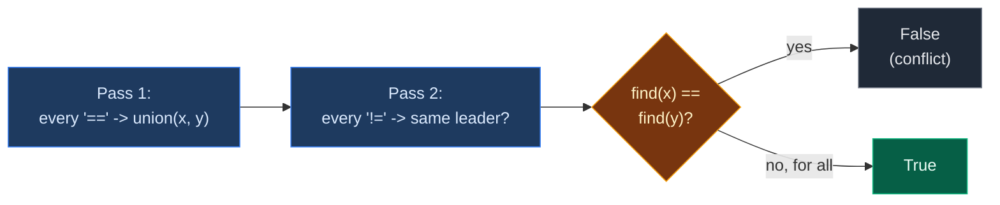
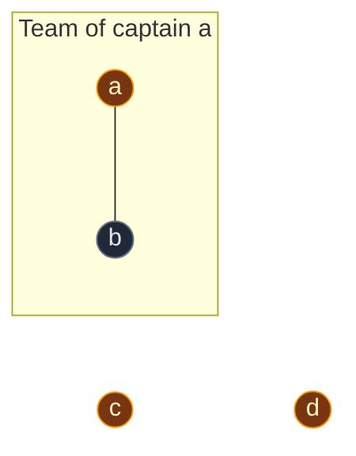
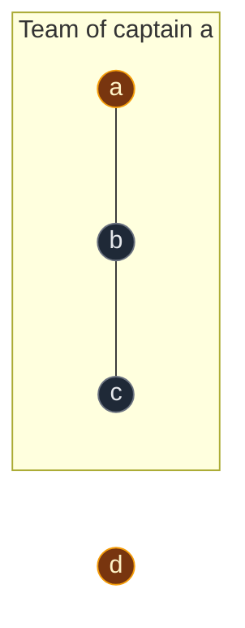
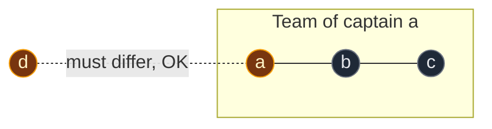
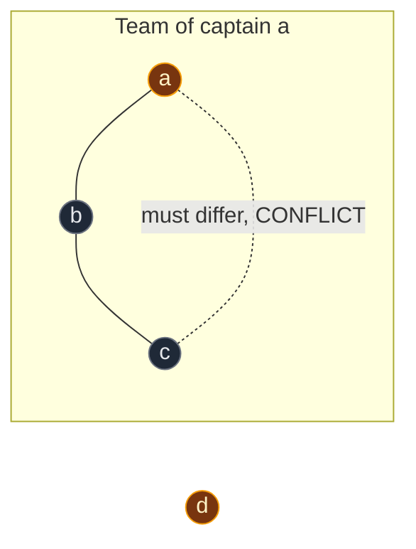

# 02. 990. Satisfiability of Equality Equations

| Difficulty | Pattern | Source | Time | Space |
|:---:|:---:|:---:|:---:|:---:|
| **Medium** | DSU: Equal Groups + Conflict Check | [990. Satisfiability of Equality Equations](https://leetcode.com/problems/satisfiability-of-equality-equations/) | `O(n · α(26))` ≈ `O(n)` | `O(1)` (26 letters) |

## 1. Problem Statement

You get a list of strings called `equations`. Each string is 4 characters long and looks like one of these:

- `"a==b"`: variable `a` must equal variable `b`.
- `"a!=b"`: variable `a` must **not** equal variable `b`.

Variables are single lowercase letters `a` to `z`.

Return `True` if you can give every variable a number so that **all** equations are true. Otherwise return `False`.

### Example

```text
equations = ["a==b", "d!=a", "b==c", "a!=c"]

a == b  and  b == c   ->  so a == c
But the last equation says a != c.
That is impossible.

Output: False
```

We use this same example in every section below.

### Constraints

- `1 <= equations.length <= 500`
- `equations[i].length == 4`
- `equations[i][0]` and `equations[i][3]` are lowercase letters
- `equations[i][1]` is `'='` or `'!'`
- `equations[i][2]` is `'='`

## 2. Core Theory

### `==` builds groups

`==` is "contagious":

```text
a == b
b == c
so a == c
```

So all variables linked by `==` must share one value. They form one **group**. That is exactly what DSU builds.

### `!=` checks the groups

`a != b` says: `a` and `b` must be in **different** groups.

- If they are in different groups, give the groups different numbers. Fine.
- If they are in the **same** group, they must be equal and different at once. **Impossible.**

### Why two passes?

We must finish **all** `==` first, then check **all** `!=`.

Look at this order:

```text
["a!=c", "a==b", "b==c"]
```

If we checked `a!=c` first, `a` and `c` are still in different groups. It looks fine. But later `a==b` and `b==c` put `a` and `c` together. The early check was wrong.

So:



### Letters to numbers

DSU works with numbers `0..25`. Turn a letter into a number with:

```text
ord(letter) - ord('a')

a -> 0, b -> 1, c -> 2, d -> 3, ..., z -> 25
```

### Reading one equation

```text
"a==b"
 0123   <- positions

eq[0] = left letter
eq[1] = '=' for "==", '!' for "!="
eq[3] = right letter
```

## 3. Edge Cases

| Case | Input | Expected | Why it matters |
|:---|:---|:---:|:---|
| A letter not equal to itself | `["a!=a"]` | `False` | `find(a) == find(a)` is always true, so it is caught with no extra code |
| A letter equal to itself | `["a==a"]` | `True` | `union(a, a)` does nothing |
| `!=` comes before `==` | `["a!=c","a==b","b==c"]` | `False` | Shows why we need two passes |
| Only `!=` | `["a!=b","b!=c","c!=a"]` | `True` | Three different numbers work. `!=` never joins groups |
| `!=` is not contagious | `["a!=b","b!=c","a==c"]` | `True` | `a = c = 1`, `b = 2` works |

## 4. Brute Force: Graph + DFS Coloring

### Idea

1. Build a graph with an edge for every `==`.
2. Run DFS to give each connected piece a color number.
3. For every `!=`, if both letters have the same color, return `False`.

### Code

```python
# Import List for type hints
from typing import List


# Solve with a graph and DFS coloring
class SolutionDFS:

    # Main method
    def equationsPossible(self, equations: List[str]) -> bool:

        # One neighbor list per letter
        graph = [[] for _ in range(26)]

        # Add an edge for every "=="
        for eq in equations:

            # Only equalities make edges
            if eq[1] == "=":

                # Turn the left letter into a number
                x = ord(eq[0]) - ord("a")

                # Turn the right letter into a number
                y = ord(eq[3]) - ord("a")

                # Edge from x to y
                graph[x].append(y)

                # Edge from y to x
                graph[y].append(x)

        # Color of each letter, -1 means not colored yet
        color = [-1] * 26

        # Give every connected piece its own color
        for start in range(26):

            # Skip letters already colored
            if color[start] != -1:
                continue

            # Use the start letter as the color number
            color[start] = start

            # Use a stack for DFS
            stack = [start]

            # Color the whole piece
            while stack:

                # Take the top letter
                node = stack.pop()

                # Look at every neighbor
                for nxt in graph[node]:

                    # Color it only if it is new
                    if color[nxt] == -1:

                        # Same piece, same color
                        color[nxt] = color[start]

                        # Add it to the stack
                        stack.append(nxt)

        # Check every "!="
        for eq in equations:

            # Only inequalities are checked here
            if eq[1] == "!":

                # Turn the left letter into a number
                x = ord(eq[0]) - ord("a")

                # Turn the right letter into a number
                y = ord(eq[3]) - ord("a")

                # Same color means they must be equal: conflict
                if color[x] == color[y]:
                    return False

        # No conflict found
        return True
```

### Complexity

| Measure | Complexity | Why |
|:---|:---:|:---|
| **Time** | `O(n)` | Read equations twice, DFS over at most 26 letters and `n` edges |
| **Space** | `O(n)` | Graph edges, plus 26 colors |

Works fine. DSU does the same grouping with less code and no graph.

## 5. Optimal Approach: DSU, Two Passes

### Idea

1. Make a DSU for 26 letters.
2. **Pass 1:** for every `"x==y"`, call `union(x, y)`.
3. **Pass 2:** for every `"x!=y"`, if `find(x) == find(y)`, return `False`.
4. If no conflict, return `True`.

### Visual Walkthrough (Story Version)

Before the arrays, let us see the idea as a story.

**The story:** kids `a`, `b`, `c`, `d` are getting T-shirts for a class photo. The teacher has 4 notes:

```text
Note 1: "a==b"  ->  a and b must wear the SAME color
Note 2: "d!=a"  ->  d and a must wear DIFFERENT colors
Note 3: "b==c"  ->  b and c must wear the SAME color
Note 4: "a!=c"  ->  a and c must wear DIFFERENT colors
```

**The rules:**

- Kids who must wear the same color stand in one **color team**. Every team has one **captain**.
- **Round 1:** the teacher reads only the "same color" notes and builds the teams.
- **Round 2:** the teacher reads only the "different color" notes. If two kids who must differ are on the **same** team, the photo is impossible.

**How to read the pictures:** gold circle = team captain. Line = "same color" note. Box = one color team. Dotted line = "different color" note being checked.

**Start: every kid is alone**


**Round 1, note 1: `"a==b"` (same color)**

- Kid `a`'s captain is `a`. Kid `b`'s captain is `b`.
- Different captains, so the teams join. `a` stays captain.



**Round 1, note 2: `"d!=a"` (different color)**

- This is a "different" note. Round 1 skips it. We come back to it in round 2.

**Round 1, note 3: `"b==c"` (same color)**

- Kid `b`'s captain is `a`. Kid `c`'s captain is `c`.
- Different captains, so the teams join. `a`'s team is bigger, so `a` stays captain.
- Now `a`, `b`, and `c` must all wear the same color.



**Round 1, note 4: `"a!=c"` (different color)**

- A "different" note. Round 1 skips it.

Round 1 is done. Teams: `{a, b, c}` and `{d}`.

**Round 2, note 2: `"d!=a"`**

- Kid `d`'s captain is `d`. Kid `a`'s captain is `a`.
- Different teams. They can wear different colors. **OK.**



**Round 2, note 4: `"a!=c"`**

- Kid `a`'s captain is `a`. Kid `c`'s captain is `a`.
- **Same team!** `a` and `c` must wear the same color (because of `a==b` and `b==c`).
- But this note says they must wear different colors. **Impossible.**



Answer: **`False`**.

**All notes at a glance**

| Round | Note | Captains | Same team? | What happens |
|:---:|:---|:---:|:---:|:---|
| 1 | `a==b` | a, b | No | Teams join: `{a,b}` |
| 1 | `d!=a` | – | – | Skip in round 1 |
| 1 | `b==c` | a, c | No | Teams join: `{a,b,c}` |
| 1 | `a!=c` | – | – | Skip in round 1 |
| 2 | `d!=a` | d, a | No | OK |
| 2 | `a!=c` | a, a | Yes | **Conflict, return False** |

**What the story teaches**

| In the story | In the code |
|:---|:---|
| Kid | Letter `0..25` |
| "Same color" note | `"x==y"` |
| "Different color" note | `"x!=y"` |
| Color team | DSU group |
| Team captain | Leader, `find(x)` |
| Round 1 | Pass 1: `union(x, y)` for every `==` |
| Round 2 | Pass 2: check `find(x) == find(y)` for every `!=` |
| Photo impossible | `return False` |

Now the same steps again, this time with the exact arrays.

### Step-by-Step Example

```text
equations = ["a==b", "d!=a", "b==c", "a!=c"]
a -> 0, b -> 1, c -> 2, d -> 3
```

The DSU has 26 slots. Only `a` to `d` are used here, so we show only those 4.

**Start**

```text
letter:  a b c d
index:   0 1 2 3
parent:  0 1 2 3
size:    1 1 1 1
```

**Pass 1, step 1: `"a==b"`, call `union(0, 1)`**

1. `eq[1] = '='`, so this is an equality.
2. `find(0)`: `parent[0] = 0`. Leader is `0` (`a`).
3. `find(1)`: `parent[1] = 1`. Leader is `1` (`b`).
4. Leaders are different, so we join.
5. `size[0] = 1` and `size[1] = 1`. Equal, so no swap. `0` stays on top.
6. Put `1` under `0`: `parent[1] = 0`.
7. `size[0] = 1 + 1 = 2`.

```text
letter:  a b c d
parent:  0 0 2 3
size:    2 1 1 1
Groups: {a,b} {c} {d}
```

**Pass 1, step 2: `"d!=a"`**

1. `eq[1] = '!'`, so this is not an equality. Skip it in pass 1.

**Pass 1, step 3: `"b==c"`, call `union(1, 2)`**

1. `eq[1] = '='`, so this is an equality.
2. `find(1)`: `parent[1] = 0`, not itself. Go up to `0`.
3. `find(0)`: `parent[0] = 0`. Leader is `0`. On the way back, `parent[1] = 0` (no change).
4. `find(2)`: `parent[2] = 2`. Leader is `2`.
5. Leaders `0` and `2` are different, so we join.
6. `size[0] = 2` and `size[2] = 1`. `0` is bigger, no swap.
7. Put `2` under `0`: `parent[2] = 0`.
8. `size[0] = 2 + 1 = 3`.

```text
letter:  a b c d
parent:  0 0 0 3
size:    3 1 1 1
Groups: {a,b,c} {d}

    a        d
   / \
  b   c
```

**Pass 1, step 4: `"a!=c"`**

1. `eq[1] = '!'`. Skip it in pass 1.

**Pass 2, step 1: `"a==b"`**

1. `eq[1] = '='`. Not an inequality. Skip it in pass 2.

**Pass 2, step 2: `"d!=a"`**

1. `eq[1] = '!'`, so we check it.
2. `find(3)`: `parent[3] = 3`. Leader is `3` (`d`).
3. `find(0)`: `parent[0] = 0`. Leader is `0` (`a`).
4. `3 != 0`. Different groups. **No conflict.** Keep going.

**Pass 2, step 3: `"b==c"`**

1. `eq[1] = '='`. Skip it in pass 2.

**Pass 2, step 4: `"a!=c"`**

1. `eq[1] = '!'`, so we check it.
2. `find(0)`: leader is `0`.
3. `find(2)`: `parent[2] = 0`, then `parent[0] = 0`. Leader is `0`.
4. `0 == 0`. Same group. **Conflict.**
5. **Return `False`.**

### Code

```python
# Import List for type hints
from typing import List


# Reusable DSU with union by size and path compression
class DSU:

    # Set up the arrays
    def __init__(self, n: int):

        # Every node starts as its own leader
        self.parent = list(range(n))

        # Every group starts with 1 node
        self.size = [1] * n

    # Find the leader of a node
    def find(self, node: int) -> int:

        # A node that points to itself is the leader
        if self.parent[node] == node:
            return node

        # Find the leader and point this node straight at it (path compression)
        self.parent[node] = self.find(self.parent[node])

        # Return the leader
        return self.parent[node]

    # Join the groups of u and v
    def union(self, u: int, v: int) -> bool:

        # Find the leader of u
        leader_u = self.find(u)

        # Find the leader of v
        leader_v = self.find(v)

        # Same leader means already in one group
        if leader_u == leader_v:
            return False

        # Make sure leader_u has the bigger group
        if self.size[leader_u] < self.size[leader_v]:
            leader_u, leader_v = leader_v, leader_u

        # Put the smaller group under the bigger group
        self.parent[leader_v] = leader_u

        # Add the smaller group's size to the new leader
        self.size[leader_u] += self.size[leader_v]

        # Join was done
        return True


# Solution for 990. Satisfiability of Equality Equations
class Solution:

    # Main method
    def equationsPossible(self, equations: List[str]) -> bool:

        # One DSU slot per lowercase letter
        dsu = DSU(26)

        # Pass 1: build groups from every "=="
        for eq in equations:

            # Only equalities join groups
            if eq[1] == "=":

                # Turn the left letter into a number
                x = ord(eq[0]) - ord("a")

                # Turn the right letter into a number
                y = ord(eq[3]) - ord("a")

                # These two must be equal, so join their groups
                dsu.union(x, y)

        # Pass 2: check every "!="
        for eq in equations:

            # Only inequalities are checked
            if eq[1] == "!":

                # Turn the left letter into a number
                x = ord(eq[0]) - ord("a")

                # Turn the right letter into a number
                y = ord(eq[3]) - ord("a")

                # Same group means they must be equal: conflict
                if dsu.find(x) == dsu.find(y):
                    return False

        # No conflict found
        return True


# Check the example from this note, step by step
dsu = DSU(26)

# Pass 1, step 1: "a==b"
assert dsu.union(0, 1) is True
assert dsu.parent[:4] == [0, 0, 2, 3] and dsu.size[:4] == [2, 1, 1, 1]

# Pass 1, step 3: "b==c"
assert dsu.union(1, 2) is True
assert dsu.parent[:4] == [0, 0, 0, 3] and dsu.size[:4] == [3, 1, 1, 1]

# Pass 2, step 2: "d!=a" has different leaders, so it is fine
assert dsu.find(3) == 3 and dsu.find(0) == 0

# Pass 2, step 4: "a!=c" has the same leader, so it is a conflict
assert dsu.find(0) == dsu.find(2) == 0

# Full solution on the example
example = ["a==b", "d!=a", "b==c", "a!=c"]
assert Solution().equationsPossible(example) is False

# LeetCode example 1
assert Solution().equationsPossible(["a==b", "b!=a"]) is False

# LeetCode example 2
assert Solution().equationsPossible(["b==a", "a==b"]) is True

# A letter not equal to itself
assert Solution().equationsPossible(["a!=a"]) is False

# A letter equal to itself
assert Solution().equationsPossible(["a==a"]) is True

# "!=" comes before "=="
assert Solution().equationsPossible(["a!=c", "a==b", "b==c"]) is False

# "!=" is not contagious
assert Solution().equationsPossible(["a!=b", "b!=c", "a==c"]) is True

# DFS brute force gives the same answers
assert SolutionDFS().equationsPossible(example) is False
assert SolutionDFS().equationsPossible(["a!=b", "b!=c", "a==c"]) is True
assert SolutionDFS().equationsPossible(["a!=a"]) is False

# All checks passed
print("All tests passed")
```

### Complexity

| Measure | Complexity | Why |
|:---|:---:|:---|
| **Time** | `O(n · α(26))` ≈ `O(n)` | Two passes over `n` equations, each `find`/`union` almost `O(1)` |
| **Space** | `O(1)` | DSU always has 26 slots, no matter how many equations |

## 6. Common Mistakes

| Mistake | What goes wrong | Fix |
|:---|:---|:---|
| Checking `!=` in the same loop as `==` | An early `!=` passes before later `==` joins the letters | Two passes: all `==` first, then all `!=` |
| Joining letters for `!=` | `!=` is not contagious. Joining makes false conflicts | Only `==` calls `union` |
| Reading the second letter from `eq[2]` | `eq[2]` is always `'='` | The second letter is `eq[3]` |
| Checking `eq[1] == "!="` | `eq[1]` is one character | Check `eq[1] == "="` or `eq[1] == "!"` |
| Special-casing `"a!=a"` | Extra code | Not needed. `find(a) == find(a)` already returns `False` |

## 7. Interview Follow-ups

### Q1. Why must all `==` come before all `!=`?

**Answer:**
- A later `==` can put two letters together.
- An earlier `!=` check would not know that yet.
- So we finish building groups first, then check.

### Q2. Why do we not join letters for `!=`?

**Answer:**
- `==` is contagious: `a==b` and `b==c` gives `a==c`.
- `!=` is not: `a!=b` and `b!=c` does **not** give `a!=c`.
- Groups only make sense for `==`.

### Q3. What if variables were full words, not single letters?

**Answer:**
- Use a dictionary to give each new word the next number.
- Or use a DSU that stores `parent` in a dictionary.
- The two passes stay the same.

### Q4. How would you return the actual values?

**Answer:**
- After pass 1, give each group leader a different number, for example `find(x)` itself.
- Every letter gets the number of its leader.
- If pass 2 finds no conflict, these values satisfy all equations.

### Q5. Could you also support `<` and `>`?

**Answer:**
- Not with DSU alone. Order is not a "same group" idea.
- Build a directed graph for `<` and check for a cycle (topological sort).
- Use DSU first to merge `==` letters into single nodes.

## 8. Interview Explanation

> Equality is contagious: if a equals b and b equals c, then a equals c. So all letters joined by equal signs form one group, which is exactly what DSU builds. I make a DSU with 26 slots. In the first pass I call union for every "==" equation. In the second pass I look at every "!=" equation. If both letters have the same leader, they must be equal and different at the same time, so I return false. If no inequality fails, I return true. I need two passes because a later "==" can merge letters that an early "!=" checked. It runs in O(n) time, and the DSU uses constant space because there are only 26 letters.
