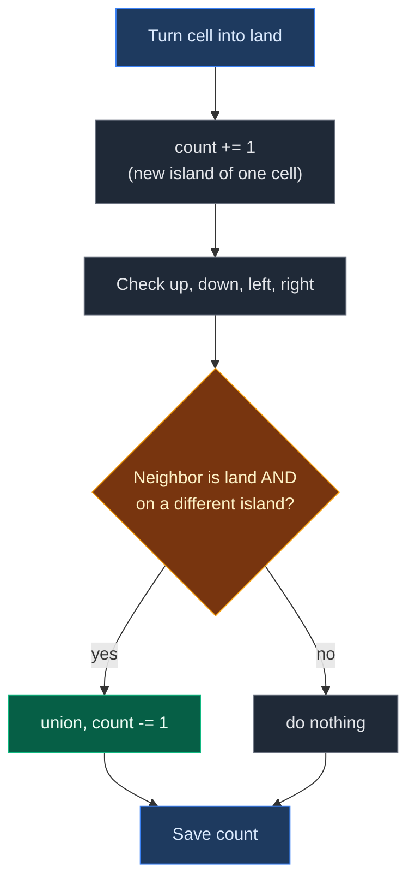

# 01. 305. Number of Islands II

| Difficulty | Pattern | Source | Time | Space |
|:---:|:---:|:---:|:---:|:---:|
| **Hard** | Dynamic Grid DSU | [305. Number of Islands II](https://leetcode.com/problems/number-of-islands-ii/) | `O(m·n + k · α(m·n))` | `O(m·n)` |

## 1. Problem Statement

You have a grid with `m` rows and `n` columns. At the start, **every cell is water**.

You get a list `positions`. Each `positions[i] = [r, c]` means: turn cell `(r, c)` from water into land.

After **each** operation, count the islands. An island is a group of land cells joined up, down, left, or right. Diagonal cells do not join.

Return a list with the island count after every operation.

### Example

```text
m = 3, n = 3
positions = [[0,0], [0,1], [1,2], [2,1], [1,1]]

After [0,0]:    After [0,1]:    After [1,2]:    After [2,1]:    After [1,1]:
1 0 0           1 1 0           1 1 0           1 1 0           1 1 0
0 0 0           0 0 0           0 0 1           0 0 1           0 1 1
0 0 0           0 0 0           0 0 0           0 1 0           0 1 0
1 island        1 island        2 islands       3 islands       1 island

Output: [1, 1, 2, 3, 1]
```

We use this same example in every section below.

### Constraints

- `1 <= m, n, positions.length <= 10^4`
- `1 <= m * n <= 10^4`
- `0 <= r < m`, `0 <= c < n`
- The same cell can appear more than once

## 2. Core Theory

### What is different from 200. Number of Islands?

- In [200. Number of Islands](../../02.%20BFS%20and%20DFS/01.%20Connected%20Components%20%28Grid%20and%20Matrix%29/02.%20200.%20Number%20of%20Islands.md), the full grid is given once. You count once.
- Here, land is added **one cell at a time**. You must give the count after **every** step.
- Running BFS again after every step is slow. DSU keeps the count up to date as we go.

### The one rule to remember

Every new land cell **starts a new island**: count goes up by 1.

Then look at its 4 neighbors. For every neighbor that is land on a **different** island, join them: count goes down by 1.



### Why "different island" matters

A new cell can touch **the same island** from two sides:

```text
1 1
1 X      <- X touches the island from the top AND from the left
```

- Top neighbor: different island from X, so join. Count goes down by 1.
- Left neighbor: now already the same island as X. `union` returns `False`. Count does **not** change.

So we decrease the count only when `union` returns `True`.

### Turning a cell into a DSU node

DSU works with numbers, not `(row, col)` pairs. So every cell gets one id:

```text
id = row * n + col        (n = number of columns)

For a 3 x 3 grid:
       col 0  col 1  col 2
row 0    0      1      2
row 1    3      4      5
row 2    6      7      8

(1, 2) -> 1 * 3 + 2 = 5
```

### Why we need a `land` array

The DSU has a node for every cell from the start. But a cell is only part of an island **after** it becomes land. So we keep `land[id] = True/False` and only join with neighbors that are land.

## 3. Edge Cases

| Case | Input | Expected | Why it matters |
|:---|:---|:---:|:---|
| Same cell twice | `[[0,0],[0,0]]` | `[1, 1]` | Second time is not new land. Do not add 1 again |
| New cell joins two islands | middle cell between two islands | count goes down by 2 | Two successful joins |
| New cell touches one island from two sides | 2x2 corner case above | count goes down by 1 only | Second `union` returns `False` |
| Diagonal neighbors | `[[0,0],[1,1]]` | `[1, 2]` | Diagonals do not join |
| Edge of the grid | cell on row 0 | Works | Skip neighbors outside the grid |
| 1 x 1 grid | `m = n = 1`, `[[0,0]]` | `[1]` | Smallest grid |

## 4. Brute Force: Count Islands Again After Every Step

### Idea

Keep the grid. After each new land cell, run a full BFS island count, like in 200. Number of Islands.

### Code

```python
# Import deque for the BFS queue
from collections import deque

# Import List for type hints
from typing import List


# Recount all islands after every step
class SolutionBrute:

    # Main method
    def numIslands2(self, m: int, n: int, positions: List[List[int]]) -> List[int]:

        # Start with all water
        grid = [[0] * n for _ in range(m)]

        # Answers after each step
        answer = []

        # Add land one cell at a time
        for r, c in positions:

            # Turn this cell into land
            grid[r][c] = 1

            # Count islands on the whole grid again
            answer.append(self.count_islands(grid, m, n))

        # Return all counts
        return answer

    # Count islands with BFS
    def count_islands(self, grid, m, n):

        # Track visited cells
        seen = [[False] * n for _ in range(m)]

        # Number of islands found
        count = 0

        # Look at every cell
        for r in range(m):

            # Look at every column in this row
            for c in range(n):

                # Unvisited land starts a new island
                if grid[r][c] == 1 and not seen[r][c]:

                    # Count the island
                    count += 1

                    # Mark the start cell
                    seen[r][c] = True

                    # Start BFS from here
                    queue = deque([(r, c)])

                    # Visit the whole island
                    while queue:

                        # Take the next cell
                        x, y = queue.popleft()

                        # Try all 4 directions
                        for dx, dy in [(-1, 0), (1, 0), (0, -1), (0, 1)]:

                            # Neighbor position
                            nx, ny = x + dx, y + dy

                            # Visit it if it is inside, land, and new
                            if 0 <= nx < m and 0 <= ny < n and grid[nx][ny] == 1 and not seen[nx][ny]:

                                # Mark it
                                seen[nx][ny] = True

                                # Add it to the queue
                                queue.append((nx, ny))

        # Return the island count
        return count
```

### Complexity

| Measure | Complexity | Why |
|:---|:---:|:---|
| **Time** | `O(k · m · n)` | `k` steps, each scans the whole grid |
| **Space** | `O(m · n)` | Grid, `seen`, and the queue |

With `k = 10^4` and `m · n = 10^4`, this is `10^8` steps. Too slow.

## 5. Optimal Approach: DSU That Grows with the Grid

### Idea

1. Make a DSU with `m * n` nodes. Make `land = [False] * (m * n)`. Set `islands = 0`.
2. For each position `(r, c)`:
   - Get `id = r * n + c`.
   - If `land[id]` is already `True`, save `islands` and move on.
   - Else set `land[id] = True` and `islands += 1`.
   - For each of the 4 neighbors inside the grid that is land: if `union(id, neighbor)` returns `True`, `islands -= 1`.
   - Save `islands`.
3. Return the saved list.

### Visual Walkthrough (Story Version)

Before the arrays, let us see the idea as a story.

**The story:** a sea has 9 spots in a 3 by 3 square. Every day, a small volcano pushes up one new piece of land. Every evening, a sailor counts how many islands there are.

**The rules:**

- A new piece of land is a brand new tiny island. The sailor adds 1.
- If the new land touches another island (up, down, left, or right), the two islands join into one. The sailor takes away 1.
- If the new land touches the **same** island twice, it only joins once. Take away 1 only once.
- Every island has a **captain** spot. Two spots are on the same island if they have the same captain.

**How to read the pictures:** `~` = water. Letters = land, same letter = same island. `*` = the captain spot of that island.

**The spot numbers**

```text
0 1 2
3 4 5
6 7 8
```

**Start: all water**

```text
~  ~  ~
~  ~  ~
~  ~  ~
Islands: 0
```

**Day 1: land appears at (0,0), spot 0**

- New land. Islands: 0 + 1 = 1.
- Look around: up is outside, down (spot 3) is water, left is outside, right (spot 1) is water.
- Nothing to join.

```text
A* ~  ~
~  ~  ~
~  ~  ~
Islands: 1      Sailor writes: [1]
```

**Day 2: land appears at (0,1), spot 1**

- New land. Islands: 1 + 1 = 2.
- Up: outside. Down (spot 4): water.
- Left (spot 0): land, island A. Different island from the new spot, so they join. Islands: 2 - 1 = 1.
- Right (spot 2): water.

```text
A  A* ~
~  ~  ~
~  ~  ~
Islands: 1      Sailor writes: [1, 1]
```

The new spot 1 became the captain, because both islands were the same size and the new spot was asked first.

**Day 3: land appears at (1,2), spot 5**

- New land. Islands: 1 + 1 = 2.
- Up (spot 2): water. Down (spot 8): water. Left (spot 4): water. Right: outside.
- Nothing to join.

```text
A  A* ~
~  ~  B*
~  ~  ~
Islands: 2      Sailor writes: [1, 1, 2]
```

**Day 4: land appears at (2,1), spot 7**

- New land. Islands: 2 + 1 = 3.
- Up (spot 4): water. Down: outside. Left (spot 6): water. Right (spot 8): water.
- Nothing to join.

```text
A  A* ~
~  ~  B*
~  C* ~
Islands: 3      Sailor writes: [1, 1, 2, 3]
```

**Day 5: land appears at (1,1), spot 4, right in the middle**

- New land. Islands: 3 + 1 = 4. Call the new tiny island D.

```text
A  A* ~
~  D* B*
~  C* ~
Islands: 4 (for a moment)
```

- **Up (spot 1):** land, island A. D and A are different. Join. Island A is bigger, so A's captain (spot 1) leads. Islands: 4 - 1 = 3.

```text
A  A* ~
~  A  B*
~  C* ~
Islands: 3
```

- **Down (spot 7):** land, island C. Different from A. Join. Islands: 3 - 1 = 2.

```text
A  A* ~
~  A  B*
~  A  ~
Islands: 2
```

- **Left (spot 3):** water. Skip.
- **Right (spot 5):** land, island B. Different from A. Join. Islands: 2 - 1 = 1.

```text
A  A* ~
~  A  A
~  A  ~
Islands: 1      Sailor writes: [1, 1, 2, 3, 1]
```

One new spot joined three islands into one.

**All days at a glance**

| Day | New spot | +1 for new land | Joins that worked | Islands at night |
|:---:|:---:|:---:|:---:|:---:|
| 1 | 0 | 1 | 0 | 1 |
| 2 | 1 | 2 | 1 (with A) | 1 |
| 3 | 5 | 2 | 0 | 2 |
| 4 | 7 | 3 | 0 | 3 |
| 5 | 4 | 4 | 3 (with A, C, B) | 1 |

**What the story teaches**

| In the story | In the code |
|:---|:---|
| Spot number | `id = r * n + col` |
| Volcano pushes up land | `land[id] = True` |
| Sailor adds 1 | `islands += 1` |
| Two islands join | `union(id, neighbor)` returns `True`, `islands -= 1` |
| Same island touched again | `union` returns `False`, no change |
| Captain spot | `find(id)` |
| Sailor's notebook | `answer` list |

Now the same steps again, this time with the exact arrays.

### Step-by-Step Example

```text
m = 3, n = 3
positions = [[0,0], [0,1], [1,2], [2,1], [1,1]]
Directions checked in this order: up, down, left, right
```

**Start**

```text
id:      0 1 2 3 4 5 6 7 8
parent:  0 1 2 3 4 5 6 7 8
size:    1 1 1 1 1 1 1 1 1
land:    F F F F F F F F F
islands = 0
```

**Query 1: `[0,0]`**

1. `id = 0 * 3 + 0 = 0`.
2. `land[0]` is `False`, so this is new land. Set `land[0] = True`.
3. `islands = 0 + 1 = 1`.
4. Up `(-1,0)`: outside the grid. Skip.
5. Down `(1,0)`: `id 3`, `land[3] = False`. Skip.
6. Left `(0,-1)`: outside. Skip.
7. Right `(0,1)`: `id 1`, `land[1] = False`. Skip.
8. Save `1`. Answer: `[1]`.

```text
parent:  0 1 2 3 4 5 6 7 8
size:    1 1 1 1 1 1 1 1 1
land:    T F F F F F F F F
islands = 1
```

**Query 2: `[0,1]`**

1. `id = 0 * 3 + 1 = 1`.
2. `land[1]` is `False`. Set `land[1] = True`.
3. `islands = 1 + 1 = 2`.
4. Up `(-1,1)`: outside. Skip.
5. Down `(1,1)`: `id 4`, water. Skip.
6. Left `(0,0)`: `id 0`, land. Call `union(1, 0)`:
   - `find(1)`: `parent[1] = 1`. Leader `1`.
   - `find(0)`: `parent[0] = 0`. Leader `0`.
   - Different leaders.
   - `size[1] = 1`, `size[0] = 1`. Equal, no swap. `1` stays on top.
   - `parent[0] = 1`. `size[1] = 2`.
   - Returns `True`, so `islands = 2 - 1 = 1`.
7. Right `(0,2)`: `id 2`, water. Skip.
8. Save `1`. Answer: `[1, 1]`.

```text
parent:  1 1 2 3 4 5 6 7 8
size:    1 2 1 1 1 1 1 1 1
land:    T T F F F F F F F
islands = 1
```

**Query 3: `[1,2]`**

1. `id = 1 * 3 + 2 = 5`.
2. `land[5]` is `False`. Set `land[5] = True`.
3. `islands = 1 + 1 = 2`.
4. Up `(0,2)`: `id 2`, water. Skip.
5. Down `(2,2)`: `id 8`, water. Skip.
6. Left `(1,1)`: `id 4`, water. Skip.
7. Right `(1,3)`: outside. Skip.
8. Save `2`. Answer: `[1, 1, 2]`.

```text
parent:  1 1 2 3 4 5 6 7 8
size:    1 2 1 1 1 1 1 1 1
land:    T T F F F T F F F
islands = 2
```

**Query 4: `[2,1]`**

1. `id = 2 * 3 + 1 = 7`.
2. `land[7]` is `False`. Set `land[7] = True`.
3. `islands = 2 + 1 = 3`.
4. Up `(1,1)`: `id 4`, water. Skip.
5. Down `(3,1)`: outside. Skip.
6. Left `(2,0)`: `id 6`, water. Skip.
7. Right `(2,2)`: `id 8`, water. Skip.
8. Save `3`. Answer: `[1, 1, 2, 3]`.

```text
parent:  1 1 2 3 4 5 6 7 8
size:    1 2 1 1 1 1 1 1 1
land:    T T F F F T F T F
islands = 3
```

**Query 5: `[1,1]`**

1. `id = 1 * 3 + 1 = 4`.
2. `land[4]` is `False`. Set `land[4] = True`.
3. `islands = 3 + 1 = 4`.
4. Up `(0,1)`: `id 1`, land. Call `union(4, 1)`:
   - `find(4)`: `parent[4] = 4`. Leader `4`.
   - `find(1)`: `parent[1] = 1`. Leader `1`.
   - Different leaders.
   - `size[4] = 1`, `size[1] = 2`. `4` is smaller, so swap: `leader_u = 1`, `leader_v = 4`.
   - `parent[4] = 1`. `size[1] = 2 + 1 = 3`.
   - Returns `True`, so `islands = 4 - 1 = 3`.
5. Down `(2,1)`: `id 7`, land. Call `union(4, 7)`:
   - `find(4)`: `parent[4] = 1`, go up. `parent[1] = 1`. Leader `1`.
   - `find(7)`: `parent[7] = 7`. Leader `7`.
   - Different leaders.
   - `size[1] = 3`, `size[7] = 1`. No swap.
   - `parent[7] = 1`. `size[1] = 3 + 1 = 4`.
   - Returns `True`, so `islands = 3 - 1 = 2`.
6. Left `(1,0)`: `id 3`, water. Skip.
7. Right `(1,2)`: `id 5`, land. Call `union(4, 5)`:
   - `find(4)`: leader `1`.
   - `find(5)`: `parent[5] = 5`. Leader `5`.
   - Different leaders.
   - `size[1] = 4`, `size[5] = 1`. No swap.
   - `parent[5] = 1`. `size[1] = 4 + 1 = 5`.
   - Returns `True`, so `islands = 2 - 1 = 1`.
8. Save `1`. Answer: `[1, 1, 2, 3, 1]`.

```text
parent:  1 1 2 3 1 1 6 1 8
size:    1 5 1 1 1 1 1 1 1
land:    T T F F T T F T F
islands = 1

Tree:
          1
      / / | \
     0  4 7  5
```

### Code

```python
# Import List for type hints
from typing import List


# Reusable DSU with union by size and path compression
class DSU:

    # Set up the arrays
    def __init__(self, n: int):

        # Every node starts as its own leader
        self.parent = list(range(n))

        # Every group starts with 1 node
        self.size = [1] * n

    # Find the leader of a node
    def find(self, node: int) -> int:

        # A node that points to itself is the leader
        if self.parent[node] == node:
            return node

        # Find the leader and point this node straight at it (path compression)
        self.parent[node] = self.find(self.parent[node])

        # Return the leader
        return self.parent[node]

    # Join the groups of u and v
    def union(self, u: int, v: int) -> bool:

        # Find the leader of u
        leader_u = self.find(u)

        # Find the leader of v
        leader_v = self.find(v)

        # Same leader means already in one group
        if leader_u == leader_v:
            return False

        # Make sure leader_u has the bigger group
        if self.size[leader_u] < self.size[leader_v]:
            leader_u, leader_v = leader_v, leader_u

        # Put the smaller group under the bigger group
        self.parent[leader_v] = leader_u

        # Add the smaller group's size to the new leader
        self.size[leader_u] += self.size[leader_v]

        # Join was done
        return True


# Solution for 305. Number of Islands II
class Solution:

    # Main method
    def numIslands2(self, m: int, n: int, positions: List[List[int]]) -> List[int]:

        # One DSU node for every cell
        dsu = DSU(m * n)

        # Which cells are land right now
        land = [False] * (m * n)

        # Current number of islands
        islands = 0

        # Counts after each step
        answer = []

        # Up, down, left, right
        directions = [(-1, 0), (1, 0), (0, -1), (0, 1)]

        # Process each new land cell
        for r, c in positions:

            # Turn (row, col) into one number
            cell = r * n + c

            # Same cell again: nothing changes
            if land[cell]:

                # Save the current count
                answer.append(islands)

                # Go to the next position
                continue

            # Mark the cell as land
            land[cell] = True

            # New land is a new island
            islands += 1

            # Look at all 4 neighbors
            for dr, dc in directions:

                # Neighbor row
                nr = r + dr

                # Neighbor column
                nc = c + dc

                # Skip neighbors outside the grid
                if nr < 0 or nr >= m or nc < 0 or nc >= n:
                    continue

                # Neighbor id
                neighbor = nr * n + nc

                # Skip water
                if not land[neighbor]:
                    continue

                # Join only if they were different islands
                if dsu.union(cell, neighbor):

                    # Two islands became one
                    islands -= 1

            # Save the count for this step
            answer.append(islands)

        # Return all counts
        return answer


# Check the example from this note, step by step
dsu = DSU(9)

# Query 1: [0,0], id 0, no land neighbors
islands = 1
assert dsu.parent == [0, 1, 2, 3, 4, 5, 6, 7, 8] and islands == 1

# Query 2: [0,1], id 1, joins with id 0 on the left
islands += 1
assert dsu.union(1, 0) is True
islands -= 1
assert dsu.parent == [1, 1, 2, 3, 4, 5, 6, 7, 8] and dsu.size[1] == 2 and islands == 1

# Query 3: [1,2], id 5, no land neighbors
islands += 1
assert islands == 2

# Query 4: [2,1], id 7, no land neighbors
islands += 1
assert islands == 3

# Query 5: [1,1], id 4, starts as a new island
islands += 1
assert islands == 4

# Query 5, up: join with id 1 (4 goes under 1 because 1 is bigger)
assert dsu.union(4, 1) is True
islands -= 1
assert dsu.parent[4] == 1 and dsu.size[1] == 3 and islands == 3

# Query 5, down: join with id 7
assert dsu.union(4, 7) is True
islands -= 1
assert dsu.parent[7] == 1 and dsu.size[1] == 4 and islands == 2

# Query 5, right: join with id 5
assert dsu.union(4, 5) is True
islands -= 1
assert dsu.parent == [1, 1, 2, 3, 1, 1, 6, 1, 8] and dsu.size[1] == 5 and islands == 1

# Full solution on the example
positions = [[0, 0], [0, 1], [1, 2], [2, 1], [1, 1]]
assert Solution().numIslands2(3, 3, positions) == [1, 1, 2, 3, 1]

# Same cell twice does not add an island
assert Solution().numIslands2(3, 3, [[0, 0], [0, 0]]) == [1, 1]

# Touching the same island from two sides joins only once
assert Solution().numIslands2(2, 2, [[0, 0], [0, 1], [1, 0], [1, 1]]) == [1, 1, 1, 1]

# Diagonal cells stay separate
assert Solution().numIslands2(2, 2, [[0, 0], [1, 1]]) == [1, 2]

# 1 x 1 grid
assert Solution().numIslands2(1, 1, [[0, 0]]) == [1]

# Brute force gives the same answers
assert SolutionBrute().numIslands2(3, 3, positions) == [1, 1, 2, 3, 1]
assert SolutionBrute().numIslands2(2, 2, [[0, 0], [1, 1]]) == [1, 2]

# All checks passed
print("All tests passed")
```

### Complexity

| Measure | Complexity | Why |
|:---|:---:|:---|
| **Time** | `O(m·n + k · α(m·n))` | `O(m·n)` to set up the arrays. Each of the `k` steps does at most 4 joins, each almost `O(1)` |
| **Space** | `O(m·n)` | `parent[]`, `size[]`, and `land[]` |

## 6. Common Mistakes

| Mistake | What goes wrong | Fix |
|:---|:---|:---|
| Adding 1 again for a repeated cell | Count is too high | If `land[cell]` is already `True`, just save the count |
| Subtracting 1 for every land neighbor | Same island touched twice is counted twice | Subtract only when `union` returns `True` |
| Joining with water neighbors | Water cells become part of islands | Check `land[neighbor]` first |
| `id = r * m + c` | Wrong ids when `m != n` | Use the number of **columns**: `r * n + c` |
| Checking diagonal neighbors | Islands join when they should not | Use only up, down, left, right |
| Forgetting the bounds check | Index error or wrap-around to another row | Skip `nr`, `nc` outside the grid |

## 7. Interview Follow-ups

### Q1. Why not just run BFS after every step?

**Answer:**
- BFS costs `O(m · n)` per step.
- With `k` steps that is `O(k · m · n)`, about `10^8` here.
- DSU updates the count in almost `O(1)` per step.

### Q2. Why does a new cell add 1 and every join take away 1?

**Answer:**
- A new land cell is alone at first, so it is a new island.
- Each successful join turns two islands into one, so one island disappears.

### Q3. Why does `union` returning `False` matter?

**Answer:**
- A new cell can touch the same island from two sides.
- The second join finds the same leader and returns `False`.
- If we subtracted anyway, the count would be too low.

### Q4. What if a step could turn land back into water?

**Answer:**
- Normal DSU cannot split a group.
- If all steps are known in advance, run them **backward**. Removing land becomes adding land, which DSU can do.
- If steps come live and include removals, you need a harder structure.

### Q5. What if the grid is huge but only a few cells become land?

**Answer:**
- Do not make arrays for every cell.
- Use dictionaries for `parent` and `size`, and add a cell only when it becomes land.
- Memory then depends on `k`, not on `m · n`.

## 8. Interview Explanation

> Land is added one cell at a time, so I keep the island count up to date with a DSU instead of recounting. Each cell gets an id, row times number of columns plus column. I keep a land array and a counter. When a new cell becomes land, it is a new island, so the counter goes up by one. Then I check its four neighbors. For every neighbor that is land, I call union, and if union returns true, two different islands just became one, so the counter goes down by one. If the cell was already land, I just record the current count. Each step is almost constant time, so the total is O(m·n + k·α(m·n)) with O(m·n) space.
