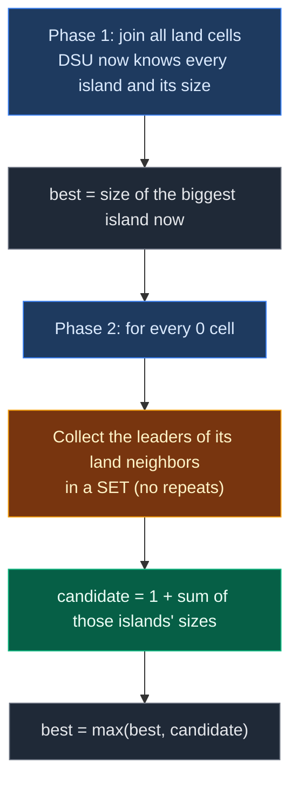

# 02. 827. Making A Large Island

| Difficulty | Pattern | Source | Time | Space |
|:---:|:---:|:---:|:---:|:---:|
| **Hard** | Grid DSU + Size Lookup | [827. Making A Large Island](https://leetcode.com/problems/making-a-large-island/) | `O(n^2 · α(n^2))` | `O(n^2)` |

## 1. Problem Statement

You get an `n x n` grid. `1` is land and `0` is water.

You may change **at most one** `0` into a `1`.

Return the size of the largest island you can get after that change. An island is a group of `1`s joined up, down, left, or right.

### Example

```text
grid = [
    [1, 1, 0],
    [1, 0, 1],
    [0, 1, 1]
]

Island A: (0,0), (0,1), (1,0)   size 3
Island B: (1,2), (2,1), (2,2)   size 3

Flip (1,1) to 1:
1 1 0
1 1 1      <- (1,1) touches A (up, left) and B (down, right)
0 1 1

New island size = 1 + 3 + 3 = 7
Output: 7
```

We use this same example in every section below.

### Constraints

- `n == grid.length == grid[i].length`
- `1 <= n <= 500`
- `grid[i][j]` is `0` or `1`

## 2. Core Theory

### Two phases



### Why DSU fits

After phase 1, for any land cell:

- `find(cell)` tells us **which island** it is on.
- `size[find(cell)]` tells us **how big** that island is.

So checking one water cell takes only 4 quick lookups.

### The most important detail: count each island once

A water cell can touch **the same island** from more than one side:

```text
1 1
1 0      <- the 0 touches the island from the top AND the left
```

- Wrong: `1 + 3 + 3 = 7`. The same island was added twice.
- Right: `1 + 3 = 4`.

So we put the neighbor leaders into a **set**. A set keeps each island only once.

### Do not join anything in phase 2

When we test a water cell, we only **pretend** to flip it. We do not call `union`.

If we joined islands while testing one zero, the DSU would be wrong for the next zero. Every zero must be tested on the original grid.

### Turning a cell into a DSU node

```text
id = row * n + col

For a 3 x 3 grid:
       col 0  col 1  col 2
row 0    0      1      2
row 1    3      4      5
row 2    6      7      8
```

### Joining only right and down in phase 1

Every pair of touching land cells is one left-right pair or one up-down pair. If every land cell joins only with its **right** and **down** neighbor, each pair is joined exactly once. That is enough and keeps the work small.

## 3. Edge Cases

| Case | Input | Expected | Why it matters |
|:---|:---|:---:|:---|
| All land | `[[1,1],[1,1]]` | `4` | No zero to flip. Answer is the biggest island as it is |
| All water | `[[0,0],[0,0]]` | `1` | Flipping any zero makes an island of size 1 |
| One cell, water | `[[0]]` | `1` | Smallest grid |
| One cell, land | `[[1]]` | `1` | No zero to flip |
| Zero touches one island from several sides | 3x3 ring of 1s, center 0 | `9` | Use a set, or you count the ring 4 times |
| Zero touches different islands | Our example | `7` | Sizes from different leaders are added |

## 4. Brute Force: Flip Every Zero and Measure

### Idea

For each `0`: flip it to `1`, run BFS from it to measure its island, then flip it back. Also handle the "no zero" case by measuring the existing islands.

### Code

```python
# Import deque for the BFS queue
from collections import deque

# Import List for type hints
from typing import List


# Try every flip and measure with BFS
class SolutionBrute:

    # Main method
    def largestIsland(self, grid: List[List[int]]) -> int:

        # Grid size
        n = len(grid)

        # Best size seen so far
        best = 0

        # Did we find any zero?
        has_zero = False

        # Try every cell
        for r in range(n):

            # Try every column in this row
            for c in range(n):

                # Only zeros can be flipped
                if grid[r][c] == 0:

                    # Remember that a zero exists
                    has_zero = True

                    # Pretend this zero is land
                    grid[r][c] = 1

                    # Measure the island that now holds this cell
                    best = max(best, self.island_size(grid, n, r, c))

                    # Put the water back
                    grid[r][c] = 0

        # No zero at all: the whole grid is one island
        if not has_zero:
            return n * n

        # Return the best flip
        return best

    # Size of the island that contains (r, c)
    def island_size(self, grid, n, r, c):

        # Track visited cells
        seen = {(r, c)}

        # Start BFS here
        queue = deque([(r, c)])

        # Visit the whole island
        while queue:

            # Take the next cell
            x, y = queue.popleft()

            # Try all 4 directions
            for dx, dy in [(-1, 0), (1, 0), (0, -1), (0, 1)]:

                # Neighbor position
                nx, ny = x + dx, y + dy

                # Visit it if it is inside, land, and new
                if 0 <= nx < n and 0 <= ny < n and grid[nx][ny] == 1 and (nx, ny) not in seen:

                    # Mark it
                    seen.add((nx, ny))

                    # Add it to the queue
                    queue.append((nx, ny))

        # Number of cells reached
        return len(seen)
```

### Complexity

| Measure | Complexity | Why |
|:---|:---:|:---|
| **Time** | `O(n^4)` | Up to `n^2` zeros, each BFS can visit `n^2` cells |
| **Space** | `O(n^2)` | `seen` set and queue |

With `n = 500`, that is about `6 · 10^10`. Far too slow.

## 5. Optimal Approach: Build Islands Once, Then Look Up Sizes

### Idea

1. Make a DSU with `n * n` nodes.
2. **Phase 1:** for every land cell, join it with its right and down land neighbors.
3. Set `best` = the biggest island size (covers the "all land" case).
4. **Phase 2:** for every `0` cell:
   - Make an empty set `leaders`.
   - For each of the 4 neighbors that is land, add `find(neighbor)` to the set.
   - `candidate = 1 + sum(size[leader] for leader in leaders)`.
   - `best = max(best, candidate)`.
5. Return `best`.

### Visual Walkthrough (Story Version)

Before the arrays, let us see the idea as a story.

**The story:** there is a 3 by 3 sea with some islands. You have **one bag of magic sand**. You can pour it on one water spot to turn it into land. Where should you pour it to make the biggest island?

**The rules:**

- First, walk around and name every island. Write down how big each one is.
- Then stand on each water spot and look up, down, left, and right.
- Write down the **names** of the islands you can see. If you see the same island twice, write its name only once.
- If you pour the sand here, the new island size = 1 (the sand spot) + the sizes of all the islands on your list.
- You are only **imagining**. You do not really pour the sand while testing.

**How to read the pictures:** `~` = water. Letters = land, same letter = same island. `*` = the captain spot of that island. `?` = the water spot we are testing.

**The spot numbers**

```text
0 1 2
3 4 5
6 7 8
```

**The sea at the start**

```text
1  1  ~
1  ~  1
~  1  1
```

**Phase 1, step 1: spot 0 holds hands with its right and down neighbors**

- Right (spot 1) is land. Spots 0 and 1 make one island. Spot 0 is captain.
- Down (spot 3) is land. Spot 3 joins the same island.

```text
A* A  ~
A  ~  1
~  1  1
Island A: 3 spots
```

**Phase 1, step 2: spot 1**

- Right (spot 2) is water. Down (spot 4) is water. Nothing to join.

**Phase 1, step 3: spot 3**

- Right (spot 4) is water. Down (spot 6) is water. Nothing to join.

**Phase 1, step 4: spot 5**

- Right is outside. Down (spot 8) is land. Spots 5 and 8 make island B. Spot 5 is captain.

```text
A* A  ~
A  ~  B*
~  1  B
Island A: 3 spots, Island B: 2 spots
```

**Phase 1, step 5: spot 7**

- Right (spot 8) is land, and spot 8 is on island B. Spot 7 joins island B.
- Down is outside.

```text
A* A  ~
A  ~  B*
~  B  B
Island A: 3 spots, Island B: 3 spots
```

**Phase 1, step 6: spot 8**

- Right and down are outside. Nothing to do.

**Biggest island without sand:** 3. So `best = 3`.

**Phase 2: test every water spot**

**Test spot 2 `(0,2)`**

```text
A* A  ?
A  ~  B*
~  B  B
```

- Up: outside. Down (spot 5): island B. Left (spot 1): island A. Right: outside.
- Island list: {A, B}.
- Size if we pour sand here: 1 + 3 + 3 = **7**. `best = 7`.

**Test spot 4 `(1,1)`, the middle**

```text
A* A  ~
A  ?  B*
~  B  B
```

- Up (spot 1): island A. Down (spot 7): island B. Left (spot 3): island A. Right (spot 5): island B.
- We saw A twice and B twice. Island list: {A, B}. Each name only once.
- Size: 1 + 3 + 3 = **7**. Not bigger than 7, so `best` stays 7.
- If we had added every neighbor, we would get 1 + 3 + 3 + 3 + 3 = 13. That is wrong.

**Test spot 6 `(2,0)`**

```text
A* A  ~
A  ~  B*
?  B  B
```

- Up (spot 3): island A. Down: outside. Left: outside. Right (spot 7): island B.
- Island list: {A, B}.
- Size: 1 + 3 + 3 = **7**. `best` stays 7.

**Best place: spot 2 (the first one that gave 7).** Answer: **7**.

**All tests at a glance**

| Water spot | Islands seen | Island list (no repeats) | 1 + sizes | Best so far |
|:---:|:---|:---:|:---:|:---:|
| start | – | – | – | 3 |
| 2 | B, A | {A, B} | 1 + 3 + 3 = 7 | 7 |
| 4 | A, B, A, B | {A, B} | 1 + 3 + 3 = 7 | 7 |
| 6 | A, B | {A, B} | 1 + 3 + 3 = 7 | 7 |

**What the story teaches**

| In the story | In the code |
|:---|:---|
| Spot number | `id = r * n + c` |
| Naming the islands | Phase 1 `union` calls |
| Captain spot | `find(id)` |
| Island size | `size[find(id)]` |
| Island list with no repeats | `leaders = set()` |
| Imagining the sand | Compute `candidate`, never call `union` in phase 2 |
| Best place | `best = max(best, candidate)` |

Now the same steps again, this time with the exact arrays.

### Step-by-Step Example

```text
grid = [
    [1, 1, 0],
    [1, 0, 1],
    [0, 1, 1]
]
n = 3
Land ids: 0, 1, 3, 5, 7, 8      Water ids: 2, 4, 6
```

**Start**

```text
id:      0 1 2 3 4 5 6 7 8
parent:  0 1 2 3 4 5 6 7 8
size:    1 1 1 1 1 1 1 1 1
```

**Phase 1, cell `(0,0)`, id 0**

1. Right `(0,1)`, id 1: land. Call `union(0, 1)`:
   - `find(0)` = `0`. `find(1)` = `1`. Different.
   - `size[0] = 1`, `size[1] = 1`. Equal, no swap.
   - `parent[1] = 0`. `size[0] = 2`.
2. Down `(1,0)`, id 3: land. Call `union(0, 3)`:
   - `find(0)` = `0`. `find(3)` = `3`. Different.
   - `size[0] = 2`, `size[3] = 1`. No swap.
   - `parent[3] = 0`. `size[0] = 3`.

```text
parent:  0 0 2 0 4 5 6 7 8
size:    3 1 1 1 1 1 1 1 1
```

**Phase 1, cell `(0,1)`, id 1**

1. Right `(0,2)`, id 2: water. Skip.
2. Down `(1,1)`, id 4: water. Skip.

**Phase 1, cell `(0,2)`:** water. Skip the whole cell.

**Phase 1, cell `(1,0)`, id 3**

1. Right `(1,1)`, id 4: water. Skip.
2. Down `(2,0)`, id 6: water. Skip.

**Phase 1, cell `(1,1)`:** water. Skip.

**Phase 1, cell `(1,2)`, id 5**

1. Right `(1,3)`: outside. Skip.
2. Down `(2,2)`, id 8: land. Call `union(5, 8)`:
   - `find(5)` = `5`. `find(8)` = `8`. Different.
   - `size[5] = 1`, `size[8] = 1`. Equal, no swap.
   - `parent[8] = 5`. `size[5] = 2`.

```text
parent:  0 0 2 0 4 5 6 7 5
size:    3 1 1 1 1 2 1 1 1
```

**Phase 1, cell `(2,0)`:** water. Skip.

**Phase 1, cell `(2,1)`, id 7**

1. Right `(2,2)`, id 8: land. Call `union(7, 8)`:
   - `find(7)` = `7`.
   - `find(8)`: `parent[8] = 5`, go up. `parent[5] = 5`. Leader `5`.
   - Different leaders.
   - `size[7] = 1`, `size[5] = 2`. `7` is smaller, so swap: `leader_u = 5`, `leader_v = 7`.
   - `parent[7] = 5`. `size[5] = 3`.
2. Down `(3,1)`: outside. Skip.

```text
parent:  0 0 2 0 4 5 6 5 5
size:    3 1 1 1 1 3 1 1 1
```

**Phase 1, cell `(2,2)`, id 8**

1. Right and down are outside. Skip.

**After phase 1**

```text
Leader 0: ids {0, 1, 3}   size 3
Leader 5: ids {5, 7, 8}   size 3
best = max(size of every land cell's leader) = 3
```

**Phase 2, water cell `(0,2)`, id 2**

1. `leaders = {}`.
2. Up `(-1,2)`: outside. Skip.
3. Down `(1,2)`, id 5: land. `find(5) = 5`. `leaders = {5}`.
4. Left `(0,1)`, id 1: land. `find(1)`: `parent[1] = 0`, then `parent[0] = 0`. Leader `0`. `leaders = {5, 0}`.
5. Right `(0,3)`: outside. Skip.
6. `candidate = 1 + size[5] + size[0] = 1 + 3 + 3 = 7`.
7. `best = max(3, 7) = 7`.

**Phase 2, water cell `(1,1)`, id 4**

1. `leaders = {}`.
2. Up `(0,1)`, id 1: leader `0`. `leaders = {0}`.
3. Down `(2,1)`, id 7: `find(7)`: `parent[7] = 5`, then `parent[5] = 5`. Leader `5`. `leaders = {0, 5}`.
4. Left `(1,0)`, id 3: `find(3)`: `parent[3] = 0`. Leader `0`. Already in the set. `leaders = {0, 5}`.
5. Right `(1,2)`, id 5: leader `5`. Already in the set. `leaders = {0, 5}`.
6. `candidate = 1 + 3 + 3 = 7`.
7. `best = max(7, 7) = 7`.

**Phase 2, water cell `(2,0)`, id 6**

1. `leaders = {}`.
2. Up `(1,0)`, id 3: leader `0`. `leaders = {0}`.
3. Down `(3,0)`: outside. Skip.
4. Left `(2,-1)`: outside. Skip.
5. Right `(2,1)`, id 7: leader `5`. `leaders = {0, 5}`.
6. `candidate = 1 + 3 + 3 = 7`.
7. `best = max(7, 7) = 7`.

**End:** return `best = 7`. The DSU arrays never changed in phase 2.

### Code

```python
# Import List for type hints
from typing import List


# Reusable DSU with union by size and path compression
class DSU:

    # Set up the arrays
    def __init__(self, n: int):

        # Every node starts as its own leader
        self.parent = list(range(n))

        # Every group starts with 1 node
        self.size = [1] * n

    # Find the leader of a node
    def find(self, node: int) -> int:

        # A node that points to itself is the leader
        if self.parent[node] == node:
            return node

        # Find the leader and point this node straight at it (path compression)
        self.parent[node] = self.find(self.parent[node])

        # Return the leader
        return self.parent[node]

    # Join the groups of u and v
    def union(self, u: int, v: int) -> bool:

        # Find the leader of u
        leader_u = self.find(u)

        # Find the leader of v
        leader_v = self.find(v)

        # Same leader means already in one group
        if leader_u == leader_v:
            return False

        # Make sure leader_u has the bigger group
        if self.size[leader_u] < self.size[leader_v]:
            leader_u, leader_v = leader_v, leader_u

        # Put the smaller group under the bigger group
        self.parent[leader_v] = leader_u

        # Add the smaller group's size to the new leader
        self.size[leader_u] += self.size[leader_v]

        # Join was done
        return True


# Solution for 827. Making A Large Island
class Solution:

    # Main method
    def largestIsland(self, grid: List[List[int]]) -> int:

        # Grid size
        n = len(grid)

        # One DSU node for every cell
        dsu = DSU(n * n)

        # Phase 1: go through every row
        for r in range(n):

            # Go through every column
            for c in range(n):

                # Only land cells join
                if grid[r][c] == 0:
                    continue

                # This cell's id
                cell = r * n + c

                # Join with the right neighbor if it is land
                if c + 1 < n and grid[r][c + 1] == 1:
                    dsu.union(cell, cell + 1)

                # Join with the down neighbor if it is land
                if r + 1 < n and grid[r + 1][c] == 1:
                    dsu.union(cell, cell + n)

        # Best answer so far: the biggest island with no flip
        best = 0

        # Look at every land cell
        for r in range(n):

            # Look at every column
            for c in range(n):

                # Use the size of this cell's island
                if grid[r][c] == 1:
                    best = max(best, dsu.size[dsu.find(r * n + c)])

        # Up, down, left, right
        directions = [(-1, 0), (1, 0), (0, -1), (0, 1)]

        # Phase 2: test every water cell
        for r in range(n):

            # Go through every column
            for c in range(n):

                # Only water cells can be flipped
                if grid[r][c] == 1:
                    continue

                # Leaders of the islands around this cell, no repeats
                leaders = set()

                # Look at all 4 neighbors
                for dr, dc in directions:

                    # Neighbor row
                    nr = r + dr

                    # Neighbor column
                    nc = c + dc

                    # Add the neighbor's island if it is inside and land
                    if 0 <= nr < n and 0 <= nc < n and grid[nr][nc] == 1:
                        leaders.add(dsu.find(nr * n + nc))

                # The flipped cell plus every different island around it
                candidate = 1 + sum(dsu.size[leader] for leader in leaders)

                # Keep the best
                best = max(best, candidate)

        # Return the biggest possible island
        return best


# Check the example from this note, step by step
dsu = DSU(9)

# Phase 1, cell (0,0): join right (id 1) and down (id 3)
assert dsu.union(0, 1) is True
assert dsu.union(0, 3) is True
assert dsu.parent == [0, 0, 2, 0, 4, 5, 6, 7, 8] and dsu.size[0] == 3

# Phase 1, cell (1,2): join down (id 8)
assert dsu.union(5, 8) is True
assert dsu.parent == [0, 0, 2, 0, 4, 5, 6, 7, 5] and dsu.size[5] == 2

# Phase 1, cell (2,1): join right (id 8), 7 goes under leader 5
assert dsu.union(7, 8) is True
assert dsu.parent == [0, 0, 2, 0, 4, 5, 6, 5, 5] and dsu.size[5] == 3

# Biggest island before any flip
assert max(dsu.size[dsu.find(i)] for i in [0, 1, 3, 5, 7, 8]) == 3

# Phase 2, water id 2: neighbors give leaders {5, 0}
assert {dsu.find(5), dsu.find(1)} == {0, 5}
assert 1 + dsu.size[0] + dsu.size[5] == 7

# Phase 2, water id 4: four neighbors but only two different leaders
assert {dsu.find(1), dsu.find(7), dsu.find(3), dsu.find(5)} == {0, 5}

# Phase 2, water id 6: neighbors give leaders {0, 5}
assert {dsu.find(3), dsu.find(7)} == {0, 5}

# Phase 2 never changed the DSU
assert dsu.parent == [0, 0, 2, 0, 4, 5, 6, 5, 5]

# Full solution on the example
grid = [[1, 1, 0], [1, 0, 1], [0, 1, 1]]
assert Solution().largestIsland(grid) == 7

# LeetCode example 1
assert Solution().largestIsland([[1, 0], [0, 1]]) == 3

# LeetCode example 2: one zero next to one island
assert Solution().largestIsland([[1, 1], [1, 0]]) == 4

# All land
assert Solution().largestIsland([[1, 1], [1, 1]]) == 4

# All water
assert Solution().largestIsland([[0, 0], [0, 0]]) == 1

# Ring of land around one zero: count the ring once
assert Solution().largestIsland([[1, 1, 1], [1, 0, 1], [1, 1, 1]]) == 9

# Brute force gives the same answers
assert SolutionBrute().largestIsland([[1, 1, 0], [1, 0, 1], [0, 1, 1]]) == 7
assert SolutionBrute().largestIsland([[1, 1, 1], [1, 0, 1], [1, 1, 1]]) == 9

# All checks passed
print("All tests passed")
```

### Complexity

| Measure | Complexity | Why |
|:---|:---:|:---|
| **Time** | `O(n^2 · α(n^2))` | Each cell does at most 2 joins in phase 1 and 4 finds in phase 2 |
| **Space** | `O(n^2)` | `parent[]` and `size[]` for every cell |

## 6. Common Mistakes

| Mistake | What goes wrong | Fix |
|:---|:---|:---|
| Adding every neighbor's size | Same island counted 2, 3, or 4 times | Put leaders in a set first |
| Calling `union` while testing a zero | DSU no longer matches the real grid for the next zero | Phase 2 only reads, never joins |
| Only checking zeros | All-land grid returns `0` | Start `best` at the biggest existing island |
| Using `size[cell]` instead of `size[find(cell)]` | Only the leader has the right size | Always look up the leader first |
| Forgetting the `+ 1` | Answer misses the flipped cell | `candidate = 1 + sum(...)` |
| `id = r * m + c` with the wrong width | Wrong ids | Use the number of columns: `r * n + c` |

## 7. Interview Follow-ups

### Q1. Why use a set for the neighbor leaders?

**Answer:**
- A zero can touch the same island from 2, 3, or 4 sides.
- The set keeps each island once, so its size is added once.

### Q2. Why not join islands while testing a zero?

**Answer:**
- Each zero is a separate "what if".
- If we joined, the next zero would see islands that are not really joined.
- So phase 2 only reads the DSU.

### Q3. Can you do this without DSU?

**Answer:**
- Yes. Run DFS once and paint each island with an id number, like 2, 3, 4.
- Store each id's size in a map.
- For each zero, collect the different ids around it and add their sizes.
- Same time, `O(n^2)`. DSU and painting are both fine.

### Q4. What if you could flip up to `k` zeros?

**Answer:**
- The problem gets much harder, because the flips affect each other.
- The simple "look at 4 neighbors" trick no longer works.
- It becomes a search problem, often BFS with a "flips used" count in the state.

### Q5. Why do we join only right and down in phase 1?

**Answer:**
- Every touching pair is either left-right or up-down.
- Checking right and down from every cell sees each pair exactly once.
- Checking all 4 directions also works, but does extra joins that return `False`.

## 8. Interview Explanation

> I solve it in two phases. In phase one I build every island with a DSU: each cell gets an id, row times n plus column, and every land cell joins with its right and down land neighbors. Union by size means each leader knows its island size. I start the answer at the biggest island as it is, which covers a grid with no zeros. In phase two I test every zero without changing the DSU. I look at its four neighbors, put the leader of each land neighbor into a set so the same island is not counted twice, and the candidate is one plus the sizes of those islands. The answer is the best candidate. Each cell does a few almost constant DSU operations, so it is O(n²·α(n²)) time and O(n²) space.
