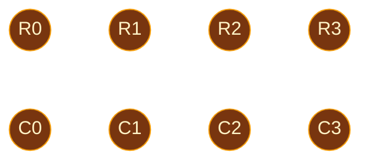
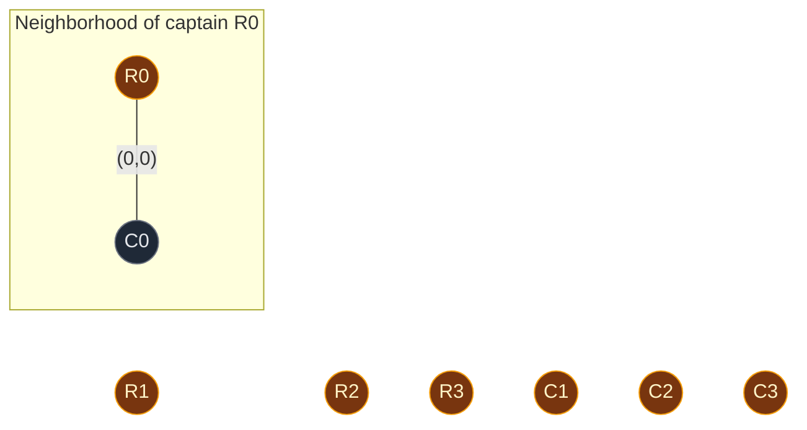
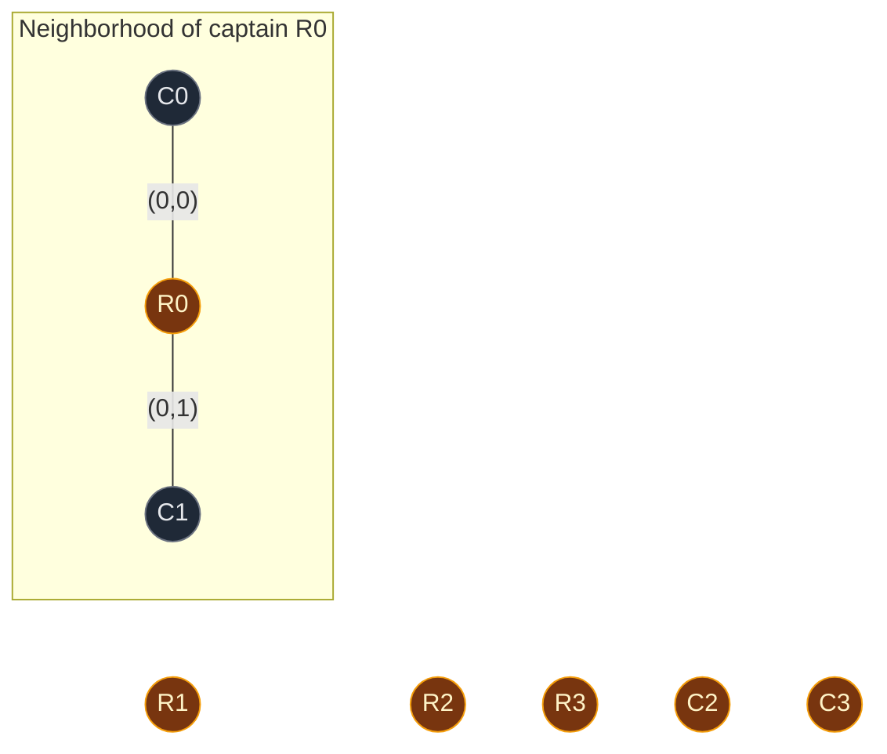
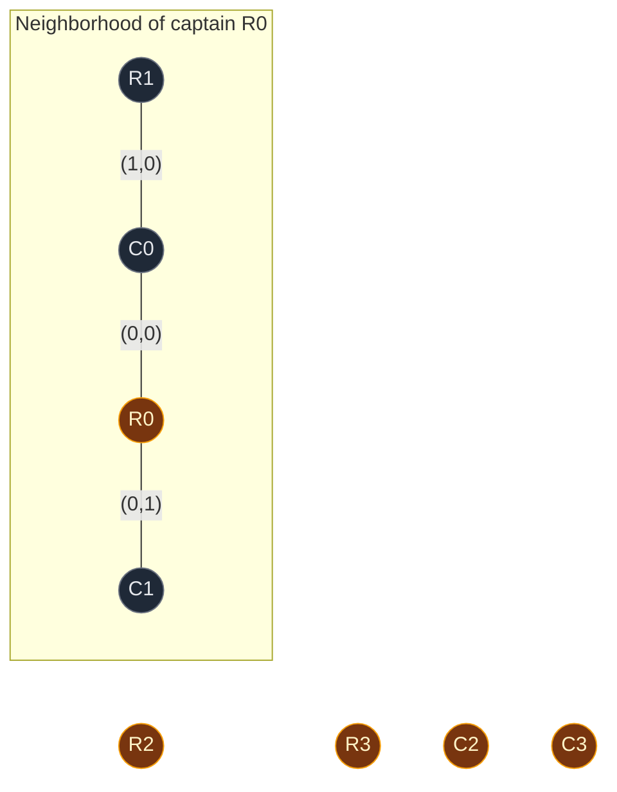
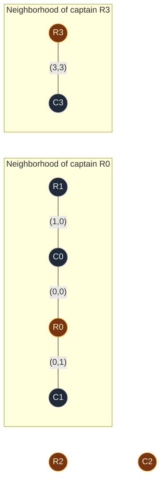

# 01. 947. Most Stones Removed with Same Row or Column

| Difficulty | Pattern | Source | Time | Space |
|:---:|:---:|:---:|:---:|:---:|
| **Medium** | DSU: Rows and Columns as Nodes | [947. Most Stones Removed with Same Row or Column](https://leetcode.com/problems/most-stones-removed-with-same-row-or-column/) | `O(n · α(R + C))` | `O(R + C)` |

`n` = number of stones, `R` = number of rows, `C` = number of columns.

## 1. Problem Statement

There are `n` stones on a 2D grid. Each stone is at a point `[row, col]`. No two stones are at the same point.

You can remove a stone if **another stone is still in the same row or the same column**.

Return the **largest number of stones** you can remove.

### Example

```text
stones = [[0,0], [0,1], [1,0], [3,3]]

Grid:
          col 0  col 1  col 2  col 3
row 0       S      S      .      .
row 1       S      .      .      .
row 2       .      .      .      .
row 3       .      .      .      S

(0,0), (0,1), (1,0) are linked:
    (0,0) and (0,1) share row 0
    (0,0) and (1,0) share col 0
(3,3) shares nothing with anyone.

Remove (0,1)  -> (0,0) is still in row 0
Remove (1,0)  -> (0,0) is still in col 0
(0,0) cannot be removed now: nothing left in its row or column.
(3,3) can never be removed.

Output: 2
```

We use this same example in every section below.

### Constraints

- `1 <= stones.length <= 1000`
- `0 <= row, col <= 10^4`
- No two stones are at the same point

## 2. Core Theory

### Idea 1: stones form groups

- Two stones in the same row or the same column are **linked**.
- Links chain: if A links to B and B links to C, then A, B and C are one group.
- So the stones split into connected groups.

### Idea 2: each group keeps exactly one stone

- In a group of `k` stones, we can always remove `k - 1` of them.
- Remove stones from the "outside" of the group first, so every removed stone still has a linked stone left.
- The last stone has nobody left in its row or column, so it stays.

```text
Groups of sizes 3, 4, 2
Removable: (3-1) + (4-1) + (2-1) = 2 + 3 + 1 = 6
Same as:   (3 + 4 + 2) - 3 groups = 9 - 3 = 6
```

So the answer is a simple formula:

```text
answer = number of stones - number of groups
```

The whole problem is now: **count the groups**.

### Idea 3: let rows and columns be the DSU nodes

The simple way: make each stone a node and compare every pair of stones. That is `O(n^2)`.

The smart way: a stone at `[r, c]` **ties row `r` to column `c`**.

```text
Stone [0,0] ties row 0 to col 0
Stone [0,1] ties row 0 to col 1
Stone [1,0] ties row 1 to col 0

row 0 --- col 0 --- row 1
  |
col 1

All of these are one group. So the 3 stones are one group.
```

Each stone becomes **one `union(row, col)`**. No pair checks needed.

### Idea 4: keep row ids and column ids apart

Row `2` and column `2` are different things. If both use the number `2`, DSU would think they are the same node.

Fix: **shift the column ids** past the last row.

```text
offset = max_row + 1

row r     -> node r
column c  -> node c + offset
```

In our example `max_row = 3`, so `offset = 4`:

```text
row 0 -> 0     col 0 -> 4
row 1 -> 1     col 1 -> 5
row 2 -> 2     col 2 -> 6
row 3 -> 3     col 3 -> 7
```

### Idea 5: count only the nodes that a stone uses

Row 2 and column 2 have no stone. Their DSU nodes stay alone, each as its own leader.

If we counted them, we would get extra fake groups. So we keep a set `used` of nodes that some stone touched, and count leaders **only among `used`**.

### How this connects to other DSU problems

| Problem | DSU nodes | What links two nodes |
|:---|:---|:---|
| 721. Accounts Merge | Accounts | A shared email |
| **947. Most Stones Removed** | Rows and columns | A stone at `[row, col]` |

## 3. Edge Cases

| Case | Input | Expected | Why it matters |
|:---|:---|:---:|:---|
| One stone | `[[0,0]]` | `0` | One group, keep its only stone |
| All in one row | `[[0,0],[0,5],[0,9]]` | `2` | One group of 3 |
| No two share a row or column | `[[0,0],[1,1],[2,2]]` | `0` | 3 groups of 1 |
| Row number equals column number | `[[2,2]]` | `0` | Offset keeps row 2 and col 2 apart |
| Empty rows/columns in between | Our example | `2` | Count leaders only in `used` |

## 4. Brute Force: Compare Every Pair of Stones

### Idea

- Each stone is a node.
- Two stones are linked if they share a row or a column.
- Run DFS from each unvisited stone and count the groups.
- Answer = stones - groups.

### Code

```python
# Import List for type hints
from typing import List


# Count groups by checking every pair of stones
class SolutionDFS:

    # Main method
    def removeStones(self, stones: List[List[int]]) -> int:

        # Number of stones
        n = len(stones)

        # Track which stones are already in a group
        visited = [False] * n

        # Number of groups found
        groups = 0

        # Try every stone as a start
        for start in range(n):

            # Skip stones that already belong to a group
            if visited[start]:
                continue

            # A new group is found
            groups += 1

            # Mark the start stone
            visited[start] = True

            # Stack for DFS
            stack = [start]

            # Keep going while the stack has stones
            while stack:

                # Take the top stone
                cur = stack.pop()

                # Compare it with every other stone
                for other in range(n):

                    # Same row or same column, and not visited yet
                    if not visited[other] and (stones[cur][0] == stones[other][0] or stones[cur][1] == stones[other][1]):

                        # Mark it
                        visited[other] = True

                        # Push it on the stack
                        stack.append(other)

        # Every group keeps one stone
        return n - groups
```

### Complexity

| Measure | Complexity | Why |
|:---|:---:|:---|
| **Time** | `O(n^2)` | Each stone is compared with every other stone |
| **Space** | `O(n)` | `visited` and the stack |

Fine for `n = 1000`, but the row/column trick does it in almost `O(n)`.

## 5. Optimal Approach: DSU on Rows and Columns

### Idea

1. Find `max_row` and `max_col`. Set `offset = max_row + 1`.
2. Make a DSU with `max_row + max_col + 2` nodes.
3. For each stone `[r, c]`:
   - `row_node = r`, `col_node = c + offset`.
   - Add both to `used`.
   - `union(row_node, col_node)`.
4. `groups` = number of nodes in `used` that are their own leader.
5. Return `len(stones) - groups`.

### Visual Walkthrough (Story Version)

Before the arrays, let us see the idea as a story.

**The story:** a school has 4 row hallways (row 0 to row 3) and 4 column hallways (col 0 to col 3). Toys sit where a row hallway crosses a column hallway. You may pick up a toy only if **another toy is still in the same row hallway or the same column hallway**.

**The rules:**

- Every toy is a **rope** that ties its row hallway to its column hallway.
- Hallways tied together by ropes make one **neighborhood**.
- Every neighborhood has one **captain** hallway.
- In every neighborhood, all toys but one can be picked up. One toy must stay.
- Hallways with no toy at all do not count as a neighborhood.

**How to read the pictures:** `R0` = row hallway 0, `C0` = column hallway 0. Gold = captain. Line = a rope (a toy), with the toy's spot written on it. Box = one neighborhood.

**Start: no ropes yet**



Every hallway is alone. Toys picked up so far: none.

**Toy 1 at (0,0): tie R0 to C0**

- R0's captain is R0. C0's captain is C0.
- Different captains, so the two hallways join one neighborhood.
- Same size. R0 becomes the captain.



**Toy 2 at (0,1): tie R0 to C1**

- R0's captain is R0. C1's captain is C1.
- Different, so join.
- R0's neighborhood is bigger (2 hallways vs 1). R0 stays captain.



**Toy 3 at (1,0): tie R1 to C0**

- R1's captain is R1.
- C0 asks: "Who is my captain?" Answer: R0.
- Different captains, so join.
- R0's neighborhood is bigger (3 hallways vs 1). R1 joins under R0.



**Toy 4 at (3,3): tie R3 to C3**

- R3's captain is R3. C3's captain is C3.
- Different, so join. Same size. R3 becomes captain.



**Count the neighborhoods**

- R2 and C2 are still gold, but **no toy** touches them. They are empty hallways. Do not count them.
- Real neighborhoods: captain R0 and captain R3. That is **2**.

**Pick up the toys**

- Neighborhood R0 has 3 toys: (0,0), (0,1), (1,0). Pick up 2, keep 1.
- Neighborhood R3 has 1 toy: (3,3). Pick up 0, keep 1.
- Total picked up: 4 toys - 2 neighborhoods = **2**.

**All toys at a glance**

| Toy | Row hallway | Column hallway | Captains before | Same? | What happens |
|:---:|:---:|:---:|:---|:---:|:---|
| (0,0) | R0 | C0 | R0, C0 | No | Join, captain R0 |
| (0,1) | R0 | C1 | R0, C1 | No | Join, captain R0 |
| (1,0) | R1 | C0 | R1, R0 | No | Join, captain R0 |
| (3,3) | R3 | C3 | R3, C3 | No | Join, captain R3 |

**What the story teaches**

| In the story | In the code |
|:---|:---|
| Row hallway `r` | DSU node `r` |
| Column hallway `c` | DSU node `c + offset` |
| Toy | Stone, one `union(row_node, col_node)` |
| Neighborhood | DSU group |
| Captain hallway | Leader, `find(node)` |
| Empty hallway | Node not in `used` |
| Keep one toy per neighborhood | `answer = stones - groups` |

Now the same steps again, this time with the exact arrays.

### Step-by-Step Example

```text
stones = [[0,0], [0,1], [1,0], [3,3]]
max_row = 3, max_col = 3
offset  = 3 + 1 = 4
DSU size = 3 + 3 + 2 = 8 nodes

node:  0  1  2  3  4  5  6  7
means: R0 R1 R2 R3 C0 C1 C2 C3
```

**Start**

```text
node:    0 1 2 3 4 5 6 7
parent:  0 1 2 3 4 5 6 7
size:    1 1 1 1 1 1 1 1
used = {}
```

**Stone 1: `[0, 0]`**

1. `row_node = 0`. `col_node = 0 + 4 = 4`.
2. Add both to `used`: `used = {0, 4}`.
3. Call `union(0, 4)`.
4. `find(0)`: `parent[0] = 0`. Leader is `0`.
5. `find(4)`: `parent[4] = 4`. Leader is `4`.
6. Leaders are different, so we join.
7. `size[0] = 1` and `size[4] = 1`. Equal, no swap. `0` stays on top.
8. Put `4` under `0`: `parent[4] = 0`.
9. `size[0] = 1 + 1 = 2`.

```text
node:    0 1 2 3 4 5 6 7
parent:  0 1 2 3 0 5 6 7
size:    2 1 1 1 1 1 1 1
used = {0, 4}
```

**Stone 2: `[0, 1]`**

1. `row_node = 0`. `col_node = 1 + 4 = 5`.
2. `used = {0, 4, 5}`.
3. Call `union(0, 5)`.
4. `find(0)`: leader is `0`.
5. `find(5)`: leader is `5`.
6. Leaders are different, so we join.
7. `size[0] = 2` and `size[5] = 1`. `0` is bigger, no swap.
8. Put `5` under `0`: `parent[5] = 0`.
9. `size[0] = 2 + 1 = 3`.

```text
node:    0 1 2 3 4 5 6 7
parent:  0 1 2 3 0 0 6 7
size:    3 1 1 1 1 1 1 1
used = {0, 4, 5}
```

**Stone 3: `[1, 0]`**

1. `row_node = 1`. `col_node = 0 + 4 = 4`.
2. `used = {0, 1, 4, 5}`.
3. Call `union(1, 4)`.
4. `find(1)`: `parent[1] = 1`. Leader is `1`.
5. `find(4)`: `parent[4] = 0`, not itself. Go up to `0`. `parent[0] = 0`. Leader is `0`. On the way back, `parent[4] = 0` (no change).
6. Leaders `1` and `0` are different, so we join.
7. `size[1] = 1` and `size[0] = 3`. `1` is smaller, so **swap**: now `leader_u = 0`, `leader_v = 1`.
8. Put `1` under `0`: `parent[1] = 0`.
9. `size[0] = 3 + 1 = 4`.

```text
node:    0 1 2 3 4 5 6 7
parent:  0 0 2 3 0 0 6 7
size:    4 1 1 1 1 1 1 1
used = {0, 1, 4, 5}
```

**Stone 4: `[3, 3]`**

1. `row_node = 3`. `col_node = 3 + 4 = 7`.
2. `used = {0, 1, 3, 4, 5, 7}`.
3. Call `union(3, 7)`.
4. `find(3)`: leader is `3`.
5. `find(7)`: leader is `7`.
6. Leaders are different, so we join.
7. `size[3] = 1` and `size[7] = 1`. Equal, no swap. `3` stays on top.
8. Put `7` under `3`: `parent[7] = 3`.
9. `size[3] = 1 + 1 = 2`.

```text
node:    0 1 2 3 4 5 6 7
parent:  0 0 2 3 0 0 6 3
size:    4 1 1 2 1 1 1 1
used = {0, 1, 3, 4, 5, 7}

       0            3
    /  |  \         |
   1   4   5        7
```

**Count the groups (only nodes in `used`)**

| Node | Means | `find(node)` | Own leader? |
|:---:|:---:|:---:|:---:|
| 0 | R0 | 0 | Yes |
| 1 | R1 | 0 | No |
| 3 | R3 | 3 | Yes |
| 4 | C0 | 0 | No |
| 5 | C1 | 0 | No |
| 7 | C3 | 3 | No |

Nodes `2` (R2) and `6` (C2) are not in `used`, so we skip them. They are their own leaders, and counting them would wrongly give 4 groups.

1. `groups = 2`.
2. Answer = `4 - 2 = 2`.

### Code

```python
# Import List for type hints
from typing import List


# Reusable DSU with union by size and path compression
class DSU:

    # Set up the arrays
    def __init__(self, n: int):

        # Every node starts as its own leader
        self.parent = list(range(n))

        # Every group starts with 1 node
        self.size = [1] * n

    # Find the leader of a node
    def find(self, node: int) -> int:

        # A node that points to itself is the leader
        if self.parent[node] == node:
            return node

        # Find the leader and point this node straight at it (path compression)
        self.parent[node] = self.find(self.parent[node])

        # Return the leader
        return self.parent[node]

    # Join the groups of u and v
    def union(self, u: int, v: int) -> bool:

        # Find the leader of u
        leader_u = self.find(u)

        # Find the leader of v
        leader_v = self.find(v)

        # Same leader means already in one group
        if leader_u == leader_v:
            return False

        # Make sure leader_u has the bigger group
        if self.size[leader_u] < self.size[leader_v]:
            leader_u, leader_v = leader_v, leader_u

        # Put the smaller group under the bigger group
        self.parent[leader_v] = leader_u

        # Add the smaller group's size to the new leader
        self.size[leader_u] += self.size[leader_v]

        # Join was done
        return True


# Solution for 947. Most Stones Removed with Same Row or Column
class Solution:

    # Main method
    def removeStones(self, stones: List[List[int]]) -> int:

        # Largest row number
        max_row = max(r for r, c in stones)

        # Largest column number
        max_col = max(c for r, c in stones)

        # Columns start right after the last row
        offset = max_row + 1

        # One DSU node per row and per column
        dsu = DSU(max_row + max_col + 2)

        # Nodes that some stone actually touches
        used = set()

        # Every stone ties its row to its column
        for r, c in stones:

            # Node id of the row
            row_node = r

            # Node id of the column, shifted past all rows
            col_node = c + offset

            # Remember the row node
            used.add(row_node)

            # Remember the column node
            used.add(col_node)

            # Tie the row and the column together
            dsu.union(row_node, col_node)

        # Count groups among used nodes only
        groups = 0

        # Look at every used node
        for node in used:

            # A node that is its own leader starts a group
            if dsu.find(node) == node:
                groups += 1

        # Every group keeps exactly one stone
        return len(stones) - groups


# Check the example from this note, step by step
dsu = DSU(8)

# Stone [0,0]: union(R0=0, C0=4)
assert dsu.union(0, 4) is True
assert dsu.parent == [0, 1, 2, 3, 0, 5, 6, 7] and dsu.size == [2, 1, 1, 1, 1, 1, 1, 1]

# Stone [0,1]: union(R0=0, C1=5)
assert dsu.union(0, 5) is True
assert dsu.parent == [0, 1, 2, 3, 0, 0, 6, 7] and dsu.size == [3, 1, 1, 1, 1, 1, 1, 1]

# Stone [1,0]: union(R1=1, C0=4), R1 is smaller so it goes under 0
assert dsu.union(1, 4) is True
assert dsu.parent == [0, 0, 2, 3, 0, 0, 6, 7] and dsu.size == [4, 1, 1, 1, 1, 1, 1, 1]

# Stone [3,3]: union(R3=3, C3=7)
assert dsu.union(3, 7) is True
assert dsu.parent == [0, 0, 2, 3, 0, 0, 6, 3] and dsu.size == [4, 1, 1, 2, 1, 1, 1, 1]

# Leaders among used nodes: only 0 and 3
used = {0, 1, 3, 4, 5, 7}
assert sorted(n for n in used if dsu.find(n) == n) == [0, 3]

# Counting all 8 nodes would be wrong: R2 and C2 add 2 fake groups
assert sum(dsu.find(n) == n for n in range(8)) == 4

# Full solution on the example
assert Solution().removeStones([[0, 0], [0, 1], [1, 0], [3, 3]]) == 2

# LeetCode example 1
assert Solution().removeStones([[0, 0], [0, 1], [1, 0], [1, 2], [2, 1], [2, 2]]) == 5

# LeetCode example 2
assert Solution().removeStones([[0, 0], [0, 2], [1, 1], [2, 0], [2, 2]]) == 3

# One stone
assert Solution().removeStones([[0, 0]]) == 0

# Row number equals column number
assert Solution().removeStones([[2, 2]]) == 0

# No two stones share a row or column
assert Solution().removeStones([[0, 0], [1, 1], [2, 2]]) == 0

# DFS brute force gives the same answers
assert SolutionDFS().removeStones([[0, 0], [0, 1], [1, 0], [3, 3]]) == 2
assert SolutionDFS().removeStones([[0, 0], [0, 2], [1, 1], [2, 0], [2, 2]]) == 3

# All checks passed
print("All tests passed")
```

### Complexity

| Measure | Complexity | Why |
|:---|:---:|:---|
| **Time** | `O(n · α(R + C) + R + C)` | One `union` per stone, plus setting up the DSU arrays |
| **Space** | `O(R + C)` | DSU arrays for every row and column, plus `used` |

With rows and columns up to `10^4`, the DSU has at most about `20002` nodes.

## 6. Common Mistakes

| Mistake | What goes wrong | Fix |
|:---|:---|:---|
| Using `c` as the column node | Row `2` and column `2` become one node | Use `c + offset` |
| Counting leaders over all DSU nodes | Empty rows and columns add fake groups | Count only nodes in `used` |
| Returning the number of groups | That is how many stones stay, not how many go | Return `stones - groups` |
| Comparing every pair of stones with DSU | `O(n^2)` for no reason | One `union(row, col)` per stone |
| Thinking the removal order matters | Leads to a greedy that can fail | Any group of `k` stones always allows `k - 1` removals |

## 7. Interview Follow-ups

### Q1. Why can we always remove `k - 1` stones from a group of `k`?

**Answer:**
- Think of the group as a connected graph of stones.
- Take a spanning tree of it and remove leaves one by one.
- A leaf always has its parent left, which shares its row or column.
- In the end, only the root stays.

### Q2. Why is `offset = max_row + 1` enough?

**Answer:**
- Rows use node ids `0` to `max_row`.
- Columns then start at `max_row + 1`.
- So no column id can ever equal a row id.

### Q3. Can we avoid the big DSU array?

**Answer:**
- Yes. Use a dictionary for `parent` and create a node the first time it is seen.
- Use `~c` (a negative number) for columns instead of an offset.
- Then only used nodes exist, and every leader is a real group.

### Q4. How would you also return which stones to remove?

**Answer:**
- Group the stones by the leader of their row node.
- In each group, keep one stone and list the rest.
- To give a valid order, remove leaves of a DFS tree first.

### Q5. Why not just DFS over the stones?

**Answer:**
- It works, but finding neighbors by comparing all pairs is `O(n^2)`.
- The row/column DSU needs one union per stone, so it is almost linear.

## 8. Interview Explanation

> Stones in the same row or column are linked, and links chain, so the stones form connected groups. In a group of k stones I can always remove k minus 1, so the answer is the number of stones minus the number of groups. To find groups fast, I make the rows and columns the DSU nodes. A stone at row r and column c is just union(r, c + offset), where the offset keeps column ids apart from row ids. I also track which nodes some stone used, and count leaders only among those, because empty rows and columns would add fake groups. That is one union per stone, so it is almost O(n), with O(R + C) space for the DSU.
