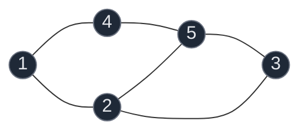
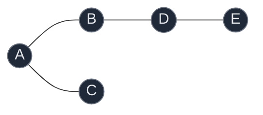
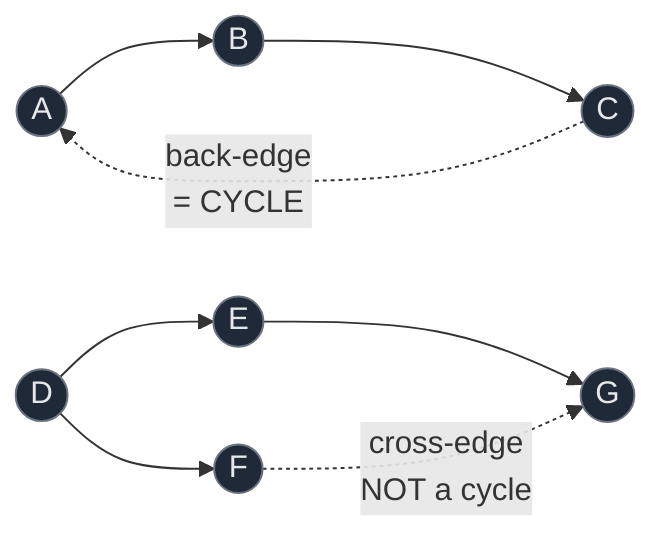
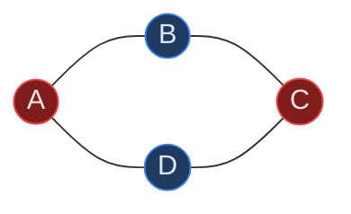

# 11. Graphs

A graph is a set of nodes connected by edges — the most general structure in this whole sheet. Arrays, linked lists, and trees are all graphs with extra restrictions (a tree is a connected, acyclic graph; a linked list is a tree where every node has one child).

This page covers vertices/edges/representations, the two traversal primitives BFS and DFS, and how nearly every problem in this tier is one of those two traversals wearing a different costume: counting components, flood-filling a grid, detecting a cycle, or 2-coloring a graph.

## Contents

1. [Vertices, Edges, Representations](#1-vertices-edges-representations)
2. [BFS vs DFS](#2-bfs-vs-dfs)
3. [The Visited Set Is Not Optional](#3-the-visited-set-is-not-optional)
4. [Connected Components](#4-connected-components)
5. [Grid Graphs](#5-grid-graphs)
6. [Multi-Source BFS](#6-multi-source-bfs)
7. [The Reversed-Thinking Trick](#7-the-reversed-thinking-trick)
8. [Cycle Detection — Undirected vs Directed](#8-cycle-detection--undirected-vs-directed)
9. [Bipartite Graphs](#9-bipartite-graphs)
10. [Common Traps](#10-common-traps)
11. [Pattern Recognition Cheat Sheet](#11-pattern-recognition-cheat-sheet)
12. [Problems](#12-problems)

## 1. Vertices, Edges, Representations



`V` = number of vertices (nodes), `E` = number of edges. Undirected edges (`A --- B`) go both ways; directed edges (`A --> B`) go one way only.

Two ways to store a graph:

| Representation | Structure | Space | Neighbor lookup |
|:---|:---|:---:|:---:|
| Adjacency matrix | `matrix[i][j] = 1` if edge exists | `O(V^2)` | `O(1)` |
| Adjacency list | `graph[i] = [neighbors]` | `O(V + E)` | `O(degree)` |

Adjacency lists win for sparse graphs (most real graphs, and every problem in this tier) because `O(V^2)` wastes space when most pairs of nodes are not connected.

## 2. BFS vs DFS

Both visit every reachable node exactly once. They differ only in *order*.



| | BFS | DFS |
|:---|:---|:---|
| Data structure | Queue (FIFO) | Stack (or recursion) |
| Visits | Level by level, nearest first | One branch fully, then backtrack |
| Order on graph above | A, B, C, D, E | A, B, D, E, C |
| Natural fit | Shortest path in unweighted graph | Exhausting all paths, cycle detection |

```python
from collections import deque

def bfs(graph, start):
    visited = {start}
    order = []
    queue = deque([start])
    while queue:
        node = queue.popleft()
        order.append(node)
        for neighbor in graph[node]:
            if neighbor not in visited:
                visited.add(neighbor)          # mark BEFORE enqueueing
                queue.append(neighbor)
    return order

def dfs(graph, start, visited=None, order=None):
    if visited is None:
        visited, order = set(), []
    visited.add(start)
    order.append(start)
    for neighbor in graph[start]:
        if neighbor not in visited:
            dfs(graph, neighbor, visited, order)
    return order
```

**Why BFS finds shortest paths and DFS does not:** BFS explores in strict distance order — everything at distance `d` is visited before anything at distance `d+1`. The first time BFS reaches a node is guaranteed to be via a shortest path. DFS commits to one path immediately and may reach a node the long way first.

## 3. The Visited Set Is Not Optional

Without it, a cyclic graph causes infinite re-visiting; even an acyclic graph gets exponentially re-explored.

```python
visited.add(neighbor)      # mark when ENQUEUED (BFS) to avoid duplicate enqueues
queue.append(neighbor)
```

**Common bug:** marking visited when a node is *dequeued* instead of when *enqueued*, in BFS. A node can be pushed onto the queue multiple times before its first dequeue, wasting work and — in problems that count something per visit — corrupting the answer.

## 4. Connected Components

A connected component is a maximal set of nodes all reachable from each other. Counting them is: run BFS/DFS from any unvisited node, mark everything reachable, increment a counter, repeat.

```text
for each node:
    if node not visited:
        bfs_or_dfs(node)     # marks the whole component
        count += 1
```

This single template answers "how many provinces/islands/groups" for any graph or grid.

## 5. Grid Graphs

A 2D grid is a graph where each cell is a node and its up-to-4 orthogonal neighbors are edges. Nearly every "matrix" problem in this tier is BFS/DFS on this implicit graph.

```python
directions = [(-1, 0), (1, 0), (0, -1), (0, 1)]   # up, down, left, right

def in_bounds(r, c, rows, cols):
    return 0 <= r < rows and 0 <= c < cols
```

**Marking visited in a grid:** either keep a separate `visited` set/matrix, or mutate the grid in place (e.g. `'1' -> '0'` once counted). In-place mutation is safe whenever you are *counting or painting*, not searching for a path to preserve — there is no need to restore it afterward, unlike backtracking.

## 6. Multi-Source BFS

Some problems have several starting points that all begin "at the same time" — seed the queue with all of them before the first BFS level runs.


**Why not run BFS from each source separately and take the minimum?** That works but costs `O(sources * V)`. Seeding all sources at once and running one BFS costs `O(V)` total — each level still expands by exactly one step of distance, because BFS explores in strict distance order regardless of how many sources it started from.

Used in: Rotten Oranges (rot spreads from every initially-rotten orange at once), 01 Matrix (distance to the nearest zero from every cell at once).

## 7. The Reversed-Thinking Trick

"Find regions that are surrounded/enclosed" is hard to check directly while scanning — you cannot know a region never touches the boundary until you have seen the whole region. The trick: **start from the boundary and mark what is reachable from it.** Everything not marked is, by definition, enclosed.

```text
1. BFS/DFS from every boundary cell that qualifies (e.g. every 'O' on the edge)
2. Mark everything reachable from those as "safe" / "not enclosed"
3. Everything unmarked is fully enclosed
```

Used in: Surrounded Regions (mark border-connected 'O's, flip the rest to 'X'), Number of Enclaves (mark border-connected land, count the rest).

## 8. Cycle Detection — Undirected vs Directed

These require genuinely different algorithms. Confusing them is the most common mistake in this tier.

### Undirected: track the parent

```python
def has_cycle_undirected(graph, start, visited):
    queue = deque([(start, -1)])          # (node, parent)
    visited.add(start)
    while queue:
        node, parent = queue.popleft()
        for neighbor in graph[node]:
            if neighbor not in visited:
                visited.add(neighbor)
                queue.append((neighbor, node))
            elif neighbor != parent:      # visited AND not where we came from
                return True                # genuine second path -> cycle
    return False
```

**Why the parent check matters:** in an undirected graph, the edge back to your immediate parent is the *same edge* traversed backwards, not a cycle. Only a visited neighbor that is *not* your parent proves a second, different path back to an already-seen node.

### Directed: track the recursion path, separately from visited-ever



```python
def has_cycle_directed(graph, node, visited, path_visited):
    visited.add(node)
    path_visited.add(node)                # on the ACTIVE recursion path
    for neighbor in graph[node]:
        if neighbor in path_visited:
            return True                    # back-edge to a live ancestor: cycle
        if neighbor not in visited:
            if has_cycle_directed(graph, neighbor, visited, path_visited):
                return True
    path_visited.remove(node)              # done exploring: no longer an ancestor
    return False
```

**Why one `visited` set is not enough here:** direction matters. Reaching an already-visited node that is *not* an ancestor of the current path (a **cross-edge**, in the diagram `F -> G`) is completely normal in a DAG — it just means two paths converge. Only reaching a node still on the *active* call stack (`C -> A`, a genuine back-edge) proves a cycle. `path_visited` must be removed on the way back up, or every finished branch looks like a permanent ancestor forever.

Used directly in: Detect Cycle in a Directed Graph, and its extension Find Eventual Safe States (a node is unsafe exactly when it can reach a cycle).

## 9. Bipartite Graphs

A graph is bipartite if its nodes can be split into two groups such that every edge connects the groups — never two nodes in the same group. Testing this is 2-coloring: color a node, then force every neighbor to the opposite color; a conflict (neighbor already the same color) means it is not bipartite.



```python
def is_bipartite(graph, n):
    color = {}
    for start in range(n):
        if start in color:
            continue
        color[start] = 0
        queue = deque([start])
        while queue:
            node = queue.popleft()
            for neighbor in graph[node]:
                if neighbor not in color:
                    color[neighbor] = 1 - color[node]     # opposite color
                    queue.append(neighbor)
                elif color[neighbor] == color[node]:
                    return False                            # same color: conflict
    return True
```

A graph containing any odd-length cycle can never be bipartite — going around an odd cycle forces a node to conflict with its own color.

## 10. Common Traps

| Trap | Broken | Correct |
|:---|:---|:---|
| Marking visited on dequeue, not enqueue | Same node enqueued multiple times | Mark visited the moment it is added to the queue |
| Undirected cycle check without parent | Every edge looks like a cycle | Skip the edge back to the immediate parent |
| Directed cycle check with one visited set | Cross-edges wrongly flagged as cycles | Track `path_visited` separately, remove on backtrack |
| Not bounding grid indices before recursing | Index error at grid edges | Check `0 <= r < rows and 0 <= c < cols` first |
| Single-source BFS repeated per source | `O(sources * V)`, needlessly slow | Seed all sources at once: `O(V)` total |
| Absolute coordinates for shape comparison | Identical shapes at different positions look different | Normalize to coordinates relative to the shape's start |
| Forgetting a same-value guard in flood fill | Infinite recursion when new value equals old | Check `new_color != old_color` first, or rely on the visited check |
| Not checking every connected component | Miss a cycle/imbalance in a later component | Loop over all nodes, skip only already-visited ones |

## 11. Pattern Recognition Cheat Sheet

| Signal in the problem | Pattern | Cost |
|:---|:---|:---:|
| "how many groups/provinces/components" | Count connected components | `O(V+E)` |
| "how many islands", grid of land/water | Connected components on a grid | `O(m*n)` |
| "paint/fill starting from a cell" | Single-source flood fill | `O(m*n)` |
| "multiple things spread simultaneously" | Multi-source BFS | `O(m*n)` |
| "distance to nearest X for every cell" | Multi-source BFS from all X's | `O(m*n)` |
| "surrounded by / enclosed by" | Reversed: mark from the boundary inward | `O(m*n)` |
| "does this graph have a cycle" + undirected | BFS/DFS with parent tracking | `O(V+E)` |
| "does this graph have a cycle" + directed | DFS with visited + path_visited | `O(V+E)` |
| "can this graph be 2-colored / split into two groups" | Bipartite check | `O(V+E)` |
| "every path from here eventually terminates" | Directed cycle detection + memoization | `O(V+E)` |
| "count DISTINCT shapes", not just count | Normalize to relative coordinates, use a set | `O(m*n)` |

## 12. Problems

Folder layout mirrors the pattern order below. **Written** = full note; **Pending** = question added, note to follow.

### Introductions

| # | Note | What it covers |
|:---:|:---|:---|
| 1 | [Introduction to Graphs](01.%20Introductions/01.%20Introduction%20to%20Graphs.md) | Vertices, edges, directed/undirected, representations |
| 2 | [Connected Components in Graphs](01.%20Introductions/02.%20Connected%20Components%20in%20Graphs.md) | What a component is, why it matters |
| 3 | [Breadth First Search](01.%20Introductions/03.%20Breadth%20First%20Search.md) | Queue-based level-order traversal |
| 4 | [Depth First Search](01.%20Introductions/04.%20Depth%20First%20Search.md) | Stack/recursion-based traversal |

### 02. BFS and DFS

#### Connected Components (Grid and Matrix)

| # | Problem | Difficulty | Key Idea | Status |
|:---:|:---|:---:|:---|:---:|
| 1 | [547. Number of Provinces](02.%20BFS%20and%20DFS/01.%20Connected%20Components%20%28Grid%20and%20Matrix%29/01.%20547.%20Number%20of%20Provinces.md) | Medium | Count connected components on an adjacency matrix | Written |
| 2 | [200. Number of Islands](02.%20BFS%20and%20DFS/01.%20Connected%20Components%20%28Grid%20and%20Matrix%29/02.%20200.%20Number%20of%20Islands.md) | Medium | Components on a grid instead of a matrix | Written |
| 3 | [733. Flood Fill](02.%20BFS%20and%20DFS/01.%20Connected%20Components%20%28Grid%20and%20Matrix%29/03.%20733.%20Flood%20Fill.md) | Easy | Same grid traversal, painting instead of counting | Written |

#### Multi-Source BFS

| # | Problem | Difficulty | Key Idea | Status |
|:---:|:---|:---:|:---|:---:|
| 1 | [994. Rotten Oranges](02.%20BFS%20and%20DFS/02.%20Multi-Source%20BFS/01.%20994.%20Rotten%20Oranges.md) | Medium | Multi-source BFS, one level = one minute | Written |
| 2 | [542. 01 Matrix](02.%20BFS%20and%20DFS/02.%20Multi-Source%20BFS/02.%20542.%2001%20Matrix.md) | Medium | Multi-source BFS from every zero | Written |
| 3 | [286. Walls and Gates](02.%20BFS%20and%20DFS/02.%20Multi-Source%20BFS/03.%20286.%20Walls%20and%20Gates.md) | Medium | Seed every gate at distance 0 and BFS outward into empty rooms | Pending |
| 4 | [1162. As Far from Land as Possible](02.%20BFS%20and%20DFS/02.%20Multi-Source%20BFS/04.%201162.%20As%20Far%20from%20Land%20as%20Possible.md) | Medium | Seed all land cells; the last water cell reached holds the answer | Pending |
| 5 | [1765. Map of Highest Peak](02.%20BFS%20and%20DFS/02.%20Multi-Source%20BFS/05.%201765.%20Map%20of%20Highest%20Peak.md) | Medium | Water cells are height 0; BFS level = height, which keeps neighbors within 1 | Pending |
| 6 | [130. Surrounded Regions](02.%20BFS%20and%20DFS/04.%20Boundary%20Traversal/01.%20130.%20Surrounded%20Regions.md) (see Boundary Traversal) | Medium | Seed all border 'O's at once, flip everything unreached | Written |
| 7 | [1020. Number of Enclaves](02.%20BFS%20and%20DFS/04.%20Boundary%20Traversal/02.%201020.%20Number%20of%20Enclaves.md) (see Boundary Traversal) | Medium | Seed all border land at once, count land never reached | Written |
| 8 | [1254. Number of Closed Islands](02.%20BFS%20and%20DFS/02.%20Multi-Source%20BFS/08.%201254.%20Number%20of%20Closed%20Islands.md) | Medium | Sink border-connected land first, then count the remaining islands | Pending |
| 9 | [417. Pacific Atlantic Water Flow](02.%20BFS%20and%20DFS/02.%20Multi-Source%20BFS/09.%20417.%20Pacific%20Atlantic%20Water%20Flow.md) | Medium | BFS uphill from each ocean's border; answer is the intersection | Pending |
| 10 | [934. Shortest Bridge](02.%20BFS%20and%20DFS/02.%20Multi-Source%20BFS/10.%20934.%20Shortest%20Bridge.md) | Medium | DFS to collect island one, then multi-source BFS from it to island two | Pending |
| 11 | [310. Minimum Height Trees](02.%20BFS%20and%20DFS/02.%20Multi-Source%20BFS/11.%20310.%20Minimum%20Height%20Trees.md) | Medium | Peel leaves layer by layer from all leaves at once; the last 1-2 nodes are the centers | Pending |
| 12 | [2812. Find the Safest Path in a Grid](02.%20BFS%20and%20DFS/02.%20Multi-Source%20BFS/12.%202812.%20Find%20the%20Safest%20Path%20in%20a%20Grid.md) | Medium | Multi-source BFS from thieves for safeness, then max-min path search | Pending |
| 13 | [2204. Distance to a Cycle in Undirected Graph](02.%20BFS%20and%20DFS/02.%20Multi-Source%20BFS/13.%202204.%20Distance%20to%20a%20Cycle%20in%20Undirected%20Graph.md) | Hard | Trim leaves to isolate the cycle, then BFS outward from every cycle node | Pending |
| 14 | [847. Shortest Path Visiting All Nodes](02.%20BFS%20and%20DFS/02.%20Multi-Source%20BFS/14.%20847.%20Shortest%20Path%20Visiting%20All%20Nodes.md) | Hard | BFS over (node, visited-mask) states, seeded from every node | Pending |
| 15 | [2258. Escape the Spreading Fire](02.%20BFS%20and%20DFS/02.%20Multi-Source%20BFS/15.%202258.%20Escape%20the%20Spreading%20Fire.md) | Hard | Multi-source BFS for fire arrival times, then binary search the wait time | Pending |
| 16 | [2603. Collect Coins in a Tree](02.%20BFS%20and%20DFS/02.%20Multi-Source%20BFS/16.%202603.%20Collect%20Coins%20in%20a%20Tree.md) | Hard | Prune coinless leaves, then strip two more leaf layers; count remaining edges | Pending |
| 17 | [317. Shortest Distance from All Buildings](02.%20BFS%20and%20DFS/02.%20Multi-Source%20BFS/17.%20317.%20Shortest%20Distance%20from%20All%20Buildings.md) | Hard | BFS from each building, accumulate distance and reach count per empty cell | Pending |
| 18 | [407. Trapping Rain Water II](02.%20BFS%20and%20DFS/02.%20Multi-Source%20BFS/18.%20407.%20Trapping%20Rain%20Water%20II.md) | Hard | Min-heap seeded with the border; always expand the lowest wall inward | Pending |

#### Undirected Cycle Detection

| # | Problem | Difficulty | Key Idea | Status |
|:---:|:---|:---:|:---|:---:|
| 1 | [Detect Cycle in an Undirected Graph (BFS)](02.%20BFS%20and%20DFS/03.%20Undirected%20Cycle%20Detection/01.%20Detect%20Cycle%20in%20an%20Undirected%20Graph%20using%20BFS.md) | Medium | Track (node, parent) pairs | Written |
| 2 | [Detect Cycle in an Undirected Graph (DFS)](02.%20BFS%20and%20DFS/03.%20Undirected%20Cycle%20Detection/02.%20Detect%20Cycle%20in%20an%20Undirected%20Graph%20using%20DFS.md) | Medium | Same idea, recursion instead of a queue | Written |
| 3 | [1559. Detect Cycles in 2D Grid](02.%20BFS%20and%20DFS/03.%20Undirected%20Cycle%20Detection/03.%201559.%20Detect%20Cycles%20in%202D%20Grid.md) | Medium | Same-value cells form the graph; a visited non-parent neighbor means a cycle | Pending |

#### Boundary Traversal

| # | Problem | Difficulty | Key Idea | Status |
|:---:|:---|:---:|:---|:---:|
| 1 | [130. Surrounded Regions](02.%20BFS%20and%20DFS/04.%20Boundary%20Traversal/01.%20130.%20Surrounded%20Regions.md) | Medium | Reversed thinking: mark from the border | Written |
| 2 | [1020. Number of Enclaves](02.%20BFS%20and%20DFS/04.%20Boundary%20Traversal/02.%201020.%20Number%20of%20Enclaves.md) | Medium | Same reversed-thinking trick, count instead of flip | Written |

#### Bipartite Graph

| # | Problem | Difficulty | Key Idea | Status |
|:---:|:---|:---:|:---|:---:|
| 1 | [785. Is Graph Bipartite (BFS)](02.%20BFS%20and%20DFS/05.%20Bipartite%20Graph/01.%20785.%20Is%20Graph%20Bipartite%20%28BFS%29.md) | Medium | 2-coloring via BFS | Written |
| 2 | [785. Is Graph Bipartite (DFS)](02.%20BFS%20and%20DFS/05.%20Bipartite%20Graph/02.%20785.%20Is%20Graph%20Bipartite%20%28DFS%29.md) | Medium | Same 2-coloring, recursive | Written |

#### Directed Cycle Detection

| # | Problem | Difficulty | Key Idea | Status |
|:---:|:---|:---:|:---|:---:|
| 1 | [Detect Cycle in a Directed Graph (DFS)](02.%20BFS%20and%20DFS/06.%20Directed%20Cycle%20Detection/01.%20Detect%20Cycle%20in%20a%20Directed%20Graph%20using%20DFS.md) | Medium | visited + path_visited, back-edge vs cross-edge | Written |
| 2 | [802. Find Eventual Safe States (DFS)](02.%20BFS%20and%20DFS/06.%20Directed%20Cycle%20Detection/02.%20802.%20Find%20Eventual%20Safe%20States.md) | Medium | Same machinery, memoized safe/unsafe per node | Written |

#### Component Shape Hashing

| # | Problem | Difficulty | Key Idea | Status |
|:---:|:---|:---:|:---|:---:|
| 1 | [Number of Distinct Islands](02.%20BFS%20and%20DFS/07.%20Component%20Shape%20Hashing/01.%20Number%20of%20Distinct%20Islands.md) | Medium | Normalize shape to relative coordinates | Written |

#### Distance-Based BFS

| # | Problem | Difficulty | Key Idea | Status |
|:---:|:---|:---:|:---|:---:|
| 1 | [Minimum Multiplications to Reach End](02.%20BFS%20and%20DFS/08.%20Distance-Based%20BFS/01.%20Minimum%20Multiplications%20to%20Reach%20End.md) | Medium | Nodes are values mod 100000; BFS level = number of multiplications | Pending |
| 2 | [1091. Shortest Path in Binary Matrix](02.%20BFS%20and%20DFS/08.%20Distance-Based%20BFS/02.%201091.%20Shortest%20Path%20in%20Binary%20Matrix.md) | Medium | Plain BFS over 8 directions; first arrival at the corner is shortest | Pending |

### 03. Topological Sort

| # | Problem | Difficulty | Key Idea | Status |
|:---:|:---|:---:|:---|:---:|
| 1 | [Topological Sort using DFS](03.%20Topological%20Sort/01.%20Topological%20Sort%20using%20DFS.md) | Medium | Push a node onto a stack after all its descendants finish; reverse finish order | Pending |
| 2 | [Kahn's Algorithm using BFS](03.%20Topological%20Sort/02.%20Kahn%27s%20Algorithm%20using%20BFS.md) | Medium | Repeatedly remove in-degree-0 nodes from a queue | Pending |
| 3 | [Detect Cycle in a Directed Graph (Kahn's Algorithm)](03.%20Topological%20Sort/03.%20Detect%20Cycle%20in%20a%20Directed%20Graph%20%28Kahn%27s%20Algorithm%29.md) | Medium | If Kahn's order holds fewer than V nodes, a cycle blocked the rest | Pending |
| 4 | [207. Course Schedule](03.%20Topological%20Sort/04.%20207.%20Course%20Schedule.md) | Medium | Courses are nodes, prerequisites are edges; finishable iff no cycle | Pending |
| 5 | [210. Course Schedule II](03.%20Topological%20Sort/05.%20210.%20Course%20Schedule%20II.md) | Medium | Return Kahn's order itself, or empty if a cycle exists | Pending |
| 6 | [802. Find Eventual Safe States (BFS)](03.%20Topological%20Sort/06.%20802.%20Find%20Eventual%20Safe%20States%20%28BFS%29.md) | Medium | Reverse every edge, then Kahn's from terminal nodes marks the safe ones | Pending |
| 7 | [Alien Dictionary](03.%20Topological%20Sort/07.%20Alien%20Dictionary.md) | Hard | First differing character of adjacent words gives an edge; topo sort the letters | Pending |
| 8 | [Shortest Path in a DAG (Topological Sort)](03.%20Topological%20Sort/08.%20Shortest%20Path%20in%20a%20DAG%20%28Topological%20Sort%29.md) | Medium | Relax edges in topological order; each node is final when popped | Pending |

### 04. Shortest Path

| # | Problem | Difficulty | Key Idea | Status |
|:---:|:---|:---:|:---|:---:|
| 1 | [Shortest Path in Undirected Graph with Unit Weights](04.%20Shortest%20Path/01.%20Shortest%20Path%20in%20Undirected%20Graph%20with%20Unit%20Weights.md) | Medium | Unit weights make plain BFS a shortest-path algorithm | Pending |
| 2 | [127. Word Ladder](04.%20Shortest%20Path/02.%20127.%20Word%20Ladder.md) | Hard | Words are nodes, one-letter changes are edges; BFS gives sequence length | Pending |
| 3 | [126. Word Ladder II](04.%20Shortest%20Path/03.%20126.%20Word%20Ladder%20II.md) | Hard | Level-wise BFS keeping every path; remove words only after a level ends | Pending |
| 4 | [126. Word Ladder II (Optimised)](04.%20Shortest%20Path/04.%20126.%20Word%20Ladder%20II%20%28Optimised%29.md) | Hard | BFS records each word's level, then DFS backward from the end builds paths | Pending |

### 05. Dijkstra's Algorithm

| # | Problem | Difficulty | Key Idea | Status |
|:---:|:---|:---:|:---|:---:|
| 1 | [Dijkstra's Algorithm using Priority Queue](05.%20Dijkstra%27s%20Algorithm/01.%20Dijkstra%27s%20Algorithm%20using%20Priority%20Queue.md) | Medium | Min-heap of (dist, node); skip stale entries, relax neighbors | Pending |
| 2 | [Dijkstra's Algorithm using Set](05.%20Dijkstra%27s%20Algorithm/02.%20Dijkstra%27s%20Algorithm%20using%20Set.md) | Medium | Ordered set lets you erase a stale entry before inserting the better one | Pending |
| 3 | [Print Shortest Path using Dijkstra](05.%20Dijkstra%27s%20Algorithm/03.%20Print%20Shortest%20Path%20using%20Dijkstra.md) | Medium | Store a parent per node on relaxation, then walk parents back from the target | Pending |
| 4 | [743. Network Delay Time](05.%20Dijkstra%27s%20Algorithm/04.%20743.%20Network%20Delay%20Time.md) | Medium | Dijkstra from k; answer is the largest final distance | Pending |
| 5 | [Shortest Path in a Weighted Undirected Graph](05.%20Dijkstra%27s%20Algorithm/05.%20Shortest%20Path%20in%20a%20Weighted%20Undirected%20Graph.md) | Medium | Dijkstra on an undirected weighted graph, returning the path itself | Pending |
| 6 | [1514. Path with Maximum Probability](05.%20Dijkstra%27s%20Algorithm/06.%201514.%20Path%20with%20Maximum%20Probability.md) | Medium | Max-heap Dijkstra; probabilities multiply and never increase along a path | Pending |
| 7 | [1631. Path With Minimum Effort](05.%20Dijkstra%27s%20Algorithm/07.%201631.%20Path%20With%20Minimum%20Effort.md) | Medium | Path cost is the max edge, not the sum; Dijkstra still works | Pending |
| 8 | [787. Cheapest Flights Within K Stops](05.%20Dijkstra%27s%20Algorithm/08.%20787.%20Cheapest%20Flights%20Within%20K%20Stops.md) | Medium | Order by stops, not cost; BFS-style relaxation bounded by k | Pending |
| 9 | [1976. Number of Ways to Arrive at Destination](05.%20Dijkstra%27s%20Algorithm/09.%201976.%20Number%20of%20Ways%20to%20Arrive%20at%20Destination.md) | Medium | Dijkstra plus a ways[] count: reset on a strictly shorter path, add on a tie | Pending |
| 10 | [778. Swim in Rising Water](05.%20Dijkstra%27s%20Algorithm/10.%20778.%20Swim%20in%20Rising%20Water.md) | Hard | Minimize the maximum elevation on the path with a min-heap | Pending |

### 06. Minimum Spanning Tree

| # | Problem | Difficulty | Key Idea | Status |
|:---:|:---|:---:|:---|:---:|
| 1 | [Minimum Spanning Tree Theory](06.%20Minimum%20Spanning%20Tree/01.%20Minimum%20Spanning%20Tree%20Theory.md) | – | V-1 edges that connect every node with minimum total weight | Pending |
| 2 | [Prim's Algorithm](06.%20Minimum%20Spanning%20Tree/02.%20Prim%27s%20Algorithm.md) | Medium | Grow one tree from a start node, always adding the cheapest crossing edge | Pending |
| 3 | [Kruskal's Algorithm](06.%20Minimum%20Spanning%20Tree/03.%20Kruskal%27s%20Algorithm.md) | Medium | Sort edges by weight; add each one that joins two different DSU sets | Pending |

### 07. Disjoint Set Union

#### DSU Fundamentals

| # | Problem | Difficulty | Key Idea | Status |
|:---:|:---|:---:|:---|:---:|
| 1 | [Disjoint Set Union (Rank, Size, Path Compression)](07.%20Disjoint%20Set%20Union/01.%20DSU%20Fundamentals/01.%20Disjoint%20Set%20Union%20%28Rank%2C%20Size%2C%20Path%20Compression%29.md) | Medium | Union by rank or size plus path compression gives near-constant find | Pending |

#### Basic Connectivity and Components

| # | Problem | Difficulty | Key Idea | Status |
|:---:|:---|:---:|:---|:---:|
| 1 | [547. Number of Provinces (DSU)](07.%20Disjoint%20Set%20Union/02.%20Basic%20Connectivity%20and%20Components/01.%20547.%20Number%20of%20Provinces%20%28DSU%29.md) | Medium | Union every connected pair; count nodes that are their own parent | Pending |
| 2 | [1971. Find if Path Exists in Graph](07.%20Disjoint%20Set%20Union/02.%20Basic%20Connectivity%20and%20Components/02.%201971.%20Find%20if%20Path%20Exists%20in%20Graph.md) | Easy | Union all edges, then check find(source) == find(destination) | Pending |

#### Cycle Detection and Redundant Connections

| # | Problem | Difficulty | Key Idea | Status |
|:---:|:---|:---:|:---|:---:|
| 1 | [684. Redundant Connection](07.%20Disjoint%20Set%20Union/03.%20Cycle%20Detection%20and%20Redundant%20Connections/01.%20684.%20Redundant%20Connection.md) | Medium | The first edge whose endpoints already share a root closes a cycle | Pending |
| 2 | [Detect Cycle using DSU](07.%20Disjoint%20Set%20Union/03.%20Cycle%20Detection%20and%20Redundant%20Connections/02.%20Detect%20Cycle%20using%20DSU.md) | Medium | An edge inside one set means a cycle in an undirected graph | Pending |
| 3 | [1319. Number of Operations to Make Network Connected](07.%20Disjoint%20Set%20Union/03.%20Cycle%20Detection%20and%20Redundant%20Connections/03.%201319.%20Number%20of%20Operations%20to%20Make%20Network%20Connected.md) | Medium | Spare edges = redundant unions; need components - 1 of them | Pending |

#### Equality, Identity and Record Merging

| # | Problem | Difficulty | Key Idea | Status |
|:---:|:---|:---:|:---|:---:|
| 1 | [721. Accounts Merge](07.%20Disjoint%20Set%20Union/04.%20Equality%2C%20Identity%20and%20Record%20Merging/01.%20721.%20Accounts%20Merge.md) | Medium | Map each email to an account index, union accounts sharing an email | Pending |
| 2 | [990. Satisfiability of Equality Equations](07.%20Disjoint%20Set%20Union/04.%20Equality%2C%20Identity%20and%20Record%20Merging/02.%20990.%20Satisfiability%20of%20Equality%20Equations.md) | Medium | Union all '==' pairs first, then reject any '!=' pair in one set | Pending |

#### Dynamic and Grid DSU

| # | Problem | Difficulty | Key Idea | Status |
|:---:|:---|:---:|:---|:---:|
| 1 | [305. Number of Islands II](07.%20Disjoint%20Set%20Union/05.%20Dynamic%20and%20Grid%20DSU/01.%20305.%20Number%20of%20Islands%20II.md) | Hard | Add land online; each union with a neighbor island drops the count by 1 | Pending |
| 2 | [827. Making A Large Island](07.%20Disjoint%20Set%20Union/05.%20Dynamic%20and%20Grid%20DSU/02.%20827.%20Making%20A%20Large%20Island.md) | Hard | DSU sizes per island, then try each 0 and sum distinct neighbor roots | Pending |

#### Creative DSU Modeling

| # | Problem | Difficulty | Key Idea | Status |
|:---:|:---|:---:|:---|:---:|
| 1 | [947. Most Stones Removed with Same Row or Column](07.%20Disjoint%20Set%20Union/06.%20Creative%20DSU%20Modeling/01.%20947.%20Most%20Stones%20Removed%20with%20Same%20Row%20or%20Column.md) | Medium | Union each stone's row and column node; answer = stones - components | Pending |

### 08. Famous Graph Algorithms

| # | Problem | Difficulty | Key Idea | Status |
|:---:|:---|:---:|:---|:---:|
| 1 | [Strongly Connected Components (Kosaraju's Algorithm)](08.%20Famous%20Graph%20Algorithms/01.%20Strongly%20Connected%20Components%20%28Kosaraju%27s%20Algorithm%29.md) | Hard | DFS finish order, reverse all edges, then DFS in that order per component | Pending |
| 2 | [1192. Bridges in Graph (Tarjan's Algorithm)](08.%20Famous%20Graph%20Algorithms/02.%201192.%20Bridges%20in%20Graph%20%28Tarjan%27s%20Algorithm%29.md) | Hard | Edge u-v is a bridge when low[v] > tin[u] | Pending |
| 3 | [Articulation Points in Graph](08.%20Famous%20Graph%20Algorithms/03.%20Articulation%20Points%20in%20Graph.md) | Hard | Non-root u is a cut vertex when some child has low[v] >= tin[u]; root needs 2+ children | Pending |

## Where This Leads

| Skill built here | Used later in |
|:---|:---|
| BFS/DFS as the base traversal | Topological sort, shortest path (Dijkstra, Bellman-Ford) |
| Connected components | Union-Find, minimum spanning tree |
| Multi-source BFS | 0/1 BFS, layered shortest-path variants |
| visited + path_visited for directed cycles | Topological sort (Kahn's algorithm needs the same insight) |
| 2-coloring | Graph coloring, constraint satisfaction |
| Reversed-thinking from the boundary | Any "reachability from a fixed set" problem |
