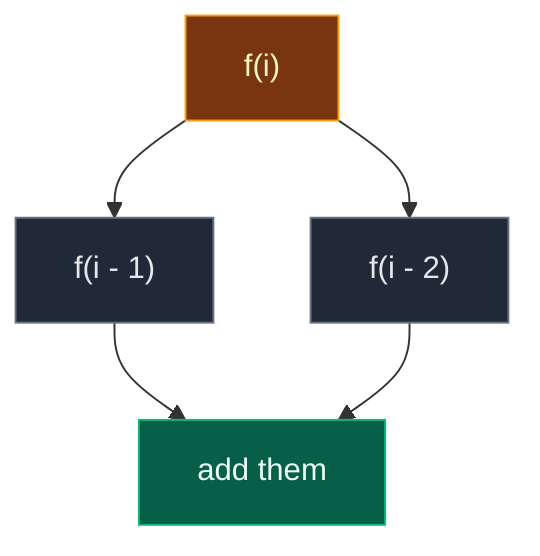
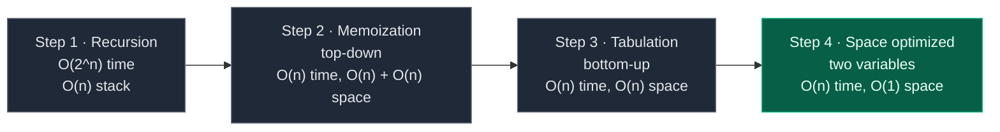
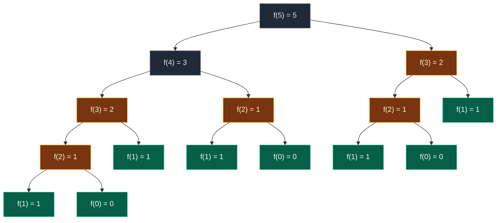
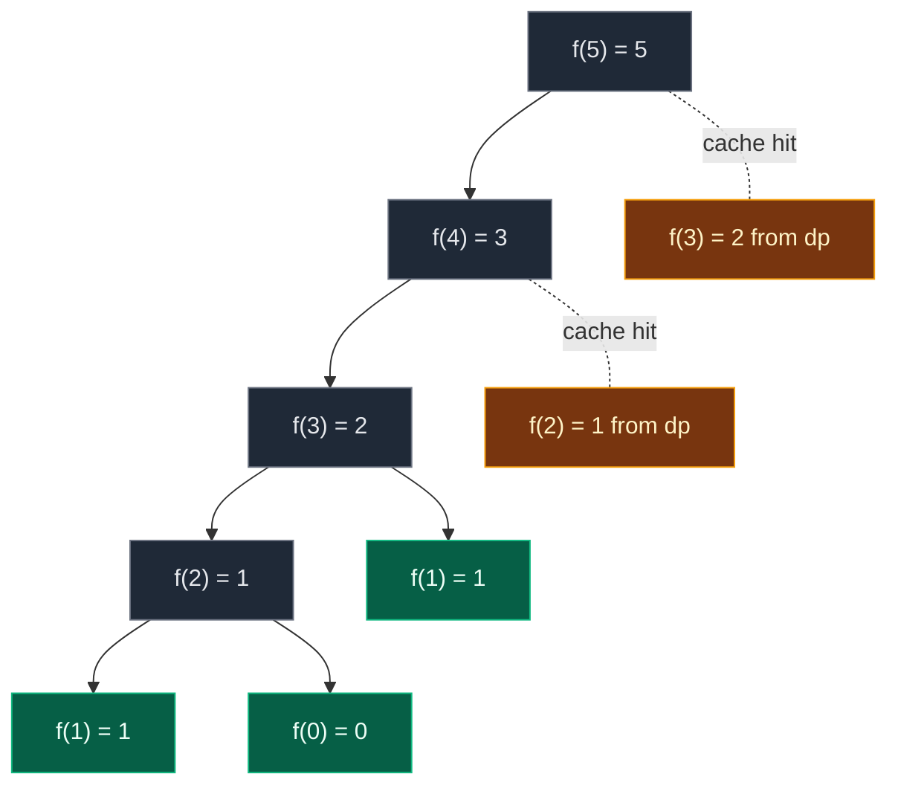

# 01. 509. Fibonacci Number

| Difficulty | Pattern | Source | Time | Space |
|:---:|:---:|:---:|:---:|:---:|
| **Easy** | 1-D DP: Last Two Values | [509. Fibonacci Number](https://leetcode.com/problems/fibonacci-number/) | `O(n)` | `O(1)` |

## 1. Problem Statement

The Fibonacci numbers, written `F(n)`, form a sequence. Each number is the **sum of the two numbers before it**. The sequence starts from `0` and `1`.

```text
F(0) = 0
F(1) = 1
F(n) = F(n - 1) + F(n - 2)      for n > 1
```

Given `n`, return `F(n)`.

LeetCode examples:

| Input | Output | Why |
|:---:|:---:|:---|
| `n = 2` | `1` | `F(2) = F(1) + F(0) = 1 + 0 = 1` |
| `n = 3` | `2` | `F(3) = F(2) + F(1) = 1 + 1 = 2` |
| `n = 4` | `3` | `F(4) = F(3) + F(2) = 2 + 1 = 3` |

The first values, so you can check any answer by eye:

```text
n:     0  1  2  3  4  5  6   7   8   9   10
F(n):  0  1  1  2  3  5  8  13  21  34   55
```

Read the index carefully. The sequence starts at **index 0**. So `F(4) = 3` (because `1 + 2 = 3`), and `F(5) = 5` (because `2 + 3 = 5`). Mixing up the index by one is the most common reason for wrong answers.

### Example

```text
n = 5

F(5) = F(4) + F(3)
     = 3    + 2
     = 5

Output: 5
```

We use this same example (`n = 5`) in every section below.

### Constraints

- `0 <= n <= 30`
- `n = 0` is allowed, so the answer can be `0`.
- `F(30) = 832,040`. It fits easily in an `int`.
- In C++ or Java, a 32-bit `int` overflows at `F(47) = 2,971,215,073`. Python has no overflow.

## 2. Core Theory

This is the very first DP note, so we start from zero.

### What is Dynamic Programming (DP)?

> "Those who cannot remember the past are condemned to repeat it."

That quote is the whole idea of DP.

- A **subproblem** is a smaller copy of the same question. For `F(5)`, the subproblems are `F(4)`, `F(3)`, `F(2)`, and so on.
- Plain recursion solves the same subproblem again and again. It "repeats the past".
- DP **remembers** the answer of each subproblem the first time, and reuses it every time after.

**DP = recursion that remembers the answers of subproblems.**

### How to spot that it is DP

Two properties make a problem DP-friendly. Fibonacci has both, which is why it is lesson 1.

| Property | Plain meaning | In Fibonacci |
|:---|:---|:---|
| **Overlapping subproblems** | The same smaller question is asked many times | `F(3)` is needed by `F(5)` and also by `F(4)` |
| **Optimal substructure** | The big answer is built from answers of smaller questions | `F(n)` is built from `F(n-1)` and `F(n-2)` |

If only the second is true (no repeats), plain recursion or divide and conquer is enough. DP helps when **both** are true.

### The state

The **state** is the small piece of information that names one subproblem.

> `f(i)` (or `dp[i]`) = the `i`-th Fibonacci number.

Here the state is just one number, `i`. That is why this is **1-D DP** (one-dimensional: one index).

### The recurrence

The **recurrence** is the rule that builds a bigger answer from smaller ones.

In words: *the answer at `i` is the answer at `i - 1` plus the answer at `i - 2`.*

```text
f(i) = f(i - 1) + f(i - 2)
```



### Base cases

A **base case** is a subproblem so small that we know the answer without any more work. It is where recursion stops.

| Base case | Value | Why |
|:---:|:---:|:---|
| `f(0)` | `0` | Given by the problem. Also stops `f(1)` from asking `f(-1)` |
| `f(1)` | `1` | Given by the problem. Without it, `f(1)` would call `f(0)` and `f(-1)` |

Nice trick: both base cases are "return `n` itself". So one line covers both: `if n <= 1: return n`. `f(0)` returns `0` and `f(1)` returns `1`.

### Two ways to remember: memoization vs tabulation

| | Memoization | Tabulation |
|:---|:---|:---|
| Other name | **Top-down** | **Bottom-up** |
| Direction | Start from the answer `f(n)`, go down to the base cases, come back up | Start from the base cases, build up to the answer |
| How | Recursion + a table (array or map) | Loop + a table |
| Computes | Only the states it needs | Every state from small to big |
| Stack | Uses the recursion stack | No recursion stack |

```text
Top-down (memoization):            Bottom-up (tabulation):

   answer f(n)                        dp[0], dp[1]  (base cases)
      ↘ go down                          ↗ build up
        base cases                     ... dp[n]   (the required answer)
      ↗ values come back up
```

### Why the space can shrink

To fill `dp[i]` we only read `dp[i - 1]` and `dp[i - 2]`. Every older cell is never read again. So instead of a whole table, two variables are enough. That is the last step: **space optimization**.

### The 4-step ladder

Learn this order. You will use it for almost every 1-D DP problem:

1. Write the plain **recursion** (it follows straight from the recurrence).
2. Add a table to get **memoization** (easy to do from the recursion).
3. Turn it into **tabulation** to remove the recursion stack.
4. Keep only what you need: **space optimization**. This is the final solution.



## 3. Edge Cases

| Case | Input | Expected | Why it matters |
|:---|:---:|:---:|:---|
| Smallest input | `n = 0` | `0` | Don't return `1`. `F(0) = 0` |
| Second base case | `n = 1` | `1` | Returned directly, no loop |
| Smallest case that uses the loop | `n = 2` | `1` | The loop runs exactly once |
| Our example | `n = 5` | `5` | Traced in every section |
| Largest input | `n = 30` | `832040` | Plain recursion makes about 2.7 million calls here |

## 4. Approach 1: Recursion

### Idea

Write the recurrence as code. If `n <= 1`, return `n`. Otherwise return `f(n - 1) + f(n - 2)`.

The board pseudo-code:

```text
f(n)
{
    if (n <= 1)
        return n;
    return f(n-1) + f(n-2);
}
```

### Recursion tree for `n = 5`

Every box shows the call and the value it returns. Calls happen depth-first, left child first.



Gold = repeated work. Green = base cases.

| Subproblem | `f(5)` | `f(4)` | `f(3)` | `f(2)` | `f(1)` | `f(0)` |
|:---|:---:|:---:|:---:|:---:|:---:|:---:|
| Times computed | 1 | 1 | **2** | **3** | 5 | 3 |

That is **15 calls** for `n = 5`. `f(3)` is solved 2 times and `f(2)` 3 times, but each gives the same answer every time.

**The exact order of calls** (indent = depth). Values bubble up from the leaves.

```text
call f(5)                    needs f(4) + f(3)
  call f(4)                  needs f(3) + f(2)
    call f(3)                needs f(2) + f(1)
      call f(2)              needs f(1) + f(0)
        call f(1)            base case → return 1
        call f(0)            base case → return 0
      f(2) done              1 + 0 = 1
      call f(1)              base case → return 1
    f(3) done                1 + 1 = 2
    call f(2)                needs f(1) + f(0)      ← f(2) again!
      call f(1)              base case → return 1
      call f(0)              base case → return 0
    f(2) done                1 + 0 = 1
  f(4) done                  2 + 1 = 3
  call f(3)                  needs f(2) + f(1)      ← f(3) again!
    call f(2)                needs f(1) + f(0)      ← f(2) a third time!
      call f(1)              base case → return 1
      call f(0)              base case → return 0
    f(2) done                1 + 0 = 1
    call f(1)                base case → return 1
  f(3) done                  1 + 1 = 2
f(5) done                    3 + 2 = 5
```

### Code

```python
# Plain recursion
class SolutionRecursion:

    # Helper that computes F(n) recursively
    def helper(self, n: int) -> int:

        # Base case: F(0) = 0
        if n == 0:
            return 0

        # Base case: F(1) = 1
        if n == 1:
            return 1

        # Answer of the left branch: F(n - 1)
        left = self.helper(n - 1)

        # Answer of the right branch: F(n - 2)
        right = self.helper(n - 2)

        # Recurrence: F(n) = F(n - 1) + F(n - 2)
        return left + right

    # Main LeetCode method
    def fib(self, n: int) -> int:

        # Start the recursion at n
        return self.helper(n)
```

### Complexity

| Measure | Complexity | Why |
|:---|:---:|:---|
| **Time** | `O(2^n)` | Each call makes two more calls, so the tree roughly doubles at each level |
| **Space** | `O(n)` | Recursion stack. Only one root-to-leaf path is on the stack at a time. The longest path is `f(n) → f(n-1) → ... → f(1)`, which is `n` frames |

**Exact count:** the number of calls is `2 · F(n + 1) - 1`.

- `n = 5`: `2 · 8 - 1 = 15` calls.
- `n = 30`: `2,692,537` calls (about 2.7 million).

**Tighter bound:** the calls grow like `φ^n`, where `φ ≈ 1.618` (the golden ratio). So `O(2^n)` is correct but loose. Either is accepted in interviews. Mention `φ^n` for bonus points.

## 5. Approach 2: Memoization (Top-Down)

### Idea

**Memoization** means: keep a table (array or map), and store the answer of every subproblem the first time you compute it. The table is called the **memo** (a note to remember).

Turning the recursion into DP takes **3 steps**:

1. **Declare** `dp` of size `n + 1`, filled with `-1`. Size `n + 1` so that index `n` exists. `-1` means "not computed yet".
2. **Store** the answer before returning: `dp[n] = f(n-1) + f(n-2)`.
3. **Check** first: if `dp[n] != -1`, return `dp[n]` and make no new calls.

That's it: recursion → DP. These 3 changes work for almost every 1-D recursion.

```text
declare dp[n+1]  (all -1)            <- step 1: declare
f(n)
{
    if (n <= 1) return n;
    if (dp[n] != -1) return dp[n];   <- step 3: check
    return dp[n] = f(n-1) + f(n-2);  <- step 2: store
}
```

Note: `dp[0]` and `dp[1]` stay `-1` forever. That is fine. The base case `if (n <= 1) return n` answers them before the table is ever looked at.

### Visual: when each `dp[k]` gets filled (`n = 5`)

```text
index:  0   1   2   3   4   5
```

**Start:** `dp = [-1] * 6`.

```text
dp: [-1][-1][-1][-1][-1][-1]
```

**Calls go down the left side:** `f(5)` → `dp[5] = -1`, compute. `f(4)` → `dp[4] = -1`, compute. `f(3)` → `dp[3] = -1`, compute. `f(2)` → `dp[2] = -1`, compute. `f(1)` base case → `1`. `f(0)` base case → `0`.

```text
dp: [-1][-1][-1][-1][-1][-1]     (nothing stored yet)
```

**Fill 1:** `f(2)` finishes: `1 + 0 = 1`. Store `dp[2] = 1`.

```text
dp: [-1][-1][ 1][-1][-1][-1]
              ^ filled
```

**`f(3)` asks for `f(1)`:** base case → `1`.

**Fill 2:** `f(3)` finishes: `1 + 1 = 2`. Store `dp[3] = 2`.

```text
dp: [-1][-1][ 1][ 2][-1][-1]
                  ^ filled
```

**Cache hit:** `f(4)` asks for `f(2)`. `dp[2] = 1`, which is not `-1` → return `1`, **no new calls**.

```text
dp: [-1][-1][ 1][ 2][-1][-1]
              ^ read, cache hit
```

**Fill 3:** `f(4)` finishes: `2 + 1 = 3`. Store `dp[4] = 3`.

```text
dp: [-1][-1][ 1][ 2][ 3][-1]
                      ^ filled
```

**Cache hit:** `f(5)` asks for `f(3)`. `dp[3] = 2` already known → return `2`, **no new calls**. The whole `f(3)` subtree is skipped.

```text
dp: [-1][-1][ 1][ 2][ 3][-1]
                  ^ read, cache hit
```

**Fill 4:** `f(5)` finishes: `3 + 2 = 5`. Store `dp[5] = 5`.

```text
dp: [-1][-1][ 1][ 2][ 3][ 5]
                          ^ filled → answer 5
```

### The pruned recursion tree

Same tree, but cache hits (dashed) stop right away.



Only **9 calls** instead of 15. In general it is `2n - 1` calls (for `n = 30`: `59` instead of `2,692,537`).

### Code

```python
# Memoization (top-down DP) with an array of -1
class SolutionMemo:

    # Helper that remembers answers in dp
    def helper(self, n: int, dp: list) -> int:

        # Base cases: F(0) = 0 and F(1) = 1
        if n <= 1:
            return n

        # Step 3 (check): already solved before? Reuse it
        if dp[n] != -1:
            return dp[n]

        # Step 2 (store): solve once and save the answer
        dp[n] = self.helper(n - 1, dp) + self.helper(n - 2, dp)

        # Return the saved answer
        return dp[n]

    # Main LeetCode method
    def fib(self, n: int) -> int:

        # Step 1 (declare): dp of size n + 1, -1 means "not solved yet"
        dp = [-1] * (n + 1)

        # Start the recursion at n
        return self.helper(n, dp)
```

The same idea with a dictionary instead of a `-1` array (this is the version from my own notes). A dict needs no `-1` sentinel; an array is a little faster.

```python
# Memoization with a dictionary
class SolutionMemoDict:

    # Helper that remembers answers in a dict
    def helper(self, n: int, dp: dict) -> int:

        # Base case: F(0) = 0
        if n == 0:
            return 0

        # Base case: F(1) = 1
        if n == 1:
            return 1

        # If the value is already computed, return it
        if n in dp:
            return dp[n]

        # Compute and store the result
        dp[n] = self.helper(n - 1, dp) + self.helper(n - 2, dp)

        # Return the stored result
        return dp[n]

    # Main LeetCode method
    def fib(self, n: int) -> int:

        # Empty dictionary for memoization
        dp = {}

        # Call the helper
        return self.helper(n, dp)
```

### Complexity

| Measure | Complexity | Why |
|:---|:---:|:---|
| **Time** | `O(n)` | Each `f(2) ... f(n)` is computed once. Every other call is a base case or a cache hit |
| **Space: dp array** | `O(n)` | `n + 1` cells |
| **Space: recursion stack** | `O(n)` | The first path goes `f(n) → f(n-1) → ... → f(1)` |
| **Total space** | `O(n) + O(n)` | Array plus stack |

## 6. Approach 3: Tabulation (Bottom-Up)

### Idea

**Tabulation** fills the table with a loop, from the base cases up to the answer. No recursion, so no recursion stack.

### How to convert memo → table, step by step

1. **Same table:** make `dp` of size `n + 1`.
2. **Base cases into the table:** `if n <= 1: return n` becomes `dp[0] = 0`, `dp[1] = 1`.
3. **Loop the opposite way:** recursion went from `n` down. The loop goes from small to big: `i = 2 ... n`.
4. **Copy the recurrence:** replace `f(...)` with `dp[...]`. So `f(n-1) + f(n-2)` becomes `dp[i-1] + dp[i-2]`.
5. **Answer is the last cell:** return `dp[n]`.

| Memoization | Becomes in tabulation |
|:---|:---|
| `declare dp[n+1]` | `declare dp[n+1]` |
| Base case `if n <= 1 return n` | `dp[0] = 0`, `dp[1] = 1` |
| `f(n)` called for `n`, `n-1`, ... | Loop `i = 2 ... n` |
| `f(n-1) + f(n-2)` | `dp[i-1] + dp[i-2]` |
| `return f(n)` | `return dp[n]` |

The board version:

```text
dp[n+1]
dp[0] = 0    dp[1] = 1
for (i = 2; i <= n; i++)
{
    dp[i] = dp[i-1] + dp[i-2];
}
```

### Visual table fill (`n = 5`)

**Start: base cases written in**

```text
i:     0   1   2   3   4   5
dp:  [ 0][ 1][  ][  ][  ][  ]
       ^   ^
       base cases
```

**i = 2:** reads `dp[1] = 1` and `dp[0] = 0`. `dp[2] = 1 + 0 = 1`.

```text
i:     0   1   2   3   4   5
dp:  [ 0][ 1][ 1][  ][  ][  ]
       ^   ^   ^
       |   |   └── filling dp[2] = dp[1] + dp[0] = 1 + 0 = 1
       └───┴── read
```

**i = 3:** reads `dp[2] = 1` and `dp[1] = 1`. `dp[3] = 1 + 1 = 2`.

```text
i:     0   1   2   3   4   5
dp:  [ 0][ 1][ 1][ 2][  ][  ]
           ^   ^   ^
           |   |   └── filling dp[3] = dp[2] + dp[1] = 1 + 1 = 2
           └───┴── read
```

**i = 4:** reads `dp[3] = 2` and `dp[2] = 1`. `dp[4] = 2 + 1 = 3`.

```text
i:     0   1   2   3   4   5
dp:  [ 0][ 1][ 1][ 2][ 3][  ]
               ^   ^   ^
               |   |   └── filling dp[4] = dp[3] + dp[2] = 2 + 1 = 3
               └───┴── read
```

**i = 5:** reads `dp[4] = 3` and `dp[3] = 2`. `dp[5] = 3 + 2 = 5`.

```text
i:     0   1   2   3   4   5
dp:  [ 0][ 1][ 1][ 2][ 3][ 5]
                   ^   ^   ^
                   |   |   └── filling dp[5] = dp[4] + dp[3] = 3 + 2 = 5
                   └───┴── read
```

Answer: `dp[5] = 5`. When we fill `dp[i]`, both cells it needs are already filled. That is why the loop goes small to big.

### Code

```python
# Tabulation (bottom-up DP)
class SolutionTab:

    # Main LeetCode method
    def fib(self, n: int) -> int:

        # F(0) = 0 and F(1) = 1 need no table
        if n <= 1:
            return n

        # dp[i] will hold F(i)
        dp = [0] * (n + 1)

        # Base case F(0) goes into the table
        dp[0] = 0

        # Base case F(1) goes into the table
        dp[1] = 1

        # Fill from small to big (bottom-up)
        for i in range(2, n + 1):

            # Every cell = the two cells before it
            dp[i] = dp[i - 1] + dp[i - 2]

        # The last cell is the answer
        return dp[n]
```

### Complexity

| Measure | Complexity | Why |
|:---|:---:|:---|
| **Time** | `O(n)` | One loop from `2` to `n` |
| **Space** | `O(n)` | The `dp` array. The recursion stack is gone |

## 7. Approach 4: Space Optimization (Optimal)

### Idea

Look at the table fill again. To fill cell `i` we only looked at the two cells right before it: `(i - 2)` and `(i - 1)`.

```text
•    •    •    •    •    •    •
               (i-2) (i-1) (i)
                 └─────┴──► only these two are read
```

So rename them:

- `prev2` = the value at `(i - 2)`
- `prev` = the value at `(i - 1)`
- `curr` = the new value at `i` = `prev + prev2`

After computing `curr`, everything shifts one step right: the old `prev` becomes `prev2`, and `curr` becomes `prev`. The whole array is crossed out. At the end, `prev` holds `F(n)`.

```text
prev2 = 0    prev = 1
for (i = 2; i <= n; i++)
{
    curr  = prev + prev2;
    prev2 = prev;
    prev  = curr;
}
return prev;
```

### Visual Walkthrough (Story Version)

**The story:** two friends, Lefty and Righty, walk along a row of numbered stones. Each stone must get a number written on it. The rule: *the number on a stone is the sum of the numbers on the two stones just behind it.*

The friends are lazy. They do not carry a notebook. Lefty holds **one card** (the number two stones back, `prev2`). Righty holds **one card** (the number one stone back, `prev`). That is all they ever carry.

**Start: stones 0 and 1 are already known**

Lefty holds `0` (stone 0). Righty holds `1` (stone 1).

```text
stone:   0    1    2    3    4    5
value:  [0]  [1]  [ ]  [ ]  [ ]  [ ]
         L    R
Lefty = 0   Righty = 1
```

**Step 1: stone 2**

- They add their cards: `1 + 0 = 1`. Stone 2 gets `1`.
- Lefty drops his card and takes Righty's: Lefty = `1`.
- Righty takes the new number: Righty = `1`.

```text
stone:   0    1    2    3    4    5
value:  [0]  [1]  [1]  [ ]  [ ]  [ ]
              L    R
Lefty = 1   Righty = 1
```

**Step 2: stone 3**

- Add: `1 + 1 = 2`. Stone 3 gets `2`.
- Lefty = `1` (old Righty). Righty = `2`.

```text
stone:   0    1    2    3    4    5
value:  [0]  [1]  [1]  [2]  [ ]  [ ]
                   L    R
Lefty = 1   Righty = 2
```

**Step 3: stone 4**

- Add: `2 + 1 = 3`. Stone 4 gets `3`.
- Lefty = `2`. Righty = `3`.

```text
stone:   0    1    2    3    4    5
value:  [0]  [1]  [1]  [2]  [3]  [ ]
                        L    R
Lefty = 2   Righty = 3
```

**Step 4: stone 5**

- Add: `3 + 2 = 5`. Stone 5 gets `5`.
- Lefty = `3`. Righty = `5`.

```text
stone:   0    1    2    3    4    5
value:  [0]  [1]  [1]  [2]  [3]  [5]
                             L    R
Lefty = 3   Righty = 5
```

**The end:** they reached stone 5. Righty is holding `5`. That is the answer.

**All steps at a glance**

| Step | Stone | Lefty + Righty | New number | Lefty after | Righty after |
|:---:|:---:|:---:|:---:|:---:|:---:|
| start | 0, 1 | – | – | 0 | 1 |
| 1 | 2 | `1 + 0` | 1 | 1 | 1 |
| 2 | 3 | `1 + 1` | 2 | 1 | 2 |
| 3 | 4 | `2 + 1` | 3 | 2 | 3 |
| 4 | 5 | `3 + 2` | 5 | 3 | 5 |

**What the story teaches**

| In the story | In the code |
|:---|:---|
| Stone `i` | Index `i`, the state |
| Number on a stone | `F(i)` |
| Lefty's card | `prev2` = `F(i - 2)` |
| Righty's card | `prev` = `F(i - 1)` |
| Adding the two cards | `curr = prev + prev2` |
| Lefty takes Righty's card | `prev2 = prev` |
| Righty takes the new number | `prev = curr` |
| No notebook | `O(1)` space, no `dp` array |
| Righty's card at the end | `return prev` |

### Step-by-Step Example

`n = 5`. Start: `prev2 = 0` (`F(0)`), `prev = 1` (`F(1)`).

| `i` | `curr = prev + prev2` | `prev2` becomes | `prev` becomes |
|:---:|:---:|:---:|:---:|
| start | – | 0 | 1 |
| 2 | `1 + 0 = 1` | 1 | 1 |
| 3 | `1 + 1 = 2` | 1 | 2 |
| 4 | `2 + 1 = 3` | 2 | 3 |
| 5 | `3 + 2 = 5` | 3 | 5 |

Loop ends (`i` went up to `n = 5`). Return `prev = 5`. Same as `dp[5]` in the table.

**The sliding window of two values**

```text
values:   0    1    1    2    3    5
i = 2:   [prev2 prev] curr=1
i = 3:        [prev2 prev] curr=2
i = 4:             [prev2 prev] curr=3
i = 5:                  [prev2 prev] curr=5
after:                       [prev2 prev]  → prev = 5
```

After computing `curr`: `prev2 ← prev`, `prev ← curr`. The window slides one step right. Everything to the left is never needed again.

**Watch the loop bounds.** The loop is `i = 2 ... n` inclusive (`range(2, n + 1)` in Python), starting from `prev2 = 0`, `prev = 1`, and the answer is `prev`. Starting the loop at `3`, or going up to `n + 1`, is off by one: for `n = 5` it gives `3` or `8` instead of `5`.

### Code

```python
# Space optimized: only the last two values
class Solution:

    # Main LeetCode method
    def fib(self, n: int) -> int:

        # F(0) = 0 and F(1) = 1: return n directly
        if n <= 1:
            return n

        # prev2 = F(i - 2), starts at F(0)
        prev2 = 0

        # prev = F(i - 1), starts at F(1)
        prev = 1

        # Build F(2), F(3), ..., F(n)
        for i in range(2, n + 1):

            # The new value F(i)
            curr = prev + prev2

            # Slide the window: old prev becomes prev2
            prev2 = prev

            # Slide the window: new value becomes prev
            prev = curr

        # After the loop, prev holds F(n)
        return prev


# ---------- Tests ----------

# Recursion tree: count the calls for n = 5
def count_calls(n: int) -> int:

    # A base case is one call
    if n <= 1:
        return 1

    # This call plus the calls of both children
    return 1 + count_calls(n - 1) + count_calls(n - 2)


# 15 calls for n = 5, and the formula 2 * F(n + 1) - 1
assert count_calls(5) == 15
assert count_calls(5) == 2 * Solution().fib(6) - 1

# Memoization trace: dp after the run on n = 5
dp = [-1] * 6
assert SolutionMemo().helper(5, dp) == 5
assert dp == [-1, -1, 1, 2, 3, 5]


# Memoization makes only 2n - 1 calls
class CountingMemo(SolutionMemo):

    # Count every call, then do the normal work
    def helper(self, n, dp):

        # One more call
        self.calls += 1

        # Normal memo helper
        return super().helper(n, dp)


# Make the counting version
counter = CountingMemo()

# Start the counter at zero
counter.calls = 0

# Run it on n = 5
assert counter.fib(5) == 5

# 2 * 5 - 1 = 9 calls
assert counter.calls == 9

# Tabulation trace: the table for n = 5
assert [SolutionTab().fib(i) for i in range(6)] == [0, 1, 1, 2, 3, 5]

# Space optimized trace: start values for n = 5
prev2, prev = 0, 1

# Record (i, curr, prev2, prev) after every loop step
states = []

# Run the same loop as Solution.fib(5)
for i in range(2, 6):

    # New value
    curr = prev + prev2

    # Slide prev2
    prev2 = prev

    # Slide prev
    prev = curr

    # Save the state after this step
    states.append((i, curr, prev2, prev))

# Matches the Step-by-Step table
assert states == [(2, 1, 1, 1), (3, 2, 1, 2), (4, 3, 2, 3), (5, 5, 3, 5)]

# LeetCode examples
assert Solution().fib(2) == 1
assert Solution().fib(3) == 2
assert Solution().fib(4) == 3

# Our example
assert Solution().fib(5) == 5

# Edge cases
assert Solution().fib(0) == 0
assert Solution().fib(1) == 1
assert Solution().fib(7) == 13
assert Solution().fib(30) == 832040

# First values of the sequence
assert [Solution().fib(i) for i in range(11)] == [0, 1, 1, 2, 3, 5, 8, 13, 21, 34, 55]

# All versions agree (recursion only on small n)
for n in range(0, 31):

    # Answer from the optimal version
    expected = Solution().fib(n)

    # Memo with an array agrees
    assert SolutionMemo().fib(n) == expected

    # Memo with a dict agrees
    assert SolutionMemoDict().fib(n) == expected

    # Tabulation agrees
    assert SolutionTab().fib(n) == expected

    # Plain recursion is slow, so test it only on small n
    if n <= 20:

        # Recursion agrees
        assert SolutionRecursion().fib(n) == expected

# All checks passed
print("All tests passed")
```

### Complexity

| Approach | Time | Space | Stack |
|:---|:---:|:---:|:---:|
| Recursion | `O(2^n)` | `O(1)` extra | `O(n)` |
| Memoization | `O(n)` | `O(n)` dp | `O(n)` |
| Tabulation (bottom-up DP) | `O(n)` | `O(n)` dp | none |
| **Space optimized** | **`O(n)`** | **`O(1)`** | **none** |
| Matrix exponentiation (see Q5) | `O(log n)` | `O(1)` | none |
| Binet's formula (see Q6) | `O(1)`* | `O(1)` | none |

\* Uses floating point. Exact only up to about `n = 70` with doubles.

## 8. Common Mistakes

| Mistake | What goes wrong | Fix |
|:---|:---|:---|
| Forgetting `F(0) = 0` | Returns `1` for `n = 0` | Base case `if n <= 1: return n` |
| Plain recursion for big `n` | About 2.7 million calls at `n = 30` | Memoize, or use the loop |
| Loop to `n` instead of `n + 1` (`range(2, n)`) | Off by one, returns `F(n - 1)` | `range(2, n + 1)` |
| Starting the loop at `3` | For `n = 5` gives `3` instead of `5` | Start at `i = 2` with `prev2 = 0`, `prev = 1` |
| Returning `curr` when `n <= 1` | `curr` is never set (undefined) | Handle `n <= 1` first, and return `prev` |
| Memo `dp` of size `n` | `dp[n]` is out of range | Size `n + 1`, because indices `0 ... n` must exist |
| Memo: checking `dp` after the recursive calls | No saving at all, still exponential | Check `dp[n] != -1` **before** recursing |
| Memo: computing but not storing | Same as plain recursion | `dp[n] = ...` before `return` |
| Packing code on one line (`for ...: dp[i] = ...`, `def fib(...): return ...`) | Hard to read and to comment | Split into the header line and an indented body |

## 9. Interview Follow-ups

### Q1. What is dynamic programming?

**Answer:**
- Solving a problem by breaking it into **overlapping subproblems**.
- Storing each subproblem's answer so it is computed only once.
- In one line: recursion that remembers.

### Q2. Memoization vs tabulation?

**Answer:**
- Memoization = top-down. Recursion + cache. Computes only the states it needs.
- Tabulation = bottom-up. A loop fills the table from the base cases. No recursion stack.
- Write memoization first (it is easy from the recursion), then convert it to tabulation.

### Q3. Why is plain recursion exponential?

**Answer:**
- Each call spawns two calls, and subproblems repeat (`f(2)` is computed 3 times for `n = 5`).
- Calls `= 2 · F(n + 1) - 1 ≈ φ^n`.

### Q4. How do you go from `O(n)` space to `O(1)`?

**Answer:**
- `dp[i]` only reads `dp[i - 1]` and `dp[i - 2]`.
- So keep two variables and slide them forward.

### Q5. Can you beat `O(n)`?

**Answer:**
- Yes: **matrix exponentiation** in `O(log n)`.
- Key identity: multiplying by `[[1, 1], [1, 0]]` moves the pair one step forward:
  `[[1, 1], [1, 0]] × [F(n), F(n-1)] = [F(n) + F(n-1), F(n)] = [F(n+1), F(n)]`.
- So `[[1, 1], [1, 0]]^n = [[F(n+1), F(n)], [F(n), F(n-1)]]`.
- Raise the matrix to the power `n` with fast exponentiation: square the base, use the bits of `n`. Only about `log₂ n` multiplications.

```python
# Matrix exponentiation: O(log n)
class SolutionMatrix:

    # Multiply two 2 x 2 matrices
    def multiply(self, X, Y):

        # Top-left entry
        a = X[0][0] * Y[0][0] + X[0][1] * Y[1][0]

        # Top-right entry
        b = X[0][0] * Y[0][1] + X[0][1] * Y[1][1]

        # Bottom-left entry
        c = X[1][0] * Y[0][0] + X[1][1] * Y[1][0]

        # Bottom-right entry
        d = X[1][0] * Y[0][1] + X[1][1] * Y[1][1]

        # The product matrix
        return [[a, b], [c, d]]

    # Main LeetCode method
    def fib(self, n: int) -> int:

        # Identity matrix: plays the role of the number 1
        result = [[1, 0], [0, 1]]

        # The Fibonacci matrix
        base = [[1, 1], [1, 0]]

        # We need base to the power n
        power = n

        # Fast exponentiation: walk through the bits of n
        while power > 0:

            # Bit is 1: multiply this power of base into the result
            if power % 2 == 1:
                result = self.multiply(result, base)

            # Square the base: base^1 -> base^2 -> base^4 -> ...
            base = self.multiply(base, base)

            # Move to the next bit
            power = power // 2

        # base^n = [[F(n+1), F(n)], [F(n), F(n-1)]]
        return result[0][1]


# The matrix version agrees with the loop version
for n in range(0, 31):

    # Same answer for every n
    assert SolutionMatrix().fib(n) == Solution().fib(n)

# Trace for n = 10 ends with F(10) = 55
assert SolutionMatrix().fib(10) == 55
```

Trace for `n = 10` (binary `1010`):

| `power` | bit | action | `result` after | `base` after squaring |
|:---:|:---:|:---|:---|:---|
| 10 | 0 | skip | `[[1, 0], [0, 1]]` | `[[2, 1], [1, 1]]` |
| 5 | 1 | `result = result × base` | `[[2, 1], [1, 1]]` | `[[5, 3], [3, 2]]` |
| 2 | 0 | skip | `[[2, 1], [1, 1]]` | `[[34, 21], [21, 13]]` |
| 1 | 1 | `result = result × base` | `[[89, 55], [55, 34]]` | (not needed) |

`result[0][1] = 55 = F(10)`. Only 4 loop rounds for `n = 10`, about 30 for `n = 10^9` (with modular arithmetic, as such problems usually ask).

### Q6. Is there a closed-form formula?

**Answer:**
- Yes, **Binet's formula**: `F(n) = (φ^n - ψ^n) / √5`, with `φ = (1 + √5) / 2 ≈ 1.618` and `ψ = (1 - √5) / 2 ≈ -0.618`.
- Since `|ψ| < 1`, `ψ^n` shrinks fast, so `F(n) = round(φ^n / √5)`. Example: `φ^10 / √5 = 122.99 / 2.236 = 55.004 → 55`.
- Warning: doubles carry only about 16 significant digits, so it becomes wrong for large `n` (around `n > 70`). Fine for `n <= 30`, but say this limitation in an interview.

### Q7. Why is the dp size `n + 1`?

**Answer:**
- Indices `0 ... n` must all exist.
- That is `n + 1` cells.

### Q8. How is this related to Climbing Stairs?

**Answer:**
- Same recurrence, shifted by one. See [70. Climbing Stairs](./02.%2070.%20Climbing%20Stairs.md).

| | 509 Fibonacci | 70 Climbing Stairs |
|:---|:---|:---|
| Recurrence | `F(n) = F(n-1) + F(n-2)` | `ways(n) = ways(n-1) + ways(n-2)` |
| Base cases | `F(0) = 0`, `F(1) = 1` | `ways(0) = 1`, `ways(1) = 1` |
| Relation | – | `ways(n) = F(n + 1)` |
| Constraint | `0 <= n <= 30` | `1 <= n <= 45` |

- Spot the Fibonacci pattern whenever "the answer at `n` depends on the two previous answers".

### Q9. What should I practice next with the same pattern?

**Answer:**
- **70. Climbing Stairs**: `F(n + 1)`.
- **1137. N-th Tribonacci Number**: three previous values instead of two.
- **746. Min Cost Climbing Stairs**: `min` instead of sum.
- **198. House Robber**: `max` of two choices.

## 10. Memory Hook

- **Recursion repeats the past; DP remembers it.**
- **Only the last two values matter → two variables are enough.**
- `F(0) = 0`, `F(1) = 1`, `F(n) = F(n-1) + F(n-2)`.
- Memo in 3 steps: **declare** `dp[n+1]` with `-1`, **store** before returning, **check** before computing.

**Pattern in one line:** write the recursion, cache it, flip it into a loop, then keep only the cells the loop still reads.

## 11. Interview Explanation

> F(n) = F(n-1) + F(n-2) with F(0) = 0 and F(1) = 1, so the recursion writes itself. But the recursion tree repeats subproblems, for example f(2) is computed three times for n = 5, which gives about 2^n calls and O(n) stack. With memoization I declare dp of size n + 1 filled with -1, store each answer and check the table before computing, so it becomes O(n) time and O(n) + O(n) space. With tabulation I set dp[0] = 0 and dp[1] = 1 and loop i from 2 to n with dp[i] = dp[i-1] + dp[i-2]: O(n) time, O(n) space, no recursion. Each step only uses the last two values, so I keep prev2 and prev and get O(n) time and O(1) space. If needed, matrix exponentiation brings it down to O(log n).
