# 02. 70. Climbing Stairs

| Difficulty | Pattern | Source | Time | Space |
|:---:|:---:|:---:|:---:|:---:|
| **Easy** | 1-D DP: Count Ways (Fibonacci) | [70. Climbing Stairs](https://leetcode.com/problems/climbing-stairs/) | `O(n)` | `O(1)` |

## 1. Problem Statement

You are climbing a staircase. It takes `n` steps to reach the top.

Each time you can climb either **1 step** or **2 steps**. In how many **distinct ways** can you climb to the top?

LeetCode examples:

| Input | Output | The ways |
|:---:|:---:|:---|
| `n = 2` | `2` | `1 + 1`, `2` |
| `n = 3` | `3` | `1 + 1 + 1`, `1 + 2`, `2 + 1` |
| `n = 4` | `5` | `1+1+1+1`, `1+1+2`, `1+2+1`, `2+1+1`, `2+2` |

How to picture it:

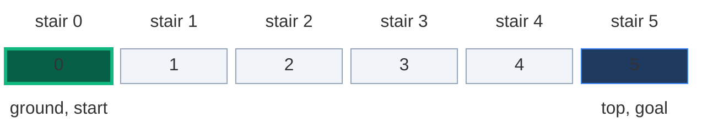

- Stair `0` is the ground. Stair `n` is the top.
- "Distinct ways" means **distinct orders of moves**. `1 + 2` and `2 + 1` are two different ways.

### Example

```text
n = 5

All 8 ways:
1+1+1+1+1
1+1+1+2
1+1+2+1
1+2+1+1
2+1+1+1
1+2+2
2+1+2
2+2+1

Output: 8
```

We use this same example (`n = 5`) in every section below.

### Constraints

- `1 <= n <= 45`
- Why 45? The answer for `n = 45` is `1,836,311,903`. It still fits in a 32-bit signed `int` (max about 2.1 billion). `n = 46` would overflow in C++ or Java. Python has no overflow.

### What the constraints tell us (simple theory)

A **constraint** is the biggest input the judge will ever give you. It quietly tells you how fast your code must be.

**Rule of thumb:** a computer does about **100 million (10^8) simple steps per second**. Count how many steps your idea needs for the biggest input, and compare.

| Biggest input `n` | Steps you can afford | Ideas that fit |
|:---:|:---:|:---|
| up to ~20 | about `2^n` | Plain recursion, try everything |
| up to ~500 | about `n^3` | Three nested loops |
| up to ~5,000 | about `n^2` | Two nested loops |
| up to ~1,000,000 | about `n` or `n log n` | One loop, DP over `n` states |

**For this problem:** `n` is at most `45`.

- Plain recursion needs **3,672,623,805 calls** (about 3.7 billion) for `n = 45`. Even at 10^8 steps per second that is more than half a minute, and Python is much slower than that. This is a TLE.
- DP needs only **44 loop steps** for `n = 45`. It finishes instantly.

So `n <= 45` is chosen to kill plain recursion. You must use DP.

**How the work grows as `n` grows**

Red bars = calls made by plain recursion. Green line = loop steps made by DP (it stays flat near zero).

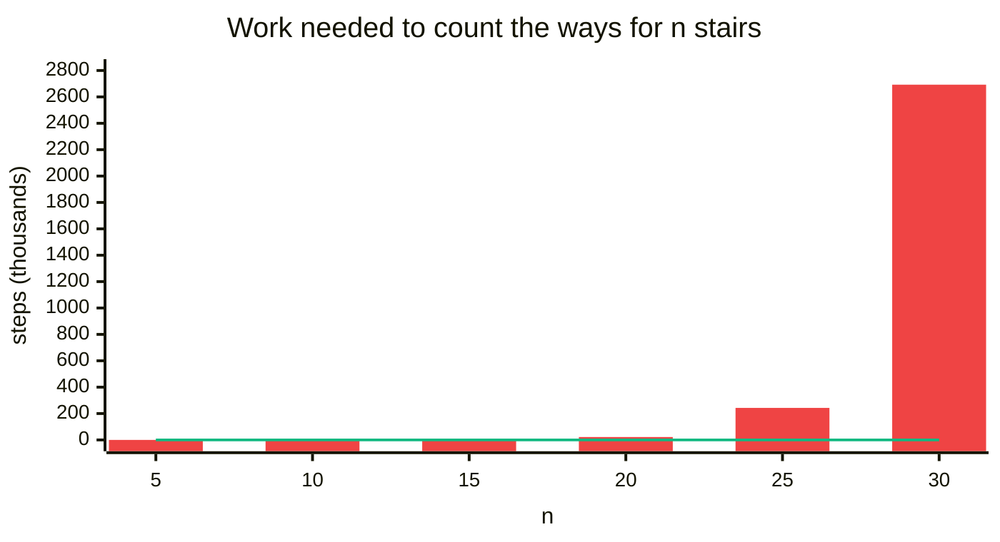

| `n` | Recursion calls | DP loop steps |
|:---:|:---:|:---:|
| 5 | 15 | 4 |
| 10 | 177 | 9 |
| 15 | 1,973 | 14 |
| 20 | 21,891 | 19 |
| 25 | 242,785 | 24 |
| 30 | 2,692,537 | 29 |
| 45 (the limit) | 3,672,623,805 | 44 |

## 2. Core Theory

If DP is new to you, first read the DP basics in [509. Fibonacci Number → Core Theory](./01.%20509.%20Fibonacci%20Number.md#2-core-theory). This note uses the same ideas: subproblems, memo, base cases, the 4-step ladder.

### How to spot it is DP

A DP question usually asks for one of three things:

| The question asks | Example words |
|:---|:---|
| **Count** the total number of ways | "in how many ways", "how many distinct ways" |
| **Min** (best, cheapest) | "minimum cost", "fewest steps" |
| **Max** (best, largest) | "maximum profit", "most money" |

Other hints: "is it possible", and choices that repeat on smaller versions of the same problem.

Climbing Stairs = **count the total number of ways**.

The general plan for every DP problem:

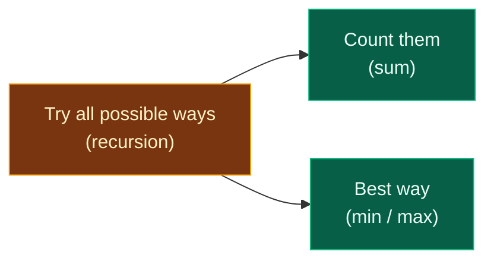

- Every DP problem starts by **trying all possible ways**.
- **Recursion** is the tool that tries all possible ways.
- Then you either **count** them (add) or pick the **best** one (min / max).

Both DP properties hold here:

| Property | In Climbing Stairs |
|:---|:---|
| **Overlapping subproblems** | "Ways to reach stair 3" is needed by stair 4 **and** by stair 5 |
| **Optimal substructure** | Ways to reach stair `n` are built from ways to reach stairs `n-1` and `n-2` |

### All the ways for `n = 3`, drawn

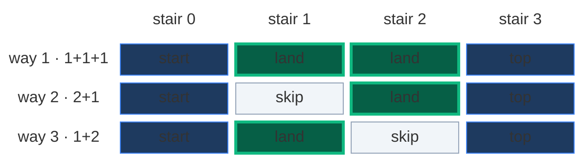

Green = a stair the climber lands on. Grey = a stair jumped over. Three different paths, so `3` ways.

### Striver's 3-step shortcut

A recipe to write the recursion for **any** 1-D DP problem:

1. **Represent the problem in terms of an index.**
2. **Do all possible stuff on that index**, according to the problem statement.
3. **Combine:** sum of all stuff → count all ways. `min` of all stuff → find the min (or `max` → find the max).

Applied to Climbing Stairs:

| Step | For Climbing Stairs |
|:---|:---|
| 1 · Index | `ind` = the stair number. `f(ind)` = number of ways to go from stair `0` to stair `ind` |
| 2 · All stuff | From `ind`, the last jump was a 1-step (from `ind - 1`) or a 2-step (from `ind - 2`) |
| 3 · Combine | We want a **count** → add them: `f(ind - 1) + f(ind - 2)` |

### The state

> `f(i)` (or `dp[i]`) = the number of distinct ways to go from stair `0` to stair `i`.

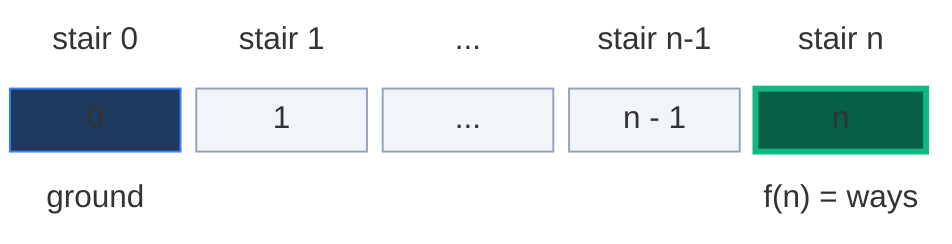

**Think in reverse:** start at stair `n` and walk down to `0`. It gives the same count, and makes the base case easy: when we reach index `0`, we have found exactly **one** complete way.

### The recurrence

In words: *to stand on stair `n`, the last move came from stair `n - 1` (a 1-step) or from stair `n - 2` (a 2-step). Split all ways by that last move and add.*

```text
f(n) = f(n - 1) + f(n - 2)
```

The choices as a picture:

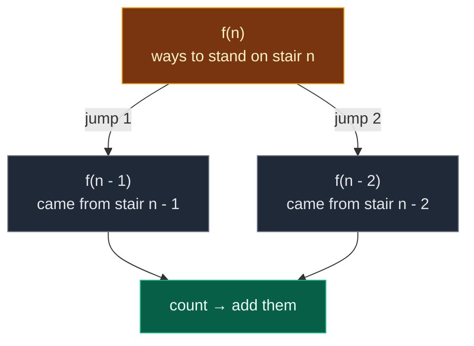

**What a cell really means:** the 5 ways to reach stair 4.

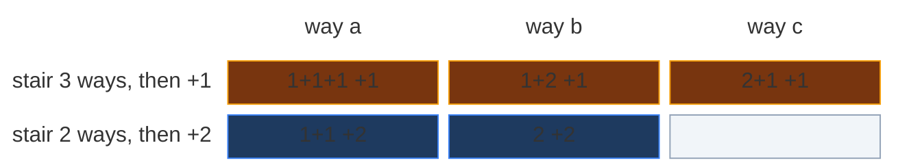

Top row: the 3 ways to reach stair 3, each with one more 1-step. Bottom row: the 2 ways to reach stair 2, each with one more 2-step. `3 + 2 = 5` ways, and no way appears twice.

### Base cases

| Base case | Value | Why |
|:---:|:---:|:---|
| `f(0)` | `1` | Standing on the ground already: one way (do nothing). Reaching index 0 means one full way was found |
| `f(1)` | `1` | From stair 1 you can only take a single 1-step down to 0 |

**Why two base cases?** `f(1)` would call `f(0)` and `f(-1)`. Either stop at `1`, or add `if ind < 0: return 0` (there is no way to stand below the ground).

### This is Fibonacci!

The recurrence is exactly Fibonacci, shifted by one.

| `n` | 0 | 1 | 2 | 3 | 4 | 5 | 6 | 7 |
|:---|:---:|:---:|:---:|:---:|:---:|:---:|:---:|:---:|
| `ways(n)` | 1 | 1 | 2 | 3 | 5 | 8 | 13 | 21 |
| `Fib(n)` | 0 | 1 | 1 | 2 | 3 | 5 | 8 | 13 |

**`ways(n) = Fib(n + 1)`.** On the board: *Fibonacci → MF → log N*. Fibonacci can be computed with **matrix exponentiation** (MF) in `O(log N)`, which beats the `O(N)` DP (see Q4 below).

### The 4-step ladder

Same roadmap as in [Fibonacci](./01.%20509.%20Fibonacci%20Number.md#2-core-theory). This note follows exactly that order.

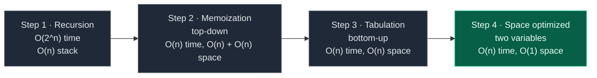

## 3. Edge Cases

| Case | Input | Expected | Why it matters |
|:---|:---:|:---:|:---|
| Smallest input | `n = 1` | `1` | Only `{1}`. Returned by the base case, no loop |
| Two stairs | `n = 2` | `2` | `{1+1, 2}`. The loop runs once |
| Three stairs | `n = 3` | `3` | `{1+1+1, 1+2, 2+1}`. Order matters |
| Our example | `n = 5` | `8` | Traced in every section |
| Largest input | `n = 45` | `1836311903` | Plain recursion gets TLE. Still fits a 32-bit `int` |
| Ground (not in LeetCode) | `n = 0` | `1` | Base case: one way to stay on the ground |

## 4. Approach 1: Recursion

### Idea

Try all possible ways. From stair `ind`, take a 1-step back (`left`) or a 2-step back (`right`). Count all ways → sum.

In the code below, `left` = take a 1-step and `right` = take a 2-step. There are two base cases: `if ind == 0: return 1` and `if ind == 1: return 1`. The second one is needed because from stair 1 there is exactly one way (a single 1-step), and without it `f(1)` would call `f(-1)`.

### Recursion tree for `n = 5`

Every box shows the call and the value it returns. Edge labels show the jump. Calls run depth-first, left child first.

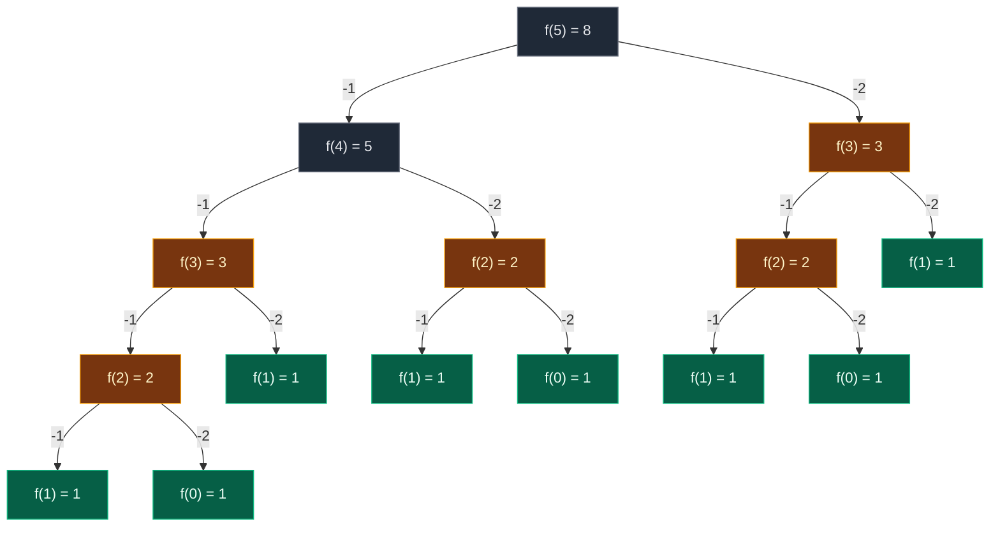

Gold = repeated work. Green = base cases.

| Subproblem | `f(5)` | `f(4)` | `f(3)` | `f(2)` | `f(1)` | `f(0)` |
|:---|:---:|:---:|:---:|:---:|:---:|:---:|
| Times computed | 1 | 1 | **2** | **3** | 5 | 3 |

**15 calls** for `n = 5`. Read it bottom-up: leaves return `1` → `f(2) = 1 + 1 = 2` → `f(3) = 2 + 1 = 3` → `f(4) = 3 + 2 = 5` → `f(5) = 5 + 3 = 8`.

**Exact order of calls.** Solid arrows are calls, dashed arrows are returns with their value. The left branch always runs to the bottom first. Only after `f(4)` is completely finished does `f(5)` start its right child `f(3)`.

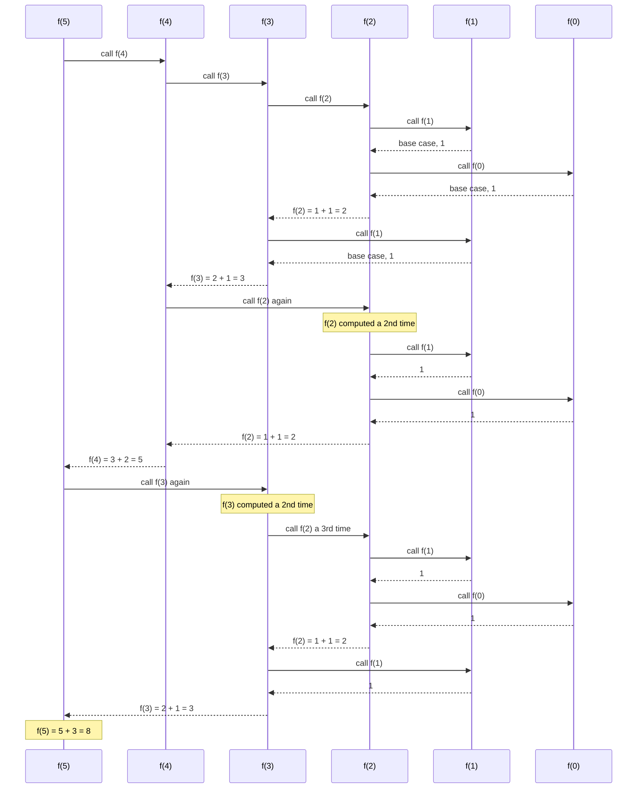

**The call stack at its deepest moment** (when `f(1)` runs for the first time):

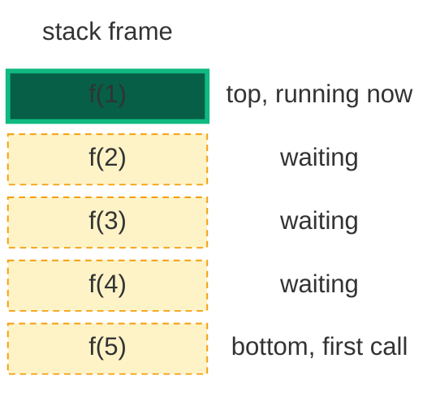

The stack is never deeper than `n` frames. That is why recursion uses `O(n)` space even though it makes `O(2^n)` calls.

> "Each call branches into two, and the tree is n levels deep, so the number of calls grows like 2^n. The same subproblems are solved again and again (overlapping subproblems), which tells us DP will help."

### Code

```python
# Plain recursion
class SolutionRecursion:

    # Main LeetCode method
    def climbStairs(self, n: int) -> int:

        # Base cases: one way from stair 0 or stair 1
        if n == 0 or n == 1:
            return 1

        # Ways if the last move was a 1-step
        left = self.climbStairs(n - 1)

        # Ways if the last move was a 2-step
        right = self.climbStairs(n - 2)

        # Count all ways: add both
        return left + right
```

### Complexity

| Measure | Complexity | Why |
|:---|:---:|:---|
| **Time** | `O(2^n)` | Each call splits into two. The tree has about `2^n` nodes. TLE at `n = 45` |
| **Space** | `O(n)` | Recursion stack. The depth is `n` |

## 5. Approach 2: Memoization (Top-Down)

### Idea

Same 3 steps as in [Fibonacci → Memoization](./01.%20509.%20Fibonacci%20Number.md#5-approach-2-memoization-top-down):

1. **Declare** `dp` of size `n + 1`, filled with `-1` ("not computed yet").
2. **Store** the answer before returning: `dp[n] = f(n-1) + f(n-2)`.
3. **Check** first: if `dp[n] != -1`, return `dp[n]`.

### Visual: when each `dp[k]` gets filled (`n = 5`)

**Start:** `dp = [-1] * 6`.

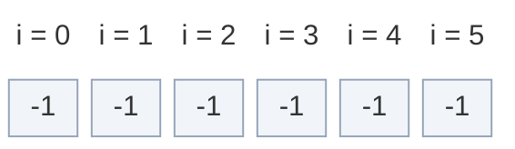

**Calls go down the left side:** `f(5)`, `f(4)`, `f(3)`, `f(2)` all see `-1` → compute. `f(1)` base case → `1`. `f(0)` base case → `1`.

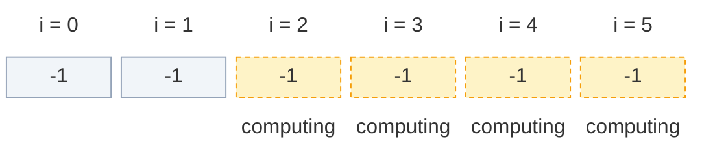

**Fill 1:** `f(2)` finishes: `1 + 1 = 2`. Store `dp[2] = 2`.

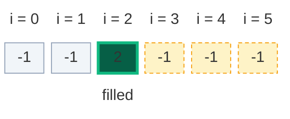

**`f(3)` asks for `f(1)`:** base case → `1`.

**Fill 2:** `f(3)` finishes: `2 + 1 = 3`. Store `dp[3] = 3`.

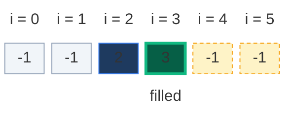

**Cache hit:** `f(4)` asks for `f(2)`. `dp[2] = 2` already known → return `2`, **no new calls**.

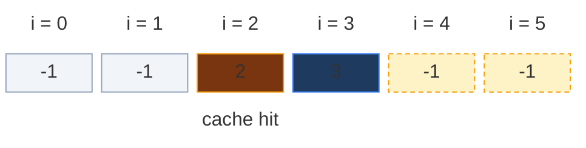

**Fill 3:** `f(4)` finishes: `3 + 2 = 5`. Store `dp[4] = 5`.

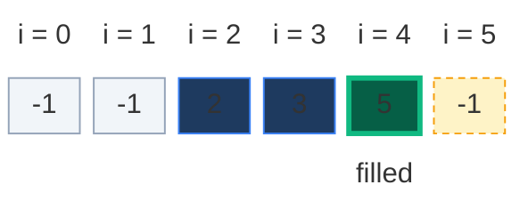

**Cache hit:** `f(5)` asks for `f(3)`. `dp[3] = 3` already known → return `3`, **no new calls**. The entire `f(3)` subtree from the plain tree disappears.

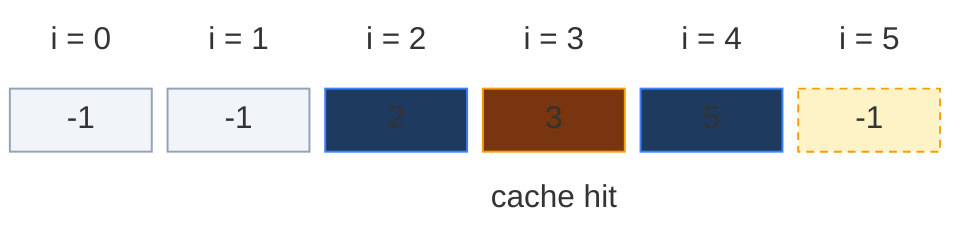

**Fill 4:** `f(5)` finishes: `5 + 3 = 8`. Store `dp[5] = 8`.

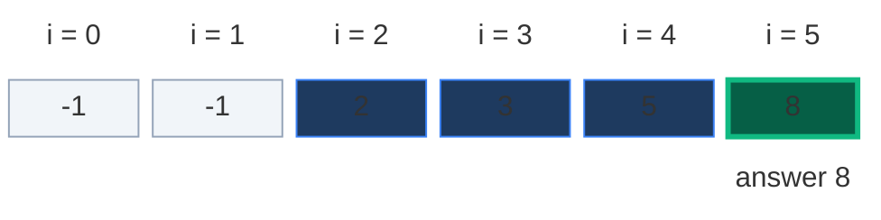

(With a dictionary, as in my own notes, the memo after `climbStairs(5)` is `{2: 2, 3: 3, 4: 5, 5: 8}`. Same numbers.)

### The pruned recursion tree

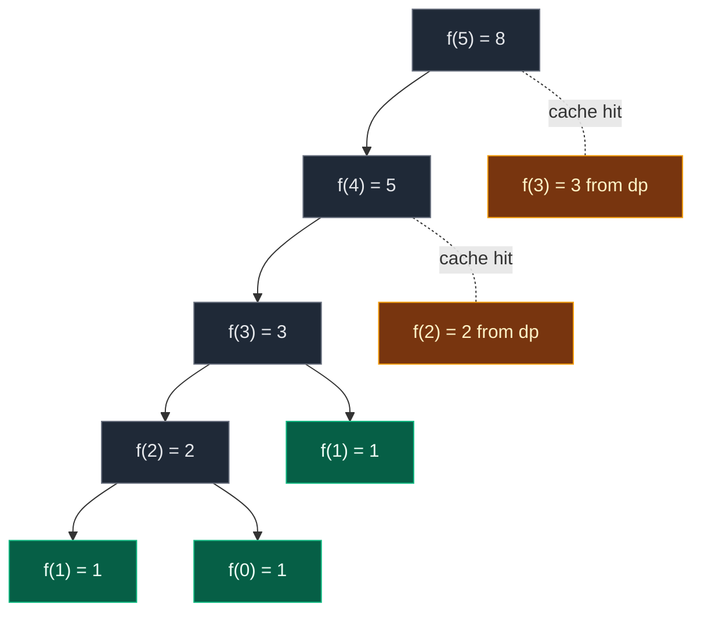

Only **9 calls** instead of 15. Gold nodes are answered straight from the memo, so their children are never called.

### Code

```python
# Memoization (top-down DP) with an array of -1
class SolutionMemo:

    # Helper that remembers answers in dp
    def helper(self, n: int, dp: list) -> int:

        # Base cases: one way from stair 0 or stair 1
        if n == 0 or n == 1:
            return 1

        # Step 3 (check): already solved? Reuse it
        if dp[n] != -1:
            return dp[n]

        # Step 2 (store): solve once and save the answer
        dp[n] = self.helper(n - 1, dp) + self.helper(n - 2, dp)

        # Return the saved answer
        return dp[n]

    # Main LeetCode method
    def climbStairs(self, n: int) -> int:

        # Step 1 (declare): dp of size n + 1, -1 means "not solved yet"
        dp = [-1] * (n + 1)

        # Start the recursion at stair n
        return self.helper(n, dp)
```

The same idea with a dictionary (the version from my own notes):

```python
# Memoization with a dictionary
class SolutionMemoDict:

    # Helper that remembers answers in a dict
    def helper(self, n: int, memo: dict) -> int:

        # Base cases: one way from stair 0 or stair 1
        if n == 0 or n == 1:
            return 1

        # Not computed yet: compute it and store it in the memo
        if n not in memo:

            # Store the sum of both choices
            memo[n] = self.helper(n - 1, memo) + self.helper(n - 2, memo)

        # Return the answer from the memo
        return memo[n]

    # Main LeetCode method
    def climbStairs(self, n: int) -> int:

        # Empty dict for memoization
        memo = {}

        # Call the helper
        return self.helper(n, memo)
```

> "I keep the same recursion but add a cache. Before computing f(n) I check the cache; if it is there I return it. Otherwise I compute f(n-1) + f(n-2), store it, then return. Each n from 2 to N is computed exactly once, so time is O(n); the cache and the recursion stack are both O(n) space."

### Complexity

| Measure | Complexity | Why |
|:---|:---:|:---|
| **Time** | `O(n)` | Each `f(2) ... f(n)` is computed once |
| **Space: dp array** | `O(n)` | `n + 1` cells (the dict holds `n - 1` entries) |
| **Space: recursion stack** | `O(n)` | The first path goes `f(n) → ... → f(1)` |

## 6. Approach 3: Tabulation (Bottom-Up)

### How to convert memo → table, step by step

Same recipe as in [Fibonacci → Tabulation](./01.%20509.%20Fibonacci%20Number.md#6-approach-3-tabulation-bottom-up):

1. **Same table:** `dp` of size `n + 1`.
2. **Base cases into the table:** `dp[0] = 1`, `dp[1] = 1`.
3. **Loop the opposite way:** small to big, `i = 2 ... n`.
4. **Copy the recurrence:** `f(i-1) + f(i-2)` becomes `dp[i-1] + dp[i-2]`.
5. **Answer is the last cell:** `dp[n]`.

Memo and table hold the **same numbers**, filled in opposite directions:

```mermaid
block-beta
  columns 6
  h0["i = 0"] h1["i = 1"] h2["i = 2"] h3["i = 3"] h4["i = 4"] h5["i = 5"]
  c0["1"] c1["1"] c2["2"] c3["3"] c4["5"] c5["8"]
  classDef head fill:none,stroke:none,color:#64748b
  class h0,h1,h2,h3,h4,h5 head
  classDef done fill:#1e3a5f,stroke:#3b82f6,color:#dbeafe
  class c0,c1,c2,c3,c4,c5 done
```

- **Memoization** asks from the **top**: `f(5)` needs `f(4)`, which needs `f(3)`, and so on, right to left.
- **Tabulation** fills from the **bottom**: `dp[0]`, `dp[1]`, `dp[2]`, and so on, left to right.

### Visual table fill (`n = 5`)

**Start: base cases written in**

```mermaid
block-beta
  columns 6
  h0["i = 0"] h1["i = 1"] h2["i = 2"] h3["i = 3"] h4["i = 4"] h5["i = 5"]
  c0["1"] c1["1"] c2[" "] c3[" "] c4[" "] c5[" "]
  m0["base case"] m1["base case"] space space space space
  classDef head fill:none,stroke:none,color:#64748b
  class h0,h1,h2,h3,h4,h5 head
  classDef new fill:#065f46,stroke:#10b981,color:#ecfdf5,stroke-width:3px
  class c0,c1 new
  classDef empty fill:#f1f5f9,stroke:#94a3b8,color:#64748b
  class c2,c3,c4,c5 empty
  classDef note fill:none,stroke:none,color:#b45309
  class m0,m1 note
```

**i = 2:** reads `dp[1] = 1` and `dp[0] = 1`.

```mermaid
block-beta
  columns 6
  h0["i = 0"] h1["i = 1"] h2["i = 2"] h3["i = 3"] h4["i = 4"] h5["i = 5"]
  c0["1"] c1["1"] c2["2"] c3[" "] c4[" "] c5[" "]
  m0["read"] m1["read"] m2["= 1 + 1"] space space space
  classDef head fill:none,stroke:none,color:#64748b
  class h0,h1,h2,h3,h4,h5 head
  classDef read fill:#78350f,stroke:#f59e0b,color:#fef3c7
  class c0,c1 read
  classDef new fill:#065f46,stroke:#10b981,color:#ecfdf5,stroke-width:3px
  class c2 new
  classDef empty fill:#f1f5f9,stroke:#94a3b8,color:#64748b
  class c3,c4,c5 empty
  classDef note fill:none,stroke:none,color:#b45309
  class m0,m1,m2 note
```

**i = 3:** reads `dp[2] = 2` and `dp[1] = 1`.

```mermaid
block-beta
  columns 6
  h0["i = 0"] h1["i = 1"] h2["i = 2"] h3["i = 3"] h4["i = 4"] h5["i = 5"]
  c0["1"] c1["1"] c2["2"] c3["3"] c4[" "] c5[" "]
  space m1["read"] m2["read"] m3["= 2 + 1"] space space
  classDef head fill:none,stroke:none,color:#64748b
  class h0,h1,h2,h3,h4,h5 head
  classDef old fill:#e2e8f0,stroke:#64748b,color:#0f172a
  class c0 old
  classDef read fill:#78350f,stroke:#f59e0b,color:#fef3c7
  class c1,c2 read
  classDef new fill:#065f46,stroke:#10b981,color:#ecfdf5,stroke-width:3px
  class c3 new
  classDef empty fill:#f1f5f9,stroke:#94a3b8,color:#64748b
  class c4,c5 empty
  classDef note fill:none,stroke:none,color:#b45309
  class m1,m2,m3 note
```

**i = 4:** reads `dp[3] = 3` and `dp[2] = 2`.

```mermaid
block-beta
  columns 6
  h0["i = 0"] h1["i = 1"] h2["i = 2"] h3["i = 3"] h4["i = 4"] h5["i = 5"]
  c0["1"] c1["1"] c2["2"] c3["3"] c4["5"] c5[" "]
  space space m2["read"] m3["read"] m4["= 3 + 2"] space
  classDef head fill:none,stroke:none,color:#64748b
  class h0,h1,h2,h3,h4,h5 head
  classDef old fill:#e2e8f0,stroke:#64748b,color:#0f172a
  class c0,c1 old
  classDef read fill:#78350f,stroke:#f59e0b,color:#fef3c7
  class c2,c3 read
  classDef new fill:#065f46,stroke:#10b981,color:#ecfdf5,stroke-width:3px
  class c4 new
  classDef empty fill:#f1f5f9,stroke:#94a3b8,color:#64748b
  class c5 empty
  classDef note fill:none,stroke:none,color:#b45309
  class m2,m3,m4 note
```

**i = 5:** reads `dp[4] = 5` and `dp[3] = 3`.

```mermaid
block-beta
  columns 6
  h0["i = 0"] h1["i = 1"] h2["i = 2"] h3["i = 3"] h4["i = 4"] h5["i = 5"]
  c0["1"] c1["1"] c2["2"] c3["3"] c4["5"] c5["8"]
  space space space m3["read"] m4["read"] m5["= 5 + 3"]
  classDef head fill:none,stroke:none,color:#64748b
  class h0,h1,h2,h3,h4,h5 head
  classDef old fill:#e2e8f0,stroke:#64748b,color:#0f172a
  class c0,c1,c2 old
  classDef read fill:#78350f,stroke:#f59e0b,color:#fef3c7
  class c3,c4 read
  classDef new fill:#065f46,stroke:#10b981,color:#ecfdf5,stroke-width:3px
  class c5 new
  classDef note fill:none,stroke:none,color:#b45309
  class m3,m4,m5 note
```

Answer: `dp[5] = 8`. (One more step would give `dp[6] = 8 + 5 = 13`.)

> "I create dp of size n+1, set dp[0] = dp[1] = 1, then loop i from 2 to n setting dp[i] = dp[i-1] + dp[i-2]. When I fill dp[i], both cells it needs are already filled. One pass, O(n) time, O(n) space, and no recursion stack."

### Code

```python
# Tabulation (bottom-up DP)
class SolutionTab:

    # Main LeetCode method
    def climbStairs(self, n: int) -> int:

        # Base cases: one way for stair 0 or stair 1
        if n == 0 or n == 1:
            return 1

        # dp[i] = number of ways to reach stair i
        dp = [0] * (n + 1)

        # Base case: one way to stand on the ground
        dp[0] = 1

        # Base case: one way to reach stair 1
        dp[1] = 1

        # Fill from stair 2 up to stair n
        for i in range(2, n + 1):

            # Last move was a 1-step or a 2-step
            dp[i] = dp[i - 1] + dp[i - 2]

        # The last cell is the answer
        return dp[n]
```

### Complexity

| Measure | Complexity | Why |
|:---|:---:|:---|
| **Time** | `O(n)` | One loop from `2` to `n` |
| **Space** | `O(n)` | The `dp` array. No recursion stack |

## 7. Approach 4: Space Optimization (Optimal)

### Idea

`dp[i]` only needs the **previous two values**, `dp[i - 1]` and `dp[i - 2]`. Everything further left is never read again. So keep two variables instead of an array (same trick as [Fibonacci → Space Optimization](./01.%20509.%20Fibonacci%20Number.md#7-approach-4-space-optimization-optimal)):

- `prev2` = ways to reach stair `i - 2`
- `prev` = ways to reach stair `i - 1`
- `curr` = ways to reach stair `i` = `prev + prev2`

Then slide: `prev2 ← prev`, `prev ← curr`.

My own notes name them `prev` (= `prev2` here), `current` (= `prev` here) and `result` (= `curr` here). Same logic, different names.

### Visual Walkthrough (Story Version)

**The story:** Mia climbs a staircase. On every stair she wants to write *how many different ways there are to reach that stair*. Her rule: "I got onto this stair either from the stair just below (a small step) or from two stairs below (a big step). So the ways for this stair = ways for one below + ways for two below."

Mia has a tiny bag. It fits only **two sticky notes**:

- the note from **two stairs below** (`prev2`)
- the note from **one stair below** (`prev`)

**Start: the ground and stair 1**

Ground: 1 way (just stand there). Stair 1: 1 way (one small step).

```mermaid
block-beta
  columns 6
  h0["stair 0"] h1["stair 1"] h2["stair 2"] h3["stair 3"] h4["stair 4"] h5["stair 5"]
  c0["1"] c1["1"] c2[" "] c3[" "] c4[" "] c5[" "]
  m0["prev2 = 1"] m1["prev = 1"] space space space space
  classDef head fill:none,stroke:none,color:#64748b
  class h0,h1,h2,h3,h4,h5 head
  classDef read fill:#78350f,stroke:#f59e0b,color:#fef3c7
  class c0 read
  classDef new fill:#065f46,stroke:#10b981,color:#ecfdf5,stroke-width:3px
  class c1 new
  classDef empty fill:#f1f5f9,stroke:#94a3b8,color:#64748b
  class c2,c3,c4,c5 empty
  classDef note fill:none,stroke:none,color:#b45309
  class m0,m1 note
```

**Step 1: Mia reaches stair 2**

- Ways = `1 + 1 = 2` (`1+1` or `2`). She writes `2`.
- She throws away the oldest note. Bag: `prev2 = 1`, `prev = 2`.

```mermaid
block-beta
  columns 6
  h0["stair 0"] h1["stair 1"] h2["stair 2"] h3["stair 3"] h4["stair 4"] h5["stair 5"]
  c0["1"] c1["1"] c2["2"] c3[" "] c4[" "] c5[" "]
  space m1["prev2 = 1"] m2["prev = 2"] space space space
  classDef head fill:none,stroke:none,color:#64748b
  class h0,h1,h2,h3,h4,h5 head
  classDef old fill:#e2e8f0,stroke:#64748b,color:#0f172a
  class c0 old
  classDef read fill:#78350f,stroke:#f59e0b,color:#fef3c7
  class c1 read
  classDef new fill:#065f46,stroke:#10b981,color:#ecfdf5,stroke-width:3px
  class c2 new
  classDef empty fill:#f1f5f9,stroke:#94a3b8,color:#64748b
  class c3,c4,c5 empty
  classDef note fill:none,stroke:none,color:#b45309
  class m1,m2 note
```

**Step 2: Mia reaches stair 3**

- Ways = `2 + 1 = 3`. She writes `3`.
- Bag: `prev2 = 2`, `prev = 3`.

```mermaid
block-beta
  columns 6
  h0["stair 0"] h1["stair 1"] h2["stair 2"] h3["stair 3"] h4["stair 4"] h5["stair 5"]
  c0["1"] c1["1"] c2["2"] c3["3"] c4[" "] c5[" "]
  space space m2["prev2 = 2"] m3["prev = 3"] space space
  classDef head fill:none,stroke:none,color:#64748b
  class h0,h1,h2,h3,h4,h5 head
  classDef old fill:#e2e8f0,stroke:#64748b,color:#0f172a
  class c0,c1 old
  classDef read fill:#78350f,stroke:#f59e0b,color:#fef3c7
  class c2 read
  classDef new fill:#065f46,stroke:#10b981,color:#ecfdf5,stroke-width:3px
  class c3 new
  classDef empty fill:#f1f5f9,stroke:#94a3b8,color:#64748b
  class c4,c5 empty
  classDef note fill:none,stroke:none,color:#b45309
  class m2,m3 note
```

**Step 3: Mia reaches stair 4**

- Ways = `3 + 2 = 5`. She writes `5`.
- Bag: `prev2 = 3`, `prev = 5`.

```mermaid
block-beta
  columns 6
  h0["stair 0"] h1["stair 1"] h2["stair 2"] h3["stair 3"] h4["stair 4"] h5["stair 5"]
  c0["1"] c1["1"] c2["2"] c3["3"] c4["5"] c5[" "]
  space space space m3["prev2 = 3"] m4["prev = 5"] space
  classDef head fill:none,stroke:none,color:#64748b
  class h0,h1,h2,h3,h4,h5 head
  classDef old fill:#e2e8f0,stroke:#64748b,color:#0f172a
  class c0,c1,c2 old
  classDef read fill:#78350f,stroke:#f59e0b,color:#fef3c7
  class c3 read
  classDef new fill:#065f46,stroke:#10b981,color:#ecfdf5,stroke-width:3px
  class c4 new
  classDef empty fill:#f1f5f9,stroke:#94a3b8,color:#64748b
  class c5 empty
  classDef note fill:none,stroke:none,color:#b45309
  class m3,m4 note
```

**Step 4: Mia reaches stair 5 (the top)**

- Ways = `5 + 3 = 8`. She writes `8`.
- Bag: `prev2 = 5`, `prev = 8`.

```mermaid
block-beta
  columns 6
  h0["stair 0"] h1["stair 1"] h2["stair 2"] h3["stair 3"] h4["stair 4"] h5["stair 5"]
  c0["1"] c1["1"] c2["2"] c3["3"] c4["5"] c5["8"]
  space space space space m4["prev2 = 5"] m5["prev = 8"]
  classDef head fill:none,stroke:none,color:#64748b
  class h0,h1,h2,h3,h4,h5 head
  classDef old fill:#e2e8f0,stroke:#64748b,color:#0f172a
  class c0,c1,c2,c3 old
  classDef read fill:#78350f,stroke:#f59e0b,color:#fef3c7
  class c4 read
  classDef new fill:#065f46,stroke:#10b981,color:#ecfdf5,stroke-width:3px
  class c5 new
  classDef note fill:none,stroke:none,color:#b45309
  class m4,m5 note
```

**The end:** Mia is at the top. The newest note in her bag says `8`. That is the answer.

**All steps at a glance**

| Step | Stair | One below + two below | Ways | Bag after (`prev2`, `prev`) |
|:---:|:---:|:---:|:---:|:---:|
| start | 0, 1 | – | 1, 1 | (1, 1) |
| 1 | 2 | `1 + 1` | 2 | (1, 2) |
| 2 | 3 | `2 + 1` | 3 | (2, 3) |
| 3 | 4 | `3 + 2` | 5 | (3, 5) |
| 4 | 5 | `5 + 3` | 8 | (5, 8) |

**What the story teaches**

| In the story | In the code |
|:---|:---|
| Stair `i` | Index `i`, the state |
| Number written on a stair | `dp[i]` = ways to reach stair `i` |
| Small step / big step | The two choices: from `i - 1` or from `i - 2` |
| Note from two stairs below | `prev2` |
| Note from one stair below | `prev` |
| Adding the two notes | `curr = prev + prev2` |
| Throwing away the oldest note | `prev2 = prev`, then `prev = curr` |
| Bag with only two notes | `O(1)` space |
| Newest note at the top | `return prev` |

### Step-by-Step Example

`n = 5`. Start: `prev2 = 1` (ways to stair 0), `prev = 1` (ways to stair 1).

| `i` | `prev2` before | `prev` before | `curr = prev + prev2` | `prev2` after | `prev` after |
|:---:|:---:|:---:|:---:|:---:|:---:|
| 2 | 1 | 1 | `1 + 1 = 2` | 1 | 2 |
| 3 | 1 | 2 | `2 + 1 = 3` | 2 | 3 |
| 4 | 2 | 3 | `3 + 2 = 5` | 3 | 5 |
| 5 | 3 | 5 | `5 + 3 = 8` | 5 | 8 |

Loop ends. Return `prev = 8`.

**The sliding window of two values**

```mermaid
block-beta
  columns 7
  hx[" "] h0["stair 0"] h1["stair 1"] h2["stair 2"] h3["stair 3"] h4["stair 4"] h5["stair 5"]
  l0["i = 2"] r0c0["1"] r0c1["1"] r0c2["2"] r0c3[" "] r0c4[" "] r0c5[" "]
  l1["i = 3"] r1c0["1"] r1c1["1"] r1c2["2"] r1c3["3"] r1c4[" "] r1c5[" "]
  l2["i = 4"] r2c0["1"] r2c1["1"] r2c2["2"] r2c3["3"] r2c4["5"] r2c5[" "]
  l3["i = 5"] r3c0["1"] r3c1["1"] r3c2["2"] r3c3["3"] r3c4["5"] r3c5["8"]
  classDef head fill:none,stroke:none,color:#64748b
  class hx,h0,h1,h2,h3,h4,h5,l0,l1,l2,l3 head
  classDef read fill:#78350f,stroke:#f59e0b,color:#fef3c7
  class r0c0,r0c1,r1c1,r1c2,r2c2,r2c3,r3c3,r3c4 read
  classDef new fill:#065f46,stroke:#10b981,color:#ecfdf5,stroke-width:3px
  class r0c2,r1c3,r2c4,r3c5 new
  classDef empty fill:#f1f5f9,stroke:#94a3b8,color:#64748b
  class r0c3,r0c4,r0c5,r1c4,r1c5,r2c5 empty
  classDef old fill:#e2e8f0,stroke:#64748b,color:#0f172a
  class r1c0,r2c0,r2c1,r3c0,r3c1,r3c2 old
```

Gold = the two cells read (`prev2`, `prev`). Green = the new `curr`. After the last row, `prev = 8`.

The two variables are just a window of two cells sliding to the right over the dp table.

**Safety detail:** my notes return `result` (here `curr`). `curr` only exists after the loop runs, which needs `n >= 2`. The base case handles `n < 2` first, so it works. Returning `prev` is safer, because it is always set, even if the base case is ever removed.

### Code

```python
# Space optimized: only the last two values
class Solution:

    # Main LeetCode method
    def climbStairs(self, n: int) -> int:

        # Base cases: one way for stair 0 or stair 1
        if n == 0 or n == 1:
            return 1

        # Ways to reach stair i - 2, starts at stair 0
        prev2 = 1

        # Ways to reach stair i - 1, starts at stair 1
        prev = 1

        # Build the answer for stairs 2, 3, ..., n
        for i in range(2, n + 1):

            # Ways to reach stair i
            curr = prev + prev2

            # Slide the window: old prev becomes prev2
            prev2 = prev

            # Slide the window: new value becomes prev
            prev = curr

        # prev holds the ways to reach stair n
        return prev


# ---------- Tests ----------

# Recursion tree: count the calls for n = 5
def count_calls(n: int) -> int:

    # A base case is one call
    if n <= 1:
        return 1

    # This call plus the calls of both children
    return 1 + count_calls(n - 1) + count_calls(n - 2)


# 15 calls in the plain recursion tree for n = 5
assert count_calls(5) == 15

# Memoization trace: dp after the run on n = 5
dp = [-1] * 6
assert SolutionMemo().helper(5, dp) == 8
assert dp == [-1, -1, 2, 3, 5, 8]

# Dict memo after climbStairs(5)
memo = {}
assert SolutionMemoDict().helper(5, memo) == 8
assert memo == {2: 2, 3: 3, 4: 5, 5: 8}

# Tabulation trace: the table for n = 5
assert [SolutionTab().climbStairs(i) for i in range(6)] == [1, 1, 2, 3, 5, 8]

# Space optimized trace: start values for n = 5
prev2, prev = 1, 1

# Record (i, curr, prev2, prev) after every loop step
states = []

# Run the same loop as Solution.climbStairs(5)
for i in range(2, 6):

    # New value
    curr = prev + prev2

    # Slide prev2
    prev2 = prev

    # Slide prev
    prev = curr

    # Save the state after this step
    states.append((i, curr, prev2, prev))

# Matches the Step-by-Step table
assert states == [(2, 2, 1, 2), (3, 3, 2, 3), (4, 5, 3, 5), (5, 8, 5, 8)]

# LeetCode examples
assert Solution().climbStairs(2) == 2
assert Solution().climbStairs(3) == 3

# Our example
assert Solution().climbStairs(5) == 8

# Edge cases
assert Solution().climbStairs(1) == 1
assert Solution().climbStairs(0) == 1
assert Solution().climbStairs(4) == 5
assert Solution().climbStairs(6) == 13
assert Solution().climbStairs(45) == 1836311903

# First answers: 1, 1, 2, 3, 5, 8, 13, ...
assert [Solution().climbStairs(i) for i in range(10)] == [1, 1, 2, 3, 5, 8, 13, 21, 34, 55]

# Fibonacci link: ways(n) = Fib(n + 1)
fib = [0, 1]

# Build Fibonacci numbers up to Fib(46)
while len(fib) < 47:

    # Next Fibonacci number
    fib.append(fib[-1] + fib[-2])

# Check the link for every allowed n
for n in range(1, 46):

    # Same number, shifted by one
    assert Solution().climbStairs(n) == fib[n + 1]

# All versions agree (recursion only on small n)
for n in range(1, 46):

    # Answer from the optimal version
    expected = Solution().climbStairs(n)

    # Memo with an array agrees
    assert SolutionMemo().climbStairs(n) == expected

    # Memo with a dict agrees
    assert SolutionMemoDict().climbStairs(n) == expected

    # Tabulation agrees
    assert SolutionTab().climbStairs(n) == expected

    # Plain recursion is slow, so test it only on small n
    if n <= 20:

        # Recursion agrees
        assert SolutionRecursion().climbStairs(n) == expected

# All checks passed
print("All tests passed")
```

### Complexity

| Approach | Time | Space | Stack |
|:---|:---:|:---:|:---:|
| Recursion | `O(2^n)` | `O(1)` extra | `O(n)` |
| Memoization | `O(n)` | `O(n)` dp | `O(n)` |
| Tabulation (bottom-up DP) | `O(n)` | `O(n)` dp | none |
| **Space optimized** | **`O(n)`** | **`O(1)`** | **none** |
| Matrix exponentiation (Fibonacci → MF, see Q4) | `O(log n)` | `O(1)` | none |

For `n <= 45` the `O(n)` loop is already instant. Matrix power matters only when `n` is huge (and the answer is usually taken modulo some number).

## 8. Common Mistakes

| Mistake | What goes wrong | Fix |
|:---|:---|:---|
| Plain recursion | TLE at `n = 45` (billions of calls) | Memoize, or use the loop |
| Wrong base cases (for example `f(0) = 0` like Fibonacci) | Every answer is shifted | `f(0) = 1` and `f(1) = 1` |
| Only one base case `f(0)` | `f(1)` calls `f(-1)`: wrong count or crash | Also stop at `1`, or return `0` for `ind < 0` |
| Returning `curr` (`result`) when `n < 2` | `curr` is never set (undefined) | Handle `n < 2` first, or return `prev` |
| Counting combinations instead of orders | Says `n = 3` has 2 ways (`{1,1,1}`, `{1,2}`) | `1 + 2` and `2 + 1` are different ways. The recurrence counts orders |
| Loop `range(2, n)` | Stops one stair early | `range(2, n + 1)` |
| Memo `dp` of size `n` | `dp[n]` is out of range | Size `n + 1` |
| Writing `if n==0 or n==1: return 1` on one line | Hard to read and to comment | Put `return` on its own indented line |

## 9. Interview Follow-ups

### Q1. Why is this the same as Fibonacci?

**Answer:**
- Same recurrence: `ways(n) = ways(n-1) + ways(n-2)`.
- Only the base cases differ: `ways(0) = ways(1) = 1`, while `F(0) = 0`, `F(1) = 1`.
- So `ways(n) = F(n + 1)`. See [509. Fibonacci Number](./01.%20509.%20Fibonacci%20Number.md).

### Q2. Why is plain recursion so slow here?

**Answer:**
- Each call branches into two, and the tree is `n` levels deep, so calls grow like `2^n`.
- The same stairs are solved again and again (`f(2)` 3 times for `n = 5`). These are overlapping subproblems.
- The stack is still only `n` deep, so space is `O(n)`.

### Q3. What if you could climb 1, 2 or 3 steps?

**Answer:**
- Add one more term: `ways(n) = ways(n-1) + ways(n-2) + ways(n-3)`.
- For `n = 4` that gives `7` instead of `5`.
- One function handles **any** set of step sizes:

```python
# Count ways to climb n stairs with any set of allowed step sizes
def count_ways(n, steps):

    # ways[i] = number of ways to reach stair i
    ways = [0] * (n + 1)

    # One way to stand on the ground: do nothing
    ways[0] = 1

    # Fill every stair from 1 to n
    for i in range(1, n + 1):

        # Try every allowed jump size
        for jump in steps:

            # We can only land on i if we came from a stair >= 0
            if i - jump >= 0:

                # Add all the ways of reaching the stair we jumped from
                ways[i] = ways[i] + ways[i - jump]

    # Ways to reach the top
    return ways[n]


# With steps {1, 2} it is the normal problem
assert count_ways(5, [1, 2]) == 8

# With steps {1, 2, 3}, n = 4 gives 7
assert count_ways(4, [1, 2, 3]) == 7

# With steps {1, 2, 3}, n = 6 gives 24
assert count_ways(6, [1, 2, 3]) == 24
```

Table fill for steps `{1, 2, 3}`, `n = 6`:

| `i` | Sum of reachable earlier cells | `ways[i]` |
|:---:|:---|:---:|
| 0 | base case | 1 |
| 1 | `ways[0]=1` | 1 |
| 2 | `ways[1]=1 + ways[0]=1` | 2 |
| 3 | `ways[2]=2 + ways[1]=1 + ways[0]=1` | 4 |
| 4 | `ways[3]=4 + ways[2]=2 + ways[1]=1` | 7 |
| 5 | `ways[4]=7 + ways[3]=4 + ways[2]=2` | 13 |
| 6 | `ways[5]=13 + ways[4]=7 + ways[3]=4` | 24 |

Each cell adds up to three earlier cells. Same idea, one more term. Answer: `24` ways.

### Q4. Can you do better than `O(n)`?

**Answer:**
- Yes. Fibonacci → MF → `O(log N)` with **matrix exponentiation**.
- `[[1, 1], [1, 0]]^n = [[ways(n), ways(n-1)], [ways(n-1), ways(n-2)]]`, so `ways(n)` is the **top-left** entry.
- Repeated squaring needs only about `log₂ n` multiplications (`n = 45` → 6 loop rounds).
- Full matrix explanation: [Fibonacci → Q5](./01.%20509.%20Fibonacci%20Number.md#q5-can-you-beat-on).

```python
# Matrix exponentiation: O(log n)
class SolutionMatrix:

    # Multiply two 2 x 2 matrices
    def multiply(self, X, Y):

        # Top-left entry
        a = X[0][0] * Y[0][0] + X[0][1] * Y[1][0]

        # Top-right entry
        b = X[0][0] * Y[0][1] + X[0][1] * Y[1][1]

        # Bottom-left entry
        c = X[1][0] * Y[0][0] + X[1][1] * Y[1][0]

        # Bottom-right entry
        d = X[1][0] * Y[0][1] + X[1][1] * Y[1][1]

        # The product matrix
        return [[a, b], [c, d]]

    # Main LeetCode method
    def climbStairs(self, n: int) -> int:

        # Start with the identity matrix (like the number 1)
        result = [[1, 0], [0, 1]]

        # The Fibonacci matrix
        base = [[1, 1], [1, 0]]

        # We need base to the power n
        power = n

        # Fast exponentiation: look at the bits of power
        while power > 0:

            # This bit is 1: multiply it into the result
            if power % 2 == 1:
                result = self.multiply(result, base)

            # Square the base for the next bit
            base = self.multiply(base, base)

            # Move to the next bit
            power = power // 2

        # Top-left entry of base^n is ways(n)
        return result[0][0]


# The matrix version agrees with the loop version
for n in range(1, 46):

    # Same answer for every n
    assert SolutionMatrix().climbStairs(n) == Solution().climbStairs(n)
```

By hand for `n = 5` (binary `101`):

| `power` | bit | action | `result` | `base` after squaring |
|:---:|:---:|:---|:---|:---|
| 5 | 1 | `result = result × base` | `[[1, 1], [1, 0]]` | `[[2, 1], [1, 1]]` |
| 2 | 0 | skip | `[[1, 1], [1, 0]]` | `[[5, 3], [3, 2]]` |
| 1 | 1 | `result = result × base` | `[[8, 5], [5, 3]]` | (not needed) |

`result[0][0] = 8 = ways(5)`. Only 3 loop rounds for `n = 5`.

> "The pair (ways(n), ways(n-1)) moves one step forward when multiplied by [[1,1],[1,0]], so ways(n) is the top-left entry of that matrix to the power n. Fast exponentiation squares the matrix and uses the bits of n, giving O(log n) multiplications."

### Q5. How do you recognise a DP problem in general?

**Answer:**
- It asks to **count ways**, or find a **min** or **max** (best way), or "is it possible".
- The choices repeat on smaller versions of the same problem.
- Recipe: index → all possible stuff on that index → sum (count) or min/max (best).

### Q6. What should I practice next?

**Answer:**
- **509. Fibonacci Number**: same recurrence.
- **746. Min Cost Climbing Stairs**: `min` instead of sum.
- **Frog Jump (Striver L3)**: min energy, jump 1 or 2.
- **198. House Robber**: pick / not pick.

## 10. Memory Hook

- **To stand on stair `n`, you came from `n - 1` or `n - 2`.**
- **`ways(n) = ways(n-1) + ways(n-2)`**, with `ways(0) = ways(1) = 1`. It is Fibonacci shifted by one.
- **Index → all possible stuff → sum (count) or min (best).**

**Pattern in one line:** count ways by splitting on the last move, then keep only the last two counts.

## 11. Interview Explanation

> To reach stair n, the last move came from stair n-1 or stair n-2, so ways(n) = ways(n-1) + ways(n-2) with ways(0) = ways(1) = 1. That is the Fibonacci recurrence, shifted by one. Plain recursion is O(2^n) because the same stairs are solved again and again. Memoizing gives O(n) time and O(n) space for the table plus O(n) for the stack. Bottom-up tabulation removes the recursion stack. Since each value only needs the previous two, two variables give O(n) time and O(1) space. If n were huge, matrix exponentiation gives O(log n).
