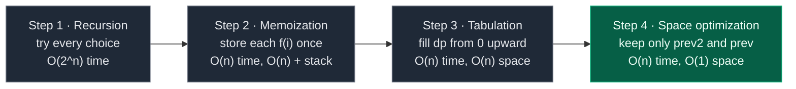
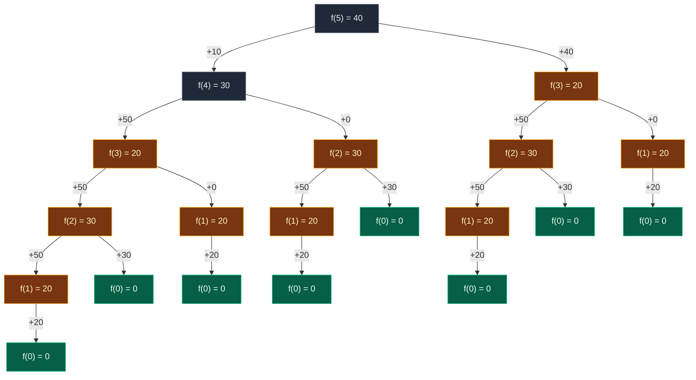
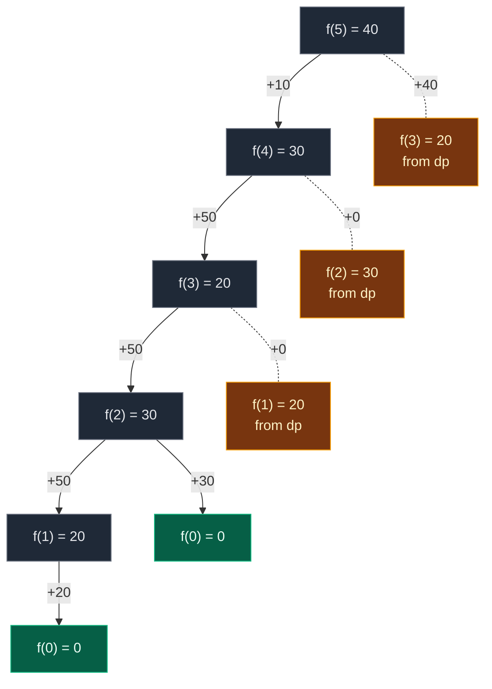

# 03. Frog Jump

| Difficulty | Pattern | Source | Time | Space |
|:---:|:---:|:---:|:---:|:---:|
| **Medium** | 1-D DP: Min over Choices | [GfG: Frog Jump (Geek Jump)](https://www.geeksforgeeks.org/problems/geek-jump/1) | `O(n)` | `O(1)` |

## 1. Problem Statement

A frog stands on the first stair of a staircase. It wants to reach the last stair.

You get an array `height`. `height[i]` is the height of stair `i`.

From stair `i`, the frog can jump:

- to stair `i + 1` (a **1-jump**), or
- to stair `i + 2` (a **2-jump**).

Every jump costs energy. The cost of a jump from stair `i` to stair `j` is `|height[i] - height[j]|`. Jumping up and jumping down cost the same, because of the absolute value `| |`.

Return the **minimum total energy** the frog needs to go from stair `0` to stair `n - 1`.

This is Striver's DP lecture **L3**. Other names for it: "Geek Jump" (old GfG name), "Frog Jump" (Coding Ninjas, GfG), "Frog 1" (AtCoder DP A).

The Coding Ninjas statement counts stairs from 1 ("1st stair to Nth stair"). In code we count from 0: stair `0` to stair `n - 1`. Same problem, the index just shifts by one.

### Example

```text
height = [30, 10, 60, 10, 60, 50]
index  =   0   1   2   3   4   5

Best route: 0 -> 2 -> 4 -> 5
  0 -> 2 : |60 - 30| = 30
  2 -> 4 : |60 - 60| =  0
  4 -> 5 : |50 - 60| = 10
  total  = 40

Output: 40
```

We use this same example in every section below. It is the example from the lecture board, and it is also the example where greedy fails.

Other samples you will see in the tests:

| Input | Output | Best route |
|:---|:---:|:---|
| `[10, 20, 30, 10]` | `20` | `0 -> 1 -> 3` = 10 + 10 |
| `[10, 50, 10]` | `0` | `0 -> 2` = 0 |
| `[7, 4, 4, 2, 6, 6, 3, 4]` | `7` | Coding Ninjas sample 2 |
| `[4, 8, 3, 10, 4, 4]` | `2` | Coding Ninjas sample 2 |
| `[20, 30, 40, 20]` | `20` | GfG example 1: `0 -> 1 -> 3` |
| `[30, 20, 50, 10, 40]` | `30` | GfG example 2: `0 -> 2 -> 4` |

### Constraints

- GfG: `1 <= height.length <= 10^5`, `0 <= height[i] <= 10^4`
- Coding Ninjas: `1 <= T <= 10`, `1 <= N <= 100000`, `1 <= HEIGHTS[i] <= 1000`, time limit 1 sec
- `n` can be `10^5`, so anything exponential is impossible. We need `O(n)`.

The problem gives 3 hints, and they are exactly the DP ladder:

1. Think about all the possibilities at each stair.
2. Using recursion, split the problem into subproblems. Solve each subproblem only once, and store it for reuse.
3. The same can be done with a loop (iteratively).

## 2. Core Theory

### First: try every path by hand

Take the small board example `[10, 20, 30, 10]` (4 stairs, go from 0 to 3). There are only 3 ways:

```text
heights :  10   20   30   10
index   :   0    1    2    3

path A: 0 -1-> 1 -1-> 2 -1-> 3   = 10 + 10 + 20 = 40
path B: 0 -1-> 1 ---2---> 3      = 10 + 10      = 20   <-- minimum
path C: 0 ---2---> 2 -1-> 3      = 20 + 20      = 40
```

Three paths for 4 stairs. That is the same count as Climbing Stairs (L2). But Climbing Stairs asked "**count all ways**". Frog Jump asks "**find the best way**".

Lecture note: *Recursion = try all possible ways. Then either count all ways, or pick the best one.* Same recursion, different combine step: **sum becomes min**.

### Why greedy fails

**Greedy** means: "at every stair, take the jump that is cheapest right now".

It sounds smart. It is wrong. Here is our example:

```text
heights:  30   10   60   10   60   50
index  :   0    1    2    3    4    5

From 0: 1-jump to 10 costs 20, 2-jump to 60 costs 30  -> greedy takes 20
From 1: 1-jump to 60 costs 50, 2-jump to 10 costs 0   -> greedy takes 0
From 3: 1-jump to 60 costs 50, 2-jump to 50 costs 40  -> greedy takes 40

greedy  : 30 -20-> 10 ---0---> 10 ---40---> 50     = 60   X
better  : 30 ---30---> 60 ---0---> 60 -10-> 50     = 40   OK
```

Greedy only looks one step ahead. Paying 30 at the start (not 20) puts the frog on the tall stones (the 60s). From there the later jumps are cheap.

An early choice changes all future costs. So we cannot decide early. We must **try every choice** and keep the cheapest. Trying every choice = recursion. Recursion with repeated work = DP.

Greedy code, so you can run it and watch it fail (it is checked in the tests at the bottom):

```python
# Greedy frog: always takes the cheaper jump right now (WRONG in general)
def greedy_frog(heights):

    # Start on stair 0
    i = 0

    # No energy used yet
    total = 0

    # Keep jumping until the last stair
    while i < len(heights) - 1:

        # Cost of a 1-jump
        one = abs(heights[i + 1] - heights[i])

        # Cost of a 2-jump starts as "impossible"
        two = float("inf")

        # A 2-jump exists only if it stays inside the array
        if i + 2 < len(heights):

            # Cost of a 2-jump
            two = abs(heights[i + 2] - heights[i])

        # Greedy: the 1-jump is cheaper or equal right now
        if one <= two:

            # Pay for the 1-jump
            total = total + one

            # Move 1 stair
            i = i + 1

        # Otherwise the 2-jump is cheaper right now
        else:

            # Pay for the 2-jump
            total = total + two

            # Move 2 stairs
            i = i + 2

    # Total energy greedy used
    return total
```

`greedy_frog([30, 10, 60, 10, 60, 50])` returns `60`. Every DP version below returns `40`.

### How to spot it is DP

Two signs. Both are here.

- **Overlapping subproblems.** A **subproblem** is a smaller version of the same question, like "cheapest energy to reach stair 3". To answer "stair 5" we need "stair 4" and "stair 3". To answer "stair 4" we need "stair 3" and "stair 2". "Stair 3" is asked twice. The same small questions come back again and again.
- **Optimal substructure.** The best answer for stair 5 is built from the best answers for stairs 4 and 3. If the frog's best route to stair 5 passes through stair 4, then the part up to stair 4 must also be the best route to stair 4. Otherwise we could swap in a cheaper one.

### The state

The **state** is the small piece of information that names one subproblem. Here it is just the stair index.

> `f(i)` = the minimum energy needed to go from stair `0` to stair `i`.

We want `f(n - 1)`.

### The recurrence

Lecture recipe for writing the recursion, in 3 steps:

1. **Express the problem in terms of an index.** Index = `0, 1, 2, ..., n - 1`.
2. **Do all stuffs on that index.** How could the frog have arrived at stair `i`? Only by a 1-jump from `i - 1`, or by a 2-jump from `i - 2`.
3. **Take the min of all stuffs.** Keep the cheaper one.

Look **backwards**: instead of "where can I go from `i`?", ask "where could I have come from to land on `i`?".

```text
          left: +|h[i] - h[i-1]|
          ┌──────────────┐
          │              v
 [ i-2 ]  [ i-1 ]      [ i ]
    │                    ^
    └────────────────────┘
          right: +|h[i] - h[i-2]|   (only if i > 1)
```

In words: "The cheapest way to stand on stair `i` is the cheaper of two options. Option 1: get to stair `i - 1` as cheaply as possible, then pay the 1-jump. Option 2: get to stair `i - 2` as cheaply as possible, then pay the 2-jump."

The **recurrence** (the rule that builds a big answer from smaller answers):

```text
left  = f(i - 1) + |h[i] - h[i - 1]|
right = f(i - 2) + |h[i] - h[i - 2]|      only if i > 1, else infinity

f(i)  = min(left, right)
```

On the board, for `f(5)` of our example (height 50):

```text
left  = f(4) + |50 - 60| = f(4) + 10
right = f(3) + |50 - 10| = f(3) + 40
```

`INT_MAX` in C++ (or `float("inf")` in Python) means "impossible". `min` ignores it.

### Base cases

A **base case** is a subproblem so small we know its answer without any work.

| Base case | Value | Why |
|:---|:---:|:---|
| `f(0)` | `0` | The frog already stands on stair 0. No jump, no energy |
| `i == 1` | only `left` | Stair `1 - 2 = -1` does not exist. So `right = infinity`. In Python, `height[-1]` would **silently read the last stair** and give a wrong answer, so the `if i > 1` check is required |

### The 4-step ladder

Every DP problem in this folder goes up the same 4 steps.



### Climbing Stairs vs Frog Jump

| | Climbing Stairs (L2) | Frog Jump (L3) |
|:---|:---|:---|
| Asks | count all ways | best (min) way |
| Combine | sum: `f(n-1) + f(n-2)` | `min(left, right)` with jump costs |
| Base | `f(0) = f(1) = 1` | `f(0) = 0` |
| Guard | two base cases | `if ind > 1` for the 2-jump |

## 3. Edge Cases

| Case | Input | Expected | Why it matters |
|:---|:---|:---:|:---|
| One stair | `[5]` | `0` | Frog is already at the end. Loop never runs, answer `f(0) = 0` |
| Two stairs | `[10, 30]` | `20` | Only a 1-jump is possible. `right` must stay infinity |
| All equal heights | `[7, 7, 7, 7]` | `0` | Every jump costs 0 |
| Height 0 allowed (GfG) | `[0, 10, 0]` | `0` | `0 -> 2` costs 0. Costs are never negative, so `-1` is still safe as "not computed" |
| `i = 1` | any | — | Must not read `height[-1]`. Python would not crash, it would read the last stair |
| Greedy trap | `[30, 10, 60, 10, 60, 50]` | `40` | Greedy says 60 |
| Big input | `n = 10^5` | — | Recursion is too slow; memoization hits Python's recursion limit; use tabulation or the O(1) loop |

## 4. Approach 1: Recursion

### Idea

Write the recurrence directly as a function. `f(i)` calls `f(i - 1)` and `f(i - 2)` and returns the smaller total.

**Recursion tree for `[30, 10, 60, 10, 60, 50]`.** Each box is one call. The edge label is the jump cost added on the way back up. Gold boxes are **repeated** subproblems (solved more than once). Green boxes are the base case.



**20 calls for only 6 stairs.** How many times each subproblem is solved:

| Subproblem | Times solved | Wasted |
|:---|:---:|:---:|
| `f(5)` | 1 | 0 |
| `f(4)` | 1 | 0 |
| `f(3)` | 2 | 1 |
| `f(2)` | 3 | 2 |
| `f(1)` | 5 | 4 |
| `f(0)` | 8 | 7 (cheap, it is the base case) |

How the values come out (bottom of the tree first):

- `f(1) = min(f(0) + 20, inf) = 20`. On the board this was first written as 30 and then corrected. The right value is `|10 - 30| = 20`.
- `f(2) = min(f(1) + 50, f(0) + 30) = min(70, 30) = 30`
- `f(3) = min(f(2) + 50, f(1) + 0) = min(80, 20) = 20`
- `f(4) = min(f(3) + 50, f(2) + 0) = min(70, 30) = 30`
- `f(5) = min(f(4) + 10, f(3) + 40) = min(40, 60) = 40`

**Execution trace for the smaller board example `[10, 20, 30, 10]`** (7 calls, indent = depth):

```text
call f(3)
  call f(2)
    call f(1)
      f(0) base case                      -> return 0
      left  = f(0) + |20-10| = 10
      right = inf (stair 1 cannot use a 2-jump)
    f(1) = min(10, inf)                   -> return 10
    left  = f(1) + |30-20| = 20
    f(0) base case                        -> return 0
    right = f(0) + |30-10| = 20
  f(2) = min(20, 20)                      -> return 20
  left  = f(2) + |10-30| = 40
  call f(1)
    f(0) base case                        -> return 0
    left  = f(0) + |20-10| = 10
    right = inf
  f(1) = min(10, inf)                     -> return 10
  right = f(1) + |10-20| = 20
f(3) = min(40, 20)                        -> return 20
```

### Code

```python
# Import List for type hints
from typing import List


# Approach 1: plain recursion
class SolutionRecursion:

    # Helper: minimum energy to reach stair ind from stair 0
    def f(self, ind: int, height: List[int]) -> int:

        # Base case: the frog already stands on stair 0, so it pays nothing
        if ind == 0:
            return 0

        # Choice 1: the last jump was a 1-jump from stair ind - 1
        left = self.f(ind - 1, height) + abs(height[ind] - height[ind - 1])

        # Choice 2 starts as "impossible" (infinity)
        right = float("inf")

        # A 2-jump exists only if stair ind - 2 is a real stair
        if ind > 1:

            # Choice 2: the last jump was a 2-jump from stair ind - 2
            right = self.f(ind - 2, height) + abs(height[ind] - height[ind - 2])

        # Keep the cheaper of the two choices
        return min(left, right)

    # GfG entry point
    def minCost(self, height: List[int]) -> int:

        # Answer = cheapest way to reach the last stair
        return self.f(len(height) - 1, height)
```

### Complexity

| Measure | Complexity | Why |
|:---|:---:|:---|
| **Time** | `O(2^n)` | Every call branches into up to 2 calls, and the tree is about `n` levels deep. Same shape as Fibonacci |
| **Space** | `O(n)` | Recursion stack. The deepest chain is `f(n-1) -> f(n-2) -> ... -> f(0)` |

At every stair we try both ways we could have arrived (one back, two back) and keep the cheaper total. With `n = 10^5` this never finishes.

## 5. Approach 2: Memoization (Top-Down)

### Idea

The tree solves `f(1)` five times. Each time the answer is the same, 20. So write it down the first time, and look it up after that. This is **memoization**: a **memo** is a notebook of answers we already know.

The 3 steps (from the board):

1. **Declare** `dp` of size `n`, filled with `-1`. `-1` means "not computed yet". Real costs are never negative, so `-1` can never be a real answer.
2. **Store** the answer before returning: `dp[ind] = min(left, right)`.
3. **Check** `dp` before computing: `if dp[ind] != -1: return dp[ind]`.

The board used `dp[n + 1]`. Indices only go up to `n - 1`, so size `n` is enough. `n + 1` also works, it just wastes one cell. Your earlier Python version used a dictionary `dp = {}` with `if index in dp`. That also works and needs no size.

### Visual: calls and dp fills, in order

Example `[30, 10, 60, 10, 60, 50]`. The base case `f(0)` returns before touching `dp`, so `dp[0]` stays `-1`. That is fine.

```text
start               dp: [-1][-1][-1][-1][-1][-1]

call f(5) -> not in dp, compute. First its left child:
 call f(4) -> not in dp, compute
  call f(3) -> not in dp, compute
   call f(2) -> not in dp, compute
    call f(1) -> not in dp, compute
     call f(0) -> base case, return 0
    f(1): left = 0 + |10-30| = 20, right = inf
    f(1) = min(20, inf) = 20, store it
                    dp: [-1][20][-1][-1][-1][-1]
                              ^ filled
   f(2): left = f(1) + |60-10| = 20 + 50 = 70
     call f(0) -> base case, return 0
   f(2): right = 0 + |60-30| = 30
   f(2) = min(70, 30) = 30, store it
                    dp: [-1][20][30][-1][-1][-1]
                                  ^ filled
  f(3): left = f(2) + |10-60| = 30 + 50 = 80
    call f(1) -> dp[1] already known -> return 20, no new calls   (cache hit)
  f(3): right = 20 + |10-10| = 20
  f(3) = min(80, 20) = 20, store it
                    dp: [-1][20][30][20][-1][-1]
                                      ^ filled
 f(4): left = f(3) + |60-10| = 20 + 50 = 70
   call f(2) -> dp[2] already known -> return 30, no new calls    (cache hit)
 f(4): right = 30 + |60-60| = 30
 f(4) = min(70, 30) = 30, store it
                    dp: [-1][20][30][20][30][-1]
                                          ^ filled
f(5): left = f(4) + |50-60| = 30 + 10 = 40
  call f(3) -> dp[3] already known -> return 20, no new calls     (cache hit)
f(5): right = 20 + |50-10| = 60
f(5) = min(40, 60) = 40, store it
                    dp: [-1][20][30][20][30][40]
                                              ^ filled
answer = 40
```

### The pruned recursion tree

Same tree, but cache hits are dashed leaves. Their whole subtrees are gone.



**10 calls instead of 20.** Each `f(i)` is computed once. Every other request is a lookup.

### Code

```python
# Approach 2: memoization (top-down)
class SolutionMemo:

    # Helper: minimum energy to reach stair ind, using the dp notebook
    def f(self, ind: int, height: List[int], dp: List[int]) -> int:

        # Base case: standing on stair 0 costs nothing
        if ind == 0:
            return 0

        # Step 3: already solved this stair? Reuse the stored answer
        if dp[ind] != -1:
            return dp[ind]

        # Choice 1: 1-jump from stair ind - 1
        left = self.f(ind - 1, height, dp) + abs(height[ind] - height[ind - 1])

        # Choice 2 starts as "impossible"
        right = float("inf")

        # A 2-jump exists only if stair ind - 2 is real
        if ind > 1:

            # Choice 2: 2-jump from stair ind - 2
            right = self.f(ind - 2, height, dp) + abs(height[ind] - height[ind - 2])

        # Step 2: store the answer before returning
        dp[ind] = min(left, right)

        # Return the stored answer
        return dp[ind]

    # GfG entry point
    def minCost(self, height: List[int]) -> int:

        # Number of stairs
        n = len(height)

        # Step 1: dp of size n, all -1 = "not computed yet"
        dp = [-1] * n

        # Solve for the last stair
        return self.f(n - 1, height, dp)
```

### Complexity

| Measure | Complexity | Why |
|:---|:---:|:---|
| **Time** | `O(n)` | `n` different states, each computed once, each does `O(1)` work |
| **dp array** | `O(n)` | One cell per stair |
| **Recursion stack** | `O(n)` | The first chain goes `f(n-1) -> f(n-2) -> ... -> f(0)` |

Total space `O(n) + O(n)`. Python's default recursion limit is about 1000, so for `n = 10^5` this crashes with `RecursionError`. Use tabulation for the real submission.

## 6. Approach 3: Tabulation (Bottom-Up)

### How to convert memo into a table, step by step

**Tabulation** means filling a table from the smallest subproblem up to the biggest, with a loop. No recursion.

1. **Same size dp array:** `dp = [0] * n`.
2. **Write the base case into it:** `dp[0] = 0`.
3. **Loop the opposite way to the recursion:** recursion went from `n - 1` down to `0`. The loop goes from `1` up to `n - 1`. So when we fill `dp[i]`, the cells `dp[i - 1]` and `dp[i - 2]` are already filled.
4. **Copy the recurrence, replace `f(...)` with `dp[...]`:**
   `left = dp[i-1] + |h[i]-h[i-1]|`, `right = dp[i-2] + |h[i]-h[i-2]|` (if `i > 1`), `dp[i] = min(left, right)`.
5. **The answer is the last cell:** `dp[n - 1]`.

On the board, the three cells slide along the row together:

```text
dp[i-2]  dp[i-1]  dp[i]
   0        1       2       3       4     ...     n-1
```

### Visual table fill

Example `[30, 10, 60, 10, 60, 50]`.

```text
height:  30  10  60  10  60  50
i:        0   1   2   3   4   5
dp:     [ 0][  ][  ][  ][  ][  ]
          ^
          └── base case dp[0] = 0
```

```text
i:        0   1   2   3   4   5
dp:     [ 0][20][  ][  ][  ][  ]
          ^   ^
          |   └── filling dp[1]
          └────── reads dp[0] = 0
left  = dp[0] + |10 - 30| = 0 + 20 = 20
right = not possible (i = 1) = inf
dp[1] = min(20, inf) = 20    winner: left
```

```text
i:        0   1   2   3   4   5
dp:     [ 0][20][30][  ][  ][  ]
          ^   ^   ^
          |   |   └── filling dp[2]
          |   └────── reads dp[1] = 20
          └────────── reads dp[0] = 0
left  = dp[1] + |60 - 10| = 20 + 50 = 70
right = dp[0] + |60 - 30| =  0 + 30 = 30
dp[2] = min(70, 30) = 30    winner: right
```

```text
i:        0   1   2   3   4   5
dp:     [ 0][20][30][20][  ][  ]
              ^   ^   ^
              |   |   └── filling dp[3]
              |   └────── reads dp[2] = 30
              └────────── reads dp[1] = 20
left  = dp[2] + |10 - 60| = 30 + 50 = 80
right = dp[1] + |10 - 10| = 20 +  0 = 20
dp[3] = min(80, 20) = 20    winner: right
```

```text
i:        0   1   2   3   4   5
dp:     [ 0][20][30][20][30][  ]
                  ^   ^   ^
                  |   |   └── filling dp[4]
                  |   └────── reads dp[3] = 20
                  └────────── reads dp[2] = 30
left  = dp[3] + |60 - 10| = 20 + 50 = 70
right = dp[2] + |60 - 60| = 30 +  0 = 30
dp[4] = min(70, 30) = 30    winner: right
```

```text
i:        0   1   2   3   4   5
dp:     [ 0][20][30][20][30][40]
                      ^   ^   ^
                      |   |   └── filling dp[5]
                      |   └────── reads dp[4] = 30
                      └────────── reads dp[3] = 20
left  = dp[4] + |50 - 60| = 30 + 10 = 40
right = dp[3] + |50 - 10| = 20 + 40 = 60
dp[5] = min(40, 60) = 40    winner: left
```

Answer `dp[5] = 40`.

| `i` | left (1-jump from `i-1`) | right (2-jump from `i-2`) | winner | `dp[i]` |
|:---:|:---|:---|:---:|:---:|
| 0 | base case | — | — | 0 |
| 1 | `0 + 20 = 20` | not possible → `inf` | left | 20 |
| 2 | `20 + 50 = 70` | `0 + 30 = 30` | right | 30 |
| 3 | `30 + 50 = 80` | `20 + 0 = 20` | right | 20 |
| 4 | `20 + 50 = 70` | `30 + 0 = 30` | right | 30 |
| 5 | `30 + 10 = 40` | `20 + 40 = 60` | left | 40 |

The "winner" column also tells us the route. Walk back from 5: left → came from 4; 4 right → came from 2; 2 right → came from 0. Route `0 -> 2 -> 4 -> 5`.

### Code

```python
# Approach 3: tabulation (bottom-up)
class SolutionTab:

    # GfG entry point
    def minCost(self, height: List[int]) -> int:

        # Number of stairs
        n = len(height)

        # Step 1: dp[i] = minimum energy to reach stair i
        dp = [0] * n

        # Step 2: base case, standing on stair 0 costs nothing
        dp[0] = 0

        # Step 3: fill from small to big
        for i in range(1, n):

            # Step 4: 1-jump from stair i - 1
            left = dp[i - 1] + abs(height[i] - height[i - 1])

            # 2-jump starts as "impossible"
            right = float("inf")

            # A 2-jump exists only if stair i - 2 is real
            if i > 1:

                # 2-jump from stair i - 2
                right = dp[i - 2] + abs(height[i] - height[i - 2])

            # Keep the cheaper choice
            dp[i] = min(left, right)

        # Step 5: the answer is the last cell
        return dp[n - 1]
```

### Complexity

| Measure | Complexity | Why |
|:---|:---:|:---|
| **Time** | `O(n)` | One loop over the stairs, `O(1)` work per stair |
| **Space** | `O(n)` | The dp array. No recursion stack |

`dp[i]` is the minimum energy to reach stair `i`. Both cells it needs are already filled when we reach it.

## 7. Approach 4: Space Optimization (Optimal)

### Idea

Look at the table fill again. To fill `dp[i]` we only read `dp[i - 1]` and `dp[i - 2]`. Every older cell is never read again.

So keep just two numbers:

- `prev2` = `dp[i - 2]` (two stairs back)
- `prev` = `dp[i - 1]` (one stair back). Your earlier code called this `prev1`. The board called it `prev`.
- `curr` = `dp[i]` (the new answer). The board wrote it as `curi`.

After computing `curr`, slide the window one step right:

```text
dp[i-2]  dp[i-1]  dp[i]
 prev2    prev     curr
          prev2    prev    curr    -->  (window slides right)

after each step:   prev2 = prev
                   prev  = curr
```

The answer at the end is `prev` (it holds `dp[n - 1]`).

Order matters: first `prev2 = prev`, then `prev = curr`. If you swap them, `prev2` gets the new value and the old one is lost.

### Visual Walkthrough (Story Version)

**The story:** Freddy the frog sits on stone 0 of a row of 6 stones. The stones have heights `30, 10, 60, 10, 60, 50`. Freddy is lazy and wants to spend as little energy as possible to reach stone 5.

Freddy has a tiny notebook with only **two lines**:

- line **"2 back"** (`prev2`): the cheapest energy to reach the stone two behind the one I am thinking about.
- line **"1 back"** (`prev`): the cheapest energy to reach the stone one behind.

For each new stone, Freddy asks: "Is it cheaper to arrive here from 1 back or from 2 back?" He writes down the winner, then rubs out the oldest line. He never needs more than two lines.

**How to read the pictures:** `[60]` is a stone with its height. `*` marks the stone Freddy is thinking about. The notebook is shown on the right.

**Start: Freddy stands on stone 0**

```text
stones:  [30] [10] [60] [10] [60] [50]
           *
notebook:  2 back = 0    1 back = 0     (standing on stone 0 costs nothing)
```

**Step 1: think about stone 1 (height 10)**

- From 1 back (stone 0): `0 + |10 - 30| = 20`.
- From 2 back: there is no stone -1. Not possible.
- Best = 20. Rub out "2 back", move "1 back" into it, write 20 as the new "1 back".

```text
stones:  [30] [10] [60] [10] [60] [50]
                *
notebook:  2 back = 0    1 back = 20
```

**Step 2: think about stone 2 (height 60)**

- From 1 back (stone 1): `20 + |60 - 10| = 70`.
- From 2 back (stone 0): `0 + |60 - 30| = 30`. Cheaper! The big 2-jump onto the tall stone wins.
- Best = 30.

```text
stones:  [30] [10] [60] [10] [60] [50]
                     *
notebook:  2 back = 20   1 back = 30
```

**Step 3: think about stone 3 (height 10)**

- From 1 back (stone 2): `30 + |10 - 60| = 80`.
- From 2 back (stone 1): `20 + |10 - 10| = 20`. Same height, free jump.
- Best = 20.

```text
stones:  [30] [10] [60] [10] [60] [50]
                          *
notebook:  2 back = 30   1 back = 20
```

**Step 4: think about stone 4 (height 60)**

- From 1 back (stone 3): `20 + |60 - 10| = 70`.
- From 2 back (stone 2): `30 + |60 - 60| = 30`. Tall to tall, free jump.
- Best = 30.

```text
stones:  [30] [10] [60] [10] [60] [50]
                               *
notebook:  2 back = 20   1 back = 30
```

**Step 5: think about stone 5 (height 50)**

- From 1 back (stone 4): `30 + |50 - 60| = 40`.
- From 2 back (stone 3): `20 + |50 - 10| = 60`.
- Best = 40.

```text
stones:  [30] [10] [60] [10] [60] [50]
                                    *
notebook:  2 back = 30   1 back = 40   <-- answer
```

Freddy reached the last stone. The "1 back" line says 40. His route was `0 -> 2 -> 4 -> 5`: stay on the tall stones, where jumps are cheap.

**Summary**

| Step | Stone | From 1 back | From 2 back | Best | Notebook after (2 back, 1 back) |
|:---:|:---:|:---:|:---:|:---:|:---:|
| start | 0 | — | — | 0 | (0, 0) |
| 1 | 1 | 20 | not possible | 20 | (0, 20) |
| 2 | 2 | 70 | 30 | 30 | (20, 30) |
| 3 | 3 | 80 | 20 | 20 | (30, 20) |
| 4 | 4 | 70 | 30 | 30 | (20, 30) |
| 5 | 5 | 40 | 60 | 40 | (30, 40) |

**What the story teaches**

| Story | Code |
|:---|:---|
| Freddy thinks about stone `i` | `for i in range(1, n)` |
| "From 1 back" | `left = prev + abs(height[i] - height[i - 1])` |
| "From 2 back" | `right = prev2 + abs(height[i] - height[i - 2])` |
| "No stone -1, not possible" | `right = float("inf")` when `i == 1` |
| Writes down the winner | `curr = min(left, right)` |
| Rubs out the oldest line | `prev2 = prev`, then `prev = curr` |
| Reads "1 back" at the end | `return prev` |
| Notebook with only 2 lines | `O(1)` space |

### Step-by-Step Example

`height = [30, 10, 60, 10, 60, 50]`. Start: `prev2 = 0`, `prev = 0`.

| `i` | `prev2` before | `prev` before | left | right | `curr` | `prev2` after | `prev` after |
|:---:|:---:|:---:|:---:|:---:|:---:|:---:|:---:|
| 1 | 0 | 0 | `0 + 20 = 20` | `inf` | 20 | 0 | 20 |
| 2 | 0 | 20 | `20 + 50 = 70` | `0 + 30 = 30` | 30 | 20 | 30 |
| 3 | 20 | 30 | `30 + 50 = 80` | `20 + 0 = 20` | 20 | 30 | 20 |
| 4 | 30 | 20 | `20 + 50 = 70` | `30 + 0 = 30` | 30 | 20 | 30 |
| 5 | 20 | 30 | `30 + 10 = 40` | `20 + 40 = 60` | 40 | 30 | 40 |

Return `prev = 40`. It is exactly the dp row from Approach 3, but only two cells are ever kept.

The sliding window of two values over the full dp row:

```text
i = 1:   dp: [ 0][20][  ][  ][  ][  ]     window (prev2, prev) = ( 0, 20)
              └──┴──┘
i = 2:   dp: [ 0][20][30][  ][  ][  ]     window = (20, 30)
                  └──┴──┘
i = 3:   dp: [ 0][20][30][20][  ][  ]     window = (30, 20)
                      └──┴──┘
i = 4:   dp: [ 0][20][30][20][30][  ]     window = (20, 30)
                          └──┴──┘
i = 5:   dp: [ 0][20][30][20][30][40]     window = (30, 40)
                              └──┴──┘
```

When `n = 1`, the loop never runs and we return `prev = 0`. Correct, no special code needed.

### Code

```python
# Approach 4: space optimized (optimal)
class Solution:

    # GfG entry point
    def minCost(self, height: List[int]) -> int:

        # Number of stairs
        n = len(height)

        # prev2 = dp[i - 2], starts at dp[0] = 0
        prev2 = 0

        # prev = dp[i - 1], starts at dp[0] = 0
        prev = 0

        # Go through stairs 1 .. n - 1
        for i in range(1, n):

            # 1-jump from stair i - 1
            left = prev + abs(height[i] - height[i - 1])

            # 2-jump starts as "impossible"
            right = float("inf")

            # A 2-jump exists only if stair i - 2 is real
            if i > 1:

                # 2-jump from stair i - 2
                right = prev2 + abs(height[i] - height[i - 2])

            # Cheapest way to reach stair i
            curr = min(left, right)

            # Slide the window: old "1 back" becomes "2 back"
            prev2 = prev

            # The new answer becomes "1 back"
            prev = curr

        # prev now holds dp[n - 1]
        return prev


# Import random for the many-inputs check
import random

# Our example
h = [30, 10, 60, 10, 60, 50]

# Traced dp row: dp[i] equals the answer on the first i + 1 stairs
expected_dp = [0, 20, 30, 20, 30, 40]

# Check every traced cell with the space optimized version
for i in range(len(h)):

    # Answer for stairs 0..i must equal dp[i] from the trace
    assert Solution().minCost(h[: i + 1]) == expected_dp[i]

# Same check with the tabulation version
for i in range(len(h)):

    # Answer for stairs 0..i must equal dp[i]
    assert SolutionTab().minCost(h[: i + 1]) == expected_dp[i]

# Memo trace: dp after the call (dp[0] stays -1, the base case returns first)
memo_dp = [-1] * len(h)

# Run the memo helper on the last stair
assert SolutionMemo().f(len(h) - 1, h, memo_dp) == 40

# dp filled exactly as in the memo visual
assert memo_dp == [-1, 20, 30, 20, 30, 40]


# Recursion that counts its own calls
class CountRec(SolutionRecursion):

    # Count each call, then do the normal work
    def f(self, ind, height):

        # One more call
        self.calls += 1

        # Normal recursion (it calls self.f, so children are counted too)
        return super().f(ind, height)


# Memo that counts its own calls
class CountMemo(SolutionMemo):

    # Count each call, then do the normal work
    def f(self, ind, height, dp):

        # One more call
        self.calls += 1

        # Normal memo recursion
        return super().f(ind, height, dp)


# Make the counting recursion object
rec = CountRec()

# Start the counter
rec.calls = 0

# Plain recursion gives 40
assert rec.minCost(h) == 40

# 20 calls, as in the recursion tree
assert rec.calls == 20

# Make the counting memo object
memo = CountMemo()

# Start the counter
memo.calls = 0

# Memo gives 40
assert memo.minCost(h) == 40

# 10 calls, as in the pruned tree
assert memo.calls == 10

# Greedy fails on the example: 60 instead of 40
assert greedy_frog(h) == 60

# Board example: path 0 -> 1 -> 3
assert Solution().minCost([10, 20, 30, 10]) == 20

# Board example: path 0 -> 2
assert Solution().minCost([10, 50, 10]) == 0

# Coding Ninjas sample 2, test 1
assert Solution().minCost([7, 4, 4, 2, 6, 6, 3, 4]) == 7

# Coding Ninjas sample 2, test 2
assert Solution().minCost([4, 8, 3, 10, 4, 4]) == 2

# GfG example 1
assert Solution().minCost([20, 30, 40, 20]) == 20

# GfG example 2
assert Solution().minCost([30, 20, 50, 10, 40]) == 30

# Edge: one stair
assert Solution().minCost([5]) == 0

# Edge: two stairs, only a 1-jump
assert Solution().minCost([10, 30]) == 20

# Edge: all equal heights
assert Solution().minCost([7, 7, 7, 7]) == 0

# Edge: height 0 is allowed on GfG
assert Solution().minCost([0, 10, 0]) == 0

# All four versions agree on many random inputs (recursion only on small n)
for _ in range(300):

    # Random length from 1 to 12
    n = random.randint(1, 12)

    # Random heights from 0 to 50
    arr = [random.randint(0, 50) for _ in range(n)]

    # Space optimized answer
    best = Solution().minCost(arr)

    # Tabulation agrees
    assert SolutionTab().minCost(arr) == best

    # Memoization agrees
    assert SolutionMemo().minCost(arr) == best

    # Plain recursion agrees
    assert SolutionRecursion().minCost(arr) == best

    # Greedy is never better than the true minimum
    assert greedy_frog(arr) >= best

# Memo is fine for medium n (stack depth about n)
mid = [random.randint(0, 10**4) for _ in range(500)]

# Memo and space optimized agree on 500 stairs
assert SolutionMemo().minCost(mid) == Solution().minCost(mid)

# Big input: 10^5 stairs, loop versions only
big = [random.randint(0, 10**4) for _ in range(10**5)]

# Tabulation and space optimized agree on the big input
assert SolutionTab().minCost(big) == Solution().minCost(big)

# All checks passed
print("All tests passed")
```

### Complexity

| Approach | Time | Space | Stack |
|:---|:---:|:---:|:---:|
| Recursion | `O(2^n)` | — | `O(n)` |
| Memoization | `O(n)` | `O(n)` dp | `O(n)` |
| Tabulation | `O(n)` | `O(n)` dp | none |
| **Space optimized** | **`O(n)`** | **`O(1)`** | **none** |
| K jumps (tabulation, see [04. Frog Jump with K Distances](./04.%20Frog%20Jump%20with%20K%20Distances.md)) | `O(n·k)` | `O(n)` | none |

## 8. Common Mistakes

| Mistake | What goes wrong | Fix |
|:---|:---|:---|
| Calling `f(i - 2)` when `i = 1` | Index `-1`. In Python `height[-1]` reads the **last** stair, so the answer is silently wrong | Guard with `if i > 1`, else `right = inf` |
| Using sum (count) instead of min | You get Climbing Stairs' "number of ways", not the cheapest cost | Combine with `min(left, right)` |
| Greedy choice | Picks the cheap jump now, pays more later. `60` instead of `40` on our example | Try both choices for every stair (DP) |
| Returning `dp[n]` instead of `dp[n - 1]` | Index out of range, or reads an unused cell | Stairs are `0 .. n - 1`, answer is `dp[n - 1]` |
| Making dp of size `n + 1` (board) | Not wrong, wastes one cell, and invites the `dp[n]` mistake | Size `n` is enough |
| `right = 0` instead of infinity | `min` picks the fake 0 at `i = 1` | Start `right` at `float("inf")` |
| Shifting in the wrong order (`prev = curr` first) | `prev2` gets the new value, old `dp[i-1]` is lost | `prev2 = prev`, then `prev = curr` |
| Using `-1` as "not computed" but forgetting to check it | Memo does nothing, still exponential | Check `dp[ind] != -1` before computing |
| Memoization on `n = 10^5` in Python | `RecursionError` (limit about 1000) | Submit tabulation or the O(1) loop |

## 9. Interview Follow-ups

### Q1. Why does greedy not work here?

**Answer:**
- Greedy looks one jump ahead only.
- On `[30, 10, 60, 10, 60, 50]` greedy pays 20 first (to the 10), then gets stuck with a 40 jump at the end: total 60.
- Paying 30 first (to the 60) keeps the frog on tall stones, where the jumps cost 0 and 10: total 40.
- An early choice changes all later costs, so we must try every choice. DP does that without repeating work.

### Q2. What if the frog can jump up to `k` stairs?

**Answer:**
- From `i` the frog may go to `i + 1, i + 2, ..., i + k`.
- Replace the two lines `left` and `right` with a loop over `j = 1 .. k`:
  `f(i) = min over j (with i - j >= 0) of f(i - j) + |h[i] - h[i - j]|`.
- Time becomes `O(n·k)`. Space `O(n)`; you cannot drop to `O(1)` easily, you need the last `k` values.
- For `k = 3` on our example the answer stays 40: the extra 3-jumps (like `0 -> 3` for 20, but then `3 -> 5` costs 40) do not beat `0 -> 2 -> 4 -> 5`. More choices can only keep or lower the minimum, never raise it.

  | `i` | options (`j = 1, 2, 3`) | `dp[i]` |
  |:---:|:---|:---:|
  | 1 | `dp[0] + 20 = 20` | 20 |
  | 2 | `dp[1] + 50 = 70`, `dp[0] + 30 = 30` | 30 |
  | 3 | `dp[2] + 50 = 80`, `dp[1] + 0 = 20`, `dp[0] + 20 = 20` | 20 |
  | 4 | `dp[3] + 50 = 70`, `dp[2] + 0 = 30`, `dp[1] + 50 = 70` | 30 |
  | 5 | `dp[4] + 10 = 40`, `dp[3] + 40 = 60`, `dp[2] + 10 = 40` | 40 |
- Full note: [04. Frog Jump with K Distances](./04.%20Frog%20Jump%20with%20K%20Distances.md).

### Q3. How do you print the actual path, not just the cost?

**Answer:**
- While filling dp, remember where each best value came from (`came_from[i] = i - 1` or `i - 2`).
- At the end, walk backwards from `n - 1` to `0`, then reverse.
- For our example `came_from = [0, 0, 0, 1, 2, 4]`, so the path is `5 <- 4 <- 2 <- 0`, i.e. `0 -> 2 -> 4 -> 5`, energy 40.

```python
# Rebuild the cheapest route as well as its cost
def frog_path(height):

    # Number of stairs
    n = len(height)

    # dp[i] = min energy to reach stair i
    dp = [0] * n

    # came_from[i] = the stair before i on the best route
    came_from = [0] * n

    # Fill stairs 1 .. n - 1
    for i in range(1, n):

        # Option 1: 1-jump from i - 1
        dp[i] = dp[i - 1] + abs(height[i] - height[i - 1])

        # Remember that option 1 came from i - 1
        came_from[i] = i - 1

        # Option 2 exists only if i > 1
        if i > 1:

            # Cost of option 2: 2-jump from i - 2
            right = dp[i - 2] + abs(height[i] - height[i - 2])

            # Keep option 2 only if it is strictly cheaper
            if right < dp[i]:

                # Store the cheaper cost
                dp[i] = right

                # Remember that it came from i - 2
                came_from[i] = i - 2

    # Start the path at the last stair
    path = [n - 1]

    # Walk back until we reach stair 0
    while path[-1] != 0:

        # Add the stair we came from
        path.append(came_from[path[-1]])

    # Reverse so it goes from stair 0 to stair n - 1
    path.reverse()

    # Return the cost and the route
    return dp[n - 1], path


# The example gives cost 40 and route 0 -> 2 -> 4 -> 5
assert frog_path([30, 10, 60, 10, 60, 50]) == (40, [0, 2, 4, 5])
```

### Q4. Why is plain recursion `O(2^n)` and memoization `O(n)`?

**Answer:**
- Plain recursion: each call makes up to 2 calls, about `n` levels deep, so the tree has about `2^n` nodes. On 6 stairs it already makes 20 calls.
- Memoization: there are only `n` different states (`f(0) .. f(n-1)`). Each is computed once with `O(1)` work. Every repeat is a lookup.

### Q5. Can memoization fail even though it is `O(n)`?

**Answer:**
- Yes, in Python. The recursion goes `n` levels deep. Python stops at about 1000 levels with `RecursionError`.
- `sys.setrecursionlimit` helps a little, but deep recursion can still crash the C stack.
- So for `n = 10^5`, submit tabulation or the space optimized loop.

### Q6. What should I practice next?

**Answer:**
- Frog Jump with K Distances (the follow-up): [04. Frog Jump with K Distances](./04.%20Frog%20Jump%20with%20K%20Distances.md).
- LeetCode 746 Min Cost Climbing Stairs: same "min over the last two" pattern.
- House Robber (L5): pick / not pick.
- Ninja's Training (L7): first 2-D DP.

## 10. Memory Hook

- **Index → try every jump that lands here → take the MIN.**
- Recipe: (1) index, (2) do all stuffs on that index, (3) take the min.
- Climbing Stairs **sums** the two ways in; Frog Jump takes the **min** of the two ways in, each plus its jump cost.
- `f(0) = 0`; second option only if `i > 1`; answer `f(n - 1)`.

One line: *a choice DP looks back at every place you could have come from, adds the price of the last step, and keeps the cheapest.*

## 11. Interview Explanation

> I define f(i) as the minimum energy to reach stair i from stair 0, so f(0) is 0 and the answer is f(n−1). The frog can land on stair i only by a 1-jump from i−1 or a 2-jump from i−2, so f(i) is the minimum of f(i−1) plus |h[i]−h[i−1]| and f(i−2) plus |h[i]−h[i−2]|, where the second option exists only when i is greater than 1. Greedy fails because a cheap jump now can force expensive jumps later, so I have to try both choices. Plain recursion is O(2^n) because the same stairs are solved many times; memoizing makes it O(n) time with O(n) dp and O(n) stack. Tabulation fills dp from left to right, and since dp[i] only needs the previous two cells, I keep them in two variables, prev2 and prev, which gives O(n) time and O(1) space.
