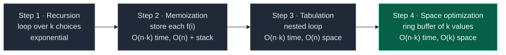
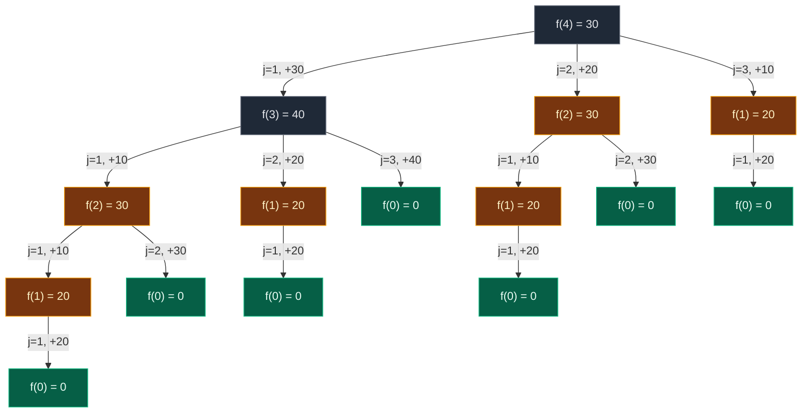
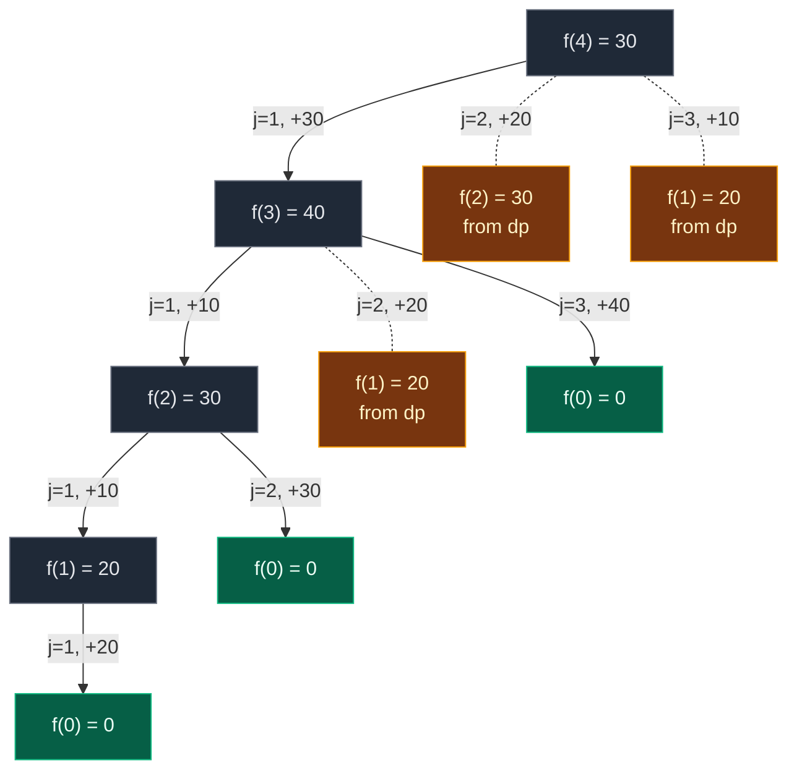

# 04. Frog Jump with K Distances

| Difficulty | Pattern | Source | Time | Space |
|:---:|:---:|:---:|:---:|:---:|
| **Medium** | 1-D DP: Min over K Choices | [GfG: Minimal Cost](https://www.geeksforgeeks.org/problems/minimal-cost/1) | `O(n·k)` | `O(k)` |

## 1. Problem Statement

There is a row of `n` stones. You get an array `arr`, where `arr[i]` is the height of stone `i`, and a number `k`.

A frog starts on stone `0` and wants to reach the last stone, `n - 1`. It can only jump forward.

From stone `i`, the frog can jump to **any** of the stones `i + 1, i + 2, ..., i + k`.

A jump from stone `i` to stone `j` costs `|arr[i] - arr[j]|`. Jumping down costs the same as jumping up, because of the absolute value `| |`. For example, from height 10 to height 30 costs `|10 - 30| = 20`.

Return the **minimum total cost** to reach the last stone.

This is Striver's DP lecture **L4**, the follow-up of [03. Frog Jump](./03.%20Frog%20Jump.md). It is also AtCoder DP **B - Frog 2** (time limit 2 sec, memory 1024 MiB). AtCoder numbers stones `1 .. N`. In code we use `0 .. n - 1`, so AtCoder's "stone 1 → 2 → 5" is our "index 0 → 1 → 4", and the answer is `f(n - 1)`.

**What changed from Frog Jump (L3)?** Only one thing: the frog may jump up to `k` stones, not just 1 or 2.

| | Frog 1 (L3) | Frog 2 (L4, this note) |
|:---|:---|:---|
| Jumps | 1 or 2 | 1, 2, ..., k |
| Choices in the code | 2 lines (`left`, `right`) | a loop `for j in 1..k` |
| Time | `O(n)` | `O(n·k)` |
| Best space | `O(1)` (two variables) | `O(k)` (last `k` values) |

### Example

```text
k = 3
arr   = [10, 30, 40, 50, 20]
index =   0   1   2   3   4

Best route: 0 -> 1 -> 4
  0 -> 1 : |30 - 10| = 20
  1 -> 4 : |20 - 30| = 10      (a 3-jump)
  total  = 30

Output: 30
```

We use this same example in every section below. It is GfG example 1 and AtCoder sample 1.

Other samples (all in the tests):

| `k` | `arr` | Output | Best route (0-indexed) |
|:---:|:---|:---:|:---|
| 1 | `[10, 20, 10]` | `20` | `0 -> 1 -> 2`. With `k = 1` there is only one route |
| 100 | `[10, 10]` | `0` | `0 -> 1`. `k` can be bigger than the number of stones |
| 4 | `[40, 10, 20, 70, 80, 10, 20, 70, 80, 60]` | `40` | `0 -> 3 -> 7 -> 9` = 30 + 0 + 10 (AtCoder stones `1 -> 4 -> 8 -> 10`) |

### Constraints

- GfG: `1 <= k <= 100`, `1 <= arr.length <= 10^4`, `1 <= arr[i] <= 10^4`. Expected time `O(n·k)`.
- AtCoder: `2 <= N <= 10^5`, `1 <= K <= 100`, `1 <= h_i <= 10^4`, all integers.
- AtCoder input format: first line `N K`, second line `h1 h2 ... hN`. Print the minimum total cost.
- `n·k` is at most `10^5 × 100 = 10^7`. Fine in C++. A few seconds in plain Python (close to the 2 sec limit).

## 2. Core Theory

### From 2 jumps to k jumps (the board)

In L3 the code had one line per choice:

```text
fs = f(ind-1) + abs(a[ind] - a[ind-1])          first step
if (ind > 1) ss = f(ind-2) + abs(a[ind] - a[ind-2])   second step
return min(fs, ss)
```

On the board, Striver adds a third jump:

```text
if (ind > 2) ts = f(ind-3) + abs(a[ind] - a[ind-3])   third step
```

We could keep adding lines (fs, ss, ts, ...). But with `k = 100` that is 100 lines. And `k` is an **input**, so we do not even know how many lines to write. **A loop is needed.**

| L3 (Frog 1) | L4 (k jumps) |
|:---|:---|
| `fs = f(ind-1) + \|a[ind] - a[ind-1]\|` | `j = 1: f(ind-1) + \|a[ind] - a[ind-1]\|` |
| `if ind > 1: ss = f(ind-2) + \|...\|` | `j = 2: f(ind-2) + \|...\|` (only if `ind - 2 >= 0`) |
| — | `j = 3, 4, ..., k` |
| `return min(fs, ss)` | `return` the min over all `j` |

Frog 1 had two ways to arrive. Frog 2 has `k`. The two lines become a loop over the last `k` stones, and you keep the cheapest.

### Why greedy fails

**Greedy** = "always take the jump that is cheapest right now".

**On our example** (`k = 3`, greedy picks the shortest jump on a tie):

```text
arr  :  10   30   40   50   20
index:   0    1    2    3    4

From 0: to 30 costs 20, to 40 costs 30, to 50 costs 40   -> greedy goes to 1 (20)
From 1: to 40 costs 10, to 50 costs 20, to 20 costs 10   -> tie, greedy goes to 2 (10)
From 2: to 50 costs 10, to 20 costs 20                   -> greedy goes to 3 (10)
From 3: to 20 costs 30                                   -> forced (30)

greedy : 0 -> 1 -> 2 -> 3 -> 4  = 20 + 10 + 10 + 30 = 70   X
best   : 0 -> 1 -> 4            = 20 + 10           = 30   OK
```

**Your example with no ties at all** (`k = 2`, `[40, 50, 20, 30, 20]`):

```text
arr  :  40   50   20   30   20
index:   0    1    2    3    4

greedy: 40 -10-> 50 -20-> 30 -10-> 20     = 10 + 20 + 10 = 40   X
best  : 40 -20-> 20 -0-> 20               = 20 + 0       = 20   OK
```

From stone 0, greedy compares `40 -> 50` (cost 10) with `40 -> 20` (cost 20) and takes the cheaper 50. But from 50 every move is expensive. Paying 20 first and then 0 gives 20.

A cheap jump now can force expensive jumps later. So we must **try every jump length** and keep the cheapest. Trying every choice = recursion. Recursion with repeated work = DP.

```python
# Greedy frog with k jumps: cheapest jump right now (WRONG in general)
def greedy_k(arr, k):

    # Number of stones
    n = len(arr)

    # Start on stone 0
    i = 0

    # No cost yet
    total = 0

    # Keep jumping until the last stone
    while i < n - 1:

        # Best (cost, jump length) seen so far for this stone
        best = None

        # Try every jump length
        for j in range(1, k + 1):

            # Only stones that exist
            if i + j < n:

                # Cost of this jump
                c = abs(arr[i + j] - arr[i])

                # Keep it if it is strictly cheaper (ties keep the shorter jump)
                if best is None or c < best[0]:

                    # Remember cost and length
                    best = (c, j)

        # Pay for the chosen jump
        total = total + best[0]

        # Move forward
        i = i + best[1]

    # Total cost greedy paid
    return total
```

### How to spot it is DP

- **Overlapping subproblems.** "Cheapest cost to reach stone 4" needs stones 3, 2 and 1. "Stone 3" needs 2, 1, 0. "Stone 2" needs 1 and 0. Stone 1 is asked again and again.
- **Optimal substructure.** If the best route to stone 4 arrives from stone 1, then the part up to stone 1 must itself be the best route to stone 1.

### The state

> `f(i)` = the minimum cost to go from stone `0` to stone `i`.

Same state as Frog 1. Only the number of choices changed.

### The recurrence

The board recipe:

1. **Express in terms of an index:** `f(ind)` = minimum energy to reach stone `ind` from stone 0.
2. **Do all stuffs on that index:** try every jump size `j = 1 .. k` that lands on `ind`, i.e. coming from stone `ind - j`.
3. **Return the min** of all those options.

Which stones can jump to stone 4 (with `k = 3`)?

```text
 [10]   [30]   [40]   [50]   [20]
  i=0    i=1    i=2    i=3    i=4
          │      │      └─j=1─┘^
          │      └────j=2──────┤
          └─────────j=3────────┘
```

Stone 4 can be reached from stone 3 (`j = 1`), stone 2 (`j = 2`) or stone 1 (`j = 3`). So `f(4)` has three children. Stone 1 can only be reached from stone 0 (`j = 2, 3` would be negative), so `f(1)` has one child.

In words: "The cheapest way to stand on stone `i` is: for each `j` from 1 to `k`, get to stone `i - j` as cheaply as possible, add the cost of the last jump, and keep the smallest total."

```text
f(i) = min over j = 1..k, with i - j >= 0, of   f(i - j) + |h[i] - h[i - j]|
f(0) = 0          answer = f(n - 1)
```

### Base cases

| Base case | Value | Why |
|:---|:---:|:---|
| `f(0)` | `0` | The frog starts on stone 0. No jump, no cost |
| `i - j < 0` | skip | That stone does not exist. Near the start, fewer than `k` stones lie behind us. In Python `arr[-1]` does not crash, it **silently reads the last stone**, so the check is essential |
| `min_steps` start | `infinity` | So the first real option always becomes the minimum. Reset it for **every** `i` |

What each line of the board's recursion means:

| Line | Meaning |
|:---|:---|
| `if (ind == 0) return 0` | Already on the first stone, no energy needed |
| `minSteps = INT_MAX` | Start with "infinity", so the first real option always wins |
| `for j = 1 .. k` | The last jump was `j` stones long, so we came from stone `ind - j` |
| `if (ind - j >= 0)` | That stone must exist (circled on the board: never jump before stone 0) |
| `f(ind - j)` | Cheapest way to reach the stone we jumped from. Recursion trusts it |
| `abs(a[ind] - a[ind - j])` | Energy for that last jump |
| `min(minSteps, jump)` | Keep the cheapest over all `j` |

### The 4-step ladder



## 3. Edge Cases

| Case | Input | Expected | Why it matters |
|:---|:---|:---:|:---|
| One stone (GfG allows it) | `k = 3, [7]` | `0` | Already at the end. Loop never runs |
| `k = 1` | `k = 1, [10, 20, 10]` | `20` | Only one route: the sum of all neighbour differences |
| `k` bigger than `n` | `k = 100, [10, 10]` | `0` | Must not jump past the start: the `i - j >= 0` check |
| `k = 2` | `k = 2, [30, 10, 60, 10, 60, 50]` | `40` | Exactly Frog Jump (L3) |
| `k >= n - 1` | `k = 4, [10, 30, 40, 50, 20]` | `10` | Frog can jump straight to the end: `\|20 - 10\| = 10` |
| All equal heights | `k = 2, [5, 5, 5]` | `0` | Every jump costs 0 |
| Greedy trap | `k = 2, [40, 50, 20, 30, 20]` | `20` | Greedy says 40 |
| Big input | `n = 10^5, k = 100` | — | `10^7` steps. Recursion and memo are out in Python; use the loops |

## 4. Approach 1: Recursion

### Idea

Same as Frog 1, but the two lines become a loop over `j = 1 .. k`.

**Recursion tree for `k = 3`, `[10, 30, 40, 50, 20]`.** Each box is one call. The edge label is the jump length `j` and the cost added on the way back up. Gold = repeated subproblem. Green = base case.



**15 calls for 5 stones.**

| Subproblem | Times solved | Wasted |
|:---|:---:|:---:|
| `f(4)` | 1 | 0 |
| `f(3)` | 1 | 0 |
| `f(2)` | 2 | 1 |
| `f(1)` | 4 | 3 |
| `f(0)` | 7 | 6 (cheap, base case) |

How fast it grows with `k = 3`: 10 stones → 326 calls, 20 stones → 144,664 calls, 30 stones → 64,099,760 calls. With `n = 10^5` it never finishes.

**Dry run, call by call** (indent = depth):

```text
f(4)                       try j = 1, 2, 3
   f(3)                    try j = 1, 2, 3
      f(2)                 try j = 1, 2
         f(1)              try j = 1
            f(0)           base case -> return 0
         f(1) done         j=1: 0 + 20 = 20                     -> 20
         f(0)              base case -> return 0
      f(2) done            j=1: 20 + 10 = 30, j=2: 0 + 30 = 30  -> 30
      f(1)                 try j = 1
         f(0)              base case -> return 0
      f(1) done            j=1: 20                              -> 20
      f(0)                 base case -> return 0
   f(3) done               j=1: 30+10 = 40, j=2: 20+20 = 40, j=3: 0+40 = 40  -> 40
   f(2)                    try j = 1, 2
      f(1)                 try j = 1
         f(0)              base case -> return 0
      f(1) done            j=1: 20                              -> 20
      f(0)                 base case -> return 0
   f(2) done               j=1: 30, j=2: 30                     -> 30
   f(1)                    try j = 1
      f(0)                 base case -> return 0
   f(1) done               j=1: 20                              -> 20
f(4) done                  j=1: 40+30 = 70, j=2: 30+20 = 50, j=3: 20+10 = 30  -> 30
```

`f(4) = min(70, 50, 30) = 30`.

### Code

```python
# Import List for type hints
from typing import List


# Approach 1: plain recursion
class SolutionRecursion:

    # Helper: minimum cost to reach stone ind from stone 0
    def f(self, ind: int, arr: List[int], k: int) -> int:

        # Base case: standing on the first stone costs nothing
        if ind == 0:
            return 0

        # Start with "infinitely expensive" so any real cost is smaller
        min_steps = float("inf")

        # The frog could have arrived from 1, 2, ..., k stones back
        for j in range(1, k + 1):

            # Only stones that exist (index 0 or more)
            if ind - j >= 0:

                # Best cost to reach stone ind - j, plus this last jump
                jump = self.f(ind - j, arr, k) + abs(arr[ind] - arr[ind - j])

                # Keep the cheapest way
                min_steps = min(min_steps, jump)

        # Cheapest over all k choices
        return min_steps

    # GfG entry point
    def minimizeCost(self, k: int, arr: List[int]) -> int:

        # Answer = cheapest cost to reach the last stone
        return self.f(len(arr) - 1, arr, k)
```

### Complexity

| Measure | Complexity | Why |
|:---|:---:|:---|
| **Time** | `O(k^n)` (exponential) | Every call branches into up to `k` calls, and the tree can be `n` levels deep (the path that always jumps 1). It is an upper bound: near the start fewer than `k` stones exist, so branches get cut. Still exponential |
| **Space** | `O(n)` | Recursion stack. The deepest chain is `f(n-1) -> f(n-2) -> ... -> f(0)` |

## 5. Approach 2: Memoization (Top-Down)

### Idea

The same 3 steps as every memo:

1. **Declare** `dp` of size `n`, filled with `-1`. `-1` = "not computed". Real costs are never negative.
2. **Store** before returning: `dp[ind] = min_steps`.
3. **Check** first: `if dp[ind] != -1: return dp[ind]`.

On the board the cost is circled: `n` states × `k` work each → `O(n × k)`.

Your earlier Python version used a dictionary `dp = {}` with `if index in dp`. Same idea, no size needed.

### Visual: calls and dp fills, in order

`k = 3`, `[10, 30, 40, 50, 20]`. The base case returns before touching `dp`, so `dp[0]` stays `-1`.

```text
start               dp: [-1][-1][-1][-1][-1]

call f(4) -> not in dp. Try j = 1 first:
 call f(3) -> not in dp. Try j = 1 first:
  call f(2) -> not in dp. Try j = 1 first:
   call f(1) -> not in dp
    call f(0) -> base case, return 0
   f(1): j=1: 0 + |30-10| = 20
   f(1) = 20, store it
                    dp: [-1][20][-1][-1][-1]
                              ^ filled
  f(2): j=1: f(1) + |40-30| = 20 + 10 = 30
    call f(0) -> base case, return 0
  f(2): j=2: 0 + |40-10| = 30
  f(2) = min(30, 30) = 30, store it
                    dp: [-1][20][30][-1][-1]
                                  ^ filled
 f(3): j=1: f(2) + |50-40| = 30 + 10 = 40
   call f(1) -> dp[1] already known -> return 20, no new calls   (cache hit)
 f(3): j=2: 20 + |50-30| = 40
   call f(0) -> base case, return 0
 f(3): j=3: 0 + |50-10| = 40
 f(3) = min(40, 40, 40) = 40, store it
                    dp: [-1][20][30][40][-1]
                                      ^ filled
f(4): j=1: f(3) + |20-50| = 40 + 30 = 70
  call f(2) -> dp[2] already known -> return 30, no new calls    (cache hit)
f(4): j=2: 30 + |20-40| = 50
  call f(1) -> dp[1] already known -> return 20, no new calls    (cache hit)
f(4): j=3: 20 + |20-30| = 30
f(4) = min(70, 50, 30) = 30, store it
                    dp: [-1][20][30][40][30]
                                          ^ filled
answer = 30
```

### The pruned recursion tree



**10 calls instead of 15.** Dashed gold leaves are answered from `dp`.

### Code

```python
# Approach 2: memoization (top-down)
class SolutionMemo:

    # Helper: minimum cost to reach stone ind, using the dp notebook
    def f(self, ind: int, arr: List[int], k: int, dp: List[int]) -> int:

        # Base case: first stone costs nothing
        if ind == 0:
            return 0

        # Step 3: already solved this stone? Reuse it
        if dp[ind] != -1:
            return dp[ind]

        # Start with "infinity"
        min_steps = float("inf")

        # Try every jump length 1..k
        for j in range(1, k + 1):

            # Only stones that exist
            if ind - j >= 0:

                # Cost if the last jump was j stones long
                jump = self.f(ind - j, arr, k, dp) + abs(arr[ind] - arr[ind - j])

                # Keep the cheapest
                min_steps = min(min_steps, jump)

        # Step 2: store before returning
        dp[ind] = min_steps

        # Return the stored answer
        return dp[ind]

    # GfG entry point
    def minimizeCost(self, k: int, arr: List[int]) -> int:

        # Number of stones
        n = len(arr)

        # Step 1: -1 = "not solved yet"
        dp = [-1] * n

        # Solve for the last stone
        return self.f(n - 1, arr, k, dp)
```

### Complexity

| Measure | Complexity | Why |
|:---|:---:|:---|
| **Time** | `O(n × k)` | `n` different states, each computed once, each runs a loop of `k` |
| **dp array** | `O(n)` | One cell per stone |
| **Recursion stack** | `O(n)` | Deepest chain `f(n-1) -> ... -> f(0)` |

Python's default recursion limit is about 1000. With `n` up to `10^5` this crashes with `RecursionError` unless you raise `sys.setrecursionlimit`, and even then the C stack can overflow. In Python, submit tabulation.

## 6. Approach 3: Tabulation (Bottom-Up)

### How to convert memo into a table, step by step

1. **Same size dp array:** `dp = [0] * n`.
2. **Base case:** `dp[0] = 0`.
3. **Loop the opposite way:** recursion went from `n - 1` down. The loop goes `i = 1 .. n - 1`. All of `dp[i-1] .. dp[i-k]` are ready when we need them.
4. **Copy the recurrence, `f(...)` becomes `dp[...]`:** for each `i`, reset `min_steps = inf`, loop `j = 1 .. k`, and if `i - j >= 0` try `dp[i - j] + |arr[i] - arr[i - j]|`.
5. **Answer:** `dp[n - 1]`.

On the board, the two fixed lines `fs, ss` inside `dp[i] = min(fs, ss)` are circled and replaced by the inner `j` loop. Careful: the board's inner line still says `abs(a[ind] - a[ind - j])`, left over from the recursive version. In the loop the index is `i`: `abs(a[i] - a[i - j])`.

### Visual table fill

`k = 3`, `arr = [10, 30, 40, 50, 20]`.

```text
arr:     10  30  40  50  20
i:        0   1   2   3   4
dp:     [ 0][  ][  ][  ][  ]
          ^
          └── base case dp[0] = 0
```

```text
i:        0   1   2   3   4
dp:     [ 0][20][  ][  ][  ]
          ^   ^
          |   └── filling dp[1]
          └────── reads dp[0] = 0
j=1: dp[0] + |30 - 10| = 0 + 20 = 20   <- winner
j=2, j=3: stone -1, -2 do not exist, skip
dp[1] = 20
```

```text
i:        0   1   2   3   4
dp:     [ 0][20][30][  ][  ]
          ^   ^   ^
          |   |   └── filling dp[2]
          |   └────── reads dp[1] = 20
          └────────── reads dp[0] = 0
j=1: dp[1] + |40 - 30| = 20 + 10 = 30   <- winner (tie)
j=2: dp[0] + |40 - 10| =  0 + 30 = 30   <- winner (tie)
j=3: stone -1 does not exist, skip
dp[2] = 30
```

```text
i:        0   1   2   3   4
dp:     [ 0][20][30][40][  ]
          ^   ^   ^   ^
          |   |   |   └── filling dp[3]
          |   |   └────── reads dp[2] = 30
          |   └────────── reads dp[1] = 20
          └────────────── reads dp[0] = 0
j=1: dp[2] + |50 - 40| = 30 + 10 = 40
j=2: dp[1] + |50 - 30| = 20 + 20 = 40
j=3: dp[0] + |50 - 10| =  0 + 40 = 40
dp[3] = 40   (three-way tie)
```

```text
i:        0   1   2   3   4
dp:     [ 0][20][30][40][30]
              ^   ^   ^   ^
              |   |   |   └── filling dp[4]
              |   |   └────── reads dp[3] = 40
              |   └────────── reads dp[2] = 30
              └────────────── reads dp[1] = 20
j=1: dp[3] + |20 - 50| = 40 + 30 = 70
j=2: dp[2] + |20 - 40| = 30 + 20 = 50
j=3: dp[1] + |20 - 30| = 20 + 10 = 30   <- winner
dp[4] = 30
```

`dp = [0, 20, 30, 40, 30]`, answer `dp[4] = 30`. The winning option is also how you recover the path: `4 <- 1 <- 0`.

**AtCoder sample 4** (`k = 4`), the full table:

| `i` | 0 | 1 | 2 | 3 | 4 | 5 | 6 | 7 | 8 | 9 |
|:---|:---:|:---:|:---:|:---:|:---:|:---:|:---:|:---:|:---:|:---:|
| `h[i]` | 40 | 10 | 20 | 70 | 80 | 10 | 20 | 70 | 80 | 60 |
| `dp[i]` | 0 | 30 | 20 | 30 | 40 | 30 | 20 | 30 | 40 | 40 |

Answer `dp[9] = 40`. Following the winners backwards gives `0 -> 3 -> 7 -> 9`, i.e. AtCoder stones `1 -> 4 -> 8 -> 10`, exactly the path in the problem statement.

### Code

```python
# Approach 3: tabulation (bottom-up)
class SolutionTab:

    # GfG entry point
    def minimizeCost(self, k: int, arr: List[int]) -> int:

        # Number of stones
        n = len(arr)

        # dp[i] = cheapest cost to reach stone i
        dp = [0] * n

        # Base case: already on stone 0
        dp[0] = 0

        # Fill stones 1, 2, ..., n - 1 from left to right
        for i in range(1, n):

            # Reset for every stone: start with "infinity"
            min_steps = float("inf")

            # Look back at the k stones before i
            for j in range(1, k + 1):

                # Stone i - j must exist
                if i - j >= 0:

                    # Cost if the last jump was j stones long
                    jump = dp[i - j] + abs(arr[i] - arr[i - j])

                    # Keep the cheapest
                    min_steps = min(min_steps, jump)

            # Store the best for stone i
            dp[i] = min_steps

        # Answer is the last cell
        return dp[n - 1]
```

Your notes' version starts `dp` at infinity and updates `dp[i]` directly for each `j`, with no separate `min_steps`. Same result:

```python
# Your notes' bottom-up variant: dp starts at infinity
class SolutionTabInf:

    # GfG entry point
    def minimizeCost(self, k: int, arr: List[int]) -> int:

        # Number of stones
        n = len(arr)

        # dp[i] = minimum cost to reach stone i, unknown = infinity
        dp = [float("inf")] * n

        # Base case
        dp[0] = 0

        # Fill dp array
        for i in range(1, n):

            # Try all jumps from 1 to k
            for j in range(1, k + 1):

                # Ensure a valid jump
                if i - j >= 0:

                    # Improve dp[i] directly
                    dp[i] = min(dp[i], dp[i - j] + abs(arr[i] - arr[i - j]))

        # Answer is the last cell
        return dp[n - 1]
```

### Complexity

| Measure | Complexity | Why |
|:---|:---:|:---|
| **Time** | `O(n × k)` | `n` stones, up to `k` looks back each. Works because `k <= 100` |
| **Space** | `O(n)` | The dp array. No recursion |

Since `n <= 10^5`, `O(n)` dp is totally acceptable and preferred for clarity. This is the version to submit if you are unsure.

## 7. Approach 4: Space Optimization (Optimal)

### Idea

**Frog 1 (k = 2):** `dp[i]` needed `dp[i-1]` (prev) and `dp[i-2]` (prev2). Two variables. `O(n) -> O(1)`. After each step: `prev2 = prev`, `prev = curr`.

**Frog 2 (any k):** `dp[i]` needs `dp[i-1], dp[i-2], ..., dp[i-k]`. That is `k` values. So `O(n) -> O(k)`, **not** `O(1)`.

The board picture for `k = 4`:

```text
         i-4   i-3   i-2   i-1    i
  .  .  [ o  ][ o  ][ o  ][ o  ]  ?   <- dp[i] needs the last K (no.) values
                                  ^
                                dp[i]
```

**Why not O(1)?** Three reasons:

1. **`k` is an input.** In Frog 1 the "2" was fixed, so 2 variables count as `O(1)`. Here the number of values grows with `k`.
2. **You cannot squeeze the `k` values into one number.** Each old value `dp[i - j]` gets a **different** jump cost added: `|h[i] - h[i - j]|`. That cost depends on `i`, so the winner changes from stone to stone. Look at our example: at `i = 4` the winner was `dp[1]` (`j = 3`, the oldest one in the window). If we had kept only the last two values, we would answer `min(70, 50) = 50` instead of 30.
3. **The window slides.** Even a "running minimum" fails, because old values leave the window and the minimum might be the one that just left.

So the best possible space is `O(k)`. (For `k = 2` it is exactly the `prev` / `prev2` trick from [03. Frog Jump](./03.%20Frog%20Jump.md).)

**How to keep only `k` values: a ring buffer.** A **ring buffer** is an array of size `k` used in a circle. Store `dp[i]` in slot `i % k`. When `dp[i]` is written, it overwrites slot `i % k`, which held `dp[i - k]`: the oldest value. No future stone can use it anymore, because they look at most `k` back.

One important detail: at stone `i`, the `j = k` look-back reads slot `(i - k) % k = i % k`, which is the slot we are about to overwrite. So we must **finish the whole `j` loop first, then write**. The code does that.

### Visual Walkthrough (Story Version)

**The story:** Frida the frog wants to cross 5 stones of heights `10, 30, 40, 50, 20`. She can jump up to 3 stones at a time.

Frida has a small notebook with exactly **3 pages** (because `k = 3`), arranged in a circle: page 0, page 1, page 2, then back to page 0. On page `i % 3` she writes "the cheapest cost to reach stone `i`". When she runs out of pages, she writes over the **oldest** page, because she can never jump back that far again.

**How to read the pictures:** `*` marks the stone Frida is thinking about. The notebook shows the 3 pages; `·` is an empty page; the label under each page says which stone it belongs to.

**Start: Frida stands on stone 0**

```text
stones:  [10] [30] [40] [50] [20]
           *
notebook:  page0 [ 0]  page1 [ ·]  page2 [ ·]
                 st0
```

Stone 0 costs nothing. Write 0 on page 0.

**Step 1: think about stone 1 (height 30)**

- From 1 back (stone 0, page 0): `0 + |30 - 10| = 20`.
- 2 back and 3 back do not exist.
- Best = 20. Write it on page `1 % 3 = 1`.

```text
stones:  [10] [30] [40] [50] [20]
                *
notebook:  page0 [ 0]  page1 [20]  page2 [ ·]
                 st0         st1
```

**Step 2: think about stone 2 (height 40)**

- From 1 back (stone 1, page 1): `20 + |40 - 30| = 30`.
- From 2 back (stone 0, page 0): `0 + |40 - 10| = 30`.
- 3 back does not exist.
- Best = 30. Write it on page `2 % 3 = 2`.

```text
stones:  [10] [30] [40] [50] [20]
                     *
notebook:  page0 [ 0]  page1 [20]  page2 [30]
                 st0         st1         st2
```

The notebook is now full.

**Step 3: think about stone 3 (height 50)**

- From 1 back (stone 2, page 2): `30 + |50 - 40| = 40`.
- From 2 back (stone 1, page 1): `20 + |50 - 30| = 40`.
- From 3 back (stone 0, page 0): `0 + |50 - 10| = 40`.
- Best = 40. Write it on page `3 % 3 = 0`. That overwrites stone 0's page. Fine: from now on, nobody can jump from stone 0 (it is more than 3 back).

```text
stones:  [10] [30] [40] [50] [20]
                          *
notebook:  page0 [40]  page1 [20]  page2 [30]
                 st3         st1         st2
                 ^ overwrote stone 0
```

**Step 4: think about stone 4 (height 20)**

- From 1 back (stone 3, page 0): `40 + |20 - 50| = 70`.
- From 2 back (stone 2, page 2): `30 + |20 - 40| = 50`.
- From 3 back (stone 1, page 1): `20 + |20 - 30| = 30`. The oldest page wins!
- Best = 30. Write it on page `4 % 3 = 1` (overwrites stone 1, after we used it).

```text
stones:  [10] [30] [40] [50] [20]
                               *
notebook:  page0 [40]  page1 [30]  page2 [30]
                 st3         st4         st2
                             ^ answer
```

Frida reached the last stone. Page `4 % 3 = 1` says 30. Her route: `0 -> 1 -> 4`.

**Summary**

| Step | Stone | 1 back | 2 back | 3 back | Best | Page written | Notebook after |
|:---:|:---:|:---:|:---:|:---:|:---:|:---:|:---|
| start | 0 | — | — | — | 0 | 0 | `[0, ·, ·]` |
| 1 | 1 | 20 | — | — | 20 | 1 | `[0, 20, ·]` |
| 2 | 2 | 30 | 30 | — | 30 | 2 | `[0, 20, 30]` |
| 3 | 3 | 40 | 40 | 40 | 40 | 0 | `[40, 20, 30]` |
| 4 | 4 | 70 | 50 | 30 | 30 | 1 | `[40, 30, 30]` |

**What the story teaches**

| Story | Code |
|:---|:---|
| Notebook with `k` pages | `window = [0] * k` |
| Stone `i` lives on page `i % k` | `window[i % k]` |
| "From `j` back" | `window[(i - j) % k] + abs(arr[i] - arr[i - j])` |
| "Does not exist" | `if i - j >= 0` |
| Look at all pages first, then write | finish the `j` loop, then `window[i % k] = min_steps` |
| Overwrite the oldest page | slot `i % k` held `dp[i - k]` |
| Read the last stone's page | `return window[(n - 1) % k]` |
| Notebook size depends on `k` | `O(k)` space, not `O(1)` |

### Step-by-Step Example

`k = 3`, `arr = [10, 30, 40, 50, 20]`. `window` starts as `[0, 0, 0]` (only slot 0 is "real" at the start).

| `i` | reads (slot ← stone) | options | `dp[i]` | writes slot | `window` after |
|:---:|:---|:---|:---:|:---:|:---|
| 0 | — | base case | 0 | 0 | `[0, 0, 0]` |
| 1 | slot 0 ← dp[0] = 0 | `20` | 20 | 1 | `[0, 20, 0]` |
| 2 | slot 1 ← dp[1] = 20, slot 0 ← dp[0] = 0 | `30, 30` | 30 | 2 | `[0, 20, 30]` |
| 3 | slot 2 ← dp[2] = 30, slot 1 ← dp[1] = 20, slot 0 ← dp[0] = 0 | `40, 40, 40` | 40 | 0 (overwrites dp[0]) | `[40, 20, 30]` |
| 4 | slot 0 ← dp[3] = 40, slot 2 ← dp[2] = 30, slot 1 ← dp[1] = 20 | `70, 50, 30` | 30 | 1 (overwrites dp[1]) | `[40, 30, 30]` |

Answer = slot `(5 - 1) % 3 = 1` = **30**.

The sliding window of the last `k` values over the full dp row:

```text
i = 3:  dp: [ 0][20][30][40][  ]      window holds dp[0..2] while computing dp[3]
             └──────────┘
i = 4:  dp: [ 0][20][30][40][30]      window holds dp[1..3] while computing dp[4]
                 └──────────┘
```

### Code

```python
# Approach 4: space optimized with a ring buffer of size k (optimal)
class Solution:

    # GfG entry point
    def minimizeCost(self, k: int, arr: List[int]) -> int:

        # Number of stones
        n = len(arr)

        # window[x] = dp value of one of the last k stones; stone i lives in slot i % k
        window = [0] * k

        # dp[0] = 0 goes into slot 0
        window[0] = 0

        # Fill stones 1 .. n - 1
        for i in range(1, n):

            # Reset for every stone
            min_steps = float("inf")

            # Look back 1..k stones
            for j in range(1, k + 1):

                # Stone i - j must exist
                if i - j >= 0:

                    # dp[i - j] is stored in slot (i - j) % k
                    before = window[(i - j) % k]

                    # Cost if the last jump was j stones long
                    jump = before + abs(arr[i] - arr[i - j])

                    # Keep the cheapest
                    min_steps = min(min_steps, jump)

            # Now overwrite slot i % k, which held dp[i - k], never needed again
            window[i % k] = min_steps

        # The last stone lives in slot (n - 1) % k
        return window[(n - 1) % k]


# Import random for the many-inputs check
import random

# Our example
k0 = 3

# Heights of the example
a0 = [10, 30, 40, 50, 20]

# Traced dp row: dp[i] equals the answer on the first i + 1 stones
expected_dp = [0, 20, 30, 40, 30]

# Check every traced cell with the ring buffer version
for i in range(len(a0)):

    # Answer for stones 0..i must equal dp[i]
    assert Solution().minimizeCost(k0, a0[: i + 1]) == expected_dp[i]

# Same check with tabulation
for i in range(len(a0)):

    # Answer for stones 0..i must equal dp[i]
    assert SolutionTab().minimizeCost(k0, a0[: i + 1]) == expected_dp[i]

# Memo trace: dp after the call (dp[0] stays -1)
memo_dp = [-1] * len(a0)

# Run the memo helper on the last stone
assert SolutionMemo().f(len(a0) - 1, a0, k0, memo_dp) == 30

# dp filled exactly as in the memo visual
assert memo_dp == [-1, 20, 30, 40, 30]

# Only two values (Frog 1 style) would give the wrong answer at i = 4
assert min(40 + 30, 30 + 20) == 50


# Recursion that counts its own calls
class CountRec(SolutionRecursion):

    # Count each call, then do the normal work
    def f(self, ind, arr, k):

        # One more call
        self.calls += 1

        # Normal recursion (children are counted too)
        return super().f(ind, arr, k)


# Memo that counts its own calls
class CountMemo(SolutionMemo):

    # Count each call, then do the normal work
    def f(self, ind, arr, k, dp):

        # One more call
        self.calls += 1

        # Normal memo recursion
        return super().f(ind, arr, k, dp)


# Make the counting recursion object
rec = CountRec()

# Start the counter
rec.calls = 0

# Plain recursion gives 30
assert rec.minimizeCost(k0, a0) == 30

# 15 calls, as in the recursion tree
assert rec.calls == 15

# Reset the counter
rec.calls = 0

# 10 stones with k = 3
rec.minimizeCost(3, list(range(10)))

# 326 calls, as in the growth note
assert rec.calls == 326

# Make the counting memo object
memo = CountMemo()

# Start the counter
memo.calls = 0

# Memo gives 30
assert memo.minimizeCost(k0, a0) == 30

# 10 calls, as in the pruned tree
assert memo.calls == 10

# Greedy fails on the example (ties go to the shorter jump)
assert greedy_k(a0, 3) == 70

# Greedy fails on your no-tie example
assert greedy_k([40, 50, 20, 30, 20], 2) == 40

# The true answer there is 20
assert Solution().minimizeCost(2, [40, 50, 20, 30, 20]) == 20

# GfG example 1 / AtCoder sample 1
assert Solution().minimizeCost(3, [10, 30, 40, 50, 20]) == 30

# GfG example 2 / AtCoder sample 2
assert Solution().minimizeCost(1, [10, 20, 10]) == 20

# AtCoder sample 3: k bigger than n
assert Solution().minimizeCost(100, [10, 10]) == 0

# AtCoder sample 4
assert Solution().minimizeCost(4, [40, 10, 20, 70, 80, 10, 20, 70, 80, 60]) == 40

# k = 2 is Frog Jump (L3): same answer as note 03
assert Solution().minimizeCost(2, [30, 10, 60, 10, 60, 50]) == 40

# Edge: one stone
assert Solution().minimizeCost(3, [7]) == 0

# Edge: k reaches the last stone directly
assert Solution().minimizeCost(4, [10, 30, 40, 50, 20]) == 10

# Edge: all equal heights
assert Solution().minimizeCost(2, [5, 5, 5]) == 0

# All versions agree on many random inputs (recursion only on small n)
for _ in range(300):

    # Random length from 1 to 10
    n = random.randint(1, 10)

    # Random k from 1 to 5
    k = random.randint(1, 5)

    # Random heights
    arr = [random.randint(1, 50) for _ in range(n)]

    # Ring buffer answer
    best = Solution().minimizeCost(k, arr)

    # Tabulation agrees
    assert SolutionTab().minimizeCost(k, arr) == best

    # Your notes' variant agrees
    assert SolutionTabInf().minimizeCost(k, arr) == best

    # Memoization agrees
    assert SolutionMemo().minimizeCost(k, arr) == best

    # Plain recursion agrees
    assert SolutionRecursion().minimizeCost(k, arr) == best

    # Greedy is never better than the true minimum
    assert greedy_k(arr, k) >= best

# GfG worst case size: n = 10^4, k = 100
big = [random.randint(1, 10**4) for _ in range(10**4)]

# Tabulation and ring buffer agree on the big input
assert SolutionTab().minimizeCost(100, big) == Solution().minimizeCost(100, big)

# All checks passed
print("All tests passed")
```

### Complexity

| Approach | Time | Space | Stack | Usable |
|:---|:---:|:---:|:---:|:---:|
| Recursion | `O(k^n)` | — | `O(n)` | No |
| Memoization | `O(n × k)` | `O(n)` dp | `O(n)` | Risky (recursion depth up to `n`) |
| Tabulation | `O(n × k)` | `O(n)` dp | none | Yes, the safe submission |
| **Space optimized (ring buffer)** | **`O(n × k)`** | **`O(k)`** | **none** | **Yes** |
| Space optimized to `O(1)` | — | — | — | Not possible for general `k` |

Your comparison table marked "Space Optimised" as not possible. More exactly: `O(1)` is not possible for general `k`, but an `O(k)` version exists (above). Saying "`O(k)` via a ring buffer" is a nice bonus point in interviews.

## 8. Common Mistakes

| Mistake | What goes wrong | Fix |
|:---|:---|:---|
| Forgetting `if i - j >= 0` | Negative index. Python does not crash, it wraps to the end of the array and gives a wrong answer | Always check `i - j >= 0` |
| `min_steps` not reset for each `i` | Stone `i` "inherits" a smaller value from stone `i - 1` | Set `min_steps = inf` inside the `i` loop |
| Thinking `O(1)` space works for any `k` | Keeping only two values loses the far-back winner (50 instead of 30 on our example) | Keep the last `k` values: ring buffer, `O(k)` |
| Answer `dp[n]` instead of `dp[n - 1]` | Out of range | Stones are `0 .. n - 1` |
| Using `ind` inside the tabulation loop (board leftover) | `NameError` or wrong cell | In the loop the index is `i`: `abs(a[i] - a[i - j])` |
| Ring buffer: writing slot `i % k` before the `j` loop ends | The `j = k` look-back reads the slot you just overwrote | Compute `min_steps` fully, then write |
| Greedy choice | Cheap jump now, expensive later (70 instead of 30) | Try every `j` (DP) |
| One-line `def frogJump(...): return ...` | Hard to read, breaks the comment-per-line rule | Put the `return` on its own line |
| Memoization in Python on `n = 10^5` | `RecursionError` | Submit tabulation |

## 9. Interview Follow-ups

### Q1. How is this different from Frog Jump 1?

**Answer:**
- The frog can jump up to `k` stones instead of 2.
- So the two fixed options become a loop over `j = 1 .. k`.
- The state stays the same: the stone index. See [03. Frog Jump](./03.%20Frog%20Jump.md).

### Q2. What are the state, transition and base case?

**Answer:**
- State: `dp[i]` = min cost to reach stone `i`.
- Transition: `dp[i] = min over j of dp[i - j] + |h[i] - h[i - j]|`, for `i - j >= 0`.
- Base case: `dp[0] = 0`.

### Q3. What are the time and space?

**Answer:**
- Time `O(n·k)`: `n` stones, `k` looks back each.
- Space `O(n)` for the table, or `O(k)` with a ring buffer.

### Q4. Why can't you use O(1) space?

**Answer:**
- Each `dp[i]` needs the last `k` values, not just two.
- Each of those gets a different jump cost added, so you cannot keep only "the best one".
- `O(k)` is the best possible. When `k = 2` it becomes the `prev` / `prev2` trick.

### Q5. Can you beat O(n·k)?

**Answer:**
- Not with a simple trick. The absolute value stops the usual sliding-window minimum (monotonic deque), because the added cost depends on both `i` and `j`.
- You can split the absolute value into two cases, `h[i - j] <= h[i]` and `h[i - j] > h[i]`, and use segment trees: about `O(n log n)`.
- But `k <= 100` makes `O(n·k)` enough.
- Compare with LeetCode 1696 Jump Game VI: there the score is just `dp[i - j] + nums[i]`, with no `|...|`, so a monotonic deque gives `O(n)`.

### Q6. How do you print the actual path?

**Answer:**
- Store which `j` won for every `i` (or recompute it), then walk back from `n - 1` to `0`.
- Our example: stone 4 won with `j = 3` (from 1), stone 1 won with `j = 1` (from 0). Path `0 -> 1 -> 4`.

### Q7. Will it be fast enough, and how do you read AtCoder input?

**Answer:**
- Worst case `n = 10^5, k = 100` is about `10^7` inner steps. C++: well under 0.1 s. Plain Python: a few seconds, close to the 2 s limit.
- Tips for Python: use local variables, the one-line `min(...)` form, or PyPy.
- Input: `n, k = map(int, input().split())` then `h = list(map(int, input().split()))`, then print the answer.

```python
# Read AtCoder-style text "N K\nh1 ... hN" and solve it
def solve(text):

    # Split the input into lines
    lines = text.strip().split("\n")

    # First line: N and K
    n, k = map(int, lines[0].split())

    # Second line: the N heights
    heights = list(map(int, lines[1].split()))

    # Solve with the optimal version
    return Solution().minimizeCost(k, heights)


# All four AtCoder samples
samples = [("5 3\n10 30 40 50 20", 30), ("3 1\n10 20 10", 20), ("2 100\n10 10", 0), ("10 4\n40 10 20 70 80 10 20 70 80 60", 40)]

# Check every sample
for text, expected in samples:

    # Each sample must match
    assert solve(text) == expected
```

### Q8. What should I practice next?

**Answer:**
- AtCoder DP C, Vacation: 2-D state (day, activity).
- LeetCode 1696 Jump Game VI: max over the last `k`, monotonic deque.
- LeetCode 746 Min Cost Climbing Stairs: a Frog 1 variant.
- LeetCode 45 Jump Game II: variable jump lengths.

## 10. Memory Hook

- **Frog 1 had two ways to arrive; Frog 2 has K, so the two lines become a loop over the last K stones, and you keep the cheapest.**
- Recipe: (1) index, (2) try every jump `j = 1..k` that lands here, (3) return the min.
- Space: need the last `k` answers → `O(k)`, never `O(1)` for general `k`.

One line: *a k-choice DP is the 2-choice DP with the choices written as a loop; time multiplies by k, and the memory window grows to k.*

## 11. Interview Explanation

> f(i) is the minimum energy to reach stone i, and the frog starts at stone 0, so f(0) is 0. To land on i, the last jump came from some i − j with 1 ≤ j ≤ k, so f(i) is the minimum over j of f(i−j) plus |h[i] − h[i−j]|, skipping any i − j below 0. Greedy fails because a cheap jump now can lead to expensive jumps later, so every j has to be tried. Plain recursion re-solves the same stones and is exponential; memoizing gives O(n·k) time, but in Python the recursion depth is a problem, so I fill dp from left to right with a nested loop and return dp[n−1]. Only the last k values are ever read, so a ring buffer of size k gives O(k) space. O(1) is not possible for general k, because each of the k old values gets a different jump cost added, so the winner can be any of them.
