# 05. 198. House Robber

| Difficulty | Pattern | Source | Time | Space |
|:---:|:---:|:---:|:---:|:---:|
| **Medium** | 1-D DP: Pick / Not Pick | [198. House Robber](https://leetcode.com/problems/house-robber/) | `O(n)` | `O(1)` |

## 1. Problem Statement

You are a robber. There is a street of houses. Each house has some money inside.

The only thing that stops you: **two houses next to each other share an alarm**. If you rob two neighbours on the same night, the police come.

You get an integer array `nums`. `nums[i]` is the money in house `i`.

Return the **most money** you can rob tonight without robbing two neighbours.

Same problem, other name: on GfG and in Striver's DP series (DP L5) this is **"Maximum sum of non-adjacent elements"**. Pick some numbers of the array, no two of them next to each other, and make the sum as big as possible. In other words: the maximum sum of a **subsequence** with no two adjacent elements.

### Example

```text
nums = [2, 7, 9, 3, 1]
Output: 12
```

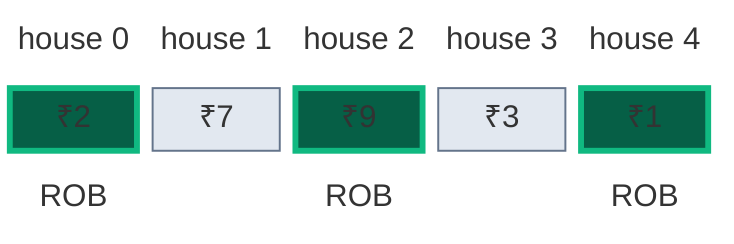

Rob house 0, house 2 and house 4: `2 + 9 + 1 = 12`.

We use this same example in every section below.

LeetCode example 1:

```text
nums = [1, 2, 3, 1]
Output: 4
```

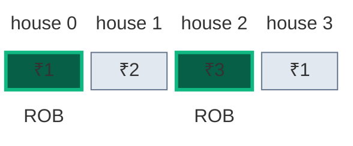

Rob house 0 and house 2: `1 + 3 = 4`.

LeetCode counts houses from 1 in its explanation ("rob house 1, house 3, house 5"). In code they are indices `0 ... n-1`, so LeetCode's "house 1" is our index `0`.

### Constraints

- `1 <= nums.length <= 100`
- `0 <= nums[i] <= 400`

### What the constraints tell us (simple theory)

A **constraint** is the biggest input the judge will ever give you. It quietly tells you how fast your code must be.

**Rule of thumb:** a computer does about **100 million (10^8) simple steps per second**. Count how many steps your idea needs for the biggest input, and compare.

| Biggest input `n` | Steps you can afford | Ideas that fit |
|:---:|:---:|:---|
| up to ~20 | about `2^n` | Plain recursion, try everything |
| up to ~500 | about `n^3` | Three nested loops |
| up to ~5,000 | about `n^2` | Two nested loops |
| up to ~1,000,000 | about `n` or `n log n` | One loop, DP over `n` states |

**For this problem:** `n` is at most `100`.

- Plain recursion makes 2 calls at every house, and they overlap. For 25 houses it already makes **242,785 calls**. For 100 houses it would make about **1.1 × 10^21 calls**. At 10^8 steps per second that is more than **300,000 years**.
- DP fills one cell per house: only **99 loop steps** for `n = 100`.
- The answer is small: at most 50 houses × 400 = 20,000. It fits easily in an `int`.

So the limit `n <= 100` looks small, but it is already far too big for plain recursion. DP makes it instant.

**How the work grows as `n` grows**

Red bars = calls made by plain recursion. Green line = loop steps made by DP (it stays flat near zero).

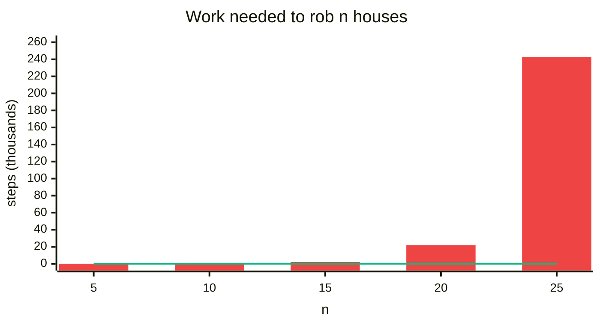

| `n` | Recursion calls | DP loop steps |
|:---:|:---:|:---:|
| 5 | 15 | 4 |
| 10 | 177 | 9 |
| 15 | 1,973 | 14 |
| 20 | 21,891 | 19 |
| 25 | 242,785 | 24 |

## 2. Core Theory

### First words we need

| Word | Meaning in this problem |
|:---|:---|
| **Subsequence** | Some houses of the street, kept in their order, not always next to each other |
| **Subproblem** | A smaller version of the same question, like "best money from houses 0 ... 2 only" |
| **State** | The small piece of information that names one subproblem. Here: one index `i` |
| **Recurrence** | A rule that builds the answer for `i` from answers for smaller indices |
| **Base case** | The smallest subproblem, answered directly without more calls |
| **Memo** | A notebook (`dp` array) where we write answers so we never solve the same subproblem twice |

### Why not just "take every other house"? (greedy fails)

A **greedy** idea makes one quick choice and never looks back. Two greedy ideas look tempting here. Both are wrong.

**Greedy 1: compare "all even houses" with "all odd houses".**

`nums = [2, 1, 1, 2]`

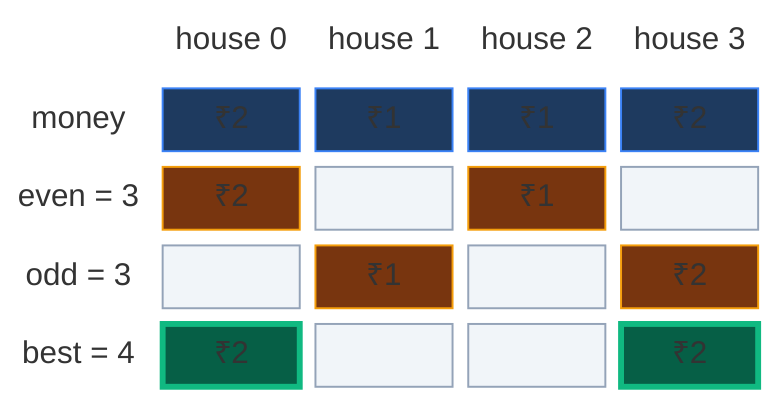

- All even houses (h0, h2): `2 + 1 = 3`.
- All odd houses (h1, h3): `1 + 2 = 3`.
- Greedy answer: `3`.
- The real best (h0, h3): `2 + 2 = 4`. It skips **two** houses in a row.

You are allowed to skip two (or more) houses in a row. "Every other house" never does that, so it misses the best plan.

**Greedy 2: take the biggest house first, then the biggest allowed one, and so on.**

`nums = [2, 3, 2]`

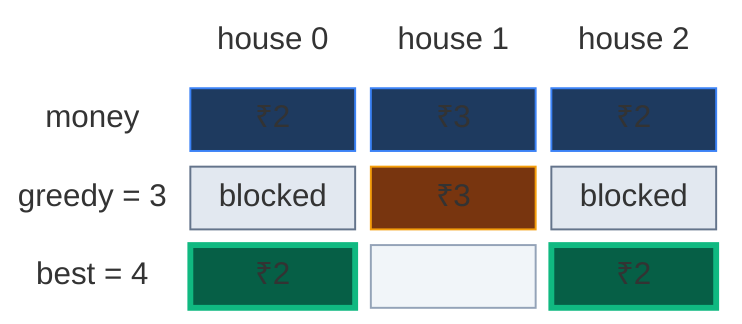

- Greedy takes the biggest house (h1 = 3). Now h0 and h2 are both blocked. Greedy answer: `3`.
- The real best (h0, h2): `2 + 2 = 4`.

A choice that looks good now (take 3) can block two good houses later. Local choices do not decide the global best. So we must **try every allowed plan** and keep the best one. Trying everything in a smart way is DP.

### Try all subsequences (the idea from the board)

The board in the lecture says: "Let's try out all subsequences with the given constraint, then pick the one with the maximum sum."

Here is that list for the small board example `[2, 1, 4, 9]`:

| Subsequence of `[2, 1, 4, 9]` | Allowed? | Sum |
|:---|:---|:---:|
| `{2, 4}` | yes (indices 0, 2) | 6 |
| `{2, 9}` | yes (indices 0, 3) | **11** |
| `{1, 9}` | yes (indices 1, 3) | 10 |
| `{2, 1}` | no, 0 and 1 are neighbours | - |
| `{4, 9}` | no, 2 and 3 are neighbours | - |
| `{9}` | yes | 9 |

All allowed subsequences of this 4-house street: `{}`, `{2}`, `{1}`, `{4}`, `{9}`, `{2,4}`, `{2,9}`, `{1,9}`. Best = **11**.

The classic way to make every subsequence is the **pick / not pick** recursion (from the recursion series, "print all subsequences", L6 / L7). At each house we either pick it or we do not.

### How to spot that it is DP

- **We make a choice at every house** (pick or not pick), and we want the **best** total. "Best of many choices" is a DP smell.
- **Optimal substructure:** the best plan for houses `0 ... i` is built from the best plan for `0 ... i-1` or for `0 ... i-2`. A big answer is made of small best answers.
- **Overlapping subproblems:** the question "best of houses `0 ... 1`?" is asked again and again from different branches (we will count them in the recursion tree).

### The 3-step recipe for writing `f(ind)`

The board writes the recursion with the same 3 steps as every 1-D DP:

1. **Express the problem in terms of an index.** `f(ind)` = best money from houses `0 ... ind`.
2. **Do stuff on that index.** Here "stuff" = pick house `ind` or do not pick it.
3. **Return the best.** It is a "maximum" problem, so we return `max(pick, notpick)`.

### The state

**`f(i)` = the most money we can rob from houses `0 ... i` only.**

The board shows what that means:

| Call | Means | For `[2, 1, 4, 9]` |
|:---|:---|:---:|
| `f(0)` | best of house 0 | 2 |
| `f(1)` | best of houses 0 ... 1 | `max(1, 2) = 2` |
| `f(2)` | best of houses 0 ... 2 | `max(4 + 2, 2) = 6` |
| `f(3)` | best of houses 0 ... 3 | `max(9 + 2, 6) = 11` |

The final answer is `f(n - 1)`: the best from the whole street.

### The recurrence (pick / not pick)

**In words:** stand at house `i`. You have two choices.

- **Pick** house `i`: you get `nums[i]`. Its neighbour `i - 1` is now forbidden, so the rest of the money comes from houses `0 ... i-2`. That is `nums[i] + f(i - 2)`.
- **Not pick** house `i`: you get nothing from it, but the neighbour `i - 1` is allowed again. The rest comes from houses `0 ... i-1`. That is `0 + f(i - 1)`.
- Keep the better one.

The board circles this: `f[0 ... ind]` → `a[ind] + [0 ... ind-2]`. If you pick house `ind` you cannot touch `ind - 1`.

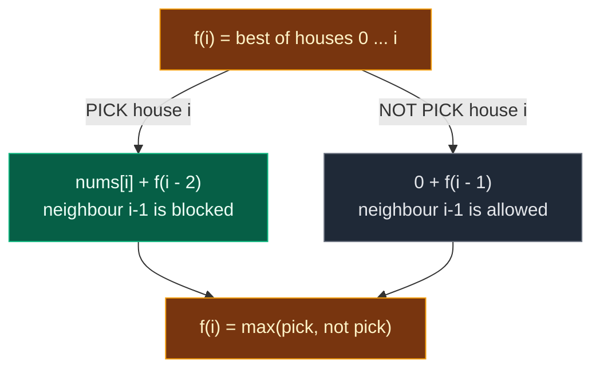

As a formula:

```text
f(i) = max( nums[i] + f(i - 2) ,  f(i - 1) )
              pick                not pick
```

What each piece means:

| Piece | Meaning |
|:---|:---|
| `f(ind)` | max money from houses `0 ... ind` |
| `ind == 0` | only house 0 left: rob it (money is never negative, so robbing never hurts) |
| `ind < 0` | no houses at all. This happens after "pick" at `ind = 1`, which calls `f(-1)`. Answer 0 |
| `pick` | rob house `ind`, jump over its neighbour |
| `notpick` | skip house `ind`, the neighbour is allowed |
| `max` | it is a "best" problem, not a "count" problem, so we take `max` instead of `+` |

**Compare with Fibonacci and Climbing Stairs:** same shape, `f(i-1)` and `f(i-2)`. Two changes: `max` instead of `+`, and an extra `nums[i]` on one branch.

### Base cases

| Base case | Value | Why |
|:---|:---:|:---|
| `f(0)` | `nums[0]` | Only house 0 is left. Money is `>= 0`, so robbing it is always at least as good as skipping it |
| `f(i)` for `i < 0` | `0` | No houses, no money. Reached when we pick house 1 and jump to `-1` |

### The 4-step ladder

Every DP problem climbs the same ladder. Each step fixes the problem of the step before.

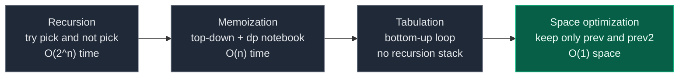

The board's summary of the same path:

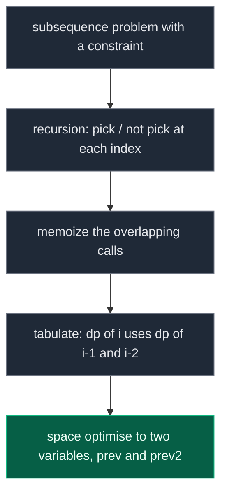

## 3. Edge Cases

| Case | Input | Expected | Why it matters |
|:---|:---|:---:|:---|
| One house | `[5]` | `5` | Rob it. Code that reads `nums[1]` or `dp[1]` crashes here |
| Two houses | `[2, 1]` | `2` | They are neighbours, so take the bigger one |
| All zeros | `[0, 0, 0]` | `0` | Nothing to steal. The answer is 0, not an error |
| Skip two in a row | `[2, 1, 1, 2]` | `4` | Breaks the "even vs odd" greedy |
| Biggest is a trap | `[2, 3, 2]` | `4` | Breaks the "take the biggest first" greedy |
| Board example | `[2, 1, 4, 9]` | `11` | Rob house 0 and house 3 |
| Empty street | `[]` | `0` | Not allowed by the constraints (`n >= 1`), but a safe `n == 0` check does no harm |

## 4. Approach 1: Recursion

### Idea

Write `f(ind)` with the pick / not pick recipe from the board:

- If `ind == 0`, return `nums[0]` (only house 0 is left).
- If `ind < 0`, return `0` (no houses).
- Otherwise `pick = nums[ind] + f(ind - 2)` and `not_pick = 0 + f(ind - 1)`.
- Return `max(pick, not_pick)`.

The Python code below is exactly these lines.

Watch out: on the board the not-pick line is written `notpick = 0 + f(ind)`. It must be **`f(ind - 1)`**. If you do not rob house `ind`, you move on to houses `0 ... ind-1`. Calling `f(ind)` again would call itself forever.

### Recursion tree for `[2, 7, 9, 3, 1]`

We call `f(4)`. Solid edge with "pick +x" = rob that house and jump two back. Edge "not pick" = step one back. The number before each label is the order of the call. Gold boxes are subproblems that are solved **more than once**.

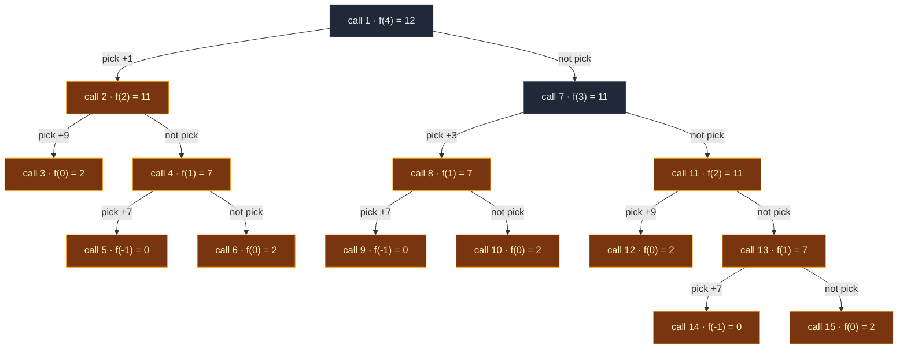

**15 calls for only 5 houses.** How often each subproblem is solved:

| Subproblem | Times solved | Wasted repeats |
|:---|:---:|:---:|
| `f(4)` | 1 | 0 |
| `f(3)` | 1 | 0 |
| `f(2)` | **2** | 1 |
| `f(1)` | **3** | 2 |
| `f(0)` | **5** | 4 |
| `f(-1)` | **3** | 2 |

The repeats grow very fast. Counting the calls for longer streets: 10 houses → **177** calls, 25 houses → **242,785** calls. With 100 houses (the maximum) plain recursion would never finish.

**The board example `[2, 1, 4, 9]`, call by call** (pick branch first, as in the code). This tree has 9 calls, and `f(1)` is computed twice: once under `f(3)`'s pick, once under `f(2)`'s not pick.

| Call (indent = depth) | What happens |
|:---|:---|
| `f(3)` | pick = `a[3] + f(1)`, notpick = `f(2)` |
| `.. f(1)` | pick = `a[1] + f(-1)`, notpick = `f(0)` |
| `.... f(-1)` | before house 0: return 0 |
| `.... f(0)` | base: return `a[0] = 2` |
| `.. f(1) done` | pick = 1 + 0 = 1, notpick = 2 → **2** |
| `.. f(2)` | pick = `a[2] + f(0)`, notpick = `f(1)` |
| `.... f(0)` | base: return `a[0] = 2` |
| `.... f(1)` | pick = `a[1] + f(-1)`, notpick = `f(0)` |
| `...... f(-1)` | return 0 |
| `...... f(0)` | return 2 |
| `.... f(1) done` | pick = 1, notpick = 2 → **2** |
| `.. f(2) done` | pick = 4 + 2 = 6, notpick = 2 → **6** |
| `f(3) done` | pick = 9 + 2 = 11, notpick = 6 → **11** |

The board boxes the same answers: `(2, 1)` → `f(1) = 2`; `(2, 1, 4)` with 2 and 4 circled → `f(2) = 6`; 2 and 9 circled → `f(3) = 11`.

### Code

```python
# Import List for type hints
from typing import List


# Approach 1: plain recursion (board version, walks backward)
class SolutionRecursion:

    # f(ind) = best money from houses 0 ... ind
    def f(self, ind: int, nums: List[int]) -> int:

        # Only house 0 is left: rob it (money is never negative)
        if ind == 0:
            return nums[0]

        # We jumped before house 0: no houses, no money
        if ind < 0:
            return 0

        # PICK house ind: take its money, neighbour ind - 1 is forbidden
        pick = nums[ind] + self.f(ind - 2, nums)

        # NOT PICK house ind: move to ind - 1 with nothing added
        not_pick = 0 + self.f(ind - 1, nums)

        # Best of the two choices
        return max(pick, not_pick)

    # Main method
    def rob(self, nums: List[int]) -> int:

        # f(n - 1) = best money from the whole street
        return self.f(len(nums) - 1, nums)
```

**Your version (walks forward).** `helper(index)` = best money from houses `index ... n-1`. Rob → jump to `index + 2`. Skip → go to `index + 1`. Base case: `index >= n` means no houses left. The returns are on their own lines here (your "no shortcut" rule).

```python
# Your recursion: walks forward from house 0
class SolutionForwardRecursion:

    # helper(index) = best money from houses index ... n - 1
    def helper(self, index: int, nums: List[int]) -> int:

        # Base case: beyond the last house
        if index >= len(nums):
            return 0

        # Option 1: rob current house and skip the next one
        rob = nums[index] + self.helper(index + 2, nums)

        # Option 2: skip current house
        skip = self.helper(index + 1, nums)

        # Return the best choice
        return max(rob, skip)

    # Main method
    def rob(self, nums: List[int]) -> int:

        # Start at the first house
        return self.helper(0, nums)
```

The board walks backward (`ind → ind-1 / ind-2`, base case at `ind <= 0`). Your code walks forward (`index → index+1 / index+2`, base case at `index >= n`). Same idea, mirrored. Interviewers accept either, so know both.

### Complexity

| Measure | Complexity | Why |
|:---|:---:|:---|
| **Time** | `O(2^n)` | Every call makes 2 more calls, and the same subproblems are solved again and again (15 calls for 5 houses, 242,785 for 25) |
| **Space** | `O(n)` | The recursion stack: the deepest chain is `f(n-1) → f(n-2) → ... → f(0)` |

## 5. Approach 2: Memoization (Top-Down)

### Idea

The tree solved `f(0)` five times. Let's write each answer in a notebook the first time and reuse it. The board: "Recursion → overlapping ✓ → Memoization".

The same 3 steps as Fibonacci:

1. **Declare** `dp` of size `n`, filled with `-1`. `-1` means "not solved yet". (Safe, because real answers are never negative.)
2. **Store** the answer before returning: `dp[ind] = max(pick, notpick)`.
3. **Check** first: if `dp[ind] != -1`, return `dp[ind]` right away.

### Visual: the order of calls and the dp notebook

`f(0)` and `f(-1)` are base cases. They return directly and are never written into `dp`, so `dp[0]` stays `-1`. That is fine.

**Start:** `dp = [-1] * 5`.

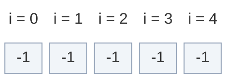

1. `f(4)` starts. `dp[4] = -1`, so compute. Pick first: call `f(2)`.
2. `f(2)` starts. `dp[2] = -1`, so compute. Pick: call `f(0)`.
3. `f(0)` is a base case → return `nums[0] = 2`. So pick for `f(2)` = 9 + 2 = 11.
4. `f(2)` not pick: call `f(1)`. `dp[1] = -1`, so compute.
5. `f(1)` pick: call `f(-1)` → base case, return 0. Pick = 7 + 0 = 7.
6. `f(1)` not pick: call `f(0)` → base case, return 2. Not pick = 2.
7. `f(1) = max(7, 2) = 7`. **Write `dp[1] = 7`.**

**After `f(1)`:**

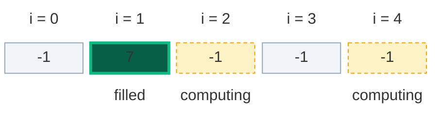

8. Back in `f(2)`: not pick = `f(1)` = 7. `f(2) = max(11, 7) = 11`. **Write `dp[2] = 11`.**

**After `f(2)`:**

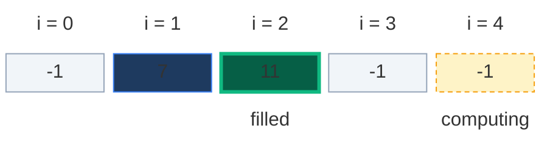

9. Back in `f(4)`: pick = 1 + 11 = 12. Now not pick: call `f(3)`. `dp[3] = -1`, so compute.
10. `f(3)` pick: call `f(1)`. **`dp[1]` already known → return 7, no new calls.** Pick = 3 + 7 = 10.
11. `f(3)` not pick: call `f(2)`. **`dp[2]` already known → return 11, no new calls.**
12. `f(3) = max(10, 11) = 11`. **Write `dp[3] = 11`.**

**After `f(3)`:** both look-ups were cache hits.

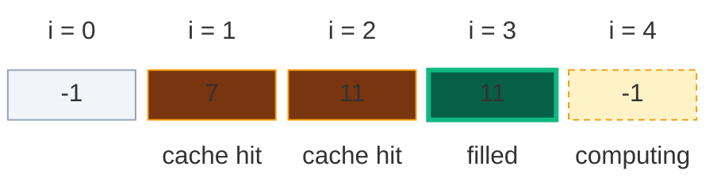

13. Back in `f(4)`: not pick = 11. `f(4) = max(12, 11) = 12`. **Write `dp[4] = 12`.**

**After `f(4)`:**

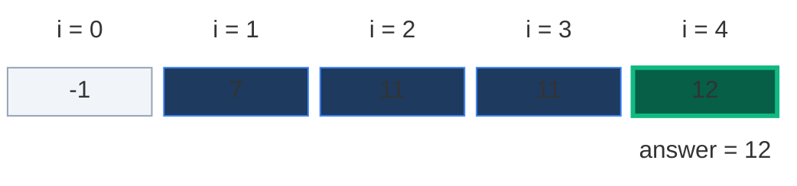

### The pruned recursion tree

Dashed lines lead to cache hits: the answer is read from `dp`, and that branch stops right there. **9 calls instead of 15.**

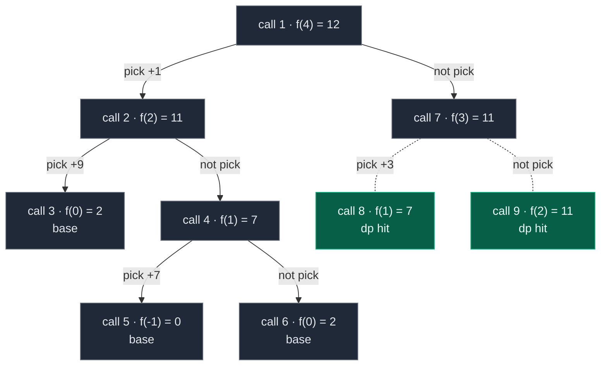

### Code

```python
# Approach 2: memoization (top-down)
class SolutionMemo:

    # f(ind) = best money from houses 0 ... ind, with a dp notebook
    def f(self, ind: int, nums: List[int], dp: List[int]) -> int:

        # Only house 0 is left: rob it
        if ind == 0:
            return nums[0]

        # No houses left
        if ind < 0:
            return 0

        # Step 3: already solved? reuse it
        if dp[ind] != -1:
            return dp[ind]

        # Pick house ind and jump over its neighbour
        pick = nums[ind] + self.f(ind - 2, nums, dp)

        # Do not pick house ind
        not_pick = 0 + self.f(ind - 1, nums, dp)

        # Step 2: store the answer before returning
        dp[ind] = max(pick, not_pick)

        # Return the stored answer
        return dp[ind]

    # Main method
    def rob(self, nums: List[int]) -> int:

        # Number of houses
        n = len(nums)

        # Step 1: -1 means "not solved yet"
        dp = [-1] * n

        # Solve for the whole street
        return self.f(n - 1, nums, dp)
```

**Your version (walks forward, dict as the notebook).** A dict works too: "is `index` a key?" plays the role of "is `dp[index] != -1`?".

```python
# Your memoization: walks forward, dp is a dict
class SolutionForwardMemo:

    # helper(index) = best money from houses index ... n - 1
    def helper(self, index: int, nums: List[int], dp: dict) -> int:

        # Base case: beyond the last house
        if index >= len(nums):
            return 0

        # Return the cached value if present
        if index in dp:
            return dp[index]

        # Rob current house
        rob = nums[index] + self.helper(index + 2, nums, dp)

        # Skip current house
        skip = self.helper(index + 1, nums, dp)

        # Store the result
        dp[index] = max(rob, skip)

        # Return the stored result
        return dp[index]

    # Main method
    def rob(self, nums: List[int]) -> int:

        # Define the dp dict
        dp = {}

        # Call the helper from the first house
        return self.helper(0, nums, dp)
```

### Complexity

| Measure | Complexity | Why |
|:---|:---:|:---|
| **Time** | `O(n)` | Each of the `n` states is solved once. Every later visit is a quick `dp` lookup |
| **dp array space** | `O(n)` | One cell per house |
| **Recursion stack space** | `O(n)` | The chain `f(n-1) → f(n-2) → ... → f(0)` can be `n` calls deep |

Board: `M: TC → O(N), SC → O(N) + O(N)`.

## 6. Approach 3: Tabulation (Bottom-Up)

### Idea

Memoization still uses the recursion stack. Tabulation removes it: fill the `dp` table with a plain loop, from small `i` to big `i`.

### How to convert memo → table, step by step

1. **Same size table:** `dp = [0] * n`. `dp[i]` = best money from houses `0 ... i`.
2. **Write the base case into it:** `dp[0] = nums[0]`. The board also writes `neg = 0`: that is just a name for the value at an index below 0 (`dp[-1] = 0`, "no houses").
3. **Loop the opposite way to the recursion:** the recursion went from `n-1` down to `0`, so the loop goes `i = 1, 2, ..., n-1`.
4. **Copy the recurrence, replacing `f(...)` with `dp[...]`:**
   - `take = nums[i] + dp[i - 2]`
   - `nontake = 0 + dp[i - 1]`
   - `dp[i] = max(take, nontake)`
5. **The answer is the last cell:** `dp[n - 1]`.

**The problem at `i = 1` (red on the board):** `dp[i - 2] = dp[-1]` does not exist. (In Python `dp[-1]` silently reads the **last** cell, which is even worse.) Two fixes:

- **Fix A:** `take = nums[i]`, then `if i > 1: take += dp[i - 2]`. At `i = 1` the "two back" part is just 0.
- **Fix B:** start the loop at `i = 2`. But then `dp[1]` must be filled separately: `dp[1] = max(nums[0], nums[1])`. This is exactly what your bottom-up code does.

The board writes `take = a[ind]` inside the loop. In tabulation the loop variable is `i`, so it must be `a[i]`. (`ind` is left over from the recursive version.)

### Visual table fill for `[2, 7, 9, 3, 1]`

**Start: base case**

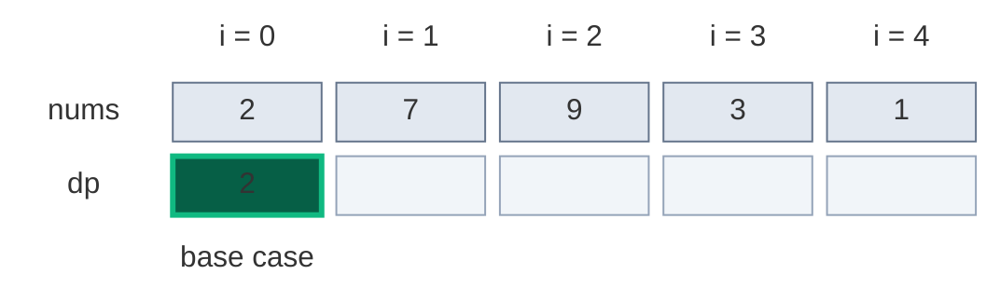

`dp[0] = nums[0] = 2`.

**i = 1**

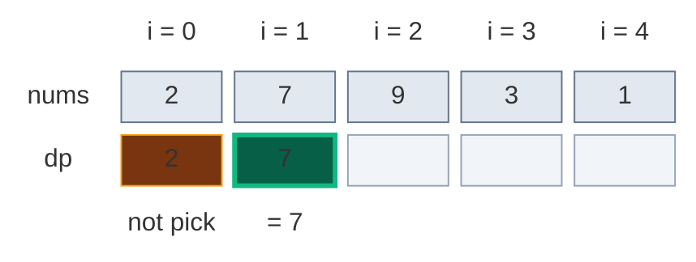

- `take = nums[1] + (nothing two back) = 7 + 0 = 7`
- `nontake = dp[0] = 2`
- `dp[1] = max(7, 2) = 7`

**i = 2**

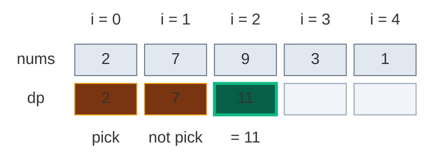

- `take = nums[2] + dp[0] = 9 + 2 = 11`
- `nontake = dp[1] = 7`
- `dp[2] = max(11, 7) = 11`

**i = 3**

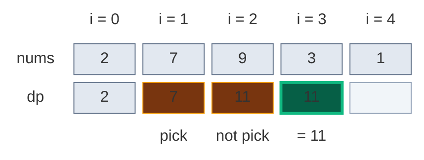

- `take = nums[3] + dp[1] = 3 + 7 = 10`
- `nontake = dp[2] = 11`
- `dp[3] = max(10, 11) = 11`

**i = 4**

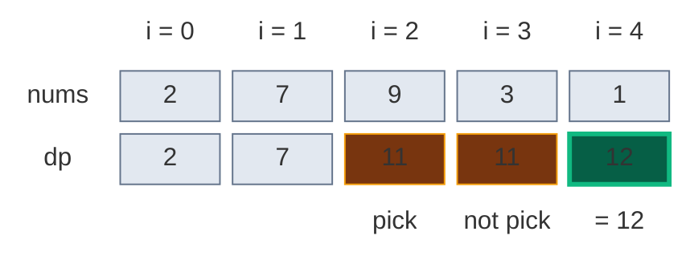

- `take = nums[4] + dp[2] = 1 + 11 = 12`
- `nontake = dp[3] = 11`
- `dp[4] = max(12, 11) = 12` ← answer

Final table: `dp = [2, 7, 11, 11, 12]`, so `dp[i] = max(a[i] + dp[i-2], dp[i-1])` and the answer is `dp[4] = 12`.

### Code

```python
# Approach 3: tabulation (bottom-up), board version with Fix A
class SolutionTab:

    # Main method
    def rob(self, nums: List[int]) -> int:

        # Number of houses
        n = len(nums)

        # dp[i] = best money from houses 0 ... i
        dp = [0] * n

        # Base case: only house 0
        dp[0] = nums[0]

        # Fill the table from small i to big i
        for i in range(1, n):

            # Pick house i: its money first
            take = nums[i]

            # dp[i - 2] exists only from i = 2 on (for i = 1 it is "no houses" = 0)
            if i > 1:

                # Add the best of houses 0 ... i-2
                take = take + dp[i - 2]

            # Do not pick house i: best of houses 0 ... i-1
            non_take = 0 + dp[i - 1]

            # Keep the better choice
            dp[i] = max(take, non_take)

        # The last cell is the answer for the whole street
        return dp[n - 1]
```

**Your version (Fix B: two base cases, loop from 2).**

```python
# Your bottom-up DP: dp[1] filled as a second base case
class SolutionBottomUpFrom2:

    # Main method
    def rob(self, nums: List[int]) -> int:

        # Compute the length of nums
        n = len(nums)

        # Edge case: no houses (cannot happen, n >= 1, but harmless)
        if n == 0:
            return 0

        # Edge case: one house
        if n == 1:
            return nums[0]

        # dp[i] = max money till house i
        dp = [0] * n

        # Base case 1: only house 0
        dp[0] = nums[0]

        # Base case 2: houses 0 and 1 are neighbours, take the bigger
        dp[1] = max(nums[0], nums[1])

        # Fill the rest of the table
        for i in range(2, n):

            # Skip current (dp[i-1]) or rob current (nums[i] + dp[i-2])
            dp[i] = max(dp[i - 1], nums[i] + dp[i - 2])

        # Return the required answer
        return dp[n - 1]
```

### Complexity

| Measure | Complexity | Why |
|:---|:---:|:---|
| **Time** | `O(n)` | One loop over the houses |
| **Space** | `O(n)` | The `dp` table. No recursion stack any more |

Board: `TC → O(N), SC → O(N)`.

## 7. Approach 4: Space Optimization (Optimal)

### Idea

Look at the table fill again. To fill `dp[i]` we only ever read **`dp[i-1]`** and **`dp[i-2]`**. Everything further back is never read again.

```mermaid
block-beta
  columns 5
  r0c0[" "] r0c1["i - 3"] r0c2["i - 2"] r0c3["i - 1"] r0c4["i"]
  r1c0["..."] r1c1["..."] r1c2["prev2"] r1c3["prev"] r1c4["curi"]
  r2c0["not needed"] r2c1["not needed"] r2c2["read"] r2c3["read"] r2c4["new"]
  classDef head fill:none,stroke:none,color:#64748b
  class r0c0,r0c1,r0c2,r0c3,r0c4 head
  classDef old fill:#e2e8f0,stroke:#64748b,color:#0f172a
  class r1c0,r1c1 old
  classDef read fill:#78350f,stroke:#f59e0b,color:#fef3c7
  class r1c2,r1c3 read
  classDef new fill:#065f46,stroke:#10b981,color:#ecfdf5,stroke-width:3px
  class r1c4 new
  classDef note fill:none,stroke:none,color:#b45309
  class r2c0,r2c1,r2c2,r2c3,r2c4 note
```

So the board renames them:

- `prev` = `dp[i-1]`. It starts as `dp[0] = nums[0]`.
- `prev2` = `dp[i-2]`. It starts as the "neg" value `0` (no houses).
- After each step: `prev2 = prev`, then `prev = curi`. The two values slide one step to the right.

Because `prev2` starts at `0`, the `if i > 1:` check is no longer needed: at `i = 1`, `take = nums[1] + 0` is exactly right.

### Visual Walkthrough (Story Version)

**The story:** Robin the robber walks down a street of 5 houses: ₹2, ₹7, ₹9, ₹3, ₹1. Robin does not carry a big notebook. Robin has only **two pockets**, each holding one note:

- **Right pocket (`prev`):** "the most I could have stolen up to the house I just passed".
- **Left pocket (`prev2`):** "the most I could have stolen up to two houses back".

At each new house Robin asks: "If I rob this house, I must have skipped the last one, so I add this money to my **left** pocket. If I skip it, I just keep my **right** pocket. Which is more?" Then Robin moves both notes one step forward.

**Start: Robin stands at house 0**

Only house 0 so far, so the best is to rob it. Before house 0 there is nothing.

```mermaid
block-beta
  columns 5
  h0["house 0"] h1["house 1"] h2["house 2"] h3["house 3"] h4["house 4"]
  c0["₹2"] c1["₹7"] c2["₹9"] c3["₹3"] c4["₹1"]
  m0["Robin · right 2"] space space space space
  classDef head fill:none,stroke:none,color:#64748b
  class h0,h1,h2,h3,h4 head
  classDef new fill:#065f46,stroke:#10b981,color:#ecfdf5,stroke-width:3px
  class c0 new
  classDef done fill:#1e3a5f,stroke:#3b82f6,color:#dbeafe
  class c1,c2,c3,c4 done
  classDef note fill:none,stroke:none,color:#b45309
  class m0 note
```

Left pocket `prev2 = 0` (nothing before house 0). Right pocket `prev = 2`.

**Step 1: house 1 (₹7)**

- Rob it: 7 + left pocket 0 = **7**.
- Skip it: right pocket = **2**.
- Best = 7. Slide: left gets the old right (2), right gets 7.

```mermaid
block-beta
  columns 5
  h0["house 0"] h1["house 1"] h2["house 2"] h3["house 3"] h4["house 4"]
  c0["₹2"] c1["₹7"] c2["₹9"] c3["₹3"] c4["₹1"]
  m0["left 2"] m1["Robin · right 7"] space space space
  classDef head fill:none,stroke:none,color:#64748b
  class h0,h1,h2,h3,h4 head
  classDef read fill:#78350f,stroke:#f59e0b,color:#fef3c7
  class c0 read
  classDef new fill:#065f46,stroke:#10b981,color:#ecfdf5,stroke-width:3px
  class c1 new
  classDef done fill:#1e3a5f,stroke:#3b82f6,color:#dbeafe
  class c2,c3,c4 done
  classDef note fill:none,stroke:none,color:#b45309
  class m0,m1 note
```

`rob = 7 + 0 = 7`, `skip = 2`, best = 7. Pockets now: left `2`, right `7`.

**Step 2: house 2 (₹9)**

- Rob it: 9 + left pocket 2 = **11**.
- Skip it: right pocket = **7**.
- Best = 11. Slide: left = 7, right = 11.

```mermaid
block-beta
  columns 5
  h0["house 0"] h1["house 1"] h2["house 2"] h3["house 3"] h4["house 4"]
  c0["₹2"] c1["₹7"] c2["₹9"] c3["₹3"] c4["₹1"]
  space m1["left 7"] m2["Robin · right 11"] space space
  classDef head fill:none,stroke:none,color:#64748b
  class h0,h1,h2,h3,h4 head
  classDef old fill:#e2e8f0,stroke:#64748b,color:#0f172a
  class c0 old
  classDef read fill:#78350f,stroke:#f59e0b,color:#fef3c7
  class c1 read
  classDef new fill:#065f46,stroke:#10b981,color:#ecfdf5,stroke-width:3px
  class c2 new
  classDef done fill:#1e3a5f,stroke:#3b82f6,color:#dbeafe
  class c3,c4 done
  classDef note fill:none,stroke:none,color:#b45309
  class m1,m2 note
```

`rob = 9 + 2 = 11`, `skip = 7`, best = 11. Pockets now: left `7`, right `11`.

**Step 3: house 3 (₹3)**

- Rob it: 3 + left pocket 7 = **10**.
- Skip it: right pocket = **11**.
- Best = 11 (skipping wins). Slide: left = 11, right = 11.

```mermaid
block-beta
  columns 5
  h0["house 0"] h1["house 1"] h2["house 2"] h3["house 3"] h4["house 4"]
  c0["₹2"] c1["₹7"] c2["₹9"] c3["₹3"] c4["₹1"]
  space space m2["left 11"] m3["Robin · right 11"] space
  classDef head fill:none,stroke:none,color:#64748b
  class h0,h1,h2,h3,h4 head
  classDef old fill:#e2e8f0,stroke:#64748b,color:#0f172a
  class c0,c1 old
  classDef read fill:#78350f,stroke:#f59e0b,color:#fef3c7
  class c2 read
  classDef new fill:#065f46,stroke:#10b981,color:#ecfdf5,stroke-width:3px
  class c3 new
  classDef done fill:#1e3a5f,stroke:#3b82f6,color:#dbeafe
  class c4 done
  classDef note fill:none,stroke:none,color:#b45309
  class m2,m3 note
```

`rob = 3 + 7 = 10`, `skip = 11`, best = 11. Pockets now: left `11`, right `11`.

**Step 4: house 4 (₹1)**

- Rob it: 1 + left pocket 11 = **12**.
- Skip it: right pocket = **11**.
- Best = 12 (robbing wins). Slide: left = 11, right = 12.

```mermaid
block-beta
  columns 5
  h0["house 0"] h1["house 1"] h2["house 2"] h3["house 3"] h4["house 4"]
  c0["₹2"] c1["₹7"] c2["₹9"] c3["₹3"] c4["₹1"]
  space space space m3["left 11"] m4["Robin · right 12"]
  classDef head fill:none,stroke:none,color:#64748b
  class h0,h1,h2,h3,h4 head
  classDef old fill:#e2e8f0,stroke:#64748b,color:#0f172a
  class c0,c1,c2 old
  classDef read fill:#78350f,stroke:#f59e0b,color:#fef3c7
  class c3 read
  classDef new fill:#065f46,stroke:#10b981,color:#ecfdf5,stroke-width:3px
  class c4 new
  classDef note fill:none,stroke:none,color:#b45309
  class m3,m4 note
```

`rob = 1 + 11 = 12`, `skip = 11`, best = 12. Robin goes home with **12**.

**All steps at a glance**

| Step | House | Rob = money + left | Skip = right | Best | Left after | Right after |
|:---:|:---:|:---:|:---:|:---:|:---:|:---:|
| start | h0 (₹2) | - | - | 2 | 0 | 2 |
| 1 | h1 (₹7) | 7 + 0 = 7 | 2 | 7 | 2 | 7 |
| 2 | h2 (₹9) | 9 + 2 = 11 | 7 | 11 | 7 | 11 |
| 3 | h3 (₹3) | 3 + 7 = 10 | 11 | 11 | 11 | 11 |
| 4 | h4 (₹1) | 1 + 11 = 12 | 11 | 12 | 11 | 12 |

**What the story teaches**

| In the story | In the code |
|:---|:---|
| Robin at house `i` | Loop index `i` |
| Right pocket | `prev` (= `dp[i-1]`) |
| Left pocket | `prev2` (= `dp[i-2]`) |
| "Rob it" | `take = nums[i] + prev2` |
| "Skip it" | `non_take = prev` |
| Best at this house | `curi = max(take, non_take)` |
| Slide the notes forward | `prev2 = prev`, then `prev = curi` |
| Money taken home | `return prev` |

### Step-by-Step Example

`nums = [2, 7, 9, 3, 1]`, `prev = nums[0] = 2`, `prev2 = 0`.

| i | `take = nums[i] + prev2` | `non_take = prev` | `curi` | `prev2` becomes | `prev` becomes |
|:---:|:---:|:---:|:---:|:---:|:---:|
| start | - | - | - | 0 | 2 |
| 1 | 7 + 0 = 7 | 2 | 7 | 2 | 7 |
| 2 | 9 + 2 = 11 | 7 | 11 | 7 | 11 |
| 3 | 3 + 7 = 10 | 11 | 11 | 11 | 11 |
| 4 | 1 + 11 = 12 | 11 | 12 | 11 | 12 |

Return `prev = 12`.

**The sliding window of two values**

```mermaid
block-beta
  columns 7
  hx[" "] h0["neg"] h1["i = 0"] h2["i = 1"] h3["i = 2"] h4["i = 3"] h5["i = 4"]
  l0["start"] r0c0["0"] r0c1["2"] r0c2[" "] r0c3[" "] r0c4[" "] r0c5[" "]
  l1["i = 1"] r1c0["0"] r1c1["2"] r1c2["7"] r1c3[" "] r1c4[" "] r1c5[" "]
  l2["i = 2"] r2c0["0"] r2c1["2"] r2c2["7"] r2c3["11"] r2c4[" "] r2c5[" "]
  l3["i = 3"] r3c0["0"] r3c1["2"] r3c2["7"] r3c3["11"] r3c4["11"] r3c5[" "]
  l4["i = 4"] r4c0["0"] r4c1["2"] r4c2["7"] r4c3["11"] r4c4["11"] r4c5["12"]
  classDef head fill:none,stroke:none,color:#64748b
  class hx,h0,h1,h2,h3,h4,h5,l0,l1,l2,l3,l4 head
  classDef done fill:#1e3a5f,stroke:#3b82f6,color:#dbeafe
  class r0c0,r0c1 done
  classDef empty fill:#f1f5f9,stroke:#94a3b8,color:#64748b
  class r0c2,r0c3,r0c4,r0c5,r1c3,r1c4,r1c5,r2c4,r2c5,r3c5 empty
  classDef read fill:#78350f,stroke:#f59e0b,color:#fef3c7
  class r1c0,r1c1,r2c1,r2c2,r3c2,r3c3,r4c3,r4c4 read
  classDef new fill:#065f46,stroke:#10b981,color:#ecfdf5,stroke-width:3px
  class r1c2,r2c3,r3c4,r4c5 new
  classDef old fill:#e2e8f0,stroke:#64748b,color:#0f172a
  class r2c0,r3c0,r3c1,r4c0,r4c1,r4c2 old
```

Gold = `prev2` and `prev` (read). Green = `curi` (new). Grey = never needed again.

- `i = 1`: `curi = max(7 + 0, 2) = 7`
- `i = 2`: `curi = max(9 + 2, 7) = 11`
- `i = 3`: `curi = max(3 + 7, 11) = 11`
- `i = 4`: `curi = max(1 + 11, 11) = 12`

The window of two pockets slides one step right each time. Old values fall off the left and are never needed again.

The board's version is the same idea: `prev = nums[0]`, `prev2 = 0`, loop `i = 1 ... n-1`, slide `prev2 = prev` then `prev = curi`, and `return prev`. Because `prev2` starts at 0, its `if i > 1:` guard is not needed.

**Your version** starts one step later, like your bottom-up: `prev2 = nums[0]`, `prev1 = max(nums[0], nums[1])`, loop from `i = 2`. It needs the `n == 1` check because it reads `nums[1]`.

```python
# Your space-optimised version: two base values, loop from 2
class SolutionSpaceFrom2:

    # Main method
    def rob(self, nums: List[int]) -> int:

        # Compute the length of nums
        n = len(nums)

        # Edge case: no houses
        if n == 0:
            return 0

        # Edge case: one house
        if n == 1:
            return nums[0]

        # prev2 -> dp[i-2], starts as dp[0]
        prev2 = nums[0]

        # prev1 -> dp[i-1], starts as dp[1]
        prev1 = max(nums[0], nums[1])

        # Iterate through the remaining houses
        for i in range(2, n):

            # Current best: skip current (prev1) or rob current (nums[i] + prev2)
            curr = max(prev1, nums[i] + prev2)

            # Shift states: old prev1 becomes prev2
            prev2 = prev1

            # The new best becomes prev1
            prev1 = curr

        # Finally return prev1
        return prev1
```

### Code

```python
# Import List for type hints
from typing import List

# Import random for the agreement test
import random


# Approach 4: space optimized (optimal)
class Solution:

    # Main method
    def rob(self, nums: List[int]) -> int:

        # Number of houses
        n = len(nums)

        # prev = dp[i - 1], starts as dp[0]
        prev = nums[0]

        # prev2 = dp[i - 2], starts as "dp[-1]" = 0 (no houses)
        prev2 = 0

        # Visit houses 1 ... n-1
        for i in range(1, n):

            # Pick: house i + best up to i - 2
            take = nums[i] + prev2

            # Not pick: best up to i - 1
            non_take = prev

            # Best up to house i
            curi = max(take, non_take)

            # Slide the window: old prev becomes prev2
            prev2 = prev

            # The new best becomes prev
            prev = curi

        # Best for the whole street
        return prev


# Trace the example step by step with the same variables
nums = [2, 7, 9, 3, 1]

# Start values
prev, prev2 = nums[0], 0

# Expected (take, non_take, curi, prev2 after, prev after) for i = 1 ... 4
expected_steps = [(7, 2, 7, 2, 7), (11, 7, 11, 7, 11), (10, 11, 11, 11, 11), (12, 11, 12, 11, 12)]

# Replay every loop step and check each value
for i in range(1, 5):

    # Pick value
    take = nums[i] + prev2

    # Not pick value
    non_take = prev

    # Best so far
    curi = max(take, non_take)

    # Slide the window
    prev2, prev = prev, curi

    # Compare with the table in this note
    assert (take, non_take, curi, prev2, prev) == expected_steps[i - 1]

# The tabulation table from section 6
dp_check = [0] * 5

# Fill it the same way as SolutionTab
dp_check[0] = nums[0]

# Fill cells 1 ... 4
for i in range(1, 5):

    # Same recurrence with the i > 1 guard
    dp_check[i] = max(nums[i] + (dp_check[i - 2] if i > 1 else 0), dp_check[i - 1])

# The table must match the picture
assert dp_check == [2, 7, 11, 11, 12]

# The memo notebook after the top-down run (dp[0] stays -1: base case)
memo_dp = [-1] * 5

# Run the memo helper directly to look at the notebook
SolutionMemo().f(4, nums, memo_dp)

# It must match the boxes in section 5
assert memo_dp == [-1, 7, 11, 11, 12]

# The main example
assert Solution().rob([2, 7, 9, 3, 1]) == 12

# LeetCode example 1
assert Solution().rob([1, 2, 3, 1]) == 4

# Board example
assert Solution().rob([2, 1, 4, 9]) == 11

# One house
assert Solution().rob([5]) == 5

# Two houses
assert Solution().rob([2, 1]) == 2

# All zeros
assert Solution().rob([0, 0, 0]) == 0

# Even/odd greedy fails here
assert Solution().rob([2, 1, 1, 2]) == 4

# Biggest-first greedy fails here
assert Solution().rob([2, 3, 2]) == 4

# Every version in this note
versions = [SolutionRecursion, SolutionForwardRecursion, SolutionMemo, SolutionForwardMemo, SolutionTab, SolutionBottomUpFrom2, SolutionSpaceFrom2, Solution]

# Check that all versions agree on many random small streets
for _ in range(300):

    # Random street with 1 to 12 houses (small so recursion stays fast)
    street = [random.randint(0, 400) for _ in range(random.randint(1, 12))]

    # Answers from every version
    answers = {cls().rob(street) for cls in versions}

    # All of them must give the same answer
    assert len(answers) == 1, street

# All checks passed
print("All tests passed")
```

### Complexity

| Approach | Time | Space | Recursion stack |
|:---|:---:|:---:|:---:|
| Recursion | `O(2^n)` | `O(1)` extra | `O(n)` |
| Memoization | `O(n)` | `O(n)` dp | `O(n)` |
| Tabulation | `O(n)` | `O(n)` dp | none |
| **Space optimized** | **`O(n)`** | **`O(1)`** | none |

The comparison table from your notes ("Interview Gold"):

| Approach | Time | Space |
|:---|:---:|:---:|
| Recursive | `O(2^n)` | `O(n)` (stack) |
| Memoization | `O(n)` | `O(n) + O(n)` |
| Bottom-Up DP | `O(n)` | `O(n)` |
| Space Optimised (`prev / prev2`) | `O(n)` | `O(1)` |

## 8. Common Mistakes

| Mistake | What goes wrong | Fix |
|:---|:---|:---|
| Greedy "all even vs all odd" houses | `[2, 1, 1, 2]` gives 3, but the answer is 4. You may skip two houses in a row | Try both choices at every house (DP) |
| Greedy "take the biggest first" | `[2, 3, 2]` gives 3, but the answer is 4 | Same: DP, not greedy |
| Not pick calls `f(i)` instead of `f(i - 1)` (as written on the board) | The function calls itself with the same input forever | Not pick moves to `i - 1` |
| Reading `dp[i - 2]` at `i = 1` | Out of range in C++/Java. In Python `dp[-1]` silently reads the last cell | Guard with `if i > 1`, or start the loop at 2 after filling `dp[1]` |
| Forgetting `n = 1` | Code that reads `nums[1]` or sets `dp[1]` crashes | Return `nums[0]` early, or use the `prev = nums[0], prev2 = 0` version that needs no check |
| Writing `a[ind]` inside the tabulation loop (as on the board) | `ind` does not exist there | Use the loop variable: `a[i]` |
| Adding instead of taking `max` | You get a count, not the best sum | It is a "best" problem: `max(pick, not_pick)` |
| `dp` filled with `0` in memoization | Cannot tell "solved, answer 0" from "not solved" (all-zero streets get re-solved) | Fill with `-1`, since real answers are never negative |
| Sliding in the wrong order (`prev = curi` before `prev2 = prev`) | `prev2` gets the new value, the old one is lost | Always `prev2 = prev` first, then `prev = curi` |
| One-line `if ...: return` or `def rob(...): return ...` | Harder to read, breaks the "one statement per line with a comment" rule | Put the `return` on its own line |

## 9. Interview Follow-ups

### Q1. Why is this DP and not greedy?

**Answer:**
- Local choices do not decide the global best.
- `[2, 1, 1, 2]` breaks "even vs odd" (3 instead of 4).
- `[2, 3, 2]` breaks "take the largest first" (3 instead of 4).
- So we try both choices at every house, and DP makes that fast.

### Q2. What is the state and the transition?

**Answer:**
- `dp[i]` = most money from houses `0 ... i`.
- `dp[i] = max(nums[i] + dp[i-2], dp[i-1])`.
- Base: `dp[0] = nums[0]`, anything below index 0 is 0.

### Q3. Why can `dp[0] = nums[0]` without a `max`?

**Answer:**
- Money is never negative.
- So robbing the only house is always at least as good as skipping it.

### Q4. Which houses did we rob? (rebuild the answer)

**Answer:**
- Build the same `dp` table.
- Walk it backwards. If `dp[i]` is different from `dp[i-1]`, house `i` was picked: record it and jump to `i - 2`. Otherwise house `i` was skipped: go to `i - 1`.

```python
# Return the best sum and the list of robbed houses
def houses_robbed(nums: List[int]):

    # Number of houses
    n = len(nums)

    # Same dp table as tabulation
    dp = [0] * n

    # Base case
    dp[0] = nums[0]

    # Fill the table
    for i in range(1, n):

        # Pick house i
        take = nums[i]

        # Add the best two houses back, if it exists
        if i > 1:

            # dp[i - 2] exists from i = 2 on
            take = take + dp[i - 2]

        # Keep the better of pick and not pick
        dp[i] = max(take, dp[i - 1])

    # Houses we picked
    chosen = []

    # Start from the last house
    i = n - 1

    # Walk backwards to see which choice made each dp value
    while i >= 0:

        # Value if we skip house i
        skip_value = dp[i - 1] if i >= 1 else 0

        # dp changed here, so house i was picked
        if dp[i] != skip_value:

            # Record house i
            chosen.append(i)

            # Jump over its neighbour
            i = i - 2

        # dp did not change, so house i was skipped
        else:

            # Move to the previous house
            i = i - 1

    # We collected houses from right to left, so flip the list
    chosen.reverse()

    # Best sum and the robbed houses
    return dp[n - 1], chosen


# Main example: houses 0, 2, 4
assert houses_robbed([2, 7, 9, 3, 1]) == (12, [0, 2, 4])

# Board example: houses 0, 3
assert houses_robbed([2, 1, 4, 9]) == (11, [0, 3])

# Skip two in a row: houses 0, 3
assert houses_robbed([2, 1, 1, 2]) == (4, [0, 3])
```

### Q5. What if the street is a circle (first and last are neighbours)?

**Answer:**
- That is [06. 213. House Robber II](./06.%20213.%20House%20Robber%20II.md).
- Run this solution twice: on `nums[0 ... n-2]` and on `nums[1 ... n-1]`, and take the max.

### Q6. What if values can be negative?

**Answer:**
- Then robbing is not always good, so you are never forced to rob.
- Base case changes: `f(0) = max(a[0], 0)`. Also take `max` with 0 where a branch could go negative.

### Q7. What should I practice next?

**Answer:**
- **213. House Robber II:** circular street.
- **740. Delete and Earn:** turns into House Robber after counting values.
- **337. House Robber III:** houses on a tree.
- **2560. House Robber IV:** binary search + greedy.

## 10. Memory Hook

> Rob this house and jump two back, or skip it and look one back. Keep the better: `max(a[i] + f(i-2), f(i-1))`.

The board's summary line: **Subsequence → pick / not pick → memoization → tabulation (`i-1`, `i-2`) → space optimization.**

One line: **House Robber = Fibonacci shape with `max` instead of `+`, and the house's money added on the "pick" branch.**

## 11. Interview Explanation

> I need the maximum-sum subsequence with no two adjacent elements, and greedy fails (for example `[2, 1, 1, 2]`), so I try both choices at every house. Let `f(i)` be the best money from houses `0 ... i`. If I pick house `i` I get `nums[i] + f(i-2)`; if I skip it I get `f(i-1)`; I return the max. Base cases are `f(0) = nums[0]` and `f(negative) = 0`. Plain recursion is `O(2^n)` because `f(i-1)` and `f(i-2)` overlap, so I memoize for `O(n)` time and `O(n) + O(n)` space. Then I tabulate with `dp[0] = nums[0]` and a loop from 1, where `take = nums[i] + dp[i-2]` only if `i > 1`. Since each cell only needs the previous two, I keep just `prev` and `prev2`, which gives `O(n)` time and `O(1)` space.

Say it out loud, in 5 lines:

1. "I need the max-sum subsequence with no two adjacent elements, so I try all valid subsequences with pick / not pick."
2. "`f(i)` = best from houses `0 ... i`. Pick: `a[i] + f(i-2)`. Not pick: `f(i-1)`. Return the max. Base: `f(0) = a[0]`, `f(negative) = 0`."
3. "The recursion is `O(2^n)` because `f(i-1)` and `f(i-2)` overlap; memoizing gives `O(n)` time, `O(n) + O(n)` space."
4. "Tabulation: `dp[0] = a[0]`, loop `i = 1 ... n-1`, `take = a[i] + dp[i-2]` (if `i > 1`), `non-take = dp[i-1]`."
5. "Only two previous values are used, so `prev` and `prev2` make it `O(1)` space."
