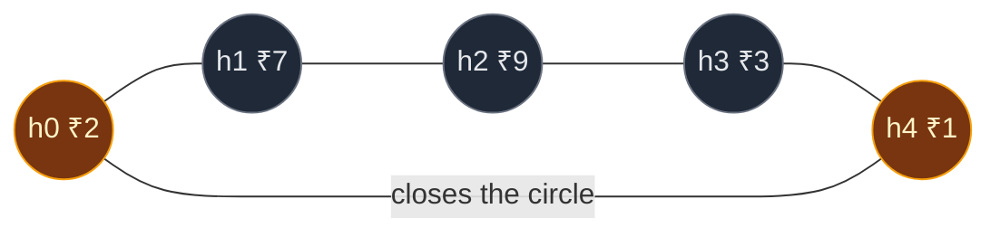
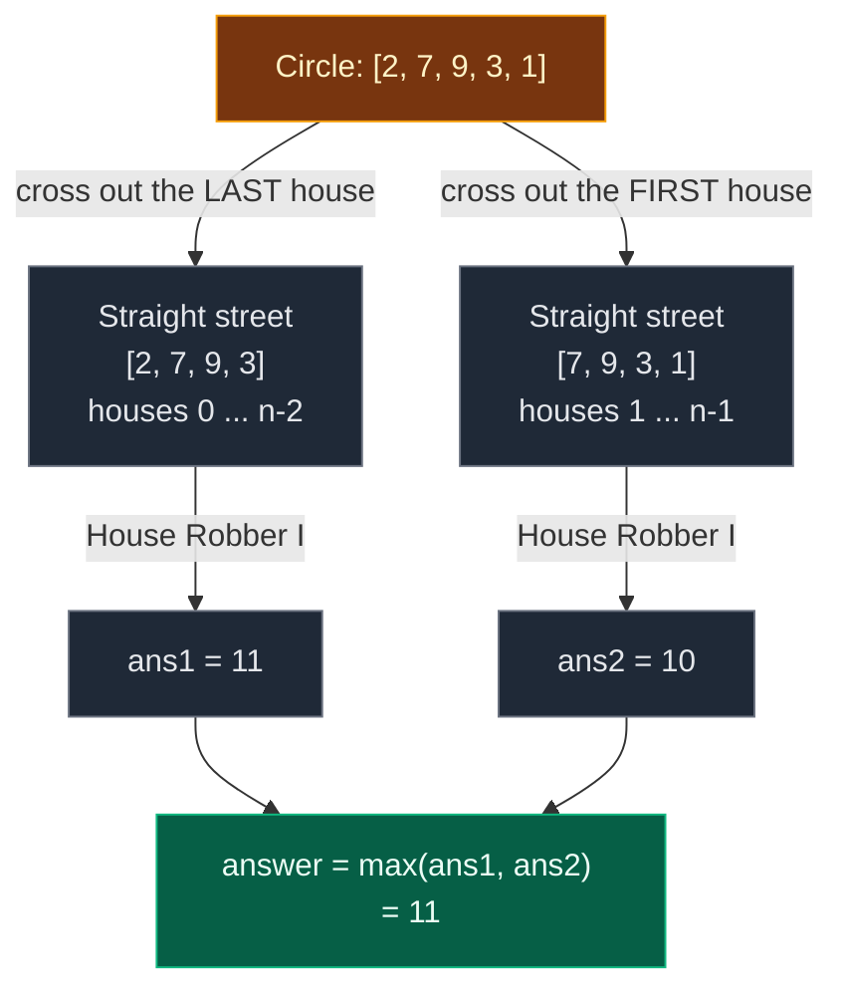
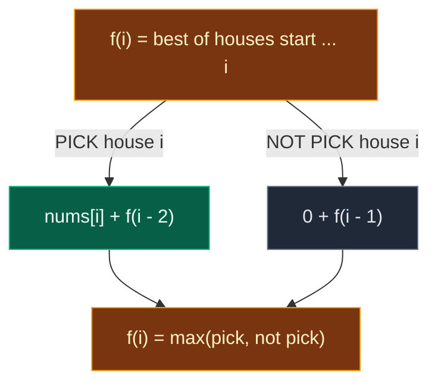
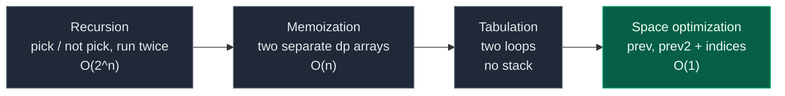
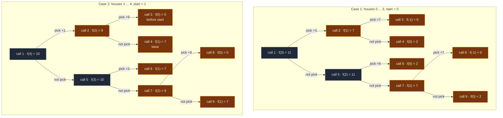
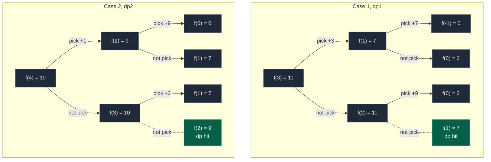

# 06. 213. House Robber II

| Difficulty | Pattern | Source | Time | Space |
|:---:|:---:|:---:|:---:|:---:|
| **Medium** | 1-D DP: Circular Array = Two Linear Runs | [213. House Robber II](https://leetcode.com/problems/house-robber-ii/) | `O(n)` | `O(1)` |

## 1. Problem Statement

Same robber, same rule as [05. 198. House Robber](./05.%20198.%20House%20Robber.md): two neighbours share an alarm, so you can never rob two houses next to each other.

The new twist: **all houses stand in a circle.** The first house is a neighbour of the last house.

You get an integer array `nums`. `nums[i]` is the money in house `i`.

Return the **most money** you can rob tonight without robbing two neighbours.

### Example

```text
nums = [2, 7, 9, 3, 1]     (the houses form a circle)

In a straight street (House Robber I) the best is 2 + 9 + 1 = 12.
But in a circle, h0 (₹2) and h4 (₹1) are neighbours. They cannot both be robbed.

Best in the circle: rob h0 and h2 -> 2 + 9 = 11

Output: 11
```

We use this same example in every section below.

LeetCode examples:

```text
Example 1: nums = [2, 3, 2]     -> 3   (you cannot rob h0 and h2: they are neighbours)
Example 2: nums = [1, 2, 3, 1]  -> 4   (rob h0 = 1 and h2 = 3)
Example 3: nums = [1, 2, 3]     -> 3
```

LeetCode counts houses from 1 in its explanation. In code they are indices `0 ... n-1`.

### Constraints

- `1 <= nums.length <= 100`
- `0 <= nums[i] <= 1000`

## 2. Core Theory

### The circle picture



The gold houses are the first and the last. In a straight street they are far apart. In a circle the last edge joins them, so they are neighbours.

### Why the first and last house conflict

Look at LeetCode example 1, `[2, 3, 2]`:

```text
straight street (House Robber I):      circle (House Robber II):

 ₹2    ₹3    ₹2                              ₹2 (h0)
[h0]  [h1]  [h2]                            /       \
 ROB         ROB                      (h2) ₹2 ----- ₹3 (h1)

 2 + 2 = 4  OK                        h0 and h2 are neighbours!
                                      2 + 2 is NOT allowed.
                                      Best: rob only ₹3  ->  3
```

In House Robber I, `[2, 3, 2]` gives 4 (rob both 2s). The circle makes `h0` and `h2` neighbours, so the answer drops to 3.

### New logic? No! (from the board)

The board puts the two lectures side by side:

| | L5 · House Robber I | L6 · House Robber II |
|:---|:---|:---|
| Rule 1 | no two adjacent houses | no two adjacent houses |
| Rule 2 | - | **not first AND last together** |

The board asks: "Do you need new logic?" Answer: **no**. No new DP is needed. The only new rule is "first and last can't both be robbed", and we handle it from the outside by running L5 twice.

### The two-runs trick

The board draws two boxes:

- **Box 1:** the array with the **last** house crossed out (✘ last) → run L5 → `ans1`.
- **Box 2:** the array with the **first** house crossed out (✘ first) → run L5 → `ans2`.
- **Final:** `max(ans1, ans2)`.



As a formula:

```text
ans = max( HR1(nums[0 ... n-2]) , HR1(nums[1 ... n-1]) )
           case 1: no last house   case 2: no first house

n = 1  ->  nums[0]   (special case)
```

### Why two cases are enough (proof in 3 lines)

1. In any valid robbery, house `0` and house `n-1` are **not both** robbed.
2. So either house `n-1` is not robbed → the plan is a valid plan for the straight street `0 ... n-2` (case 1). Or house `0` is not robbed → it is a valid plan for `1 ... n-1` (case 2). Plans that rob neither end are in both cases.
3. The other way round: every plan for either straight street is valid in the circle, because it never contains both ends. So the best circular plan = `max(case 1, case 2)`.

Each straight street is a normal House Robber I. Inside it the old rule still applies, and its own first and last houses are **not** neighbours any more, because we removed the house that closed the circle.

### How to spot that it is DP

- It is House Robber I inside, so it has the same two DP signs:
- **Optimal substructure:** the best plan for houses `start ... i` is built from the best plans for `start ... i-1` or `start ... i-2`.
- **Overlapping subproblems:** the same "best up to house `k`" is asked again and again in the recursion.
- The only new part (the circle) is not DP at all. It is a split into two cases.

### The state

**`f(i)` = the most money from houses `start ... i` of one straight street.**

- Case 1: `start = 0`, we ask for `f(n - 2)`.
- Case 2: `start = 1`, we ask for `f(n - 1)`.

This is exactly `f(i)` from House Robber I, with an extra `start` so we never copy the list.

### The recurrence (pick / not pick)

Same as House Robber I. At house `i`:



```text
f(i) = max( nums[i] + f(i - 2) ,  f(i - 1) )
```

### Base cases

| Base case | Value | Why |
|:---|:---:|:---|
| `f(start)` | `nums[start]` | Only the first house of this street is left. Money is never negative, so rob it |
| `f(i)` for `i < start` | `0` | No houses left in this street |
| Whole problem with `n = 1` | `nums[0]` | Both streets would be empty and give 0. But one house has no neighbour, so rob it |

### The 4-step ladder



## 3. Edge Cases

| Case | Input | Expected | Why it matters |
|:---|:---|:---:|:---|
| One house | `[5]` | `5` | Both streets (`0 ... -1` and `1 ... 0`) are empty and would return 0. That is why `n = 1` is a special case |
| Two houses | `[4, 9]` | `9` | They are neighbours both ways, so take the bigger |
| Three houses | `[1, 2, 3]` | `3` | In a triangle every pair is adjacent, so just the biggest house |
| First and last are the best | `[2, 3, 2]` | `3` | House Robber I would say 4. The circle forbids it |
| The circle changes the answer | `[2, 7, 9, 3, 1]` | `11` | Straight street gives 12. The circle forbids `2 + 1` together |
| Big ends | `[200, 3, 140, 20, 10]` | `340` | Rob `200 + 140`. The last house (10) is dropped |
| All zeros | `[0, 0, 0]` | `0` | Nothing to steal |

## 4. Approach 1: Recursion

### Idea

Write House Robber I's `f(i)` with one extra input, `start`, so it works on any straight part of the array. Call it twice:

- case 1: `f(n - 2)` with `start = 0` (last house left out).
- case 2: `f(n - 1)` with `start = 1` (first house left out).

### Recursion tree for `[2, 7, 9, 3, 1]`

Case 1 works on `[2, 7, 9, 3]` (houses 0 ... 3). Case 2 works on `[7, 9, 3, 1]` (houses 1 ... 4). Gold boxes are subproblems solved more than once inside the same case.



How often each subproblem is solved:

| Case | Subproblem | Times solved |
|:---|:---|:---:|
| Case 1 | `f(1)` | **2** |
| Case 1 | `f(0)` | **3** |
| Case 1 | `f(-1)` | **2** |
| Case 2 | `f(2)` | **2** |
| Case 2 | `f(1)` | **3** |
| Case 2 | `f(0)` | **2** |

9 calls per case, 18 in total, for only 5 houses. For 100 houses this explodes, just like House Robber I.

Answer: `max(f(3) of case 1, f(4) of case 2) = max(11, 10) = 11`.

### Code

```python
# Import List for type hints
from typing import List


# Approach 1: plain recursion, House Robber I run twice
class SolutionRecursion:

    # f(i) = best money from houses start ... i
    def f(self, i: int, start: int, nums: List[int]) -> int:

        # Only the first house of this street is left: rob it
        if i == start:
            return nums[start]

        # We jumped before the street starts: no money
        if i < start:
            return 0

        # PICK house i and jump over its neighbour
        pick = nums[i] + self.f(i - 2, start, nums)

        # NOT PICK house i, move to the neighbour
        not_pick = 0 + self.f(i - 1, start, nums)

        # Best of the two choices
        return max(pick, not_pick)

    # Main method
    def rob(self, nums: List[int]) -> int:

        # Number of houses
        n = len(nums)

        # One house: no neighbour problem at all
        if n == 1:
            return nums[0]

        # Case 1: houses 0 ... n-2 (last house left out)
        case1 = self.f(n - 2, 0, nums)

        # Case 2: houses 1 ... n-1 (first house left out)
        case2 = self.f(n - 1, 1, nums)

        # The better of the two straight streets
        return max(case1, case2)
```

**Your version (walks forward).** `helper(index, end)` = House Robber I on `nums[index ... end]`. Instead of copying the list, the extra parameter `end` marks where the street stops: case 1 ends at `n - 2`, case 2 starts at `1`.

```python
# Your recursion: walks forward, end marks where the street stops
class SolutionForwardRecursion:

    # helper(index, end) = best money from houses index ... end
    def helper(self, index: int, end: int, nums: List[int]) -> int:

        # Base case: crossed the allowed range
        if index > end:
            return 0

        # Option 1: rob current house
        rob = nums[index] + self.helper(index + 2, end, nums)

        # Option 2: skip current house
        skip = self.helper(index + 1, end, nums)

        # Return the best option
        return max(rob, skip)

    # Main method
    def rob(self, nums: List[int]) -> int:

        # Compute the length of nums
        n = len(nums)

        # Edge case: only one house
        if n == 1:
            return nums[0]

        # Case 1: exclude the last house
        case1 = self.helper(0, n - 2, nums)

        # Case 2: exclude the first house
        case2 = self.helper(1, n - 1, nums)

        # Finally return the max of both cases
        return max(case1, case2)
```

### Complexity

| Measure | Complexity | Why |
|:---|:---:|:---|
| **Time** | `O(2^n)` | Each straight street is House Robber I's exponential recursion. Two of them is still `O(2^n)` |
| **Space** | `O(n)` | Recursion stack, up to `n - 1` calls deep |

## 5. Approach 2: Memoization (Top-Down)

### Idea

The same 3 steps as House Robber I, **once per case**:

1. **Declare** a `dp` array of size `n`, filled with `-1` ("not solved yet").
2. **Store** `dp[i] = max(pick, not_pick)` before returning.
3. **Check** `if dp[i] != -1: return dp[i]` first.

**Important: each case gets its own fresh `dp`.** `dp[i]` means "best of houses `start ... i`", and `start` is different in the two cases. A notebook from case 1 is wrong for case 2.

### Visual: the order of calls and both dp notebooks

**Case 1** (`start = 0`, ask `f(3)`). Base cases `f(0)` and `f(-1)` return directly and are not stored.

```text
start            dp1: [-1][-1][-1][-1][-1]
                        0   1   2   3   4
```

1. `f(3)`: not in dp. Pick first: call `f(1)`.
2. `f(1)`: not in dp. Pick: `f(-1)` → 0, so pick = 7. Not pick: `f(0)` → 2. `f(1) = 7`. **Write `dp1[1] = 7`.**

```text
after f(1)       dp1: [-1][ 7][-1][-1][-1]
                            ^ filled
```

3. Back in `f(3)`: pick = 3 + 7 = 10. Not pick: call `f(2)`.
4. `f(2)`: pick: `f(0)` → 2, so pick = 11. Not pick: `f(1)`. **`dp1[1]` already known → return 7, no new calls.** `f(2) = 11`. **Write `dp1[2] = 11`.**

```text
after f(2)       dp1: [-1][ 7][11][-1][-1]
                                ^ filled
```

5. Back in `f(3)`: `max(10, 11) = 11`. **Write `dp1[3] = 11`.** `ans1 = 11`.

```text
after f(3)       dp1: [-1][ 7][11][11][-1]
                                    ^ filled     ans1 = 11
```

**Case 2** (`start = 1`, ask `f(4)`) with a **new** notebook:

```text
start            dp2: [-1][-1][-1][-1][-1]
```

1. `f(4)`: not in dp. Pick first: call `f(2)`.
2. `f(2)`: pick: `f(0)` is before the start → 0, so pick = 9. Not pick: `f(1)` is the base → 7. `f(2) = 9`. **Write `dp2[2] = 9`.**

```text
after f(2)       dp2: [-1][-1][ 9][-1][-1]
                                ^ filled
```

3. Back in `f(4)`: pick = 1 + 9 = 10. Not pick: call `f(3)`.
4. `f(3)`: pick: `f(1)` → base 7, so pick = 10. Not pick: `f(2)`. **`dp2[2]` already known → return 9, no new calls.** `f(3) = 10`. **Write `dp2[3] = 10`.**

```text
after f(3)       dp2: [-1][-1][ 9][10][-1]
                                    ^ filled
```

5. Back in `f(4)`: `max(10, 10) = 10`. **Write `dp2[4] = 10`.** `ans2 = 10`.

```text
after f(4)       dp2: [-1][-1][ 9][10][10]
                                        ^ filled   ans2 = 10

answer = max(11, 10) = 11
```

Notice `dp1[2] = 11` but `dp2[2] = 9`. Same index, different street, different answer. That is why the notebooks must be separate.

### The pruned recursion tree

Dashed lines are cache hits. 7 calls per case instead of 9.



### Code

```python
# Approach 2: memoization, one fresh dp array per case
class SolutionMemo:

    # f(i) = best money from houses start ... i, with a dp notebook
    def f(self, i: int, start: int, nums: List[int], dp: List[int]) -> int:

        # Only the first house of this street is left
        if i == start:
            return nums[start]

        # Before the street starts
        if i < start:
            return 0

        # Step 3: already solved? reuse it
        if dp[i] != -1:
            return dp[i]

        # Pick house i
        pick = nums[i] + self.f(i - 2, start, nums, dp)

        # Do not pick house i
        not_pick = 0 + self.f(i - 1, start, nums, dp)

        # Step 2: store before returning
        dp[i] = max(pick, not_pick)

        # Return the stored answer
        return dp[i]

    # Main method
    def rob(self, nums: List[int]) -> int:

        # Number of houses
        n = len(nums)

        # One house: rob it
        if n == 1:
            return nums[0]

        # Step 1 for case 1: a fresh notebook
        dp1 = [-1] * n

        # Case 1: houses 0 ... n-2
        case1 = self.f(n - 2, 0, nums, dp1)

        # Step 1 for case 2: another fresh notebook
        dp2 = [-1] * n

        # Case 2: houses 1 ... n-1
        case2 = self.f(n - 1, 1, nums, dp2)

        # The better of the two
        return max(case1, case2)
```

**Your version (walks forward, two separate dicts `dp1` and `dp2`).** In the forward version `dp[index]` means "best from `index` to `end`", and `end` is different in the two cases.

```python
# Your memoization: walks forward, one dict per case
class SolutionForwardMemo:

    # helper(index, end) = best money from houses index ... end
    def helper(self, index: int, end: int, nums: List[int], dp: dict) -> int:

        # Base case: crossed the allowed range
        if index > end:
            return 0

        # Return the cached result
        if index in dp:
            return dp[index]

        # Rob current house
        rob = nums[index] + self.helper(index + 2, end, nums, dp)

        # Skip current house
        skip = self.helper(index + 1, end, nums, dp)

        # Store the result
        dp[index] = max(rob, skip)

        # Finally return the required answer
        return dp[index]

    # Main method
    def rob(self, nums: List[int]) -> int:

        # Compute the length of nums
        n = len(nums)

        # Edge case: one house
        if n == 1:
            return nums[0]

        # Case 1: exclude the last house, with its own dict
        dp1 = {}

        # Process case 1
        case1 = self.helper(0, n - 2, nums, dp1)

        # Case 2: exclude the first house, with its own dict
        dp2 = {}

        # Process case 2
        case2 = self.helper(1, n - 1, nums, dp2)

        # Finally return the max of the 2 cases
        return max(case1, case2)
```

**What goes wrong with one shared dict.** Case 2 would reuse case 1's answers, which were computed for a street that ends at `n - 2`, not `n - 1`:

```python
# WRONG on purpose: both cases share one dict
class SharedMemoBug(SolutionForwardMemo):

    # Main method
    def rob(self, nums: List[int]) -> int:

        # Number of houses
        n = len(nums)

        # One house: rob it
        if n == 1:
            return nums[0]

        # One dict for both cases (the bug)
        shared = {}

        # Case 1 fills shared[index] = best of index ... n-2
        case1 = self.helper(0, n - 2, nums, shared)

        # Case 2 reads shared[1], which ignores the last house
        case2 = self.helper(1, n - 1, nums, shared)

        # Wrong answer when the last house matters
        return max(case1, case2)


# [1, 1, 1, 100]: the right answer is 1 + 100 = 101, the buggy one is 2
assert SharedMemoBug().rob([1, 1, 1, 100]) == 2
```

### Complexity

| Measure | Complexity | Why |
|:---|:---:|:---|
| **Time** | `O(n)` | Each case solves at most `n` states once. Two cases is `2n`, still `O(n)` |
| **dp array space** | `O(n)` | One notebook per case (they could even reuse memory one after another) |
| **Recursion stack space** | `O(n)` | The chain `f(end) → f(end-1) → ... → f(start)` |

## 6. Approach 3: Tabulation (Bottom-Up)

### Idea

Turn each memoized run into a loop, exactly like House Robber I.

### How to convert memo → table, step by step

1. **Same size table:** `dp = [0] * n`. `dp[i]` = best of houses `start ... i`.
2. **Base case into the table:** `dp[start] = nums[start]`.
3. **Loop small to big:** `i = start + 1, ..., end` (the recursion went from `end` down).
4. **Copy the recurrence:** `take = nums[i] + dp[i - 2]` (only if `i - 2 >= start`), `non_take = dp[i - 1]`, `dp[i] = max(take, non_take)`.
5. **Answer = the last cell of this street:** `dp[end]`.

Do it for case 1 (`start = 0, end = n - 2`) and case 2 (`start = 1, end = n - 1`), then take the max.

### Visual table fill for `[2, 7, 9, 3, 1]`

**Case 1: houses 0 ... 3, last house crossed out**

```text
i:       0    1    2    3    4
nums:  [ 2][  7][  9][  3][  ✘]
dp1:   [ 2][   ][   ][   ][  -]
         ^
         └── base: dp1[0] = nums[0] = 2
```

```text
i:       0    1    2    3    4
dp1:   [ 2][  7][   ][   ][  -]
         ^    ^
         |    └── filling dp1[1] = max(7 + 0, dp1[0]) = max(7, 2) = 7
         └── reads dp1[0] = 2      (nothing two back: i - 2 < start)
```

```text
i:       0    1    2    3    4
dp1:   [ 2][  7][ 11][   ][  -]
         ^    ^    ^
         |    |    └── filling dp1[2] = max(9 + dp1[0], dp1[1]) = max(11, 7) = 11
         |    └── reads dp1[1] = 7
         └── reads dp1[0] = 2
```

```text
i:       0    1    2    3    4
dp1:   [ 2][  7][ 11][ 11][  -]
              ^    ^    ^
              |    |    └── filling dp1[3] = max(3 + dp1[1], dp1[2]) = max(10, 11) = 11
              |    └── reads dp1[2] = 11
              └── reads dp1[1] = 7

ans1 = dp1[3] = 11
```

**Case 2: houses 1 ... 4, first house crossed out**

```text
i:       0    1    2    3    4
nums:  [ ✘][  7][  9][  3][  1]
dp2:   [ -][  7][   ][   ][   ]
              ^
              └── base: dp2[1] = nums[1] = 7
```

```text
i:       0    1    2    3    4
dp2:   [ -][  7][  9][   ][   ]
              ^    ^
              |    └── filling dp2[2] = max(9 + 0, dp2[1]) = max(9, 7) = 9
              └── reads dp2[1] = 7     (nothing two back: i - 2 < start)
```

```text
i:       0    1    2    3    4
dp2:   [ -][  7][  9][ 10][   ]
              ^    ^    ^
              |    |    └── filling dp2[3] = max(3 + dp2[1], dp2[2]) = max(10, 9) = 10
              |    └── reads dp2[2] = 9
              └── reads dp2[1] = 7
```

```text
i:       0    1    2    3    4
dp2:   [ -][  7][  9][ 10][ 10]
                   ^    ^    ^
                   |    |    └── filling dp2[4] = max(1 + dp2[2], dp2[3]) = max(10, 10) = 10
                   |    └── reads dp2[3] = 10
                   └── reads dp2[2] = 9

ans2 = dp2[4] = 10

answer = max(11, 10) = 11
```

### Code

```python
# Approach 3: tabulation on index ranges (no copies of the list)
class SolutionTab:

    # House Robber I table on nums[start ... end]
    def rob_range(self, nums: List[int], start: int, end: int) -> int:

        # dp[i] = best of houses start ... i
        dp = [0] * len(nums)

        # Base case: the first house of this street
        dp[start] = nums[start]

        # Fill from small i to big i
        for i in range(start + 1, end + 1):

            # Pick house i: its money first
            take = nums[i]

            # Add the best two houses back, only if that house is in this street
            if i - 2 >= start:

                # Best of houses start ... i-2
                take = take + dp[i - 2]

            # Do not pick house i
            non_take = dp[i - 1]

            # Keep the better choice
            dp[i] = max(take, non_take)

        # The last cell of this street
        return dp[end]

    # Main method
    def rob(self, nums: List[int]) -> int:

        # Number of houses
        n = len(nums)

        # One house: rob it
        if n == 1:
            return nums[0]

        # Case 1: houses 0 ... n-2
        ans1 = self.rob_range(nums, 0, n - 2)

        # Case 2: houses 1 ... n-1
        ans2 = self.rob_range(nums, 1, n - 1)

        # The better of the two
        return max(ans1, ans2)
```

**Your version (slices + `robLinear`).** `nums[:-1]` = everything except the last house. `nums[1:]` = everything except the first. The `n == 0` check in `robLinear` can never fire here (with `n = 1` handled outside, slices are never empty), but it is a good safety net.

```python
# Your bottom-up DP: House Robber I on slices
class SolutionBottomUpSlices:

    # Bottom-up DP for a straight street
    def robLinear(self, nums: List[int]) -> int:

        # Compute the length of nums
        n = len(nums)

        # Safety net: no houses
        if n == 0:
            return 0

        # One house
        if n == 1:
            return nums[0]

        # dp[i] = max money till house i
        dp = [0] * n

        # Base case 1
        dp[0] = nums[0]

        # Base case 2
        dp[1] = max(nums[0], nums[1])

        # Fill the DP table
        for i in range(2, n):

            # Skip current (dp[i-1]) or rob current (nums[i] + dp[i-2])
            dp[i] = max(dp[i - 1], nums[i] + dp[i - 2])

        # Finally return the required answer
        return dp[n - 1]

    # Main method
    def rob(self, nums: List[int]) -> int:

        # Compute the length of nums
        n = len(nums)

        # Edge case: one house
        if n == 1:
            return nums[0]

        # Case 1: exclude the last house
        case1 = self.robLinear(nums[:-1])

        # Case 2: exclude the first house
        case2 = self.robLinear(nums[1:])

        # Finally return the max of the 2 cases
        return max(case1, case2)
```

### Complexity

| Measure | Complexity | Why |
|:---|:---:|:---|
| **Time** | `O(n)` | Two loops, each up to `n - 1` houses |
| **Space** | `O(n)` | The `dp` table (and the slices in your version). No recursion stack |

## 7. Approach 4: Space Optimization (Optimal)

### Idea

Inside each straight street, `dp[i]` only reads `dp[i-1]` and `dp[i-2]`. So keep two variables, exactly like House Robber I:

- `prev` = best up to the previous house.
- `prev2` = best up to two houses back.

Nice trick from your `robLinear`: start with **`prev2 = prev = 0`** ("no houses yet"). Then no special base case is needed, and even an empty street returns 0.

Your space-optimised code used slices `nums[:-1]` and `nums[1:]`. Small correction: each slice makes a **new list** of `n - 1` items, so it really uses `O(n)` extra space. To be truly `O(1)`, pass `start` and `end` indices instead of slicing. The final code below does that.

### Visual Walkthrough (Story Version)

**The story:** five houses stand around a roundabout: ₹2, ₹7, ₹9, ₹3, ₹1. The last house (₹1) is right next to the first house (₹2). Robin the robber has the same two pockets as in House Robber I: **left pocket = `prev2`** (best up to two houses back) and **right pocket = `prev`** (best up to the house just passed).

Robin cannot walk a circle safely, so Robin plans **two nights on paper**: night A pretends the last house is not there, night B pretends the first house is not there. Then Robin picks the better night.

**Step 0: the roundabout**

```text
                [h0 ₹2]
              /         \
       [h4 ₹1]           [h1 ₹7]
            |               |
       [h3 ₹3] ------- [h2 ₹9]

h4 and h0 touch. They can never both be robbed.
```

**Step 1: cut the circle twice**

```text
night A (no h4):   [₹2] [₹7] [₹9] [₹3]  ✘
night B (no h0):    ✘   [₹7] [₹9] [₹3] [₹1]

Each night is now a straight street. Its ends are no longer neighbours.
```

**Night A, step A1: house h0 (₹2)**

- Rob: 2 + left 0 = 2. Skip: right 0. Best 2. Slide: left = 0, right = 2.

```text
night A:  [₹2] [₹7] [₹9] [₹3]
            ^
left (prev2) = 0    right (prev) = 2
```

**Night A, step A2: house h1 (₹7)**

- Rob: 7 + left 0 = 7. Skip: right 2. Best 7. Slide: left = 2, right = 7.

```text
night A:  [₹2] [₹7] [₹9] [₹3]
                 ^
left (prev2) = 2    right (prev) = 7
```

**Night A, step A3: house h2 (₹9)**

- Rob: 9 + left 2 = 11. Skip: right 7. Best 11. Slide: left = 7, right = 11.

```text
night A:  [₹2] [₹7] [₹9] [₹3]
                      ^
left (prev2) = 7    right (prev) = 11
```

**Night A, step A4: house h3 (₹3)**

- Rob: 3 + left 7 = 10. Skip: right 11. Best 11. Slide: left = 11, right = 11.

```text
night A:  [₹2] [₹7] [₹9] [₹3]
                           ^
left (prev2) = 11   right (prev) = 11   -> night A gives 11
```

**Night B, step B1: house h1 (₹7)** (pockets emptied again)

- Rob: 7 + left 0 = 7. Skip: right 0. Best 7. Slide: left = 0, right = 7.

```text
night B:  [₹7] [₹9] [₹3] [₹1]
            ^
left (prev2) = 0    right (prev) = 7
```

**Night B, step B2: house h2 (₹9)**

- Rob: 9 + left 0 = 9. Skip: right 7. Best 9. Slide: left = 7, right = 9.

```text
night B:  [₹7] [₹9] [₹3] [₹1]
                 ^
left (prev2) = 7    right (prev) = 9
```

**Night B, step B3: house h3 (₹3)**

- Rob: 3 + left 7 = 10. Skip: right 9. Best 10. Slide: left = 9, right = 10.

```text
night B:  [₹7] [₹9] [₹3] [₹1]
                      ^
left (prev2) = 9    right (prev) = 10
```

**Night B, step B4: house h4 (₹1)**

- Rob: 1 + left 9 = 10. Skip: right 10. Best 10. Slide: left = 10, right = 10.

```text
night B:  [₹7] [₹9] [₹3] [₹1]
                           ^
left (prev2) = 10   right (prev) = 10   -> night B gives 10
```

**Last step: pick the better night**

```text
night A = 11   (rob h0 ₹2 + h2 ₹9)
night B = 10   (rob h1 ₹7 + h3 ₹3)

answer = max(11, 10) = 11
```

**All steps at a glance**

| Step | House | Rob = money + left | Skip = right | Best | Left after | Right after |
|:---:|:---:|:---:|:---:|:---:|:---:|:---:|
| A1 | h0 (₹2) | 2 + 0 = 2 | 0 | 2 | 0 | 2 |
| A2 | h1 (₹7) | 7 + 0 = 7 | 2 | 7 | 2 | 7 |
| A3 | h2 (₹9) | 9 + 2 = 11 | 7 | 11 | 7 | 11 |
| A4 | h3 (₹3) | 3 + 7 = 10 | 11 | 11 | 11 | 11 |
| B1 | h1 (₹7) | 7 + 0 = 7 | 0 | 7 | 0 | 7 |
| B2 | h2 (₹9) | 9 + 0 = 9 | 7 | 9 | 7 | 9 |
| B3 | h3 (₹3) | 3 + 7 = 10 | 9 | 10 | 9 | 10 |
| B4 | h4 (₹1) | 1 + 9 = 10 | 10 | 10 | 10 | 10 |
| end | - | - | - | `max(11, 10) = 11` | - | - |

**What the story teaches**

| In the story | In the code |
|:---|:---|
| Roundabout | The circular array |
| First and last house touch | `nums[0]` and `nums[n-1]` are adjacent |
| Night A (no last house) | `rob_range(nums, 0, n - 2)` |
| Night B (no first house) | `rob_range(nums, 1, n - 1)` |
| Empty pockets at the start of a night | `prev2 = prev = 0` |
| Left pocket / right pocket | `prev2` / `prev` |
| Pick the better night | `max(ans1, ans2)` |
| Only one house on the roundabout | `if n == 1: return nums[0]` |

### Step-by-Step Example

`nums = [2, 7, 9, 3, 1]`, `n = 5`.

**Case 1: `rob_range(nums, 0, 3)`**, start `prev2 = 0, prev = 0`.

| i | `nums[i]` | `take = nums[i] + prev2` | `non_take = prev` | `curi` | `prev2` after | `prev` after |
|:---:|:---:|:---:|:---:|:---:|:---:|:---:|
| 0 | 2 | 2 + 0 = 2 | 0 | 2 | 0 | 2 |
| 1 | 7 | 7 + 0 = 7 | 2 | 7 | 2 | 7 |
| 2 | 9 | 9 + 2 = 11 | 7 | 11 | 7 | 11 |
| 3 | 3 | 3 + 7 = 10 | 11 | 11 | 11 | 11 |

`ans1 = 11`.

**Case 2: `rob_range(nums, 1, 4)`**, start `prev2 = 0, prev = 0`.

| i | `nums[i]` | `take = nums[i] + prev2` | `non_take = prev` | `curi` | `prev2` after | `prev` after |
|:---:|:---:|:---:|:---:|:---:|:---:|:---:|
| 1 | 7 | 7 + 0 = 7 | 0 | 7 | 0 | 7 |
| 2 | 9 | 9 + 0 = 9 | 7 | 9 | 7 | 9 |
| 3 | 3 | 3 + 7 = 10 | 9 | 10 | 9 | 10 |
| 4 | 1 | 1 + 9 = 10 | 10 | 10 | 10 | 10 |

`ans2 = 10`. Answer = `max(11, 10) = 11`.

**The sliding window of two values**

```text
case 1:  values   [0]  [0]  [2]  [7]  [11]  [11]
                  [prev2 prev]                       start
                       [prev2 prev]                  after i = 0
                            [prev2 prev]             after i = 1
                                 [prev2 prev]        after i = 2
                                      [prev2 prev]   after i = 3   -> 11

case 2:  values   [0]  [0]  [7]  [9]  [10]  [10]
                  [prev2 prev]                       start
                       [prev2 prev]                  after i = 1
                            [prev2 prev]             after i = 2
                                 [prev2 prev]        after i = 3
                                      [prev2 prev]   after i = 4   -> 10
```

In a straight line this street gives 12 (2 + 9 + 1). In the circle `h0` (₹2) and `h4` (₹1) are neighbours, so the best is 11: `2 + 9` from case 1. Case 2 only reaches `7 + 3 = 10`.

**The other LeetCode examples, both cases by hand:**

| `nums` | Case 1 (no last) | Case 2 (no first) | Answer |
|:---|:---:|:---:|:---:|
| `[2, 3, 2]` | `[2, 3]` → 3 | `[3, 2]` → 3 | 3 |
| `[1, 2, 3, 1]` | `[1, 2, 3]` → 4 | `[2, 3, 1]` → 3 | 4 |
| `[1, 2, 3]` | `[1, 2]` → 2 | `[2, 3]` → 3 | 3 |

`[1, 2, 3, 1]` in detail: case 1 goes `curr = 1, 2, 4` (at h2: `3 + 1 = 4` vs 2). Case 2 goes `curr = 2, 3, 3` (at h3: `1 + 2 = 3` vs 3). Answer `max(4, 3) = 4`.

**Your version (slices, `O(n)` extra space because of the copies):**

```python
# Your space-optimised code: two variables, but slices copy the list
class SolutionSpaceSlices:

    # House Robber I with two variables
    def robLinear(self, nums: List[int]) -> int:

        # dp[i-2]
        prev2 = 0

        # dp[i-1]
        prev1 = 0

        # Iterate on the houses
        for money in nums:

            # Skip current house (prev1) or rob it (prev2 + money)
            curr = max(prev1, prev2 + money)

            # Shift states: old prev1 becomes prev2
            prev2 = prev1

            # The new best becomes prev1
            prev1 = curr

        # Finally return prev1
        return prev1

    # Main method
    def rob(self, nums: List[int]) -> int:

        # Compute the length of nums
        n = len(nums)

        # Edge case: one house
        if n == 1:
            return nums[0]

        # Case 1: exclude the last house (makes a copy)
        case1 = self.robLinear(nums[:-1])

        # Case 2: exclude the first house (makes a copy)
        case2 = self.robLinear(nums[1:])

        # Finally return the max of the 2 cases
        return max(case1, case2)
```

### Code

```python
# Import List for type hints
from typing import List

# Import random for the agreement test
import random


# Approach 4: truly O(1) space, indices instead of slices
class Solution:

    # House Robber I on nums[start ... end], no copy of the list
    def rob_range(self, nums: List[int], start: int, end: int) -> int:

        # Best money up to two houses back
        prev2 = 0

        # Best money up to the previous house
        prev = 0

        # Walk the street from start to end
        for i in range(start, end + 1):

            # Rob house i: its money + best up to i - 2
            take = nums[i] + prev2

            # Skip house i: best up to i - 1
            non_take = prev

            # Best up to house i
            curi = max(take, non_take)

            # Slide the window: old prev becomes prev2
            prev2 = prev

            # The new best becomes prev
            prev = curi

        # Best for this straight street
        return prev

    # Main method
    def rob(self, nums: List[int]) -> int:

        # Number of houses
        n = len(nums)

        # One house: no neighbour problem at all
        if n == 1:
            return nums[0]

        # Case 1: houses 0 ... n-2 (last house left out)
        ans1 = self.rob_range(nums, 0, n - 2)

        # Case 2: houses 1 ... n-1 (first house left out)
        ans2 = self.rob_range(nums, 1, n - 1)

        # The better of the two straight streets
        return max(ans1, ans2)


# Replay one straight street and return every (take, non_take, curi, prev2, prev)
def trace_range(nums: List[int], start: int, end: int):

    # Empty pockets
    prev2, prev = 0, 0

    # Rows of the trace table
    rows = []

    # Same loop as rob_range
    for i in range(start, end + 1):

        # Rob house i
        take = nums[i] + prev2

        # Skip house i
        non_take = prev

        # Best so far
        curi = max(take, non_take)

        # Slide the window
        prev2, prev = prev, curi

        # Save this step
        rows.append((take, non_take, curi, prev2, prev))

    # All steps
    return rows


# The example of this note
nums = [2, 7, 9, 3, 1]

# Case 1 trace must match the table
assert trace_range(nums, 0, 3) == [(2, 0, 2, 0, 2), (7, 2, 7, 2, 7), (11, 7, 11, 7, 11), (10, 11, 11, 11, 11)]

# Case 2 trace must match the table
assert trace_range(nums, 1, 4) == [(7, 0, 7, 0, 7), (9, 7, 9, 7, 9), (10, 9, 10, 9, 10), (10, 10, 10, 10, 10)]

# The memo notebooks from section 5
dp1, dp2 = [-1] * 5, [-1] * 5

# Fill notebook 1 (case 1)
assert SolutionMemo().f(3, 0, nums, dp1) == 11

# Fill notebook 2 (case 2)
assert SolutionMemo().f(4, 1, nums, dp2) == 10

# Both notebooks must match the boxes
assert dp1 == [-1, 7, 11, 11, -1] and dp2 == [-1, -1, 9, 10, 10]

# The main example in the circle
assert Solution().rob(nums) == 11

# The same street in a straight line gives 12 (House Robber I)
assert Solution().rob_range(nums, 0, 4) == 12

# LeetCode example 1
assert Solution().rob([2, 3, 2]) == 3

# LeetCode example 2
assert Solution().rob([1, 2, 3, 1]) == 4

# LeetCode example 3
assert Solution().rob([1, 2, 3]) == 3

# One house
assert Solution().rob([5]) == 5

# Two houses
assert Solution().rob([4, 9]) == 9

# Big ends
assert Solution().rob([200, 3, 140, 20, 10]) == 340

# All zeros
assert Solution().rob([0, 0, 0]) == 0

# The shared-dict bug case is right here
assert Solution().rob([1, 1, 1, 100]) == 101


# Brute force: try every set of houses on the circle
def brute_circle(nums: List[int]) -> int:

    # Number of houses
    n = len(nums)

    # Best sum found so far
    best = 0

    # Every subset as a bitmask
    for mask in range(1 << n):

        # Robbed houses in this subset
        picked = [i for i in range(n) if mask >> i & 1]

        # Neighbours on the circle (i and i+1, plus last and first when n > 1)
        clash = any((i + 1) % n in picked for i in picked) if n > 1 else False

        # Keep the sum of a valid plan
        if not clash:

            # Update the best
            best = max(best, sum(nums[i] for i in picked))

    # The real answer
    return best


# Every version in this note
versions = [SolutionRecursion, SolutionForwardRecursion, SolutionMemo, SolutionForwardMemo, SolutionTab, SolutionBottomUpSlices, SolutionSpaceSlices, Solution]

# All versions agree with the brute force on many random circles
for _ in range(400):

    # Random circle with 1 to 10 houses
    circle = [random.randint(0, 1000) for _ in range(random.randint(1, 10))]

    # The right answer
    expected = brute_circle(circle)

    # Check every version
    for cls in versions:

        # Same answer as brute force
        assert cls().rob(circle) == expected, (cls.__name__, circle)

# All checks passed
print("All tests passed")
```

### Complexity

| Approach | Time | Space | Recursion stack |
|:---|:---:|:---:|:---:|
| Recursion | `O(2^n)` | `O(1)` extra | `O(n)` |
| Memoization | `O(n)` | `O(n)` dp (one per case) | `O(n)` |
| Tabulation | `O(n)` | `O(n)` dp | none |
| Space optimized with slices | `O(n)` | `O(n)` (the copies) | none |
| **Space optimized with indices** | **`O(n)`** | **`O(1)`** | none |

The comparison table from your notes ("Interview Gold"):

| Approach | Time | Space |
|:---|:---:|:---:|
| Recursive | `O(2^n)` | `O(n)` |
| Memoization | `O(n)` | `O(n)` |
| Bottom-Up DP | `O(n)` | `O(n)` |
| Space Optimised (`prev / prev2` + indices) | `O(n)` | `O(1)`* |

\* only with indices instead of slices.

## 8. Common Mistakes

| Mistake | What goes wrong | Fix |
|:---|:---|:---|
| Forgetting `n = 1` | Both ranges are empty and return 0, but the single house can be robbed (`[5]` gives 0 instead of 5) | `if n == 1: return nums[0]` |
| Running House Robber I on the whole array | It may rob both the first and last house (`[2, 3, 2]` gives 4 instead of 3) | Run it twice: without the last, and without the first |
| Slicing `nums[:-1]` and `nums[1:]` and calling it `O(1)` space | Each slice is a new list of `n - 1` items: `O(n)` extra space | Pass `start` and `end` indices |
| One shared memo dict (or array) for both cases | Case 2 reuses answers computed for a different street (`[1, 1, 1, 100]` gives 2 instead of 101) | A fresh `dp1` and `dp2` |
| Removing BOTH ends in one run | Misses plans that use the first house or the last house | Two runs, each removing only one end |
| Using `dp[i - 2]` when `i - 2 < start` | Reads a house that is not in this street | Guard with `if i - 2 >= start`, or start with `prev2 = prev = 0` |
| Base case `f(0) = nums[0]` in case 2 | Case 2 starts at house 1, so house 0 must not be used | Base case is `f(start) = nums[start]` |

## 9. Interview Follow-ups

### Q1. How do you handle the circle?

**Answer:**
- First and last cannot both be robbed.
- So run House Robber I on `nums[0 ... n-2]` and on `nums[1 ... n-1]`, and take the max.
- No new DP is needed.

### Q2. Why is `n = 1` special?

**Answer:**
- Both ranges become empty and would return 0.
- But a single house has no neighbour, so it can be robbed.
- Also: `n = 2` → the bigger of the two. `n = 3` → just the biggest house, because in a triangle every pair is adjacent.

### Q3. Could you do it in one pass?

**Answer:**
- Yes. Run both `prev / prev2` pairs side by side in the same loop.
- Two passes are clearer and still `O(n)`, so most people keep two.

```python
# One pass: both straight streets in the same loop
def rob_one_pass(nums: List[int]) -> int:

    # Number of houses
    n = len(nums)

    # One house: rob it
    if n == 1:
        return nums[0]

    # Pockets for case 1 (no last house) and case 2 (no first house)
    a2, a1, b2, b1 = 0, 0, 0, 0

    # Walk every house once
    for i in range(n):

        # Case 1 uses houses 0 ... n-2
        if i <= n - 2:

            # Update case 1's pockets
            a2, a1 = a1, max(a1, a2 + nums[i])

        # Case 2 uses houses 1 ... n-1
        if i >= 1:

            # Update case 2's pockets
            b2, b1 = b1, max(b1, b2 + nums[i])

    # The better of the two cases
    return max(a1, b1)


# Same answer as the two-pass solution
assert rob_one_pass([2, 7, 9, 3, 1]) == 11 and rob_one_pass([2, 3, 2]) == 3 and rob_one_pass([5]) == 5
```

### Q4. What is the general lesson?

**Answer:**
- When a circular rule links the two ends, **break the circle** by fixing what happens at one end.
- Then solve the straight (linear) cases with the tool you already have.

### Q5. Why are two cases enough, not three or four?

**Answer:**
- Every valid plan leaves out the first house or the last house (or both).
- "Leaves out the last" is case 1. "Leaves out the first" is case 2. Plans that leave out both are counted in both, which is fine for a max.

### Q6. What should I practice next?

**Answer:**
- **337. House Robber III:** houses on a binary tree.
- **740. Delete and Earn:** becomes House Robber.
- **1388. Pizza With 3n Slices:** circular + pick exactly `k`.
- **2560. House Robber IV:** binary search.

## 10. Memory Hook

> Break the circle twice: drop the last house, then drop the first. The answer is the better of the two straight streets.

One line: **House Robber II = `max(HR1(without last), HR1(without first))`, with `n = 1` as the only special case.**

## 11. Interview Explanation

> It is House Robber I, but the houses form a circle, so the first and last houses are neighbours. Any valid plan leaves out the first house or the last house, so I run the linear robber twice: once on houses `0 ... n-2` and once on houses `1 ... n-1`, and return the max. Each run is the usual pick / not pick DP, `f(i) = max(nums[i] + f(i-2), f(i-1))`, done with two variables `prev` and `prev2`. A single house is a special case, because both ranges would be empty. Each run is `O(n)` time, and with start and end indices instead of slices the space is `O(1)`.

Say it out loud, in 5 lines:

1. "It's House Robber I, but the first and last houses are neighbours."
2. "So any valid plan leaves out the first house or the last house."
3. "I run the linear robber on nums without the last house and on nums without the first house, and return the max."
4. "Single house is a special case."
5. "Each run is `O(n)` time; with two variables and indices instead of slices it's `O(1)` space."
