# 01. Subset Sum Equal To K

| Difficulty | Pattern | Source | Time | Space |
|:---:|:---:|:---:|:---:|:---:|
| **Medium** | 2-D DP: Pick / Not Pick on Subsets | [Subset Sum Problem](https://www.geeksforgeeks.org/problems/subset-sum-problem-1611555638/1) | `O(n·k)` | `O(k)` |

## 1. Problem Statement

You are given an array `arr` of `n` numbers and a number `k`. Is there a **subset** of `arr` whose sum is **exactly** `k`? Return `True` if yes, `False` if no.

The same problem appears on three sites:

- **GeeksforGeeks:** "Subset Sum Problem" (the link above). The method is `isSubsetSum(arr, sum)`.
- **Coding Ninjas:** "Subset Sum Equal To K" (the version from my notes, below).
- **Striver's DP series:** lecture 14 (DP L14).

The Coding Ninjas statement, as in my notes:

> You are given an array/list `ARR` of `N` positive integers and an integer `K`. Your task is to check if there exists a subset in `ARR` with a sum equal to `K`. Return true if there exists a subset with sum equal to `K`. Otherwise, return false.
>
> For example: if `ARR` is `{1, 2, 3, 4}` and `K = 4`, there are 2 subsets with sum 4: `{1, 3}` and `{4}`. Hence, return true.

Input format (Coding Ninjas): the first line has `T`, the number of test cases. Each test case has a line with `N` and `K`, then a line with the `N` numbers. For each test case, return true or false. You don't print anything, you just implement the function.

Sample tests from my notes:

| `ARR` | `K` | Output | Why |
|:---|:---:|:---:|:---|
| `[4, 3, 2, 1]` | 5 | `true` | `{4, 1}` and `{3, 2}` both sum to 5 |
| `[2, 5, 1, 6, 7]` | 4 | `false` | No subset sums to 4 |
| `[6, 1, 2, 1]` | 4 | `true` | `{1, 2, 1}` sums to 4 |
| `[1, 7, 2, 9, 10]` | 6 | `false` | No subset sums to 6 |

GfG examples:

| `arr` | `sum` | Output | Why |
|:---|:---:|:---:|:---|
| `[3, 34, 4, 12, 5, 2]` | 9 | `true` | `4 + 5 = 9` |
| `[3, 34, 4, 12, 5, 2]` | 30 | `false` | No subset sums to 30 |
| `[1, 2, 3]` | 6 | `true` | `1 + 2 + 3 = 6` |

Hints given on Coding Ninjas (from my notes):

1. Can you find every possible subset of `ARR` and check if its sum is equal to `K`?
2. Can you use dynamic programming and use the previously calculated result to calculate the new result?
3. Try to use a recursive approach followed by memoization by including both index and sum we can form.

### Example

```text
arr = [2, 3, 1, 1]
k   = 4

Subsets with sum 4: {3, 1} (using index 1 and index 2)
                    {3, 1} (using index 1 and index 3)
                    {2, 1, 1}

Output: True
```

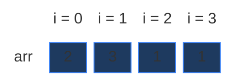

This is the example from the board in Striver's lecture. We use it in every section below. It is small (a 4 × 5 grid), but it already has a repeated subproblem.

### Constraints

Coding Ninjas (from my notes):

- `1 <= T <= 5`
- `1 <= N <= 10^3`
- `0 <= ARR[i] <= 10^9`
- `0 <= K <= 10^3`
- Time limit: 1 second.

Two things to notice (from my notes):

- The statement says "positive integers", but the constraints allow `ARR[i] = 0`. Zeros do not break any solution below. A `0` never changes a sum (tested at the bottom of the final code).
- `ARR[i]` can be `10^9`, much bigger than `K`. This matters for the tabulation base case (Section 6): `dp[0][arr[0]]` only exists if `arr[0] <= k`.

### What the constraints tell us (simple theory)

A **constraint** is the biggest input the judge will ever give you. It quietly tells you how fast your code must be.

**Rule of thumb:** a computer does about **100 million (10^8) simple steps per second**. Count how many steps your idea needs for the biggest input, and compare.

| Biggest input `n` | Steps you can afford | Ideas that fit |
|:---:|:---:|:---|
| up to ~20 | about `2^n` | Plain recursion, try everything |
| up to ~500 | about `n^3` | Three nested loops |
| up to ~5,000 | about `n^2` | Two nested loops |
| up to ~1,000,000 | about `n` or `n log n` | One loop, DP over `n` states |

**For this problem:** `N` is at most `1000` and `K` is at most `1000`.

- Trying every subset needs `2^1000` checks. That number has 302 digits. It is more than the number of atoms in the universe. Impossible.
- The DP fills a grid of `N × (K + 1) = 1000 × 1001 ≈ 1 million` cells. Even with `T = 5` test cases, that is about **5 million** steps. That runs in well under a second.

The key: the input has two sizes, `N` and `K`. The DP work is their **product** `N · K`, not `2^N`.

**How the work grows as `n` grows**

Here `arr` is all ones and `k = n` (the worst case for recursion: every call can pick and not pick). Red bars = calls made by plain recursion. Green line = cells in the DP grid, `n · (k + 1)` (it stays flat near zero).

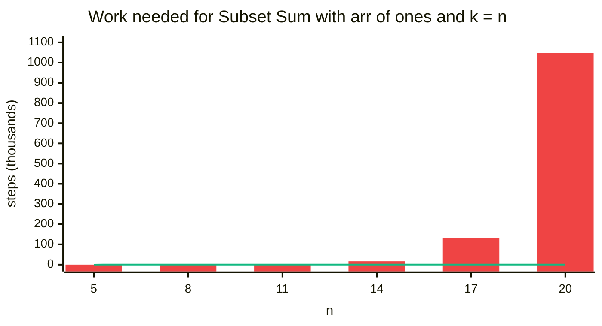

| `n` (and `k`) | Recursion calls | DP cells `n · (k + 1)` |
|:---:|:---:|:---:|
| 5 | 31 | 30 |
| 8 | 255 | 72 |
| 11 | 2,047 | 132 |
| 14 | 16,383 | 210 |
| 17 | 131,071 | 306 |
| 20 | 1,048,575 | 420 |

The recursion calls are exactly `2^n - 1` here: they double with every extra element. The DP cells grow slowly. (My notes measured the same thing on a random array of 22 numbers with `K = 60`: plain recursion made 2,140,169 calls, memoization only 1,653.)

## 2. Core Theory

This is the first **2-D DP** note. If you have only seen 1-D DP (like [Fibonacci](../01.%20One%20Dimensional%20DP/01.%20509.%20Fibonacci%20Number.md) or [House Robber](../01.%20One%20Dimensional%20DP/05.%20198.%20House%20Robber.md)), this section starts from zero.

### Subset, subsequence, subarray: what is the difference?

Take an array and choose some of its elements (any number, even none). Every element has only **two options: in or out**. The chosen group is a **subset**.

| Word | Rule | Example from `[1, 3, 2]` |
|:---|:---|:---|
| **Subarray** | Side by side (contiguous), keep the order | `{3, 2}` |
| **Subsequence** | May skip elements, but keep the order | `{1, 2}` (skips 3) |
| **Subset** | Any choice, order does not matter | `{2, 1}` is the same as `{1, 2}` |

This problem only cares about the **sum**, and `1 + 2 = 2 + 1`. So the order never matters, and we can think of plain subsets. (Striver calls this family "DP on subsequences", it is the same thing here.)

### Why we can't just try them all

`[1, 2, 3, 4]` has `2 × 2 × 2 × 2 = 2^4 = 16` subsets (each element in or out). Here they all are, with target 4:

| Subset | Sum | `= 4`? | Subset | Sum | `= 4`? |
|:---|:---:|:---:|:---|:---:|:---:|
| `{}` | 0 | | `{2, 3}` | 5 | |
| `{1}` | 1 | | `{2, 4}` | 6 | |
| `{2}` | 2 | | `{3, 4}` | 7 | |
| `{3}` | 3 | | `{1, 2, 3}` | 6 | |
| `{4}` | 4 | ✓ | `{1, 2, 4}` | 7 | |
| `{1, 2}` | 3 | | `{1, 3, 4}` | 8 | |
| `{1, 3}` | 4 | ✓ | `{2, 3, 4}` | 9 | |
| `{1, 4}` | 5 | | `{1, 2, 3, 4}` | 10 | |

Two of them, `{4}` and `{1, 3}`, sum to 4, so the answer is `True`. With `N = 1000` there are `2^1000` subsets, so checking them one by one is impossible.

There are two ways to "try everything" (from the board):

1. **Power set with bit masks:** every number from `0` to `2^n - 1` is a mask. Bit `i` = 1 means "element `i` is in". `2^n` masks.
2. **Recursion with take / not take** (Striver's lectures L6 and L8): at each element, branch into "take it" and "skip it".

Both try every subset, so both are `2^n` work. Too slow for `N = 1000`. We need DP. Here is the bit-mask version. We only use it to check the other answers on small inputs.

```python
# Imports used by every code block in this note
from typing import List

# For the recursion limit and the tests
import sys

# For random tests at the end
import random


# Brute force: try every subset with a bit mask
class SolutionBrute:

    # Main method (same name as GfG)
    def isSubsetSum(self, arr: List[int], k: int) -> bool:

        # Number of elements
        n = len(arr)

        # Every mask from 0 to 2^n - 1 is one subset
        for mask in range(1 << n):

            # Sum of the chosen elements
            total = 0

            # Look at every bit of the mask
            for i in range(n):

                # Bit i is 1: element i is in this subset
                if mask & (1 << i):

                    # Add it to the sum
                    total += arr[i]

            # Found a subset with the right sum
            if total == k:
                return True

        # No subset matched
        return False
```

### How to spot that it is DP

| Property | Plain meaning | In Subset Sum |
|:---|:---|:---|
| **Overlapping subproblems** | The same smaller question is asked many times | "Can `arr[0..1]` make 3?" is asked twice in our example (Section 4) |
| **Optimal substructure** | The big answer is built from answers of smaller questions | "Can `arr[0..3]` make 4?" is built from questions about `arr[0..2]` |

Also: the problem says "choose some elements" and asks yes / no. "Pick or not pick" + "does a target work" is the classic sign of DP on subsets.

### Why one number is not enough: the state needs two numbers

The **state** is the small piece of information that names one subproblem.

In 1-D DP the state was one number. For Fibonacci, `f(i)` = "the `i`-th number". Here try the same: `f(i)` = "can the first elements make the target?" But *which* target?

- When we **skip** an element, the target stays the same: we still need 4.
- When we **pick** an element, say `1`, the target **shrinks**: now we only need `4 - 1 = 3`.

So the same elements get asked about different targets. "Can `arr[0..2]` make 4?" and "Can `arr[0..2]` make 3?" are **different questions** with possibly different answers. One number cannot tell them apart. We need two:

> `f(ind, target)` = "using only the elements `arr[0], arr[1], ..., arr[ind]`, can I pick some of them so that they sum to exactly `target`?" Answer: `True` or `False`.

- `ind` = how far into the array we are allowed to look (which elements are still available).
- `target` = how much sum we still need.

Two numbers in the state = **2-D DP** (two-dimensional). The whole question is `f(n - 1, k)`: "using all elements, can I make `k`?" For our example that is `f(3, 4)`.

### The grid: rows are elements, columns are targets

With two numbers, the answers no longer fit in a line. They fit in a **grid** (a table with rows and columns):

- **Row `ind`** = "I may use elements `0 .. ind`". Row 0 can use only the `2`. Row 3 can use all four elements. Going down a row = one more element is allowed.
- **Column `target`** = "the sum I want to make". From `0` to `k`, so there are `k + 1` columns.
- **Cell `[ind][target]`** = `True` or `False`: the answer to `f(ind, target)`.

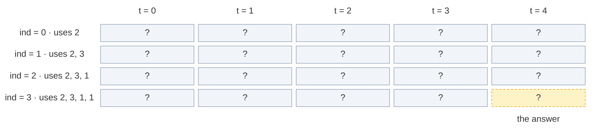

The grid has `n` rows and `k + 1` columns: here `4 × 5 = 20` cells. The answer is the bottom-right cell `[3][4]`. Every DP approach below just fills this grid in a different order (or keeps only part of it).

### The recurrence: pick or not pick

The **recurrence** is the rule that builds a bigger answer from smaller ones. My notes write the recursion in 3 steps (Striver's recipe):

1. **Express** the problem in terms of the state `(ind, target)`.
2. **Explore all possibilities** of that index: `arr[ind]` is part of the subset (take), or it is not (not take).
3. **Return** `True` if any possibility works (OR).

In words: *look at the last allowed element `arr[ind]`. Either skip it, and ask whether the earlier elements can still make the whole `target`. Or pick it, and ask whether the earlier elements can make the rest, `target - arr[ind]`. If either way works, the answer is yes.*

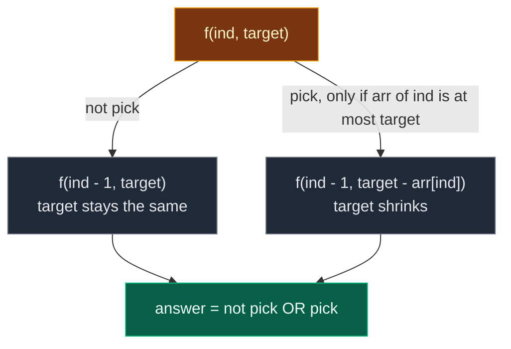

```text
not_pick = f(ind - 1, target)
pick     = f(ind - 1, target - arr[ind])     only if arr[ind] <= target
f(ind, target) = pick OR not_pick
```

Why "only if `arr[ind] <= target`"? You cannot pick a number bigger than what you still need, the target would go negative. Example from my notes: `arr = [1, 3, 6]` with target `2`. The `3` and the `6` are too big to pick, only the `1` can be picked.

My notes' intuition with `arr = [1, 2, 3, 4]`, `k = 5`, starting at the last index (value 4, target 5):

- **not pick 4** → can we make 5 using `[1, 2, 3]`?
- **pick 4** → can we make 1 using `[1, 2, 3]`? Yes: the subset `[1]`. So the answer is `True`.

In the grid: **not pick reads the cell straight up** (same column, row above). **Pick reads the cell up and `arr[ind]` columns to the left** (row above, column `target - arr[ind]`).

### Base cases

A **base case** is a subproblem so small that we know the answer without more work. It is where the recursion stops.

| Base case | Answer | Why |
|:---|:---:|:---|
| `target == 0` | `True` | We need nothing more. Take nothing more (the empty choice) and we are done. This works at any `ind` |
| `ind == 0` | `arr[0] == target` | Only `arr[0]` is left. Either it alone equals the target, or nothing works |

Why check `target == 0` **first**? If the target is already 0, we can stop picking, no matter which index we are on. Example: `f(0, 0)` must be `True` even if `arr[0] = 2`. If we checked `ind == 0` first, we would return `arr[0] == 0`, which is `False`. Wrong.

### Two ways to remember: memoization vs tabulation

| | Memoization | Tabulation |
|:---|:---|:---|
| Other name | **Top-down** | **Bottom-up** |
| Direction | Start from `f(n - 1, k)`, go down to the base cases, come back up | Start from the base cases (row 0, column 0), fill row by row down to `[n - 1][k]` |
| How | Recursion + a 2-D table | Two nested loops + a 2-D table |
| Computes | Only the cells it needs | Every cell |
| Stack | Uses the recursion stack (depth up to `n`) | No recursion stack |

### The 4-step ladder

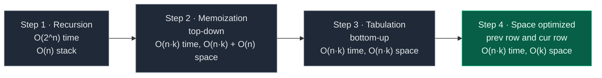

Bonus step after step 4: one single array with a **backward** loop (Section 7).

## 3. Edge Cases

| Case | Input | Expected | Why it matters |
|:---|:---:|:---:|:---|
| Target 0 | `arr = [5, 7]`, `k = 0` | `True` | The empty subset has sum 0. Base case `target == 0` |
| First element bigger than `k` | `arr = [10^9, 1]`, `k = 1` | `True` | `dp[0][arr[0]]` must be guarded by `arr[0] <= k`, or the index is out of range |
| Zeros in the array | `arr = [0, 0, 4]`, `k = 4` | `True` | A `0` never changes a sum, nothing breaks |
| Single element, equal | `arr = [4]`, `k = 4` | `True` | Base case `ind == 0`: `arr[0] == target` |
| Single element, not equal | `arr = [3]`, `k = 4` | `False` | Same base case, returns `False` |
| Total sum too small | `arr = [1, 1]`, `k = 5` | `False` | Even taking everything is not enough |
| No subset fits | `arr = [2, 5, 1, 6, 7]`, `k = 4` | `False` | Sample from Coding Ninjas |
| Our example | `arr = [2, 3, 1, 1]`, `k = 4` | `True` | Traced in every section |
| Biggest input | `N = 1000`, `K = 1000` | – | Python memoization needs a higher recursion limit (Section 5) |

## 4. Approach 1: Recursion

### Idea

Write the recurrence as code. Start with `f(n - 1, k)`. Check the base cases. Otherwise try "not pick" and "pick" and return their OR.

What does the start call mean? `f(n - 1, target) = f(3, 4)` = "in `arr[0 .. 3]`, is there a subset with sum 4?"

### Recursion tree for `arr = [2, 3, 1, 1]`, `k = 4`

Every box shows the call and what it returns (`T` = True, `F` = False). Calls happen depth-first, "not pick" first (like the code).

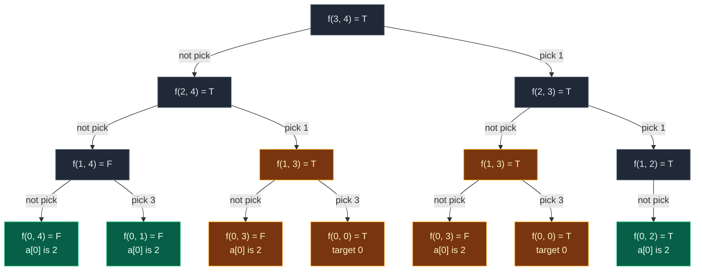

Gold = repeated work. Green = base cases that are not repeated.

`f(1, 2)` has only one child: `arr[1] = 3` is bigger than the target `2`, so "pick" is not allowed.

| State | Times computed |
|:---|:---:|
| `f(3, 4)`, `f(2, 4)`, `f(2, 3)`, `f(1, 4)`, `f(1, 2)` | 1 each |
| **`f(1, 3)`** | **2** |
| **`f(0, 3)`** | **2** (inside each `f(1, 3)`) |
| **`f(0, 0)`** | **2** (inside each `f(1, 3)`) |
| `f(0, 4)`, `f(0, 1)`, `f(0, 2)` | 1 each |

That is **14 calls** for just 4 elements. `f(1, 3)` is the overlapping subproblem Striver circled on the board: it is reached by "skip the last 1, pick the other 1" and by "pick the last 1, skip the other 1". Both paths leave the same question: "can `[2, 3]` make 3?"

**The exact order of calls.** One participant per row of the grid (`ind`). Solid arrows = calls, dashed arrows = returns.

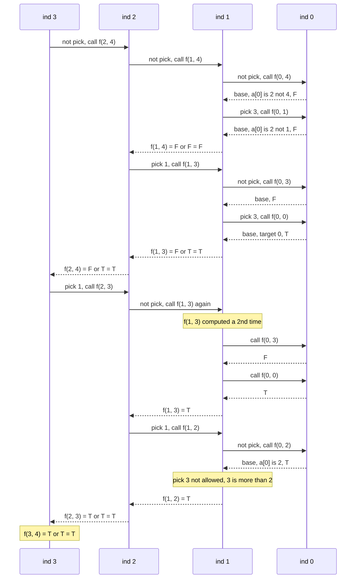

**A second dry run from my notes:** `arr = [1, 2, 3]`, `k = 5`. Call `f(2, 5)`, value `3`:

- not pick → `f(1, 5)`, value `2`: not pick → `f(0, 5)`: `1 ≠ 5` → F. pick → `f(0, 3)`: `1 ≠ 3` → F. So `f(1, 5) = F`.
- pick → `f(1, 2)`, value `2`: not pick → `f(0, 2)`: `1 ≠ 2` → F. pick → `f(0, 0)`: target 0 → T. So `f(1, 2) = T`.
- `f(2, 5) = F or T = T`. (The subset is `{2, 3}`.)

### Code

```python
# Plain recursion
class SolutionRecursion:

    # Helper: can arr[0..index] make target?
    def solve(self, index: int, target: int, arr: List[int]) -> bool:

        # Base case 1: nothing left to make, the empty subset works
        if target == 0:
            return True

        # Base case 2: only arr[0] is left, it alone must equal target
        if index == 0:
            return arr[0] == target

        # Choice 1: do not pick arr[index], target stays the same
        not_pick = self.solve(index - 1, target, arr)

        # Choice 2 starts as False (not allowed yet)
        pick = False

        # Pick arr[index] only if it is not bigger than target
        if arr[index] <= target:

            # Picking it shrinks the target by arr[index]
            pick = self.solve(index - 1, target - arr[index], arr)

        # If either choice works, the answer is True
        return pick or not_pick

    # Main method (same name as GfG)
    def isSubsetSum(self, arr: List[int], k: int) -> bool:

        # Start from the last index and the full target
        return self.solve(len(arr) - 1, k, arr)
```

### Complexity

| Measure | Complexity | Why |
|:---|:---:|:---|
| **Time** | `O(2^n)` | Each index gives 2 choices (pick / not pick), so the tree can double at each level |
| **Space** | `O(n)` | Recursion stack. The deepest path goes `ind = n - 1, n - 2, ..., 0`, which is `n` frames |

## 5. Approach 2: Memoization (Top-Down)

### Idea

In the recursion, the same `(ind, target)` states are solved again and again. Store each answer the first time in a 2-D table `dp[ind][target]`, and reuse it.

The values in the table (from my notes):

| Value | Meaning |
|:---:|:---|
| `-1` | Not computed yet |
| `0` | Computed, the answer is `False` |
| `1` | Computed, the answer is `True` |

**Size of the table.** `ind` goes from `0` to `n - 1` (that is `n` rows). `target` goes from `0` to `k` (that is `k + 1` columns). So `dp` is `n × (k + 1)`. On the board, Striver sized it for the worst case: `N <= 10^3` and `K <= 10^3`, so about `[10^3 + 1] × [10^3 + 1]`. Rows = `ind`, columns = `target`.

The same **3 steps** as in 1-D DP:

1. **Declare** `dp` with `n` rows and `k + 1` columns, filled with `-1`.
2. **Store** the answer before returning: `dp[ind][target] = 1 if (pick or not_pick) else 0`.
3. **Check** first: if `dp[ind][target] != -1`, return it and make no new calls.

Note: base-case cells (`target == 0` or `ind == 0`) are never stored. The base-case checks answer them before the table is looked at. So column 0 and row 0 stay `-1` in the memo table. That is fine.

**Python only (from my notes):** with `N = 1000` the recursion goes 1000 calls deep, and Python's default limit is 1000. Running memoization on `[1] × 1000`, `K = 1000` gave `RecursionError: maximum recursion depth exceeded`. Fix: `sys.setrecursionlimit(...)` (then it returns `True`), or use tabulation, which has no recursion.

### Visual: when each `dp[ind][target]` gets filled

Colours: grey = `-1` (not computed), dashed yellow = computing (waiting for its children), green = just filled, blue = filled earlier, orange = cache hit.

**Start:** `dp` is `4 × 5`, all `-1`.

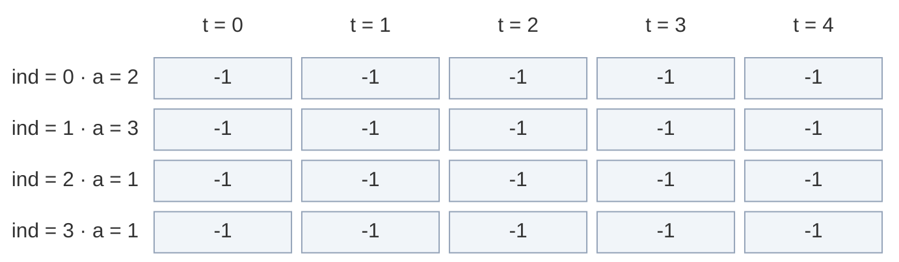

**Calls go down the "not pick" side:** `f(3, 4)` → `dp[3][4] = -1`, compute. `f(2, 4)` → `-1`, compute. `f(1, 4)` → `-1`, compute.

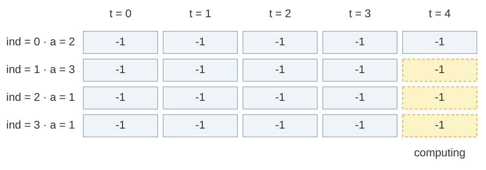

**Fill 1:** `f(1, 4)` asks `f(0, 4)` (base, `2 ≠ 4` → F) and `f(0, 1)` (base, `2 ≠ 1` → F). `F or F = F`. Store `dp[1][4] = 0`.

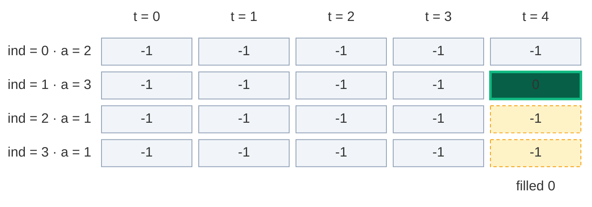

**Fill 2:** back in `f(2, 4)`, "pick 1" calls `f(1, 3)` → `-1`, compute. It asks `f(0, 3)` (base → F) and `f(0, 0)` (base, target 0 → T). `F or T = T`. Store `dp[1][3] = 1`.

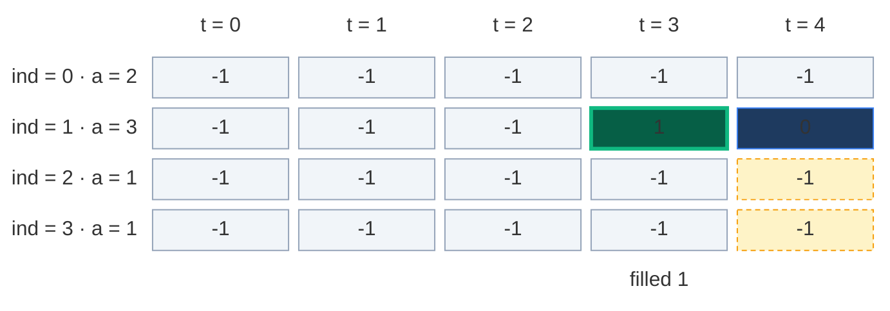

**Fill 3:** `f(2, 4) = F or T = T`. Store `dp[2][4] = 1`.

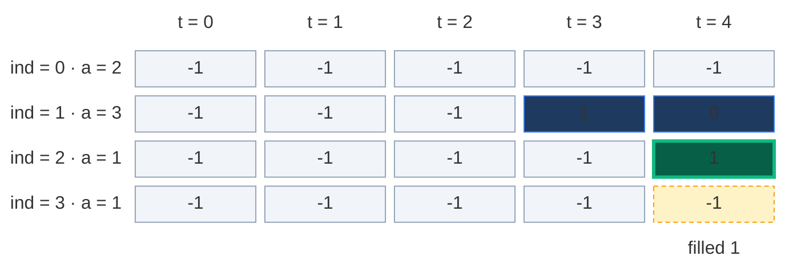

**Cache hit:** `f(3, 4)` now tries "pick 1" → `f(2, 3)` → `-1`, compute. Its "not pick" asks `f(1, 3)`. `dp[1][3] = 1`, not `-1` → return `True`, **no new calls**. The whole `f(1, 3)` subtree (3 calls) is skipped.

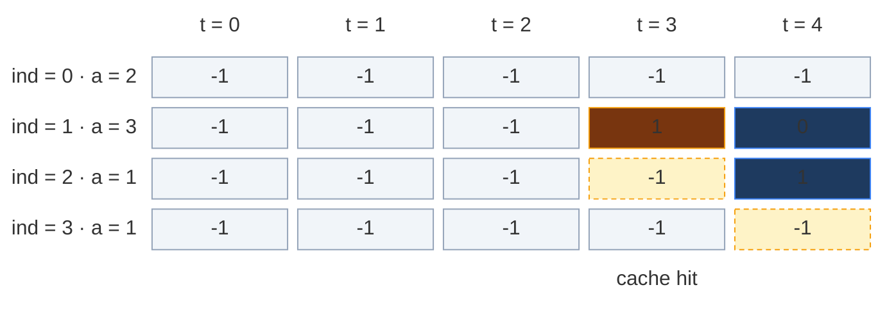

**Fill 4:** `f(2, 3)`'s "pick 1" asks `f(1, 2)` → `-1`, compute. "Not pick" asks `f(0, 2)` (base, `2 == 2` → T). "Pick 3" is not allowed (`3 > 2`). Store `dp[1][2] = 1`.

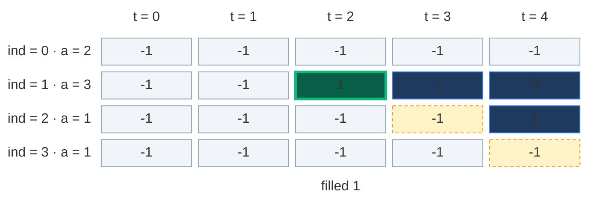

**Fill 5:** `f(2, 3) = T or T = T`. Store `dp[2][3] = 1`.

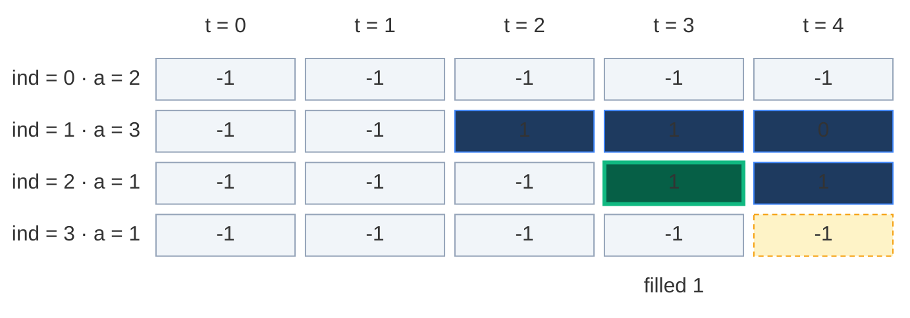

**Fill 6:** `f(3, 4) = T or T = T`. Store `dp[3][4] = 1`. That is the answer.

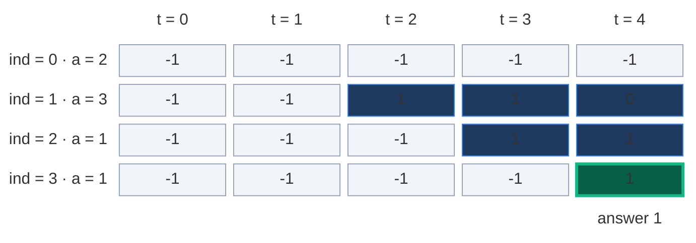

Only 6 of the 20 cells were ever stored. Memoization computes **only the states it needs**.

About the example in my notes (`arr = [1, 2, 3, 4]`, `k = 5`): the notes list states like `solve(2, 5)`, `solve(2, 3)`, `solve(1, 2)`, `solve(1, 5)` and say "suppose `solve(2, 2)` is computed once, next time we return `dp[2][2]` directly". That is the right idea, but in that small array no state actually repeats (I traced every call), and `solve(2, 2)` is never reached there. It is a "suppose". The board example `[2, 3, 1, 1]` shows a real repeat: `f(1, 3)`.

### The pruned recursion tree

Same tree, but the cache hit (dashed) stops right away.

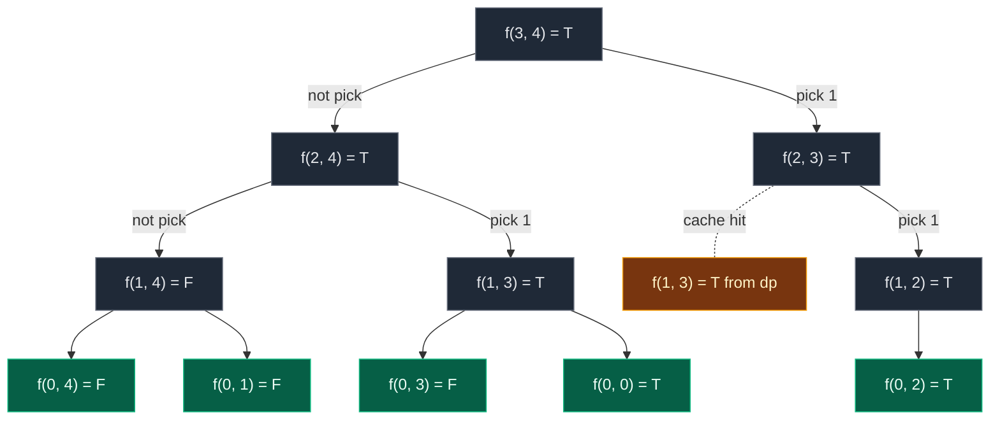

**12 calls** instead of 14. Small saving here because the example is tiny. On bigger inputs the saving is huge: at most `n · (k + 1)` states are ever computed.

### Code

```python
# Memoization (top-down DP) with a 2-D table of -1
class SolutionMemo:

    # Helper: can arr[0..index] make target? Uses and fills dp
    def solve(self, index: int, target: int, arr: List[int], dp: List[List[int]]) -> bool:

        # Base case 1: nothing left to make, the empty subset works
        if target == 0:
            return True

        # Base case 2: only arr[0] is left, it alone must equal target
        if index == 0:
            return arr[0] == target

        # Step 3 (check): already solved this (index, target)? Reuse it
        if dp[index][target] != -1:
            return bool(dp[index][target])

        # Choice 1: do not pick arr[index], target stays the same
        not_pick = self.solve(index - 1, target, arr, dp)

        # Choice 2 starts as False (not allowed yet)
        pick = False

        # Pick arr[index] only if it is not bigger than target
        if arr[index] <= target:

            # Picking it shrinks the target by arr[index]
            pick = self.solve(index - 1, target - arr[index], arr, dp)

        # Step 2 (store): 1 means True, 0 means False
        dp[index][target] = 1 if (pick or not_pick) else 0

        # Return the answer
        return pick or not_pick

    # Main method (same name as GfG)
    def isSubsetSum(self, arr: List[int], k: int) -> bool:

        # Number of elements
        n = len(arr)

        # Python only: allow recursion as deep as n (default limit is 1000)
        sys.setrecursionlimit(max(1000, 2 * n + 100))

        # Step 1 (declare): n rows, k + 1 columns, -1 means not solved yet
        dp = [[-1] * (k + 1) for _ in range(n)]

        # Keep the table so we can look at it after the run
        self.dp = dp

        # Start from the last index and the full target
        return self.solve(n - 1, k, arr, dp)
```

### Complexity

| Measure | Complexity | Why |
|:---|:---:|:---|
| **Time** | `O(n · k)` | At most `n · (k + 1)` different states, each solved once with `O(1)` work |
| **Space: dp table** | `O(n · k)` | `n` rows × `k + 1` columns |
| **Space: recursion stack** | `O(n)` | The deepest path goes `ind = n - 1` down to `0` |
| **Total space** | `O(n · k) + O(n)` | Table plus stack |

## 6. Approach 3: Tabulation (Bottom-Up)

### Idea

Fill the whole grid with two loops, from the smallest states (row 0) to the answer (`[n - 1][k]`). No recursion, so no stack.

`dp[i][t]` = "can we make sum `t` using elements from index `0` to `i`?"

### How to convert memo → table, step by step

The 3 steps from the board, plus "same table" and "answer":

1. **Same grid:** `dp` with `n` rows and `k + 1` columns, all `False`.
2. **Base cases become cells:**
   - `target == 0 → True` becomes `dp[i][0] = True` for **every** row `i`. (Sum 0 is always possible with the empty subset.)
   - `ind == 0 → arr[0] == target` becomes `dp[0][arr[0]] = True`, **but only if `arr[0] <= k`**. (With only the first element, we can make exactly `arr[0]`.) Without this check, `arr[0] = 10^9` would be an index far outside the table.
3. **Two nested loops, in the opposite direction:** the recursion went top-down, `n - 1 → n - 2 → ... → 0`. Reverse it: `ind` from `1` to `n - 1`, and inside, `target` from `1` to `k`.
4. **Copy the recurrence:** replace `f(...)` with `dp[...]`:
   - `not_pick = dp[ind - 1][target]`
   - `pick = dp[ind - 1][target - arr[ind]]` if `arr[ind] <= target`
   - `dp[ind][target] = pick or not_pick`
5. **Answer:** `dp[n - 1][k]`.

| Memoization | Becomes in tabulation |
|:---|:---|
| `dp[n][k + 1]` with `-1` | `dp[n][k + 1]` with `False` |
| `if target == 0: return True` | `dp[i][0] = True` for every `i` |
| `if ind == 0: return arr[0] == target` | `dp[0][arr[0]] = True` if `arr[0] <= k` |
| `f(n - 1, k)` going down | Loops `ind = 1 .. n - 1`, `target = 1 .. k` going up |
| `f(ind - 1, target)` | `dp[ind - 1][target]` |
| `f(ind - 1, target - arr[ind])` | `dp[ind - 1][target - arr[ind]]` |
| `return f(n - 1, k)` | `return dp[n - 1][k]` |

**Picture rule:** to fill a cell, look **straight up** (not pick) and **up, then `arr[ind]` steps left** (pick). If either is `T`, write `T`.

### Visual table fill (`arr = [2, 3, 1, 1]`, `k = 4`)

Colours: green = just filled, orange = the two cells it reads, blue = filled earlier, grey `?` = not filled yet.

**Start: base cases written in.** Column 0 is all `T` (empty subset). Row 0 has only `arr[0] = 2`, so `dp[0][2] = T` and the rest of row 0 is `F`.

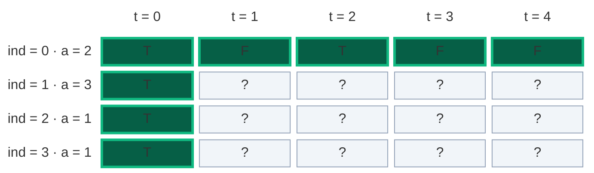

#### Row 1 (`arr[1] = 3`), cell by cell

**`dp[1][1]`:** not pick = `dp[0][1] = F`. Pick: `3 > 1`, not allowed. Result `F`.

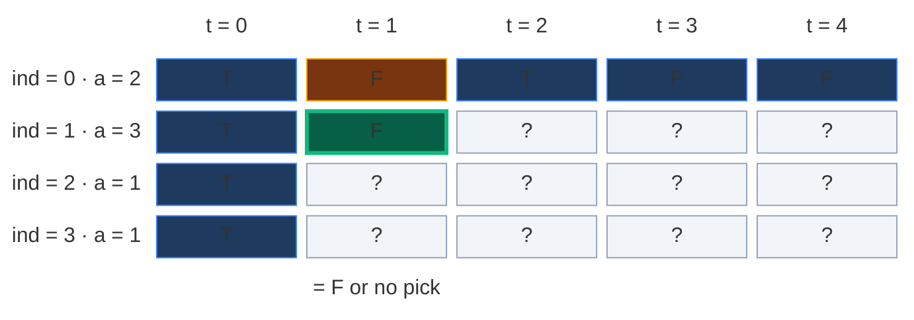

**`dp[1][2]`:** not pick = `dp[0][2] = T`. Pick: `3 > 2`, not allowed. Result `T`.

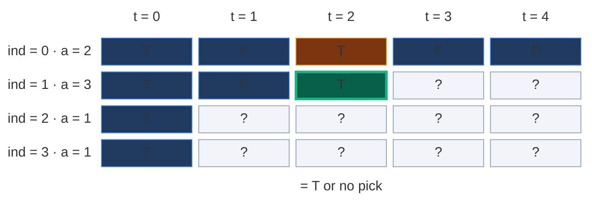

**`dp[1][3]`:** not pick = `dp[0][3] = F`. Pick = `dp[0][3 - 3] = dp[0][0] = T`. Result `T`.

```mermaid
block-beta
  columns 6
  hx[" "] h0["t = 0"] h1["t = 1"] h2["t = 2"] h3["t = 3"] h4["t = 4"]
  l0["ind = 0 · a = 2"] r0c0["T"] r0c1["F"] r0c2["T"] r0c3["F"] r0c4["F"]
  l1["ind = 1 · a = 3"] r1c0["T"] r1c1["F"] r1c2["T"] r1c3["T"] r1c4["?"]
  l2["ind = 2 · a = 1"] r2c0["T"] r2c1["?"] r2c2["?"] r2c3["?"] r2c4["?"]
  l3["ind = 3 · a = 1"] r3c0["T"] r3c1["?"] r3c2["?"] r3c3["?"] r3c4["?"]
  space space space space m3["= F or T"] space
  classDef head fill:none,stroke:none,color:#64748b
  class hx,h0,h1,h2,h3,h4,l0,l1,l2,l3 head
  classDef read fill:#78350f,stroke:#f59e0b,color:#fef3c7
  class r0c0,r0c3 read
  classDef done fill:#1e3a5f,stroke:#3b82f6,color:#dbeafe
  class r0c1,r0c2,r0c4,r1c0,r1c1,r1c2,r2c0,r3c0 done
  classDef new fill:#065f46,stroke:#10b981,color:#ecfdf5,stroke-width:3px
  class r1c3 new
  classDef empty fill:#f1f5f9,stroke:#94a3b8,color:#64748b
  class r1c4,r2c1,r2c2,r2c3,r2c4,r3c1,r3c2,r3c3,r3c4 empty
  classDef note fill:none,stroke:none,color:#b45309
  class m3 note
```

**`dp[1][4]`:** not pick = `dp[0][4] = F`. Pick = `dp[0][4 - 3] = dp[0][1] = F`. Result `F`.

```mermaid
block-beta
  columns 6
  hx[" "] h0["t = 0"] h1["t = 1"] h2["t = 2"] h3["t = 3"] h4["t = 4"]
  l0["ind = 0 · a = 2"] r0c0["T"] r0c1["F"] r0c2["T"] r0c3["F"] r0c4["F"]
  l1["ind = 1 · a = 3"] r1c0["T"] r1c1["F"] r1c2["T"] r1c3["T"] r1c4["F"]
  l2["ind = 2 · a = 1"] r2c0["T"] r2c1["?"] r2c2["?"] r2c3["?"] r2c4["?"]
  l3["ind = 3 · a = 1"] r3c0["T"] r3c1["?"] r3c2["?"] r3c3["?"] r3c4["?"]
  space space space space space m4["= F or F"]
  classDef head fill:none,stroke:none,color:#64748b
  class hx,h0,h1,h2,h3,h4,l0,l1,l2,l3 head
  classDef done fill:#1e3a5f,stroke:#3b82f6,color:#dbeafe
  class r0c0,r0c2,r0c3,r1c0,r1c1,r1c2,r1c3,r2c0,r3c0 done
  classDef read fill:#78350f,stroke:#f59e0b,color:#fef3c7
  class r0c1,r0c4 read
  classDef new fill:#065f46,stroke:#10b981,color:#ecfdf5,stroke-width:3px
  class r1c4 new
  classDef empty fill:#f1f5f9,stroke:#94a3b8,color:#64748b
  class r2c1,r2c2,r2c3,r2c4,r3c1,r3c2,r3c3,r3c4 empty
  classDef note fill:none,stroke:none,color:#b45309
  class m4 note
```

**After row 1:** with `{2, 3}` we can make `0`, `2` and `3`.

```mermaid
block-beta
  columns 6
  hx[" "] h0["t = 0"] h1["t = 1"] h2["t = 2"] h3["t = 3"] h4["t = 4"]
  l0["ind = 0 · a = 2"] r0c0["T"] r0c1["F"] r0c2["T"] r0c3["F"] r0c4["F"]
  l1["ind = 1 · a = 3"] r1c0["T"] r1c1["F"] r1c2["T"] r1c3["T"] r1c4["F"]
  l2["ind = 2 · a = 1"] r2c0["T"] r2c1["?"] r2c2["?"] r2c3["?"] r2c4["?"]
  l3["ind = 3 · a = 1"] r3c0["T"] r3c1["?"] r3c2["?"] r3c3["?"] r3c4["?"]
  classDef head fill:none,stroke:none,color:#64748b
  class hx,h0,h1,h2,h3,h4,l0,l1,l2,l3 head
  classDef done fill:#1e3a5f,stroke:#3b82f6,color:#dbeafe
  class r0c0,r0c1,r0c2,r0c3,r0c4,r1c0,r1c1,r1c2,r1c3,r1c4,r2c0,r3c0 done
  classDef empty fill:#f1f5f9,stroke:#94a3b8,color:#64748b
  class r2c1,r2c2,r2c3,r2c4,r3c1,r3c2,r3c3,r3c4 empty
```

#### Row 2 (`arr[2] = 1`), cell by cell

**`dp[2][1]`:** not pick = `dp[1][1] = F`. Pick = `dp[1][0] = T`. Result `T`.

```mermaid
block-beta
  columns 6
  hx[" "] h0["t = 0"] h1["t = 1"] h2["t = 2"] h3["t = 3"] h4["t = 4"]
  l0["ind = 0 · a = 2"] r0c0["T"] r0c1["F"] r0c2["T"] r0c3["F"] r0c4["F"]
  l1["ind = 1 · a = 3"] r1c0["T"] r1c1["F"] r1c2["T"] r1c3["T"] r1c4["F"]
  l2["ind = 2 · a = 1"] r2c0["T"] r2c1["T"] r2c2["?"] r2c3["?"] r2c4["?"]
  l3["ind = 3 · a = 1"] r3c0["T"] r3c1["?"] r3c2["?"] r3c3["?"] r3c4["?"]
  space space m1["= F or T"] space space space
  classDef head fill:none,stroke:none,color:#64748b
  class hx,h0,h1,h2,h3,h4,l0,l1,l2,l3 head
  classDef done fill:#1e3a5f,stroke:#3b82f6,color:#dbeafe
  class r0c0,r0c1,r0c2,r0c3,r0c4,r1c2,r1c3,r1c4,r2c0,r3c0 done
  classDef read fill:#78350f,stroke:#f59e0b,color:#fef3c7
  class r1c0,r1c1 read
  classDef new fill:#065f46,stroke:#10b981,color:#ecfdf5,stroke-width:3px
  class r2c1 new
  classDef empty fill:#f1f5f9,stroke:#94a3b8,color:#64748b
  class r2c2,r2c3,r2c4,r3c1,r3c2,r3c3,r3c4 empty
  classDef note fill:none,stroke:none,color:#b45309
  class m1 note
```

**`dp[2][2]`:** not pick = `dp[1][2] = T`. Pick = `dp[1][1] = F`. Result `T`.

```mermaid
block-beta
  columns 6
  hx[" "] h0["t = 0"] h1["t = 1"] h2["t = 2"] h3["t = 3"] h4["t = 4"]
  l0["ind = 0 · a = 2"] r0c0["T"] r0c1["F"] r0c2["T"] r0c3["F"] r0c4["F"]
  l1["ind = 1 · a = 3"] r1c0["T"] r1c1["F"] r1c2["T"] r1c3["T"] r1c4["F"]
  l2["ind = 2 · a = 1"] r2c0["T"] r2c1["T"] r2c2["T"] r2c3["?"] r2c4["?"]
  l3["ind = 3 · a = 1"] r3c0["T"] r3c1["?"] r3c2["?"] r3c3["?"] r3c4["?"]
  space space space m2["= T or F"] space space
  classDef head fill:none,stroke:none,color:#64748b
  class hx,h0,h1,h2,h3,h4,l0,l1,l2,l3 head
  classDef done fill:#1e3a5f,stroke:#3b82f6,color:#dbeafe
  class r0c0,r0c1,r0c2,r0c3,r0c4,r1c0,r1c3,r1c4,r2c0,r2c1,r3c0 done
  classDef read fill:#78350f,stroke:#f59e0b,color:#fef3c7
  class r1c1,r1c2 read
  classDef new fill:#065f46,stroke:#10b981,color:#ecfdf5,stroke-width:3px
  class r2c2 new
  classDef empty fill:#f1f5f9,stroke:#94a3b8,color:#64748b
  class r2c3,r2c4,r3c1,r3c2,r3c3,r3c4 empty
  classDef note fill:none,stroke:none,color:#b45309
  class m2 note
```

**`dp[2][3]`:** not pick = `dp[1][3] = T`. Pick = `dp[1][2] = T`. Result `T`.

```mermaid
block-beta
  columns 6
  hx[" "] h0["t = 0"] h1["t = 1"] h2["t = 2"] h3["t = 3"] h4["t = 4"]
  l0["ind = 0 · a = 2"] r0c0["T"] r0c1["F"] r0c2["T"] r0c3["F"] r0c4["F"]
  l1["ind = 1 · a = 3"] r1c0["T"] r1c1["F"] r1c2["T"] r1c3["T"] r1c4["F"]
  l2["ind = 2 · a = 1"] r2c0["T"] r2c1["T"] r2c2["T"] r2c3["T"] r2c4["?"]
  l3["ind = 3 · a = 1"] r3c0["T"] r3c1["?"] r3c2["?"] r3c3["?"] r3c4["?"]
  space space space space m3["= T or T"] space
  classDef head fill:none,stroke:none,color:#64748b
  class hx,h0,h1,h2,h3,h4,l0,l1,l2,l3 head
  classDef done fill:#1e3a5f,stroke:#3b82f6,color:#dbeafe
  class r0c0,r0c1,r0c2,r0c3,r0c4,r1c0,r1c1,r1c4,r2c0,r2c1,r2c2,r3c0 done
  classDef read fill:#78350f,stroke:#f59e0b,color:#fef3c7
  class r1c2,r1c3 read
  classDef new fill:#065f46,stroke:#10b981,color:#ecfdf5,stroke-width:3px
  class r2c3 new
  classDef empty fill:#f1f5f9,stroke:#94a3b8,color:#64748b
  class r2c4,r3c1,r3c2,r3c3,r3c4 empty
  classDef note fill:none,stroke:none,color:#b45309
  class m3 note
```

**`dp[2][4]`:** not pick = `dp[1][4] = F`. Pick = `dp[1][3] = T`. Result `T`. (This is `3 + 1 = 4`.)

```mermaid
block-beta
  columns 6
  hx[" "] h0["t = 0"] h1["t = 1"] h2["t = 2"] h3["t = 3"] h4["t = 4"]
  l0["ind = 0 · a = 2"] r0c0["T"] r0c1["F"] r0c2["T"] r0c3["F"] r0c4["F"]
  l1["ind = 1 · a = 3"] r1c0["T"] r1c1["F"] r1c2["T"] r1c3["T"] r1c4["F"]
  l2["ind = 2 · a = 1"] r2c0["T"] r2c1["T"] r2c2["T"] r2c3["T"] r2c4["T"]
  l3["ind = 3 · a = 1"] r3c0["T"] r3c1["?"] r3c2["?"] r3c3["?"] r3c4["?"]
  space space space space space m4["= F or T"]
  classDef head fill:none,stroke:none,color:#64748b
  class hx,h0,h1,h2,h3,h4,l0,l1,l2,l3 head
  classDef done fill:#1e3a5f,stroke:#3b82f6,color:#dbeafe
  class r0c0,r0c1,r0c2,r0c3,r0c4,r1c0,r1c1,r1c2,r2c0,r2c1,r2c2,r2c3,r3c0 done
  classDef read fill:#78350f,stroke:#f59e0b,color:#fef3c7
  class r1c3,r1c4 read
  classDef new fill:#065f46,stroke:#10b981,color:#ecfdf5,stroke-width:3px
  class r2c4 new
  classDef empty fill:#f1f5f9,stroke:#94a3b8,color:#64748b
  class r3c1,r3c2,r3c3,r3c4 empty
  classDef note fill:none,stroke:none,color:#b45309
  class m4 note
```

**After row 2:** with `{2, 3, 1}` every target `0 .. 4` is possible.

```mermaid
block-beta
  columns 6
  hx[" "] h0["t = 0"] h1["t = 1"] h2["t = 2"] h3["t = 3"] h4["t = 4"]
  l0["ind = 0 · a = 2"] r0c0["T"] r0c1["F"] r0c2["T"] r0c3["F"] r0c4["F"]
  l1["ind = 1 · a = 3"] r1c0["T"] r1c1["F"] r1c2["T"] r1c3["T"] r1c4["F"]
  l2["ind = 2 · a = 1"] r2c0["T"] r2c1["T"] r2c2["T"] r2c3["T"] r2c4["T"]
  l3["ind = 3 · a = 1"] r3c0["T"] r3c1["?"] r3c2["?"] r3c3["?"] r3c4["?"]
  classDef head fill:none,stroke:none,color:#64748b
  class hx,h0,h1,h2,h3,h4,l0,l1,l2,l3 head
  classDef done fill:#1e3a5f,stroke:#3b82f6,color:#dbeafe
  class r0c0,r0c1,r0c2,r0c3,r0c4,r1c0,r1c1,r1c2,r1c3,r1c4,r2c0,r2c1,r2c2,r2c3,r2c4,r3c0 done
  classDef empty fill:#f1f5f9,stroke:#94a3b8,color:#64748b
  class r3c1,r3c2,r3c3,r3c4 empty
```

#### Row 3 (`arr[3] = 1`)

Every cell's "not pick" (the cell straight up in row 2) is already `T`, so every cell is `T`:

| Cell | not pick (up) | pick (up, 1 left) | Result |
|:---:|:---:|:---:|:---:|
| `dp[3][1]` | `dp[2][1] = T` | `dp[2][0] = T` | `T` |
| `dp[3][2]` | `dp[2][2] = T` | `dp[2][1] = T` | `T` |
| `dp[3][3]` | `dp[2][3] = T` | `dp[2][2] = T` | `T` |
| `dp[3][4]` | `dp[2][4] = T` | `dp[2][3] = T` | `T` |

```mermaid
block-beta
  columns 6
  hx[" "] h0["t = 0"] h1["t = 1"] h2["t = 2"] h3["t = 3"] h4["t = 4"]
  l0["ind = 0 · a = 2"] r0c0["T"] r0c1["F"] r0c2["T"] r0c3["F"] r0c4["F"]
  l1["ind = 1 · a = 3"] r1c0["T"] r1c1["F"] r1c2["T"] r1c3["T"] r1c4["F"]
  l2["ind = 2 · a = 1"] r2c0["T"] r2c1["T"] r2c2["T"] r2c3["T"] r2c4["T"]
  l3["ind = 3 · a = 1"] r3c0["T"] r3c1["T"] r3c2["T"] r3c3["T"] r3c4["T"]
  classDef head fill:none,stroke:none,color:#64748b
  class hx,h0,h1,h2,h3,h4,l0,l1,l2,l3 head
  classDef done fill:#1e3a5f,stroke:#3b82f6,color:#dbeafe
  class r0c0,r0c1,r0c2,r0c3,r0c4,r1c0,r1c1,r1c2,r1c3,r1c4,r2c0,r2c1,r2c2,r2c3,r2c4,r3c0,r3c1,r3c2,r3c3,r3c4 done
```

**Answer:** `dp[3][4] = T`.

**Which subset? (from my notes)** Walk back from `dp[n - 1][k]`. If the cell straight up is `T`, this number was not needed: go up. Otherwise it was taken: go up and `arr[i]` columns left.

- `dp[3][4]`: up is `dp[2][4] = T` → skip `arr[3]`, go up.
- `dp[2][4]`: up is `dp[1][4] = F` → take `arr[2] = 1`, go to `dp[1][3]`.
- `dp[1][3]`: up is `dp[0][3] = F` → take `arr[1] = 3`, go to `dp[0][0]`.
- Target is 0: stop. Subset = `{3, 1}`, and `3 + 1 = 4` ✓.

Green = taken, light grey = skipped, orange = where we stop.

```mermaid
block-beta
  columns 6
  hx[" "] h0["t = 0"] h1["t = 1"] h2["t = 2"] h3["t = 3"] h4["t = 4"]
  l0["ind = 0 · a = 2"] r0c0["T"] r0c1["F"] r0c2["T"] r0c3["F"] r0c4["F"]
  l1["ind = 1 · a = 3"] r1c0["T"] r1c1["F"] r1c2["T"] r1c3["T"] r1c4["F"]
  l2["ind = 2 · a = 1"] r2c0["T"] r2c1["T"] r2c2["T"] r2c3["T"] r2c4["T"]
  l3["ind = 3 · a = 1"] r3c0["T"] r3c1["T"] r3c2["T"] r3c3["T"] r3c4["T"]
  classDef head fill:none,stroke:none,color:#64748b
  class hx,h0,h1,h2,h3,h4,l0,l1,l2,l3 head
  classDef read fill:#78350f,stroke:#f59e0b,color:#fef3c7
  class r0c0 read
  classDef done fill:#1e3a5f,stroke:#3b82f6,color:#dbeafe
  class r0c1,r0c2,r0c3,r0c4,r1c0,r1c1,r1c2,r1c4,r2c0,r2c1,r2c2,r2c3,r3c0,r3c1,r3c2,r3c3 done
  classDef new fill:#065f46,stroke:#10b981,color:#ecfdf5,stroke-width:3px
  class r1c3,r2c4 new
  classDef old fill:#e2e8f0,stroke:#64748b,color:#0f172a
  class r3c4 old
```

**Second example from my notes:** `arr = [1, 2, 3]`, `k = 5`. Row 0: `arr[0] = 1`, so targets 0 and 1 are possible. Row 1 (`arr[1] = 2`): target 1 → not pick `dp[0][1] = T` → T. Target 2 → pick `dp[0][0] = T` → T. Target 3 → pick `dp[0][1] = T` → T. Targets 4 and 5 → F. Row 2 (`arr[2] = 3`): target 5 → not pick `dp[1][5] = F`, pick `dp[1][2] = T` → T. Answer `True`.

```mermaid
block-beta
  columns 7
  hx[" "] h0["t = 0"] h1["t = 1"] h2["t = 2"] h3["t = 3"] h4["t = 4"] h5["t = 5"]
  l0["ind = 0 · a = 1"] r0c0["T"] r0c1["T"] r0c2["F"] r0c3["F"] r0c4["F"] r0c5["F"]
  l1["ind = 1 · a = 2"] r1c0["T"] r1c1["T"] r1c2["T"] r1c3["T"] r1c4["F"] r1c5["F"]
  l2["ind = 2 · a = 3"] r2c0["T"] r2c1["T"] r2c2["T"] r2c3["T"] r2c4["T"] r2c5["T"]
  classDef head fill:none,stroke:none,color:#64748b
  class hx,h0,h1,h2,h3,h4,h5,l0,l1,l2 head
  classDef done fill:#1e3a5f,stroke:#3b82f6,color:#dbeafe
  class r0c0,r0c1,r0c2,r0c3,r0c4,r0c5,r1c0,r1c1,r1c2,r1c3,r1c4,r1c5,r2c0,r2c1,r2c2,r2c3,r2c4 done
  classDef new fill:#065f46,stroke:#10b981,color:#ecfdf5,stroke-width:3px
  class r2c5 new
```

### Code

```python
# Tabulation (bottom-up DP)
class SolutionTab:

    # Main method (same name as GfG)
    def isSubsetSum(self, arr: List[int], k: int) -> bool:

        # Number of elements
        n = len(arr)

        # Step 1: n rows, k + 1 columns, all False
        dp = [[False] * (k + 1) for _ in range(n)]

        # Step 2a: sum 0 is always possible (empty subset), in every row
        for index in range(n):

            # Column 0 of this row is True
            dp[index][0] = True

        # Step 2b: row 0 can make arr[0], but only if it fits in the table
        if arr[0] <= k:

            # Using only the first element, we make exactly arr[0]
            dp[0][arr[0]] = True

        # Step 3: fill row by row, from index 1 down to n - 1
        for index in range(1, n):

            # Every target from 1 to k
            for target in range(1, k + 1):

                # Not pick: look straight up
                not_pick = dp[index - 1][target]

                # Pick starts as False (not allowed yet)
                pick = False

                # Pick only if arr[index] fits in target
                if arr[index] <= target:

                    # Pick: look up, then arr[index] columns to the left
                    pick = dp[index - 1][target - arr[index]]

                # Step 4: copy the recurrence
                dp[index][target] = pick or not_pick

        # Keep the table so we can look at it after the run
        self.dp = dp

        # Step 5: the answer is the bottom-right cell
        return dp[n - 1][k]
```

### Complexity

| Measure | Complexity | Why |
|:---|:---:|:---|
| **Time** | `O(n · k)` | Two nested loops: `n - 1` rows × `k` targets |
| **Space** | `O(n · k)` | The full grid. No recursion stack any more |

## 7. Approach 4: Space Optimization (Optimal)

### Idea

Look at the table fill again. Every cell of row `ind` only reads cells from **row `ind - 1`** (straight up, and up-left). Rows `ind - 2`, `ind - 3`, ... are never read again.

So we only need two rows:

- `prev` = the row above (answers for `ind - 1`).
- `cur` = the row we are filling now (answers for `ind`).

Board example from my notes: with `a[0] = 2`, `a[1] = 3`, `K = 6`, the cell `cur[4]` uses `prev[4]` (not pick) and `prev[4 - 3] = prev[1]` (pick). Only the row above. After the row is done: `prev = cur`. Only 2 rows ever exist.

**Why `O(k)` and not `O(1)`?** In Fibonacci, each cell read only two single values, so two variables were enough. Here, a cell reads `prev[target - arr[ind]]`, and `arr[ind]` can be any size. So a cell may need **any** cell of the row above. We must keep the whole previous row: `k + 1` values. That is `O(k)`.

### Visual Walkthrough (Story Version)

**The story:** Mia has a box of toy blocks. They weigh `2`, `3`, `1` and `1` kg. She has a **lamp board** with 5 lamps labelled `0 kg` to `4 kg`. A lamp is **on** if she can put some of her blocks on a scale and read exactly that weight. She wants to know: can the `4 kg` lamp turn on?

Mia takes the blocks out of the box one by one. Each time she makes a **new board** by looking at the **old board**:

- *Skip the new block:* every lamp that was on stays on (look straight up).
- *Add the new block:* if lamp `w` was on, then lamp `w + block` turns on (look up-left).

She never needs boards older than the last one. Two boards are enough.

**Start: only block 2 is out.** She can weigh nothing (`0 kg`, the empty scale) or just the 2 (`2 kg`).

```mermaid
block-beta
  columns 6
  hx[" "] h0["0 kg"] h1["1 kg"] h2["2 kg"] h3["3 kg"] h4["4 kg"]
  l0["board · block 2"] r0c0["on"] r0c1["off"] r0c2["on"] r0c3["off"] r0c4["off"]
  space m0["no blocks"] space m2["just the 2"] space space
  classDef head fill:none,stroke:none,color:#64748b
  class hx,h0,h1,h2,h3,h4,l0 head
  classDef new fill:#065f46,stroke:#10b981,color:#ecfdf5,stroke-width:3px
  class r0c0,r0c2 new
  classDef empty fill:#f1f5f9,stroke:#94a3b8,color:#64748b
  class r0c1,r0c3,r0c4 empty
  classDef note fill:none,stroke:none,color:#b45309
  class m0,m2 note
```

**Step 1: block 3 comes out.** Old lamps `0` and `2` stay on. Adding 3: `0 + 3 = 3` turns on. (`2 + 3 = 5` is off the board.)

```mermaid
block-beta
  columns 6
  hx[" "] h0["0 kg"] h1["1 kg"] h2["2 kg"] h3["3 kg"] h4["4 kg"]
  l0["old board"] r0c0["on"] r0c1["off"] r0c2["on"] r0c3["off"] r0c4["off"]
  l1["new board · block 3"] r1c0["on"] r1c1["off"] r1c2["on"] r1c3["on"] r1c4["off"]
  space space space space m3["0 + 3"] space
  classDef head fill:none,stroke:none,color:#64748b
  class hx,h0,h1,h2,h3,h4,l0,l1 head
  classDef read fill:#78350f,stroke:#f59e0b,color:#fef3c7
  class r0c0,r0c2 read
  classDef empty fill:#f1f5f9,stroke:#94a3b8,color:#64748b
  class r0c1,r0c3,r0c4,r1c1,r1c4 empty
  classDef done fill:#1e3a5f,stroke:#3b82f6,color:#dbeafe
  class r1c0,r1c2 done
  classDef new fill:#065f46,stroke:#10b981,color:#ecfdf5,stroke-width:3px
  class r1c3 new
  classDef note fill:none,stroke:none,color:#b45309
  class m3 note
```

Then the new board becomes the old board.

**Step 2: block 1 comes out.** Old lamps `0`, `2`, `3` stay on. Adding 1: `0 + 1 = 1` and `3 + 1 = 4` turn on. (`2 + 1 = 3` was already on.)

```mermaid
block-beta
  columns 6
  hx[" "] h0["0 kg"] h1["1 kg"] h2["2 kg"] h3["3 kg"] h4["4 kg"]
  l0["old board"] r0c0["on"] r0c1["off"] r0c2["on"] r0c3["on"] r0c4["off"]
  l1["new board · block 1"] r1c0["on"] r1c1["on"] r1c2["on"] r1c3["on"] r1c4["on"]
  space space m1["0 + 1"] space space m4["3 + 1"]
  classDef head fill:none,stroke:none,color:#64748b
  class hx,h0,h1,h2,h3,h4,l0,l1 head
  classDef read fill:#78350f,stroke:#f59e0b,color:#fef3c7
  class r0c0,r0c2,r0c3 read
  classDef empty fill:#f1f5f9,stroke:#94a3b8,color:#64748b
  class r0c1,r0c4 empty
  classDef done fill:#1e3a5f,stroke:#3b82f6,color:#dbeafe
  class r1c0,r1c2,r1c3 done
  classDef new fill:#065f46,stroke:#10b981,color:#ecfdf5,stroke-width:3px
  class r1c1,r1c4 new
  classDef note fill:none,stroke:none,color:#b45309
  class m1,m4 note
```

The `4 kg` lamp is on! (`3 + 1`.) The new board becomes the old board.

**Step 3: the last block 1 comes out.** Everything is already on. Nothing new turns on.

```mermaid
block-beta
  columns 6
  hx[" "] h0["0 kg"] h1["1 kg"] h2["2 kg"] h3["3 kg"] h4["4 kg"]
  l0["old board"] r0c0["on"] r0c1["on"] r0c2["on"] r0c3["on"] r0c4["on"]
  l1["new board · block 1"] r1c0["on"] r1c1["on"] r1c2["on"] r1c3["on"] r1c4["on"]
  classDef head fill:none,stroke:none,color:#64748b
  class hx,h0,h1,h2,h3,h4,l0,l1 head
  classDef read fill:#78350f,stroke:#f59e0b,color:#fef3c7
  class r0c0,r0c1,r0c2,r0c3,r0c4 read
  classDef done fill:#1e3a5f,stroke:#3b82f6,color:#dbeafe
  class r1c0,r1c1,r1c2,r1c3,r1c4 done
```

**The end:** the `4 kg` lamp is on, so the answer is `True`.

**All steps at a glance**

| Step | Block | Lamps on before | Newly on | Lamps on after |
|:---:|:---:|:---|:---|:---|
| start | 2 | – | 0, 2 | 0, 2 |
| 1 | 3 | 0, 2 | 3 (`0 + 3`) | 0, 2, 3 |
| 2 | 1 | 0, 2, 3 | 1 (`0 + 1`), 4 (`3 + 1`) | 0, 1, 2, 3, 4 |
| 3 | 1 | 0 .. 4 | none | 0, 1, 2, 3, 4 |

**What the story teaches**

| In the story | In the code |
|:---|:---|
| A block | `arr[ind]` |
| Lamp `w kg` | Column `target = w` |
| Lamp on / off | `True` / `False` |
| Old board | `prev` (row `ind - 1`) |
| New board | `cur` (row `ind`) |
| Lamp `0 kg` always on | `cur[0] = True` (empty subset) |
| Skip the block, lamp stays on | `not_pick = prev[target]` |
| Add the block to lamp `w - block` | `pick = prev[target - arr[ind]]` |
| Off the board (more than 4 kg) | `arr[ind] <= target` check |
| New board becomes old board | `prev = cur` |
| Is the `4 kg` lamp on? | `return prev[k]` |

### Step-by-Step Example

`arr = [2, 3, 1, 1]`, `k = 4`.

**Start:** `prev` = row 0. `prev[0] = True` (empty subset). `arr[0] = 2 <= 4`, so `prev[2] = True`.

```mermaid
block-beta
  columns 6
  hx[" "] h0["t = 0"] h1["t = 1"] h2["t = 2"] h3["t = 3"] h4["t = 4"]
  l0["prev · row 0"] r0c0["T"] r0c1["F"] r0c2["T"] r0c3["F"] r0c4["F"]
  space m0["empty subset"] space m2["a[0] = 2"] space space
  classDef head fill:none,stroke:none,color:#64748b
  class hx,h0,h1,h2,h3,h4,l0 head
  classDef new fill:#065f46,stroke:#10b981,color:#ecfdf5,stroke-width:3px
  class r0c0,r0c1,r0c2,r0c3,r0c4 new
  classDef note fill:none,stroke:none,color:#b45309
  class m0,m2 note
```

**`ind = 1` (`arr[1] = 3`).** `cur[0] = True`. Then every target:

| `t` | not pick `prev[t]` | pick `prev[t - 3]` | `cur[t]` |
|:---:|:---:|:---:|:---:|
| 1 | `F` | not allowed (`3 > 1`) | `F` |
| 2 | `T` | not allowed (`3 > 2`) | `T` |
| 3 | `F` | `prev[0] = T` | `T` |
| 4 | `F` | `prev[1] = F` | `F` |

```mermaid
block-beta
  columns 6
  hx[" "] h0["t = 0"] h1["t = 1"] h2["t = 2"] h3["t = 3"] h4["t = 4"]
  l0["prev · rows 0..0"] r0c0["T"] r0c1["F"] r0c2["T"] r0c3["F"] r0c4["F"]
  l1["cur · a = 3"] r1c0["T"] r1c1["F"] r1c2["T"] r1c3["T"] r1c4["F"]
  space m0["always T"] m1["F or none"] m2["T or none"] m3["F or T"] m4["F or F"]
  classDef head fill:none,stroke:none,color:#64748b
  class hx,h0,h1,h2,h3,h4,l0,l1 head
  classDef read fill:#78350f,stroke:#f59e0b,color:#fef3c7
  class r0c0,r0c1,r0c2,r0c3,r0c4 read
  classDef new fill:#065f46,stroke:#10b981,color:#ecfdf5,stroke-width:3px
  class r1c0,r1c1,r1c2,r1c3,r1c4 new
  classDef note fill:none,stroke:none,color:#b45309
  class m0,m1,m2,m3,m4 note
```

Then `prev = cur`.

**`ind = 2` (`arr[2] = 1`).** `cur[0] = True`.

| `t` | not pick `prev[t]` | pick `prev[t - 1]` | `cur[t]` |
|:---:|:---:|:---:|:---:|
| 1 | `F` | `prev[0] = T` | `T` |
| 2 | `T` | `prev[1] = F` | `T` |
| 3 | `T` | `prev[2] = T` | `T` |
| 4 | `F` | `prev[3] = T` | `T` |

```mermaid
block-beta
  columns 6
  hx[" "] h0["t = 0"] h1["t = 1"] h2["t = 2"] h3["t = 3"] h4["t = 4"]
  l0["prev · rows 0..1"] r0c0["T"] r0c1["F"] r0c2["T"] r0c3["T"] r0c4["F"]
  l1["cur · a = 1"] r1c0["T"] r1c1["T"] r1c2["T"] r1c3["T"] r1c4["T"]
  space m0["always T"] m1["F or T"] m2["T or F"] m3["T or T"] m4["F or T"]
  classDef head fill:none,stroke:none,color:#64748b
  class hx,h0,h1,h2,h3,h4,l0,l1 head
  classDef read fill:#78350f,stroke:#f59e0b,color:#fef3c7
  class r0c0,r0c1,r0c2,r0c3,r0c4 read
  classDef new fill:#065f46,stroke:#10b981,color:#ecfdf5,stroke-width:3px
  class r1c0,r1c1,r1c2,r1c3,r1c4 new
  classDef note fill:none,stroke:none,color:#b45309
  class m0,m1,m2,m3,m4 note
```

Then `prev = cur`.

**`ind = 3` (`arr[3] = 1`).** `cur[0] = True`.

| `t` | not pick `prev[t]` | pick `prev[t - 1]` | `cur[t]` |
|:---:|:---:|:---:|:---:|
| 1 | `T` | `prev[0] = T` | `T` |
| 2 | `T` | `prev[1] = T` | `T` |
| 3 | `T` | `prev[2] = T` | `T` |
| 4 | `T` | `prev[3] = T` | `T` |

```mermaid
block-beta
  columns 6
  hx[" "] h0["t = 0"] h1["t = 1"] h2["t = 2"] h3["t = 3"] h4["t = 4"]
  l0["prev · rows 0..2"] r0c0["T"] r0c1["T"] r0c2["T"] r0c3["T"] r0c4["T"]
  l1["cur · a = 1"] r1c0["T"] r1c1["T"] r1c2["T"] r1c3["T"] r1c4["T"]
  space m0["always T"] m1["T or T"] m2["T or T"] m3["T or T"] m4["T or T"]
  classDef head fill:none,stroke:none,color:#64748b
  class hx,h0,h1,h2,h3,h4,l0,l1 head
  classDef read fill:#78350f,stroke:#f59e0b,color:#fef3c7
  class r0c0,r0c1,r0c2,r0c3,r0c4 read
  classDef new fill:#065f46,stroke:#10b981,color:#ecfdf5,stroke-width:3px
  class r1c0,r1c1,r1c2,r1c3,r1c4 new
  classDef note fill:none,stroke:none,color:#b45309
  class m0,m1,m2,m3,m4 note
```

Then `prev = cur`. The loop ends. Return `prev[4] = True`. Same as `dp[3][4]` in the table.

**The rows, one after another** (only the last one is kept in memory at the end):

```mermaid
block-beta
  columns 6
  hx[" "] h0["t = 0"] h1["t = 1"] h2["t = 2"] h3["t = 3"] h4["t = 4"]
  l0["start · a = 2"] r0c0["T"] r0c1["F"] r0c2["T"] r0c3["F"] r0c4["F"]
  l1["after a = 3"] r1c0["T"] r1c1["F"] r1c2["T"] r1c3["T"] r1c4["F"]
  l2["after a = 1"] r2c0["T"] r2c1["T"] r2c2["T"] r2c3["T"] r2c4["T"]
  l3["after a = 1"] r3c0["T"] r3c1["T"] r3c2["T"] r3c3["T"] r3c4["T"]
  classDef head fill:none,stroke:none,color:#64748b
  class hx,h0,h1,h2,h3,h4,l0,l1,l2,l3 head
  classDef old fill:#e2e8f0,stroke:#64748b,color:#0f172a
  class r0c0,r0c1,r0c2,r0c3,r0c4,r1c0,r1c1,r1c2,r1c3,r1c4 old
  classDef read fill:#78350f,stroke:#f59e0b,color:#fef3c7
  class r2c0,r2c1,r2c2,r2c3,r2c4 read
  classDef new fill:#065f46,stroke:#10b981,color:#ecfdf5,stroke-width:3px
  class r3c0,r3c1,r3c2,r3c3,r3c4 new
```

My notes' working example, `arr = [1, 2, 3]`, `k = 5`: initial `prev = [T, T, F, F, F, F]`. Process 2: target 1 → T, target 2 → take 2 → T, target 3 → take 2 + the old target 1 → T, so `prev = [T, T, T, T, F, F]`. Process 3: target 3 → direct take → T, target 4 → `3 + 1` → T, target 5 → `3 + 2` → T. Final `prev = [T, T, T, T, T, T]`, answer `True`.

### Even smaller: one array with a backward loop

My notes go one step further: keep **one** array `dp` of size `k + 1` and update it in place:

```text
for each num in arr:
    for t from k down to num:
        dp[t] = dp[t] or dp[t - num]
```

**Why backward?** When we update `dp[t]`, we read `dp[t - num]`, a smaller index. Going from right to left, the smaller index is **not updated yet** in this round, so it still holds the old value, exactly the "previous row". Going left to right would read a value that was already updated with the same `num`, which means using `num` twice.

**Proof with `arr = [3]`, `K = 6` (from my notes).** Forward: at `t = 3`, `dp[3] = dp[0] = T`. Then at `t = 6`, `dp[6] = dp[3] = T`. It used 3 twice (`3 + 3`). Wrong:

```mermaid
block-beta
  columns 8
  hx[" "] h0["t = 0"] h1["t = 1"] h2["t = 2"] h3["t = 3"] h4["t = 4"] h5["t = 5"] h6["t = 6"]
  l0["forward"] r0c0["T"] r0c1["F"] r0c2["F"] r0c3["T"] r0c4["F"] r0c5["F"] r0c6["T"]
  space space space space m3["uses 3"] space space m6["3 used twice"]
  classDef head fill:none,stroke:none,color:#64748b
  class hx,h0,h1,h2,h3,h4,h5,h6,l0 head
  classDef done fill:#1e3a5f,stroke:#3b82f6,color:#dbeafe
  class r0c0,r0c3 done
  classDef empty fill:#f1f5f9,stroke:#94a3b8,color:#64748b
  class r0c1,r0c2,r0c4,r0c5 empty
  classDef wait fill:#fef3c7,stroke:#f59e0b,color:#78350f,stroke-dasharray:4 3
  class r0c6 wait
  classDef note fill:none,stroke:none,color:#b45309
  class m3,m6 note
```

Backward: `t = 6` first: `dp[6] = dp[3] = F` (still the old value). Then `t = 3`: `T`. `dp[6]` stays `F`. Correct:

```mermaid
block-beta
  columns 8
  hx[" "] h0["t = 0"] h1["t = 1"] h2["t = 2"] h3["t = 3"] h4["t = 4"] h5["t = 5"] h6["t = 6"]
  l0["backward"] r0c0["T"] r0c1["F"] r0c2["F"] r0c3["T"] r0c4["F"] r0c5["F"] r0c6["F"]
  space space space space m3["uses 3"] space space m6["correct F"]
  classDef head fill:none,stroke:none,color:#64748b
  class hx,h0,h1,h2,h3,h4,h5,h6,l0 head
  classDef done fill:#1e3a5f,stroke:#3b82f6,color:#dbeafe
  class r0c0,r0c6 done
  classDef empty fill:#f1f5f9,stroke:#94a3b8,color:#64748b
  class r0c1,r0c2,r0c4,r0c5 empty
  classDef new fill:#065f46,stroke:#10b981,color:#ecfdf5,stroke-width:3px
  class r0c3 new
  classDef note fill:none,stroke:none,color:#b45309
  class m3,m6 note
```

(Forward looping is exactly the trick for the **unlimited** version, where a number may be reused, like Coin Change.)

The one array on our example, after each number (green = newly `T`):

```mermaid
block-beta
  columns 6
  hx[" "] h0["t = 0"] h1["t = 1"] h2["t = 2"] h3["t = 3"] h4["t = 4"]
  l0["start"] r0c0["T"] r0c1["F"] r0c2["F"] r0c3["F"] r0c4["F"]
  l1["after num 2"] r1c0["T"] r1c1["F"] r1c2["T"] r1c3["F"] r1c4["F"]
  l2["after num 3"] r2c0["T"] r2c1["F"] r2c2["T"] r2c3["T"] r2c4["F"]
  l3["after num 1"] r3c0["T"] r3c1["T"] r3c2["T"] r3c3["T"] r3c4["T"]
  l4["after num 1"] r4c0["T"] r4c1["T"] r4c2["T"] r4c3["T"] r4c4["T"]
  classDef head fill:none,stroke:none,color:#64748b
  class hx,h0,h1,h2,h3,h4,l0,l1,l2,l3,l4 head
  classDef done fill:#1e3a5f,stroke:#3b82f6,color:#dbeafe
  class r0c0,r0c1,r0c2,r0c3,r0c4,r1c0,r1c1,r1c3,r1c4,r2c0,r2c1,r2c2,r2c4,r3c0,r3c2,r3c3,r4c0,r4c1,r4c2,r4c3,r4c4 done
  classDef new fill:#065f46,stroke:#10b981,color:#ecfdf5,stroke-width:3px
  class r1c2,r2c3,r3c1,r3c4 new
```

```python
# One array, backward loop
class SolutionOneArray:

    # Main method (same name as GfG)
    def isSubsetSum(self, arr: List[int], k: int) -> bool:

        # dp[target] = can the numbers seen so far make target?
        dp = [False] * (k + 1)

        # Sum 0 is always possible
        dp[0] = True

        # Process each number one by one
        for num in arr:

            # Go backwards so each number is used at most once
            for target in range(k, num - 1, -1):

                # Not pick (old dp[target]) or pick (old dp[target - num])
                dp[target] = dp[target] or dp[target - num]

        # Can we make k?
        return dp[k]
```

### Code

```python
# Space optimized: only the previous row and the current row
class Solution:

    # Main method (same name as GfG)
    def isSubsetSum(self, arr: List[int], k: int) -> bool:

        # Number of elements
        n = len(arr)

        # prev = row 0: answers using only arr[0]
        prev = [False] * (k + 1)

        # Sum 0 is always possible (empty subset)
        prev[0] = True

        # arr[0] alone makes arr[0], if it fits
        if arr[0] <= k:

            # Mark that target
            prev[arr[0]] = True

        # Build one row per element, from index 1 to n - 1
        for index in range(1, n):

            # The new row for this index
            cur = [False] * (k + 1)

            # Sum 0 is always possible
            cur[0] = True

            # Every target from 1 to k
            for target in range(1, k + 1):

                # Not pick: same target in the row above
                not_pick = prev[target]

                # Pick starts as False (not allowed yet)
                pick = False

                # Pick only if arr[index] fits in target
                if arr[index] <= target:

                    # Pick: smaller target in the row above
                    pick = prev[target - arr[index]]

                # Either choice works
                cur[target] = pick or not_pick

            # The current row becomes the previous row
            prev = cur

        # Answer for all elements and target k
        return prev[k]


# ---------- Tests ----------

# Our example
arr = [2, 3, 1, 1]

# Our target
k = 4


# Recursion: a version of the helper that counts calls
class CountingRecursion(SolutionRecursion):

    # Set up the counter
    def __init__(self):

        # No calls yet
        self.calls = 0

    # Count the call, then do the normal work
    def solve(self, index, target, arr):

        # One more call
        self.calls += 1

        # Same logic as SolutionRecursion
        return super().solve(index, target, arr)


# Make the counting version
counter = CountingRecursion()

# Recursion tree: f(3, 4) is True
assert counter.isSubsetSum(arr, k) is True

# Recursion tree: 14 calls
assert counter.calls == 14


# Memoization: a version of the helper that counts calls
class CountingMemo(SolutionMemo):

    # Set up the counter
    def __init__(self):

        # No calls yet
        self.calls = 0

    # Count the call, then do the normal work
    def solve(self, index, target, arr, dp):

        # One more call
        self.calls += 1

        # Same logic as SolutionMemo
        return super().solve(index, target, arr, dp)


# Make the counting memo version
memo = CountingMemo()

# Memoization answer
assert memo.isSubsetSum(arr, k) is True

# Pruned tree: 12 calls (one cache hit saves 2 more calls below f(1, 3))
assert memo.calls == 12

# Memo table after the run: only 6 cells stored, base cells stay -1
assert memo.dp == [[-1, -1, -1, -1, -1], [-1, -1, 1, 1, 0], [-1, -1, -1, 1, 1], [-1, -1, -1, -1, 1]]

# Tabulation trace: the full grid after every row
tab = SolutionTab()

# Tabulation answer
assert tab.isSubsetSum(arr, k) is True

# Short names for the grid check
T, F = True, False

# Rows 0, 1, 2, 3 as drawn in Section 6
assert tab.dp == [[T, F, T, F, F], [T, F, T, T, F], [T, T, T, T, T], [T, T, T, T, T]]

# Walk back the subset from the full grid
picked = []

# Start at the bottom-right cell
i, t = len(arr) - 1, k

# Walk until the target is 0 or we reach row 0
while t > 0 and i > 0:

    # Cell straight up is True: arr[i] not needed
    if tab.dp[i - 1][t]:

        # Go up
        i -= 1

    # Otherwise arr[i] was taken
    else:

        # Remember it
        picked.append(arr[i])

        # Go up and arr[i] columns left
        t -= arr[i]

        # Next row up
        i -= 1

# Row 0 may still need arr[0]
if t > 0:

    # Then arr[0] is the last piece
    picked.append(arr[0])

# The walk back finds 1 (index 2) and 3 (index 1)
assert picked == [1, 3]

# Space optimized trace: rows after each step
prev = [T, F, T, F, F]

# The rows we expect after ind = 1, 2, 3
expected_rows = [[T, F, T, T, F], [T, T, T, T, T], [T, T, T, T, T]]

# Same loop as Solution.isSubsetSum
for index in range(1, len(arr)):

    # New row, column 0 is True
    cur = [True] + [False] * k

    # Every target
    for target in range(1, k + 1):

        # Not pick or (pick if it fits)
        cur[target] = prev[target] or (arr[index] <= target and prev[target - arr[index]])

    # Matches the Step-by-Step tables
    assert cur == expected_rows[index - 1]

    # Slide down one row
    prev = cur

# One array trace: [3] with K = 6 must be False (3 cannot be used twice)
assert SolutionOneArray().isSubsetSum([3], 6) is False

# Final space optimized answer
assert Solution().isSubsetSum(arr, k) is True

# All the versions we test
versions = [SolutionBrute(), SolutionRecursion(), SolutionMemo(), SolutionTab(), Solution(), SolutionOneArray()]

# Coding Ninjas samples and GfG examples
samples = [
    ([4, 3, 2, 1], 5, True),
    ([2, 5, 1, 6, 7], 4, False),
    ([6, 1, 2, 1], 4, True),
    ([1, 7, 2, 9, 10], 6, False),
    ([1, 2, 3, 4], 4, True),
    ([3, 34, 4, 12, 5, 2], 9, True),
    ([3, 34, 4, 12, 5, 2], 30, False),
    ([1, 2, 3], 6, True),
    ([1, 2, 3], 5, True),
]

# Edge cases from Section 3
edges = [
    ([5, 7], 0, True),
    ([10 ** 9, 1], 1, True),
    ([0, 0, 4], 4, True),
    ([4], 4, True),
    ([3], 4, False),
    ([1, 1], 5, False),
    ([2, 3, 1, 1], 4, True),
]

# Every version on every sample and edge case
for nums, target, expected in samples + edges:

    # Each version
    for v in versions:

        # Same answer as expected
        assert v.isSubsetSum(nums, target) == expected

# All versions agree with brute force on random arrays (with zeros)
random.seed(14)

# Many random tests
for _ in range(400):

    # Random size 1 to 10
    size = random.randint(1, 10)

    # Random numbers 0 to 12 (zeros included)
    nums = [random.randint(0, 12) for _ in range(size)]

    # Random target 0 to 30
    target = random.randint(0, 30)

    # Brute force answer
    expected = SolutionBrute().isSubsetSum(nums, target)

    # Each DP version
    for v in versions[1:]:

        # Must agree
        assert v.isSubsetSum(nums, target) == expected

# Biggest input: N = 1000, K = 1000, memoization needs the higher recursion limit
assert SolutionMemo().isSubsetSum([1] * 1000, 1000) is True

# Biggest input for the loop versions
assert Solution().isSubsetSum([1] * 1000, 1000) is True

# One array on the biggest input
assert SolutionOneArray().isSubsetSum([1] * 1000, 1000) is True

# All checks passed
print("All tests passed")
```

### Complexity

| Approach | Time | Space | Stack |
|:---|:---:|:---:|:---:|
| Brute force (bit masks) | `O(2^n · n)` | `O(1)` | none |
| Recursion | `O(2^n)` | `O(1)` extra | `O(n)` |
| Memoization | `O(n · k)` | `O(n · k)` dp | `O(n)` |
| Tabulation | `O(n · k)` | `O(n · k)` dp | none |
| **Space optimized (2 rows)** | **`O(n · k)`** | **`O(k)`** | **none** |
| Space optimized (1 array, backward) | `O(n · k)` | `O(k)` | none |

## 8. Common Mistakes

| Mistake | What goes wrong | Fix |
|:---|:---|:---|
| `dp[0][arr[0]] = True` without the check `arr[0] <= k` | `arr[0]` can be `10^9`: index error | `if arr[0] <= k: dp[0][arr[0]] = True` |
| Forward loop in the one-array version | Reuses a number (`[3]`, `K = 6` gives `True`) | Loop `target` from `k` down to `num` |
| dp width `k` instead of `k + 1` | `dp[i][k]` is out of range | Targets go `0 .. k`, that is `k + 1` columns |
| State with only `ind` | `f(2, 3)` and `f(2, 4)` get mixed up | The state is `(ind, target)` |
| Checking `ind == 0` before `target == 0` | `f(0, 0)` returns `arr[0] == 0`, which is wrong | Check `target == 0` first |
| Picking without `arr[ind] <= target` | Negative target, negative index (Python wraps around silently) | Only pick if `arr[ind] <= target` |
| Setting only `dp[0][0] = True` | Rows 1 .. n-1 have `dp[i][0] = False`, so a pick that lands on target 0 fails | `dp[i][0] = True` for every row |
| Forgetting `cur[0] = True` in the 2-row version | Same problem as above | Set it before the target loop |
| Python memo with `N = 1000` | `RecursionError` | `sys.setrecursionlimit(...)`, or use tabulation |

## 9. Interview Follow-ups

### Q1. Why is the state `(ind, target)` and not just `ind`?

**Answer:**
- The answer depends on how much sum is still needed.
- `f(2, 3)` and `f(2, 5)` are different questions about the same elements.
- Picking an element changes the target, so the target must be part of the state.

### Q2. Why does `target == 0` return `True` before checking `ind`?

**Answer:**
- Once the remaining target is 0, we can stop picking. The empty choice works, no matter which index we are on.
- If `ind == 0` were checked first, `f(0, 0)` would return `arr[0] == 0`, which is wrong.

### Q3. Why is the dp size `n × (k + 1)`?

**Answer:**
- `ind` takes `n` values: `0 .. n - 1`.
- Targets go from `0` to `k` inclusive. That is `k + 1` values.

### Q4. Can you print the subset, not just `True` / `False`?

**Answer:**
- Yes. Fill the full table, then walk back from `dp[n - 1][k]`.
- If `dp[i - 1][t]` is `T`, skip `arr[i]` (go up). Otherwise take it and move to `t - arr[i]`.
- At row 0, if the target is still not 0, `arr[0]` is the last piece.

```python
# Find one subset with sum k (or None)
def find_subset(arr: List[int], k: int):

    # Fill the full table first
    tab = SolutionTab()

    # No subset at all
    if not tab.isSubsetSum(arr, k):
        return None

    # The filled grid
    dp = tab.dp

    # Numbers we take
    picked = []

    # Start at the bottom-right cell
    i, t = len(arr) - 1, k

    # Walk up until the target is 0 or we reach row 0
    while t > 0 and i > 0:

        # Not taken: the row above already makes t
        if dp[i - 1][t]:

            # Go up
            i -= 1

        # Taken
        else:

            # Remember arr[i]
            picked.append(arr[i])

            # Smaller target
            t -= arr[i]

            # Go up
            i -= 1

    # Row 0: arr[0] fills the rest
    if t > 0:

        # Take arr[0]
        picked.append(arr[0])

    # Return in array order
    return picked[::-1]


# Our example: 3 + 1 = 4
assert find_subset([2, 3, 1, 1], 4) == [3, 1]

# Sample: {4, 1} or {3, 2}, the walk finds one with sum 5
assert sum(find_subset([4, 3, 2, 1], 5)) == 5

# No subset
assert find_subset([2, 5, 1, 6, 7], 4) is None
```

### Q5. What if the numbers can be negative?

**Answer:**
- Then sums can go below 0 and above `k`, so "target as a column index" breaks.
- Option 1: shift every target by the total of the negative numbers, so the smallest possible sum becomes column 0.
- Option 2: keep a **set of reachable sums**. Start with `{0}`, and for each number add `s + x` for every `s` in the set.

```python
# Subset sum with any integers: a set of reachable sums
def subset_sum_any(arr: List[int], k: int) -> bool:

    # The empty subset makes 0
    reach = {0}

    # Add numbers one by one
    for x in arr:

        # Old sums (not pick) plus old sums + x (pick)
        reach = reach | {s + x for s in reach}

    # Is k reachable?
    return k in reach


# -3 + 5 = 2
assert subset_sum_any([-3, 5, 7], 2) is True

# Sums possible: 0, -3, 5, 7, 2, 4, 12, 9; not 1
assert subset_sum_any([-3, 5, 7], 1) is False
```

### Q6. What is the bitset trick?

**Answer:**
- Store the one-array dp as the bits of a single big integer: bit `t` = 1 means "sum `t` is reachable".
- "Pick `x`" for all targets at once is a left shift by `x`: `reach |= reach << x`.
- Same DP as the one-array version, but about 64 targets per machine operation (C++ `bitset`, or Python big ints).

```python
# Subset sum with a bitset (a Python int)
def subset_sum_bitset(arr: List[int], k: int) -> bool:

    # Only bit 0 is set: sum 0 is reachable
    reach = 1

    # Keep only bits 0 .. k (big numbers like 10^9 would make a huge int)
    mask = (1 << (k + 1)) - 1

    # Add numbers one by one
    for x in arr:

        # Not pick (reach) or pick (reach shifted by x), cut to k + 1 bits
        reach = (reach | (reach << x)) & mask

    # Is bit k set?
    return (reach >> k) & 1 == 1


# Same answers as the DP on the samples
for nums, target, expected in samples + edges:

    # Bitset agrees
    assert subset_sum_bitset(nums, target) == expected
```

### Q7. Why does the one-array version loop backward, and when do you loop forward?

**Answer:**
- Backward: `dp[t - num]` is still the old value (the "previous row"), so each number is used at most once. This is **0/1** (pick each item once).
- Forward: `dp[t - num]` may already include `num`, so a number can be used again and again. That is right for **unlimited** problems like Coin Change and Unbounded Knapsack, and wrong here.

### Q8. What should I practice next with the same pattern?

**Answer:**

| Problem | Change from this one |
|:---|:---|
| 416. Partition Equal Subset Sum | Target = `total / 2` (odd total → `False`) |
| Partition Array with Minimum Difference | Use the last dp row to find the best reachable sum `<= total / 2` |
| Count Subsets with Sum K | OR becomes `+`, base cases count ways |
| 0/1 Knapsack | `True / False` becomes the max value |
| Coin Change (unlimited coins) | "Pick" stays at the same index (forward loop) |

## 10. Memory Hook

- **Every number says: "take me or skip me". DP remembers each `(ind, target)` answer once.**
- Base cases: `target == 0 → True`, `ind == 0 → arr[0] == target`.
- Table: `dp[i][0] = True` for all `i`, `dp[0][arr[0]] = True` if `arr[0] <= k`, loops `i = 1 → n - 1`, `t = 1 → k`, answer `dp[n - 1][k]`.
- Grid picture: **straight up = not pick, up and `arr[i]` left = pick**.
- One array: **loop targets backward** so each number is used once.

**Pattern in one line:** at every index, either include the current element in the subset or exclude it, and use DP to avoid recomputing repeated `(index, target)` states.

## 11. Interview Explanation

> Each element is either taken or not. f(ind, target) asks if a[0..ind] can make target. Base cases: target 0 is true; at index 0 only a[0] == target works. Not pick is f(ind - 1, target), pick is f(ind - 1, target - a[ind]) when a[ind] <= target, and the answer is their OR. That recursion is 2^n, but there are only N × (K + 1) different states, so I memoize with a dp table of -1, which gives O(N·K) time and O(N·K) + O(N) space. Bottom-up, I set dp[i][0] = true for every row and dp[0][a[0]] = true if a[0] <= K, then fill dp[i][t] from the row above. Since only the previous row is used, I keep two rows of size K + 1, or one row with the targets looped backwards so each number is used once: O(N·K) time and O(K) space.
