# 02. 416. Partition Equal Subset Sum

| Difficulty | Pattern | Source | Time | Space |
|:---:|:---:|:---:|:---:|:---:|
| **Medium** | 2-D DP: Subset Sum with `k = total / 2` | [416. Partition Equal Subset Sum](https://leetcode.com/problems/partition-equal-subset-sum/) | `O(n · k)` | `O(k)` |

> **Prerequisite:** [01. Subset Sum Equal To K](01.%20Subset%20Sum%20Equal%20To%20K.md). This problem is that one with `k = total / 2`. This note still explains everything from scratch, so you can read it on its own.

## 1. Problem Statement

You are given an integer array `nums`. Return `True` if you can split the array into **two groups** (subsets) so that both groups have the **same sum**. Otherwise return `False`.

- Every number goes into exactly one group.
- Both groups must have equal sums.

LeetCode examples:

| Input | Output | Why |
|:---:|:---:|:---|
| `nums = [1, 5, 11, 5]` | `True` | Total `22`. Groups `[1, 5, 5]` and `[11]`, both sum `11` |
| `nums = [1, 2, 3, 5]` | `False` | Total `11` is odd. It can never be cut into two equal whole numbers |

A split drawn on the board, for `{2, 3, 3, 3, 4, 5}` (total `S = 20`): group 1 = `{2, 3, 5}` (sum `10`), group 2 = `{3, 3, 4}` (sum `10`). Every number goes to exactly one side, and both sides are equal.

### Example

We use one small example in every section below, so the grids stay readable:

```text
nums = [1, 1, 2, 2]
total = 1 + 1 + 2 + 2 = 6      (even, so a split may exist)
k = total / 2 = 3              (each group must sum to 3)

Group A = [1, 2] -> 3
Group B = [1, 2] -> 3

Output: True
```

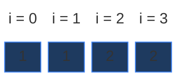

The split we are looking for:

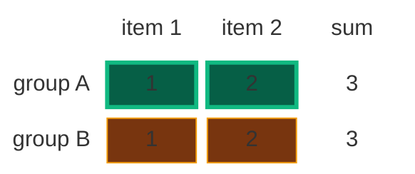

### Constraints

- `1 <= nums.length <= 200`
- `1 <= nums[i] <= 100`
- So the total is at most `200 · 100 = 20,000`, and the half `k` is at most `10,000`.
- All numbers are positive. There are no zeros and no negatives.

### What the constraints tell us (simple theory)

A **constraint** is the biggest input the judge will ever give you. It quietly tells you how fast your code must be.

**Rule of thumb:** a computer does about **100 million (10^8) simple steps per second**. Count how many steps your idea needs for the biggest input, and compare.

| Biggest input | Steps you can afford | Ideas that fit |
|:---:|:---:|:---|
| `n` up to ~20 | about `2^n` | Plain recursion, try every subset |
| `n` up to ~500 | about `n^3` | Three nested loops |
| `n` up to ~5,000 | about `n^2` | Two nested loops |
| `n · k` up to ~10,000,000 | about `n · k` | A 2-D DP table with `n` rows and `k + 1` columns |

**For this problem:** `n` is at most `200` and `k` is at most `10,000`.

- Plain recursion tries pick or not pick for every number. That is up to `2^200` subsets. That number has 61 digits. It would never finish.
- The DP table has `n · (k + 1) = 200 · 10,001 = 2,000,200` cells. Each cell is one quick step. About 2 million steps run in a blink.

So the limits are a hint: they are too big for "try everything", but `n · k` is small. That smells like a 2-D DP on `(index, target)`.

**How the work grows as `n` grows**

To measure it, we ran the code on `nums = [1, 2, ..., n]` (the total is even for these sizes). Red bars = calls made by plain recursion. Green line = DP cells `n · (k + 1)`.

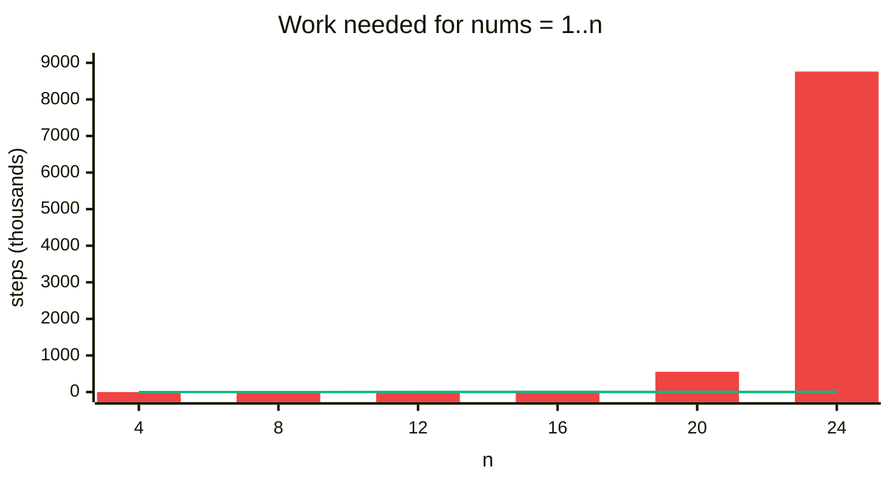

| `n` | `k = total / 2` | Recursion calls | DP cells `n · (k + 1)` |
|:---:|:---:|:---:|:---:|
| 4 | 5 | 11 | 24 |
| 8 | 18 | 151 | 152 |
| 12 | 39 | 2,287 | 480 |
| 16 | 68 | 35,355 | 1,104 |
| 20 | 105 | 554,542 | 2,120 |
| 24 | 150 | 8,761,835 | 3,624 |

For tiny arrays the recursion is cheap (it stops early when the target hits `0`). But every `+4` in `n` multiplies the calls by about 15. The DP grows slowly, like `n · k`.

## 2. Core Theory

### The key trick: halve the total

Call the two group sums `S1` and `S2`, and the total `S`.

```text
S1 = S2              (the groups must be equal)
S1 + S2 = S          (every number is in one group)
so S1 = S2 = S / 2
```

So each group must sum to exactly **half of the total**.

- **Odd total → `False` right away.** Half of an odd number is something like `5.5`. Whole numbers can never add up to `5.5`. Example: `[1, 2, 3, 5]` has total `11`, so the answer is `False` without any DP.
- **Even total → find ONE group with sum `S / 2`.** If one group sums to `S / 2`, the leftover numbers sum to `S - S / 2 = S / 2` too. The second group comes for free. For `[1, 5, 11, 5]`: the group `[11]` sums to `11`, and the rest `[1, 5, 5]` also sums to `22 - 11 = 11`.

So the question becomes: **"Is there a subset with sum `k = total / 2`?"** That is exactly **Subset Sum Equal To K** ([note 01](01.%20Subset%20Sum%20Equal%20To%20K.md)), with `k = total / 2`. Same recursion, same table.

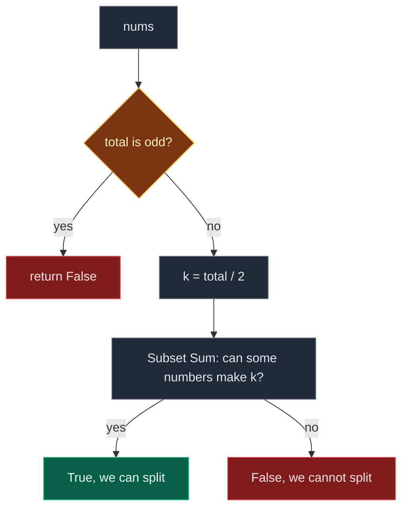

### How to spot that it is DP

| Property | Plain meaning | In this problem |
|:---|:---|:---|
| **Overlapping subproblems** | The same smaller question is asked many times | `f(1, 1)` ("can the first two numbers make 1?") is asked twice in our example |
| **Optimal substructure** | The big answer is built from answers of smaller questions | "Can the first 4 numbers make 3?" is built from "can the first 3 numbers make 3?" and "can the first 3 numbers make 1?" |

Also: every number has a **choice** (pick it or not). Choice problems with repeats are the home of DP. This one is the **take / not take** pattern on subsequences.

### Why one number is not enough for the state

In 1-D DP (like Fibonacci), the state was one number `i`. Here, when we pick a number, the **sum we still need changes**. Two calls at the same index can need different sums. So the question needs two numbers to be named:

- **which numbers we may still use** (`ind`: the numbers `nums[0..ind]`)
- **what sum we still need** (`target`)

### The state

> `f(ind, target)` = "Using only `nums[0..ind]`, can I pick some numbers that add up to exactly `target`?" The answer is `True` or `False`.

Because the state has two numbers, the table is a **grid**:

- **Rows** = how many numbers we may use. Row `ind` may use `nums[0]`, ..., `nums[ind]`.
- **Columns** = the target sum `t = 0 ... k`.
- The answer to the whole problem is the **bottom-right** cell: all numbers, target `k`.

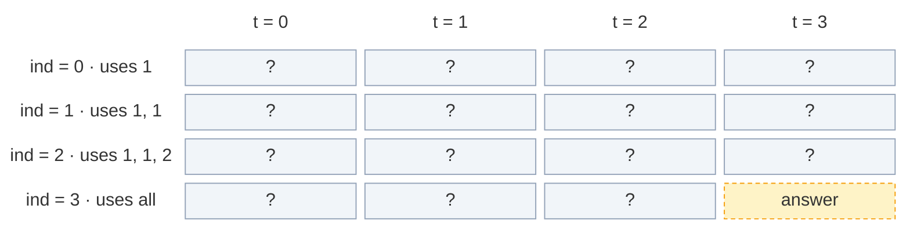

That is `n = 4` rows and `k + 1 = 4` columns (sums `0, 1, 2, 3`).

### The recurrence

In words: *look at the last allowed number `nums[ind]`. Either we leave it out, or we put it in the group. If either way works, the answer is `True`.*

```text
not_pick = f(ind - 1, target)
pick     = f(ind - 1, target - nums[ind])     only if nums[ind] <= target
f(ind, target) = not_pick OR pick
```

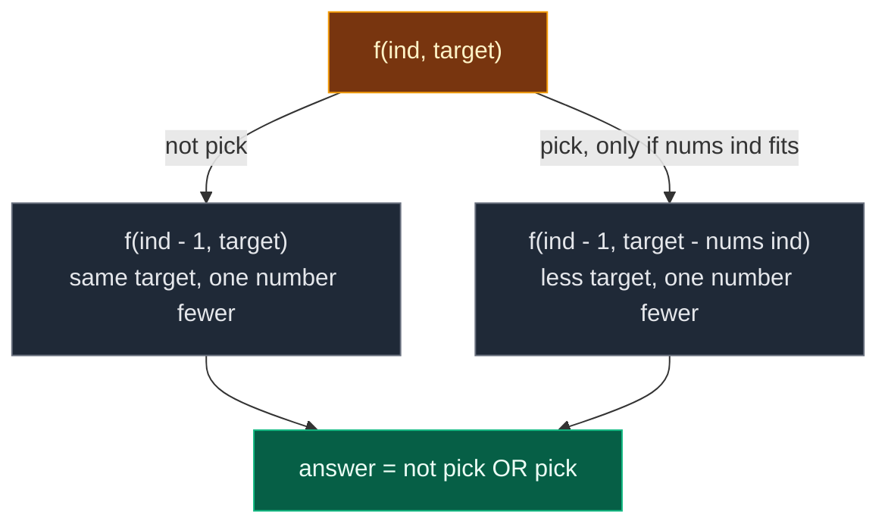

In the grid this means: **not pick = the cell straight up**, **pick = the cell up, then `nums[ind]` steps to the left**. A cell is `True` if either of those two cells is `True`. If `nums[ind]` is bigger than `t`, the pick cell would be off the left edge, so pick = `False`.

### Base cases

| Base case | Value | Why |
|:---:|:---:|:---|
| `target == 0` | `True` | Pick nothing. The empty group has sum `0`. So sum `0` is always possible, in every row |
| `ind == 0` | `nums[0] == target` | Only one number is left. Either it is exactly the target (pick it), or we cannot make the target |

Check `target == 0` **first**. Then `f(0, 0)` returns `True` (pick nothing), which is right.

### The 4-step ladder

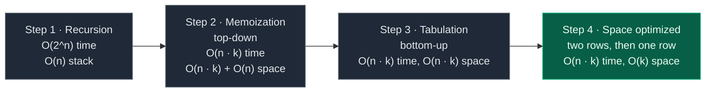

## 3. Edge Cases

| Case | Input | Expected | Why it matters |
|:---|:---:|:---:|:---|
| Odd total | `[1, 2, 3, 5]` | `False` | Total `11`. Return before any DP |
| Two equal numbers | `[1, 1]` | `True` | Total `2`, `k = 1`, the group `[1]` exists |
| Even total, still no split | `[2, 2, 3, 5]` | `False` | Total `12`, `k = 6`, but no subset makes `6` (full table in section 6) |
| Single number | `[2]` | `False` | Total `2`, `k = 1`. The only number `2` is bigger than `1`. Two non-empty groups are impossible |
| A number bigger than half | `[1, 2, 5]` | `False` | Total `8`, `k = 4`, and `5 > 4`. `dp[0][nums[0]]` must not be written when `nums[0] > k` |
| First number equals `k` | `[5, 1, 2, 2]` | `True` | Total `10`, `k = 5`. The base case gives `dp[0][5] = True`: groups `[5]` and `[1, 2, 2]` |
| Our example | `[1, 1, 2, 2]` | `True` | Traced in every section |
| LeetCode example 1 | `[1, 5, 11, 5]` | `True` | `[11]` and `[1, 5, 5]` |

## 4. Approach 1: Recursion

### Idea

Let `solve(ind, target)` answer: "Can we make `target` using `nums[0..ind]`?" Start from the last index with `target = total / 2`. At each index, try **not take** and **take** (only if the number fits). Return `True` if either works.

### Recursion tree for `nums = [1, 1, 2, 2]`, `k = 3`

Every box shows the call and what it returns. Calls happen depth-first, not pick first.

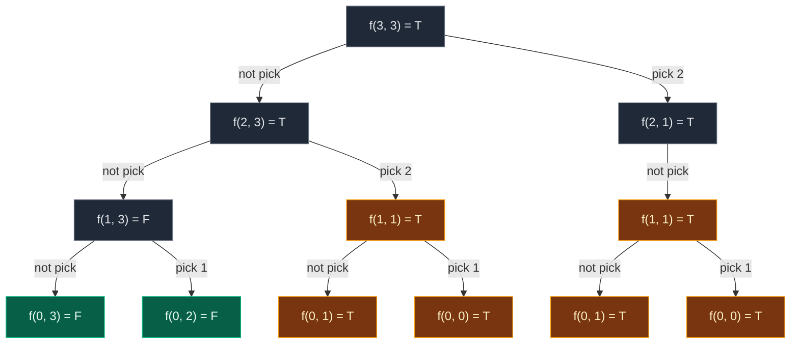

Gold = states that repeat. Green = base cases seen once. `f(2, 1)` has no pick child: `nums[2] = 2` is bigger than `1`.

| State | `f(3,3)` | `f(2,3)` | `f(2,1)` | `f(1,3)` | `f(1,1)` | `f(0,3)` | `f(0,2)` | `f(0,1)` | `f(0,0)` |
|:---|:---:|:---:|:---:|:---:|:---:|:---:|:---:|:---:|:---:|
| Times computed | 1 | 1 | 1 | 1 | **2** | 1 | 1 | **2** | **2** |

That is **12 calls**, and **3 of them are repeats** (`f(1, 1)` and its two children, computed a second time). On bigger inputs the repeats explode (see the chart above).

**The exact order of calls.** Values come back up from the leaves.

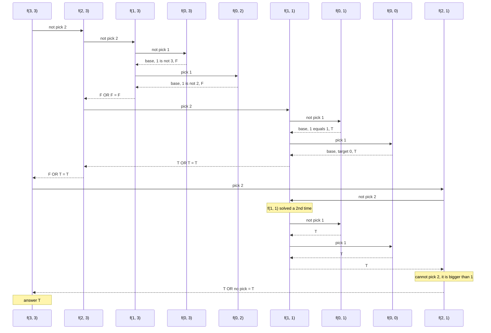

**The LeetCode example, `[1, 5, 11, 5]`, `k = 11`.** Start at `solve(3, 11)`, value `5`. Two options: (1) do not take `5` → `solve(2, 11)`, (2) take `5` → `solve(2, 6)`. From `solve(2, 11)`, value `11`: take it → `solve(1, 0)` → `True` (target is `0`). Read the path: `f(3, 11)` → skip `5` → `f(2, 11)` → take `11` → `f(1, 0) = T`. That is the group `{11}`. The full tree has **10 calls**:

| Call | Returns | Why |
|:---|:---:|:---|
| `f(3, 11)` | T | not take gives T |
| `f(2, 11)` | T | take `11` gives `f(1, 0)` |
| `f(1, 11)` | F | both children F |
| `f(0, 11)` | F | `nums[0] = 1`, not `11` |
| `f(0, 6)` | F | `1` is not `6` |
| `f(1, 0)` | T | target is `0` |
| `f(2, 6)` | T | not take gives `f(1, 6) = T` (`11 > 6`, cannot take) |
| `f(1, 6)` | T | take `5` gives `f(0, 1)` |
| `f(0, 6)` | F | `1` is not `6` |
| `f(0, 1)` | T | `nums[0] = 1` equals `1` |

### Code

```python
from typing import List


# Plain recursion: try pick / not pick for every number
class SolutionRecursion:

    # Main LeetCode method
    def canPartition(self, nums: List[int]) -> bool:

        # Calculate the total sum of the array
        total_sum = sum(nums)

        # If the total sum is odd, an equal split is impossible
        if total_sum % 2 != 0:
            return False

        # We only need ONE group with half of the total
        target = total_sum // 2

        # Start the recursion from the last index
        return self.solve(len(nums) - 1, target, nums)

    # Can we make target using nums[0..index]?
    def solve(self, index: int, target: int, nums: List[int]) -> bool:

        # Target reached 0: the group is complete
        if target == 0:
            return True

        # Only the first number is left: it must equal the target
        if index == 0:
            return nums[0] == target

        # Option 1: do not take the current number
        not_take = self.solve(index - 1, target, nums)

        # Option 2 starts as False
        take = False

        # Take the current number only if it fits in the target
        if nums[index] <= target:

            # Take it: one number fewer, smaller target
            take = self.solve(index - 1, target - nums[index], nums)

        # True if either option works
        return take or not_take
```

### Complexity

| Measure | Complexity | Why |
|:---|:---:|:---|
| **Time** | `O(2^n)` | Every number has two choices, so the tree can double at each level |
| **Space** | `O(n)` | Recursion stack. The deepest path goes `ind = n-1, n-2, ..., 0`, which is `n` frames |

## 5. Approach 2: Memoization (Top-Down)

### Idea

In the recursion, the same `(index, target)` pair is solved more than once. In our example `f(1, 1)` is solved twice. In bigger inputs states like `solve(2, 6)`, `solve(1, 6)`, `solve(1, 1)` come back again and again. So we keep a notebook: `dp[index][target]`.

What the table is, from zero:

- It is a notebook with **one box for every question** `f(index, target)`.
- **Rows** = index `0, 1, 2, 3` (one row per number).
- **Columns** = target `0, 1, ..., k` (every sum we might still need). So the size is `n x (k + 1)`.
- At the start every box holds `-1` = "I don't know yet".
- When a call finishes, it writes its answer into its box: `1` (True) or `0` (False).
- Before doing any work, a call first looks in its box. If it is not `-1`, it just returns that answer.

The **3 steps** that turn recursion into memoization:

1. **Declare** `dp` with `n` rows and `k + 1` columns, filled with `-1`.
2. **Store** the answer before returning: `dp[index][target] = 1 if (take or not_take) else 0`.
3. **Check** first: if `dp[index][target] != -1`, return `bool(dp[index][target])`.

**Top-down** means we start from the BIG question `f(3, 3)` and go down to small questions. The table gets filled only where the recursion actually goes. Many boxes stay `-1`, and that is fine. Base-case calls (`index == 0` or `target == 0`) are answered directly and are never written into the table.

### Visual: the grid after every fill (`nums = [1, 1, 2, 2]`, `k = 3`)

**Start:** every box is `-1`.

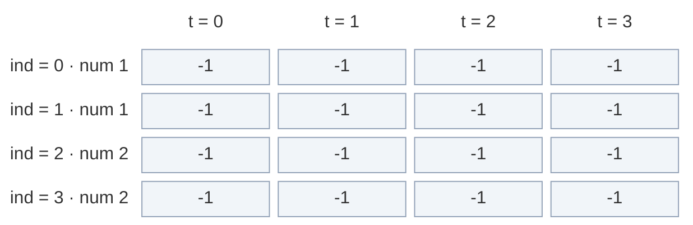

**Fill 1.** `f(3, 3)` → box `-1`, work. `f(2, 3)` → `-1`, work. `f(1, 3)` → `-1`, work. Its children are base cases: `f(0, 3)`: `1` is not `3` → F. `f(0, 2)`: `1` is not `2` → F. So `F OR F = F`. Write `dp[1][3] = 0`.

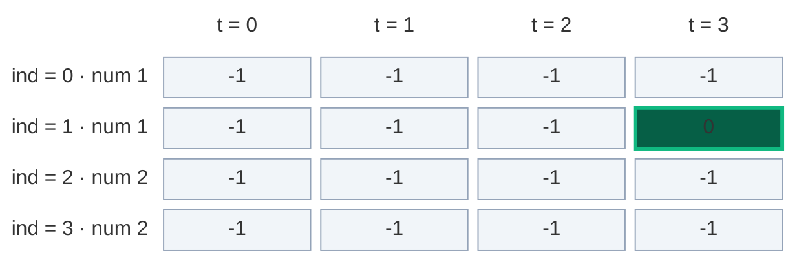

**Fill 2.** Back in `f(2, 3)`, pick `2` → `f(1, 1)` → box `-1`, work. `f(0, 1)`: `1` equals `1` → T. `f(0, 0)`: target is `0` → T. So `T OR T = T`. Write `dp[1][1] = 1`.

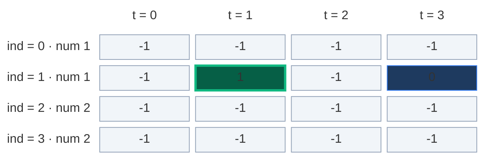

**Fill 3.** Back in `f(2, 3)`: not take = F, take = T → T. Write `dp[2][3] = 1`.

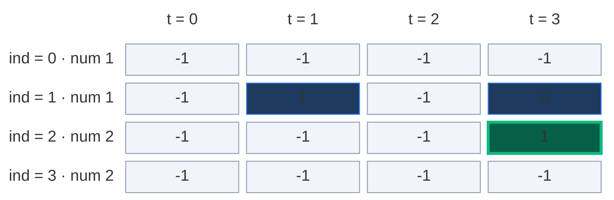

**Cache hit.** Back in `f(3, 3)`, pick `2` → `f(2, 1)` → box `-1`, work (yellow, still computing). Not pick → `f(1, 1)`. Its box already says `1`! Return `True` straight away. No new calls (orange).

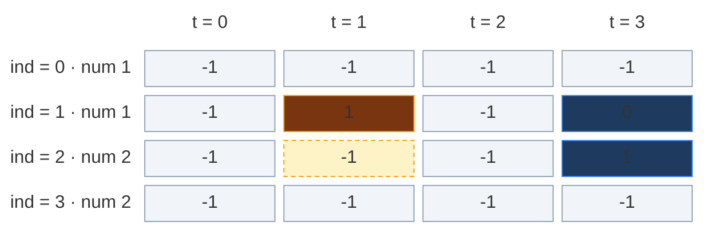

**Fill 4.** In `f(2, 1)`: pick `2` is not allowed (`2 > 1`). So `T OR no pick = T`. Write `dp[2][1] = 1`.

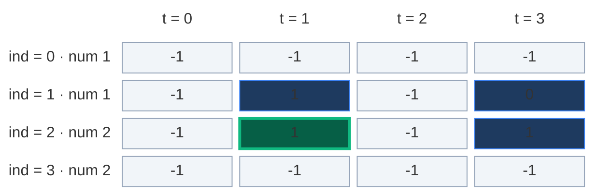

**Fill 5.** Back in `f(3, 3)`: not take = T, take = T → T. Write `dp[3][3] = 1`. Answer: `True`.

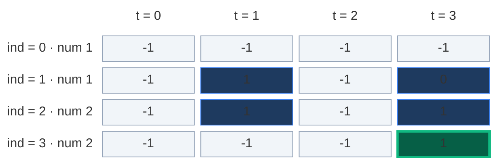

Only 5 of the 16 boxes were ever needed. The rest stay `-1`.

| Step | Call | What happens | Box written |
|:---:|:---|:---|:---:|
| 1 | `f(3, 3)` | box `-1`, try both choices with `nums[3] = 2` | |
| 2 | `f(2, 3)` | box `-1`, try both choices with `nums[2] = 2` | |
| 3 | `f(1, 3)` | box `-1`, try both choices with `nums[1] = 1` | |
| 4 | `f(0, 3)` | base case, `1` is not `3` → F | |
| 5 | `f(0, 2)` | base case, `1` is not `2` → F | `dp[1][3] = 0` |
| 6 | `f(1, 1)` | box `-1`, try both choices with `nums[1] = 1` | |
| 7 | `f(0, 1)` | base case, `1` equals `1` → T | |
| 8 | `f(0, 0)` | base case, target `0` → T | `dp[1][1] = 1`, then `dp[2][3] = 1` |
| 9 | `f(2, 1)` | box `-1`, try both choices with `nums[2] = 2` | |
| 10 | `f(1, 1)` | **box is already `1` → return T, no new work** | `dp[2][1] = 1`, then `dp[3][3] = 1` |

### The pruned recursion tree

Same tree, but the cache hit (dashed) stops right away.

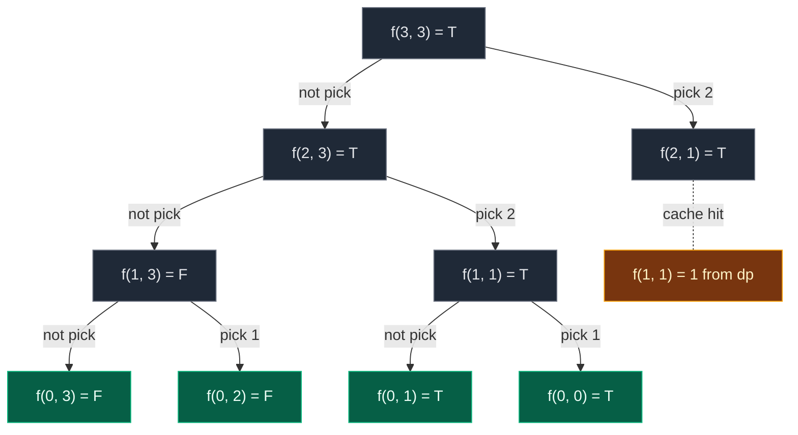

**10 calls** instead of 12. On big inputs this saving happens thousands of times. That is why memo turns `2^n` into `n · k`.

**On the LeetCode example `[1, 5, 11, 5]`:** memo writes 5 boxes, in this order: `dp[1][11] = 0`, `dp[2][11] = 1`, `dp[1][6] = 1`, `dp[2][6] = 1`, `dp[3][11] = 1`. No box is asked twice there, so memo saves nothing on that tiny input. For example, once `solve(2, 6)` is stored in `dp[2][6]`, any later `solve(2, 6)` would use the stored value. That is why our main example uses `[1, 1, 2, 2]`: it shows a real reuse.

### Code

```python
# Memoization (top-down DP): recursion + a grid of -1
class SolutionMemo:

    # Main LeetCode method
    def canPartition(self, nums: List[int]) -> bool:

        # Compute the total sum
        total_sum = sum(nums)

        # An odd sum cannot be split equally
        if total_sum % 2 != 0:
            return False

        # The target sum for one group
        target = total_sum // 2

        # Step 1 (declare): n rows, target + 1 columns, -1 = not computed
        dp = [[-1 for _ in range(target + 1)] for _ in range(len(nums))]

        # Start the memoized recursion from the last index
        return self.solve(len(nums) - 1, target, nums, dp)

    # Can we make target using nums[0..index]? Remember answers in dp
    def solve(self, index: int, target: int, nums: List[int], dp: List[List[int]]) -> bool:

        # Target reached 0: a valid group is found
        if target == 0:
            return True

        # Only the first number is available
        if index == 0:
            return nums[0] == target

        # Step 3 (check): already computed? Return the stored answer
        if dp[index][target] != -1:
            return bool(dp[index][target])

        # Option 1: do not take the current number
        not_take = self.solve(index - 1, target, nums, dp)

        # Option 2 starts as False
        take = False

        # Take the current number only if it fits
        if nums[index] <= target:

            # Take it: one number fewer, smaller target
            take = self.solve(index - 1, target - nums[index], nums, dp)

        # Step 2 (store): 1 for True, 0 for False
        dp[index][target] = 1 if (take or not_take) else 0

        # Return the final answer for this state
        return take or not_take
```

### Complexity

| Measure | Complexity | Why |
|:---|:---:|:---|
| **Time** | `O(n · k)` | Each of the `n · (k + 1)` states is computed at most once. Each does `O(1)` work |
| **Space: dp grid** | `O(n · k)` | `n` rows times `k + 1` columns |
| **Space: recursion stack** | `O(n)` | The index drops by one per call, so at most `n` frames |
| **Total space** | `O(n · k) + O(n)` | Grid plus stack |

## 6. Approach 3: Tabulation (Bottom-Up)

### Idea

Define `dp[i][t]` = "Can we make sum `t` using `nums[0..i]`?" (`True` or `False`). Fill the grid with loops, row by row, left to right. No recursion.

- Box `dp[i][t]` answers: "Using only `nums[0]` ... `nums[i]`, can I pick some numbers that add up to exactly `t`?"
- Row `0` may use only `[1]`. Row `1` may use `[1, 1]`. Row `2` may use `[1, 1, 2]`. Row `3` may use all of `[1, 1, 2, 2]`.
- Each row only needs the row just above it. That is why we fill top to bottom.

### How to convert memo → table in 2-D, step by step

1. **Same grid:** `dp` with `n` rows and `k + 1` columns. Start with every box `False`.
2. **Base cases into the grid:**
   - `target == 0 → True` becomes `dp[i][0] = True` for **every row** `i` (sum `0` is always possible: the empty group).
   - `index == 0 → nums[0] == target` becomes `dp[0][nums[0]] = True`, but only if `nums[0] <= k` (otherwise the column does not exist).
3. **Two nested loops, opposite to the recursion:** recursion went from `n - 1` down to `0`. The loops go small to big: `ind` from `1` to `n - 1`, and `target` from `1` to `k`.
4. **Copy the recurrence**, replacing `f(...)` with `dp[...]`:
   - `not_take = dp[ind - 1][target]` (the cell straight up)
   - `take = dp[ind - 1][target - nums[ind]]` if `nums[ind] <= target` (up, then `nums[ind]` steps left)
   - `dp[ind][target] = take or not_take`
5. **The answer is the bottom-right cell** `dp[n - 1][k]`.

| Memoization | Becomes in tabulation |
|:---|:---|
| Grid of `-1`, `n` rows and `k + 1` columns | Grid of `False`, same size |
| `if target == 0: return True` | `dp[i][0] = True` for every `i` |
| `if index == 0: return nums[0] == target` | `dp[0][nums[0]] = True` if `nums[0] <= k` |
| `f(index - 1, target)` | `dp[ind - 1][target]` |
| `f(index - 1, target - nums[index])` | `dp[ind - 1][target - nums[ind]]` |
| `return f(n - 1, k)` | `return dp[n - 1][k]` |

### Visual table fill (`nums = [1, 1, 2, 2]`, `k = 3`)

**Step A.** The code makes every box `False`.

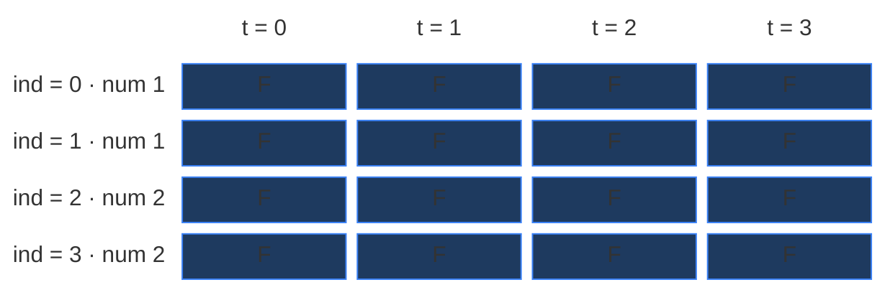

**Step B.** Column `0` becomes `True` in every row (pick nothing → sum `0`).

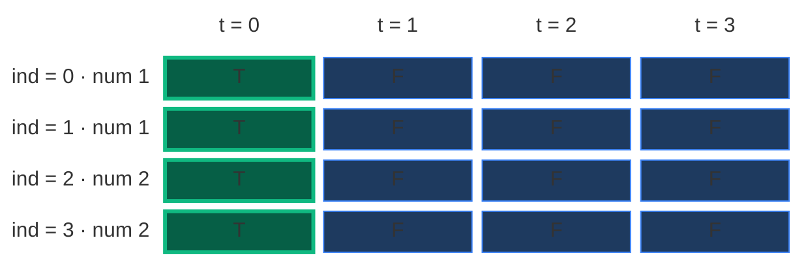

**Step C.** Row `0` can use only `nums[0] = 1`, so sum `1` is possible: `dp[0][1] = True`. Row `0` is now finished. `?` = not filled yet.

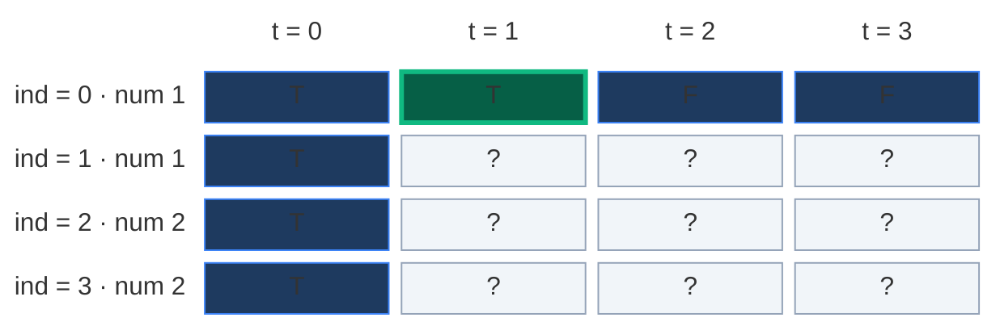

**Row 1** (`nums[1] = 1`). Orange = the two cells it reads: **up** (not pick) and **up, then 1 step left** (pick). Green = the new cell.

`t = 1`: not pick = `dp[0][1] = T`. Pick 1 = `dp[0][0] = T`. `T OR T = T`.

```mermaid
block-beta
  columns 5
  hx[" "] h0["t = 0"] h1["t = 1"] h2["t = 2"] h3["t = 3"]
  l0["ind = 0 · num 1"] r0c0["T"] r0c1["T"] r0c2["F"] r0c3["F"]
  l1["ind = 1 · num 1"] r1c0["T"] r1c1["T"] r1c2["?"] r1c3["?"]
  l2["ind = 2 · num 2"] r2c0["T"] r2c1["?"] r2c2["?"] r2c3["?"]
  l3["ind = 3 · num 2"] r3c0["T"] r3c1["?"] r3c2["?"] r3c3["?"]
  l4[" "] r4c0["pick src"] r4c1["= T OR T"] r4c2[" "] r4c3[" "]
  classDef head fill:none,stroke:none,color:#64748b
  class hx,h0,h1,h2,h3,l0,l1,l2,l3,l4 head
  classDef read fill:#78350f,stroke:#f59e0b,color:#fef3c7
  class r0c0,r0c1 read
  classDef done fill:#1e3a5f,stroke:#3b82f6,color:#dbeafe
  class r0c2,r0c3,r1c0,r2c0,r3c0 done
  classDef new fill:#065f46,stroke:#10b981,color:#ecfdf5,stroke-width:3px
  class r1c1 new
  classDef empty fill:#f1f5f9,stroke:#94a3b8,color:#64748b
  class r1c2,r1c3,r2c1,r2c2,r2c3,r3c1,r3c2,r3c3 empty
  classDef note fill:none,stroke:none,color:#b45309
  class r4c0,r4c1,r4c2,r4c3 note
```

`t = 2`: not pick = `dp[0][2] = F`. Pick 1 = `dp[0][1] = T`. `F OR T = T` (with `[1, 1]` I can make `2` → `1 + 1`).

```mermaid
block-beta
  columns 5
  hx[" "] h0["t = 0"] h1["t = 1"] h2["t = 2"] h3["t = 3"]
  l0["ind = 0 · num 1"] r0c0["T"] r0c1["T"] r0c2["F"] r0c3["F"]
  l1["ind = 1 · num 1"] r1c0["T"] r1c1["T"] r1c2["T"] r1c3["?"]
  l2["ind = 2 · num 2"] r2c0["T"] r2c1["?"] r2c2["?"] r2c3["?"]
  l3["ind = 3 · num 2"] r3c0["T"] r3c1["?"] r3c2["?"] r3c3["?"]
  l4[" "] r4c0[" "] r4c1["pick src"] r4c2["= F OR T"] r4c3[" "]
  classDef head fill:none,stroke:none,color:#64748b
  class hx,h0,h1,h2,h3,l0,l1,l2,l3,l4 head
  classDef done fill:#1e3a5f,stroke:#3b82f6,color:#dbeafe
  class r0c0,r0c3,r1c0,r1c1,r2c0,r3c0 done
  classDef read fill:#78350f,stroke:#f59e0b,color:#fef3c7
  class r0c1,r0c2 read
  classDef new fill:#065f46,stroke:#10b981,color:#ecfdf5,stroke-width:3px
  class r1c2 new
  classDef empty fill:#f1f5f9,stroke:#94a3b8,color:#64748b
  class r1c3,r2c1,r2c2,r2c3,r3c1,r3c2,r3c3 empty
  classDef note fill:none,stroke:none,color:#b45309
  class r4c0,r4c1,r4c2,r4c3 note
```

`t = 3`: not pick = `dp[0][3] = F`. Pick 1 = `dp[0][2] = F`. `F OR F = F`.

```mermaid
block-beta
  columns 5
  hx[" "] h0["t = 0"] h1["t = 1"] h2["t = 2"] h3["t = 3"]
  l0["ind = 0 · num 1"] r0c0["T"] r0c1["T"] r0c2["F"] r0c3["F"]
  l1["ind = 1 · num 1"] r1c0["T"] r1c1["T"] r1c2["T"] r1c3["F"]
  l2["ind = 2 · num 2"] r2c0["T"] r2c1["?"] r2c2["?"] r2c3["?"]
  l3["ind = 3 · num 2"] r3c0["T"] r3c1["?"] r3c2["?"] r3c3["?"]
  l4[" "] r4c0[" "] r4c1[" "] r4c2["pick src"] r4c3["= F OR F"]
  classDef head fill:none,stroke:none,color:#64748b
  class hx,h0,h1,h2,h3,l0,l1,l2,l3,l4 head
  classDef done fill:#1e3a5f,stroke:#3b82f6,color:#dbeafe
  class r0c0,r0c1,r1c0,r1c1,r1c2,r2c0,r3c0 done
  classDef read fill:#78350f,stroke:#f59e0b,color:#fef3c7
  class r0c2,r0c3 read
  classDef new fill:#065f46,stroke:#10b981,color:#ecfdf5,stroke-width:3px
  class r1c3 new
  classDef empty fill:#f1f5f9,stroke:#94a3b8,color:#64748b
  class r2c1,r2c2,r2c3,r3c1,r3c2,r3c3 empty
  classDef note fill:none,stroke:none,color:#b45309
  class r4c0,r4c1,r4c2,r4c3 note
```

After row 1: possible sums = `[0, 1, 2]`. The new one is `2`: an old sum + `1`.

**Row 2** (`nums[2] = 2`). Pick now looks **2 steps** to the left.

`t = 1`: not pick = `dp[1][1] = T`. Pick 2: `2 > 1`, cannot pick (off the left edge). `T OR no pick = T`.

```mermaid
block-beta
  columns 5
  hx[" "] h0["t = 0"] h1["t = 1"] h2["t = 2"] h3["t = 3"]
  l0["ind = 0 · num 1"] r0c0["T"] r0c1["T"] r0c2["F"] r0c3["F"]
  l1["ind = 1 · num 1"] r1c0["T"] r1c1["T"] r1c2["T"] r1c3["F"]
  l2["ind = 2 · num 2"] r2c0["T"] r2c1["T"] r2c2["?"] r2c3["?"]
  l3["ind = 3 · num 2"] r3c0["T"] r3c1["?"] r3c2["?"] r3c3["?"]
  l4[" "] r4c0[" "] r4c1["= T OR no pick"] r4c2[" "] r4c3[" "]
  classDef head fill:none,stroke:none,color:#64748b
  class hx,h0,h1,h2,h3,l0,l1,l2,l3,l4 head
  classDef done fill:#1e3a5f,stroke:#3b82f6,color:#dbeafe
  class r0c0,r0c1,r0c2,r0c3,r1c0,r1c2,r1c3,r2c0,r3c0 done
  classDef read fill:#78350f,stroke:#f59e0b,color:#fef3c7
  class r1c1 read
  classDef new fill:#065f46,stroke:#10b981,color:#ecfdf5,stroke-width:3px
  class r2c1 new
  classDef empty fill:#f1f5f9,stroke:#94a3b8,color:#64748b
  class r2c2,r2c3,r3c1,r3c2,r3c3 empty
  classDef note fill:none,stroke:none,color:#b45309
  class r4c0,r4c1,r4c2,r4c3 note
```

`t = 2`: not pick = `dp[1][2] = T`. Pick 2 = `dp[1][0] = T`. `T OR T = T`.

```mermaid
block-beta
  columns 5
  hx[" "] h0["t = 0"] h1["t = 1"] h2["t = 2"] h3["t = 3"]
  l0["ind = 0 · num 1"] r0c0["T"] r0c1["T"] r0c2["F"] r0c3["F"]
  l1["ind = 1 · num 1"] r1c0["T"] r1c1["T"] r1c2["T"] r1c3["F"]
  l2["ind = 2 · num 2"] r2c0["T"] r2c1["T"] r2c2["T"] r2c3["?"]
  l3["ind = 3 · num 2"] r3c0["T"] r3c1["?"] r3c2["?"] r3c3["?"]
  l4[" "] r4c0["pick src"] r4c1[" "] r4c2["= T OR T"] r4c3[" "]
  classDef head fill:none,stroke:none,color:#64748b
  class hx,h0,h1,h2,h3,l0,l1,l2,l3,l4 head
  classDef done fill:#1e3a5f,stroke:#3b82f6,color:#dbeafe
  class r0c0,r0c1,r0c2,r0c3,r1c1,r1c3,r2c0,r2c1,r3c0 done
  classDef read fill:#78350f,stroke:#f59e0b,color:#fef3c7
  class r1c0,r1c2 read
  classDef new fill:#065f46,stroke:#10b981,color:#ecfdf5,stroke-width:3px
  class r2c2 new
  classDef empty fill:#f1f5f9,stroke:#94a3b8,color:#64748b
  class r2c3,r3c1,r3c2,r3c3 empty
  classDef note fill:none,stroke:none,color:#b45309
  class r4c0,r4c1,r4c2,r4c3 note
```

`t = 3`: not pick = `dp[1][3] = F`. Pick 2 = `dp[1][1] = T`. `F OR T = T`. Now `dp[2][3]` is already `True`: `[1, 2]` makes `3`.

```mermaid
block-beta
  columns 5
  hx[" "] h0["t = 0"] h1["t = 1"] h2["t = 2"] h3["t = 3"]
  l0["ind = 0 · num 1"] r0c0["T"] r0c1["T"] r0c2["F"] r0c3["F"]
  l1["ind = 1 · num 1"] r1c0["T"] r1c1["T"] r1c2["T"] r1c3["F"]
  l2["ind = 2 · num 2"] r2c0["T"] r2c1["T"] r2c2["T"] r2c3["T"]
  l3["ind = 3 · num 2"] r3c0["T"] r3c1["?"] r3c2["?"] r3c3["?"]
  l4[" "] r4c0[" "] r4c1["pick src"] r4c2[" "] r4c3["= F OR T"]
  classDef head fill:none,stroke:none,color:#64748b
  class hx,h0,h1,h2,h3,l0,l1,l2,l3,l4 head
  classDef done fill:#1e3a5f,stroke:#3b82f6,color:#dbeafe
  class r0c0,r0c1,r0c2,r0c3,r1c0,r1c2,r2c0,r2c1,r2c2,r3c0 done
  classDef read fill:#78350f,stroke:#f59e0b,color:#fef3c7
  class r1c1,r1c3 read
  classDef new fill:#065f46,stroke:#10b981,color:#ecfdf5,stroke-width:3px
  class r2c3 new
  classDef empty fill:#f1f5f9,stroke:#94a3b8,color:#64748b
  class r3c1,r3c2,r3c3 empty
  classDef note fill:none,stroke:none,color:#b45309
  class r4c0,r4c1,r4c2,r4c3 note
```

After row 2: possible sums = `[0, 1, 2, 3]`. The new one is `3`: an old sum `1` + `2`.

**Row 3** (`nums[3] = 2`).

`t = 1`: not pick = `dp[2][1] = T`. `2 > 1`, cannot pick. `T OR no pick = T`.

```mermaid
block-beta
  columns 5
  hx[" "] h0["t = 0"] h1["t = 1"] h2["t = 2"] h3["t = 3"]
  l0["ind = 0 · num 1"] r0c0["T"] r0c1["T"] r0c2["F"] r0c3["F"]
  l1["ind = 1 · num 1"] r1c0["T"] r1c1["T"] r1c2["T"] r1c3["F"]
  l2["ind = 2 · num 2"] r2c0["T"] r2c1["T"] r2c2["T"] r2c3["T"]
  l3["ind = 3 · num 2"] r3c0["T"] r3c1["T"] r3c2["?"] r3c3["?"]
  l4[" "] r4c0[" "] r4c1["= T OR no pick"] r4c2[" "] r4c3[" "]
  classDef head fill:none,stroke:none,color:#64748b
  class hx,h0,h1,h2,h3,l0,l1,l2,l3,l4 head
  classDef done fill:#1e3a5f,stroke:#3b82f6,color:#dbeafe
  class r0c0,r0c1,r0c2,r0c3,r1c0,r1c1,r1c2,r1c3,r2c0,r2c2,r2c3,r3c0 done
  classDef read fill:#78350f,stroke:#f59e0b,color:#fef3c7
  class r2c1 read
  classDef new fill:#065f46,stroke:#10b981,color:#ecfdf5,stroke-width:3px
  class r3c1 new
  classDef empty fill:#f1f5f9,stroke:#94a3b8,color:#64748b
  class r3c2,r3c3 empty
  classDef note fill:none,stroke:none,color:#b45309
  class r4c0,r4c1,r4c2,r4c3 note
```

`t = 2`: not pick = `dp[2][2] = T`. Pick 2 = `dp[2][0] = T`. `T OR T = T`.

```mermaid
block-beta
  columns 5
  hx[" "] h0["t = 0"] h1["t = 1"] h2["t = 2"] h3["t = 3"]
  l0["ind = 0 · num 1"] r0c0["T"] r0c1["T"] r0c2["F"] r0c3["F"]
  l1["ind = 1 · num 1"] r1c0["T"] r1c1["T"] r1c2["T"] r1c3["F"]
  l2["ind = 2 · num 2"] r2c0["T"] r2c1["T"] r2c2["T"] r2c3["T"]
  l3["ind = 3 · num 2"] r3c0["T"] r3c1["T"] r3c2["T"] r3c3["?"]
  l4[" "] r4c0["pick src"] r4c1[" "] r4c2["= T OR T"] r4c3[" "]
  classDef head fill:none,stroke:none,color:#64748b
  class hx,h0,h1,h2,h3,l0,l1,l2,l3,l4 head
  classDef done fill:#1e3a5f,stroke:#3b82f6,color:#dbeafe
  class r0c0,r0c1,r0c2,r0c3,r1c0,r1c1,r1c2,r1c3,r2c1,r2c3,r3c0,r3c1 done
  classDef read fill:#78350f,stroke:#f59e0b,color:#fef3c7
  class r2c0,r2c2 read
  classDef new fill:#065f46,stroke:#10b981,color:#ecfdf5,stroke-width:3px
  class r3c2 new
  classDef empty fill:#f1f5f9,stroke:#94a3b8,color:#64748b
  class r3c3 empty
  classDef note fill:none,stroke:none,color:#b45309
  class r4c0,r4c1,r4c2,r4c3 note
```

`t = 3`: not pick = `dp[2][3] = T`. Pick 2 = `dp[2][1] = T`. `T OR T = T`.

```mermaid
block-beta
  columns 5
  hx[" "] h0["t = 0"] h1["t = 1"] h2["t = 2"] h3["t = 3"]
  l0["ind = 0 · num 1"] r0c0["T"] r0c1["T"] r0c2["F"] r0c3["F"]
  l1["ind = 1 · num 1"] r1c0["T"] r1c1["T"] r1c2["T"] r1c3["F"]
  l2["ind = 2 · num 2"] r2c0["T"] r2c1["T"] r2c2["T"] r2c3["T"]
  l3["ind = 3 · num 2"] r3c0["T"] r3c1["T"] r3c2["T"] r3c3["T"]
  l4[" "] r4c0[" "] r4c1["pick src"] r4c2[" "] r4c3["= T OR T"]
  classDef head fill:none,stroke:none,color:#64748b
  class hx,h0,h1,h2,h3,l0,l1,l2,l3,l4 head
  classDef done fill:#1e3a5f,stroke:#3b82f6,color:#dbeafe
  class r0c0,r0c1,r0c2,r0c3,r1c0,r1c1,r1c2,r1c3,r2c0,r2c2,r3c0,r3c1,r3c2 done
  classDef read fill:#78350f,stroke:#f59e0b,color:#fef3c7
  class r2c1,r2c3 read
  classDef new fill:#065f46,stroke:#10b981,color:#ecfdf5,stroke-width:3px
  class r3c3 new
  classDef note fill:none,stroke:none,color:#b45309
  class r4c0,r4c1,r4c2,r4c3 note
```

Answer = bottom-right box `dp[3][3] = T`. The array can be split. When we fill a row, the row above is always complete. That is why the outer loop goes top to bottom.

| Row `ind` | `nums[ind]` | Possible sums after this row | New sums |
|:---:|:---:|:---|:---|
| 0 | 1 | `0, 1` | `1` (base case) |
| 1 | 1 | `0, 1, 2` | `2` |
| 2 | 2 | `0, 1, 2, 3` | `3` |
| 3 | 2 | `0, 1, 2, 3` | none |

**The LeetCode example `[1, 5, 11, 5]`, `k = 11`** (4 rows × 12 columns). Blue = `T`, grey = `F`, green = the answer.

```mermaid
block-beta
  columns 13
  hx[" "] h0["0"] h1["1"] h2["2"] h3["3"] h4["4"] h5["5"] h6["6"] h7["7"] h8["8"] h9["9"] h10["10"] h11["11"]
  l0["ind = 0 · num 1"] r0c0["T"] r0c1["T"] r0c2["F"] r0c3["F"] r0c4["F"] r0c5["F"] r0c6["F"] r0c7["F"] r0c8["F"] r0c9["F"] r0c10["F"] r0c11["F"]
  l1["ind = 1 · num 5"] r1c0["T"] r1c1["T"] r1c2["F"] r1c3["F"] r1c4["F"] r1c5["T"] r1c6["T"] r1c7["F"] r1c8["F"] r1c9["F"] r1c10["F"] r1c11["F"]
  l2["ind = 2 · num 11"] r2c0["T"] r2c1["T"] r2c2["F"] r2c3["F"] r2c4["F"] r2c5["T"] r2c6["T"] r2c7["F"] r2c8["F"] r2c9["F"] r2c10["F"] r2c11["T"]
  l3["ind = 3 · num 5"] r3c0["T"] r3c1["T"] r3c2["F"] r3c3["F"] r3c4["F"] r3c5["T"] r3c6["T"] r3c7["F"] r3c8["F"] r3c9["F"] r3c10["T"] r3c11["T"]
  classDef head fill:none,stroke:none,color:#64748b
  class hx,h0,h1,h2,h3,h4,h5,h6,h7,h8,h9,h10,h11,l0,l1,l2,l3 head
  classDef done fill:#1e3a5f,stroke:#3b82f6,color:#dbeafe
  class r0c0,r0c1,r1c0,r1c1,r1c5,r1c6,r2c0,r2c1,r2c5,r2c6,r2c11,r3c0,r3c1,r3c5,r3c6,r3c10 done
  classDef old fill:#e2e8f0,stroke:#64748b,color:#0f172a
  class r0c2,r0c3,r0c4,r0c5,r0c6,r0c7,r0c8,r0c9,r0c10,r0c11,r1c2,r1c3,r1c4,r1c7,r1c8,r1c9,r1c10,r1c11,r2c2,r2c3,r2c4,r2c7,r2c8,r2c9,r2c10,r3c2,r3c3,r3c4,r3c7,r3c8,r3c9 old
  classDef new fill:#065f46,stroke:#10b981,color:#ecfdf5,stroke-width:3px
  class r3c11 new
```

- Start: `dp[i][0] = True`, and the first number is `1`, so `dp[0][1] = True`.
- Row 1, value `5`: not take keeps the old sums `0, 1`. Take `5` adds `5, 6`. Example of one cell: `dp[1][6]`: not take `5` → straight up `dp[0][6] = F`. Take `5` → only `6 - 5 = 1` is still needed → `dp[0][1] = T`. So `F OR T = T` (with `[1, 5]` I can make `6 = 1 + 5`).
- Row 2, value `11`: not take keeps old sums. Take `11` adds `11` (from `dp[1][0]`). `dp[2][11] = True` already, so the answer is reachable after row 2. The code still fills row 3.
- Row 3, value `5`: adds `10` (from `5 + 5`). Answer `dp[3][11] = T`.

**A FALSE example: `[2, 2, 3, 5]`**, total `12`, `k = 6` (4 rows × 7 columns). Orange = the answer cell.

```mermaid
block-beta
  columns 8
  hx[" "] h0["0"] h1["1"] h2["2"] h3["3"] h4["4"] h5["5"] h6["6"]
  l0["ind = 0 · num 2"] r0c0["T"] r0c1["F"] r0c2["T"] r0c3["F"] r0c4["F"] r0c5["F"] r0c6["F"]
  l1["ind = 1 · num 2"] r1c0["T"] r1c1["F"] r1c2["T"] r1c3["F"] r1c4["T"] r1c5["F"] r1c6["F"]
  l2["ind = 2 · num 3"] r2c0["T"] r2c1["F"] r2c2["T"] r2c3["T"] r2c4["T"] r2c5["T"] r2c6["F"]
  l3["ind = 3 · num 5"] r3c0["T"] r3c1["F"] r3c2["T"] r3c3["T"] r3c4["T"] r3c5["T"] r3c6["F"]
  classDef head fill:none,stroke:none,color:#64748b
  class hx,h0,h1,h2,h3,h4,h5,h6,l0,l1,l2,l3 head
  classDef done fill:#1e3a5f,stroke:#3b82f6,color:#dbeafe
  class r0c0,r0c2,r1c0,r1c2,r1c4,r2c0,r2c2,r2c3,r2c4,r2c5,r3c0,r3c2,r3c3,r3c4,r3c5 done
  classDef old fill:#e2e8f0,stroke:#64748b,color:#0f172a
  class r0c1,r0c3,r0c4,r0c5,r0c6,r1c1,r1c3,r1c5,r1c6,r2c1,r2c6,r3c1 old
  classDef read fill:#78350f,stroke:#f59e0b,color:#fef3c7
  class r3c6 read
```

After each row the possible sums are `[0, 2]`, `[0, 2, 4]`, `[0, 2, 3, 4, 5]`, `[0, 2, 3, 4, 5]`. Sum `6` never appears, so `dp[3][6] = F`: no equal split.

### Code

```python
# Tabulation (bottom-up DP): fill the grid row by row
class SolutionTab:

    # Main LeetCode method
    def canPartition(self, nums: List[int]) -> bool:

        # Compute the total sum
        total_sum = sum(nums)

        # An odd total cannot be split into two equal groups
        if total_sum % 2 != 0:
            return False

        # The target sum for one group
        target = total_sum // 2

        # Number of elements
        n = len(nums)

        # Grid with n rows and target + 1 columns, all False
        dp = [[False for _ in range(target + 1)] for _ in range(n)]

        # Base case: sum 0 is always possible, in every row
        for index in range(n):

            # Pick nothing: empty group
            dp[index][0] = True

        # Base case: the first number alone, only if it fits
        if nums[0] <= target:

            # Row 0 can make exactly nums[0]
            dp[0][nums[0]] = True

        # Fill rows 1 .. n - 1
        for index in range(1, n):

            # Fill every target 1 .. target in this row
            for current_target in range(1, target + 1):

                # Do not take: the cell straight up
                not_take = dp[index - 1][current_target]

                # Take starts as False
                take = False

                # Take only if the number fits
                if nums[index] <= current_target:

                    # Take: up, then nums[index] steps left
                    take = dp[index - 1][current_target - nums[index]]

                # The cell is True if either way works
                dp[index][current_target] = take or not_take

        # The answer is the bottom-right cell
        return dp[n - 1][target]
```

### Complexity

| Measure | Complexity | Why |
|:---|:---:|:---|
| **Time** | `O(n · k)` | Two nested loops: `n - 1` rows times `k` targets |
| **Space** | `O(n · k)` | The full grid. No recursion stack |

## 7. Approach 4: Space Optimization (Optimal)

### Idea

In the table fill, row `ind` only ever read **row `ind - 1`**. Older rows are never read again. So keep just two rows:

- `prev` = the row above (row `ind - 1`)
- `cur` = the row we are filling (row `ind`)

When `cur` is finished, it becomes the new `prev`. At the end, `prev` is the last row and `prev[k]` is the answer.

Why `O(k)` and not `O(1)`: the pick cell is `nums[ind]` steps to the left, and `nums[ind]` can be anything from `1` to `100`. So we cannot keep only one or two cells (like Fibonacci did). We must keep the **whole row** above, which has `k + 1` cells.

**Going one step further: one array.** We can even drop `cur` and update a single row `dp` **from right to left**:

```text
for t from k down to num:
    dp[t] = dp[t] or dp[t - num]
```

Before a number is processed, `dp` is the "row above". We overwrite it in place. Going right to left, when we read `dp[t - num]` (a box on the left), it still holds the **old** value, exactly like reading the row above. Going left to right would read a box we just changed, and the same number would be used twice.

Wrong direction, shown with `num = 1` on a row that starts as `[T, F, F, F]`:

```mermaid
block-beta
  columns 5
  hx[" "] h0["t = 0"] h1["t = 1"] h2["t = 2"] h3["t = 3"]
  l0["right to left"] r0c0["T"] r0c1["T"] r0c2["F"] r0c3["F"]
  l1["left to right"] r1c0["T"] r1c1["T"] r1c2["T"] r1c3["T"]
  classDef head fill:none,stroke:none,color:#64748b
  class hx,h0,h1,h2,h3,l0,l1 head
  classDef done fill:#1e3a5f,stroke:#3b82f6,color:#dbeafe
  class r0c0,r0c2,r0c3,r1c0 done
  classDef new fill:#065f46,stroke:#10b981,color:#ecfdf5,stroke-width:3px
  class r0c1,r1c1 new
  classDef read fill:#78350f,stroke:#f59e0b,color:#fef3c7
  class r1c2,r1c3 read
```

Left to right: `dp[1]` becomes `T`, then `dp[2]` reads that new `dp[1]` and becomes `T` (that is `1 + 1`, using the same `1` twice), then `dp[3]` too. Right to left only `dp[1]` changes, which is correct: with a single `1` we can make only `0` and `1`.

Also, `t` below `num` is never visited: `num` cannot help make a sum smaller than itself, so those boxes stay as they were.

### Visual Walkthrough (Story Version)

**The story:** Mia and Leo have 4 bags of candy with `1, 1, 2, 2` candies. They want to share the bags so both get the **same number of candies**. Bags cannot be opened.

```mermaid
block-beta
  columns 4
  h0["bag 0"] h1["bag 1"] h2["bag 2"] h3["bag 3"]
  c0["1"] c1["1"] c2["2"] c3["2"]
  classDef head fill:none,stroke:none,color:#64748b
  class h0,h1,h2,h3 head
  classDef done fill:#1e3a5f,stroke:#3b82f6,color:#dbeafe
  class c0,c1,c2,c3 done
```

**Step 0: count and halve.** Total = `1 + 1 + 2 + 2 = 6`. That is even, so each friend needs `6 / 2 = 3`. (If the total were odd, like `7`, they would stop right here: nobody can get `3.5` candies with closed bags.)

Now they only need to answer one question: **can Mia's pile be exactly 3?** If yes, Leo gets the rest, which is also 3.

Mia keeps a scoreboard: "which totals can my pile be?" At the start she has no bags, so only `0` is possible.

```mermaid
block-beta
  columns 5
  hx[" "] h0["sum 0"] h1["sum 1"] h2["sum 2"] h3["sum 3"]
  l0["Mia can make"] r0c0["yes"] r0c1["no"] r0c2["no"] r0c3["no"]
  l1[" "] r1c0["take nothing"] r1c1[" "] r1c2[" "] r1c3[" "]
  classDef head fill:none,stroke:none,color:#64748b
  class hx,h0,h1,h2,h3,l0,l1 head
  classDef new fill:#065f46,stroke:#10b981,color:#ecfdf5,stroke-width:3px
  class r0c0 new
  classDef empty fill:#f1f5f9,stroke:#94a3b8,color:#64748b
  class r0c1,r0c2,r0c3 empty
  classDef note fill:none,stroke:none,color:#b45309
  class r1c0,r1c1,r1c2,r1c3 note
```

**Step 1: bag with 1 candy.** For every total she could already make, she can now also make that total + 1. Going from the right: `3` needs `2` (no), `2` needs `1` (no), `1` needs `0` (yes!). So `1` lights up.

```mermaid
block-beta
  columns 5
  hx[" "] h0["sum 0"] h1["sum 1"] h2["sum 2"] h3["sum 3"]
  l0["Mia can make"] r0c0["yes"] r0c1["yes"] r0c2["no"] r0c3["no"]
  l1[" "] r1c0[" "] r1c1["0 + 1"] r1c2[" "] r1c3[" "]
  classDef head fill:none,stroke:none,color:#64748b
  class hx,h0,h1,h2,h3,l0,l1 head
  classDef done fill:#1e3a5f,stroke:#3b82f6,color:#dbeafe
  class r0c0 done
  classDef new fill:#065f46,stroke:#10b981,color:#ecfdf5,stroke-width:3px
  class r0c1 new
  classDef empty fill:#f1f5f9,stroke:#94a3b8,color:#64748b
  class r0c2,r0c3 empty
  classDef note fill:none,stroke:none,color:#b45309
  class r1c0,r1c1,r1c2,r1c3 note
```

**Step 2: second bag with 1 candy.** `3` needs `2` (no). `2` needs `1` (yes!). `1` needs `0` (already yes). So `2` lights up.

```mermaid
block-beta
  columns 5
  hx[" "] h0["sum 0"] h1["sum 1"] h2["sum 2"] h3["sum 3"]
  l0["Mia can make"] r0c0["yes"] r0c1["yes"] r0c2["yes"] r0c3["no"]
  l1[" "] r1c0[" "] r1c1[" "] r1c2["1 + 1"] r1c3[" "]
  classDef head fill:none,stroke:none,color:#64748b
  class hx,h0,h1,h2,h3,l0,l1 head
  classDef done fill:#1e3a5f,stroke:#3b82f6,color:#dbeafe
  class r0c0,r0c1 done
  classDef new fill:#065f46,stroke:#10b981,color:#ecfdf5,stroke-width:3px
  class r0c2 new
  classDef empty fill:#f1f5f9,stroke:#94a3b8,color:#64748b
  class r0c3 empty
  classDef note fill:none,stroke:none,color:#b45309
  class r1c0,r1c1,r1c2,r1c3 note
```

**Step 3: bag with 2 candies.** `3` needs `1` (yes!). `2` needs `0` (already yes). Sum `3` lights up. Mia can have `1 + 2 = 3`!

```mermaid
block-beta
  columns 5
  hx[" "] h0["sum 0"] h1["sum 1"] h2["sum 2"] h3["sum 3"]
  l0["Mia can make"] r0c0["yes"] r0c1["yes"] r0c2["yes"] r0c3["yes"]
  l1[" "] r1c0[" "] r1c1[" "] r1c2[" "] r1c3["1 + 2, goal"]
  classDef head fill:none,stroke:none,color:#64748b
  class hx,h0,h1,h2,h3,l0,l1 head
  classDef done fill:#1e3a5f,stroke:#3b82f6,color:#dbeafe
  class r0c0,r0c1,r0c2 done
  classDef new fill:#065f46,stroke:#10b981,color:#ecfdf5,stroke-width:3px
  class r0c3 new
  classDef note fill:none,stroke:none,color:#b45309
  class r1c0,r1c1,r1c2,r1c3 note
```

**Step 4: last bag with 2 candies.** `3` is already yes. `2` is already yes. Nothing new, the goal stays lit.

```mermaid
block-beta
  columns 5
  hx[" "] h0["sum 0"] h1["sum 1"] h2["sum 2"] h3["sum 3"]
  l0["Mia can make"] r0c0["yes"] r0c1["yes"] r0c2["yes"] r0c3["yes"]
  l1[" "] r1c0[" "] r1c1[" "] r1c2[" "] r1c3["still yes"]
  classDef head fill:none,stroke:none,color:#64748b
  class hx,h0,h1,h2,h3,l0,l1 head
  classDef done fill:#1e3a5f,stroke:#3b82f6,color:#dbeafe
  class r0c0,r0c1,r0c2 done
  classDef new fill:#065f46,stroke:#10b981,color:#ecfdf5,stroke-width:3px
  class r0c3 new
  classDef note fill:none,stroke:none,color:#b45309
  class r1c0,r1c1,r1c2,r1c3 note
```

**The end:** the box for `3` is lit. Mia takes a `1`-bag and a `2`-bag. Leo takes the other `1`-bag and `2`-bag. Both have `3`. Answer: `True`.

**All steps at a glance**

| Step | Bag | Totals Mia can make after | Newly lit |
|:---:|:---:|:---|:---:|
| 0 | none | `0` | `0` |
| 1 | 1 | `0, 1` | `1` |
| 2 | 1 | `0, 1, 2` | `2` |
| 3 | 2 | `0, 1, 2, 3` | `3` |
| 4 | 2 | `0, 1, 2, 3` | none |

**What the story teaches**

| In the story | In the code |
|:---|:---|
| Count the candies, halve them | `target = total_sum // 2` |
| Odd total, stop | `if total_sum % 2 != 0: return False` |
| Mia's pile is 3, Leo gets the rest | One subset with sum `k` is enough |
| The scoreboard | The one-row `dp` array |
| `0` is lit at the start | `dp[0] = True` (empty group) |
| A total lights up if (total - bag) was lit | `dp[t] = dp[t] or dp[t - num]` |
| Checking from the right | Inner loop `t = k` down to `num` |
| Box `3` lit at the end | `return dp[target]` |

### Step-by-Step Example

**Two rows (`prev` and `cur`).** Start: `prev` = row 0 (only `nums[0] = 1` is used).

```mermaid
block-beta
  columns 5
  hx[" "] h0["t = 0"] h1["t = 1"] h2["t = 2"] h3["t = 3"]
  l0["prev · row 0"] r0c0["T"] r0c1["T"] r0c2["F"] r0c3["F"]
  classDef head fill:none,stroke:none,color:#64748b
  class hx,h0,h1,h2,h3,l0 head
  classDef done fill:#1e3a5f,stroke:#3b82f6,color:#dbeafe
  class r0c0,r0c1,r0c2,r0c3 done
```

**`ind = 1`, `nums[1] = 1`.** Build `cur` from `prev`: `cur[0] = T`. `t = 1`: `prev[1] = T` OR `prev[0] = T` → T. `t = 2`: `prev[2] = F` OR `prev[1] = T` → T. `t = 3`: `prev[3] = F` OR `prev[2] = F` → F. Then `prev = cur`.

```mermaid
block-beta
  columns 5
  hx[" "] h0["t = 0"] h1["t = 1"] h2["t = 2"] h3["t = 3"]
  l0["prev · row 0"] r0c0["T"] r0c1["T"] r0c2["F"] r0c3["F"]
  l1["cur · row 1"] r1c0["T"] r1c1["T"] r1c2["T"] r1c3["F"]
  classDef head fill:none,stroke:none,color:#64748b
  class hx,h0,h1,h2,h3,l0,l1 head
  classDef read fill:#78350f,stroke:#f59e0b,color:#fef3c7
  class r0c0,r0c1,r0c2,r0c3 read
  classDef new fill:#065f46,stroke:#10b981,color:#ecfdf5,stroke-width:3px
  class r1c0,r1c1,r1c2,r1c3 new
```

**`ind = 2`, `nums[2] = 2`.** `t = 1`: `prev[1] = T`, cannot pick (`2 > 1`) → T. `t = 2`: `prev[2] = T` OR `prev[0] = T` → T. `t = 3`: `prev[3] = F` OR `prev[1] = T` → T. Then `prev = cur`.

```mermaid
block-beta
  columns 5
  hx[" "] h0["t = 0"] h1["t = 1"] h2["t = 2"] h3["t = 3"]
  l0["prev · row 1"] r0c0["T"] r0c1["T"] r0c2["T"] r0c3["F"]
  l1["cur · row 2"] r1c0["T"] r1c1["T"] r1c2["T"] r1c3["T"]
  classDef head fill:none,stroke:none,color:#64748b
  class hx,h0,h1,h2,h3,l0,l1 head
  classDef read fill:#78350f,stroke:#f59e0b,color:#fef3c7
  class r0c0,r0c1,r0c2,r0c3 read
  classDef new fill:#065f46,stroke:#10b981,color:#ecfdf5,stroke-width:3px
  class r1c0,r1c1,r1c2,r1c3 new
```

**`ind = 3`, `nums[3] = 2`.** `t = 1`: `prev[1] = T`, cannot pick → T. `t = 2`: `prev[2] = T` OR `prev[0] = T` → T. `t = 3`: `prev[3] = T` OR `prev[1] = T` → T. Then `prev = cur`.

```mermaid
block-beta
  columns 5
  hx[" "] h0["t = 0"] h1["t = 1"] h2["t = 2"] h3["t = 3"]
  l0["prev · row 2"] r0c0["T"] r0c1["T"] r0c2["T"] r0c3["T"]
  l1["cur · row 3"] r1c0["T"] r1c1["T"] r1c2["T"] r1c3["T"]
  classDef head fill:none,stroke:none,color:#64748b
  class hx,h0,h1,h2,h3,l0,l1 head
  classDef read fill:#78350f,stroke:#f59e0b,color:#fef3c7
  class r0c0,r0c1,r0c2,r0c3 read
  classDef new fill:#065f46,stroke:#10b981,color:#ecfdf5,stroke-width:3px
  class r1c0,r1c1,r1c2,r1c3 new
```

Answer: `prev[3] = T`. Each `cur` row is exactly the matching row of the big table.

| `ind` | `nums[ind]` | `prev` before | `cur` after |
|:---:|:---:|:---|:---|
| 1 | 1 | `[T, T, F, F]` | `[T, T, T, F]` |
| 2 | 2 | `[T, T, T, F]` | `[T, T, T, T]` |
| 3 | 2 | `[T, T, T, T]` | `[T, T, T, T]` |

**One array, right to left (every iteration).** This version starts with an empty row (`dp[0] = True` only) and processes `nums[0]` inside the loop too.

```mermaid
block-beta
  columns 5
  hx[" "] h0["t = 0"] h1["t = 1"] h2["t = 2"] h3["t = 3"]
  l0["dp at start"] r0c0["T"] r0c1["F"] r0c2["F"] r0c3["F"]
  classDef head fill:none,stroke:none,color:#64748b
  class hx,h0,h1,h2,h3,l0 head
  classDef done fill:#1e3a5f,stroke:#3b82f6,color:#dbeafe
  class r0c0,r0c1,r0c2,r0c3 done
```

| `num` | `t` (going down) | keep old `dp[t]` | use `num`: `dp[t - num]` | new `dp[t]` |
|:---:|:---:|:---:|:---:|:---:|
| 1 | 3 | F | `dp[2]` = F | F |
| 1 | 2 | F | `dp[1]` = F | F |
| 1 | 1 | F | `dp[0]` = T | **T** |
| 1 | 3 | F | `dp[2]` = F | F |
| 1 | 2 | F | `dp[1]` = T | **T** |
| 1 | 1 | T | `dp[0]` = T | T |
| 2 | 3 | F | `dp[1]` = T | **T** |
| 2 | 2 | T | `dp[0]` = T | T |
| 2 | 3 | T | `dp[1]` = T | T |
| 2 | 2 | T | `dp[0]` = T | T |

After `num = 1` (first):

```mermaid
block-beta
  columns 5
  hx[" "] h0["t = 0"] h1["t = 1"] h2["t = 2"] h3["t = 3"]
  l0["before"] r0c0["T"] r0c1["F"] r0c2["F"] r0c3["F"]
  l1["after num 1"] r1c0["T"] r1c1["T"] r1c2["F"] r1c3["F"]
  classDef head fill:none,stroke:none,color:#64748b
  class hx,h0,h1,h2,h3,l0,l1 head
  classDef done fill:#1e3a5f,stroke:#3b82f6,color:#dbeafe
  class r0c0,r0c1,r0c2,r0c3,r1c2,r1c3 done
  classDef old fill:#e2e8f0,stroke:#64748b,color:#0f172a
  class r1c0 old
  classDef new fill:#065f46,stroke:#10b981,color:#ecfdf5,stroke-width:3px
  class r1c1 new
```

After `num = 1` (second):

```mermaid
block-beta
  columns 5
  hx[" "] h0["t = 0"] h1["t = 1"] h2["t = 2"] h3["t = 3"]
  l0["before"] r0c0["T"] r0c1["T"] r0c2["F"] r0c3["F"]
  l1["after num 1"] r1c0["T"] r1c1["T"] r1c2["T"] r1c3["F"]
  classDef head fill:none,stroke:none,color:#64748b
  class hx,h0,h1,h2,h3,l0,l1 head
  classDef done fill:#1e3a5f,stroke:#3b82f6,color:#dbeafe
  class r0c0,r0c1,r0c2,r0c3,r1c1,r1c3 done
  classDef old fill:#e2e8f0,stroke:#64748b,color:#0f172a
  class r1c0 old
  classDef new fill:#065f46,stroke:#10b981,color:#ecfdf5,stroke-width:3px
  class r1c2 new
```

After `num = 2` (first). Grey = `t = 0, 1` are not visited, because `2` cannot help make `0` or `1`:

```mermaid
block-beta
  columns 5
  hx[" "] h0["t = 0"] h1["t = 1"] h2["t = 2"] h3["t = 3"]
  l0["before"] r0c0["T"] r0c1["T"] r0c2["T"] r0c3["F"]
  l1["after num 2"] r1c0["T"] r1c1["T"] r1c2["T"] r1c3["T"]
  classDef head fill:none,stroke:none,color:#64748b
  class hx,h0,h1,h2,h3,l0,l1 head
  classDef done fill:#1e3a5f,stroke:#3b82f6,color:#dbeafe
  class r0c0,r0c1,r0c2,r0c3,r1c2 done
  classDef old fill:#e2e8f0,stroke:#64748b,color:#0f172a
  class r1c0,r1c1 old
  classDef new fill:#065f46,stroke:#10b981,color:#ecfdf5,stroke-width:3px
  class r1c3 new
```

After `num = 2` (second):

```mermaid
block-beta
  columns 5
  hx[" "] h0["t = 0"] h1["t = 1"] h2["t = 2"] h3["t = 3"]
  l0["before"] r0c0["T"] r0c1["T"] r0c2["T"] r0c3["T"]
  l1["after num 2"] r1c0["T"] r1c1["T"] r1c2["T"] r1c3["T"]
  classDef head fill:none,stroke:none,color:#64748b
  class hx,h0,h1,h2,h3,l0,l1 head
  classDef done fill:#1e3a5f,stroke:#3b82f6,color:#dbeafe
  class r0c0,r0c1,r0c2,r0c3,r1c2,r1c3 done
  classDef old fill:#e2e8f0,stroke:#64748b,color:#0f172a
  class r1c0,r1c1 old
```

Total: `3 + 3 + 2 + 2 = 10` iterations. Answer `dp[3] = T`.

On the LeetCode example `[1, 5, 11, 5]`, `k = 11`: `num = 1` → `dp[1] = dp[1] or dp[0] = True`. `num = 5` (backward) → `dp[6] = dp[6] or dp[1] = True`, `dp[5] = dp[5] or dp[0] = True`. `num = 11` → `dp[11] = dp[11] or dp[0] = True`. The last `5` adds `dp[10]`. Iterations: `11 + 7 + 1 + 7 = 26`. Answer `dp[11] = True`.

### Code

The two-row version first:

```python
# Space optimized with two rows: prev and cur
class SolutionTwoRows:

    # Main LeetCode method
    def canPartition(self, nums: List[int]) -> bool:

        # Compute the total sum
        total_sum = sum(nums)

        # An odd sum cannot be split equally
        if total_sum % 2 != 0:
            return False

        # The target sum for one group
        target = total_sum // 2

        # Number of elements
        n = len(nums)

        # prev = row 0, all False at first
        prev = [False for _ in range(target + 1)]

        # Sum 0 is always possible
        prev[0] = True

        # The first number alone, only if it fits
        if nums[0] <= target:

            # Row 0 can make exactly nums[0]
            prev[nums[0]] = True

        # Process the remaining numbers
        for index in range(1, n):

            # A fresh current row
            curr = [False for _ in range(target + 1)]

            # Sum 0 is always possible
            curr[0] = True

            # Fill every target in this row
            for current_target in range(1, target + 1):

                # Do not take: same column in prev
                not_take = prev[current_target]

                # Take starts as False
                take = False

                # Take only if the number fits
                if nums[index] <= current_target:

                    # Take: nums[index] steps left in prev
                    take = prev[current_target - nums[index]]

                # The cell is True if either way works
                curr[current_target] = take or not_take

            # The finished row becomes the row above
            prev = curr

        # The last row holds the answer
        return prev[target]
```

The final version, one array updated right to left:

```python
# Space optimized with ONE array, updated from right to left
class Solution:

    # Main LeetCode method
    def canPartition(self, nums: List[int]) -> bool:

        # Compute the total sum
        total_sum = sum(nums)

        # If the total is odd, an equal split is impossible
        if total_sum % 2 != 0:
            return False

        # The target sum for one group
        target = total_sum // 2

        # dp[t] = can we make sum t with the numbers processed so far?
        dp = [False for _ in range(target + 1)]

        # Sum 0 is always possible (empty group)
        dp[0] = True

        # Process each number one by one
        for num in nums:

            # Go backward so each number is used at most once
            for current_target in range(target, num - 1, -1):

                # Keep the old answer, or make it by adding num
                dp[current_target] = dp[current_target] or dp[current_target - num]

        # The answer for the half sum
        return dp[target]

# ---------- Tests ----------

import itertools
import random

# Our example
EX = [1, 1, 2, 2]

# Count every call of the plain recursion
class CountingRecursion(SolutionRecursion):

    # Count, then do the normal work
    def solve(self, index, target, nums):

        # One more call
        self.calls += 1

        # Normal recursive step
        return super().solve(index, target, nums)

# Make the counter
rec = CountingRecursion()

# Start at zero
rec.calls = 0

# Run on our example
assert rec.canPartition(EX) is True

# 12 calls in the recursion tree
assert rec.calls == 12

# Reset for the LeetCode example
rec.calls = 0

# Run on [1, 5, 11, 5]
assert rec.canPartition([1, 5, 11, 5]) is True

# 10 calls, as in the LeetCode tree table
assert rec.calls == 10

# Count every call of the memo version
class CountingMemo(SolutionMemo):

    # Count, then do the normal work
    def solve(self, index, target, nums, dp):

        # One more call
        self.calls += 1

        # Normal memo step
        return super().solve(index, target, nums, dp)

# Make the counter
memo = CountingMemo()

# Start at zero
memo.calls = 0

# Run on our example
assert memo.canPartition(EX) is True

# 10 calls with memo (2 saved by the cache hit)
assert memo.calls == 10

# Memo grid after the run on our example
grid = [[-1] * 4 for _ in range(4)]

# Run the memo helper directly from f(3, 3)
assert SolutionMemo().solve(3, 3, EX, grid) is True

# Matches the final memo picture
assert grid == [[-1, -1, -1, -1], [-1, 1, -1, 0], [-1, 1, -1, 1], [-1, -1, -1, 1]]

# Memo grid on [1, 5, 11, 5]: exactly 5 boxes written
grid = [[-1] * 12 for _ in range(4)]

# Run from f(3, 11)
SolutionMemo().solve(3, 11, [1, 5, 11, 5], grid)

# The 5 written boxes
written = {(i, t): grid[i][t] for i in range(4) for t in range(12) if grid[i][t] != -1}

# Same as the note
assert written == {(1, 11): 0, (2, 11): 1, (1, 6): 1, (2, 6): 1, (3, 11): 1}

# Build the full table (same loops as SolutionTab) to check every row
def full_table(nums, k):

    # Number of rows
    n = len(nums)

    # All False
    dp = [[False] * (k + 1) for _ in range(n)]

    # Column 0 is True
    for i in range(n):

        # Empty group
        dp[i][0] = True

    # First number, if it fits
    if nums[0] <= k:

        # Row 0 makes nums[0]
        dp[0][nums[0]] = True

    # Rows 1 .. n - 1
    for i in range(1, n):

        # Targets 1 .. k
        for t in range(1, k + 1):

            # Pick cell if allowed
            pick = dp[i - 1][t - nums[i]] if nums[i] <= t else False

            # Not pick OR pick
            dp[i][t] = dp[i - 1][t] or pick

    # Whole grid
    return dp

# Possible sums of every row, as a list of lists
def sums(dp):

    # Columns that are True, per row
    return [[t for t, v in enumerate(row) if v] for row in dp]

# Our example rows
assert sums(full_table(EX, 3)) == [[0, 1], [0, 1, 2], [0, 1, 2, 3], [0, 1, 2, 3]]

# LeetCode example rows
assert sums(full_table([1, 5, 11, 5], 11)) == [[0, 1], [0, 1, 5, 6], [0, 1, 5, 6, 11], [0, 1, 5, 6, 10, 11]]

# The FALSE example rows
assert sums(full_table([2, 2, 3, 5], 6)) == [[0, 2], [0, 2, 4], [0, 2, 3, 4, 5], [0, 2, 3, 4, 5]]

# Two rows trace: cur after every row
prev = [True, True, False, False]

# Record each cur
rows = []

# Same loop as SolutionTwoRows
for index in range(1, 4):

    # Fresh row with sum 0
    curr = [True] + [False] * 3

    # Every target
    for t in range(1, 4):

        # Pick cell if allowed
        pick = prev[t - EX[index]] if EX[index] <= t else False

        # Not pick OR pick
        curr[t] = prev[t] or pick

    # Save it
    rows.append(curr)

    # Slide down
    prev = curr

# Matches the Step-by-Step table
assert rows == [[True, True, True, False], [True, True, True, True], [True, True, True, True]]

# One array trace: dp after every number, and the iteration count
dp = [True, False, False, False]

# Snapshots after each number
snaps = []

# Count inner loop steps
steps = 0

# Same loop as Solution
for num in EX:

    # Right to left
    for t in range(3, num - 1, -1):

        # One more iteration
        steps += 1

        # Keep old or add num
        dp[t] = dp[t] or dp[t - num]

    # Save a copy
    snaps.append(dp[:])

# Matches the pictures
assert snaps == [[True, True, False, False], [True, True, True, False], [True, True, True, True], [True, True, True, True]]

# 10 iterations
assert steps == 10

# Left to right is wrong: one 1 would make 2 and 3
bad = [True, False, False, False]

# Forward loop with num = 1
for t in range(1, 4):

    # Reads a value changed in this same pass
    bad[t] = bad[t] or bad[t - 1]

# Every sum looks reachable, which is wrong
assert bad == [True, True, True, True]

# LeetCode one array iterations: 11 + 7 + 1 + 7 = 26
assert sum(11 - num + 1 for num in [1, 5, 11, 5]) == 26

# LeetCode examples
assert Solution().canPartition([1, 5, 11, 5]) is True
assert Solution().canPartition([1, 2, 3, 5]) is False

# Our example
assert Solution().canPartition(EX) is True

# Edge cases
assert Solution().canPartition([1, 1]) is True
assert Solution().canPartition([2, 2, 3, 5]) is False
assert Solution().canPartition([2]) is False
assert Solution().canPartition([1, 2, 5]) is False
assert Solution().canPartition([5, 1, 2, 2]) is True
assert Solution().canPartition([100] * 200) is True
assert Solution().canPartition([100] * 199 + [2]) is False

# The board example {2, 3, 3, 3, 4, 5}
assert Solution().canPartition([2, 3, 3, 3, 4, 5]) is True

# Brute force: try every subset
def brute(nums):

    # Total of all numbers
    total = sum(nums)

    # Try every pick / not pick pattern
    for mask in itertools.product([0, 1], repeat=len(nums)):

        # Sum of the picked numbers
        s = sum(v for v, m in zip(nums, mask) if m)

        # Picked sum doubled equals total: equal split
        if 2 * s == total:
            return True

    # No pattern worked
    return False

# Chart numbers: recursion calls on nums = 1..n
for n, calls in [(4, 11), (8, 151), (12, 2287)]:

    # Fresh counter
    rec.calls = 0

    # Run on 1..n
    rec.canPartition(list(range(1, n + 1)))

    # Same as the chart
    assert rec.calls == calls

# Same random inputs for everyone
random.seed(416)

# All versions agree on many random arrays
for _ in range(400):

    # Small length so recursion and brute force stay fast
    nums = [random.randint(1, 12) for _ in range(random.randint(1, 10))]

    # Expected answer from brute force
    expected = brute(nums)

    # Final one-array version
    assert Solution().canPartition(nums) == expected

    # Two rows
    assert SolutionTwoRows().canPartition(nums) == expected

    # Tabulation
    assert SolutionTab().canPartition(nums) == expected

    # Memoization
    assert SolutionMemo().canPartition(nums) == expected

    # Plain recursion
    assert SolutionRecursion().canPartition(nums) == expected

# All checks passed
print("All tests passed")
```

### Complexity

| Approach | Time | Space | Stack |
|:---|:---:|:---:|:---:|
| Recursion | `O(2^n)` | `O(1)` extra | `O(n)` |
| Memoization | `O(n · k)` | `O(n · k)` grid | `O(n)` |
| Tabulation | `O(n · k)` | `O(n · k)` grid | none |
| Space optimized (2 rows) | `O(n · k)` | `O(k)` | none |
| **Space optimized (1 array)** | **`O(n · k)`** | **`O(k)`** | **none** |

Here `k = total / 2` (the `target`). With the limits, `n · k <= 200 · 10,000 = 2,000,000`.

## 8. Common Mistakes

| Mistake | What goes wrong | Fix |
|:---|:---|:---|
| Forgetting the odd check | Builds a table for `total // 2` and may answer `True` wrongly, e.g. `[1, 2]` → `k = 1` → `True` | `if total_sum % 2 != 0: return False` first |
| Searching for two groups at once | Much harder state (two sums) | Find ONE group with sum `total / 2`, the rest is automatic |
| Checking `ind == 0` before `target == 0` | `f(0, 0)` returns `nums[0] == 0`, which is `False` | Check `target == 0` first |
| `dp[0][nums[0]] = True` with no guard | Index error when `nums[0] > k` | `if nums[0] <= target:` |
| Forgetting `dp[i][0] = True` for every row | Pick cells that land on column `0` read `False` | Set column `0` in all rows |
| Taking without the fit check | Negative index `t - nums[ind]` wraps around in Python and reads a wrong cell | `if nums[ind] <= t:` before the pick |
| One array, inner loop left to right | Same number used many times (`[1]` would make `2`, `3`, ...) | Loop `t` from `k` down to `num` |
| Memo: checking the grid after recursing | No saving, still exponential | Check `dp[index][target] != -1` before the calls |
| Memo grid with `k` columns | `dp[index][k]` is out of range | `k + 1` columns: targets `0 ... k` |
| Packing code on one line (`if ...: return ...`, `for ...: dp[t] = ...`) | Hard to read and to comment | Split into the header line and an indented body |

## 9. Interview Follow-ups

### Q1. Why is finding ONE group with sum `total / 2` enough?

**Answer:**
- If one group has sum `S / 2`, the numbers left over have sum `S - S / 2 = S / 2`.
- So the second group is automatic. Example: `[1, 5, 11, 5]`, `S = 22`. The group `[11]` leaves `[1, 5, 5]`, and `11 == 11`.

### Q2. Why return `False` when the total is odd?

**Answer:**
- Each group must be `S / 2`. For odd `S`, that is a number like `5.5`.
- All numbers are whole, so any group sum is whole. It can never be `5.5`.

### Q3. Why must the one-array loop go right to left?

**Answer:**
- `dp[t]` reads `dp[t - num]`, a cell to its **left**.
- Right to left, that cell still holds the old value (the "row above"). So each number is used at most once.
- Left to right, it was already updated in this pass, so the same number could be used again. That is the **unbounded** knapsack behaviour (used for Coin Change), not this problem.

### Q4. Can you make it faster in practice?

**Answer:**
- Stop early: if `dp[target]` becomes `True`, return right away.
- Use a **bitset**: bit `t` of an integer means "sum `t` is possible". Adding `num` to every sum at once is `bits | (bits << num)`. Python big integers do this in fast chunks.

```python
# Bitset version: bit t is 1 when sum t is reachable
class SolutionBitset:

    # Main LeetCode method
    def canPartition(self, nums: List[int]) -> bool:

        # Total of all numbers
        total_sum = sum(nums)

        # Odd total: impossible
        if total_sum % 2 != 0:
            return False

        # Half of the total
        target = total_sum // 2

        # Only sum 0 is reachable at first (bit 0 is 1)
        bits = 1

        # Add each number to every reachable sum at once
        for num in nums:

            # Old sums, plus old sums shifted up by num
            bits = bits | (bits << num)

        # Is bit number target set?
        return (bits >> target) & 1 == 1

# The bitset version agrees with the DP on our examples
for arr in [[1, 1, 2, 2], [1, 5, 11, 5], [1, 2, 3, 5], [2, 2, 3, 5], [1, 1], [2]]:

    # Same answer as the one-array DP
    assert SolutionBitset().canPartition(arr) == Solution().canPartition(arr)
```

### Q5. How do you print the two groups, not just `True`?

**Answer:**
- Build the full table (tabulation), then walk back from `dp[n-1][k]`.
- At row `i`, if `dp[i-1][t]` is `True`, skip `nums[i]`. Otherwise `nums[i]` was taken: add it to group A and set `t -= nums[i]`.
- At row `0`, if `t` is still more than `0`, `nums[0]` was taken. Every number not taken goes to group B.

### Q6. What if the numbers could be negative?

**Answer:**
- Here they cannot (`1 <= nums[i] <= 100`).
- With negatives, a target column could be negative, so the grid needs an offset, or a set / dict of reachable sums. The "odd total" rule still holds.

### Q7. What about splitting into `k` equal groups (LeetCode 698)?

**Answer:**
- The two-group trick does not extend. Finding one group of `S / k` does not make the rest split nicely.
- That problem uses backtracking with pruning, or bitmask DP over which numbers are used.

### Q8. Which pattern is this, and what are the related problems?

**Answer:**
- DP on subsequences → take / not take → the subset sum family.
- Related: [Subset Sum Equal To K](01.%20Subset%20Sum%20Equal%20To%20K.md), Count Subsets With Sum K, Partition Array With Minimum Subset Sum Difference, Target Sum (494).

## 10. Memory Hook

- **Halve the total, then ask Subset Sum: "can some numbers make this half?"**
- **Odd total → `False`.**
- **Cell = straight up (skip) OR up and `nums[i]` to the left (take). Answer = bottom-right.**
- Memo in 3 steps: **declare** the `n x (k + 1)` grid with `-1`, **store** before returning, **check** before computing.

**Pattern in one line:** turn "two equal groups" into "one group of sum `total / 2`", then run take / not take subset sum and shrink the grid to one row read right to left.

## 11. Interview Explanation

> Two equal groups means each group sums to total / 2. If the total is odd, that is impossible, so I return False. Otherwise I only need to find ONE group with sum total / 2, because the leftover numbers then automatically sum to total / 2 as well. That is Subset Sum with k = total / 2. My state is dp[i][t]: using nums[0..i], can I make sum t? Each box is the box straight above (skip nums[i]) OR the box above and nums[i] to the left (take nums[i]). Column 0 is always True, and row 0 has True at nums[0]. The answer is the bottom-right box. Recursion is O(2^n), memoization and tabulation are O(n · k) time and space. Since each row only reads the row above, I keep one array and update it from right to left, so each number is used once: O(n · k) time and O(k) space.
