# 03. Partition Array with Minimum Difference

| Difficulty | Pattern | Source | Time | Space |
|:---:|:---:|:---:|:---:|:---:|
| **Medium** | 2-D DP: Subset Sum Table, Read the Last Row | [GfG: Minimum sum partition](https://www.geeksforgeeks.org/problems/minimum-sum-partition3317/1) | `O(n · S)` | `O(S)` |

Also on Coding Ninjas as "Array partition with minimum difference" (marked Hard there) and in Striver's DP series as lecture 16. `S` = the sum of all numbers.

## 1. Problem Statement

You are given an array `arr` of `n` **non-negative** integers. Split it into **two groups** (subsets) so that the **absolute difference** between the two group sums is as small as possible. Return that smallest difference.

Rules (from the problem page):

- Each array element must belong to **exactly one** of the two groups.
- Groups do not have to be contiguous. For `[1, 2, 3]`, two possible splits are `{1, 2}` and `{3}`, or `{1, 3}` and `{2}`.
- A group's sum is the sum of all its elements. A group may even be empty (its sum is then `0`).

Platform examples:

| Input | Output | One best split |
|:---|:---:|:---|
| `[3, 1, 5, 2, 8]` | `1` | `{3, 1, 5}` = 9 and `{2, 8}` = 10, so `10 - 9 = 1` |
| `[1, 2, 3, 4]` | `0` | `{2, 3}` = 5 and `{1, 4}` = 5, so `5 - 5 = 0` |
| `[8, 6, 5]` | `3` | `{8}` = 8 and `{6, 5}` = 11, so `11 - 8 = 3` |
| `[1, 6, 11, 5]` | `1` | `{11}` = 11 and `{1, 6, 5}` = 12, so `12 - 11 = 1` |

Two more splits of `[1, 2, 3, 4]`, to see why the choice matters:

- `{1, 4}` and `{2, 3}` → sums `5` and `5` → difference `0` (best).
- `{1, 2}` and `{3, 4}` → sums `3` and `7` → difference `4`.

GfG names the method `minDifference(arr)`. Coding Ninjas names it `minimumDifference`. The body is the same; this note uses `minDifference`.

### Example

```text
arr = [1, 2, 7]          total = 1 + 2 + 7 = 10

All ways to split:
{ }       vs {1, 2, 7}  ->  0 vs 10  ->  diff 10
{1}       vs {2, 7}     ->  1 vs 9   ->  diff 8
{2}       vs {1, 7}     ->  2 vs 8   ->  diff 6
{1, 2}    vs {7}        ->  3 vs 7   ->  diff 4   <- smallest
(the other 4 splits are the same ones with the groups swapped)

Output: 4
```

We use this same example (`arr = [1, 2, 7]`, total `10`) in every section below. The grid is `3` rows by `11` columns, small enough to draw in full. (It is also the memoization example from my notes.)

### Constraints

From the Coding Ninjas page (time limit 1 second):

- `1 <= n <= 10^3`
- `0 <= arr[i] <= 10^3`
- `0 <= sum of arr <= 10^4`
- Expected time: `O(n · S)`, where `S` is the sum of all elements.
- GfG has the same kind of limit: the product `n · S` is kept small (around `10^5`), so a table of `n` by `S + 1` cells always fits.

### What the constraints tell us (simple theory)

A **constraint** is the biggest input the judge will ever give you. It quietly tells you how fast your code must be.

**Rule of thumb:** a computer does about **100 million (10^8) simple steps per second**. Count how many steps your idea needs for the biggest input, and compare.

| Biggest input | Steps you can afford | Ideas that fit |
|:---:|:---:|:---|
| `n` up to ~20 | about `2^n` | Plain recursion, try every subset |
| `n` up to ~5,000 | about `n^2` | Two nested loops |
| `n · S` up to ~10^7 | about `n · S` | A 2-D DP table: one row per element, one column per sum |
| `n` up to ~1,000,000 | about `n` or `n log n` | One loop |

**For this problem:** `n` can be `1000` and `S` can be `10^4`.

- Plain recursion asks "can I make `t`?" for every `t` from `0` to `S`, and each question can try all `2^n` subsets. That is up to `10^4 · 2^1000` steps. It would never finish.
- The DP table has `n · (S + 1)` cells, about `1000 · 10^4 = 10^7`. Each cell is one `or`. That is about a tenth of a second.

So the limit on the **sum** (not just on `n`) is the big hint: it tells you that the sum is allowed to be a DP index.

**How the work grows as `n` grows**

To see the gap, take `arr = [1, 2, ..., n]` (so `S = n(n + 1) / 2`). Red bars = calls made by plain recursion over all targets `0 ... S`. Green line = cells in the DP table, `n · (S + 1)` (it stays flat near zero).

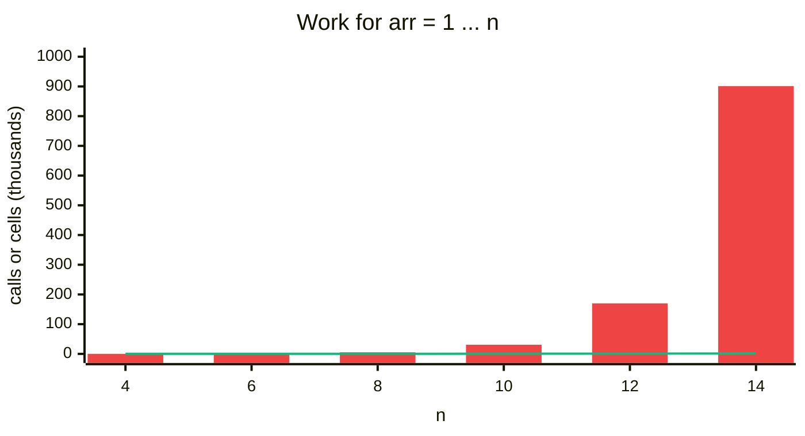

| `n` | `S` | Recursion calls (all targets) | DP cells `n · (S + 1)` |
|:---:|:---:|:---:|:---:|
| 4 | 10 | 104 | 44 |
| 6 | 21 | 803 | 132 |
| 8 | 36 | 5,202 | 296 |
| 10 | 55 | 30,653 | 560 |
| 12 | 78 | 169,892 | 948 |
| 14 | 105 | 900,999 | 1,484 |

Every number in this table was counted by running the code (the tests at the end check some of them).

## 2. Core Theory

This note builds on [Subset Sum Equal To K](01.%20Subset%20Sum%20Equal%20To%20K.md). Everything needed is explained again here, so you can read this note on its own.

### What the problem really asks: the key formula

Call the two group sums `s1` and `s2`. Every number goes into one of the two groups, so:

```text
s1 + s2 = total        so   s2 = total - s1

difference = |s1 - s2|
           = |s1 - (total - s1)|
           = |2·s1 - total|
           = |total - 2·s1|
```

`|x|` (absolute value) just removes the minus sign: `|7 - 3| = 4` and `|3 - 7| = 4`. So the difference is never negative, and we don't care which group is bigger.

**Big idea:** once you pick group 1's sum `s1`, group 2 is decided for you (`total - s1`). So we never need to try partitions directly. We only need to know:

> **Which subset sums `s1` are possible?** Then pick the possible `s1` that makes `|total - 2·s1|` smallest.

For our example, `total = 10`:

| `s1` (group 1) | `s2 = 10 - s1` | possible? | `|10 - 2·s1|` |
|:---:|:---:|:---:|:---:|
| 0 | 10 | yes (empty group) | 10 |
| 1 | 9 | yes `{1}` | 8 |
| 2 | 8 | yes `{2}` | 6 |
| 3 | 7 | yes `{1, 2}` | **4** |
| 4 | 6 | no | – |
| 5 | 5 | no | – |

"Which sums are possible?" is exactly the **Subset Sum** question, asked for every target `t` from `0` to `total` at once. That is why this problem lives in the subset-sum family.

### Only half is enough

`s1 = 3` means group 1 = 3, group 2 = 7. `s1 = 7` means group 1 = 7, group 2 = 3. That is the **same split with the names swapped**, and it gives the same difference. So we only check `s1` from `0` to `total // 2`. After half, the differences repeat like a mirror.

The pairs for `total = 10` (each column is one split):

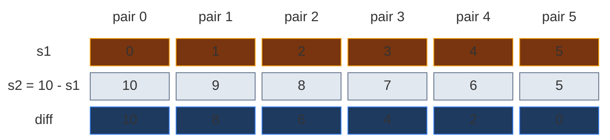

My notes say it with `total = 20`: `s1 = 3` gives diff `14`, and `s1 = 17` also gives diff `14`. Same split. So we only scan up to `S // 2`.

### How to spot that it is DP

| Property | Plain meaning | In this problem |
|:---|:---|:---|
| **Overlapping subproblems** | The same smaller question is asked many times | "Can elements `0..1` make sum `1`?" is asked while checking target `1` **and** again while checking target `8` |
| **Optimal substructure** | The big answer is built from answers of smaller questions | "Can `0..i` make `t`?" is built from "can `0..i-1` make `t`?" and "can `0..i-1` make `t - arr[i]`?" |

### Why one number is not enough: the 2-D state

In 1-D DP (Fibonacci, House Robber) one number `i` named a subproblem. Here it does not. When we pick a number, the **sum still needed goes down**. So a subproblem must remember two things:

1. **How many elements we may still use** (index `ind`).
2. **What sum we still need** (target `t`).

> `f(ind, t)` (or `dp[ind][t]`) = **True** if some subset of `arr[0..ind]` adds up to exactly `t`.


Two numbers → the answers form a **grid**:

- **Rows** = `ind` = "elements used so far" (row `1` means we may use `arr[0]` and `arr[1]`).
- **Columns** = `t` = "the target sum".
- Each cell is True or False.

For our example the grid is `3 × 11` (rows `0..2`, columns `0..10`).

**What is new compared to Subset Sum Equal To K:**

| | Subset Sum = K | This problem |
|:---|:---|:---|
| Columns | `0 ... K` | `0 ... total` (not `K` any more) |
| What we read at the end | one cell `dp[n-1][K]` | the **whole last row**, from `0` to `total // 2` |

### The recurrence: pick or not pick

For `f(ind, t)` we look at the last allowed element `arr[ind]` and make one choice:

- **Not pick** it: the other elements must make all of `t` → `f(ind - 1, t)`.
- **Pick** it (only if `arr[ind] <= t`): the other elements must make the rest → `f(ind - 1, t - arr[ind])`.

If either way works, the answer is True.

```text
f(ind, t) = f(ind - 1, t)  or  f(ind - 1, t - arr[ind])     (second part only if arr[ind] <= t)
```

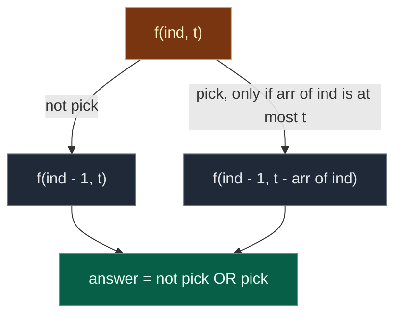

### Base cases

| Base case | Value | Why |
|:---|:---:|:---|
| `t == 0` | `True` | The **empty subset** has sum `0`. You can always make `0` by picking nothing |
| `ind == 0` | `arr[0] == t` | Only one element is left. It either equals `t` exactly (pick it) or it does not. (`t == 0` was already handled above) |

### The plan: build the table, read the last row

1. Build the Subset Sum table with columns `0 ... total`.
2. The **last row** `dp[n-1][s1]` tells, for every `s1`, if some subset of **all** elements makes `s1`.
3. Scan `s1 = 0 ... total // 2`. For every True cell, compute `|total - 2·s1|`. Keep the smallest.

### The 4-step ladder

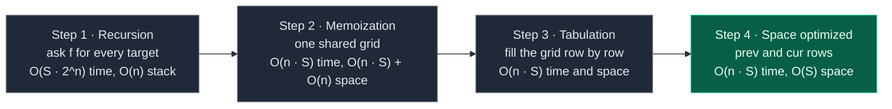

## 3. Edge Cases

| Case | Input | Expected | Why it matters |
|:---|:---:|:---:|:---|
| Single element | `[5]` | `5` | One group gets `5`, the other is empty (`0`) |
| Single zero | `[0]` | `0` | `total = 0`, the scan checks only `s1 = 0` |
| All zeros | `[0, 0, 0]` | `0` | Zeros never change a sum |
| A zero plus a number | `[0, 3]` | `3` | `arr[0] = 0`: the base case `t == 0` is checked first, so it still works |
| Two equal numbers | `[10, 10]` | `0` | A perfect split exists |
| Two different numbers | `[1, 4]` | `3` | Only two real splits: `{1}`/`{4}` or `{}`/`{1, 4}` |
| Perfect split exists | `[1, 2, 3]` | `0` | `{1, 2}` vs `{3}` |
| One giant number | `[1, 2, 7]` | `4` | Our example. The big `7` always sits alone |
| Negative numbers | `[-1, 2]` | (not allowed) | The table uses sums as column numbers. Negative sums have no column. See Q3 |

## 4. Approach 1: Recursion

### Idea

Take the Subset Sum recursion `solve(index, target)` ("is it possible to form sum `target` using elements from `0` to `index`?"). Ask it once **for every target** from `0` to `total`. Each time the answer is yes, compute `|total - 2·target|` and keep the smallest.

My notes' small example, `arr = [1, 2, 3]`, total `6`. Every target is possible:

| target | `_solve_recursive(2, target)` | difference | `min_diff` so far |
|:---:|:---:|:---:|:---:|
| 0 | T (empty) | `|6 - 2·0| = 6` | 6 |
| 1 | T `{1}` | `|6 - 2·1| = 4` | 4 |
| 2 | T `{2}` | `|6 - 2·2| = 2` | 2 |
| 3 | T `{3}` | `|6 - 2·3| = 0` | 0 |
| 4 | T `{1, 3}` | `|6 - 2·4| = 2` | 0 |
| 5 | T `{2, 3}` | `|6 - 2·5| = 4` | 0 |
| 6 | T `{1, 2, 3}` | `|6 - 2·6| = 6` | 0 |

Answer `0`. Note: the recursion and memo code check **all** targets `0 ... total`, even above half. That is correct, it just does extra work. Tabulation and the space versions check only `0 ... total // 2`.

### Recursion tree for `arr = [1, 2, 7]`

The outer loop builds one small tree per target (11 trees). Here are the 6 trees that share work: targets `1, 2, 3` and `8, 9, 10`. Solid arrow = not pick. Dashed arrow = pick. Each box shows the call and its answer.

```mermaid
flowchart TD
    subgraph T1["target 1"]
        A1["f(2, 1) = T"]:::norm -->|not pick| A2["f(1, 1) = T"]:::gold
        A2 -->|not pick| A3["f(0, 1) = T"]:::base
    end
    subgraph T2["target 2"]
        B1["f(2, 2) = T"]:::norm -->|not pick| B2["f(1, 2) = T"]:::gold
        B2 -->|not pick| B3["f(0, 2) = F"]:::base
        B2 -.->|pick 2| B4["f(0, 0) = T"]:::base
    end
    subgraph T3["target 3"]
        C1["f(2, 3) = T"]:::norm -->|not pick| C2["f(1, 3) = T"]:::gold
        C2 -->|not pick| C3["f(0, 3) = F"]:::base
        C2 -.->|pick 2| C4["f(0, 1) = T"]:::base
    end
    subgraph T8["target 8"]
        D1["f(2, 8) = T"]:::norm -->|not pick| D2["f(1, 8) = F"]:::norm
        D2 -->|not pick| D3["f(0, 8) = F"]:::base
        D2 -.->|pick 2| D4["f(0, 6) = F"]:::base
        D1 -.->|pick 7| D5["f(1, 1) = T"]:::gold
        D5 -->|not pick| D6["f(0, 1) = T"]:::base
    end
    subgraph T9["target 9"]
        E1["f(2, 9) = T"]:::norm -->|not pick| E2["f(1, 9) = F"]:::norm
        E2 -->|not pick| E3["f(0, 9) = F"]:::base
        E2 -.->|pick 2| E4["f(0, 7) = F"]:::base
        E1 -.->|pick 7| E5["f(1, 2) = T"]:::gold
        E5 -->|not pick| E6["f(0, 2) = F"]:::base
        E5 -.->|pick 2| E7["f(0, 0) = T"]:::base
    end
    subgraph T10["target 10"]
        F1["f(2, 10) = T"]:::norm -->|not pick| F2["f(1, 10) = F"]:::norm
        F2 -->|not pick| F3["f(0, 10) = F"]:::base
        F2 -.->|pick 2| F4["f(0, 8) = F"]:::base
        F1 -.->|pick 7| F5["f(1, 3) = T"]:::gold
        F5 -->|not pick| F6["f(0, 3) = F"]:::base
        F5 -.->|pick 2| F7["f(0, 1) = T"]:::base
    end

    classDef norm fill:#1f2937,stroke:#6b7280,color:#e5e7eb
    classDef gold fill:#78350f,stroke:#f59e0b,color:#fef3c7
    classDef base fill:#065f46,stroke:#10b981,color:#ecfdf5
```

Gold = a non-base state that is solved again in a later tree. Green = base cases (`ind == 0` or `t == 0`).

How often each repeated state is called, over **all 11 trees** (49 calls in total):

| State | `f(1, 1)` | `f(1, 2)` | `f(1, 3)` | `f(0, 0)` | `f(0, 1)` | `f(0, 2)` | `f(0, 3)` | `f(0, 4)` ... `f(0, 8)` |
|:---|:---:|:---:|:---:|:---:|:---:|:---:|:---:|:---:|
| Times called | **2** | **2** | **2** | 2 | 4 | 3 | 3 | 2 each |

Inside one tree nothing repeats here (the array is tiny). The waste comes from **asking 11 separate questions that share sub-questions**. Plain recursion rebuilds every tree from scratch. That is why it costs `O(total × 2^n)`.

My notes also draw one single tree with `[1, 2, 3]`: "can `[1, 2, 3]` make `4`?" → `f(2, 4)` picks `3` → `f(1, 1)` skips `2` → `f(0, 1)` is `arr[0] = 1` → True. So `4 = 3 + 1`, found in 6 calls.

### Code

```python
# Type hints for the GfG signature
from typing import List

# Plain recursion: ask the subset-sum question for every target
class SolutionRecursion:

    # Main function to find minimum subset sum difference
    def minDifference(self, arr: List[int]) -> int:

        # Calculate total sum of the array
        total_sum = sum(arr)

        # Store the minimum difference found so far
        min_diff = float("inf")

        # Check every possible subset sum from 0 to total_sum
        for target in range(total_sum + 1):

            # If this target sum is achievable, compute partition difference
            if self._solve_recursive(len(arr) - 1, target, arr):

                # Other subset sum will be total_sum - target
                current_diff = abs(total_sum - 2 * target)

                # Update minimum difference
                min_diff = min(min_diff, current_diff)

        # Return the best possible minimum difference
        return min_diff

    # Helper recursive function to check whether subset sum = target is possible
    def _solve_recursive(self, index: int, target: int, arr: List[int]) -> bool:

        # Sum 0 is always possible by taking empty subset
        if target == 0:
            return True

        # If we are at the first element, only one choice remains
        if index == 0:
            return arr[0] == target

        # Option 1: do not take current element
        not_take = self._solve_recursive(index - 1, target, arr)

        # Option 2: take current element if it does not exceed target
        take = False

        # Only possible when the element fits in the target
        if arr[index] <= target:

            # Pick it: the rest must make target - arr[index]
            take = self._solve_recursive(index - 1, target - arr[index], arr)

        # Return True if either option works
        return take or not_take
```

### Complexity

| Measure | Complexity | Why |
|:---|:---:|:---|
| **Time** | `O(S · 2^n)` | `S + 1` targets, and each target's tree can have up to `2^n` leaves (pick / not pick for every element) |
| **Space** | `O(n)` | Recursion stack. The deepest path goes `ind = n-1, n-2, ..., 0` |

For our example: **49 calls** over 11 targets. For `arr = [1 ... 14]`: about **900 thousand** calls (see the chart).

## 5. Approach 2: Memoization (Top-Down)

### Idea

Keep **one** grid `dp` of size `n × (S + 1)`, filled with `-1` ("don't know yet"), and **share it between all the targets**. Something learned while answering target `3` is reused for target `10`.

The 3 steps (same as in 1-D DP):

1. **Declare** `dp = [[-1] * (S + 1) for _ in range(n)]`. One row per index, one column per target `0 ... S`.
2. **Store** the answer before returning: `dp[index][target] = 1` if True, `0` if False.
3. **Check** first: if `dp[index][target] != -1`, return it and make no new calls.

How the notebook works here:

- `dp` has 3 rows (index `0, 1, 2`) and 11 columns (target `0 ... 10`). Every box starts at `-1`.
- The outer loop asks `f(2, 0)`, `f(2, 1)`, ..., `f(2, 10)`: 11 questions, one after another.
- The **same** `dp` is kept between questions.
- Base cases (`index == 0` or `target == 0`) are answered directly and are **never written** into `dp`. So row `0` and column `0` stay `-1` forever. That is fine.

In the pictures, the code stores `1` for True and `0` for False. We draw them as `T` and `F`. Green = written in this step. Orange = cache hit (read back instead of solved again).

### Visual: the grid after each target

**Start:** every box is `-1`.

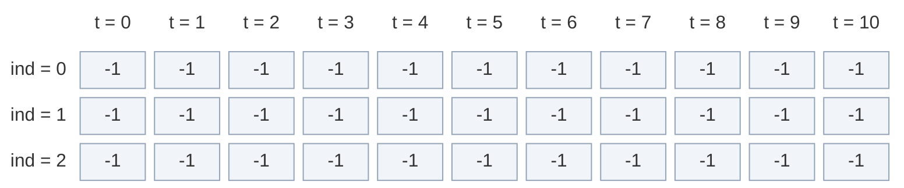

**target = 0:** `f(2, 0)` is a base case (`target == 0`) → True. Nothing is written. Diff `|10 - 0| = 10`.

**target = 1:** `f(2, 1)` → not pick `f(1, 1)` → not pick `f(0, 1)`: `arr[0] = 1 = 1` → T. Pick `2`? `2 > 1`, can't. So `dp[1][1] = T`. Back in `f(2, 1)`: pick `7`? `7 > 1`, can't. `dp[2][1] = T`. Diff `|10 - 2| = 8`.

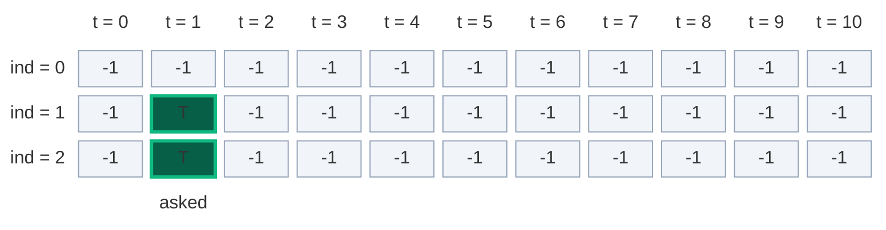

**target = 2:** `f(1, 2)`: not pick `f(0, 2)` → F, pick `2` → `f(0, 0)` → T. `dp[1][2] = T`, then `dp[2][2] = T` (`7 > 2`). Diff `|10 - 4| = 6`.

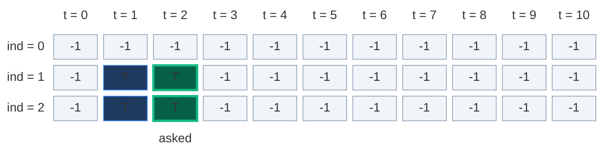

**target = 3:** `f(1, 3)`: not pick `f(0, 3)` → F, pick `2` → `f(0, 1)` → T. `dp[1][3] = T`, `dp[2][3] = T`. Diff `|10 - 6| = 4`.

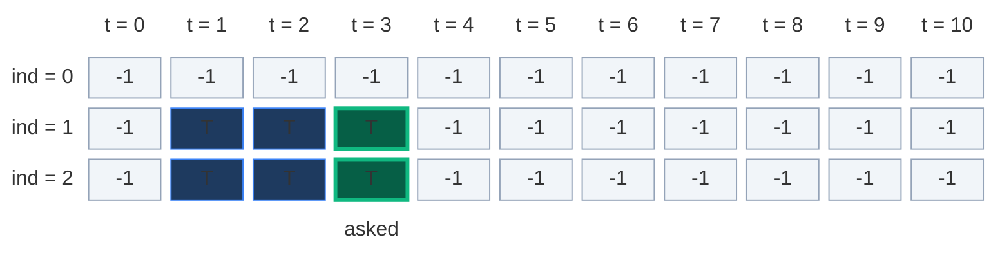

**target = 4:** `f(1, 4)`: `f(0, 4)` → F, pick `2` → `f(0, 2)` → F. `dp[1][4] = F`. `7 > 4`, so `dp[2][4] = F`. **Not possible**, no diff.

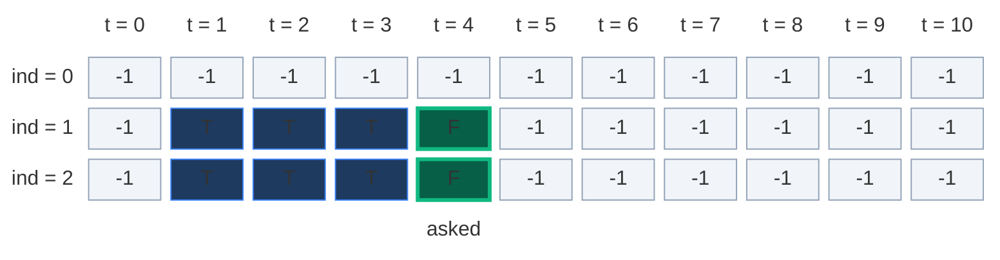

**target = 5:** `f(1, 5)`: `f(0, 5)` → F, `f(0, 3)` → F. `dp[1][5] = F`, `dp[2][5] = F`. Not possible.

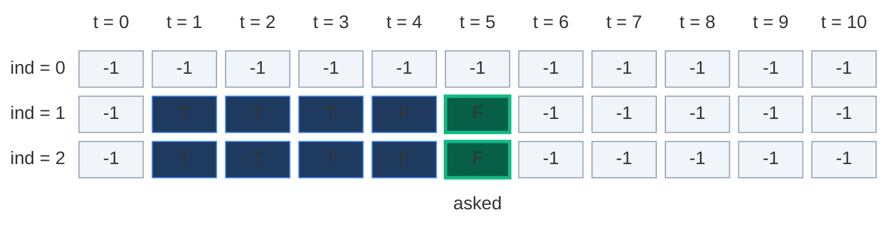

**target = 6:** `f(1, 6)`: `f(0, 6)` → F, `f(0, 4)` → F. `dp[1][6] = F`, `dp[2][6] = F`. Not possible.

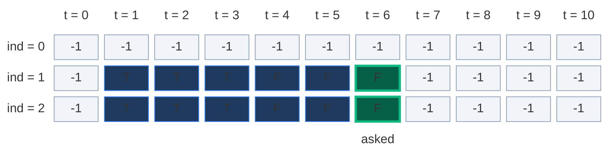

**target = 7:** `f(1, 7)`: `f(0, 7)` → F, `f(0, 5)` → F, so `dp[1][7] = F`. Now `7 <= 7`, so pick `7` → `f(1, 0)` → base case T. `dp[2][7] = F or T = T`. Diff `|10 - 14| = 4`.

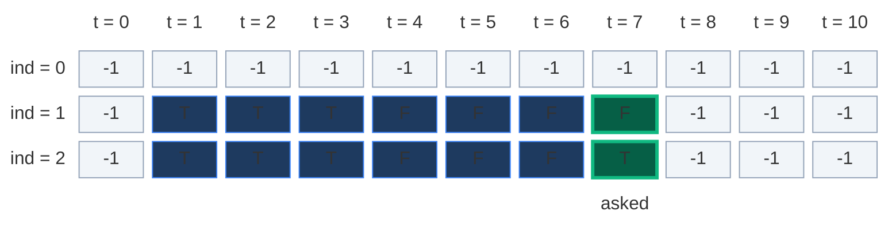

**target = 8:** `f(1, 8)`: `f(0, 8)` → F, `f(0, 6)` → F, so `dp[1][8] = F`. Pick `7` → `f(1, 1)`: **`dp[1][1] = T` already, cache hit, no new calls.** `dp[2][8] = T`. Diff `|10 - 16| = 6`.

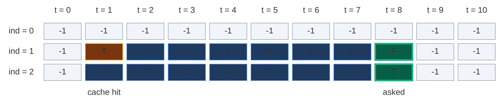

**target = 9:** `dp[1][9] = F`. Pick `7` → `f(1, 2)`: **cache hit, T.** `dp[2][9] = T`. Diff `|10 - 18| = 8`.

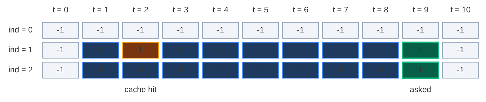

**target = 10:** `dp[1][10] = F`. Pick `7` → `f(1, 3)`: **cache hit, T.** `dp[2][10] = T`. Diff `|10 - 20| = 10`.

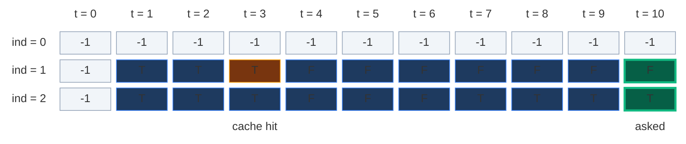

Total: **44 calls** and **3 cache hits** (plain recursion made 49). The boxes that really get reused are `dp[1][1]`, `dp[1][2]`, `dp[1][3]`. (My notes list `solve(2, 3)` as a repeat, but with this code it is asked only once. The list `solve(1, 3)`, `solve(1, 1)` is right.)

**The exact call order for target 8** (the first cache hit):

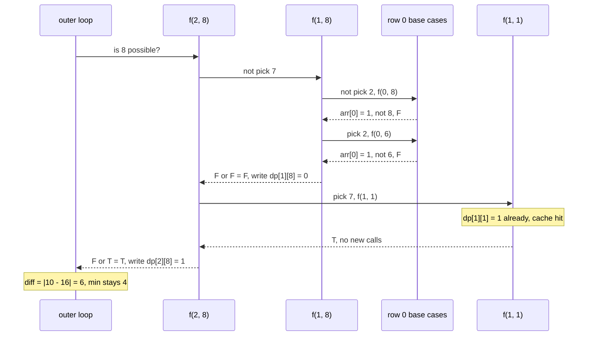

**Final step: pick the best target**

| target | possible? | difference | `min_diff` |
|:---:|:---:|:---:|:---:|
| 0 | T | `|10 - 2·0| = 10` | 10 |
| 1 | T | `|10 - 2·1| = 8` | 8 |
| 2 | T | `|10 - 2·2| = 6` | 6 |
| 3 | T | `|10 - 2·3| = 4` | 4 |
| 4 | F | skip | 4 |
| 5 | F | skip | 4 |
| 6 | F | skip | 4 |
| 7 | T | `|10 - 2·7| = 4` | 4 |
| 8 | T | `|10 - 2·8| = 6` | 4 |
| 9 | T | `|10 - 2·9| = 8` | 4 |
| 10 | T | `|10 - 2·10| = 10` | 4 |

Answer `4`: `{1, 2}` = 3 and `{7}` = 7. Sum `3` and sum `7` both give `4`, because they are the same split.

### The pruned recursion tree (targets 8, 9, 10)

Same trees as before, but the second visit of `f(1, 1)`, `f(1, 2)`, `f(1, 3)` stops right away (dashed = cache hit).

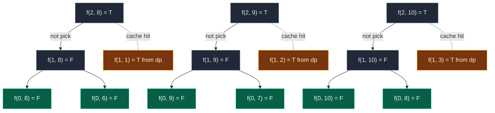

With bigger arrays the savings are huge: every state `(ind, t)` is solved at most once, so the work is at most `n · (S + 1)` states.

### Code

```python
# Memoization: one shared dp grid for all targets
class SolutionMemo:

    # Main function to find minimum subset sum difference
    def minDifference(self, arr: List[int]) -> int:

        # Calculate total sum
        total_sum = sum(arr)

        # Create memoization table with -1 meaning "not computed"
        dp = [[-1 for _ in range(total_sum + 1)] for _ in range(len(arr))]

        # Initialize minimum difference
        min_diff = float("inf")

        # Check all possible subset sums
        for target in range(total_sum + 1):

            # If this target is achievable, compute difference
            if self._solve_memo(len(arr) - 1, target, arr, dp):

                # Compute the current diff
                current_diff = abs(total_sum - 2 * target)

                # Compute the min diff
                min_diff = min(min_diff, current_diff)

        # Return final minimum difference
        return min_diff

    # Helper memoized function to check subset sum possibility
    def _solve_memo(self, index: int, target: int, arr: List[int], dp: List[List[int]]) -> bool:

        # Sum 0 is always possible
        if target == 0:
            return True

        # Base case: only first element remains
        if index == 0:
            return arr[0] == target

        # Return already computed result
        if dp[index][target] != -1:
            return bool(dp[index][target])

        # Option 1: do not take current element
        not_take = self._solve_memo(index - 1, target, arr, dp)

        # Option 2: take current element if allowed
        take = False

        # Only possible when the element fits in the target
        if arr[index] <= target:

            # Pick it: the rest must make target - arr[index]
            take = self._solve_memo(index - 1, target - arr[index], arr, dp)

        # Store result
        dp[index][target] = 1 if (take or not_take) else 0

        # Return final answer
        return take or not_take
```

### Complexity

| Measure | Complexity | Why |
|:---|:---:|:---|
| **Time** | `O(n · S)` | Number of states is `n · (S + 1)`. Each is solved once, with `O(1)` work |
| **Space: dp grid** | `O(n · S)` | `n` rows, `S + 1` columns |
| **Space: recursion stack** | `O(n)` | The deepest path goes from `ind = n - 1` down to `0` |
| **Total space** | `O(n · S) + O(n)` | Grid plus stack |

## 6. Approach 3: Tabulation (Bottom-Up)

### Idea

This is the most standard and important version. Fill the same grid with two loops, from the base cases up. No recursion, so no stack. Then scan the last row.

> `dp[i][target]` = can we form sum `target` using elements from `0` to `i`?

### How to convert memo → table, step by step (2-D)

1. **Same grid:** `dp = [[False] * (S + 1) for _ in range(n)]`. Columns go to `total`, not to some `K`.
2. **Base cases into the grid:**
   - `target == 0 → True` becomes `dp[i][0] = True` for **every row** `i`.
   - `index == 0 → arr[0] == target` becomes `dp[0][arr[0]] = True`, if `arr[0] <= total` (always true here, since numbers are `>= 0`).
3. **Two nested loops, opposite to the recursion:** `ind` from `1` to `n - 1`, `target` from `1` to `S`.
4. **Copy the recurrence**, replacing `f(...)` with `dp[...]`:
   - `not_take = dp[i-1][target]` (look straight **up**)
   - `take = dp[i-1][target - arr[i]]` if `arr[i] <= target` (look **up, then `arr[i]` steps left**)
   - `dp[i][target] = take or not_take`
5. **Answer:** not one cell. Scan the **whole last row** `dp[n-1][s1]` for `s1 = 0 ... total // 2`.

| Memoization | Becomes in tabulation |
|:---|:---|
| `dp` of `n × (S + 1)` with `-1` | `dp` of `n × (S + 1)` with `False` |
| `if target == 0: return True` | `dp[i][0] = True` for all `i` |
| `if index == 0: return arr[0] == target` | `dp[0][arr[0]] = True` |
| `f(index - 1, target)` | `dp[index - 1][target]` |
| `f(index - 1, target - arr[index])` | `dp[index - 1][target - arr[index]]` |
| outer loop calls `f(n-1, t)` for every `t` | read the row `dp[n-1]` |

### Visual table fill (`arr = [1, 2, 7]`)

**Start: base cases.** Column `0` is True in every row. Row `0` may use only `arr[0] = 1`, so `dp[0][1] = True`. The rest of row `0` is False. `?` = not filled yet.

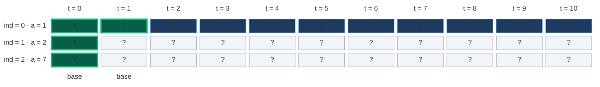

**Row 1, cell by cell.** Now we may also use `arr[1] = 2`. Row 0 said the possible sums were `[0, 1]`. For each cell: orange = the cells it reads, green = the new cell, and the label row says `= not pick or pick`.

**t = 1:** not pick → up `dp[0][1] = T`. Pick `2`? `2 > 1`, can't. `dp[1][1] = T or (no pick) = T`.

```mermaid
block-beta
  columns 12
  hx[" "] h0["t = 0"] h1["t = 1"] h2["t = 2"] h3["t = 3"] h4["t = 4"] h5["t = 5"] h6["t = 6"] h7["t = 7"] h8["t = 8"] h9["t = 9"] h10["t = 10"]
  l0["ind = 0 · a = 1"] r0c0["T"] r0c1["T"] r0c2["F"] r0c3["F"] r0c4["F"] r0c5["F"] r0c6["F"] r0c7["F"] r0c8["F"] r0c9["F"] r0c10["F"]
  l1["ind = 1 · a = 2"] r1c0["T"] r1c1["T"] r1c2["?"] r1c3["?"] r1c4["?"] r1c5["?"] r1c6["?"] r1c7["?"] r1c8["?"] r1c9["?"] r1c10["?"]
  l2["ind = 2 · a = 7"] r2c0["T"] r2c1["?"] r2c2["?"] r2c3["?"] r2c4["?"] r2c5["?"] r2c6["?"] r2c7["?"] r2c8["?"] r2c9["?"] r2c10["?"]
  space space m1["= T or no pick"] space space space space space space space space space
  classDef head fill:none,stroke:none,color:#64748b
  class hx,h0,h1,h2,h3,h4,h5,h6,h7,h8,h9,h10,l0,l1,l2 head
  classDef done fill:#1e3a5f,stroke:#3b82f6,color:#dbeafe
  class r0c0,r0c2,r0c3,r0c4,r0c5,r0c6,r0c7,r0c8,r0c9,r0c10,r1c0,r2c0 done
  classDef read fill:#78350f,stroke:#f59e0b,color:#fef3c7
  class r0c1 read
  classDef new fill:#065f46,stroke:#10b981,color:#ecfdf5,stroke-width:3px
  class r1c1 new
  classDef empty fill:#f1f5f9,stroke:#94a3b8,color:#64748b
  class r1c2,r1c3,r1c4,r1c5,r1c6,r1c7,r1c8,r1c9,r1c10,r2c1,r2c2,r2c3,r2c4,r2c5,r2c6,r2c7,r2c8,r2c9,r2c10 empty
  classDef note fill:none,stroke:none,color:#b45309
  class m1 note
```

**t = 2:** not pick → `dp[0][2] = F`. Pick → `dp[0][2 - 2] = dp[0][0] = T`. `dp[1][2] = F or T = T`.

```mermaid
block-beta
  columns 12
  hx[" "] h0["t = 0"] h1["t = 1"] h2["t = 2"] h3["t = 3"] h4["t = 4"] h5["t = 5"] h6["t = 6"] h7["t = 7"] h8["t = 8"] h9["t = 9"] h10["t = 10"]
  l0["ind = 0 · a = 1"] r0c0["T"] r0c1["T"] r0c2["F"] r0c3["F"] r0c4["F"] r0c5["F"] r0c6["F"] r0c7["F"] r0c8["F"] r0c9["F"] r0c10["F"]
  l1["ind = 1 · a = 2"] r1c0["T"] r1c1["T"] r1c2["T"] r1c3["?"] r1c4["?"] r1c5["?"] r1c6["?"] r1c7["?"] r1c8["?"] r1c9["?"] r1c10["?"]
  l2["ind = 2 · a = 7"] r2c0["T"] r2c1["?"] r2c2["?"] r2c3["?"] r2c4["?"] r2c5["?"] r2c6["?"] r2c7["?"] r2c8["?"] r2c9["?"] r2c10["?"]
  space m0["pick cell"] space m2["= F or T"] space space space space space space space space
  classDef head fill:none,stroke:none,color:#64748b
  class hx,h0,h1,h2,h3,h4,h5,h6,h7,h8,h9,h10,l0,l1,l2 head
  classDef read fill:#78350f,stroke:#f59e0b,color:#fef3c7
  class r0c0,r0c2 read
  classDef done fill:#1e3a5f,stroke:#3b82f6,color:#dbeafe
  class r0c1,r0c3,r0c4,r0c5,r0c6,r0c7,r0c8,r0c9,r0c10,r1c0,r1c1,r2c0 done
  classDef new fill:#065f46,stroke:#10b981,color:#ecfdf5,stroke-width:3px
  class r1c2 new
  classDef empty fill:#f1f5f9,stroke:#94a3b8,color:#64748b
  class r1c3,r1c4,r1c5,r1c6,r1c7,r1c8,r1c9,r1c10,r2c1,r2c2,r2c3,r2c4,r2c5,r2c6,r2c7,r2c8,r2c9,r2c10 empty
  classDef note fill:none,stroke:none,color:#b45309
  class m0,m2 note
```

**t = 3:** not pick → `dp[0][3] = F`. Pick → `dp[0][3 - 2] = dp[0][1] = T`. `dp[1][3] = F or T = T` (`1 + 2 = 3`).

```mermaid
block-beta
  columns 12
  hx[" "] h0["t = 0"] h1["t = 1"] h2["t = 2"] h3["t = 3"] h4["t = 4"] h5["t = 5"] h6["t = 6"] h7["t = 7"] h8["t = 8"] h9["t = 9"] h10["t = 10"]
  l0["ind = 0 · a = 1"] r0c0["T"] r0c1["T"] r0c2["F"] r0c3["F"] r0c4["F"] r0c5["F"] r0c6["F"] r0c7["F"] r0c8["F"] r0c9["F"] r0c10["F"]
  l1["ind = 1 · a = 2"] r1c0["T"] r1c1["T"] r1c2["T"] r1c3["T"] r1c4["?"] r1c5["?"] r1c6["?"] r1c7["?"] r1c8["?"] r1c9["?"] r1c10["?"]
  l2["ind = 2 · a = 7"] r2c0["T"] r2c1["?"] r2c2["?"] r2c3["?"] r2c4["?"] r2c5["?"] r2c6["?"] r2c7["?"] r2c8["?"] r2c9["?"] r2c10["?"]
  space space m1["pick cell"] space m3["= F or T"] space space space space space space space
  classDef head fill:none,stroke:none,color:#64748b
  class hx,h0,h1,h2,h3,h4,h5,h6,h7,h8,h9,h10,l0,l1,l2 head
  classDef done fill:#1e3a5f,stroke:#3b82f6,color:#dbeafe
  class r0c0,r0c2,r0c4,r0c5,r0c6,r0c7,r0c8,r0c9,r0c10,r1c0,r1c1,r1c2,r2c0 done
  classDef read fill:#78350f,stroke:#f59e0b,color:#fef3c7
  class r0c1,r0c3 read
  classDef new fill:#065f46,stroke:#10b981,color:#ecfdf5,stroke-width:3px
  class r1c3 new
  classDef empty fill:#f1f5f9,stroke:#94a3b8,color:#64748b
  class r1c4,r1c5,r1c6,r1c7,r1c8,r1c9,r1c10,r2c1,r2c2,r2c3,r2c4,r2c5,r2c6,r2c7,r2c8,r2c9,r2c10 empty
  classDef note fill:none,stroke:none,color:#b45309
  class m1,m3 note
```

**t = 4:** not pick → `dp[0][4] = F`. Pick → `dp[0][2] = F`. `dp[1][4] = F or F = F`.

```mermaid
block-beta
  columns 12
  hx[" "] h0["t = 0"] h1["t = 1"] h2["t = 2"] h3["t = 3"] h4["t = 4"] h5["t = 5"] h6["t = 6"] h7["t = 7"] h8["t = 8"] h9["t = 9"] h10["t = 10"]
  l0["ind = 0 · a = 1"] r0c0["T"] r0c1["T"] r0c2["F"] r0c3["F"] r0c4["F"] r0c5["F"] r0c6["F"] r0c7["F"] r0c8["F"] r0c9["F"] r0c10["F"]
  l1["ind = 1 · a = 2"] r1c0["T"] r1c1["T"] r1c2["T"] r1c3["T"] r1c4["F"] r1c5["?"] r1c6["?"] r1c7["?"] r1c8["?"] r1c9["?"] r1c10["?"]
  l2["ind = 2 · a = 7"] r2c0["T"] r2c1["?"] r2c2["?"] r2c3["?"] r2c4["?"] r2c5["?"] r2c6["?"] r2c7["?"] r2c8["?"] r2c9["?"] r2c10["?"]
  space space space m2["pick cell"] space m4["= F or F"] space space space space space space
  classDef head fill:none,stroke:none,color:#64748b
  class hx,h0,h1,h2,h3,h4,h5,h6,h7,h8,h9,h10,l0,l1,l2 head
  classDef done fill:#1e3a5f,stroke:#3b82f6,color:#dbeafe
  class r0c0,r0c1,r0c3,r0c5,r0c6,r0c7,r0c8,r0c9,r0c10,r1c0,r1c1,r1c2,r1c3,r2c0 done
  classDef read fill:#78350f,stroke:#f59e0b,color:#fef3c7
  class r0c2,r0c4 read
  classDef new fill:#065f46,stroke:#10b981,color:#ecfdf5,stroke-width:3px
  class r1c4 new
  classDef empty fill:#f1f5f9,stroke:#94a3b8,color:#64748b
  class r1c5,r1c6,r1c7,r1c8,r1c9,r1c10,r2c1,r2c2,r2c3,r2c4,r2c5,r2c6,r2c7,r2c8,r2c9,r2c10 empty
  classDef note fill:none,stroke:none,color:#b45309
  class m2,m4 note
```

**t = 5:** `dp[0][5] = F`, pick → `dp[0][3] = F`. `dp[1][5] = F`.

```mermaid
block-beta
  columns 12
  hx[" "] h0["t = 0"] h1["t = 1"] h2["t = 2"] h3["t = 3"] h4["t = 4"] h5["t = 5"] h6["t = 6"] h7["t = 7"] h8["t = 8"] h9["t = 9"] h10["t = 10"]
  l0["ind = 0 · a = 1"] r0c0["T"] r0c1["T"] r0c2["F"] r0c3["F"] r0c4["F"] r0c5["F"] r0c6["F"] r0c7["F"] r0c8["F"] r0c9["F"] r0c10["F"]
  l1["ind = 1 · a = 2"] r1c0["T"] r1c1["T"] r1c2["T"] r1c3["T"] r1c4["F"] r1c5["F"] r1c6["?"] r1c7["?"] r1c8["?"] r1c9["?"] r1c10["?"]
  l2["ind = 2 · a = 7"] r2c0["T"] r2c1["?"] r2c2["?"] r2c3["?"] r2c4["?"] r2c5["?"] r2c6["?"] r2c7["?"] r2c8["?"] r2c9["?"] r2c10["?"]
  space space space space m3["pick cell"] space m5["= F or F"] space space space space space
  classDef head fill:none,stroke:none,color:#64748b
  class hx,h0,h1,h2,h3,h4,h5,h6,h7,h8,h9,h10,l0,l1,l2 head
  classDef done fill:#1e3a5f,stroke:#3b82f6,color:#dbeafe
  class r0c0,r0c1,r0c2,r0c4,r0c6,r0c7,r0c8,r0c9,r0c10,r1c0,r1c1,r1c2,r1c3,r1c4,r2c0 done
  classDef read fill:#78350f,stroke:#f59e0b,color:#fef3c7
  class r0c3,r0c5 read
  classDef new fill:#065f46,stroke:#10b981,color:#ecfdf5,stroke-width:3px
  class r1c5 new
  classDef empty fill:#f1f5f9,stroke:#94a3b8,color:#64748b
  class r1c6,r1c7,r1c8,r1c9,r1c10,r2c1,r2c2,r2c3,r2c4,r2c5,r2c6,r2c7,r2c8,r2c9,r2c10 empty
  classDef note fill:none,stroke:none,color:#b45309
  class m3,m5 note
```

**t = 6:** `dp[0][6] = F`, pick → `dp[0][4] = F`. `dp[1][6] = F`.

```mermaid
block-beta
  columns 12
  hx[" "] h0["t = 0"] h1["t = 1"] h2["t = 2"] h3["t = 3"] h4["t = 4"] h5["t = 5"] h6["t = 6"] h7["t = 7"] h8["t = 8"] h9["t = 9"] h10["t = 10"]
  l0["ind = 0 · a = 1"] r0c0["T"] r0c1["T"] r0c2["F"] r0c3["F"] r0c4["F"] r0c5["F"] r0c6["F"] r0c7["F"] r0c8["F"] r0c9["F"] r0c10["F"]
  l1["ind = 1 · a = 2"] r1c0["T"] r1c1["T"] r1c2["T"] r1c3["T"] r1c4["F"] r1c5["F"] r1c6["F"] r1c7["?"] r1c8["?"] r1c9["?"] r1c10["?"]
  l2["ind = 2 · a = 7"] r2c0["T"] r2c1["?"] r2c2["?"] r2c3["?"] r2c4["?"] r2c5["?"] r2c6["?"] r2c7["?"] r2c8["?"] r2c9["?"] r2c10["?"]
  space space space space space m4["pick cell"] space m6["= F or F"] space space space space
  classDef head fill:none,stroke:none,color:#64748b
  class hx,h0,h1,h2,h3,h4,h5,h6,h7,h8,h9,h10,l0,l1,l2 head
  classDef done fill:#1e3a5f,stroke:#3b82f6,color:#dbeafe
  class r0c0,r0c1,r0c2,r0c3,r0c5,r0c7,r0c8,r0c9,r0c10,r1c0,r1c1,r1c2,r1c3,r1c4,r1c5,r2c0 done
  classDef read fill:#78350f,stroke:#f59e0b,color:#fef3c7
  class r0c4,r0c6 read
  classDef new fill:#065f46,stroke:#10b981,color:#ecfdf5,stroke-width:3px
  class r1c6 new
  classDef empty fill:#f1f5f9,stroke:#94a3b8,color:#64748b
  class r1c7,r1c8,r1c9,r1c10,r2c1,r2c2,r2c3,r2c4,r2c5,r2c6,r2c7,r2c8,r2c9,r2c10 empty
  classDef note fill:none,stroke:none,color:#b45309
  class m4,m6 note
```

**t = 7:** `dp[0][7] = F`, pick → `dp[0][5] = F`. `dp[1][7] = F`.

```mermaid
block-beta
  columns 12
  hx[" "] h0["t = 0"] h1["t = 1"] h2["t = 2"] h3["t = 3"] h4["t = 4"] h5["t = 5"] h6["t = 6"] h7["t = 7"] h8["t = 8"] h9["t = 9"] h10["t = 10"]
  l0["ind = 0 · a = 1"] r0c0["T"] r0c1["T"] r0c2["F"] r0c3["F"] r0c4["F"] r0c5["F"] r0c6["F"] r0c7["F"] r0c8["F"] r0c9["F"] r0c10["F"]
  l1["ind = 1 · a = 2"] r1c0["T"] r1c1["T"] r1c2["T"] r1c3["T"] r1c4["F"] r1c5["F"] r1c6["F"] r1c7["F"] r1c8["?"] r1c9["?"] r1c10["?"]
  l2["ind = 2 · a = 7"] r2c0["T"] r2c1["?"] r2c2["?"] r2c3["?"] r2c4["?"] r2c5["?"] r2c6["?"] r2c7["?"] r2c8["?"] r2c9["?"] r2c10["?"]
  space space space space space space m5["pick cell"] space m7["= F or F"] space space space
  classDef head fill:none,stroke:none,color:#64748b
  class hx,h0,h1,h2,h3,h4,h5,h6,h7,h8,h9,h10,l0,l1,l2 head
  classDef done fill:#1e3a5f,stroke:#3b82f6,color:#dbeafe
  class r0c0,r0c1,r0c2,r0c3,r0c4,r0c6,r0c8,r0c9,r0c10,r1c0,r1c1,r1c2,r1c3,r1c4,r1c5,r1c6,r2c0 done
  classDef read fill:#78350f,stroke:#f59e0b,color:#fef3c7
  class r0c5,r0c7 read
  classDef new fill:#065f46,stroke:#10b981,color:#ecfdf5,stroke-width:3px
  class r1c7 new
  classDef empty fill:#f1f5f9,stroke:#94a3b8,color:#64748b
  class r1c8,r1c9,r1c10,r2c1,r2c2,r2c3,r2c4,r2c5,r2c6,r2c7,r2c8,r2c9,r2c10 empty
  classDef note fill:none,stroke:none,color:#b45309
  class m5,m7 note
```

**t = 8:** `dp[0][8] = F`, pick → `dp[0][6] = F`. `dp[1][8] = F`.

```mermaid
block-beta
  columns 12
  hx[" "] h0["t = 0"] h1["t = 1"] h2["t = 2"] h3["t = 3"] h4["t = 4"] h5["t = 5"] h6["t = 6"] h7["t = 7"] h8["t = 8"] h9["t = 9"] h10["t = 10"]
  l0["ind = 0 · a = 1"] r0c0["T"] r0c1["T"] r0c2["F"] r0c3["F"] r0c4["F"] r0c5["F"] r0c6["F"] r0c7["F"] r0c8["F"] r0c9["F"] r0c10["F"]
  l1["ind = 1 · a = 2"] r1c0["T"] r1c1["T"] r1c2["T"] r1c3["T"] r1c4["F"] r1c5["F"] r1c6["F"] r1c7["F"] r1c8["F"] r1c9["?"] r1c10["?"]
  l2["ind = 2 · a = 7"] r2c0["T"] r2c1["?"] r2c2["?"] r2c3["?"] r2c4["?"] r2c5["?"] r2c6["?"] r2c7["?"] r2c8["?"] r2c9["?"] r2c10["?"]
  space space space space space space space m6["pick cell"] space m8["= F or F"] space space
  classDef head fill:none,stroke:none,color:#64748b
  class hx,h0,h1,h2,h3,h4,h5,h6,h7,h8,h9,h10,l0,l1,l2 head
  classDef done fill:#1e3a5f,stroke:#3b82f6,color:#dbeafe
  class r0c0,r0c1,r0c2,r0c3,r0c4,r0c5,r0c7,r0c9,r0c10,r1c0,r1c1,r1c2,r1c3,r1c4,r1c5,r1c6,r1c7,r2c0 done
  classDef read fill:#78350f,stroke:#f59e0b,color:#fef3c7
  class r0c6,r0c8 read
  classDef new fill:#065f46,stroke:#10b981,color:#ecfdf5,stroke-width:3px
  class r1c8 new
  classDef empty fill:#f1f5f9,stroke:#94a3b8,color:#64748b
  class r1c9,r1c10,r2c1,r2c2,r2c3,r2c4,r2c5,r2c6,r2c7,r2c8,r2c9,r2c10 empty
  classDef note fill:none,stroke:none,color:#b45309
  class m6,m8 note
```

**t = 9:** `dp[0][9] = F`, pick → `dp[0][7] = F`. `dp[1][9] = F`.

```mermaid
block-beta
  columns 12
  hx[" "] h0["t = 0"] h1["t = 1"] h2["t = 2"] h3["t = 3"] h4["t = 4"] h5["t = 5"] h6["t = 6"] h7["t = 7"] h8["t = 8"] h9["t = 9"] h10["t = 10"]
  l0["ind = 0 · a = 1"] r0c0["T"] r0c1["T"] r0c2["F"] r0c3["F"] r0c4["F"] r0c5["F"] r0c6["F"] r0c7["F"] r0c8["F"] r0c9["F"] r0c10["F"]
  l1["ind = 1 · a = 2"] r1c0["T"] r1c1["T"] r1c2["T"] r1c3["T"] r1c4["F"] r1c5["F"] r1c6["F"] r1c7["F"] r1c8["F"] r1c9["F"] r1c10["?"]
  l2["ind = 2 · a = 7"] r2c0["T"] r2c1["?"] r2c2["?"] r2c3["?"] r2c4["?"] r2c5["?"] r2c6["?"] r2c7["?"] r2c8["?"] r2c9["?"] r2c10["?"]
  space space space space space space space space m7["pick cell"] space m9["= F or F"] space
  classDef head fill:none,stroke:none,color:#64748b
  class hx,h0,h1,h2,h3,h4,h5,h6,h7,h8,h9,h10,l0,l1,l2 head
  classDef done fill:#1e3a5f,stroke:#3b82f6,color:#dbeafe
  class r0c0,r0c1,r0c2,r0c3,r0c4,r0c5,r0c6,r0c8,r0c10,r1c0,r1c1,r1c2,r1c3,r1c4,r1c5,r1c6,r1c7,r1c8,r2c0 done
  classDef read fill:#78350f,stroke:#f59e0b,color:#fef3c7
  class r0c7,r0c9 read
  classDef new fill:#065f46,stroke:#10b981,color:#ecfdf5,stroke-width:3px
  class r1c9 new
  classDef empty fill:#f1f5f9,stroke:#94a3b8,color:#64748b
  class r1c10,r2c1,r2c2,r2c3,r2c4,r2c5,r2c6,r2c7,r2c8,r2c9,r2c10 empty
  classDef note fill:none,stroke:none,color:#b45309
  class m7,m9 note
```

**t = 10:** `dp[0][10] = F`, pick → `dp[0][8] = F`. `dp[1][10] = F`.

```mermaid
block-beta
  columns 12
  hx[" "] h0["t = 0"] h1["t = 1"] h2["t = 2"] h3["t = 3"] h4["t = 4"] h5["t = 5"] h6["t = 6"] h7["t = 7"] h8["t = 8"] h9["t = 9"] h10["t = 10"]
  l0["ind = 0 · a = 1"] r0c0["T"] r0c1["T"] r0c2["F"] r0c3["F"] r0c4["F"] r0c5["F"] r0c6["F"] r0c7["F"] r0c8["F"] r0c9["F"] r0c10["F"]
  l1["ind = 1 · a = 2"] r1c0["T"] r1c1["T"] r1c2["T"] r1c3["T"] r1c4["F"] r1c5["F"] r1c6["F"] r1c7["F"] r1c8["F"] r1c9["F"] r1c10["F"]
  l2["ind = 2 · a = 7"] r2c0["T"] r2c1["?"] r2c2["?"] r2c3["?"] r2c4["?"] r2c5["?"] r2c6["?"] r2c7["?"] r2c8["?"] r2c9["?"] r2c10["?"]
  space space space space space space space space space m8["pick cell"] space m10["= F or F"]
  classDef head fill:none,stroke:none,color:#64748b
  class hx,h0,h1,h2,h3,h4,h5,h6,h7,h8,h9,h10,l0,l1,l2 head
  classDef done fill:#1e3a5f,stroke:#3b82f6,color:#dbeafe
  class r0c0,r0c1,r0c2,r0c3,r0c4,r0c5,r0c6,r0c7,r0c9,r1c0,r1c1,r1c2,r1c3,r1c4,r1c5,r1c6,r1c7,r1c8,r1c9,r2c0 done
  classDef read fill:#78350f,stroke:#f59e0b,color:#fef3c7
  class r0c8,r0c10 read
  classDef new fill:#065f46,stroke:#10b981,color:#ecfdf5,stroke-width:3px
  class r1c10 new
  classDef empty fill:#f1f5f9,stroke:#94a3b8,color:#64748b
  class r2c1,r2c2,r2c3,r2c4,r2c5,r2c6,r2c7,r2c8,r2c9,r2c10 empty
  classDef note fill:none,stroke:none,color:#b45309
  class m8,m10 note
```

**After row 1:** possible sums = `[0, 1, 2, 3]`. The new ones (`2, 3`) are each an old sum `+ 2`.

```mermaid
block-beta
  columns 12
  hx[" "] h0["t = 0"] h1["t = 1"] h2["t = 2"] h3["t = 3"] h4["t = 4"] h5["t = 5"] h6["t = 6"] h7["t = 7"] h8["t = 8"] h9["t = 9"] h10["t = 10"]
  l0["ind = 0 · a = 1"] r0c0["T"] r0c1["T"] r0c2["F"] r0c3["F"] r0c4["F"] r0c5["F"] r0c6["F"] r0c7["F"] r0c8["F"] r0c9["F"] r0c10["F"]
  l1["ind = 1 · a = 2"] r1c0["T"] r1c1["T"] r1c2["T"] r1c3["T"] r1c4["F"] r1c5["F"] r1c6["F"] r1c7["F"] r1c8["F"] r1c9["F"] r1c10["F"]
  l2["ind = 2 · a = 7"] r2c0["T"] r2c1["?"] r2c2["?"] r2c3["?"] r2c4["?"] r2c5["?"] r2c6["?"] r2c7["?"] r2c8["?"] r2c9["?"] r2c10["?"]
  classDef head fill:none,stroke:none,color:#64748b
  class hx,h0,h1,h2,h3,h4,h5,h6,h7,h8,h9,h10,l0,l1,l2 head
  classDef done fill:#1e3a5f,stroke:#3b82f6,color:#dbeafe
  class r0c0,r0c1,r0c2,r0c3,r0c4,r0c5,r0c6,r0c7,r0c8,r0c9,r0c10,r2c0 done
  classDef new fill:#065f46,stroke:#10b981,color:#ecfdf5,stroke-width:3px
  class r1c0,r1c1,r1c2,r1c3,r1c4,r1c5,r1c6,r1c7,r1c8,r1c9,r1c10 new
  classDef empty fill:#f1f5f9,stroke:#94a3b8,color:#64748b
  class r2c1,r2c2,r2c3,r2c4,r2c5,r2c6,r2c7,r2c8,r2c9,r2c10 empty
```

**Row 2.** Now we may also use `arr[2] = 7`. Row 1 said the possible sums were `[0, 1, 2, 3]`.

| `t` | not pick (straight up) | pick 7 (up, then 7 left) | OR | `dp[2][t]` |
|:---:|:---|:---|:---:|:---:|
| 1 | `dp[1][1] = T` | `7 > 1`, can't | T or F | **T** |
| 2 | `dp[1][2] = T` | `7 > 2`, can't | T or F | **T** |
| 3 | `dp[1][3] = T` | `7 > 3`, can't | T or F | **T** |
| 4 | `dp[1][4] = F` | `7 > 4`, can't | F or F | F |
| 5 | `dp[1][5] = F` | `7 > 5`, can't | F or F | F |
| 6 | `dp[1][6] = F` | `7 > 6`, can't | F or F | F |
| 7 | `dp[1][7] = F` | `dp[1][0] = T` | F or T | **T** |
| 8 | `dp[1][8] = F` | `dp[1][1] = T` | F or T | **T** |
| 9 | `dp[1][9] = F` | `dp[1][2] = T` | F or T | **T** |
| 10 | `dp[1][10] = F` | `dp[1][3] = T` | F or T | **T** |

**After row 2:** possible sums = `[0, 1, 2, 3, 7, 8, 9, 10]`. The new ones (`7 ... 10`) are each an old sum `+ 7`.

```mermaid
block-beta
  columns 12
  hx[" "] h0["t = 0"] h1["t = 1"] h2["t = 2"] h3["t = 3"] h4["t = 4"] h5["t = 5"] h6["t = 6"] h7["t = 7"] h8["t = 8"] h9["t = 9"] h10["t = 10"]
  l0["ind = 0 · a = 1"] r0c0["T"] r0c1["T"] r0c2["F"] r0c3["F"] r0c4["F"] r0c5["F"] r0c6["F"] r0c7["F"] r0c8["F"] r0c9["F"] r0c10["F"]
  l1["ind = 1 · a = 2"] r1c0["T"] r1c1["T"] r1c2["T"] r1c3["T"] r1c4["F"] r1c5["F"] r1c6["F"] r1c7["F"] r1c8["F"] r1c9["F"] r1c10["F"]
  l2["ind = 2 · a = 7"] r2c0["T"] r2c1["T"] r2c2["T"] r2c3["T"] r2c4["F"] r2c5["F"] r2c6["F"] r2c7["T"] r2c8["T"] r2c9["T"] r2c10["T"]
  classDef head fill:none,stroke:none,color:#64748b
  class hx,h0,h1,h2,h3,h4,h5,h6,h7,h8,h9,h10,l0,l1,l2 head
  classDef done fill:#1e3a5f,stroke:#3b82f6,color:#dbeafe
  class r0c0,r0c1,r0c2,r0c3,r0c4,r0c5,r0c6,r0c7,r0c8,r0c9,r0c10,r1c0,r1c1,r1c2,r1c3,r1c4,r1c5,r1c6,r1c7,r1c8,r1c9,r1c10 done
  classDef new fill:#065f46,stroke:#10b981,color:#ecfdf5,stroke-width:3px
  class r2c0,r2c1,r2c2,r2c3,r2c4,r2c5,r2c6,r2c7,r2c8,r2c9,r2c10 new
```

**Last step: read the last row and scan `0 ... 10 // 2 = 5`.** The last row is the list of every possible `s1`. Under each cell: the other group's sum.

```mermaid
block-beta
  columns 12
  hx[" "] h0["s1 = 0"] h1["s1 = 1"] h2["s1 = 2"] h3["s1 = 3"] h4["s1 = 4"] h5["s1 = 5"] h6["s1 = 6"] h7["s1 = 7"] h8["s1 = 8"] h9["s1 = 9"] h10["s1 = 10"]
  l0["dp[2][s1]"] r0c0["T"] r0c1["T"] r0c2["T"] r0c3["T"] r0c4["F"] r0c5["F"] r0c6["F"] r0c7["T"] r0c8["T"] r0c9["T"] r0c10["T"]
  space m0["other 10"] m1["other 9"] m2["other 8"] m3["other 7"] m4["other 6"] m5["other 5"] m6["other 4"] m7["other 3"] m8["other 2"] m9["other 1"] m10["other 0"]
  classDef head fill:none,stroke:none,color:#64748b
  class hx,h0,h1,h2,h3,h4,h5,h6,h7,h8,h9,h10,l0 head
  classDef done fill:#1e3a5f,stroke:#3b82f6,color:#dbeafe
  class r0c0,r0c1,r0c2,r0c3,r0c7,r0c8,r0c9,r0c10 done
  classDef empty fill:#f1f5f9,stroke:#94a3b8,color:#64748b
  class r0c4,r0c5,r0c6 empty
  classDef note fill:none,stroke:none,color:#b45309
  class m0,m1,m2,m3,m4,m5,m6,m7,m8,m9,m10 note
```

Now the second loop of the code. Orange = possible and checked, green = the best, grey = above half (not checked).

```mermaid
block-beta
  columns 12
  hx[" "] h0["s1 = 0"] h1["s1 = 1"] h2["s1 = 2"] h3["s1 = 3"] h4["s1 = 4"] h5["s1 = 5"] h6["s1 = 6"] h7["s1 = 7"] h8["s1 = 8"] h9["s1 = 9"] h10["s1 = 10"]
  l0["last row"] r0c0["T"] r0c1["T"] r0c2["T"] r0c3["T"] r0c4["F"] r0c5["F"] r0c6["F"] r0c7["T"] r0c8["T"] r0c9["T"] r0c10["T"]
  space m0["diff 10"] m1["diff 8"] m2["diff 6"] m3["best, diff 4"] m4["skip"] m5["skip"] m6["not checked"] m7["not checked"] m8["not checked"] m9["not checked"] m10["not checked"]
  classDef head fill:none,stroke:none,color:#64748b
  class hx,h0,h1,h2,h3,h4,h5,h6,h7,h8,h9,h10,l0 head
  classDef read fill:#78350f,stroke:#f59e0b,color:#fef3c7
  class r0c0,r0c1,r0c2 read
  classDef new fill:#065f46,stroke:#10b981,color:#ecfdf5,stroke-width:3px
  class r0c3 new
  classDef empty fill:#f1f5f9,stroke:#94a3b8,color:#64748b
  class r0c4,r0c5 empty
  classDef old fill:#e2e8f0,stroke:#64748b,color:#0f172a
  class r0c6,r0c7,r0c8,r0c9,r0c10 old
  classDef note fill:none,stroke:none,color:#b45309
  class m0,m1,m2,m3,m4,m5,m6,m7,m8,m9,m10 note
```

| `s1` | possible? | difference | `min_diff` |
|:---:|:---:|:---:|:---:|
| 0 | ✓ | `|10 - 2·0| = 10` | 10 |
| 1 | ✓ | `|10 - 2·1| = 8` | 8 |
| 2 | ✓ | `|10 - 2·2| = 6` | 6 |
| 3 | ✓ | `|10 - 2·3| = 4` | **4** |
| 4 | ✗ | skip | 4 |
| 5 | ✗ | skip | 4 |

Smallest difference = **4** at `s1 = 3` → `{1, 2}` = 3 and `{7}` = 7.

**My notes' bigger example**, `arr = [1, 2, 3, 9]`, total `15` (a `4 × 16` table):

| Row | Uses | Possible sums |
|:---:|:---|:---|
| 0 | `1` | `0, 1` |
| 1 | `1, 2` | `0, 1, 2, 3` |
| 2 | `1, 2, 3` | `0, 1, 2, 3, 4, 5, 6` |
| 3 | `1, 2, 3, 9` | `0, 1, 2, 3, 4, 5, 6, 9, 10, 11, 12, 13, 14, 15` |

Scan `0 ... 15 // 2 = 7`: possible are `0 ... 6` (`7` is not). Best `s1 = 6` → `|15 - 12| = 3`. Answer `3`: `{1, 2, 3}` = 6 vs `{9}` = 9. (My notes' list of possible sums skipped `13 = 1 + 3 + 9`. It does not change the answer, since `13 > 7` is never checked.)

### Code

```python
# Tabulation: fill the subset-sum grid, then scan the last row
class SolutionTab:

    # Main function to find minimum subset sum difference
    def minDifference(self, arr: List[int]) -> int:

        # Number of elements
        n = len(arr)

        # Calculate total sum
        total_sum = sum(arr)

        # dp[i][target] tells whether sum "target" can be formed using elements 0..i
        dp = [[False for _ in range(total_sum + 1)] for _ in range(n)]

        # Sum 0 is always possible
        for index in range(n):

            # Empty subset makes 0 in every row
            dp[index][0] = True

        # First element handling
        if arr[0] <= total_sum:

            # Row 0 can make exactly arr[0]
            dp[0][arr[0]] = True

        # Fill table row by row
        for index in range(1, n):

            # Every target from 1 to total_sum
            for target in range(1, total_sum + 1):

                # Option 1: do not take current element
                not_take = dp[index - 1][target]

                # Option 2: take current element if possible
                take = False

                # Only possible when the element fits in the target
                if arr[index] <= target:

                    # Look up, then arr[index] steps left
                    take = dp[index - 1][target - arr[index]]

                # Store final answer for current state
                dp[index][target] = take or not_take

        # Initialize minimum difference
        min_diff = float("inf")

        # We only need to check half of total_sum
        for subset_sum in range(total_sum // 2 + 1):

            # If subset_sum is achievable, compute difference
            if dp[n - 1][subset_sum]:

                # Update the current diff
                current_diff = abs(total_sum - 2 * subset_sum)

                # Update the min diff
                min_diff = min(min_diff, current_diff)

        # Return minimum difference
        return min_diff
```

### Complexity

| Measure | Complexity | Why |
|:---|:---:|:---|
| **Time** | `O(n · S)` | Two nested loops fill `n · (S + 1)` cells, then one scan of `S / 2` cells |
| **Space** | `O(n · S)` | The grid. The recursion stack is gone |

## 7. Approach 4: Space Optimization (Optimal)

### Idea

Look at the table fill again. Row `i` only reads **row `i - 1`** (straight up, and up-left by `arr[i]`). Rows `i - 2`, `i - 3`, ... are never read again. So keep only two rows:

- `prev` = the row above (elements `0 .. i-1`).
- `cur` = the row we are filling (elements `0 .. i`). The code from my notes calls it `curr`.

After each row: `prev = cur`. At the end, `prev` is the last row, and we scan it.

**Why `O(S)` and not `O(1)`?** In Fibonacci each cell read the two cells just before it, so two numbers were enough. Here a cell reads `prev[t - arr[i]]`, which can be **any** column to the left (it depends on the size of `arr[i]`). So we must keep the whole previous row of `S + 1` cells.

**Start:** `prev` = row 0 (only `arr[0] = 1`): `prev[0] = T`, `prev[1] = T`.

```mermaid
block-beta
  columns 12
  hx[" "] h0["t = 0"] h1["t = 1"] h2["t = 2"] h3["t = 3"] h4["t = 4"] h5["t = 5"] h6["t = 6"] h7["t = 7"] h8["t = 8"] h9["t = 9"] h10["t = 10"]
  l0["prev · row 0"] r0c0["T"] r0c1["T"] r0c2["F"] r0c3["F"] r0c4["F"] r0c5["F"] r0c6["F"] r0c7["F"] r0c8["F"] r0c9["F"] r0c10["F"]
  classDef head fill:none,stroke:none,color:#64748b
  class hx,h0,h1,h2,h3,h4,h5,h6,h7,h8,h9,h10,l0 head
  classDef done fill:#1e3a5f,stroke:#3b82f6,color:#dbeafe
  class r0c0,r0c1,r0c2,r0c3,r0c4,r0c5,r0c6,r0c7,r0c8,r0c9,r0c10 done
```

**Row step 1 (`arr[1] = 2`):** fill `cur` from `prev`. Orange = `prev` (read only), green = `cur` (new).

```mermaid
block-beta
  columns 12
  hx[" "] h0["t = 0"] h1["t = 1"] h2["t = 2"] h3["t = 3"] h4["t = 4"] h5["t = 5"] h6["t = 6"] h7["t = 7"] h8["t = 8"] h9["t = 9"] h10["t = 10"]
  l0["prev · row 0"] r0c0["T"] r0c1["T"] r0c2["F"] r0c3["F"] r0c4["F"] r0c5["F"] r0c6["F"] r0c7["F"] r0c8["F"] r0c9["F"] r0c10["F"]
  l1["cur · row 1"] r1c0["T"] r1c1["T"] r1c2["T"] r1c3["T"] r1c4["F"] r1c5["F"] r1c6["F"] r1c7["F"] r1c8["F"] r1c9["F"] r1c10["F"]
  classDef head fill:none,stroke:none,color:#64748b
  class hx,h0,h1,h2,h3,h4,h5,h6,h7,h8,h9,h10,l0,l1 head
  classDef read fill:#78350f,stroke:#f59e0b,color:#fef3c7
  class r0c0,r0c1,r0c2,r0c3,r0c4,r0c5,r0c6,r0c7,r0c8,r0c9,r0c10 read
  classDef new fill:#065f46,stroke:#10b981,color:#ecfdf5,stroke-width:3px
  class r1c0,r1c1,r1c2,r1c3,r1c4,r1c5,r1c6,r1c7,r1c8,r1c9,r1c10 new
```

Then `prev = cur`:

```mermaid
block-beta
  columns 12
  hx[" "] h0["t = 0"] h1["t = 1"] h2["t = 2"] h3["t = 3"] h4["t = 4"] h5["t = 5"] h6["t = 6"] h7["t = 7"] h8["t = 8"] h9["t = 9"] h10["t = 10"]
  l0["prev = cur"] r0c0["T"] r0c1["T"] r0c2["T"] r0c3["T"] r0c4["F"] r0c5["F"] r0c6["F"] r0c7["F"] r0c8["F"] r0c9["F"] r0c10["F"]
  classDef head fill:none,stroke:none,color:#64748b
  class hx,h0,h1,h2,h3,h4,h5,h6,h7,h8,h9,h10,l0 head
  classDef done fill:#1e3a5f,stroke:#3b82f6,color:#dbeafe
  class r0c0,r0c1,r0c2,r0c3,r0c4,r0c5,r0c6,r0c7,r0c8,r0c9,r0c10 done
```

**Row step 2 (`arr[2] = 7`):**

```mermaid
block-beta
  columns 12
  hx[" "] h0["t = 0"] h1["t = 1"] h2["t = 2"] h3["t = 3"] h4["t = 4"] h5["t = 5"] h6["t = 6"] h7["t = 7"] h8["t = 8"] h9["t = 9"] h10["t = 10"]
  l0["prev · row 1"] r0c0["T"] r0c1["T"] r0c2["T"] r0c3["T"] r0c4["F"] r0c5["F"] r0c6["F"] r0c7["F"] r0c8["F"] r0c9["F"] r0c10["F"]
  l1["cur · row 2"] r1c0["T"] r1c1["T"] r1c2["T"] r1c3["T"] r1c4["F"] r1c5["F"] r1c6["F"] r1c7["T"] r1c8["T"] r1c9["T"] r1c10["T"]
  classDef head fill:none,stroke:none,color:#64748b
  class hx,h0,h1,h2,h3,h4,h5,h6,h7,h8,h9,h10,l0,l1 head
  classDef read fill:#78350f,stroke:#f59e0b,color:#fef3c7
  class r0c0,r0c1,r0c2,r0c3,r0c4,r0c5,r0c6,r0c7,r0c8,r0c9,r0c10 read
  classDef new fill:#065f46,stroke:#10b981,color:#ecfdf5,stroke-width:3px
  class r1c0,r1c1,r1c2,r1c3,r1c4,r1c5,r1c6,r1c7,r1c8,r1c9,r1c10 new
```

Then `prev = cur`. This is the last row, the same as `dp[2]` in the full grid:

```mermaid
block-beta
  columns 12
  hx[" "] h0["t = 0"] h1["t = 1"] h2["t = 2"] h3["t = 3"] h4["t = 4"] h5["t = 5"] h6["t = 6"] h7["t = 7"] h8["t = 8"] h9["t = 9"] h10["t = 10"]
  l0["prev = cur"] r0c0["T"] r0c1["T"] r0c2["T"] r0c3["T"] r0c4["F"] r0c5["F"] r0c6["F"] r0c7["T"] r0c8["T"] r0c9["T"] r0c10["T"]
  classDef head fill:none,stroke:none,color:#64748b
  class hx,h0,h1,h2,h3,h4,h5,h6,h7,h8,h9,h10,l0 head
  classDef done fill:#1e3a5f,stroke:#3b82f6,color:#dbeafe
  class r0c0,r0c1,r0c2,r0c3,r0c4,r0c5,r0c6,r0c7,r0c8,r0c9,r0c10 done
```

Scan `prev[0 ... 5]`: possible `0, 1, 2, 3` → best `s1 = 3` → difference `4`.

### Visual Walkthrough (Story Version)

**The story:** Mia and Leo must share **3 closed bags of candy**: bag A has `1` candy, bag B has `2`, bag C has `7`. Bags can't be opened. Each bag goes to exactly one kid. Mom says: "make it as fair as you can". That means: make the gap between Mia's candies and Leo's candies as small as possible. There are `10` candies in total.

Mia is clever. She does not try every way to share. She keeps a single line in her notebook: **"how many candies could I end up with?"** She writes `yes` under every number she can reach. When she looks at a new bag, she copies the old line and adds: "every old number + this bag" (taking the bag) is also reachable. The old numbers stay reachable (not taking the bag).

**Step 0: no bags looked at yet.** Mia can only have `0` candies (she takes nothing).

```mermaid
block-beta
  columns 12
  hx[" "] h0["0 candies"] h1["1 candies"] h2["2 candies"] h3["3 candies"] h4["4 candies"] h5["5 candies"] h6["6 candies"] h7["7 candies"] h8["8 candies"] h9["9 candies"] h10["10 candies"]
  l0["no bags yet"] r0c0["yes"] r0c1[" "] r0c2[" "] r0c3[" "] r0c4[" "] r0c5[" "] r0c6[" "] r0c7[" "] r0c8[" "] r0c9[" "] r0c10[" "]
  classDef head fill:none,stroke:none,color:#64748b
  class hx,h0,h1,h2,h3,h4,h5,h6,h7,h8,h9,h10,l0 head
  classDef new fill:#065f46,stroke:#10b981,color:#ecfdf5,stroke-width:3px
  class r0c0 new
  classDef empty fill:#f1f5f9,stroke:#94a3b8,color:#64748b
  class r0c1,r0c2,r0c3,r0c4,r0c5,r0c6,r0c7,r0c8,r0c9,r0c10 empty
```

**Step 1: bag A (1 candy).** Old line: `0`. Take bag A: `0 + 1 = 1`. Now reachable: `0, 1`. (Green = new this step.)

```mermaid
block-beta
  columns 12
  hx[" "] h0["0 candies"] h1["1 candies"] h2["2 candies"] h3["3 candies"] h4["4 candies"] h5["5 candies"] h6["6 candies"] h7["7 candies"] h8["8 candies"] h9["9 candies"] h10["10 candies"]
  l0["after bag 1"] r0c0["yes"] r0c1["yes"] r0c2[" "] r0c3[" "] r0c4[" "] r0c5[" "] r0c6[" "] r0c7[" "] r0c8[" "] r0c9[" "] r0c10[" "]
  classDef head fill:none,stroke:none,color:#64748b
  class hx,h0,h1,h2,h3,h4,h5,h6,h7,h8,h9,h10,l0 head
  classDef done fill:#1e3a5f,stroke:#3b82f6,color:#dbeafe
  class r0c0 done
  classDef new fill:#065f46,stroke:#10b981,color:#ecfdf5,stroke-width:3px
  class r0c1 new
  classDef empty fill:#f1f5f9,stroke:#94a3b8,color:#64748b
  class r0c2,r0c3,r0c4,r0c5,r0c6,r0c7,r0c8,r0c9,r0c10 empty
```

**Step 2: bag B (2 candies).** Old line: `0, 1`. Take bag B: `0 + 2 = 2`, `1 + 2 = 3`. Now reachable: `0, 1, 2, 3`.

```mermaid
block-beta
  columns 12
  hx[" "] h0["0 candies"] h1["1 candies"] h2["2 candies"] h3["3 candies"] h4["4 candies"] h5["5 candies"] h6["6 candies"] h7["7 candies"] h8["8 candies"] h9["9 candies"] h10["10 candies"]
  l0["after bag 2"] r0c0["yes"] r0c1["yes"] r0c2["yes"] r0c3["yes"] r0c4[" "] r0c5[" "] r0c6[" "] r0c7[" "] r0c8[" "] r0c9[" "] r0c10[" "]
  classDef head fill:none,stroke:none,color:#64748b
  class hx,h0,h1,h2,h3,h4,h5,h6,h7,h8,h9,h10,l0 head
  classDef done fill:#1e3a5f,stroke:#3b82f6,color:#dbeafe
  class r0c0,r0c1 done
  classDef new fill:#065f46,stroke:#10b981,color:#ecfdf5,stroke-width:3px
  class r0c2,r0c3 new
  classDef empty fill:#f1f5f9,stroke:#94a3b8,color:#64748b
  class r0c4,r0c5,r0c6,r0c7,r0c8,r0c9,r0c10 empty
```

**Step 3: bag C (7 candies).** Old line: `0, 1, 2, 3`. Take bag C: `7, 8, 9, 10`. Now reachable: `0, 1, 2, 3, 7, 8, 9, 10`. The numbers `4, 5, 6` can never happen.

```mermaid
block-beta
  columns 12
  hx[" "] h0["0 candies"] h1["1 candies"] h2["2 candies"] h3["3 candies"] h4["4 candies"] h5["5 candies"] h6["6 candies"] h7["7 candies"] h8["8 candies"] h9["9 candies"] h10["10 candies"]
  l0["after bag 7"] r0c0["yes"] r0c1["yes"] r0c2["yes"] r0c3["yes"] r0c4[" "] r0c5[" "] r0c6[" "] r0c7["yes"] r0c8["yes"] r0c9["yes"] r0c10["yes"]
  classDef head fill:none,stroke:none,color:#64748b
  class hx,h0,h1,h2,h3,h4,h5,h6,h7,h8,h9,h10,l0 head
  classDef done fill:#1e3a5f,stroke:#3b82f6,color:#dbeafe
  class r0c0,r0c1,r0c2,r0c3 done
  classDef empty fill:#f1f5f9,stroke:#94a3b8,color:#64748b
  class r0c4,r0c5,r0c6 empty
  classDef new fill:#065f46,stroke:#10b981,color:#ecfdf5,stroke-width:3px
  class r0c7,r0c8,r0c9,r0c10 new
```

**Step 4: pick the fairest number.** A perfectly fair share would be `10 / 2 = 5` each. Mia only looks at numbers up to `5` (if she takes more than half, it is the same as Leo taking less than half: just swap names). From `0 ... 5`, the reachable ones are `0, 1, 2, 3`. The closest to `5` is `3`. Then Leo gets `10 - 3 = 7`. Gap = `7 - 3 = 4`.

```mermaid
block-beta
  columns 12
  hx[" "] h0["s1 = 0"] h1["s1 = 1"] h2["s1 = 2"] h3["s1 = 3"] h4["s1 = 4"] h5["s1 = 5"] h6["s1 = 6"] h7["s1 = 7"] h8["s1 = 8"] h9["s1 = 9"] h10["s1 = 10"]
  l0["last row"] r0c0["T"] r0c1["T"] r0c2["T"] r0c3["T"] r0c4["F"] r0c5["F"] r0c6["F"] r0c7["T"] r0c8["T"] r0c9["T"] r0c10["T"]
  space m0["diff 10"] m1["diff 8"] m2["diff 6"] m3["best, diff 4"] m4["skip"] m5["skip"] m6["not checked"] m7["not checked"] m8["not checked"] m9["not checked"] m10["not checked"]
  classDef head fill:none,stroke:none,color:#64748b
  class hx,h0,h1,h2,h3,h4,h5,h6,h7,h8,h9,h10,l0 head
  classDef read fill:#78350f,stroke:#f59e0b,color:#fef3c7
  class r0c0,r0c1,r0c2 read
  classDef new fill:#065f46,stroke:#10b981,color:#ecfdf5,stroke-width:3px
  class r0c3 new
  classDef empty fill:#f1f5f9,stroke:#94a3b8,color:#64748b
  class r0c4,r0c5 empty
  classDef old fill:#e2e8f0,stroke:#64748b,color:#0f172a
  class r0c6,r0c7,r0c8,r0c9,r0c10 old
  classDef note fill:none,stroke:none,color:#b45309
  class m0,m1,m2,m3,m4,m5,m6,m7,m8,m9,m10 note
```

**The end:** Mia takes bags A and B (`3` candies), Leo takes bag C (`7` candies). The gap is `4`, and no sharing does better, because `4` and `5` were never reachable.

**All steps at a glance**

| Step | Bag looked at | Old reachable line | + bag | New reachable line |
|:---:|:---:|:---|:---|:---|
| 0 | – | – | – | `0` |
| 1 | A = 1 | `0` | `1` | `0, 1` |
| 2 | B = 2 | `0, 1` | `2, 3` | `0, 1, 2, 3` |
| 3 | C = 7 | `0, 1, 2, 3` | `7, 8, 9, 10` | `0, 1, 2, 3, 7, 8, 9, 10` |
| 4 | scan `0 ... 5` | reachable `0, 1, 2, 3` | best `3` | gap `|10 - 6| = 4` |

**What the story teaches**

| In the story | In the code |
|:---|:---|
| A bag of candy | `arr[i]` |
| Mia's candies | `s1` |
| Leo's candies | `s2 = total - s1` |
| The gap | `|total - 2·s1|` |
| Mia's notebook line | one row of the grid: `prev` / `cur` |
| "Old numbers stay reachable" | not pick: `cur[t] = prev[t]` |
| "Old number + this bag" | pick: `prev[t - arr[i]]` |
| Copying a new line, keeping only the latest | `prev = cur`, `O(S)` space |
| Looking only up to half | `for s1 in range(total // 2 + 1)` |
| The reachable number closest to half | the best `s1`, smallest gap |

### Step-by-Step Example

`arr = [1, 2, 7]`, `total = 10`. Start: `prev = [T, T, F, F, F, F, F, F, F, F, F]` (row 0).

**Row step `index = 1` (`arr[1] = 2`):** new `cur = [T, F, F, F, F, F, F, F, F, F, F]` (only `cur[0] = True`).

| `t` | `not_take = prev[t]` | `take = prev[t - 2]` | `cur[t]` |
|:---:|:---:|:---:|:---:|
| 1 | T | `2 > 1` → F | **T** |
| 2 | F | `prev[0]` = T | **T** |
| 3 | F | `prev[1]` = T | **T** |
| 4 | F | `prev[2]` = F | F |
| 5 | F | `prev[3]` = F | F |
| 6 | F | `prev[4]` = F | F |
| 7 | F | `prev[5]` = F | F |
| 8 | F | `prev[6]` = F | F |
| 9 | F | `prev[7]` = F | F |
| 10 | F | `prev[8]` = F | F |

`prev = cur` → `[T, T, T, T, F, F, F, F, F, F, F]`.

**Row step `index = 2` (`arr[2] = 7`):**

| `t` | `not_take = prev[t]` | `take = prev[t - 7]` | `cur[t]` |
|:---:|:---:|:---:|:---:|
| 1 | T | `7 > 1` → F | **T** |
| 2 | T | `7 > 2` → F | **T** |
| 3 | T | `7 > 3` → F | **T** |
| 4 | F | `7 > 4` → F | F |
| 5 | F | `7 > 5` → F | F |
| 6 | F | `7 > 6` → F | F |
| 7 | F | `prev[0]` = T | **T** |
| 8 | F | `prev[1]` = T | **T** |
| 9 | F | `prev[2]` = T | **T** |
| 10 | F | `prev[3]` = T | **T** |

`prev = cur` → `[T, T, T, T, F, F, F, T, T, T, T]`.

**Scan `subset_sum = 0 ... 5`:**

| `subset_sum` | `prev[subset_sum]` | `current_diff` | `min_diff` after |
|:---:|:---:|:---:|:---:|
| start | – | – | `inf` |
| 0 | T | 10 | 10 |
| 1 | T | 8 | 8 |
| 2 | T | 6 | 6 |
| 3 | T | 4 | 4 |
| 4 | F | – | 4 |
| 5 | F | – | 4 |

Return `4`.

**The two rows sliding down the grid** (each step reads the orange row and writes the green row):

```mermaid
block-beta
  columns 4
  hx[" "] h0["row 0"] h1["row 1"] h2["row 2"]
  l0["index = 1"] a0["prev"] a1["cur"] a2[" "]
  l1["index = 2"] b0["gone"] b1["prev"] b2["cur"]
  l2["end"] c0["gone"] c1["gone"] c2["prev = answer row"]
  classDef head fill:none,stroke:none,color:#64748b
  class hx,h0,h1,h2,l0,l1,l2 head
  classDef read fill:#78350f,stroke:#f59e0b,color:#fef3c7
  class a0,b1 read
  classDef new fill:#065f46,stroke:#10b981,color:#ecfdf5,stroke-width:3px
  class a1,b2 new
  classDef empty fill:#f1f5f9,stroke:#94a3b8,color:#64748b
  class a2 empty
  classDef old fill:#e2e8f0,stroke:#64748b,color:#0f172a
  class b0,c0,c1 old
  classDef done fill:#1e3a5f,stroke:#3b82f6,color:#dbeafe
  class c2 done
```

My notes' space example, `arr = [1, 6, 11, 5]`, total `23`: the last row has possible sums `[0, 1, 5, 6, 7, 11, 12, 16, 17, 18, 22, 23]`. Scan `0 ... 23 // 2 = 11`: `11` is possible, so the difference is `|23 - 22| = 1`. Split: `{11}` vs `{1, 6, 5}` = 12. Sums near half are the ones that matter most.

### Code

```python
# Space optimized: keep only the previous row and the current row
class Solution:

    # Main function to find minimum subset sum difference
    def minDifference(self, arr: List[int]) -> int:

        # Number of elements
        n = len(arr)

        # Calculate total sum
        total_sum = sum(arr)

        # Previous row
        prev = [False for _ in range(total_sum + 1)]

        # Sum 0 is always possible
        prev[0] = True

        # First element handling
        if arr[0] <= total_sum:

            # Row 0 can make exactly arr[0]
            prev[arr[0]] = True

        # Process remaining elements
        for index in range(1, n):

            # Current row
            curr = [False for _ in range(total_sum + 1)]

            # Sum 0 is always possible
            curr[0] = True

            # Iterate over every target
            for target in range(1, total_sum + 1):

                # Option 1: do not take current element
                not_take = prev[target]

                # Option 2: take current element if possible
                take = False

                # Only possible when the element fits in the target
                if arr[index] <= target:

                    # Look in the previous row, arr[index] steps left
                    take = prev[target - arr[index]]

                # Store answer
                curr[target] = take or not_take

            # Move current row into prev
            prev = curr

        # Compute minimum difference
        min_diff = float("inf")

        # Check only half of the total sum
        for subset_sum in range(total_sum // 2 + 1):

            # Only possible sums give a real split
            if prev[subset_sum]:

                # Update the current diff
                current_diff = abs(total_sum - 2 * subset_sum)

                # Update the min diff
                min_diff = min(min_diff, current_diff)

        # Return minimum difference
        return min_diff

# ---------- Tests ----------

# Our example
arr = [1, 2, 7]

# Recursion: count every call over all 11 targets
class CountingRecursion(SolutionRecursion):

    # Count the call, then do the normal work
    def _solve_recursive(self, index, target, arr):

        # One more call
        self.calls += 1

        # Normal recursive helper
        return super()._solve_recursive(index, target, arr)

# Run a counter on an array and return the number of calls
def count_recursion_calls(values):

    # Fresh counter
    counter = CountingRecursion()

    # Start at zero
    counter.calls = 0

    # Run the whole algorithm
    counter.minDifference(values)

    # Calls made
    return counter.calls

# 49 plain recursion calls for our example
assert count_recursion_calls(arr) == 49

# Chart numbers: recursion calls and DP cells for arr = 1 ... n
for size, calls in [(4, 104), (6, 803), (8, 5202), (10, 30653), (12, 169892), (14, 900999)]:

    # The array 1 ... size
    values = list(range(1, size + 1))

    # Recursion calls match the chart
    assert count_recursion_calls(values) == calls

# DP cells n * (S + 1) match the chart line
assert [n * (n * (n + 1) // 2 + 1) for n in (4, 6, 8, 10, 12, 14)] == [44, 132, 296, 560, 948, 1484]

# Memoization: count calls and cache hits
class CountingMemo(SolutionMemo):

    # Count the call and any cache hit, then do the normal work
    def _solve_memo(self, index, target, arr, dp):

        # One more call
        self.calls += 1

        # A cache hit: not a base case and already in dp
        if target != 0 and index != 0 and dp[index][target] != -1:

            # Count it
            self.hits += 1

        # Normal memo helper
        return super()._solve_memo(index, target, arr, dp)

# Fresh counting memo
memo = CountingMemo()

# Start both counters at zero
memo.calls, memo.hits = 0, 0

# Our example gives 4
assert memo.minDifference(arr) == 4

# 44 calls and 3 cache hits
assert (memo.calls, memo.hits) == (44, 3)

# Final memo grid after all targets (base cases never written)
dp = [[-1] * 11 for _ in range(3)]

# Ask every target, sharing the same dp
for target in range(11):

    # Fill dp the same way as the outer loop
    SolutionMemo()._solve_memo(2, target, arr, dp)

# Row 0 and column 0 stay -1
assert dp == [[-1] * 11, [-1, 1, 1, 1, 0, 0, 0, 0, 0, 0, 0], [-1, 1, 1, 1, 0, 0, 0, 1, 1, 1, 1]]

# Tabulation trace: rebuild the grid row by row
grid = [[False] * 11 for _ in range(3)]

# Base cases: column 0 in every row
for i in range(3):

    # Empty subset
    grid[i][0] = True

# Base case: row 0 makes arr[0] = 1
grid[0][1] = True

# Fill rows 1 and 2
for i in range(1, 3):

    # Every target
    for t in range(1, 11):

        # Not pick or pick
        grid[i][t] = grid[i - 1][t] or (arr[i] <= t and grid[i - 1][t - arr[i]])

# Possible sums in each row, as in the pictures
assert [[t for t in range(11) if grid[i][t]] for i in range(3)] == [[0, 1], [0, 1, 2, 3], [0, 1, 2, 3, 7, 8, 9, 10]]

# Scan of the last row: (s1, diff) for every possible s1 up to half
assert [(s, abs(10 - 2 * s)) for s in range(6) if grid[2][s]] == [(0, 10), (1, 8), (2, 6), (3, 4)]

# Space optimized trace: prev after each row step
prev = [True, True] + [False] * 9

# Rows seen
rows_seen = []

# Same loop as Solution
for index in range(1, 3):

    # New row with cur[0] = True
    cur = [True] + [False] * 10

    # Every target
    for t in range(1, 11):

        # Not pick or pick
        cur[t] = prev[t] or (arr[index] <= t and prev[t - arr[index]])

    # Slide down
    prev = cur

    # Remember this row
    rows_seen.append([t for t in range(11) if prev[t]])

# Matches the Step-by-Step tables
assert rows_seen == [[0, 1, 2, 3], [0, 1, 2, 3, 7, 8, 9, 10]]

# Platform examples
assert Solution().minDifference([3, 1, 5, 2, 8]) == 1
assert Solution().minDifference([1, 2, 3, 4]) == 0
assert Solution().minDifference([8, 6, 5]) == 3
assert Solution().minDifference([1, 6, 11, 5]) == 1
assert Solution().minDifference([1, 4]) == 3

# Examples from my notes
assert Solution().minDifference([1, 2, 3]) == 0
assert Solution().minDifference([1, 2, 7]) == 4
assert Solution().minDifference([1, 2, 3, 9]) == 3

# Edge cases
assert Solution().minDifference([5]) == 5
assert Solution().minDifference([0]) == 0
assert Solution().minDifference([0, 0, 0]) == 0
assert Solution().minDifference([0, 3]) == 3
assert Solution().minDifference([10, 10]) == 0

# Brute force: try every split with a bitmask
def brute(values):

    # Total of all numbers
    total = sum(values)

    # Best difference so far
    best = total

    # Every subset is one group
    for mask in range(1 << len(values)):

        # Sum of this group
        s1 = sum(values[i] for i in range(len(values)) if mask >> i & 1)

        # Keep the smallest difference
        best = min(best, abs(total - 2 * s1))

    # Smallest difference
    return best

# Random tests, with zeros allowed
import random

# Fixed seed so the run is repeatable
random.seed(16)

# Many random arrays
for _ in range(300):

    # Random small array
    values = [random.randint(0, 12) for _ in range(random.randint(1, 8))]

    # Expected answer
    expected = brute(values)

    # All four versions agree with the brute force
    assert Solution().minDifference(values) == expected
    assert SolutionTab().minDifference(values) == expected
    assert SolutionMemo().minDifference(values) == expected
    assert SolutionRecursion().minDifference(values) == expected

# All checks passed
print("All tests passed")
```

### Complexity

| Approach | Time | Space | Stack |
|:---|:---:|:---:|:---:|
| Recursion | `O(S · 2^n)` | `O(1)` extra | `O(n)` |
| Memoization | `O(n · S)` | `O(n · S)` grid | `O(n)` |
| Tabulation | `O(n · S)` | `O(n · S)` grid | none |
| **Space optimized (2 rows)** | **`O(n · S)`** | **`O(S)`** | **none** |
| Space optimized (1 array, see Q4) | `O(n · S)` | `O(S)` | none |

`S` = total sum. With the limits (`n = 10^3`, `S = 10^4`) that is about `10^7` steps.

## 8. Common Mistakes

| Mistake | What goes wrong | Fix |
|:---|:---|:---|
| Using only `dp[n-1][total]` (or one cell) | That cell is always True (take everything) and says nothing about the best split | Read the **whole last row**, `s1 = 0 ... total // 2` |
| Forgetting `abs(...)` | `total - 2·s1` is negative when `s1 > total / 2`, so `min` picks a wrong negative number | `abs(total - 2 * s1)`, or scan only up to half |
| Columns only up to some `K` | Copying Subset Sum code with a `K` makes sums above `K` unknown | Columns go up to `total` (or at least `total // 2`) |
| Negative numbers | The table uses sums as column numbers; a negative sum has no column | The problem promises `arr[i] >= 0`. For negatives see Q3 |
| A new memo grid for each target | Nothing is shared between targets, so it is almost as slow as plain recursion | One `dp` shared by the whole outer loop |
| Writing base cases into the memo grid and then trusting `-1` in row 0 | Row 0 and column 0 stay `-1`, that is normal | Base cases are answered before `dp` is checked |
| Forgetting `dp[i][0] = True` for every row | `pick` reads `dp[i-1][0]` when `arr[i] == t`, finds False, misses exact matches | Set column 0 True in **every** row |
| One array, but the inner loop goes left to right | The same element gets used many times (`1 + 1 + 1 ...`) | Loop `target` from **right to left** (see Q4) |
| Packing `if ...: take = ...` on one line | Hard to read and to comment | Split into the `if` line and an indented body |

## 9. Interview Follow-ups

### Q1. Why do we only check `s1` up to `total // 2`?

**Answer:**
- `s1` and `total - s1` describe the **same split**, just with the group names swapped.
- They give the same difference: `|total - 2·s1| = |total - 2·(total - s1)|`.
- So checking `0 ... total // 2` covers every split exactly once.

### Q2. How is this different from 416. Partition Equal Subset Sum and Subset Sum = K?

**Answer:**
- All three build the **same** pick / not pick table. Only the columns and what we read at the end change.

| Problem | Table columns | What we read at the end |
|:---|:---|:---|
| Subset Sum = K | `0 ... K` | one box `dp[n-1][K]` |
| 416. Partition Equal Subset Sum | `0 ... total / 2` | one box `dp[n-1][total / 2]` |
| This one | `0 ... total` | the **whole last row**, from `0` to `total // 2` |

- 416 is the special case "is the answer of this problem `0`?".

### Q3. What if the array has negative numbers? (LeetCode 2035)

**Answer:**
- This table works only when numbers are `>= 0`. With negatives, subset sums can be negative too, and the table over `0 ... total` has no column for them. The usual interview / platform version promises `arr[i] >= 0`.
- You could shift every sum by an offset, but values can be huge (up to `10^7` in LC 2035), so the table would be far too wide.
- **LC 2035 (Partition Array Into Two Arrays to Minimize Sum Difference)** has `2n` numbers (`n <= 15`), negatives allowed, and **both halves must have exactly `n` numbers**. It is solved with **meet in the middle**:
  - Split the array into a left half and a right half.
  - For each half, list all subset sums, grouped by how many elements are picked (`2^15` each).
  - For `k` picked from the left, you need `n - k` from the right. Sort the right lists and binary search the right sum that brings `s1` closest to `total / 2`.
  - About `O(2^n · n)` time, which is fine for `n = 15`.

### Q4. Can we use just one array?

**Answer:**
- Yes. My notes' version: one `dp` of size `S + 1`. For every number, update `dp[t] = dp[t] or dp[t - num]`.
- **Key rule: loop `target` from right to left.** Then `dp[t - num]` (a cell on the left) is still the **old** value (the row above) when we read it.
- Left to right would read cells already updated **with the same number**, so one number gets used again and again.

`arr = [1, 2, 7]`: `dp` after each number (green = new this number). Total `10 + 9 + 4 = 23` loop steps.

```mermaid
block-beta
  columns 12
  hx[" "] h0["t = 0"] h1["t = 1"] h2["t = 2"] h3["t = 3"] h4["t = 4"] h5["t = 5"] h6["t = 6"] h7["t = 7"] h8["t = 8"] h9["t = 9"] h10["t = 10"]
  l0["start"] r0c0["T"] r0c1["F"] r0c2["F"] r0c3["F"] r0c4["F"] r0c5["F"] r0c6["F"] r0c7["F"] r0c8["F"] r0c9["F"] r0c10["F"]
  l1["after 1"] r1c0["T"] r1c1["T"] r1c2["F"] r1c3["F"] r1c4["F"] r1c5["F"] r1c6["F"] r1c7["F"] r1c8["F"] r1c9["F"] r1c10["F"]
  l2["after 2"] r2c0["T"] r2c1["T"] r2c2["T"] r2c3["T"] r2c4["F"] r2c5["F"] r2c6["F"] r2c7["F"] r2c8["F"] r2c9["F"] r2c10["F"]
  l3["after 7"] r3c0["T"] r3c1["T"] r3c2["T"] r3c3["T"] r3c4["F"] r3c5["F"] r3c6["F"] r3c7["T"] r3c8["T"] r3c9["T"] r3c10["T"]
  classDef head fill:none,stroke:none,color:#64748b
  class hx,h0,h1,h2,h3,h4,h5,h6,h7,h8,h9,h10,l0,l1,l2,l3 head
  classDef done fill:#1e3a5f,stroke:#3b82f6,color:#dbeafe
  class r0c0,r0c1,r0c2,r0c3,r0c4,r0c5,r0c6,r0c7,r0c8,r0c9,r0c10,r1c0,r2c0,r2c1,r3c0,r3c1,r3c2,r3c3 done
  classDef new fill:#065f46,stroke:#10b981,color:#ecfdf5,stroke-width:3px
  class r1c1,r2c2,r2c3,r3c7,r3c8,r3c9,r3c10 new
  classDef empty fill:#f1f5f9,stroke:#94a3b8,color:#64748b
  class r1c2,r1c3,r1c4,r1c5,r1c6,r1c7,r1c8,r1c9,r1c10,r2c4,r2c5,r2c6,r2c7,r2c8,r2c9,r2c10,r3c4,r3c5,r3c6 empty
```

The bug, after the first number (`1`) only: right to left gives `0, 1` (correct). Left to right gives every sum, because `1` gets used `1, 2, 3, ...` times. The wrong version would answer `0` instead of `4`. (Orange = sums that look reachable but are not.)

```mermaid
block-beta
  columns 12
  hx[" "] h0["t = 0"] h1["t = 1"] h2["t = 2"] h3["t = 3"] h4["t = 4"] h5["t = 5"] h6["t = 6"] h7["t = 7"] h8["t = 8"] h9["t = 9"] h10["t = 10"]
  l0["right to left"] r0c0["T"] r0c1["T"] r0c2["F"] r0c3["F"] r0c4["F"] r0c5["F"] r0c6["F"] r0c7["F"] r0c8["F"] r0c9["F"] r0c10["F"]
  l1["left to right"] r1c0["T"] r1c1["T"] r1c2["T"] r1c3["T"] r1c4["T"] r1c5["T"] r1c6["T"] r1c7["T"] r1c8["T"] r1c9["T"] r1c10["T"]
  classDef head fill:none,stroke:none,color:#64748b
  class hx,h0,h1,h2,h3,h4,h5,h6,h7,h8,h9,h10,l0,l1 head
  classDef done fill:#1e3a5f,stroke:#3b82f6,color:#dbeafe
  class r0c0,r0c1,r1c0,r1c1 done
  classDef empty fill:#f1f5f9,stroke:#94a3b8,color:#64748b
  class r0c2,r0c3,r0c4,r0c5,r0c6,r0c7,r0c8,r0c9,r0c10 empty
  classDef read fill:#78350f,stroke:#f59e0b,color:#fef3c7
  class r1c2,r1c3,r1c4,r1c5,r1c6,r1c7,r1c8,r1c9,r1c10 read
```

```python
# Single-array space optimization: loop targets right to left
class SolutionOneArray:

    # Main function to find minimum subset sum difference
    def minDifference(self, arr: List[int]) -> int:

        # Calculate total sum
        total_sum = sum(arr)

        # DP array where dp[target] tells whether target sum is possible
        dp = [False for _ in range(total_sum + 1)]

        # Sum 0 is always possible
        dp[0] = True

        # Process every number
        for num in arr:

            # Traverse backwards to avoid using same number multiple times
            for target in range(total_sum, num - 1, -1):

                # Not pick (keep old) or pick (old value num steps left)
                dp[target] = dp[target] or dp[target - num]

        # Find minimum difference
        min_diff = float("inf")

        # Only check up to half
        for subset_sum in range(total_sum // 2 + 1):

            # Only possible sums give a real split
            if dp[subset_sum]:

                # Update the curr diff
                current_diff = abs(total_sum - 2 * subset_sum)

                # Update the min diff
                min_diff = min(min_diff, current_diff)

        # Return answer
        return min_diff

# The wrong direction, to show the bug
def wrong_left_to_right(arr):

    # Total of all numbers
    total_sum = sum(arr)

    # One row
    dp = [True] + [False] * total_sum

    # Every number
    for num in arr:

        # Left to right: reuses the same number
        for target in range(num, total_sum + 1):

            # Reads a cell already updated with num
            dp[target] = dp[target] or dp[target - num]

    # Best difference over the (wrong) possible sums
    return min(abs(total_sum - 2 * s) for s in range(total_sum // 2 + 1) if dp[s])

# Right to left gives 4, left to right wrongly gives 0
assert SolutionOneArray().minDifference([1, 2, 7]) == 4
assert wrong_left_to_right([1, 2, 7]) == 0

# One-array version agrees with the two-row version
for values in ([3, 1, 5, 2, 8], [1, 2, 3, 4], [8, 6, 5], [1, 6, 11, 5], [1, 2, 3, 9], [5], [0, 3]):

    # Same answer
    assert SolutionOneArray().minDifference(values) == Solution().minDifference(values)
```

### Q5. How do you print the two groups, not just the difference?

**Answer:**
- Keep the full table (tabulation). Find the best `s1`. Walk back from row `n - 1`:
  - If `dp[i-1][t]` is True, element `i` was **not** needed: move up.
  - Else element `i` was picked: add it to group 1 and set `t = t - arr[i]`.
  - At row `0`, if `t > 0`, `arr[0]` is in group 1.
- For `[1, 2, 7]` with `s1 = 3`: row 2, `dp[1][3] = T` → skip `7`. Row 1, `dp[0][3] = F` → pick `2`, `t = 1`. Row 0, `t = 1` → pick `1`. Group 1 = `{1, 2}`, group 2 = `{7}`.

```python
# Rebuild group 1 from the full table
def best_groups(arr):

    # Number of elements and total
    n, total = len(arr), sum(arr)

    # Full subset-sum table
    dp = [[False] * (total + 1) for _ in range(n)]

    # Column 0 in every row
    for i in range(n):

        # Empty subset
        dp[i][0] = True

    # Row 0 makes arr[0]
    dp[0][arr[0]] = True

    # Fill the rest
    for i in range(1, n):

        # Every target
        for t in range(1, total + 1):

            # Not pick or pick
            dp[i][t] = dp[i - 1][t] or (arr[i] <= t and dp[i - 1][t - arr[i]])

    # Best possible s1 up to half (the largest one)
    t = max(s for s in range(total // 2 + 1) if dp[n - 1][s])

    # Group 1 elements
    group1 = []

    # Walk up from the last row
    for i in range(n - 1, 0, -1):

        # Element i was picked only if t was not reachable without it
        if not dp[i - 1][t]:

            # Add it and reduce the target
            group1.append(arr[i])

            # Remaining sum
            t -= arr[i]

    # Whatever is left is made by arr[0]
    if t > 0:

        # arr[0] is in group 1
        group1.append(arr[0])

    # Both groups
    return sorted(group1)

# {1, 2} vs {7}
assert best_groups([1, 2, 7]) == [1, 2]
```

### Q6. Can the table be narrower or faster?

**Answer:**
- **Narrower:** we only scan `0 ... total // 2`, and a cell only reads columns to its left. So columns `0 ... total // 2` are enough. Half the work, same answer.
- **Faster in Python:** a big integer as a bitset: `reach = 1`, then for each `x`: `reach |= reach << x`. Bit `s` is 1 when sum `s` is possible. Same idea, but the computer handles many sums at once.

### Q7. How do I recognise this pattern next time?

**Answer:**
- Whenever you see: **split an array into 2 subsets**, **minimise the difference**, **partition into equal or near-equal sums** → think immediately: **subset sum DP**.
- Partition questions often reduce to "which subset sums are possible?".
- Family: DP on subsequences → subset sum family → partition DP. Close relatives: Subset Sum Equal To K, Partition Equal Subset Sum, Count Subsets With Sum K, Partitions With Given Difference, Target Sum.

## 10. Memory Hook

- **Every number goes to group 1 or group 2.** Return the smallest `|s1 - s2|`.
- **`s2 = total - s1`, so `diff = |total - 2·s1|`.** Only `s1` matters.
- **Build the Subset Sum table up to `total`, read the last row, pick the possible sum closest to half.**
- **Only half:** check `s1` from `0` to `total // 2`.
- Numbers are `>= 0`. Negative numbers break the table.

**Pattern in one line:** a partition question is a subset-sum question in disguise: find every reachable sum, then pick the best one.

## 11. Interview Explanation

> We want to split the array into two subsets with minimum sum difference. If one subset has sum s1, the other has sum totalSum - s1, so the difference becomes |totalSum - 2·s1|. Therefore, we first find all possible subset sums using subset-sum DP, then choose the achievable sum that minimizes this expression. The state dp[i][t] says whether elements 0..i can make sum t; each cell is "not pick" dp[i-1][t] or "pick" dp[i-1][t - arr[i]]. The columns go up to the total sum, and at the end I scan the whole last row from 0 to total // 2, since s1 and total - s1 are the same split. That is O(n · S) time; each row only reads the row above, so two rows (or one array updated right to left) bring the space down to O(S). This needs non-negative numbers; with negatives, as in LeetCode 2035, I would switch to meet in the middle.
