# 04. Count Subsets with Sum K

| Difficulty | Pattern | Source | Time | Space |
|:---:|:---:|:---:|:---:|:---:|
| **Medium** | 2-D DP: Pick / Not Pick, Count the Ways | [Perfect Sum Problem](https://www.geeksforgeeks.org/problems/perfect-sum-problem5633/1) | `O(n·k)` | `O(k)` |

## 1. Problem Statement

You are given an array `arr` of `n` numbers and a number `k`. **How many** subsets of `arr` have a sum of **exactly** `k`? Two subsets count as different if they use different **positions**, even when the values look the same.

This is the counting version of [Subset Sum Equal To K](01.%20Subset%20Sum%20Equal%20To%20K.md). There we asked "is it possible?" (`True` / `False`). Here we ask "in how many ways?" (a number).

The same problem appears on three sites:

- **GeeksforGeeks:** "Perfect Sum Problem" (the link above). The method is `perfectSum(arr, target)`. The array holds non-negative numbers, so zeros are allowed.
- **Coding Ninjas:** "Count Subsets with Sum K" (the version from my notes, below). The method is `findWays(arr, k)`.
- **Striver's DP series:** lecture 17 (DP L17).

The Coding Ninjas statement, as in my notes:

> You are given an array `arr` of size `n` containing positive integers and a target sum `k`. Find the number of ways of selecting the elements from the array such that the sum of chosen elements is equal to the target `k`. Since the number of ways can be very large, print it modulo `10^9 + 7`.
>
> Example: `arr = [1, 1, 4, 5]`, output `3`. The possible ways are `[1, 4]`, `[1, 4]` and `[5]`. Please note that both `1`s present in `arr` are treated differently.

Sample tests from my notes (Coding Ninjas):

| `arr` | `k` | Output | Why |
|:---|:---:|:---:|:---|
| `[1, 4, 4, 5]` | 5 | 3 | `[1, 4]` (first 4), `[1, 4]` (second 4), `[5]` |
| `[1, 1, 1]` | 2 | 3 | Choose any two of the three `1`s: 3 ways |
| `[2, 34, 5]` | 40 | 0 | No subset sums to 40 |
| `[1, 1, 4, 5]` | 5 | 3 | The example in the statement |

GfG examples:

| `arr` | `target` | Output | Why |
|:---|:---:|:---:|:---|
| `[5, 2, 3, 10, 6, 8]` | 10 | 3 | `{5, 2, 3}`, `{2, 8}`, `{10}` |
| `[2, 5, 1, 4, 3]` | 10 | 3 | `{2, 1, 4, 3}`, `{5, 1, 4}`, `{2, 5, 3}` |
| `[5, 7, 8]` | 3 | 0 | Every number is bigger than 3 |
| `[35, 2, 8, 22]` | 0 | 1 | Only the empty subset has sum 0 |

On the board, Striver placed this problem in the family:

| Lecture | Question | Answer type |
|:---|:---|:---:|
| DP 14 | Is there a subset with sum `k`? | `T` / `F` |
| DP 15 | Can the array be split into two equal halves? | `T` / `F` |
| DP 16 | Smallest difference between two halves | a number |
| **DP 17** | **How many** subsets have sum `k`? | **a count** |

Same subsets, new question. The answer is a number, not `T` / `F`.

### Example

```text
arr = [1, 2, 2, 3]
k   = 3

Subsets with sum 3: {1, 2}  (the 2 at index 1)
                    {1, 2}  (the 2 at index 2)
                    {3}

Output: 3
```

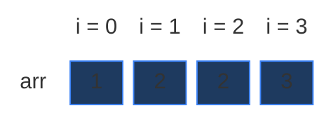

This is the example from the board in Striver's lecture and from my notes. The two `2`s sit at index 1 and index 2. Same value, different position, so `{1, 2}` is counted **twice**. We use this example in every section below. It is small (a 4 × 4 grid).

### Constraints

Coding Ninjas (from my notes):

- `1 <= n <= 100`
- `0 <= arr[i] <= 1000`
- `1 <= k <= 1000`
- Expected time: `O(n · k)`. Time limit: 1 second.

Two details in the statement matter (from my notes):

- It says "positive integers", but the constraints allow `arr[i] = 0`. **Zeros change the count.** The simple base cases give wrong answers when zeros appear. Section 2 ("The zeros trap") shows why and fixes it. Every code block in this note uses the fixed base case.
- The answer must be printed **modulo `10^9 + 7`**. The 5 codes in my notes forget it. Every code block here takes it.

### What the constraints tell us (simple theory)

A **constraint** is the biggest input the judge will ever give you. It quietly tells you how fast your code must be.

**Rule of thumb:** a computer does about **100 million (10^8) simple steps per second**. Count how many steps your idea needs for the biggest input, and compare.

| Biggest input `n` | Steps you can afford | Ideas that fit |
|:---:|:---:|:---|
| up to ~20 | about `2^n` | Plain recursion, try everything |
| up to ~500 | about `n^3` | Three nested loops |
| up to ~5,000 | about `n^2` | Two nested loops |
| up to ~1,000,000 | about `n` or `n log n` | One loop, DP over `n` states |

**For this problem:** `n` is at most `100` and `k` is at most `1000`.

- Trying every subset needs `2^100` checks. That is about `1.3 × 10^30`. Even at `10^8` steps per second, that is far longer than the age of the universe.
- The DP fills a grid of `n × (k + 1) = 100 × 1001 ≈ 100,000` cells. That is about **0.1 million** steps. It runs in a blink.

The key: the input has two sizes, `n` and `k`. The DP work is their **product** `n · k`, not `2^n`.

**How the work grows as `n` grows**

Here `arr` is all ones and `k = n / 2` (rounded down). Then the answer is "choose `k` of the `n` ones", a big count, and recursion has to walk through a huge tree. Red bars = calls made by plain recursion. Green line = cells in the DP grid, `n · (k + 1)` (it stays flat near zero).

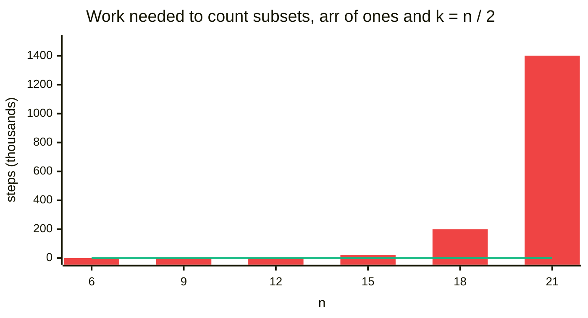

| `n` | `k` | Recursion calls | DP cells `n · (k + 1)` | Answer (number of subsets) |
|:---:|:---:|:---:|:---:|:---:|
| 6 | 3 | 56 | 24 | 20 |
| 9 | 4 | 381 | 45 | 126 |
| 12 | 6 | 3,301 | 84 | 924 |
| 15 | 7 | 22,818 | 120 | 6,435 |
| 18 | 9 | 199,139 | 180 | 48,620 |
| 21 | 10 | 1,401,291 | 231 | 352,716 |

The recursion calls grow about 7 to 9 times for every 3 extra elements. The DP cells grow slowly. (All numbers were counted by running the code; the counter is in the tests at the bottom of the final code.)

## 2. Core Theory

This note builds on [Subset Sum Equal To K](01.%20Subset%20Sum%20Equal%20To%20K.md). That note teaches 2-D DP from zero: why the state needs two numbers, and how the grid works. Here we only change **what each cell holds**.

### The one change: OR becomes +

From my notes:

| | L14 Subset Sum | L17 Count Subsets |
|:---|:---|:---|
| Question | Is it possible? | How many ways? |
| A cell holds | `T` / `F` | a number |
| Combine the two choices | take **OR** not take | take **+** not take |
| Base: target 0 | `True` | `1` (or more with zeros) |
| Base: index 0 | `a[0] == t` | `1` if `a[0] == t`, else `0` |

`T` / `F` becomes `1` / `0`, and OR becomes add. That is the whole change.

**Why add?** Every subset either uses `arr[ind]` or it does not. Never both. So the subsets that skip it and the subsets that use it are **two separate piles**. Nothing is in both piles. Total = pile 1 + pile 2.

Example: in our array, the subsets with sum 3 are `{1, 2a}`, `{1, 2b}` and `{3}`. Look at the last element, the `3`:

- **Skip the 3** pile: `{1, 2a}` and `{1, 2b}`. That is 2 ways.
- **Use the 3** pile: `{3}`. That is 1 way.
- Total: `2 + 1 = 3`. With OR we would only learn "yes". With `+` we learn "3".

### Why we can't just try them all

`[1, 2, 2, 3]` has `2^4 = 16` subsets (each element in or out). We could check each one and count those with sum 3. With `n = 100` there are `2^100` subsets, so that is impossible. We only use the brute force to check the other answers on small inputs.

```python
# Imports used by every code block in this note
from typing import List

# For the recursion limit and the tests
import sys

# For random tests at the end
import random

# For exact binomial counts in the tests
import math

# Answers are taken modulo this prime
MOD = 10 ** 9 + 7


# Brute force: try every subset with a bit mask and count the matches
class SolutionBrute:

    # Main method (same name as GfG)
    def perfectSum(self, arr: List[int], target: int) -> int:

        # Number of elements
        n = len(arr)

        # Matching subsets found so far
        count = 0

        # Every mask from 0 to 2^n - 1 is one subset (by position)
        for mask in range(1 << n):

            # Sum of the chosen elements
            total = 0

            # Look at every bit of the mask
            for i in range(n):

                # Bit i is 1: element i is in this subset
                if mask & (1 << i):

                    # Add it to the sum
                    total += arr[i]

            # This subset has the right sum
            if total == target:

                # Count it
                count += 1

        # Number of matching subsets, modulo the prime
        return count % MOD

    # Coding Ninjas name for the same method
    def findWays(self, arr: List[int], k: int) -> int:

        # Same work
        return self.perfectSum(arr, k)
```

Note: the mask picks **positions**, not values. So `{1, 2a}` and `{1, 2b}` are two different masks, and both are counted. That is exactly what the problem wants.

### How to spot that it is DP

| Property | Plain meaning | In this problem |
|:---|:---|:---|
| **Overlapping subproblems** | The same smaller question is asked many times | "How many subsets of `arr[0..0]` make 1?" is asked twice in our example (Section 4) |
| **Optimal substructure** | The big answer is built from answers of smaller questions | "How many subsets of `arr[0..3]` make 3?" = (ways without the 3) + (ways with the 3) |

"Choose some elements" + "count the ways to reach a target" is the classic sign of DP on subsets.

### The state and the grid

The **state** is the small piece of information that names one subproblem. Just like in [note 01](01.%20Subset%20Sum%20Equal%20To%20K.md), one number is not enough, because picking an element shrinks the target. So we use two:

> `f(ind, target)` = "how many subsets of `arr[0], arr[1], ..., arr[ind]` have sum exactly `target`?" Answer: a whole number `0, 1, 2, ...`

The whole question is `f(n - 1, k)`. For our example that is `f(3, 3)`. On the board: `f(n - 1, S) = f(3, 3)` = "how many ways using index 0 to 3".

The answers fit in a **grid**:

- **Row `ind`** = "I may use elements `0 .. ind`". Row 0 uses only the `1`. Row 3 uses all four.
- **Column `target`** = "the sum I want". From `0` to `k`, so `k + 1` columns.
- **Cell `[ind][target]`** = a count.

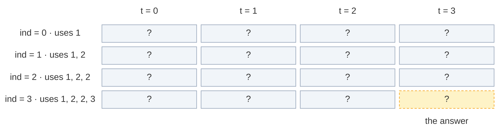

`n` rows and `k + 1` columns: here `4 × 4 = 16` cells. The answer is the bottom-right cell `[3][3]`.

### The recurrence: pick or not pick, then ADD

My notes write the recursion in 3 steps (Striver's recipe from the board):

1. **Express** everything in terms of `(ind, target)`.
2. **Explore all possibilities**: not pick `arr[ind]`, or pick it.
3. **Sum all possibilities** and return. (L14 used OR, "does any way work?". Here we ADD, "how many ways?".)

In words: *look at the last allowed element `arr[ind]`. Count the ways without it (the earlier elements must still make `target`). Count the ways with it (the earlier elements must make `target - arr[ind]`). Add the two counts.*

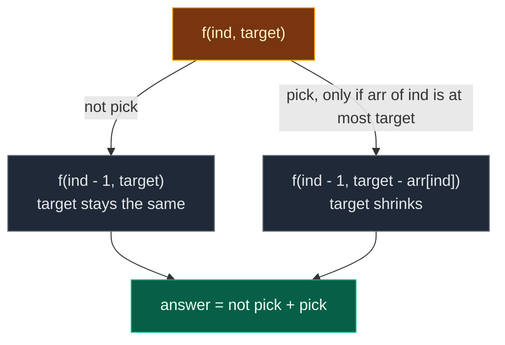

```text
not_pick = f(ind - 1, target)
pick     = f(ind - 1, target - arr[ind])     only if arr[ind] <= target, else 0
f(ind, target) = not_pick + pick
```

From my notes, as a formula:

```text
count(index, target) = count(index - 1, target)                   # not take
                     + count(index - 1, target - arr[index])      # take
```

In the grid (my notes call it the "box rule"): **box = box straight up + box up and `arr[i]` to the left**. Answer = `dp[n - 1][k]`.

### Base cases

A **base case** is a subproblem so small that we know the answer without more work.

**The simple version (from my notes and the board, fine for positive numbers):**

| Base case | Answer | Why |
|:---|:---:|:---|
| `target == 0` | `1` | The target is already made. Take nothing more: that is 1 way (the empty choice) |
| `ind == 0` | `1` if `arr[0] == target`, else `0` | Only `arr[0]` is left. It must equal the target: 1 way, or no way |

My notes say "this problem is very important for base cases". The board adds a warning: these two lines assume there are **no zeros** in the array. The next part shows why.

### The zeros trap

A `0` can be put into **any** subset, or left out, and the sum does not change. So every `0` gives 2 choices that both keep the sum. **Each zero doubles the count.**

Example from my notes: `arr = [0, 0, 1]`, `k = 1`. Call the zeros `0a` and `0b`. The subsets with sum 1:

- `{1}`
- `{0a, 1}`
- `{0b, 1}`
- `{0a, 0b, 1}`

Answer = **4** (`1 × 2 × 2`). This is not only "other platforms": the Coding Ninjas constraints say `0 <= arr[i]`, and GfG says non-negative. Zeros can be in the real tests. (It matters even more later in Target Sum and Count Partitions With Given Difference, which reduce to this problem.)

**Where the simple base cases break:**

- `if target == 0: return 1` **stops too early**. There may still be zeros below that index. Each of them could be taken or skipped, and each doubles the ways. Stopping returns 1 instead of 2, 4, 8, ...
- In the table, `dp[0][0] = 1` is wrong when `arr[0] == 0`: with only `arr[0] = 0` there are **2** ways to make sum 0, `{}` and `{0}`.

My notes ran all 5 codes on arrays with zeros:

| `arr` | `k` | Correct | Recursion | Memo | Table | 2 rows | 1 array | Fixed |
|:---|:---:|:---:|:---:|:---:|:---:|:---:|:---:|:---:|
| `[0, 0, 1]` | 1 | 4 | ✗ 1 | ✗ 1 | ✗ 2 | ✗ 2 | ✓ 4 | ✓ 4 |
| `[0, 1]` | 1 | 2 | ✗ 1 | ✗ 1 | ✗ 1 | ✗ 1 | ✓ 2 | ✓ 2 |
| `[1, 0, 1]` | 1 | 4 | ✗ 3 | ✗ 3 | ✓ 4 | ✓ 4 | ✓ 4 | ✓ 4 |
| `[2, 0, 3]` | 5 | 2 | ✓ 2 | ✓ 2 | ✓ 2 | ✓ 2 | ✓ 2 | ✓ 2 |

- **Recursion / memo:** wrong when a zero sits at or below the point where the target hits 0 (like `[0, 0, 1]`). `[2, 0, 3]` happens to work.
- **Table / 2 rows:** wrong only when `arr[0] == 0`. Rows 1 and later loop from `t = 0`, so they handle zeros. Only row 0 is wrong.
- **1 array:** correct. For `num = 0`, the loop runs `t = k .. 0` and does `dp[t] += dp[t]`, which doubles every count.

**The table for `[0, 0, 1]`, `k = 1`, with the old row 0** (`dp[0][0] = 1`, dashed = the wrong cell):

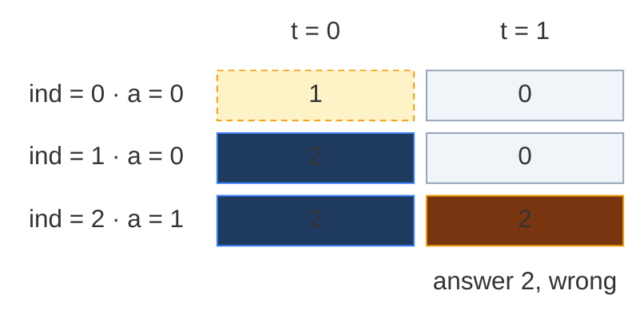

**With the fixed row 0** (`dp[0][0] = 2`, because `arr[0] = 0`):

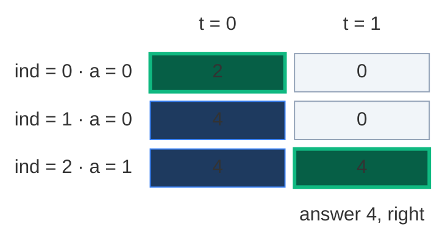

Column 0 goes `2 → 4` because of the two zeros. The answer is `4`: `{1}`, `{0a, 1}`, `{0b, 1}`, `{0a, 0b, 1}`.

**The fixed base case (used in every code block below).** Remove the early `target == 0` line. Handle everything at `ind == 0`:

| At `ind == 0` | Answer | Why |
|:---|:---:|:---|
| `target == 0` and `arr[0] == 0` | `2` | Skip the 0 (`{}`) or take it (`{0}`). Both have sum 0 |
| `target == 0` (and `arr[0] != 0`) | `1` | Skip `arr[0]`: the empty choice |
| `arr[0] == target` (and not 0) | `1` | Take `arr[0]` |
| anything else | `0` | No way |

For the table, the same rule becomes: `dp[0][0] = 2` if `arr[0] == 0`, else `1`. And `dp[0][arr[0]] = 1` only if `arr[0] != 0` and `arr[0] <= k`. Then loop the targets from **`t = 0`**, not `t = 1`, so a zero in a later row also doubles column 0.

Here are the two codes from my notes, kept only to prove the trap in the tests at the bottom:

```python
# The recursion from my notes: early target == 0 return (breaks with zeros)
class SolutionNotesRecursion:

    # Helper with the simple base cases
    def solve(self, index: int, target: int, arr: List[int]) -> int:

        # Target made: 1 way (wrong if zeros are still below)
        if target == 0:
            return 1

        # Only arr[0] left: it must equal target
        if index == 0:
            return 1 if arr[0] == target else 0

        # Not take
        not_take = self.solve(index - 1, target, arr)

        # Take starts at 0 ways
        take = 0

        # Take only if it fits
        if arr[index] <= target:

            # Smaller target
            take = self.solve(index - 1, target - arr[index], arr)

        # Total ways
        return take + not_take

    # Coding Ninjas name
    def findWays(self, arr: List[int], k: int) -> int:

        # Start from the last index
        return self.solve(len(arr) - 1, k, arr)


# The table from my notes: dp[0][0] = 1 even when arr[0] is 0
class SolutionNotesTab:

    # Coding Ninjas name
    def findWays(self, arr: List[int], k: int) -> int:

        # Number of elements
        n = len(arr)

        # n rows, k + 1 columns of zeros
        dp = [[0] * (k + 1) for _ in range(n)]

        # Sum 0 in every row: 1 way (the empty subset)
        for index in range(n):

            # Column 0 of this row
            dp[index][0] = 1

        # First element alone makes arr[0] (for arr[0] = 0 this sets dp[0][0] = 1 again)
        if arr[0] <= k:

            # Mark it
            dp[0][arr[0]] = 1

        # Fill rows 1 .. n - 1
        for index in range(1, n):

            # Targets from 0 (so later zeros still work)
            for target in range(0, k + 1):

                # Not take
                not_take = dp[index - 1][target]

                # Take starts at 0
                take = 0

                # Take only if it fits
                if arr[index] <= target:

                    # Up and arr[index] to the left
                    take = dp[index - 1][target - arr[index]]

                # Total ways
                dp[index][target] = take + not_take

        # Bottom-right cell
        return dp[n - 1][k]
```

### Why modulo `10^9 + 7`?

The count can be huge. With 100 ones and `k = 50`, the answer is "choose 50 of 100" = `100891344545564193334812497256`, a 30-digit number.

- In C++ or Java, an `int` holds at most about `2.1 × 10^9`, and a `long` about `9.2 × 10^18`. The real count does not fit, so it would overflow and turn into garbage.
- So the judge asks for the answer **modulo `10^9 + 7`** (the remainder after dividing by `1,000,000,007`, a prime).
- Take the modulo **every time you add**: `dp = (pick + not_pick) % MOD`. The rule `(a + b) % M = ((a % M) + (b % M)) % M` means taking it early gives the same final remainder.
- After each step every value is below `MOD`. Adding two of them gives less than `2 × MOD ≈ 2.0 × 10^9`, which still fits in a 32-bit `int`.
- Python has big integers, so it would not overflow, but the judge still expects the remainder. And small numbers are faster.

### The 4-step ladder

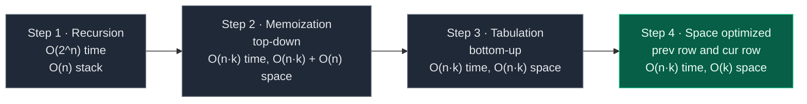

Bonus step after step 4: one single array with a **backward** loop (Section 7).

## 3. Edge Cases

| Case | Input | Expected | Why it matters |
|:---|:---:|:---:|:---|
| Our example | `arr = [1, 2, 2, 3]`, `k = 3` | 3 | Same values at different positions count separately |
| Zeros double the count | `arr = [0, 0, 1]`, `k = 1` | 4 | The zeros trap: the base case must return 2 at `arr[0] = 0`, `target = 0` |
| Zero at index 0 only | `arr = [0, 1]`, `k = 1` | 2 | `{1}` and `{0, 1}`. The old table gives 1 |
| Zero in the middle | `arr = [1, 0, 1]`, `k = 1` | 4 | The old recursion stops early and gives 3 |
| Target 0, no zeros | `arr = [35, 2, 8, 22]`, `k = 0` | 1 | Only the empty subset (GfG example) |
| Target 0, all zeros | `arr = [0, 0]`, `k = 0` | 4 | `{}`, `{0a}`, `{0b}`, `{0a, 0b}` |
| First element bigger than `k` | `arr = [1000, 1]`, `k = 1` | 1 | `dp[0][arr[0]]` must be guarded by `arr[0] <= k` |
| No subset fits | `arr = [2, 34, 5]`, `k = 40` | 0 | Sample from Coding Ninjas |
| All the same value | `arr = [1, 1, 1]`, `k = 2` | 3 | Choose any two of the three `1`s |
| Huge count | 100 ones, `k = 50` | `C(100, 50) mod (10^9 + 7)` | Needs the modulo |
| Biggest input | `n = 100`, `k = 1000` | – | Only `100 × 1001` cells, fast |

## 4. Approach 1: Recursion

### Idea

Write the recurrence as code. Start with `f(n - 1, k)`. At `ind == 0`, use the fixed base case. Otherwise count "not pick" and "pick" and **add** them.

What does the start call mean? `f(n - 1, k) = f(3, 3)` = "in `arr[0 .. 3]`, how many subsets have sum 3?"

### Recursion tree for `arr = [1, 2, 2, 3]`, `k = 3`

Every box shows the call and the count it returns. Calls happen depth-first, "not pick" first (like the code). Numbers flow **up** and get **added**.

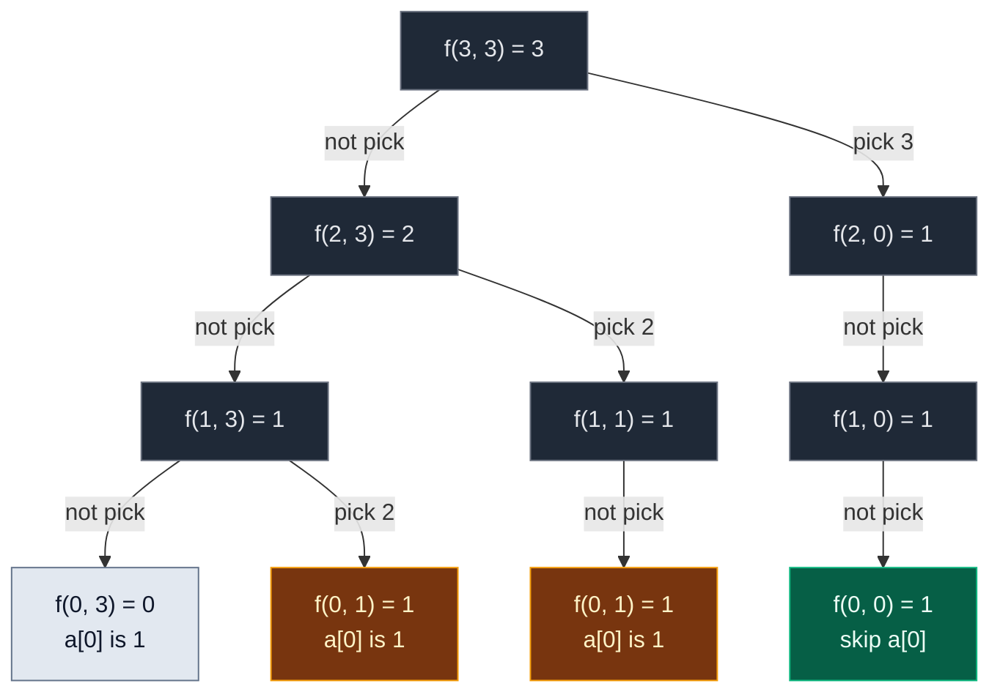

Gold = repeated work. Green = a leaf that found 1 way. Grey = a leaf with 0 ways.

- `f(1, 1)`, `f(2, 0)` and `f(1, 0)` have only one child: the `2` (or the `3`) is bigger than the target, so "pick" is not allowed and counts 0.
- `f(2, 0)` does not stop at "target 0". With the zero-safe base case it walks down to `ind == 0`, in case there are zeros below. Here there are none, so it still returns 1. (The simple code from my notes would stop right at `f(2, 0)` and return 1: same count here, but wrong when zeros are below.)

| State | Times computed |
|:---|:---:|
| `f(3, 3)`, `f(2, 3)`, `f(1, 3)`, `f(1, 1)`, `f(2, 0)`, `f(1, 0)` | 1 each |
| **`f(0, 1)`** | **2** |
| `f(0, 3)`, `f(0, 0)` | 1 each |

That is **10 calls**. The repeated state `f(0, 1)` ("how many subsets of `[1]` make 1?") is reached by "skip 3, skip second 2, pick first 2" and by "skip 3, pick second 2, skip first 2". Both paths leave the same question.

**Leaves that return 1 are exactly the subsets** (from my notes). Count the green and gold leaves:

| Leaf | Path from the top | Subset |
|:---|:---|:---|
| `f(0, 1)` under `f(1, 3)` | skip 3, skip second 2, pick first 2, pick 1 | `{1, 2a}` |
| `f(0, 1)` under `f(1, 1)` | skip 3, pick second 2, skip first 2, pick 1 | `{1, 2b}` |
| `f(0, 0)` | pick 3, skip the rest | `{3}` |

Memory hook from my notes: **same take / not-take tree as Subset Sum, count the leaves that hit the target.**

**The exact order of calls.** One participant per row of the grid (`ind`). Solid arrows = calls, dashed arrows = returns with counts.

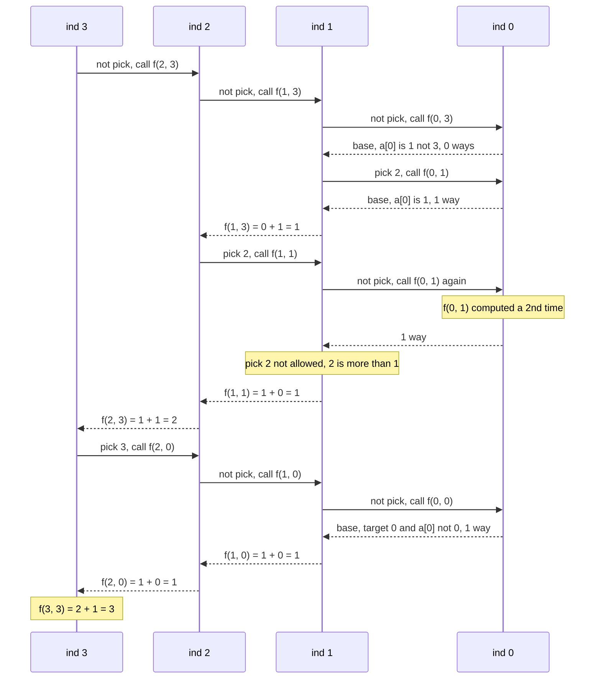

**Two more dry runs from my notes** (both give 2, the subsets `{1, 2}` and `{3}`):

- **Board:** `arr = [1, 3, 2]`, `s = 3`. `f(2, 3)`: take 2 → `f(1, 1)` = 1 (skip 3, then `a[0] = 1` ✓, that is `{1, 2}`). Skip 2 → `f(1, 3)` = 1 (take 3 → target 0 ✓, that is `{3}`). `f(2, 3) = 1 + 1 = 2`.
- **My notes:** `arr = [1, 2, 3]`, `k = 3`. `f(2, 3)`: not take → `f(1, 3)`, take → `f(1, 0)`. `f(1, 3)`: not take → `f(0, 3) = 0`, take → `f(0, 1) = 1` because `arr[0] = 1`. So `f(1, 3) = 1`. `f(1, 0) = 1`. Total `f(2, 3) = 1 + 1 = 2`.

### Code

```python
# Plain recursion with the zero-safe base case
class SolutionRecursion:

    # Helper: how many subsets of arr[0..index] have sum target?
    def solve(self, index: int, target: int, arr: List[int]) -> int:

        # Base case: only arr[0] is left
        if index == 0:

            # arr[0] is 0 and target is 0: skip it or take it, 2 ways
            if target == 0 and arr[0] == 0:
                return 2

            # Target 0 (skip arr[0]) or arr[0] equals target (take it): 1 way
            if target == 0 or arr[0] == target:
                return 1

            # Otherwise no way
            return 0

        # Choice 1: do not pick arr[index], target stays the same
        not_pick = self.solve(index - 1, target, arr)

        # Choice 2 starts at 0 ways (not allowed yet)
        pick = 0

        # Pick arr[index] only if it is not bigger than target
        if arr[index] <= target:

            # Picking it shrinks the target by arr[index]
            pick = self.solve(index - 1, target - arr[index], arr)

        # Two separate piles: add them, keep it small with the modulo
        return (pick + not_pick) % MOD

    # Main method (same name as GfG)
    def perfectSum(self, arr: List[int], target: int) -> int:

        # Start from the last index and the full target
        return self.solve(len(arr) - 1, target, arr)

    # Coding Ninjas name for the same method
    def findWays(self, arr: List[int], k: int) -> int:

        # Same work
        return self.perfectSum(arr, k)
```

### Complexity

| Measure | Complexity | Why |
|:---|:---:|:---|
| **Time** | `O(2^n)` | Each index gives 2 choices (pick / not pick), so the tree can double at each level |
| **Space** | `O(n)` | Recursion stack. The deepest path goes `ind = n - 1, n - 2, ..., 0`, which is `n` frames |

## 5. Approach 2: Memoization (Top-Down)

### Idea

The same `(ind, target)` state can repeat many times. Store each count the first time in a 2-D table `dp[ind][target]`, and reuse it.

| Value | Meaning |
|:---:|:---|
| `-1` | Not computed yet |
| `0, 1, 2, ...` | Computed: that many subsets |

Why `-1` and not `0`? Because `0` is a real answer here ("no subset"). We need a value that can never be a count.

**Size of the table.** `ind` goes `0 .. n - 1` (`n` rows), `target` goes `0 .. k` (`k + 1` columns). On the board: `dp[N][sum + 1]`.

The same **3 steps** as always:

1. **Declare** `dp` with `n` rows and `k + 1` columns, filled with `-1`.
2. **Store** the count before returning: `dp[ind][target] = (pick + not_pick) % MOD`.
3. **Check** first: if `dp[ind][target] != -1`, return it and make no new calls.

Note: base-case cells (`ind == 0`) are never stored. The base case answers them before the table is looked at. So row 0 stays `-1`.

**Python only:** with `n = 100` the recursion is only 100 calls deep, well under Python's default limit of 1000. We still raise the limit for safety on bigger tests.

### Visual: when each `dp[ind][target]` gets filled

Colours: grey = `-1` (not computed), dashed yellow = computing (waiting for its children), green = just filled, blue = filled earlier.

**Start:** `dp` is `4 × 4`, all `-1`.

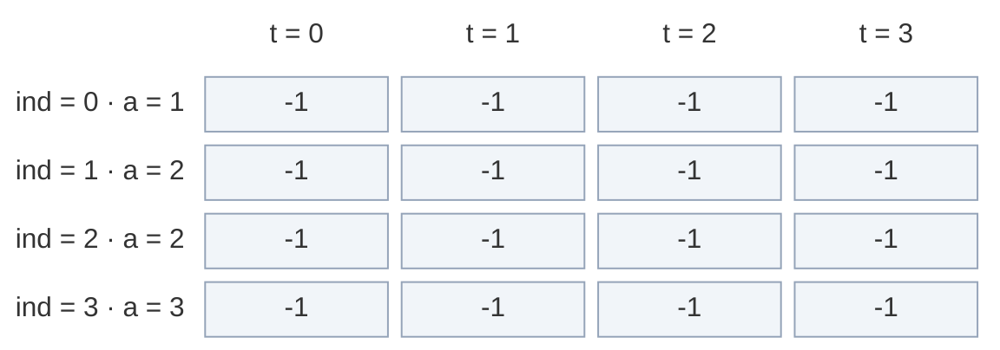

**Calls go down the "not pick" side:** `f(3, 3)` → `dp[3][3] = -1`, compute. `f(2, 3)` → `-1`, compute. `f(1, 3)` → `-1`, compute.

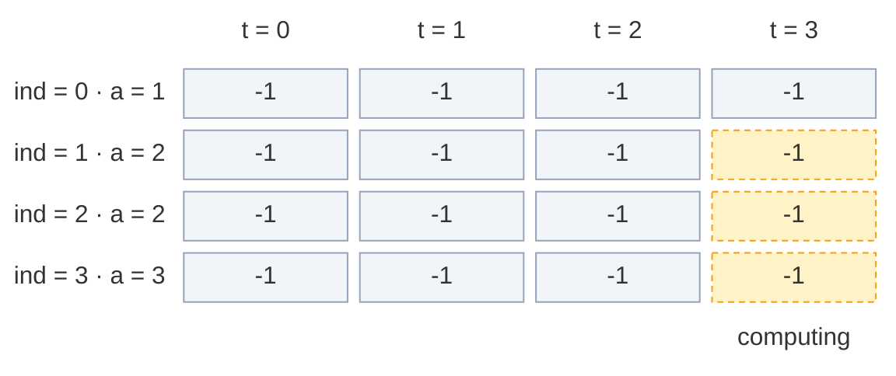

**Fill 1:** `f(1, 3)` asks `f(0, 3)` (base, `1 ≠ 3` → 0) and `f(0, 1)` (base, `1 == 1` → 1). `0 + 1 = 1`. Store `dp[1][3] = 1`.

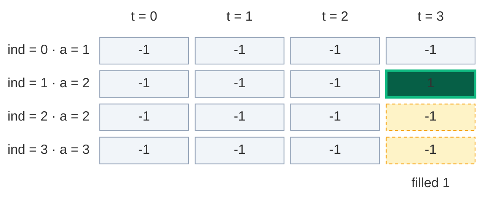

**Fill 2:** back in `f(2, 3)`, "pick 2" calls `f(1, 1)` → `-1`, compute. "Not pick" asks `f(0, 1)` (base → 1). "Pick 2" is not allowed (`2 > 1`) → 0. Store `dp[1][1] = 1`.

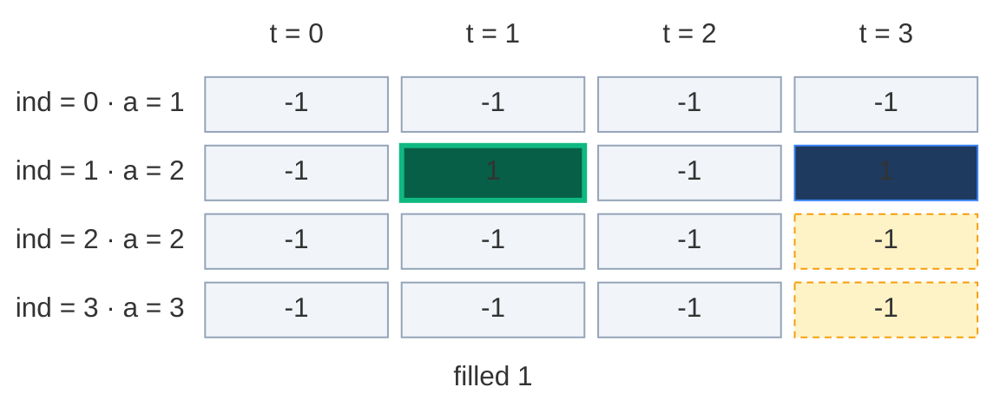

**Fill 3:** `f(2, 3) = 1 + 1 = 2`. Store `dp[2][3] = 2`.

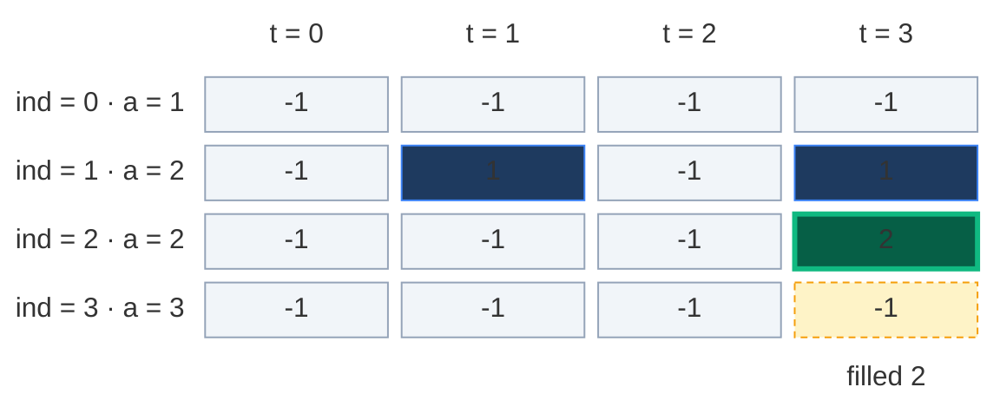

**Fill 4:** `f(3, 3)` now tries "pick 3" → `f(2, 0)` → `-1`, compute. Its "not pick" asks `f(1, 0)` → `-1`, compute. That asks `f(0, 0)` (base, target 0 and `a[0] = 1` → 1). "Pick 2" not allowed. Store `dp[1][0] = 1`.

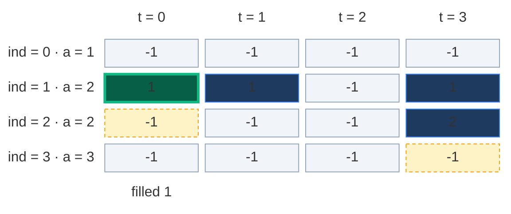

**Fill 5:** `f(2, 0) = 1 + 0 = 1` ("pick 2" not allowed). Store `dp[2][0] = 1`.

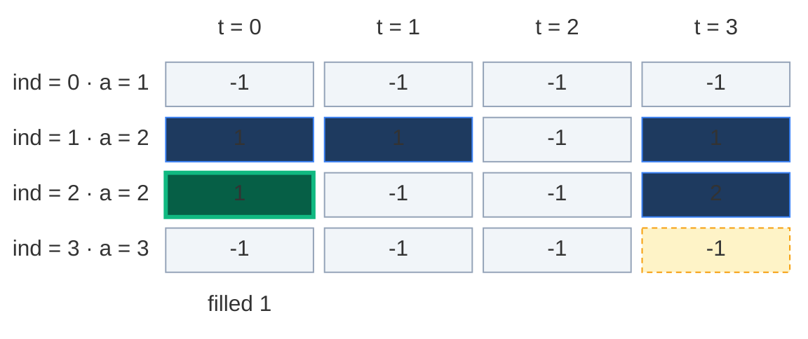

**Fill 6:** `f(3, 3) = 2 + 1 = 3`. Store `dp[3][3] = 3`. That is the answer.

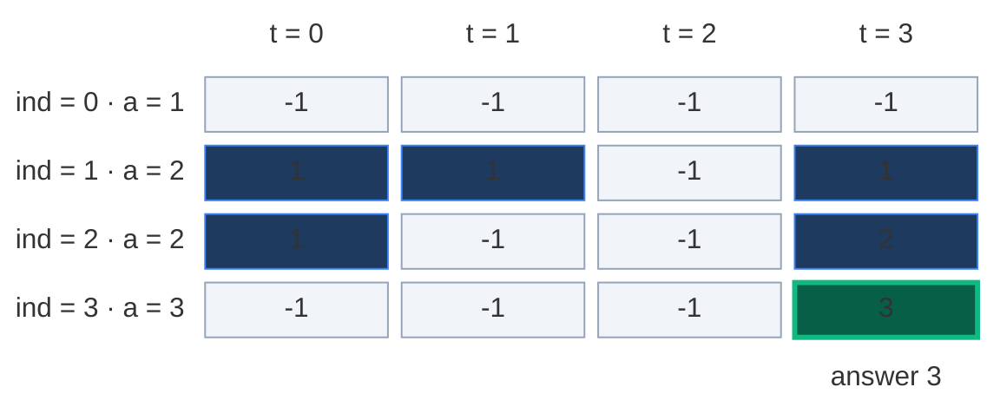

Only 6 of the 16 cells were ever stored. Memoization computes **only the states it needs**.

**No cache hit here** (my notes say the same): for this small example, no box with `ind ≥ 1` is asked twice. `f(1, 1)` is reached once and `f(2, 3)` once. The only repeat, `f(0, 1)`, is a base case, which is answered right away and never stored. So memo makes the same 10 calls as plain recursion. On bigger arrays the same box is hit many times. That is where the `2^n → n · k` saving comes from.

### The pruned recursion tree (a tiny example with a real cache hit)

To see a cache hit, take `arr = [1, 1, 1, 1]`, `k = 2` (answer: choose 2 of 4 = 6). The state `f(1, 1)` is asked twice. The second time it comes from `dp` (dashed) and its 2 children are never called.

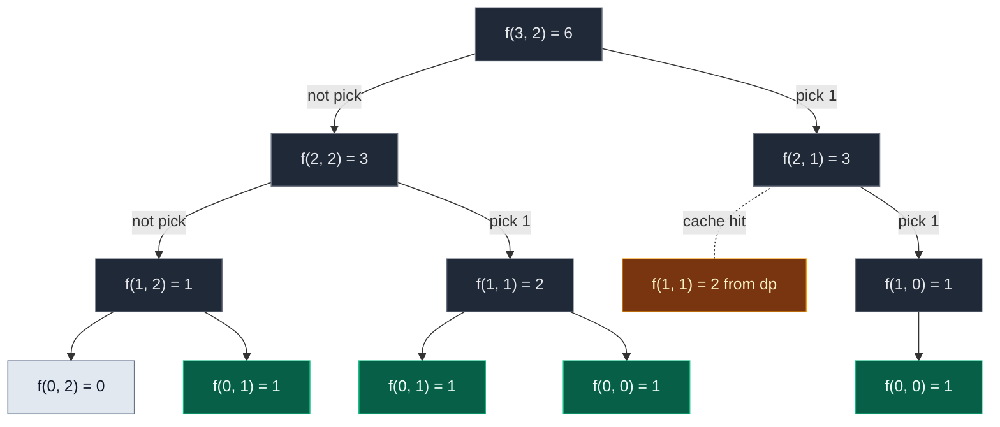

**12 calls** instead of 14 (both counted in the tests). Small saving because the example is tiny. On bigger inputs the saving is huge: at most `n · (k + 1)` states are ever computed.

### Code

```python
# Memoization (top-down DP) with a 2-D table of -1
class SolutionMemo:

    # Helper: how many subsets of arr[0..index] make target? Uses and fills dp
    def solve(self, index: int, target: int, arr: List[int], dp: List[List[int]]) -> int:

        # Base case: only arr[0] is left
        if index == 0:

            # arr[0] is 0 and target is 0: skip it or take it, 2 ways
            if target == 0 and arr[0] == 0:
                return 2

            # Target 0 (skip arr[0]) or arr[0] equals target (take it): 1 way
            if target == 0 or arr[0] == target:
                return 1

            # Otherwise no way
            return 0

        # Step 3 (check): already counted this (index, target)? Reuse it
        if dp[index][target] != -1:
            return dp[index][target]

        # Choice 1: do not pick arr[index], target stays the same
        not_pick = self.solve(index - 1, target, arr, dp)

        # Choice 2 starts at 0 ways (not allowed yet)
        pick = 0

        # Pick arr[index] only if it is not bigger than target
        if arr[index] <= target:

            # Picking it shrinks the target by arr[index]
            pick = self.solve(index - 1, target - arr[index], arr, dp)

        # Step 2 (store): add the two piles, with the modulo
        dp[index][target] = (pick + not_pick) % MOD

        # Return the stored count
        return dp[index][target]

    # Main method (same name as GfG)
    def perfectSum(self, arr: List[int], target: int) -> int:

        # Number of elements
        n = len(arr)

        # Python only: allow recursion as deep as n, with room to spare
        sys.setrecursionlimit(max(1000, 2 * n + 100))

        # Step 1 (declare): n rows, target + 1 columns, -1 means not counted yet
        dp = [[-1] * (target + 1) for _ in range(n)]

        # Keep the table so we can look at it after the run
        self.dp = dp

        # Start from the last index and the full target
        return self.solve(n - 1, target, arr, dp)

    # Coding Ninjas name for the same method
    def findWays(self, arr: List[int], k: int) -> int:

        # Same work
        return self.perfectSum(arr, k)
```

### Complexity

From the board: recursion `O(2^n)` time, `O(n)` stack. Overlapping subproblems → memo.

| Measure | Complexity | Why |
|:---|:---:|:---|
| **Time** | `O(n · k)` | At most `n · (k + 1)` different states, each counted once with `O(1)` work |
| **Space: dp table** | `O(n · k)` | `n` rows × `k + 1` columns |
| **Space: recursion stack** | `O(n)` | The deepest path goes `ind = n - 1` down to `0` |
| **Total space** | `O(n · k) + O(n)` | Table plus stack. Tabulation removes the `O(n)` stack |

## 6. Approach 3: Tabulation (Bottom-Up)

### Idea

Fill the whole grid with two loops, from the smallest states (row 0) to the answer (`[n - 1][k]`). No recursion, so no stack.

`dp[i][t]` = "how many subsets of `arr[0 .. i]` have sum exactly `t`?" A count, not `T` / `F`.

### How to convert memo → table, step by step

The board's 3 steps (base case, changing parameters as nested loops, copy the recursion), plus "same table" and "answer":

1. **Same grid:** `dp` with `n` rows and `k + 1` columns, all `0`.
2. **Base cases become cells** (zero-safe):
   - `dp[0][0] = 2` if `arr[0] == 0`, else `dp[0][0] = 1`. (Sum 0 with only `arr[0]`: skip it, and also take it if it is 0.)
   - `dp[0][arr[0]] = 1` if `arr[0] != 0` and `arr[0] <= k`. (Take `arr[0]` alone. The `<= k` check keeps the index inside the table, `arr[0]` can be 1000.)
   - My notes (and the board) also write `dp[i][0] = 1` for every row. That is not needed here: the loop below fills column 0 itself, `dp[i][0] = dp[i - 1][0] + 0`, or doubled if `arr[i] == 0`.
3. **Two nested loops, in the opposite direction:** the recursion went `n - 1 → 0`. Reverse it: `ind` from `1` to `n - 1`, and inside, `target` from **`0`** to `k`. (Subset Sum started at `t = 1`. Here we start at `t = 0` so that a zero in a later row doubles column 0.)
4. **Copy the recurrence:** replace `f(...)` with `dp[...]`:
   - `not_pick = dp[ind - 1][target]`
   - `pick = dp[ind - 1][target - arr[ind]]` if `arr[ind] <= target`, else `0`
   - `dp[ind][target] = (not_pick + pick) % MOD`
5. **Answer:** `dp[n - 1][k]`.

| Memoization | Becomes in tabulation |
|:---|:---|
| `dp[n][k + 1]` with `-1` | `dp[n][k + 1]` with `0` |
| `ind == 0`, `target == 0` → `2` if `arr[0] == 0` else `1` | `dp[0][0] = 2` or `1` |
| `ind == 0`, `arr[0] == target` → `1` | `dp[0][arr[0]] = 1` if `0 < arr[0] <= k` |
| `f(n - 1, k)` going down | Loops `ind = 1 .. n - 1`, `target = 0 .. k` going up |
| `f(ind - 1, target)` | `dp[ind - 1][target]` |
| `f(ind - 1, target - arr[ind])` | `dp[ind - 1][target - arr[ind]]` |
| `return f(n - 1, k)` | `return dp[n - 1][k]` |

**Picture rule (my notes):** box = box **straight up** (not pick) **+** box **up, then `arr[ind]` steps left** (pick).

### Visual table fill (`arr = [1, 2, 2, 3]`, `k = 3`)

Colours: green = just filled, orange = the two cells it reads, blue = filled earlier, grey `?` = not filled yet.

**Start: row 0 written in.** `arr[0] = 1` is not 0, so `dp[0][0] = 1` (the empty subset). `arr[0] = 1 <= 3`, so `dp[0][1] = 1` (just the 1). Targets 2 and 3 are 0 ways.

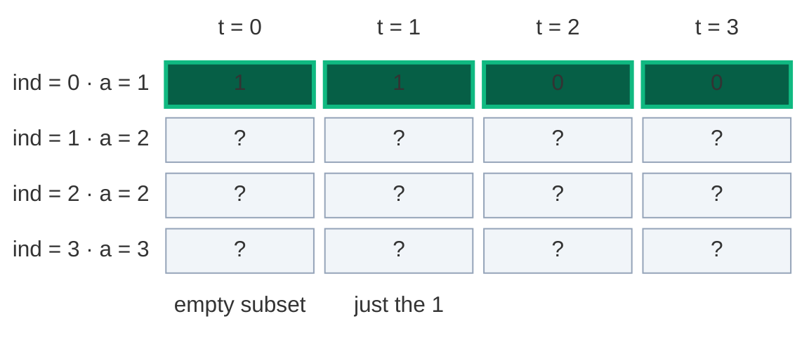

#### Row 1 (`arr[1] = 2`), cell by cell

**`dp[1][0]`:** not pick = `dp[0][0] = 1`. Pick: `2 > 0`, not allowed → 0. Result `1 + 0 = 1`.

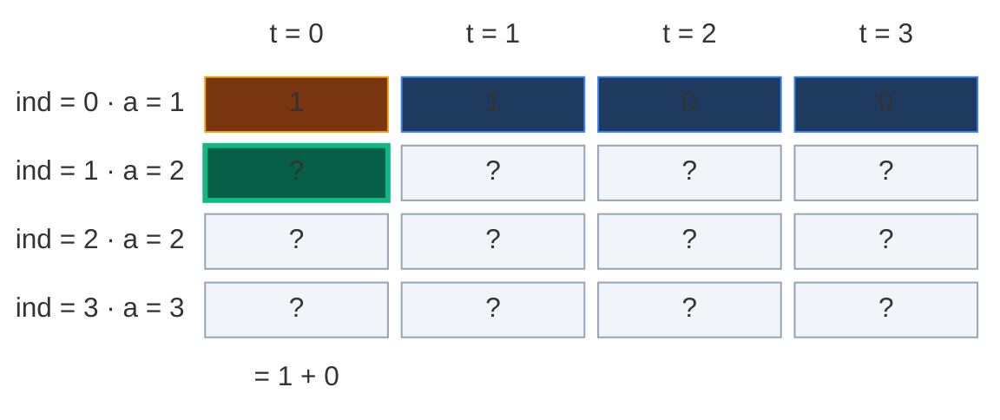

**`dp[1][1]`:** not pick = `dp[0][1] = 1`. Pick: `2 > 1`, not allowed → 0. Result `1`.

```mermaid
block-beta
  columns 5
  hx[" "] h0["t = 0"] h1["t = 1"] h2["t = 2"] h3["t = 3"]
  l0["ind = 0 · a = 1"] r0c0["1"] r0c1["1"] r0c2["0"] r0c3["0"]
  l1["ind = 1 · a = 2"] r1c0["1"] r1c1["?"] r1c2["?"] r1c3["?"]
  l2["ind = 2 · a = 2"] r2c0["?"] r2c1["?"] r2c2["?"] r2c3["?"]
  l3["ind = 3 · a = 3"] r3c0["?"] r3c1["?"] r3c2["?"] r3c3["?"]
  space space m1["= 1 + 0"] space space
  classDef head fill:none,stroke:none,color:#64748b
  class hx,h0,h1,h2,h3,l0,l1,l2,l3 head
  classDef done fill:#1e3a5f,stroke:#3b82f6,color:#dbeafe
  class r0c0,r0c2,r0c3,r1c0 done
  classDef read fill:#78350f,stroke:#f59e0b,color:#fef3c7
  class r0c1 read
  classDef new fill:#065f46,stroke:#10b981,color:#ecfdf5,stroke-width:3px
  class r1c1 new
  classDef empty fill:#f1f5f9,stroke:#94a3b8,color:#64748b
  class r1c2,r1c3,r2c0,r2c1,r2c2,r2c3,r3c0,r3c1,r3c2,r3c3 empty
  classDef note fill:none,stroke:none,color:#b45309
  class m1 note
```

**`dp[1][2]`:** not pick = `dp[0][2] = 0`. Pick = `dp[0][2 - 2] = dp[0][0] = 1`. Result `0 + 1 = 1` (that is `{2}`).

```mermaid
block-beta
  columns 5
  hx[" "] h0["t = 0"] h1["t = 1"] h2["t = 2"] h3["t = 3"]
  l0["ind = 0 · a = 1"] r0c0["1"] r0c1["1"] r0c2["0"] r0c3["0"]
  l1["ind = 1 · a = 2"] r1c0["1"] r1c1["1"] r1c2["?"] r1c3["?"]
  l2["ind = 2 · a = 2"] r2c0["?"] r2c1["?"] r2c2["?"] r2c3["?"]
  l3["ind = 3 · a = 3"] r3c0["?"] r3c1["?"] r3c2["?"] r3c3["?"]
  space space space m2["= 0 + 1"] space
  classDef head fill:none,stroke:none,color:#64748b
  class hx,h0,h1,h2,h3,l0,l1,l2,l3 head
  classDef read fill:#78350f,stroke:#f59e0b,color:#fef3c7
  class r0c0,r0c2 read
  classDef done fill:#1e3a5f,stroke:#3b82f6,color:#dbeafe
  class r0c1,r0c3,r1c0,r1c1 done
  classDef new fill:#065f46,stroke:#10b981,color:#ecfdf5,stroke-width:3px
  class r1c2 new
  classDef empty fill:#f1f5f9,stroke:#94a3b8,color:#64748b
  class r1c3,r2c0,r2c1,r2c2,r2c3,r3c0,r3c1,r3c2,r3c3 empty
  classDef note fill:none,stroke:none,color:#b45309
  class m2 note
```

**`dp[1][3]`:** not pick = `dp[0][3] = 0`. Pick = `dp[0][3 - 2] = dp[0][1] = 1`. Result `0 + 1 = 1` (that is `{1, 2}`).

```mermaid
block-beta
  columns 5
  hx[" "] h0["t = 0"] h1["t = 1"] h2["t = 2"] h3["t = 3"]
  l0["ind = 0 · a = 1"] r0c0["1"] r0c1["1"] r0c2["0"] r0c3["0"]
  l1["ind = 1 · a = 2"] r1c0["1"] r1c1["1"] r1c2["1"] r1c3["?"]
  l2["ind = 2 · a = 2"] r2c0["?"] r2c1["?"] r2c2["?"] r2c3["?"]
  l3["ind = 3 · a = 3"] r3c0["?"] r3c1["?"] r3c2["?"] r3c3["?"]
  space space space space m3["= 0 + 1"]
  classDef head fill:none,stroke:none,color:#64748b
  class hx,h0,h1,h2,h3,l0,l1,l2,l3 head
  classDef done fill:#1e3a5f,stroke:#3b82f6,color:#dbeafe
  class r0c0,r0c2,r1c0,r1c1,r1c2 done
  classDef read fill:#78350f,stroke:#f59e0b,color:#fef3c7
  class r0c1,r0c3 read
  classDef new fill:#065f46,stroke:#10b981,color:#ecfdf5,stroke-width:3px
  class r1c3 new
  classDef empty fill:#f1f5f9,stroke:#94a3b8,color:#64748b
  class r2c0,r2c1,r2c2,r2c3,r3c0,r3c1,r3c2,r3c3 empty
  classDef note fill:none,stroke:none,color:#b45309
  class m3 note
```

**After row 1:** with `[1, 2]`, every target `0 .. 3` has exactly 1 way. Row 1 = `[1, 1, 1, 1]`.

```mermaid
block-beta
  columns 5
  hx[" "] h0["t = 0"] h1["t = 1"] h2["t = 2"] h3["t = 3"]
  l0["ind = 0 · a = 1"] r0c0["1"] r0c1["1"] r0c2["0"] r0c3["0"]
  l1["ind = 1 · a = 2"] r1c0["1"] r1c1["1"] r1c2["1"] r1c3["1"]
  l2["ind = 2 · a = 2"] r2c0["?"] r2c1["?"] r2c2["?"] r2c3["?"]
  l3["ind = 3 · a = 3"] r3c0["?"] r3c1["?"] r3c2["?"] r3c3["?"]
  classDef head fill:none,stroke:none,color:#64748b
  class hx,h0,h1,h2,h3,l0,l1,l2,l3 head
  classDef done fill:#1e3a5f,stroke:#3b82f6,color:#dbeafe
  class r0c0,r0c1,r0c2,r0c3 done
  classDef new fill:#065f46,stroke:#10b981,color:#ecfdf5,stroke-width:3px
  class r1c0,r1c1,r1c2,r1c3 new
  classDef empty fill:#f1f5f9,stroke:#94a3b8,color:#64748b
  class r2c0,r2c1,r2c2,r2c3,r3c0,r3c1,r3c2,r3c3 empty
```

#### Row 2 (`arr[2] = 2`, the second 2), cell by cell

**`dp[2][0]`:** not pick = `dp[1][0] = 1`. Pick not allowed. Result `1`.

```mermaid
block-beta
  columns 5
  hx[" "] h0["t = 0"] h1["t = 1"] h2["t = 2"] h3["t = 3"]
  l0["ind = 0 · a = 1"] r0c0["1"] r0c1["1"] r0c2["0"] r0c3["0"]
  l1["ind = 1 · a = 2"] r1c0["1"] r1c1["1"] r1c2["1"] r1c3["1"]
  l2["ind = 2 · a = 2"] r2c0["?"] r2c1["?"] r2c2["?"] r2c3["?"]
  l3["ind = 3 · a = 3"] r3c0["?"] r3c1["?"] r3c2["?"] r3c3["?"]
  space m0["= 1 + 0"] space space space
  classDef head fill:none,stroke:none,color:#64748b
  class hx,h0,h1,h2,h3,l0,l1,l2,l3 head
  classDef done fill:#1e3a5f,stroke:#3b82f6,color:#dbeafe
  class r0c0,r0c1,r0c2,r0c3,r1c1,r1c2,r1c3 done
  classDef read fill:#78350f,stroke:#f59e0b,color:#fef3c7
  class r1c0 read
  classDef new fill:#065f46,stroke:#10b981,color:#ecfdf5,stroke-width:3px
  class r2c0 new
  classDef empty fill:#f1f5f9,stroke:#94a3b8,color:#64748b
  class r2c1,r2c2,r2c3,r3c0,r3c1,r3c2,r3c3 empty
  classDef note fill:none,stroke:none,color:#b45309
  class m0 note
```

**`dp[2][1]`:** not pick = `dp[1][1] = 1`. Pick not allowed (`2 > 1`). Result `1`.

```mermaid
block-beta
  columns 5
  hx[" "] h0["t = 0"] h1["t = 1"] h2["t = 2"] h3["t = 3"]
  l0["ind = 0 · a = 1"] r0c0["1"] r0c1["1"] r0c2["0"] r0c3["0"]
  l1["ind = 1 · a = 2"] r1c0["1"] r1c1["1"] r1c2["1"] r1c3["1"]
  l2["ind = 2 · a = 2"] r2c0["1"] r2c1["?"] r2c2["?"] r2c3["?"]
  l3["ind = 3 · a = 3"] r3c0["?"] r3c1["?"] r3c2["?"] r3c3["?"]
  space space m1["= 1 + 0"] space space
  classDef head fill:none,stroke:none,color:#64748b
  class hx,h0,h1,h2,h3,l0,l1,l2,l3 head
  classDef done fill:#1e3a5f,stroke:#3b82f6,color:#dbeafe
  class r0c0,r0c1,r0c2,r0c3,r1c0,r1c2,r1c3,r2c0 done
  classDef read fill:#78350f,stroke:#f59e0b,color:#fef3c7
  class r1c1 read
  classDef new fill:#065f46,stroke:#10b981,color:#ecfdf5,stroke-width:3px
  class r2c1 new
  classDef empty fill:#f1f5f9,stroke:#94a3b8,color:#64748b
  class r2c2,r2c3,r3c0,r3c1,r3c2,r3c3 empty
  classDef note fill:none,stroke:none,color:#b45309
  class m1 note
```

**`dp[2][2]`:** not pick = `dp[1][2] = 1` (that is `{2a}`). Pick = `dp[1][0] = 1` (that is `{}` plus this `2b`). Result `1 + 1 = 2`. The first time a count goes above 1.

```mermaid
block-beta
  columns 5
  hx[" "] h0["t = 0"] h1["t = 1"] h2["t = 2"] h3["t = 3"]
  l0["ind = 0 · a = 1"] r0c0["1"] r0c1["1"] r0c2["0"] r0c3["0"]
  l1["ind = 1 · a = 2"] r1c0["1"] r1c1["1"] r1c2["1"] r1c3["1"]
  l2["ind = 2 · a = 2"] r2c0["1"] r2c1["1"] r2c2["?"] r2c3["?"]
  l3["ind = 3 · a = 3"] r3c0["?"] r3c1["?"] r3c2["?"] r3c3["?"]
  space space space m2["= 1 + 1"] space
  classDef head fill:none,stroke:none,color:#64748b
  class hx,h0,h1,h2,h3,l0,l1,l2,l3 head
  classDef done fill:#1e3a5f,stroke:#3b82f6,color:#dbeafe
  class r0c0,r0c1,r0c2,r0c3,r1c1,r1c3,r2c0,r2c1 done
  classDef read fill:#78350f,stroke:#f59e0b,color:#fef3c7
  class r1c0,r1c2 read
  classDef new fill:#065f46,stroke:#10b981,color:#ecfdf5,stroke-width:3px
  class r2c2 new
  classDef empty fill:#f1f5f9,stroke:#94a3b8,color:#64748b
  class r2c3,r3c0,r3c1,r3c2,r3c3 empty
  classDef note fill:none,stroke:none,color:#b45309
  class m2 note
```

**`dp[2][3]`:** not pick the second 2 → look straight up: `dp[1][3] = 1` (that is `{1, 2a}`). Take the second 2 → look up, then 2 left: `dp[1][1] = 1` (that is `{1}` plus this `2b`). Result `1 + 1 = 2`.

```mermaid
block-beta
  columns 5
  hx[" "] h0["t = 0"] h1["t = 1"] h2["t = 2"] h3["t = 3"]
  l0["ind = 0 · a = 1"] r0c0["1"] r0c1["1"] r0c2["0"] r0c3["0"]
  l1["ind = 1 · a = 2"] r1c0["1"] r1c1["1"] r1c2["1"] r1c3["1"]
  l2["ind = 2 · a = 2"] r2c0["1"] r2c1["1"] r2c2["2"] r2c3["?"]
  l3["ind = 3 · a = 3"] r3c0["?"] r3c1["?"] r3c2["?"] r3c3["?"]
  space space space space m3["= 1 + 1"]
  classDef head fill:none,stroke:none,color:#64748b
  class hx,h0,h1,h2,h3,l0,l1,l2,l3 head
  classDef done fill:#1e3a5f,stroke:#3b82f6,color:#dbeafe
  class r0c0,r0c1,r0c2,r0c3,r1c0,r1c2,r2c0,r2c1,r2c2 done
  classDef read fill:#78350f,stroke:#f59e0b,color:#fef3c7
  class r1c1,r1c3 read
  classDef new fill:#065f46,stroke:#10b981,color:#ecfdf5,stroke-width:3px
  class r2c3 new
  classDef empty fill:#f1f5f9,stroke:#94a3b8,color:#64748b
  class r3c0,r3c1,r3c2,r3c3 empty
  classDef note fill:none,stroke:none,color:#b45309
  class m3 note
```

**After row 2:** row 2 = `[1, 1, 2, 2]`.

```mermaid
block-beta
  columns 5
  hx[" "] h0["t = 0"] h1["t = 1"] h2["t = 2"] h3["t = 3"]
  l0["ind = 0 · a = 1"] r0c0["1"] r0c1["1"] r0c2["0"] r0c3["0"]
  l1["ind = 1 · a = 2"] r1c0["1"] r1c1["1"] r1c2["1"] r1c3["1"]
  l2["ind = 2 · a = 2"] r2c0["1"] r2c1["1"] r2c2["2"] r2c3["2"]
  l3["ind = 3 · a = 3"] r3c0["?"] r3c1["?"] r3c2["?"] r3c3["?"]
  classDef head fill:none,stroke:none,color:#64748b
  class hx,h0,h1,h2,h3,l0,l1,l2,l3 head
  classDef done fill:#1e3a5f,stroke:#3b82f6,color:#dbeafe
  class r0c0,r0c1,r0c2,r0c3,r1c0,r1c1,r1c2,r1c3 done
  classDef new fill:#065f46,stroke:#10b981,color:#ecfdf5,stroke-width:3px
  class r2c0,r2c1,r2c2,r2c3 new
  classDef empty fill:#f1f5f9,stroke:#94a3b8,color:#64748b
  class r3c0,r3c1,r3c2,r3c3 empty
```

#### Row 3 (`arr[3] = 3`)

| Cell | not pick (up) | pick (up, 3 left) | Result |
|:---:|:---:|:---:|:---:|
| `dp[3][0]` | `dp[2][0] = 1` | not allowed (`3 > 0`) → 0 | `1` |
| `dp[3][1]` | `dp[2][1] = 1` | not allowed (`3 > 1`) → 0 | `1` |
| `dp[3][2]` | `dp[2][2] = 2` | not allowed (`3 > 2`) → 0 | `2` |
| `dp[3][3]` | `dp[2][3] = 2` | `dp[2][0] = 1` | `2 + 1 = 3` |

```mermaid
block-beta
  columns 5
  hx[" "] h0["t = 0"] h1["t = 1"] h2["t = 2"] h3["t = 3"]
  l0["ind = 0 · a = 1"] r0c0["1"] r0c1["1"] r0c2["0"] r0c3["0"]
  l1["ind = 1 · a = 2"] r1c0["1"] r1c1["1"] r1c2["1"] r1c3["1"]
  l2["ind = 2 · a = 2"] r2c0["1"] r2c1["1"] r2c2["2"] r2c3["2"]
  l3["ind = 3 · a = 3"] r3c0["1"] r3c1["1"] r3c2["2"] r3c3["3"]
  classDef head fill:none,stroke:none,color:#64748b
  class hx,h0,h1,h2,h3,l0,l1,l2,l3 head
  classDef done fill:#1e3a5f,stroke:#3b82f6,color:#dbeafe
  class r0c0,r0c1,r0c2,r0c3,r1c0,r1c1,r1c2,r1c3,r2c0,r2c1,r2c2,r2c3 done
  classDef new fill:#065f46,stroke:#10b981,color:#ecfdf5,stroke-width:3px
  class r3c0,r3c1,r3c2,r3c3 new
```

**Answer:** the bottom-right box `dp[3][3] = 3`. Total: 12 cell updates (3 rows × 4 targets).

My notes' summary of the same table, row by row:

| Row | Uses | Counts for `t = 0 .. 3` | In words |
|:---|:---|:---|:---|
| row 0 | `[1]` | `[1, 1, 0, 0]` | sum 0 → empty subset, sum 1 → `[1]` |
| row 1 | `[1, 2]` | `[1, 1, 1, 1]` | target 2 → `[2]`, target 3 → `[1, 2]` |
| row 2 | `[1, 2, 2]` | `[1, 1, 2, 2]` | target 3: not take second 2 → 1 way, take it → `dp[1][1] = 1` way, total 2 |
| row 3 | `[1, 2, 2, 3]` | `[1, 1, 2, 3]` | target 3: not take 3 → 2 ways, take 3 → `dp[2][0] = 1` way, total 3 |

### Code

```python
# Tabulation (bottom-up DP), zero-safe, with the modulo
class SolutionTab:

    # Main method (same name as GfG)
    def perfectSum(self, arr: List[int], target: int) -> int:

        # Number of elements
        n = len(arr)

        # Step 1: n rows, target + 1 columns, all 0 ways
        dp = [[0] * (target + 1) for _ in range(n)]

        # Step 2a: row 0, sum 0. A zero at index 0 gives 2 ways ({} and {0})
        if arr[0] == 0:

            # Skip it or take it
            dp[0][0] = 2

        # Otherwise only the empty subset makes sum 0
        else:

            # Skip it
            dp[0][0] = 1

        # Step 2b: a non-zero arr[0] alone makes its own value, if it fits
        if arr[0] != 0 and arr[0] <= target:

            # Take it
            dp[0][arr[0]] = 1

        # Step 3: fill row by row, from index 1 down to n - 1
        for index in range(1, n):

            # Every target from 0 (so zeros are counted in column 0 too)
            for t in range(0, target + 1):

                # Not pick: look straight up
                not_pick = dp[index - 1][t]

                # Pick starts at 0 ways (not allowed yet)
                pick = 0

                # Pick only if arr[index] fits in t
                if arr[index] <= t:

                    # Pick: look up, then arr[index] columns to the left
                    pick = dp[index - 1][t - arr[index]]

                # Step 4: copy the recurrence, add with the modulo
                dp[index][t] = (pick + not_pick) % MOD

        # Keep the table so we can look at it after the run
        self.dp = dp

        # Step 5: the answer is the bottom-right cell
        return dp[n - 1][target]

    # Coding Ninjas name for the same method
    def findWays(self, arr: List[int], k: int) -> int:

        # Same work
        return self.perfectSum(arr, k)
```

### Complexity

| Measure | Complexity | Why |
|:---|:---:|:---|
| **Time** | `O(n · k)` | Two nested loops: `n - 1` rows × `k + 1` targets |
| **Space** | `O(n · k)` | The full grid. No recursion stack any more |

## 7. Approach 4: Space Optimization (Optimal)

### Idea

Look at the table fill again. Every cell of row `ind` only reads cells from **row `ind - 1`** (straight up, and up-left). Older rows are never read again.

So we only need two rows (my notes: "since the current row depends only on the previous row, use 2 arrays"):

- `prev` = the row above (counts for `ind - 1`).
- `cur` = the row we are filling now (counts for `ind`).

After each row: `prev = cur`.

**Why `O(k)` and not `O(1)`?** In Fibonacci each cell read two single values, so two variables were enough. Here a cell reads `prev[target - arr[ind]]`, and `arr[ind]` can be any size. So a cell may need **any** cell of the row above. We must keep the whole previous row: `k + 1` numbers. That is `O(k)`.

### Visual Walkthrough (Story Version)

**The story:** Riya has 4 toy blocks. They weigh `1`, `2`, `2` and `3` kg. The two `2 kg` blocks look the same, but one is **red** and one is **blue**, so they are different blocks. She has a **tally board** with 4 boxes labelled `0 kg` to `3 kg`. Each box shows **how many different piles** of her blocks weigh exactly that much. She wants the number in the `3 kg` box.

Riya takes the blocks out of the bag one by one. Each time she makes a **new board** from the **old board**:

- *Piles without the new block:* every old pile is still there. Copy the old number (look straight up).
- *Piles with the new block:* every old pile of weight `w` becomes a new pile of weight `w + block` (look up-left).
- New number = old number in this box + old number in the box `block` steps to the left. **Add**, because no pile is counted twice: it either has the new block or it does not.

She never needs boards older than the last one. Two boards are enough.

**Start: only block 1 is out.** The empty scale weighs `0 kg` (1 way). Just the 1 weighs `1 kg` (1 way).

```mermaid
block-beta
  columns 5
  hx[" "] h0["0 kg"] h1["1 kg"] h2["2 kg"] h3["3 kg"]
  l0["board · block 1"] r0c0["1"] r0c1["1"] r0c2["0"] r0c3["0"]
  space m0["empty scale"] m1["just the 1"] space space
  classDef head fill:none,stroke:none,color:#64748b
  class hx,h0,h1,h2,h3,l0 head
  classDef new fill:#065f46,stroke:#10b981,color:#ecfdf5,stroke-width:3px
  class r0c0,r0c1 new
  classDef empty fill:#f1f5f9,stroke:#94a3b8,color:#64748b
  class r0c2,r0c3 empty
  classDef note fill:none,stroke:none,color:#b45309
  class m0,m1 note
```

**Step 1: the red 2 comes out.** Old piles stay: `0 kg` 1 way, `1 kg` 1 way. Adding the red 2 to the old `0 kg` pile makes `2 kg`. Adding it to the old `1 kg` pile makes `3 kg`.

```mermaid
block-beta
  columns 5
  hx[" "] h0["0 kg"] h1["1 kg"] h2["2 kg"] h3["3 kg"]
  l0["old board"] r0c0["1"] r0c1["1"] r0c2["0"] r0c3["0"]
  l1["new board · red 2"] r1c0["1"] r1c1["1"] r1c2["1"] r1c3["1"]
  space space space m2["0 + red 2"] m3["1 + red 2"]
  classDef head fill:none,stroke:none,color:#64748b
  class hx,h0,h1,h2,h3,l0,l1 head
  classDef read fill:#78350f,stroke:#f59e0b,color:#fef3c7
  class r0c0,r0c1 read
  classDef empty fill:#f1f5f9,stroke:#94a3b8,color:#64748b
  class r0c2,r0c3 empty
  classDef done fill:#1e3a5f,stroke:#3b82f6,color:#dbeafe
  class r1c0,r1c1 done
  classDef new fill:#065f46,stroke:#10b981,color:#ecfdf5,stroke-width:3px
  class r1c2,r1c3 new
  classDef note fill:none,stroke:none,color:#b45309
  class m2,m3 note
```

Board now `[1, 1, 1, 1]`. The new board becomes the old board.

**Step 2: the blue 2 comes out.** Old piles stay. Adding the blue 2: old `0 kg` (1 way) → one more way for `2 kg`, so `1 + 1 = 2`. Old `1 kg` (1 way) → one more way for `3 kg`, so `1 + 1 = 2`. Now `3 kg` has `{1, red 2}` and `{1, blue 2}`.

```mermaid
block-beta
  columns 5
  hx[" "] h0["0 kg"] h1["1 kg"] h2["2 kg"] h3["3 kg"]
  l0["old board"] r0c0["1"] r0c1["1"] r0c2["1"] r0c3["1"]
  l1["new board · blue 2"] r1c0["1"] r1c1["1"] r1c2["2"] r1c3["2"]
  space space space m2["1 old + 1 new"] m3["1 old + 1 new"]
  classDef head fill:none,stroke:none,color:#64748b
  class hx,h0,h1,h2,h3,l0,l1 head
  classDef read fill:#78350f,stroke:#f59e0b,color:#fef3c7
  class r0c0,r0c1,r0c2,r0c3 read
  classDef done fill:#1e3a5f,stroke:#3b82f6,color:#dbeafe
  class r1c0,r1c1 done
  classDef new fill:#065f46,stroke:#10b981,color:#ecfdf5,stroke-width:3px
  class r1c2,r1c3 new
  classDef note fill:none,stroke:none,color:#b45309
  class m2,m3 note
```

Board now `[1, 1, 2, 2]`. The new board becomes the old board.

**Step 3: block 3 comes out.** Old piles stay. Adding the 3: only the old `0 kg` pile fits (`0 + 3 = 3`), so `3 kg` gets `2 + 1 = 3`.

```mermaid
block-beta
  columns 5
  hx[" "] h0["0 kg"] h1["1 kg"] h2["2 kg"] h3["3 kg"]
  l0["old board"] r0c0["1"] r0c1["1"] r0c2["2"] r0c3["2"]
  l1["new board · block 3"] r1c0["1"] r1c1["1"] r1c2["2"] r1c3["3"]
  space space space space m3["2 old + 1 new"]
  classDef head fill:none,stroke:none,color:#64748b
  class hx,h0,h1,h2,h3,l0,l1 head
  classDef read fill:#78350f,stroke:#f59e0b,color:#fef3c7
  class r0c0,r0c1,r0c2,r0c3 read
  classDef done fill:#1e3a5f,stroke:#3b82f6,color:#dbeafe
  class r1c0,r1c1,r1c2 done
  classDef new fill:#065f46,stroke:#10b981,color:#ecfdf5,stroke-width:3px
  class r1c3 new
  classDef note fill:none,stroke:none,color:#b45309
  class m3 note
```

**The end:** the `3 kg` box shows `3`. The three piles are `{1, red 2}`, `{1, blue 2}`, `{3}`.

**All steps at a glance**

| Step | Block | Board before | New piles | Board after |
|:---:|:---:|:---|:---|:---|
| start | 1 | – | `{}`, `{1}` | `[1, 1, 0, 0]` |
| 1 | red 2 | `[1, 1, 0, 0]` | `{red 2}`, `{1, red 2}` | `[1, 1, 1, 1]` |
| 2 | blue 2 | `[1, 1, 1, 1]` | `{blue 2}`, `{1, blue 2}` | `[1, 1, 2, 2]` |
| 3 | 3 | `[1, 1, 2, 2]` | `{3}` | `[1, 1, 2, 3]` |

**What the story teaches**

| In the story | In the code |
|:---|:---|
| A block | `arr[ind]` |
| Red 2 and blue 2 are different blocks | Same value at a different index = a different subset |
| Box `w kg` | Column `target = w` |
| Number in the box | Count of subsets, `cur[target]` |
| Old board | `prev` (row `ind - 1`) |
| New board | `cur` (row `ind`) |
| Copy the old number | `not_pick = prev[target]` |
| Add the block to the pile `block` boxes to the left | `pick = prev[target - arr[ind]]` |
| Old number + new piles | `cur[target] = (pick + not_pick) % MOD` |
| Too heavy, off the board | `arr[ind] <= target` check |
| New board becomes old board | `prev = cur` |
| Read the `3 kg` box | `return prev[k]` |

### Step-by-Step Example

`arr = [1, 2, 2, 3]`, `k = 3`.

**Start:** `prev` = row 0. `arr[0] = 1` is not 0, so `prev[0] = 1`. `arr[0] = 1 <= 3`, so `prev[1] = 1`.

```mermaid
block-beta
  columns 5
  hx[" "] h0["t = 0"] h1["t = 1"] h2["t = 2"] h3["t = 3"]
  l0["prev · row 0"] r0c0["1"] r0c1["1"] r0c2["0"] r0c3["0"]
  space m0["empty subset"] m1["a[0] = 1"] space space
  classDef head fill:none,stroke:none,color:#64748b
  class hx,h0,h1,h2,h3,l0 head
  classDef new fill:#065f46,stroke:#10b981,color:#ecfdf5,stroke-width:3px
  class r0c0,r0c1,r0c2,r0c3 new
  classDef note fill:none,stroke:none,color:#b45309
  class m0,m1 note
```

**Pass 1, `ind = 1` (`arr[1] = 2`):**

| `t` | not pick `prev[t]` | pick `prev[t - 2]` | add | `cur[t]` |
|:---:|:---:|:---:|:---:|:---:|
| 0 | 1 | `2 > 0` → 0 | `1 + 0` | 1 |
| 1 | 1 | `2 > 1` → 0 | `1 + 0` | 1 |
| 2 | 0 | `prev[0] = 1` | `0 + 1` | 1 |
| 3 | 0 | `prev[1] = 1` | `0 + 1` | 1 |

```mermaid
block-beta
  columns 5
  hx[" "] h0["t = 0"] h1["t = 1"] h2["t = 2"] h3["t = 3"]
  l0["prev · uses 1"] r0c0["1"] r0c1["1"] r0c2["0"] r0c3["0"]
  l1["cur · a = 2"] r1c0["1"] r1c1["1"] r1c2["1"] r1c3["1"]
  space m0["1 + 0"] m1["1 + 0"] m2["0 + 1"] m3["0 + 1"]
  classDef head fill:none,stroke:none,color:#64748b
  class hx,h0,h1,h2,h3,l0,l1 head
  classDef read fill:#78350f,stroke:#f59e0b,color:#fef3c7
  class r0c0,r0c1,r0c2,r0c3 read
  classDef new fill:#065f46,stroke:#10b981,color:#ecfdf5,stroke-width:3px
  class r1c0,r1c1,r1c2,r1c3 new
  classDef note fill:none,stroke:none,color:#b45309
  class m0,m1,m2,m3 note
```

Then `prev = cur`.

**Pass 2, `ind = 2` (`arr[2] = 2`):**

| `t` | not pick `prev[t]` | pick `prev[t - 2]` | add | `cur[t]` |
|:---:|:---:|:---:|:---:|:---:|
| 0 | 1 | `2 > 0` → 0 | `1 + 0` | 1 |
| 1 | 1 | `2 > 1` → 0 | `1 + 0` | 1 |
| 2 | 1 | `prev[0] = 1` | `1 + 1` | 2 |
| 3 | 1 | `prev[1] = 1` | `1 + 1` | 2 |

```mermaid
block-beta
  columns 5
  hx[" "] h0["t = 0"] h1["t = 1"] h2["t = 2"] h3["t = 3"]
  l0["prev · uses 1, 2"] r0c0["1"] r0c1["1"] r0c2["1"] r0c3["1"]
  l1["cur · a = 2"] r1c0["1"] r1c1["1"] r1c2["2"] r1c3["2"]
  space m0["1 + 0"] m1["1 + 0"] m2["1 + 1"] m3["1 + 1"]
  classDef head fill:none,stroke:none,color:#64748b
  class hx,h0,h1,h2,h3,l0,l1 head
  classDef read fill:#78350f,stroke:#f59e0b,color:#fef3c7
  class r0c0,r0c1,r0c2,r0c3 read
  classDef new fill:#065f46,stroke:#10b981,color:#ecfdf5,stroke-width:3px
  class r1c0,r1c1,r1c2,r1c3 new
  classDef note fill:none,stroke:none,color:#b45309
  class m0,m1,m2,m3 note
```

Then `prev = cur`.

**Pass 3, `ind = 3` (`arr[3] = 3`):**

| `t` | not pick `prev[t]` | pick `prev[t - 3]` | add | `cur[t]` |
|:---:|:---:|:---:|:---:|:---:|
| 0 | 1 | `3 > 0` → 0 | `1 + 0` | 1 |
| 1 | 1 | `3 > 1` → 0 | `1 + 0` | 1 |
| 2 | 2 | `3 > 2` → 0 | `2 + 0` | 2 |
| 3 | 2 | `prev[0] = 1` | `2 + 1` | 3 |

```mermaid
block-beta
  columns 5
  hx[" "] h0["t = 0"] h1["t = 1"] h2["t = 2"] h3["t = 3"]
  l0["prev · uses 1, 2, 2"] r0c0["1"] r0c1["1"] r0c2["2"] r0c3["2"]
  l1["cur · a = 3"] r1c0["1"] r1c1["1"] r1c2["2"] r1c3["3"]
  space m0["1 + 0"] m1["1 + 0"] m2["2 + 0"] m3["2 + 1"]
  classDef head fill:none,stroke:none,color:#64748b
  class hx,h0,h1,h2,h3,l0,l1 head
  classDef read fill:#78350f,stroke:#f59e0b,color:#fef3c7
  class r0c0,r0c1,r0c2,r0c3 read
  classDef new fill:#065f46,stroke:#10b981,color:#ecfdf5,stroke-width:3px
  class r1c0,r1c1,r1c2,r1c3 new
  classDef note fill:none,stroke:none,color:#b45309
  class m0,m1,m2,m3 note
```

Then `prev = cur`. The loop ends. Return `prev[3] = 3`. Same as `dp[3][3]` in the table.

**The rows, one after another** (my notes: after `1` → `[1, 1, 0, 0]`, after first 2 → `[1, 1, 1, 1]`, after second 2 → `[1, 1, 2, 2]`, after 3 → `[1, 1, 2, 3]`). Only the last row is kept in memory at the end:

```mermaid
block-beta
  columns 5
  hx[" "] h0["t = 0"] h1["t = 1"] h2["t = 2"] h3["t = 3"]
  l0["start · a = 1"] r0c0["1"] r0c1["1"] r0c2["0"] r0c3["0"]
  l1["after a = 2"] r1c0["1"] r1c1["1"] r1c2["1"] r1c3["1"]
  l2["after a = 2"] r2c0["1"] r2c1["1"] r2c2["2"] r2c3["2"]
  l3["after a = 3"] r3c0["1"] r3c1["1"] r3c2["2"] r3c3["3"]
  classDef head fill:none,stroke:none,color:#64748b
  class hx,h0,h1,h2,h3,l0,l1,l2,l3 head
  classDef old fill:#e2e8f0,stroke:#64748b,color:#0f172a
  class r0c0,r0c1,r0c2,r0c3,r1c0,r1c1,r1c2,r1c3 old
  classDef read fill:#78350f,stroke:#f59e0b,color:#fef3c7
  class r2c0,r2c1,r2c2,r2c3 read
  classDef new fill:#065f46,stroke:#10b981,color:#ecfdf5,stroke-width:3px
  class r3c0,r3c1,r3c2,r3c3 new
```

### Even smaller: one array with a backward loop

My notes ask: "Can we use one array?" Yes, but there is a subtle point: for counting subsets, it works if we loop the target from **right to left**.

```text
dp = [1, 0, 0, ..., 0]          (dp[0] = 1: the empty subset)
for each num in arr:
    for t from k down to num:
        dp[t] = dp[t] + dp[t - num]
```

**Why backward?** When we update `dp[t]`, we read `dp[t - num]`, a smaller index. Going right to left, the smaller index is **not updated yet** in this round, so it still holds the count from **before** this number, exactly like reading the row above. So each number is used at most once. Going left to right would read a count that already includes `num`, and `num` would be used twice. (Same reason as in [Subset Sum](01.%20Subset%20Sum%20Equal%20To%20K.md), Section 7.)

My notes' iteration count: `num = 1` → 3 updates (`t = 3, 2, 1`), `num = 2` → 2, second `2` → 2, `num = 3` → 1. Total `3 + 2 + 2 + 1 = 8` updates. The array after each number (green = changed):

```mermaid
block-beta
  columns 5
  hx[" "] h0["t = 0"] h1["t = 1"] h2["t = 2"] h3["t = 3"]
  l0["start"] r0c0["1"] r0c1["0"] r0c2["0"] r0c3["0"]
  l1["after num 1"] r1c0["1"] r1c1["1"] r1c2["0"] r1c3["0"]
  l2["after num 2"] r2c0["1"] r2c1["1"] r2c2["1"] r2c3["1"]
  l3["after num 2"] r3c0["1"] r3c1["1"] r3c2["2"] r3c3["2"]
  l4["after num 3"] r4c0["1"] r4c1["1"] r4c2["2"] r4c3["3"]
  classDef head fill:none,stroke:none,color:#64748b
  class hx,h0,h1,h2,h3,l0,l1,l2,l3,l4 head
  classDef done fill:#1e3a5f,stroke:#3b82f6,color:#dbeafe
  class r0c0,r1c0,r2c0,r2c1,r3c0,r3c1,r4c0,r4c1,r4c2 done
  classDef empty fill:#f1f5f9,stroke:#94a3b8,color:#64748b
  class r0c1,r0c2,r0c3,r1c2,r1c3 empty
  classDef new fill:#065f46,stroke:#10b981,color:#ecfdf5,stroke-width:3px
  class r1c1,r2c2,r2c3,r3c2,r3c3,r4c3 new
```

**Bonus: the one array is zero-safe for free.** No special base case. For `num = 0` the loop runs `t = k .. 0` and does `dp[t] = dp[t] + dp[t]`, which doubles every count. For `[0, 0, 1]`, `k = 1`:

```mermaid
block-beta
  columns 3
  hx[" "] h0["t = 0"] h1["t = 1"]
  l0["start"] r0c0["1"] r0c1["0"]
  l1["after num 0"] r1c0["2"] r1c1["0"]
  l2["after num 0"] r2c0["4"] r2c1["0"]
  l3["after num 1"] r3c0["4"] r3c1["4"]
  classDef head fill:none,stroke:none,color:#64748b
  class hx,h0,h1,l0,l1,l2,l3 head
  classDef done fill:#1e3a5f,stroke:#3b82f6,color:#dbeafe
  class r0c0,r3c0 done
  classDef empty fill:#f1f5f9,stroke:#94a3b8,color:#64748b
  class r0c1,r1c1,r2c1 empty
  classDef new fill:#065f46,stroke:#10b981,color:#ecfdf5,stroke-width:3px
  class r1c0,r2c0,r3c1 new
```

```python
# One array, backward loop (zero-safe on its own)
class SolutionOneArray:

    # Main method (same name as GfG)
    def perfectSum(self, arr: List[int], target: int) -> int:

        # dp[t] = number of subsets of the numbers seen so far with sum t
        dp = [0] * (target + 1)

        # One way to make sum 0: the empty subset
        dp[0] = 1

        # Process each number one by one
        for num in arr:

            # Go backwards so each number is used at most once
            for t in range(target, num - 1, -1):

                # Old count (not pick) + old count of t - num (pick)
                dp[t] = (dp[t] + dp[t - num]) % MOD

        # Number of subsets with sum target
        return dp[target]

    # Coding Ninjas name for the same method
    def findWays(self, arr: List[int], k: int) -> int:

        # Same work
        return self.perfectSum(arr, k)
```

### Code

```python
# Space optimized: only the previous row and the current row
class Solution:

    # Main method (same name as GfG)
    def perfectSum(self, arr: List[int], target: int) -> int:

        # Number of elements
        n = len(arr)

        # prev = row 0: counts using only arr[0]
        prev = [0] * (target + 1)

        # Sum 0 with only arr[0]: 2 ways if it is 0, else 1 way
        prev[0] = 2 if arr[0] == 0 else 1

        # A non-zero arr[0] alone makes its own value, if it fits
        if arr[0] != 0 and arr[0] <= target:

            # Take it
            prev[arr[0]] = 1

        # Build one row per element, from index 1 to n - 1
        for index in range(1, n):

            # The new row for this index
            cur = [0] * (target + 1)

            # Every target from 0 (so zeros double column 0 too)
            for t in range(0, target + 1):

                # Not pick: same target in the row above
                not_pick = prev[t]

                # Pick starts at 0 ways (not allowed yet)
                pick = 0

                # Pick only if arr[index] fits in t
                if arr[index] <= t:

                    # Pick: smaller target in the row above
                    pick = prev[t - arr[index]]

                # Add the two piles, with the modulo
                cur[t] = (pick + not_pick) % MOD

            # The current row becomes the previous row
            prev = cur

        # Count for all elements and the full target
        return prev[target]

    # Coding Ninjas name for the same method
    def findWays(self, arr: List[int], k: int) -> int:

        # Same work
        return self.perfectSum(arr, k)


# ---------- Tests ----------

# Our example
arr = [1, 2, 2, 3]

# Our target
k = 3


# Recursion: a version of the helper that counts and records calls
class CountingRecursion(SolutionRecursion):

    # Set up the counter
    def __init__(self):

        # No calls yet
        self.calls = []

    # Record the call, then do the normal work
    def solve(self, index, target, arr):

        # One more call
        self.calls.append((index, target))

        # Same logic as SolutionRecursion
        return super().solve(index, target, arr)


# Make the counting version
counter = CountingRecursion()

# Recursion tree: f(3, 3) = 3
assert counter.perfectSum(arr, k) == 3

# Recursion tree: 10 calls, in the order of the sequence diagram
assert counter.calls == [(3, 3), (2, 3), (1, 3), (0, 3), (0, 1), (1, 1), (0, 1), (2, 0), (1, 0), (0, 0)]

# Only f(0, 1) is computed twice
assert [s for s in set(counter.calls) if counter.calls.count(s) > 1] == [(0, 1)]


# Memoization: a version of the helper that counts calls
class CountingMemo(SolutionMemo):

    # Set up the counter
    def __init__(self):

        # No calls yet
        self.calls = 0

    # Count the call, then do the normal work
    def solve(self, index, target, arr, dp):

        # One more call
        self.calls += 1

        # Same logic as SolutionMemo
        return super().solve(index, target, arr, dp)


# Make the counting memo version
memo = CountingMemo()

# Memoization answer
assert memo.perfectSum(arr, k) == 3

# No cache hit in our example: same 10 calls
assert memo.calls == 10

# Memo table after the run: 6 cells stored, row 0 stays -1 (Fill 1 to Fill 6)
assert memo.dp == [[-1, -1, -1, -1], [1, 1, -1, 1], [1, -1, -1, 2], [-1, -1, -1, 3]]

# Pruned tree example: [1, 1, 1, 1], k = 2, plain recursion
small = CountingRecursion()

# Choose 2 of 4 = 6 subsets
assert small.perfectSum([1, 1, 1, 1], 2) == 6

# Plain recursion makes 14 calls
assert len(small.calls) == 14

# Same example with memoization
small_memo = CountingMemo()

# Same answer
assert small_memo.perfectSum([1, 1, 1, 1], 2) == 6

# The cache hit on f(1, 1) saves 2 calls
assert small_memo.calls == 12

# Tabulation trace: the full grid after every row
tab = SolutionTab()

# Tabulation answer
assert tab.perfectSum(arr, k) == 3

# Rows 0, 1, 2, 3 as drawn in Section 6
assert tab.dp == [[1, 1, 0, 0], [1, 1, 1, 1], [1, 1, 2, 2], [1, 1, 2, 3]]

# Space optimized trace: rows after each pass
prev = [1, 1, 0, 0]

# The rows we expect after ind = 1, 2, 3
expected_rows = [[1, 1, 1, 1], [1, 1, 2, 2], [1, 1, 2, 3]]

# Same loop as Solution.perfectSum
for index in range(1, len(arr)):

    # Not pick + (pick if it fits), for every target from 0
    cur = [prev[t] + (prev[t - arr[index]] if arr[index] <= t else 0) for t in range(k + 1)]

    # Matches the Step-by-Step tables
    assert cur == expected_rows[index - 1]

    # Slide down one row
    prev = cur

# One array trace: the array after each number
one = [1, 0, 0, 0]

# Rows after num = 1, 2, 2, 3
expected_one = [[1, 1, 0, 0], [1, 1, 1, 1], [1, 1, 2, 2], [1, 1, 2, 3]]

# Number of updates, 8 in my notes
updates = 0

# Same loop as SolutionOneArray
for step, num in enumerate(arr):

    # Backward over the targets
    for t in range(k, num - 1, -1):

        # Not pick + pick
        one[t] = one[t] + one[t - num]

        # One more update
        updates += 1

    # Matches the one-array picture
    assert one == expected_one[step]

# 3 + 2 + 2 + 1 updates
assert updates == 8

# Final space optimized answer
assert Solution().perfectSum(arr, k) == 3

# The zeros trap: the codes from my notes, as in the table of Section 2
assert [SolutionNotesRecursion().findWays(a, t) for a, t in [([0, 0, 1], 1), ([0, 1], 1), ([1, 0, 1], 1), ([2, 0, 3], 5)]] == [1, 1, 3, 2]

# The old table is wrong only when arr[0] is 0
assert [SolutionNotesTab().findWays(a, t) for a, t in [([0, 0, 1], 1), ([0, 1], 1), ([1, 0, 1], 1), ([2, 0, 3], 5)]] == [2, 1, 4, 2]

# The fixed table for [0, 0, 1], k = 1 (Section 2 picture)
fixed = SolutionTab()

# Each zero doubles the count
assert fixed.perfectSum([0, 0, 1], 1) == 4

# Rows 2 0 / 4 0 / 4 4
assert fixed.dp == [[2, 0], [4, 0], [4, 4]]

# All the versions we test
versions = [SolutionBrute(), SolutionRecursion(), SolutionMemo(), SolutionTab(), Solution(), SolutionOneArray()]

# Coding Ninjas samples and GfG examples
samples = [
    ([1, 4, 4, 5], 5, 3),
    ([1, 1, 1], 2, 3),
    ([2, 34, 5], 40, 0),
    ([1, 1, 4, 5], 5, 3),
    ([5, 2, 3, 10, 6, 8], 10, 3),
    ([2, 5, 1, 4, 3], 10, 3),
    ([5, 7, 8], 3, 0),
    ([35, 2, 8, 22], 0, 1),
    ([1, 3, 2], 3, 2),
    ([1, 2, 3], 3, 2),
]

# Edge cases from Section 3
edges = [
    ([1, 2, 2, 3], 3, 3),
    ([0, 0, 1], 1, 4),
    ([0, 1], 1, 2),
    ([1, 0, 1], 1, 4),
    ([2, 0, 3], 5, 2),
    ([0, 0], 0, 4),
    ([1000, 1], 1, 1),
    ([4], 4, 1),
    ([3], 4, 0),
]

# Every version on every sample and edge case
for nums, target, expected in samples + edges:

    # Each version
    for v in versions:

        # Same answer as expected
        assert v.perfectSum(nums, target) == expected

        # Coding Ninjas name gives the same answer
        assert v.findWays(nums, target) == expected

# All versions agree with brute force on random arrays (with zeros)
random.seed(17)

# Many random tests
for _ in range(400):

    # Random size 1 to 10
    size = random.randint(1, 10)

    # Random numbers 0 to 6 (zeros included, often)
    nums = [random.randint(0, 6) for _ in range(size)]

    # Random target 0 to 20
    target = random.randint(0, 20)

    # Brute force answer
    expected = SolutionBrute().perfectSum(nums, target)

    # Each DP version
    for v in versions[1:]:

        # Must agree
        assert v.perfectSum(nums, target) == expected

# Huge count: 100 ones, k = 50, the exact count has 30 digits
assert math.comb(100, 50) == 100891344545564193334812497256

# Every loop version returns it modulo 10^9 + 7
for v in [SolutionMemo(), SolutionTab(), Solution(), SolutionOneArray()]:

    # Remainder, not the 30-digit number
    assert v.perfectSum([1] * 100, 50) == math.comb(100, 50) % MOD

# Chart numbers: recursion calls and DP cells for arr of ones, k = n // 2
chart = []

# The six sizes of the chart
for size in [6, 9, 12, 15, 18, 21]:

    # Half of n, rounded down
    half = size // 2

    # Fresh counter
    c = CountingRecursion()

    # The answer is "choose half of size"
    assert c.perfectSum([1] * size, half) == math.comb(size, half)

    # Store (calls, cells)
    chart.append((len(c.calls), size * (half + 1)))

# Same numbers as the chart and its table
assert chart == [(56, 24), (381, 45), (3301, 84), (22818, 120), (199139, 180), (1401291, 231)]

# Biggest input: n = 100, k = 1000, numbers up to 1000 (zeros included)
big = [random.randint(0, 1000) for _ in range(100)]

# All loop versions agree on it
assert SolutionMemo().perfectSum(big, 1000) == SolutionTab().perfectSum(big, 1000) == Solution().perfectSum(big, 1000) == SolutionOneArray().perfectSum(big, 1000)

# All checks passed
print("All tests passed")
```

### Complexity

My notes' final summary, plus the extra versions:

| Approach | Time | Space | Stack |
|:---|:---:|:---:|:---:|
| Brute force (bit masks) | `O(2^n · n)` | `O(1)` | none |
| Recursion | `O(2^n)` | `O(1)` extra | `O(n)` |
| Memoization | `O(n · k)` | `O(n · k)` dp | `O(n)` |
| Tabulation | `O(n · k)` | `O(n · k)` dp | none |
| **Space optimized (2 rows)** | **`O(n · k)`** | **`O(k)`** | **none** |
| Space optimized (1 array, backward) | `O(n · k)` | `O(k)` | none |

## 8. Common Mistakes

| Mistake | What goes wrong | Fix |
|:---|:---|:---|
| Using OR (or `max`) instead of `+` | You get `T` / `F` (or one pile), not the number of ways | `pick + not_pick`: the two piles never overlap |
| `if target == 0: return 1` before the index check, when zeros are allowed | Stops too early: zeros below are never doubled. `[0, 0, 1]`, `k = 1` gives 1 instead of 4 | Remove it. At `ind == 0`: return 2 if `target == 0` and `arr[0] == 0` |
| `dp[0][0] = 1` when `arr[0] == 0` | `{}` and `{0}` are 2 ways. `[0, 1]`, `k = 1` gives 1 instead of 2 | `dp[0][0] = 2 if arr[0] == 0 else 1` |
| `dp[0][arr[0]] = 1` when `arr[0] == 0` | Overwrites the `2` in `dp[0][0]` with `1` | Only set it if `arr[0] != 0` |
| `dp[0][arr[0]] = 1` without the check `arr[0] <= k` | `arr[0]` can be 1000: index out of range | `if arr[0] <= k` |
| Target loop from `t = 1` (copied from Subset Sum) | A zero in a later row never doubles column 0 | Loop `t` from `0` to `k` |
| Forgetting the modulo | Wrong answer on big counts (and overflow in C++ / Java) | `% MOD` after every addition |
| Taking the modulo only at the very end | In C++ / Java the middle values already overflowed | Take it every time you add |
| Marking "not computed" with `0` in the memo | `0` is a real count, so those states are computed again and again | Use `-1` |
| Treating equal values as one subset | `[1, 2, 2, 3]`, `k = 3` gives 2 instead of 3 | Count by position: the two 2s are different |
| Forward loop in the one-array version | A number is used twice (`[3]`, `k = 6` gives 1 instead of 0) | Loop `t` from `k` down to `num` |

## 9. Interview Follow-ups

### Q1. Why do we add the two choices instead of OR?

**Answer:**
- Every subset either uses `arr[ind]` or does not, never both.
- So "subsets without it" and "subsets with it" are two separate piles. Nothing is counted twice.
- The total is pile 1 + pile 2. OR would only say whether at least one pile is non-empty.

### Q2. Why does `f(0, 0)` return 2 when `arr[0] == 0`?

**Answer:**
- With only `arr[0] = 0` left and target 0, we can skip it (`{}`) or take it (`{0}`). Both have sum 0.
- In general each zero can be in or out without changing the sum, so each zero doubles the count.
- That is also why the early `if target == 0: return 1` must go: it would skip the zeros below.

### Q3. Why modulo `10^9 + 7`, and where do you apply it?

**Answer:**
- The count can be astronomically big (100 ones, `k = 50` gives a 30-digit number). It does not fit in `int` or `long`.
- Apply it after **every** addition: `(pick + not_pick) % MOD`. The final remainder is the same as taking it once at the end, but no value ever grows past `2 × MOD`.
- `10^9 + 7` is a prime, and `2 × (10^9 + 7)` still fits in a 32-bit `int`.

### Q4. How is this related to Subset Sum Equal To K?

**Answer:**
- Same state `(ind, target)`, same grid, same "up" and "up-left" reads. See [note 01](01.%20Subset%20Sum%20Equal%20To%20K.md).
- Subset Sum's answer is `True` exactly when this count is more than 0.
- Only the cell type (count instead of `T` / `F`), the combine (`+` instead of OR) and the base cases change.

### Q5. Is there another way to handle zeros?

**Answer:**
- Yes. Take the zeros out, count `z` = how many zeros there were.
- Solve the problem on the non-zero numbers with the simple base cases.
- Multiply by `2^z`: each zero can be in or out of every subset.

```python
# Zeros handled by counting them: answer = count without zeros * 2^z
def perfect_sum_strip_zeros(arr: List[int], target: int) -> int:

    # How many zeros
    z = arr.count(0)

    # The non-zero numbers
    rest = [x for x in arr if x != 0]

    # One array over the non-zero numbers
    dp = [0] * (target + 1)

    # Empty subset makes 0
    dp[0] = 1

    # Each non-zero number
    for num in rest:

        # Backward so each number is used once
        for t in range(target, num - 1, -1):

            # Not pick + pick
            dp[t] = (dp[t] + dp[t - num]) % MOD

    # Each zero doubles every count
    return dp[target] * pow(2, z, MOD) % MOD


# [0, 0, 1], k = 1: 1 way without zeros, times 2^2 = 4
assert perfect_sum_strip_zeros([0, 0, 1], 1) == 4

# Same as the main solution on the samples and edge cases
for nums, target, expected in samples + edges:

    # Must agree
    assert perfect_sum_strip_zeros(nums, target) == expected
```

### Q6. Why does the one-array version loop backward?

**Answer:**
- Backward: `dp[t - num]` is still the count from before this number (the "previous row"), so each number is used at most once. This is **0/1** counting.
- Forward: `dp[t - num]` may already include `num`, so it can be used again. That is right for **unlimited** problems like Coin Change II (count ways with unlimited coins), and wrong here.

### Q7. Where is this used next?

**Answer:**

| Problem | How it uses this note |
|:---|:---|
| Partitions With Given Difference (DP 18) | Count subsets with sum `(total - d) / 2`. Zeros matter, use the zero-safe base |
| 494. Target Sum | Same as the one above, with `+` / `-` signs |
| 0/1 Knapsack | Same grid, `+` becomes `max` of values |
| 518. Coin Change II | Same counting, but a coin can be reused (forward loop) |

## 10. Memory Hook

- **Same take / not-take tree as Subset Sum. Count the leaves that hit the target.**
- **OR becomes +.** `T` / `F` becomes `1` / `0`.
- Count subsets with sum exactly `k`. **Same value at a different index = a different subset.**
- Answer **mod `10^9 + 7`**.
- Simple base: `t == 0 → 1` (empty subset), `ind == 0 → 1 if a[0] == t else 0`. **⚠ breaks if zeros exist.**
- Zero-safe base: at `ind == 0`, `t == 0` and `a[0] == 0` → **2**.
- Table: box = box straight up + box up and `a[i]` left. Answer = `dp[n - 1][k]`.

**Pattern in one line:** at every index, either include the current element or exclude it, and since we need the number of subsets, add both possibilities instead of taking OR. This turns the subset-sum decision DP into a counting DP.

## 11. Interview Explanation

> Same take / not-take recursion as subset sum, but I return counts and add the two choices, because a subset either uses arr[ind] or it does not, so the two piles never overlap. f(ind, target) is the number of subsets of a[0..ind] with sum target. At index 0: if the target is 0 and a[0] is 0 there are 2 ways (skip it or take it), if the target is 0 or a[0] equals the target there is 1 way, else 0. I do not stop early at target 0, because zeros below would double the count. Memoization makes it O(n·k) time with an n × (k + 1) table of -1. Tabulation fills dp[i][t] = up + up-and-left-by-a[i], with the targets looped from 0. Since only the previous row is used, I keep two rows of size k + 1, or one row with the targets looped backwards: O(n·k) time and O(k) space. And I take everything mod 10^9 + 7.
