# 05. Partitions With Given Difference

| Difficulty | Pattern | Source | Time | Space |
|:---:|:---:|:---:|:---:|:---:|
| **Medium** | 2-D DP: Count Subsets with Sum K | [Partitions with Given Difference](https://www.geeksforgeeks.org/problems/partitions-with-given-difference/1) | `O(n·target)` | `O(target)` |

## 1. Problem Statement

You are given an array `arr` of `n` numbers (zeros allowed) and a number `d`. Split the array into two groups `S1` and `S2`. Every element goes into exactly one group. Count the splits where `S1 >= S2` and `S1 - S2 = d` (here `S1` and `S2` mean the sums of the groups). The answer can be big, so return it modulo `10^9 + 7`.

The same problem appears on three sites:

- **GeeksforGeeks:** "Partitions with Given Difference" (the link above). The method takes the array and `d`.
- **Coding Ninjas:** "Partitions With Given Difference" (the version from my notes, below). The method is `countPartitions(n, d, arr)`.
- **Striver's DP series:** lecture 18 (DP 18). It comes right after DP 17, [Count Subsets with Sum K](04.%20Count%20Subsets%20with%20Sum%20K.md).

The Coding Ninjas statement, as in my notes:

> Given an array `ARR`, partition it into two subsets (possibly empty) such that their union is the original array. Let the sum of the elements of these two subsets be `S1` and `S2`.
>
> Given a difference `D`, count the number of partitions in which `S1` is greater than or equal to `S2` and the difference between `S1` and `S2` is equal to `D`. Since the answer may be too large, return it modulo `10^9 + 7`.
>
> If `Pi_Sj` denotes the Subset `j` for Partition `i`, then two partitions `P1` and `P2` are considered different if:
>
> 1. `P1_S1 != P2_S1`, i.e. at least one of the elements of `P1_S1` is different from `P2_S1`.
> 2. `P1_S1 == P2_S1`, but the **indices** set represented by `P1_S1` is not equal to the indices set of `P2_S1`. The indices set of `P1_S1` is formed by taking the indices of the elements from which the subset is formed.
>
> Note that the sum of the elements of an empty subset is 0.
>
> For example: if `N = 4`, `D = 3`, `ARR = {5, 2, 5, 1}`, there are only two possible partitions of this array. Partition 1: `{5, 2, 1}, {5}`, the difference is `(5 + 2 + 1) - (5) = 3`. Partition 2: `{5, 2, 1}, {5}`, the difference is again `3`. These two partitions are different because in the 1st partition `S1` contains the 5 from index 0, and in the 2nd partition `S1` contains the 5 from index 2.

So **equal values at different indices count as different elements.** Two `1`s are two different toys that just happen to weigh the same.

Input format (Coding Ninjas): the first line has `T`, the number of test cases. Each test case has a line with `N` and `D`, then a line with the `N` numbers. For each test case, return the number of partitions modulo `10^9 + 7`. You don't print anything, you just implement the function.

Sample tests from my notes:

| `N` | `D` | `ARR` | Output | Why |
|:---:|:---:|:---|:---:|:---|
| 4 | 3 | `[5, 2, 6, 4]` | 1 | Only `{6, 4}, {5, 2}`: `10 - 7 = 3` |
| 4 | 0 | `[1, 1, 1, 1]` | 6 | `{1, 1}, {1, 1}` in 6 ways: pick which 2 of the 4 indices go into `S1` |
| 3 | 1 | `[4, 6, 3]` | 1 | `{4, 3}, {6}`: `7 - 6 = 1` |
| 5 | 0 | `[3, 1, 1, 2, 1]` | 6 | Both groups sum to 4 |
| 5 | 1 | `[3, 2, 2, 5, 1]` | 3 | `S2` must sum to 6 |

The 6 partitions of `[1, 1, 1, 1]` with `D = 0` (from my notes): `{ARR[0], ARR[1]}, {ARR[2], ARR[3]}`, then `{ARR[0], ARR[2]}, {ARR[1], ARR[3]}`, `{ARR[0], ARR[3]}, {ARR[1], ARR[2]}`, `{ARR[1], ARR[2]}, {ARR[0], ARR[3]}`, `{ARR[1], ARR[3]}, {ARR[0], ARR[2]}`, `{ARR[2], ARR[3]}, {ARR[0], ARR[1]}`. The values are the same each time. Only the **indices** in `S1` change.

### Example

```text
arr = [2, 3, 1, 1]
d   = 1

total = 2 + 3 + 1 + 1 = 7
S2 must be (7 - 1) / 2 = 3

Subsets with sum 3:  {3}                       → S1 = {2, 1, 1} = 4,  4 - 3 = 1
                     {2, 1} (the 1 at index 2) → S1 = {3, 1}    = 4,  4 - 3 = 1
                     {2, 1} (the 1 at index 3) → S1 = {3, 1}    = 4,  4 - 3 = 1

Output: 3
```

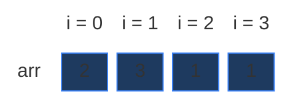

The three partitions, element by element (orange = goes to `S2`, blue = goes to `S1`):

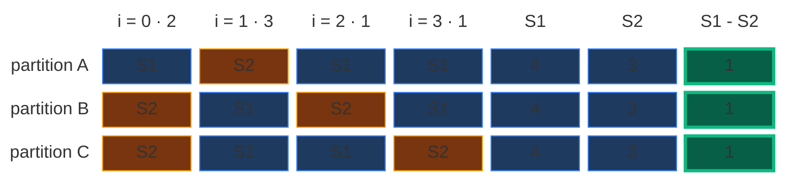

This is the same array as in [Subset Sum Equal To K](01.%20Subset%20Sum%20Equal%20To%20K.md), so the grid will look familiar. The two `1`s give two different partitions (B and C), exactly like the "different indices" rule says. We use this example in every section below.

### Constraints

Coding Ninjas (from my notes):

- `1 <= T <= 10`
- `1 <= N <= 50`
- `0 <= D <= 2500`
- `0 <= ARR[i] <= 50`
- Time limit: 1 second.

Two things to notice:

- `ARR[i]` can be **0**. Zeros are the main trap of this problem (Section 2).
- The total is at most `50 × 50 = 2500`, so the target `S2 = (total - D) / 2` is at most `1250`. That is a small table.

### What the constraints tell us (simple theory)

A **constraint** is the biggest input the judge will ever give you. It quietly tells you how fast your code must be.

**Rule of thumb:** a computer does about **100 million (10^8) simple steps per second**. Count how many steps your idea needs for the biggest input, and compare.

| Biggest input `n` | Steps you can afford | Ideas that fit |
|:---:|:---:|:---|
| up to ~20 | about `2^n` | Plain recursion, try everything |
| up to ~500 | about `n^3` | Three nested loops |
| up to ~5,000 | about `n^2` | Two nested loops |
| up to ~1,000,000 | about `n` or `n log n` | One loop, DP over `n` states |

**For this problem:** `N` is at most `50`, and the target is at most `1250`.

- Trying every split needs `2^50` checks. That is about `1.1 × 10^15`. At `10^8` steps per second, that is about **130 days**. Impossible.
- The DP fills a grid of `N × (target + 1) = 50 × 1251 = 62,550` cells. Even with `T = 10` test cases, that is about **625,000** steps. That runs in a few milliseconds.

The key: `N` looks tiny (50), but `2^50` is huge. The DP work is `N · target`, not `2^N`.

**How the work grows as `n` grows**

Here `arr` is all ones and `d = 0`, so the target is `n / 2`. Red bars = calls made by plain recursion. Green line = cells in the DP grid, `n · (target + 1)` (it stays flat near zero).

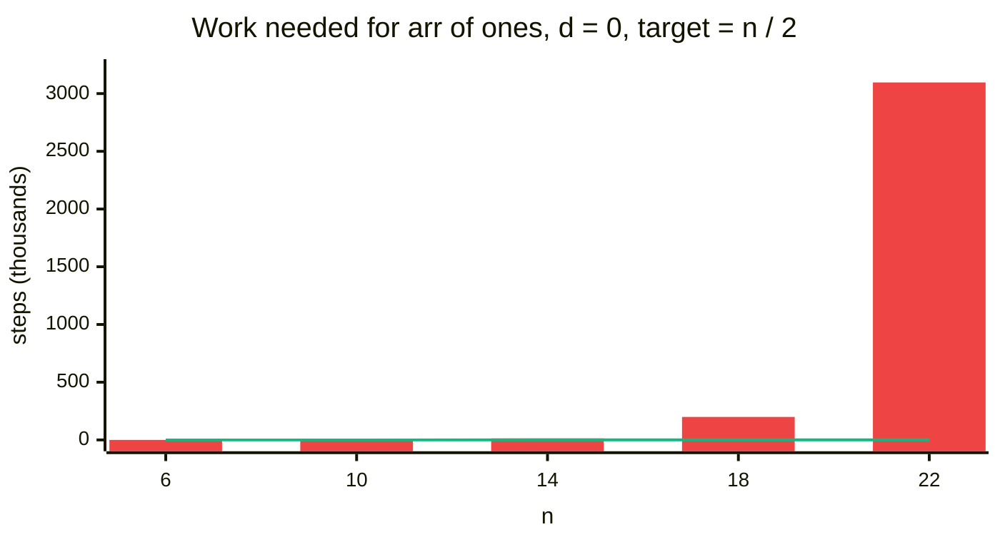

| `n` | Target `n / 2` | Recursion calls | DP cells `n · (target + 1)` |
|:---:|:---:|:---:|:---:|
| 6 | 3 | 56 | 24 |
| 10 | 5 | 847 | 60 |
| 14 | 7 | 12,910 | 112 |
| 18 | 9 | 199,139 | 180 |
| 22 | 11 | 3,096,513 | 264 |

Every 4 more elements make the recursion about **15 times** slower. The DP grid only grows a little. (Memoization makes 27, 75, 147, 243 and 363 calls for the same sizes. All these numbers are checked by the tests at the bottom of Section 7.)

## 2. Core Theory

This note is short on new ideas: **it is [Count Subsets with Sum K](04.%20Count%20Subsets%20with%20Sum%20K.md) (DP 17) with a modified target.** The only new part is a little algebra that finds the target. If 2-D DP (the `(ind, target)` grid) is new to you, read [Subset Sum Equal To K](01.%20Subset%20Sum%20Equal%20To%20K.md) first. It builds the grid from zero.

### From "count partitions" to "count subsets"

A partition puts every element into `S1` or `S2`. So once you choose `S2`, `S1` is fixed: it is everything else. That means:

> **number of partitions = number of ways to choose the group `S2`**

So we only have to count subsets. Which subsets? The ones with the right sum. Let's find that sum.

### The algebra: two equations, one unknown

From my notes (Striver's board). We know two facts:

```text
S1 - S2 = d          (the problem asks for this)
S1 + S2 = total      (every element is in one of the groups)
```

From the second line, `S1 = total - S2`. Put it into the first line:

```text
(total - S2) - S2 = d
total - 2 × S2    = d
total - d         = 2 × S2
S2                = (total - d) / 2
```

In pictures: `S1` is "a piece as big as `S2`" plus "an extra `d`". So the whole array is two `S2` pieces plus one `d`:

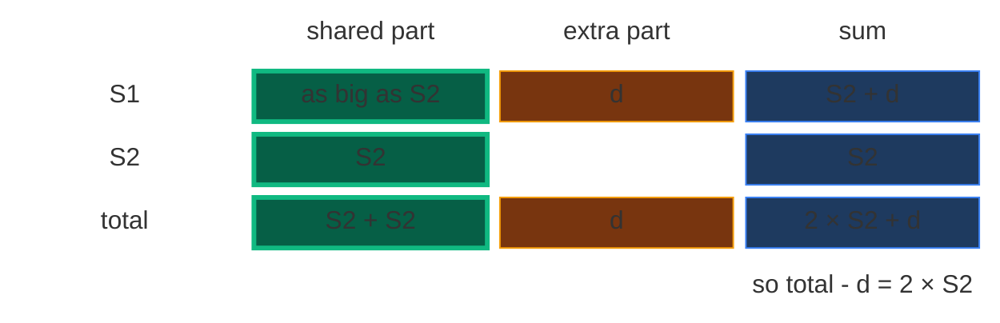

The same picture with our numbers (`total = 7`, `d = 1`): take the extra `1` away and `6` is left. Two equal pieces of `6` are `3` each. So `S2 = 3` and `S1 = 4`.

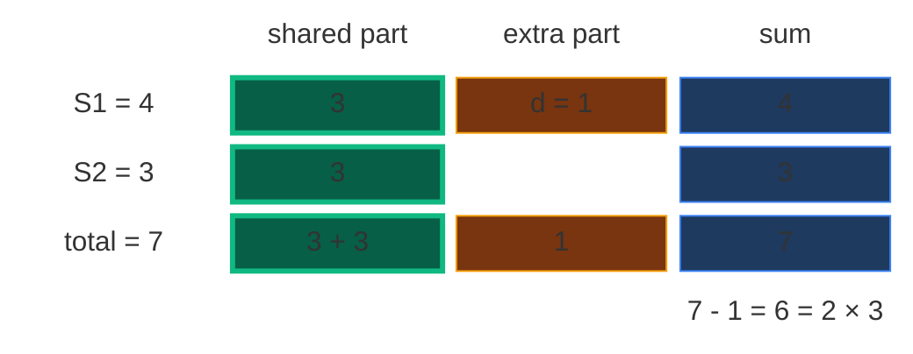

My notes also show the other way: **add** the two equations, `(S1 - S2) + (S1 + S2) = d + total`, so `2 × S1 = total + d` and `S1 = (total + d) / 2`. Both work (Q1 in Section 9). We count `S2`, because `S2` is the **smaller** sum, so the table is smaller. In practice:

```text
target = (total - d) // 2
```

So the problem becomes: **count the number of subsets whose sum is exactly `target`.** That is Count Subsets with Sum K in disguise. On the board: "DP 17, modified target".

What about the rule `S1 >= S2`? Since `d >= 0`, `S1 = S2 + d` is never smaller than `S2`. The rule holds by itself. Nothing extra to check.

### When is the answer 0 right away?

`S2` is "the sum of a subset". The numbers are `>= 0`, so `S2` must be a **whole number** and **not negative**. From the board:

- **`total - d` must be `>= 0`.** If `d` is bigger than the whole total, no split can make that difference. Example: `arr = [1, 2]`, `d = 5`: `3 - 5 = -2`, answer 0.
- **`total - d` must be even.** Otherwise `S2` would be half a number. Example: `arr = [1, 2]`, `d = 0`: `3 - 0 = 3` is odd, `S2 = 1.5`, answer 0. (Check: the splits give differences 3, 1, 1, 3, never 0.)

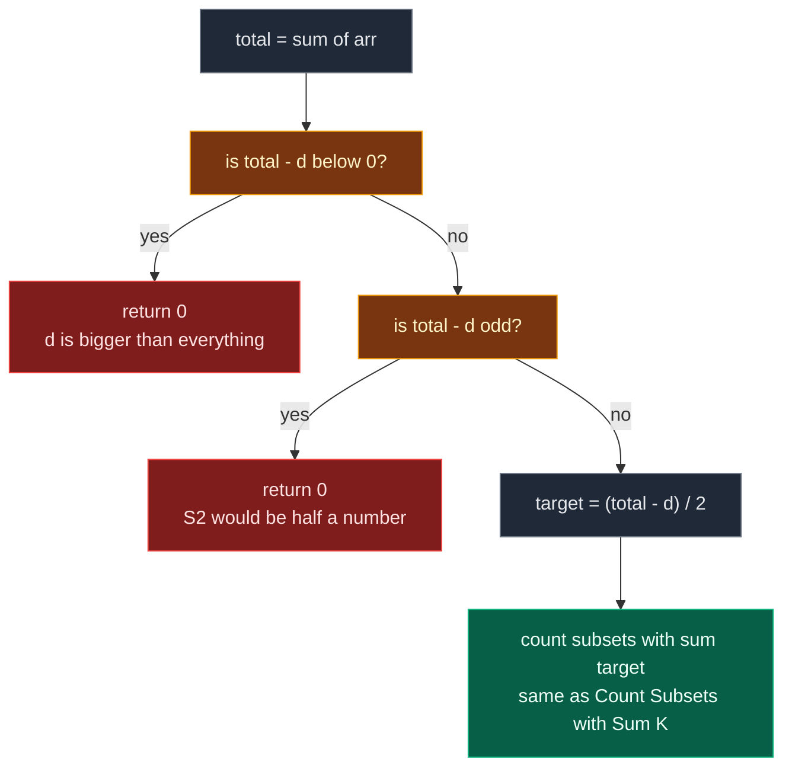

**The sample from my notes:** `arr = [5, 2, 6, 4]`, `d = 3`. `total = 17`, `target = (17 - 3) // 2 = 7`. Only one subset sums to 7: `{5, 2}`. So the other group is `{6, 4}`, and `10 - 7 = 3`. Answer 1.

### Brute force: try every split

Every element goes to `S1` or `S2`, so there are `2^n` splits. A bit mask can list them all: bit `i` = 1 means "element `i` is in `S1`". This version does **not** use the algebra at all, it checks `S1 - S2 == d` directly. That makes it a good judge for the DP versions on small inputs.

```python
# Imports used by every code block in this note
from typing import List

# For random tests at the end
import random

# For the n choose k check in the tests
import math


# Brute force: try every split with a bit mask
class SolutionBrute:

    # Modulo from the problem statement
    MOD = 10 ** 9 + 7

    # Main method (same name as Coding Ninjas)
    def countPartitions(self, n: int, d: int, arr: List[int]) -> int:

        # Number of good splits
        count = 0

        # Every mask from 0 to 2^n - 1 is one split
        for mask in range(1 << n):

            # Sum of the group S1
            s1 = 0

            # Sum of the group S2
            s2 = 0

            # Look at every element
            for i in range(n):

                # Bit i is 1: element i goes to S1
                if mask & (1 << i):

                    # Add it to S1
                    s1 += arr[i]

                # Bit i is 0: element i goes to S2
                else:

                    # Add it to S2
                    s2 += arr[i]

            # The difference is exactly d (this also means S1 >= S2)
            if s1 - s2 == d:

                # One more good split
                count += 1

        # Answer modulo 10^9 + 7
        return count % self.MOD
```

### How to spot that it is DP

| Property | Plain meaning | In this problem |
|:---|:---|:---|
| **Overlapping subproblems** | The same smaller question is asked many times | "How many subsets of `arr[0..1]` make 2?" is asked twice in our example (Section 4) |
| **Optimal substructure** | The big answer is built from answers of smaller questions | "How many subsets of `arr[0..3]` make 3?" = (ways without `arr[3]`) + (ways with `arr[3]`) |

Also: "count the ways to choose some elements so that a sum works" is the classic sign of DP on subsets. Here it hides behind the word "partition".

### The state: two numbers again

The **state** is the small piece of information that names one subproblem. It is the same as in Subset Sum, but the answer is now a **count**, not `True` / `False`:

> `f(ind, target)` = "using only the elements `arr[0], arr[1], ..., arr[ind]`, **in how many ways** can I pick some of them so that they sum to exactly `target`?"

- `ind` = how far into the array we are allowed to look.
- `target` = how much sum we still need. It changes when we pick, so it must be part of the state.

The whole question is `f(n - 1, target)`. For our example that is `f(3, 3)`.

The answers fit in a **grid**: row `ind` = "elements `0 .. ind` are allowed", column `t` = "the sum I want". Each cell holds a number of ways.

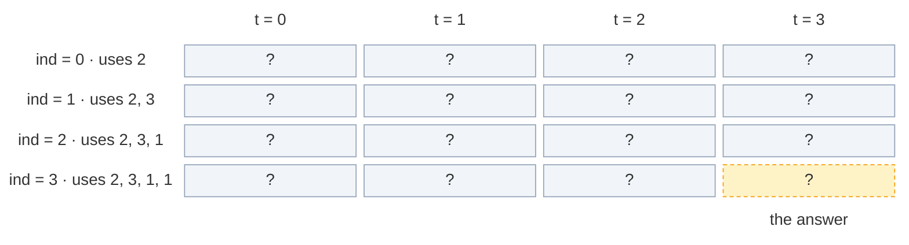

The grid has `n` rows and `target + 1` columns: here `4 × 4 = 16` cells. The answer is the bottom-right cell `[3][3]`.

### The recurrence: not pick + pick

From my notes: at every index, either **do not take** the current element, or **take** it if possible. In Subset Sum we joined the two answers with OR ("does either way work?"). Now we want **how many** ways, so we **add** them:

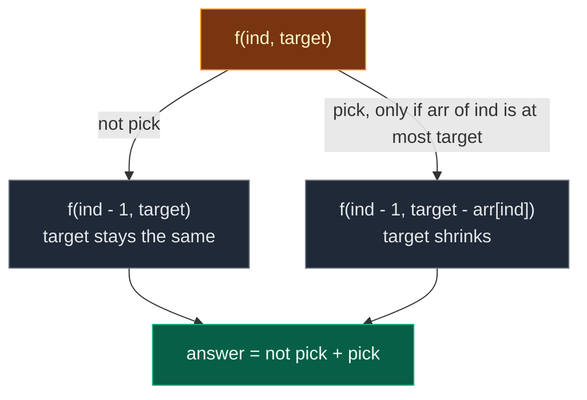

```text
count(ind, target) = count(ind - 1, target)                   not take
                   + count(ind - 1, target - arr[ind])        take, only if arr[ind] <= target
```

Why add? The ways **without** `arr[ind]` and the ways **with** `arr[ind]` never overlap (a subset either has that index or not). So the total is simply their sum.

In the grid: **not pick reads the cell straight up**. **Pick reads the cell up and `arr[ind]` columns to the left.** The new cell is their sum.

### Base cases (this is the most important part)

From my notes: "This is the most important part." When `ind == 0`, only `arr[0]` is left. It is either taken or not.

| Case | Answer | Why |
|:---|:---:|:---|
| `target == 0` and `arr[0] == 0` | `2` | Two choices both give sum 0: **take the zero** or **skip the zero** |
| `target == 0` (and `arr[0] != 0`) | `1` | Skip `arr[0]`: the empty choice |
| `target == arr[0]` (and not 0) | `1` | Take `arr[0]`: it alone is the target |
| anything else | `0` | No way |

In code: first check "`target == 0 and arr[0] == 0` → 2", then "`target == 0 or target == arr[0]` → 1", else 0.

**Why not stop early at `target == 0`, like Subset Sum did?** In Subset Sum, `target == 0 → True` was the first base case, at any index. "Is there a way?" Yes, and we are done. But now we **count**. If the remaining elements still hold zeros, each zero can be taken or skipped, and every choice is a **different** way. Stopping early at `target == 0` counts only 1 of them. So here we only stop at `ind == 0`.

### The zeros trap

My notes put it on the board: `arr = {0, 0, 1}`, sum `1`. How many subsets? Not 1, but **4**:

- `{1}` (no zeros)
- `{0, 1}` with the first zero
- `{0, 1}` with the second zero
- `{0, 0, 1}` with both zeros

With `d = 1`: `total = 1`, `target = (1 - 1) / 2 = 0`. How many subsets have sum 0? Also **4**: `{}`, `{first 0}`, `{second 0}`, `{both zeros}`. **Every zero doubles the number of ways.**

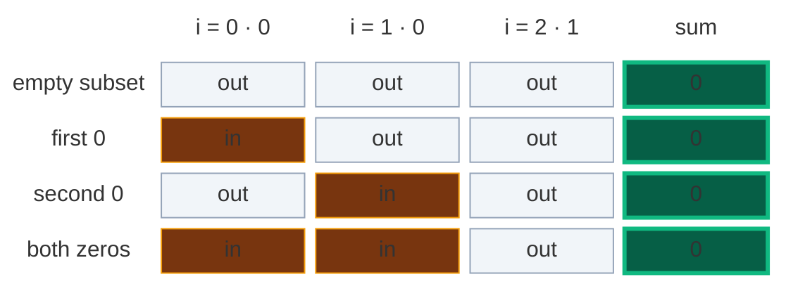

The tree from the board, for `{0, 0, 1}` and sum 1. Pick the `1` at the top, and `f(1, 0)` is left: "how many subsets of `{0, 0}` make 0?" Striver circled it. The answer is 4, not 1.

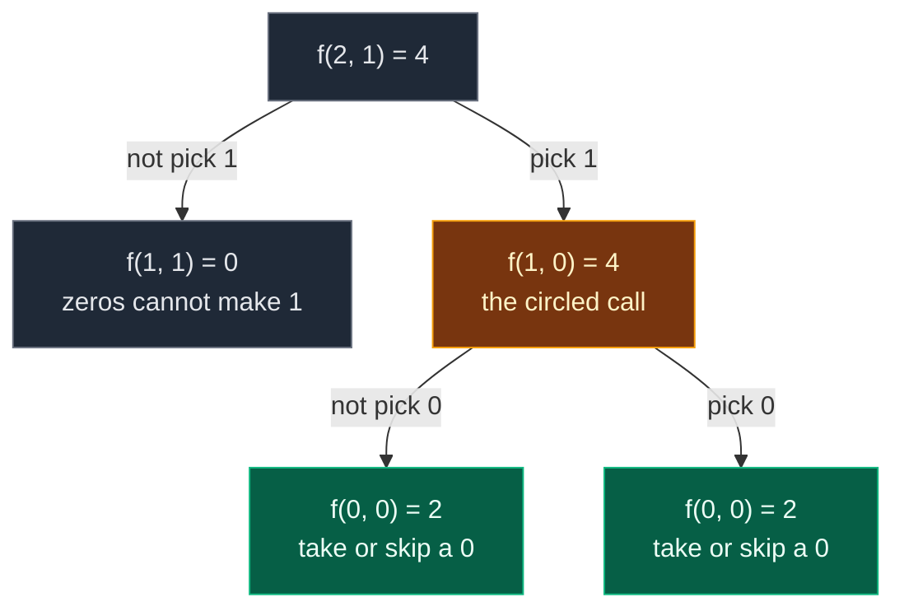

**Another way to see it (power set, from the board):** the zeros never change a sum. Count the subsets of the **non-zero** elements with the target (`{1}`: 1 way), then multiply by `2^(number of zeros)`, because each zero can join or not. `2^2 × 1 = 4` subsets. (Code in Q3 of Section 9.)

**Where the trap bites.** Two common wrong versions, shown on `[0, 0, 1]` with target 0. Yellow dashed = wrong, green = right.

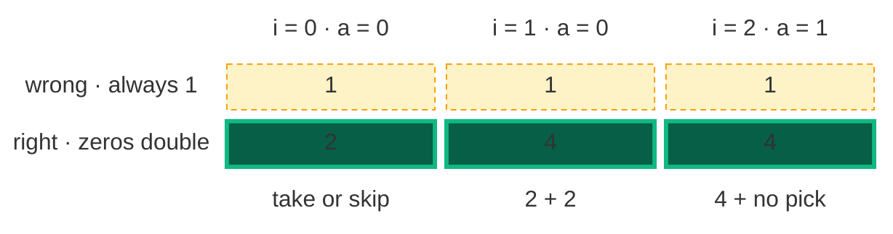

- **Early stop:** returning `1` as soon as `target == 0` gives `f(2, 0) = 1`. Wrong.
- **Table copied from Subset Sum:** setting `dp[i][0] = 1` for every row, and starting the target loop at 1, never lets a zero double column 0. Gives 1. Wrong.
- **Right:** row 0 uses the 3 base cases (`dp[0][0] = 2` because `arr[0] = 0`), and the target loop starts at **0**, so each later zero doubles column 0.

```python
# Wrong version 1: stops early at target == 0 (copied from Subset Sum)
def count_wrong_early_stop(arr: List[int], target: int) -> int:

    # Inner helper over (index, target)
    def solve(index: int, t: int) -> int:

        # The bug: stop as soon as the target is 0, zeros left behind are lost
        if t == 0:
            return 1

        # Only arr[0] left
        if index == 0:
            return 1 if arr[0] == t else 0

        # Not pick
        not_pick = solve(index - 1, t)

        # Pick starts at 0 ways
        pick = 0

        # Pick only if it fits
        if arr[index] <= t:

            # Smaller target
            pick = solve(index - 1, t - arr[index])

        # Add both
        return not_pick + pick

    # Start from the last index
    return solve(len(arr) - 1, target)


# Wrong version 2: column 0 is always 1 and the target loop starts at 1
def count_wrong_table(arr: List[int], target: int) -> int:

    # Number of elements
    n = len(arr)

    # n rows, target + 1 columns, all 0
    dp = [[0] * (target + 1) for _ in range(n)]

    # Every row
    for i in range(n):

        # The bug: sum 0 is always exactly 1 way
        dp[i][0] = 1

    # Row 0 can make arr[0] if it fits
    if arr[0] <= target:

        # One way (for arr[0] == 0 this keeps 1, not 2)
        dp[0][arr[0]] = 1

    # Fill rows 1 .. n - 1
    for i in range(1, n):

        # The bug: target 0 is skipped
        for t in range(1, target + 1):

            # Not pick
            dp[i][t] = dp[i - 1][t]

            # Pick if it fits
            if arr[i] <= t:

                # Add the pick ways
                dp[i][t] += dp[i - 1][t - arr[i]]

    # Bottom-right cell
    return dp[n - 1][target]


# The board example: {0, 0, 1} with sum 1 has 4 subsets, both wrong versions say 1
assert count_wrong_early_stop([0, 0, 1], 1) == 1

# Wrong version 2 says 1 as well
assert count_wrong_table([0, 0, 1], 1) == 1

# Target 0 (d = 1): the right answer is 4, both wrong versions say 1
assert count_wrong_early_stop([0, 0, 1], 0) == 1

# Wrong version 2 on target 0
assert count_wrong_table([0, 0, 1], 0) == 1

# Without zeros, both wrong versions happen to be right (that is why the bug hides)
assert count_wrong_early_stop([2, 3, 1, 1], 3) == 3

# Wrong version 2 without zeros
assert count_wrong_table([2, 3, 1, 1], 3) == 3
```

### Why modulo `10^9 + 7`?

The count can be huge. With `N = 50` zeros and `d = 0`, every one of the `2^50` subsets has sum 0, and `2^50` is about `10^15`. In C++ or Java that overflows a 32-bit `int`. So the problem asks for the answer **modulo `10^9 + 7`** (a big prime that fits in an `int`). Rule: take `% MOD` every time you **add** two counts, so each stored number stays small. Python's big integers never overflow, but we still use `% MOD` so the answer matches the judge.

### Two ways to remember: memoization vs tabulation

| | Memoization | Tabulation |
|:---|:---|:---|
| Other name | **Top-down** | **Bottom-up** |
| Direction | Start from `f(n - 1, target)`, go down to row 0, come back up | Start from row 0, fill row by row down to `[n - 1][target]` |
| How | Recursion + a 2-D table of `-1` | Two nested loops + a 2-D table of `0` |
| Computes | Only the cells it needs | Every cell |
| Stack | Uses the recursion stack (depth up to `n`) | No recursion stack |

### The 4-step ladder

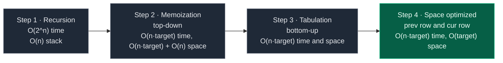

Every step starts with the same two checks (`total - d` not negative, and even) and the same `target = (total - d) // 2`. Bonus step after step 4: one single array with a **backward** loop (Section 7).

## 3. Edge Cases

| Case | Input | Expected | Why it matters |
|:---|:---:|:---:|:---|
| `d` bigger than the total | `arr = [1, 2]`, `d = 5` | `0` | `total - d < 0`: return 0 before any DP |
| `total - d` is odd | `arr = [1, 2]`, `d = 0` | `0` | `S2` would be `1.5`. Without the check, `//` rounds down and counts wrong splits |
| Zeros, target 0 | `arr = [0, 0, 1]`, `d = 1` | `4` | Every zero doubles the ways. The trap above |
| Only zeros | `arr = [0, 0, 0]`, `d = 0` | `8` | `2^3` subsets, all with sum 0 |
| First element is 0 | `arr = [0, 2, 1]`, `d = 1` | `2` | Base case `dp[0][0] = 2`. Subsets `{1}` and `{0, 1}` |
| First element bigger than target | `arr = [6, 1, 1]`, `d = 6` | `2` | Target is 1. `dp[0][arr[0]]` must be guarded by `arr[0] <= target` |
| Single element, `d` equals it | `arr = [5]`, `d = 5` | `1` | `S1 = {5}`, `S2 = {}` (empty subsets are allowed, sum 0) |
| `d = 0` | `arr = [1, 1, 1, 1]`, `d = 0` | `6` | Equal halves. Different indices count as different partitions |
| Same values, different indices | `arr = [5, 2, 5, 1]`, `d = 3` | `2` | The statement's example: the two 5s give two partitions |
| Huge count | 50 zeros, `d = 0` | `2^50 mod (10^9 + 7)` | Modulo needed |
| Our example | `arr = [2, 3, 1, 1]`, `d = 1` | `3` | Traced in every section |

## 4. Approach 1: Recursion

### Idea

Do the two checks, compute `target = (total - d) // 2`, then call `f(n - 1, target)`. Inside: at `ind == 0`, use the 3 base cases. Otherwise return "not pick" + "pick".

What does the start call mean? `f(3, 3)` = "in `arr[0 .. 3]`, how many subsets have sum 3?"

### Recursion tree for `arr = [2, 3, 1, 1]`, `target = 3`

Every box shows the call and how many ways it returns. Calls happen depth-first, "not pick" first (like the code).

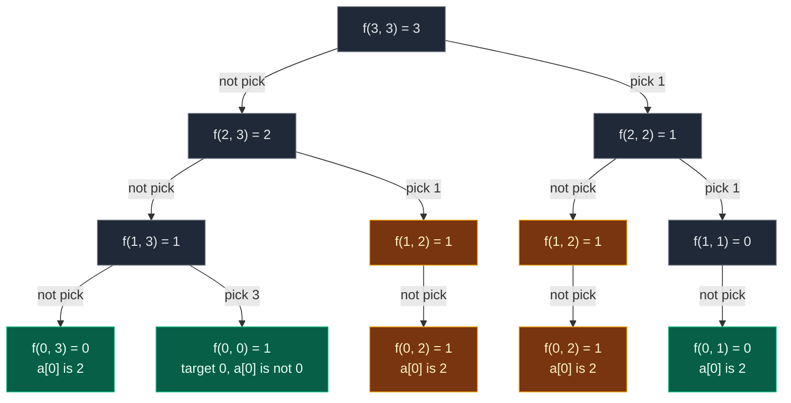

Gold = repeated work. Green = base cases that are not repeated.

`f(1, 2)` and `f(1, 1)` have only one child: `arr[1] = 3` is bigger than the target, so "pick" is not allowed.

| State | Times computed |
|:---|:---:|
| `f(3, 3)`, `f(2, 3)`, `f(2, 2)`, `f(1, 3)`, `f(1, 1)` | 1 each |
| **`f(1, 2)`** | **2** |
| **`f(0, 2)`** | **2** (inside each `f(1, 2)`) |
| `f(0, 3)`, `f(0, 0)`, `f(0, 1)` | 1 each |

That is **12 calls** for just 4 elements. `f(1, 2)` is the overlapping subproblem: it is reached by "skip the last 1, pick the other 1" and by "pick the last 1, skip the other 1". Both paths leave the same question: "how many subsets of `[2, 3]` make 2?"

How the 3 ways appear at the top: `f(3, 3) = f(2, 3) + f(2, 2) = 2 + 1`. The `2` holds `{3}` and `{2, 1 at index 2}`. The `1` holds `{2, 1 at index 3}`.

**The exact order of calls.** One participant per row of the grid (`ind`). Solid arrows = calls, dashed arrows = returns.

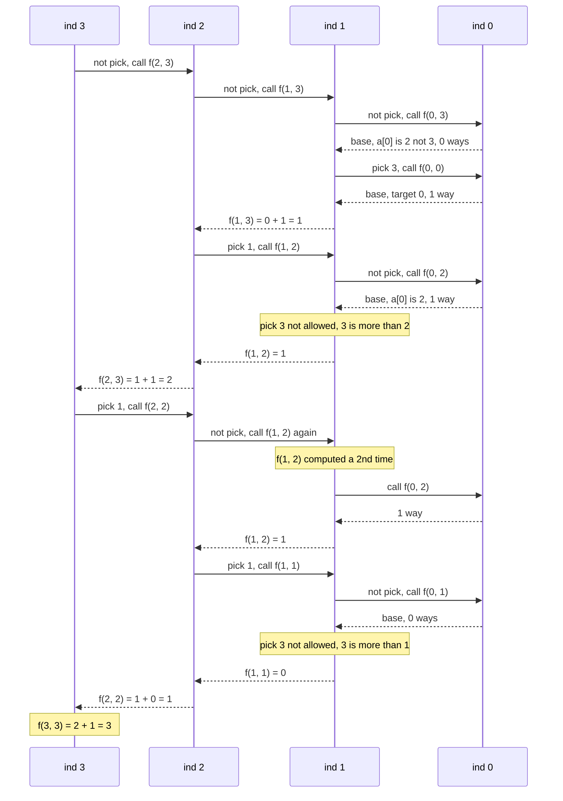

**A second dry run from my notes:** `arr = [1, 1, 2, 3]`, `d = 1`. `total = 7`, `target = (7 - 1) // 2 = 3`. The subsets with sum 3 are `[1, 2]` with the first 1, `[1, 2]` with the second 1, and `[3]`. At index 3 (value 3, target 3):

- not take 3 → count ways to make 3 from `[1, 1, 2]`: `count(2, 3) = 2` (`[1, 2]` with either 1).
- take 3 → count ways to make 0 from `[1, 1, 2]`: `count(2, 0) = 1` (the empty subset).
- `count(3, 3) = count(2, 3) + count(2, 0) = 2 + 1 = 3`.

### Code

```python
# Plain recursion
class SolutionRecursion:

    # Modulo from the problem statement
    MOD = 10 ** 9 + 7

    # Helper: number of subsets of arr[0..index] with sum target
    def solve(self, index: int, target: int, arr: List[int]) -> int:

        # Base case: only arr[0] is left
        if index == 0:

            # Target 0 and arr[0] is 0: take the zero or skip it, 2 ways
            if target == 0 and arr[0] == 0:
                return 2

            # Target 0 (skip arr[0]) or target equals arr[0] (take it): 1 way
            if target == 0 or target == arr[0]:
                return 1

            # Otherwise no way
            return 0

        # Choice 1: do not take arr[index], target stays the same
        not_take = self.solve(index - 1, target, arr)

        # Choice 2 starts at 0 ways (not allowed yet)
        take = 0

        # Take arr[index] only if it is not bigger than target
        if arr[index] <= target:

            # Taking it shrinks the target by arr[index]
            take = self.solve(index - 1, target - arr[index], arr)

        # Total ways = not take + take, kept small with the modulo
        return (take + not_take) % self.MOD

    # Main method (same name as Coding Ninjas)
    def countPartitions(self, n: int, d: int, arr: List[int]) -> int:

        # Sum of all elements
        total = sum(arr)

        # S2 = (total - d) / 2 must be a whole number that is not negative
        if total - d < 0 or (total - d) % 2 != 0:
            return 0

        # The sum that the group S2 must have
        target = (total - d) // 2

        # Count subsets of the whole array with that sum
        return self.solve(n - 1, target, arr)
```

### Complexity

| Measure | Complexity | Why |
|:---|:---:|:---|
| **Time** | `O(2^n)` | Each index gives 2 choices (take / not take), so the tree can double at each level |
| **Space** | `O(n)` | Recursion stack. The deepest path goes `ind = n - 1, n - 2, ..., 0`, which is `n` frames |

## 5. Approach 2: Memoization (Top-Down)

### Idea

From my notes: the same states `(index, target)` repeat, so we store them in `dp[index][target]`. Each state is then solved once.

The values in the table:

| Value | Meaning |
|:---:|:---|
| `-1` | Not computed yet |
| `0, 1, 2, ...` | Computed: that many ways |

`0` is a real answer here ("no way"), so "not computed" must be `-1`, not `0`.

**Size of the table.** `ind` goes from `0` to `n - 1` (that is `n` rows). `target` goes from `0` to `(total - d) / 2` (that is `target + 1` columns). So `dp` is `n × (target + 1)`. For our example: `4 × 4`.

The same **3 steps** as always:

1. **Declare** `dp` with `n` rows and `target + 1` columns, filled with `-1`.
2. **Store** the answer before returning: `dp[ind][target] = (take + not_take) % MOD`.
3. **Check** first: if `dp[ind][target] != -1`, return it and make no new calls.

Note: row-0 cells are never stored. The base cases answer them before the table is looked at. So row 0 stays `-1` in the memo table. (Unlike Subset Sum, column 0 **can** be stored for rows `>= 1`, because `target == 0` is no longer an early stop.)

### Visual: when each `dp[ind][target]` gets filled

Colours: grey = `-1` (not computed), dashed yellow = computing (waiting for its children), green = just filled, blue = filled earlier, orange = cache hit.

**Start:** `dp` is `4 × 4`, all `-1`.

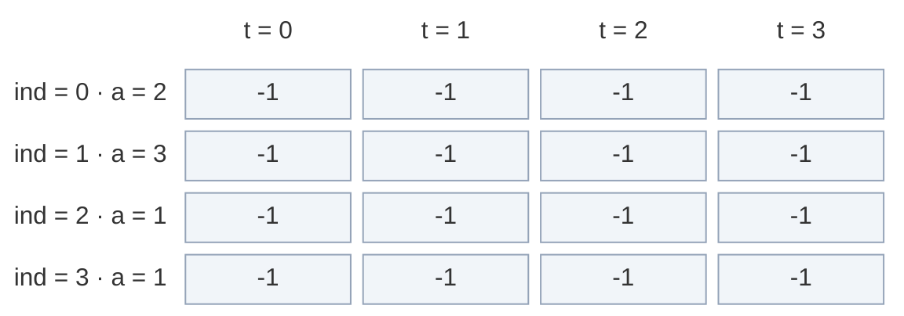

**Calls go down the "not pick" side:** `f(3, 3)` → `dp[3][3] = -1`, compute. `f(2, 3)` → `-1`, compute. `f(1, 3)` → `-1`, compute. `f(0, 3)` and `f(0, 0)` are base cases (0 and 1 way).

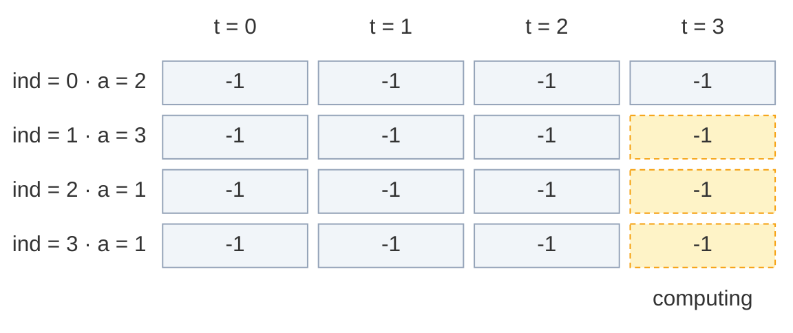

**Fill 1:** `f(1, 3) = f(0, 3) + f(0, 0) = 0 + 1 = 1`. Store `dp[1][3] = 1`.

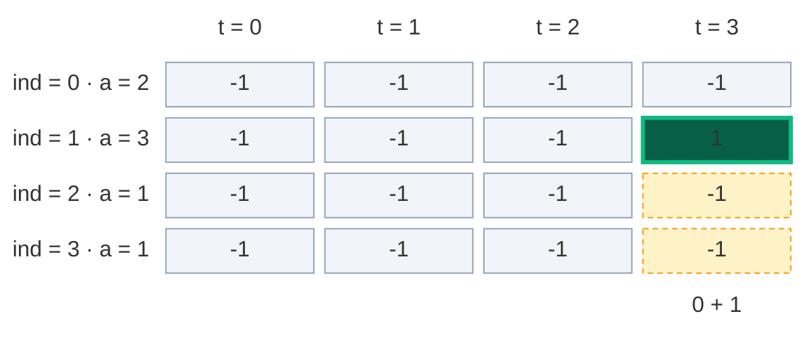

**Fill 2:** back in `f(2, 3)`, pick 1 → `f(1, 2)`. Not pick → `f(0, 2) = 1` (base, `a[0] = 2`). Pick 3 is not allowed (`3 > 2`). Store `dp[1][2] = 1`.

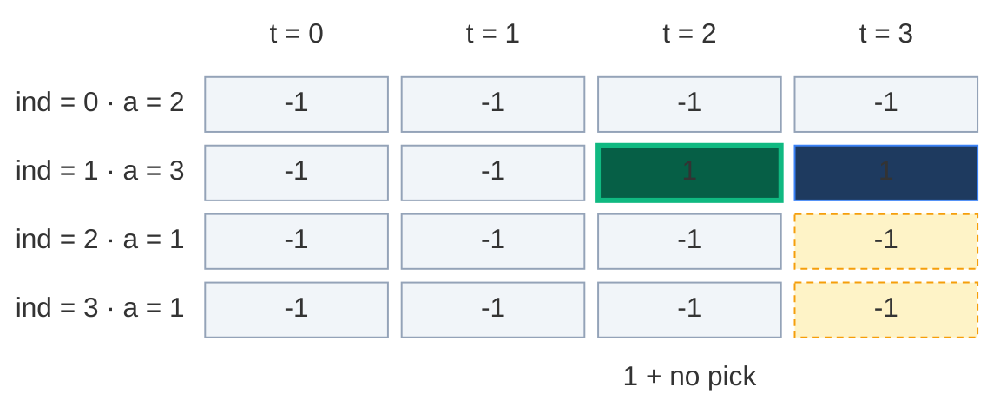

**Fill 3:** `f(2, 3) = f(1, 3) + f(1, 2) = 1 + 1 = 2`. Store `dp[2][3] = 2`.

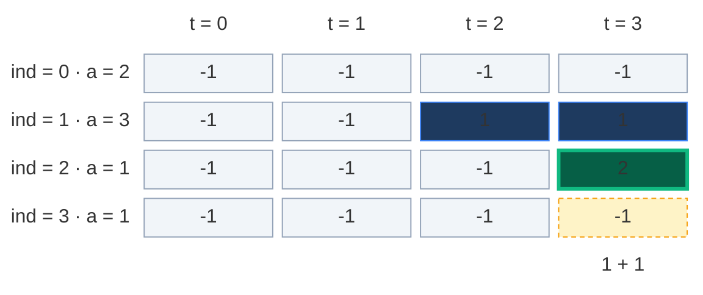

**Cache hit:** back in `f(3, 3)`, pick 1 → `f(2, 2)` starts. Its "not pick" is `f(1, 2)`. `dp[1][2] = 1` is already known → return 1, **no new calls**. (In plain recursion this was the repeated `f(1, 2)`.)

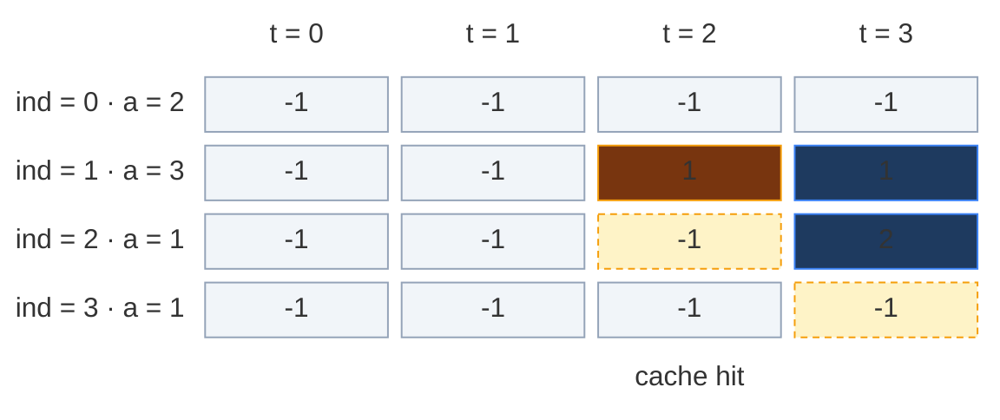

**Fill 4:** `f(2, 2)` picks 1 → `f(1, 1)`. Not pick → `f(0, 1) = 0` (base). Pick 3 is not allowed. Store `dp[1][1] = 0`.

```mermaid
block-beta
  columns 5
  hx[" "] h0["t = 0"] h1["t = 1"] h2["t = 2"] h3["t = 3"]
  l0["ind = 0 · a = 2"] r0c0["-1"] r0c1["-1"] r0c2["-1"] r0c3["-1"]
  l1["ind = 1 · a = 3"] r1c0["-1"] r1c1["0"] r1c2["1"] r1c3["1"]
  l2["ind = 2 · a = 1"] r2c0["-1"] r2c1["-1"] r2c2["-1"] r2c3["2"]
  l3["ind = 3 · a = 1"] r3c0["-1"] r3c1["-1"] r3c2["-1"] r3c3["-1"]
  space space m1["0 + no pick"] space space
  classDef head fill:none,stroke:none,color:#64748b
  class hx,h0,h1,h2,h3,l0,l1,l2,l3 head
  classDef empty fill:#f1f5f9,stroke:#94a3b8,color:#64748b
  class r0c0,r0c1,r0c2,r0c3,r1c0,r2c0,r2c1,r3c0,r3c1,r3c2 empty
  classDef new fill:#065f46,stroke:#10b981,color:#ecfdf5,stroke-width:3px
  class r1c1 new
  classDef done fill:#1e3a5f,stroke:#3b82f6,color:#dbeafe
  class r1c2,r1c3,r2c3 done
  classDef wait fill:#fef3c7,stroke:#f59e0b,color:#78350f,stroke-dasharray:4 3
  class r2c2,r3c3 wait
  classDef note fill:none,stroke:none,color:#b45309
  class m1 note
```

**Fill 5:** `f(2, 2) = f(1, 2) + f(1, 1) = 1 + 0 = 1`. Store `dp[2][2] = 1`.

```mermaid
block-beta
  columns 5
  hx[" "] h0["t = 0"] h1["t = 1"] h2["t = 2"] h3["t = 3"]
  l0["ind = 0 · a = 2"] r0c0["-1"] r0c1["-1"] r0c2["-1"] r0c3["-1"]
  l1["ind = 1 · a = 3"] r1c0["-1"] r1c1["0"] r1c2["1"] r1c3["1"]
  l2["ind = 2 · a = 1"] r2c0["-1"] r2c1["-1"] r2c2["1"] r2c3["2"]
  l3["ind = 3 · a = 1"] r3c0["-1"] r3c1["-1"] r3c2["-1"] r3c3["-1"]
  space space space m2["1 + 0"] space
  classDef head fill:none,stroke:none,color:#64748b
  class hx,h0,h1,h2,h3,l0,l1,l2,l3 head
  classDef empty fill:#f1f5f9,stroke:#94a3b8,color:#64748b
  class r0c0,r0c1,r0c2,r0c3,r1c0,r2c0,r2c1,r3c0,r3c1,r3c2 empty
  classDef done fill:#1e3a5f,stroke:#3b82f6,color:#dbeafe
  class r1c1,r1c2,r1c3,r2c3 done
  classDef new fill:#065f46,stroke:#10b981,color:#ecfdf5,stroke-width:3px
  class r2c2 new
  classDef wait fill:#fef3c7,stroke:#f59e0b,color:#78350f,stroke-dasharray:4 3
  class r3c3 wait
  classDef note fill:none,stroke:none,color:#b45309
  class m2 note
```

**Fill 6:** `f(3, 3) = f(2, 3) + f(2, 2) = 2 + 1 = 3`. Store `dp[3][3] = 3`. **Answer: 3.**

```mermaid
block-beta
  columns 5
  hx[" "] h0["t = 0"] h1["t = 1"] h2["t = 2"] h3["t = 3"]
  l0["ind = 0 · a = 2"] r0c0["-1"] r0c1["-1"] r0c2["-1"] r0c3["-1"]
  l1["ind = 1 · a = 3"] r1c0["-1"] r1c1["0"] r1c2["1"] r1c3["1"]
  l2["ind = 2 · a = 1"] r2c0["-1"] r2c1["-1"] r2c2["1"] r2c3["2"]
  l3["ind = 3 · a = 1"] r3c0["-1"] r3c1["-1"] r3c2["-1"] r3c3["3"]
  space space space space m3["2 + 1 = 3"]
  classDef head fill:none,stroke:none,color:#64748b
  class hx,h0,h1,h2,h3,l0,l1,l2,l3 head
  classDef empty fill:#f1f5f9,stroke:#94a3b8,color:#64748b
  class r0c0,r0c1,r0c2,r0c3,r1c0,r2c0,r2c1,r3c0,r3c1,r3c2 empty
  classDef done fill:#1e3a5f,stroke:#3b82f6,color:#dbeafe
  class r1c1,r1c2,r1c3,r2c2,r2c3 done
  classDef new fill:#065f46,stroke:#10b981,color:#ecfdf5,stroke-width:3px
  class r3c3 new
  classDef note fill:none,stroke:none,color:#b45309
  class m3 note
```

Only 6 of the 16 cells were ever stored. Memoization computes **only the states it needs**.

About the example in my notes (`arr = [1, 1, 2, 3]`, target 3): the notes say calls like `solve(1, 1)`, `solve(2, 3)`, `solve(2, 0)` repeat. That is the right idea, but in that small array no state repeats above row 0 (I traced every call: only the base call `f(0, 0)` comes twice). Our example `[2, 3, 1, 1]` shows a real repeat: `f(1, 2)`.

### The pruned recursion tree

Same tree, but the cache hit (dashed) stops right away.

```mermaid
flowchart TD
    A["f(3, 3) = 3"]:::norm -->|not pick| B["f(2, 3) = 2"]:::norm
    A -->|pick 1| H["f(2, 2) = 1"]:::norm
    B -->|not pick| C["f(1, 3) = 1"]:::norm
    B -->|pick 1| F["f(1, 2) = 1"]:::norm
    C --> D["f(0, 3) = 0"]:::base
    C --> E["f(0, 0) = 1"]:::base
    F --> G["f(0, 2) = 1"]:::base
    H -.-|cache hit| I["f(1, 2) = 1 from dp"]:::hit
    H -->|pick 1| K["f(1, 1) = 0"]:::norm
    K --> L["f(0, 1) = 0"]:::base

    classDef norm fill:#1f2937,stroke:#6b7280,color:#e5e7eb
    classDef hit fill:#78350f,stroke:#f59e0b,color:#fef3c7
    classDef base fill:#065f46,stroke:#10b981,color:#ecfdf5
```

**11 calls** instead of 12. A small saving because the example is tiny. On bigger inputs the saving is huge: at most `n · (target + 1)` states are ever computed (for 22 ones: 363 calls instead of 3,096,513).

### Code

```python
# Memoization (top-down DP) with a 2-D table of -1
class SolutionMemo:

    # Modulo from the problem statement
    MOD = 10 ** 9 + 7

    # Helper: number of subsets of arr[0..index] with sum target, uses and fills dp
    def solve(self, index: int, target: int, arr: List[int], dp: List[List[int]]) -> int:

        # Base case: only arr[0] is left
        if index == 0:

            # Two ways if both target and arr[0] are 0 (take the zero or not)
            if target == 0 and arr[0] == 0:
                return 2

            # One way if target is 0 (skip) or target equals arr[0] (take)
            if target == 0 or target == arr[0]:
                return 1

            # Otherwise no way
            return 0

        # Step 3 (check): already solved this (index, target)? Reuse it
        if dp[index][target] != -1:
            return dp[index][target]

        # Option 1: do not take the current element
        not_take = self.solve(index - 1, target, arr, dp)

        # Option 2 starts at 0 ways
        take = 0

        # Take the current element only if it fits
        if arr[index] <= target:

            # Taking it shrinks the target
            take = self.solve(index - 1, target - arr[index], arr, dp)

        # Step 2 (store): the number of ways, modulo MOD
        dp[index][target] = (take + not_take) % self.MOD

        # Return the stored result
        return dp[index][target]

    # Main method (same name as Coding Ninjas)
    def countPartitions(self, n: int, d: int, arr: List[int]) -> int:

        # Sum of all elements
        total = sum(arr)

        # S2 = (total - d) / 2 must be a whole number that is not negative
        if total - d < 0 or (total - d) % 2 != 0:
            return 0

        # The sum that the group S2 must have
        target = (total - d) // 2

        # Step 1 (declare): n rows, target + 1 columns, -1 means not solved yet
        dp = [[-1] * (target + 1) for _ in range(n)]

        # Keep the table so we can look at it after the run
        self.dp = dp

        # Start from the last index and the full target
        return self.solve(n - 1, target, arr, dp)
```

### Complexity

| Measure | Complexity | Why |
|:---|:---:|:---|
| **Time** | `O(n · target)` | At most `n · (target + 1)` different states, each solved once with `O(1)` work |
| **Space: dp table** | `O(n · target)` | `n` rows × `target + 1` columns |
| **Space: recursion stack** | `O(n)` | The deepest path goes `ind = n - 1` down to `0` |
| **Total space** | `O(n · target) + O(n)` | Table plus stack |

`N <= 50`, so the recursion is at most 50 calls deep. Python's default limit (1000) is fine here.

## 6. Approach 3: Tabulation (Bottom-Up)

### Idea

Fill the whole grid with two loops, from the smallest states (row 0) to the answer (`[n - 1][target]`). No recursion, so no stack.

From my notes: `dp[i][t]` = "the number of ways to form sum `t` using elements from index `0` to `i`".

### How to convert memo → table, step by step

1. **Same grid:** `dp` with `n` rows and `target + 1` columns, all `0`.
2. **Base cases become cells (row 0 only).** This is again where zero handling matters (from my notes):
   - If `arr[0] == 0`: `dp[0][0] = 2` (take the zero, or do not take it).
   - Else: `dp[0][0] = 1` (only the empty subset makes 0).
   - If `arr[0] != 0` and `arr[0] <= target`: `dp[0][arr[0]] = 1` (take `arr[0]` alone).
   - **Not** `dp[i][0] = 1` for every row, like in Subset Sum. A later zero must be able to double column 0.
3. **Two nested loops, in the opposite direction:** `ind` from `1` to `n - 1`, and inside, `target` from **`0`** to `target`. Column 0 is computed too, because a zero can be picked at target 0.
4. **Copy the recurrence:** replace `f(...)` with `dp[...]`:
   - `not_take = dp[ind - 1][t]`
   - `take = dp[ind - 1][t - arr[ind]]` if `arr[ind] <= t`
   - `dp[ind][t] = (take + not_take) % MOD`
5. **Answer:** `dp[n - 1][target]`.

| Memoization | Becomes in tabulation |
|:---|:---|
| `dp[n][target + 1]` with `-1` | `dp[n][target + 1]` with `0` |
| `if ind == 0` base cases (2, 1, 0) | `dp[0][0] = 2 or 1`, `dp[0][arr[0]] = 1` if `arr[0] != 0` and fits |
| `f(n - 1, target)` going down | Loops `ind = 1 .. n - 1`, `t = 0 .. target` going up |
| `f(ind - 1, t)` | `dp[ind - 1][t]` |
| `f(ind - 1, t - arr[ind])` | `dp[ind - 1][t - arr[ind]]` |
| `return f(n - 1, target)` | `return dp[n - 1][target]` |

**Why the `arr[0] != 0` guard?** If `arr[0] = 0`, then `dp[0][arr[0]]` is `dp[0][0]`, and writing `1` there would overwrite the `2`. **Why `arr[0] <= target`?** `arr[0]` can be up to 50 while the target can be smaller: the index would be outside the table.

**Picture rule:** to fill a cell, look **straight up** (not take) and **up, then `arr[ind]` steps left** (take). **Add** the two numbers.

### Visual table fill (`arr = [2, 3, 1, 1]`, `target = 3`)

Colours: green = just filled, orange = the cells it reads, blue = filled earlier, grey `?` = not filled yet.

**Start: row 0 (base cases).** `arr[0] = 2` is not 0, so `dp[0][0] = 1`. `2 <= 3`, so `dp[0][2] = 1`. The rest of row 0 is 0.

```mermaid
block-beta
  columns 5
  hx[" "] h0["t = 0"] h1["t = 1"] h2["t = 2"] h3["t = 3"]
  l0["ind = 0 · a = 2"] r0c0["1"] r0c1["0"] r0c2["1"] r0c3["0"]
  l1["ind = 1 · a = 3"] r1c0["?"] r1c1["?"] r1c2["?"] r1c3["?"]
  l2["ind = 2 · a = 1"] r2c0["?"] r2c1["?"] r2c2["?"] r2c3["?"]
  l3["ind = 3 · a = 1"] r3c0["?"] r3c1["?"] r3c2["?"] r3c3["?"]
  space m0["arr 0 is not 0"] space m2["a 0 = 2"] space
  classDef head fill:none,stroke:none,color:#64748b
  class hx,h0,h1,h2,h3,l0,l1,l2,l3 head
  classDef new fill:#065f46,stroke:#10b981,color:#ecfdf5,stroke-width:3px
  class r0c0,r0c1,r0c2,r0c3 new
  classDef empty fill:#f1f5f9,stroke:#94a3b8,color:#64748b
  class r1c0,r1c1,r1c2,r1c3,r2c0,r2c1,r2c2,r2c3,r3c0,r3c1,r3c2,r3c3 empty
  classDef note fill:none,stroke:none,color:#b45309
  class m0,m2 note
```

#### Row 1 (`arr[1] = 3`)

| Cell | not take (up) | take (up, 3 left) | Result |
|:---:|:---:|:---:|:---:|
| `dp[1][0]` | `dp[0][0] = 1` | not allowed (`3 > 0`) | `1` |
| `dp[1][1]` | `dp[0][1] = 0` | not allowed (`3 > 1`) | `0` |
| `dp[1][2]` | `dp[0][2] = 1` | not allowed (`3 > 2`) | `1` |
| `dp[1][3]` | `dp[0][3] = 0` | `dp[0][0] = 1` | `1` |

```mermaid
block-beta
  columns 5
  hx[" "] h0["t = 0"] h1["t = 1"] h2["t = 2"] h3["t = 3"]
  l0["ind = 0 · a = 2"] r0c0["1"] r0c1["0"] r0c2["1"] r0c3["0"]
  l1["ind = 1 · a = 3"] r1c0["1"] r1c1["0"] r1c2["1"] r1c3["1"]
  l2["ind = 2 · a = 1"] r2c0["?"] r2c1["?"] r2c2["?"] r2c3["?"]
  l3["ind = 3 · a = 1"] r3c0["?"] r3c1["?"] r3c2["?"] r3c3["?"]
  space m0["1 + no pick"] m1["0 + no pick"] m2["1 + no pick"] m3["0 + 1"]
  classDef head fill:none,stroke:none,color:#64748b
  class hx,h0,h1,h2,h3,l0,l1,l2,l3 head
  classDef read fill:#78350f,stroke:#f59e0b,color:#fef3c7
  class r0c0,r0c1,r0c2,r0c3 read
  classDef new fill:#065f46,stroke:#10b981,color:#ecfdf5,stroke-width:3px
  class r1c0,r1c1,r1c2,r1c3 new
  classDef empty fill:#f1f5f9,stroke:#94a3b8,color:#64748b
  class r2c0,r2c1,r2c2,r2c3,r3c0,r3c1,r3c2,r3c3 empty
  classDef note fill:none,stroke:none,color:#b45309
  class m0,m1,m2,m3 note
```

With `{2, 3}` we can make 0 (empty), 2 (`{2}`) and 3 (`{3}`), one way each.

#### Row 2 (`arr[2] = 1`), cell by cell

**`dp[2][0]`:** not take = `dp[1][0] = 1`. Take: `1 > 0`, not allowed. Result `1`.

```mermaid
block-beta
  columns 5
  hx[" "] h0["t = 0"] h1["t = 1"] h2["t = 2"] h3["t = 3"]
  l0["ind = 0 · a = 2"] r0c0["1"] r0c1["0"] r0c2["1"] r0c3["0"]
  l1["ind = 1 · a = 3"] r1c0["1"] r1c1["0"] r1c2["1"] r1c3["1"]
  l2["ind = 2 · a = 1"] r2c0["1"] r2c1["?"] r2c2["?"] r2c3["?"]
  l3["ind = 3 · a = 1"] r3c0["?"] r3c1["?"] r3c2["?"] r3c3["?"]
  space m0["1 + no pick"] space space space
  classDef head fill:none,stroke:none,color:#64748b
  class hx,h0,h1,h2,h3,l0,l1,l2,l3 head
  classDef done fill:#1e3a5f,stroke:#3b82f6,color:#dbeafe
  class r0c0,r0c1,r0c2,r0c3,r1c1,r1c2,r1c3 done
  classDef read fill:#78350f,stroke:#f59e0b,color:#fef3c7
  class r1c0 read
  classDef new fill:#065f46,stroke:#10b981,color:#ecfdf5,stroke-width:3px
  class r2c0 new
  classDef empty fill:#f1f5f9,stroke:#94a3b8,color:#64748b
  class r2c1,r2c2,r2c3,r3c0,r3c1,r3c2,r3c3 empty
  classDef note fill:none,stroke:none,color:#b45309
  class m0 note
```

**`dp[2][1]`:** not take = `dp[1][1] = 0`. Take = `dp[1][0] = 1`. Result `0 + 1 = 1`.

```mermaid
block-beta
  columns 5
  hx[" "] h0["t = 0"] h1["t = 1"] h2["t = 2"] h3["t = 3"]
  l0["ind = 0 · a = 2"] r0c0["1"] r0c1["0"] r0c2["1"] r0c3["0"]
  l1["ind = 1 · a = 3"] r1c0["1"] r1c1["0"] r1c2["1"] r1c3["1"]
  l2["ind = 2 · a = 1"] r2c0["1"] r2c1["1"] r2c2["?"] r2c3["?"]
  l3["ind = 3 · a = 1"] r3c0["?"] r3c1["?"] r3c2["?"] r3c3["?"]
  space space m1["0 + 1"] space space
  classDef head fill:none,stroke:none,color:#64748b
  class hx,h0,h1,h2,h3,l0,l1,l2,l3 head
  classDef done fill:#1e3a5f,stroke:#3b82f6,color:#dbeafe
  class r0c0,r0c1,r0c2,r0c3,r1c2,r1c3,r2c0 done
  classDef read fill:#78350f,stroke:#f59e0b,color:#fef3c7
  class r1c0,r1c1 read
  classDef new fill:#065f46,stroke:#10b981,color:#ecfdf5,stroke-width:3px
  class r2c1 new
  classDef empty fill:#f1f5f9,stroke:#94a3b8,color:#64748b
  class r2c2,r2c3,r3c0,r3c1,r3c2,r3c3 empty
  classDef note fill:none,stroke:none,color:#b45309
  class m1 note
```

**`dp[2][2]`:** not take = `dp[1][2] = 1`. Take = `dp[1][1] = 0`. Result `1 + 0 = 1`.

```mermaid
block-beta
  columns 5
  hx[" "] h0["t = 0"] h1["t = 1"] h2["t = 2"] h3["t = 3"]
  l0["ind = 0 · a = 2"] r0c0["1"] r0c1["0"] r0c2["1"] r0c3["0"]
  l1["ind = 1 · a = 3"] r1c0["1"] r1c1["0"] r1c2["1"] r1c3["1"]
  l2["ind = 2 · a = 1"] r2c0["1"] r2c1["1"] r2c2["1"] r2c3["?"]
  l3["ind = 3 · a = 1"] r3c0["?"] r3c1["?"] r3c2["?"] r3c3["?"]
  space space space m2["1 + 0"] space
  classDef head fill:none,stroke:none,color:#64748b
  class hx,h0,h1,h2,h3,l0,l1,l2,l3 head
  classDef done fill:#1e3a5f,stroke:#3b82f6,color:#dbeafe
  class r0c0,r0c1,r0c2,r0c3,r1c0,r1c3,r2c0,r2c1 done
  classDef read fill:#78350f,stroke:#f59e0b,color:#fef3c7
  class r1c1,r1c2 read
  classDef new fill:#065f46,stroke:#10b981,color:#ecfdf5,stroke-width:3px
  class r2c2 new
  classDef empty fill:#f1f5f9,stroke:#94a3b8,color:#64748b
  class r2c3,r3c0,r3c1,r3c2,r3c3 empty
  classDef note fill:none,stroke:none,color:#b45309
  class m2 note
```

**`dp[2][3]`:** not take = `dp[1][3] = 1` (that is `{3}`). Take = `dp[1][2] = 1` (that is `{2}`, plus this 1). Result `1 + 1 = 2`.

```mermaid
block-beta
  columns 5
  hx[" "] h0["t = 0"] h1["t = 1"] h2["t = 2"] h3["t = 3"]
  l0["ind = 0 · a = 2"] r0c0["1"] r0c1["0"] r0c2["1"] r0c3["0"]
  l1["ind = 1 · a = 3"] r1c0["1"] r1c1["0"] r1c2["1"] r1c3["1"]
  l2["ind = 2 · a = 1"] r2c0["1"] r2c1["1"] r2c2["1"] r2c3["2"]
  l3["ind = 3 · a = 1"] r3c0["?"] r3c1["?"] r3c2["?"] r3c3["?"]
  space space space space m3["1 + 1"]
  classDef head fill:none,stroke:none,color:#64748b
  class hx,h0,h1,h2,h3,l0,l1,l2,l3 head
  classDef done fill:#1e3a5f,stroke:#3b82f6,color:#dbeafe
  class r0c0,r0c1,r0c2,r0c3,r1c0,r1c1,r2c0,r2c1,r2c2 done
  classDef read fill:#78350f,stroke:#f59e0b,color:#fef3c7
  class r1c2,r1c3 read
  classDef new fill:#065f46,stroke:#10b981,color:#ecfdf5,stroke-width:3px
  class r2c3 new
  classDef empty fill:#f1f5f9,stroke:#94a3b8,color:#64748b
  class r3c0,r3c1,r3c2,r3c3 empty
  classDef note fill:none,stroke:none,color:#b45309
  class m3 note
```

**After row 2:**

```mermaid
block-beta
  columns 5
  hx[" "] h0["t = 0"] h1["t = 1"] h2["t = 2"] h3["t = 3"]
  l0["ind = 0 · a = 2"] r0c0["1"] r0c1["0"] r0c2["1"] r0c3["0"]
  l1["ind = 1 · a = 3"] r1c0["1"] r1c1["0"] r1c2["1"] r1c3["1"]
  l2["ind = 2 · a = 1"] r2c0["1"] r2c1["1"] r2c2["1"] r2c3["2"]
  l3["ind = 3 · a = 1"] r3c0["?"] r3c1["?"] r3c2["?"] r3c3["?"]
  classDef head fill:none,stroke:none,color:#64748b
  class hx,h0,h1,h2,h3,l0,l1,l2,l3 head
  classDef done fill:#1e3a5f,stroke:#3b82f6,color:#dbeafe
  class r0c0,r0c1,r0c2,r0c3,r1c0,r1c1,r1c2,r1c3,r2c0,r2c1,r2c2,r2c3 done
  classDef empty fill:#f1f5f9,stroke:#94a3b8,color:#64748b
  class r3c0,r3c1,r3c2,r3c3 empty
```

#### Row 3 (`arr[3] = 1`)

| Cell | not take (up) | take (up, 1 left) | Result |
|:---:|:---:|:---:|:---:|
| `dp[3][0]` | `dp[2][0] = 1` | not allowed | `1` |
| `dp[3][1]` | `dp[2][1] = 1` | `dp[2][0] = 1` | `2` |
| `dp[3][2]` | `dp[2][2] = 1` | `dp[2][1] = 1` | `2` |
| `dp[3][3]` | `dp[2][3] = 2` | `dp[2][2] = 1` | `3` |

```mermaid
block-beta
  columns 5
  hx[" "] h0["t = 0"] h1["t = 1"] h2["t = 2"] h3["t = 3"]
  l0["ind = 0 · a = 2"] r0c0["1"] r0c1["0"] r0c2["1"] r0c3["0"]
  l1["ind = 1 · a = 3"] r1c0["1"] r1c1["0"] r1c2["1"] r1c3["1"]
  l2["ind = 2 · a = 1"] r2c0["1"] r2c1["1"] r2c2["1"] r2c3["2"]
  l3["ind = 3 · a = 1"] r3c0["1"] r3c1["2"] r3c2["2"] r3c3["3"]
  space m0["1 + no pick"] m1["1 + 1"] m2["1 + 1"] m3["2 + 1"]
  classDef head fill:none,stroke:none,color:#64748b
  class hx,h0,h1,h2,h3,l0,l1,l2,l3 head
  classDef done fill:#1e3a5f,stroke:#3b82f6,color:#dbeafe
  class r0c0,r0c1,r0c2,r0c3,r1c0,r1c1,r1c2,r1c3 done
  classDef read fill:#78350f,stroke:#f59e0b,color:#fef3c7
  class r2c0,r2c1,r2c2,r2c3 read
  classDef new fill:#065f46,stroke:#10b981,color:#ecfdf5,stroke-width:3px
  class r3c0,r3c1,r3c2,r3c3 new
  classDef note fill:none,stroke:none,color:#b45309
  class m0,m1,m2,m3 note
```

**Answer:** `dp[3][3] = 3`. Three partitions.

**Second example from my notes:** `arr = [1, 1, 2, 3]`, target 3. Row 0 (first 1): `1 1 0 0`. Row 1 (`[1, 1]`): target 1 = not take 1 + take 1 = 2, so `1 2 1 0`. Row 2 (`[1, 1, 2]`): target 3 = not take `row1[3] = 0` + take `row1[1] = 2` = 2, so `1 2 2 2`. Row 3 (`[1, 1, 2, 3]`): target 3 = not take 2 + take `row2[0] = 1` = 3. Answer 3.

```mermaid
block-beta
  columns 5
  hx[" "] h0["t = 0"] h1["t = 1"] h2["t = 2"] h3["t = 3"]
  l0["ind = 0 · a = 1"] r0c0["1"] r0c1["1"] r0c2["0"] r0c3["0"]
  l1["ind = 1 · a = 1"] r1c0["1"] r1c1["2"] r1c2["1"] r1c3["0"]
  l2["ind = 2 · a = 2"] r2c0["1"] r2c1["2"] r2c2["2"] r2c3["2"]
  l3["ind = 3 · a = 3"] r3c0["1"] r3c1["2"] r3c2["2"] r3c3["3"]
  classDef head fill:none,stroke:none,color:#64748b
  class hx,h0,h1,h2,h3,l0,l1,l2,l3 head
  classDef done fill:#1e3a5f,stroke:#3b82f6,color:#dbeafe
  class r0c0,r0c1,r0c2,r0c3,r1c0,r1c1,r1c2,r1c3,r2c0,r2c1,r2c2,r2c3,r3c0,r3c1,r3c2 done
  classDef new fill:#065f46,stroke:#10b981,color:#ecfdf5,stroke-width:3px
  class r3c3 new
```

### Code

```python
# Tabulation (bottom-up DP)
class SolutionTab:

    # Modulo from the problem statement
    MOD = 10 ** 9 + 7

    # Main method (same name as Coding Ninjas)
    def countPartitions(self, n: int, d: int, arr: List[int]) -> int:

        # Sum of all elements
        total = sum(arr)

        # If the transformed target is invalid, the answer is 0
        if total - d < 0 or (total - d) % 2 != 0:
            return 0

        # Convert to: count subsets with sum target
        target = (total - d) // 2

        # Step 1: dp[i][t] = ways to make sum t using indices 0..i, all 0
        dp = [[0] * (target + 1) for _ in range(n)]

        # Step 2a: the first element is 0
        if arr[0] == 0:

            # Two ways to make sum 0: take the zero or not
            dp[0][0] = 2

        # Step 2a: the first element is not 0
        else:

            # One way to make sum 0: the empty subset
            dp[0][0] = 1

        # Step 2b: a non-zero first element that fits makes its own value
        if arr[0] != 0 and arr[0] <= target:

            # One way: take arr[0] alone
            dp[0][arr[0]] = 1

        # Step 3: fill row by row
        for index in range(1, n):

            # Every target, starting at 0 (zeros can be taken at target 0)
            for t in range(target + 1):

                # Not take: look straight up
                not_take = dp[index - 1][t]

                # Take starts at 0 ways
                take = 0

                # Take only if the element fits
                if arr[index] <= t:

                    # Take: look up, then arr[index] columns to the left
                    take = dp[index - 1][t - arr[index]]

                # Step 4: copy the recurrence, modulo MOD
                dp[index][t] = (take + not_take) % self.MOD

        # Keep the table so we can look at it after the run
        self.dp = dp

        # Step 5: the answer is the bottom-right cell
        return dp[n - 1][target]
```

### Complexity

| Measure | Complexity | Why |
|:---|:---:|:---|
| **Time** | `O(n · target)` | Two nested loops: `n - 1` rows × `target + 1` columns |
| **Space** | `O(n · target)` | The full grid. No recursion stack any more |

## 7. Approach 4: Space Optimization (Optimal)

### Idea

From my notes: "Since the current row depends only on the previous row, use 2 arrays."

- `prev` = the row above (answers for `ind - 1`).
- `cur` = the row we are filling now (answers for `ind`).

After a row is done: `prev = cur`.

**Why `O(target)` and not `O(1)`?** A cell reads `prev[t - arr[ind]]`, and `arr[ind]` can be any size. So a cell may need **any** cell of the row above. We must keep the whole previous row: `target + 1` numbers.

### Visual Walkthrough (Story Version)

**The story:** Mia has toy blocks that weigh `2`, `3`, `1` and `1` kg. She must put **every** block into one of two boxes, A or B. Her teacher says: "Box A must be exactly **1 kg heavier** than box B." All blocks together weigh 7 kg. Take the extra 1 kg away: 6 kg is left, shared equally, so box B must weigh exactly **3 kg** (and box A gets 4 kg).

So Mia only asks: **in how many ways can I fill box B with exactly 3 kg?** She uses a **counter board** with 4 counters, `0 kg` to `3 kg`. Each counter shows how many ways the blocks seen so far can make that weight.

She takes the blocks out one by one. For each new block she makes a **new board** from the **old board**:

- *Leave the new block out:* every old count stays (look straight up).
- *Put the new block in:* the count of `w - block` is added to counter `w` (look up-left).

**Start: only block 2 is out.** One way to make `0 kg` (nothing in the box), one way to make `2 kg` (just the 2).

```mermaid
block-beta
  columns 5
  hx[" "] h0["0 kg"] h1["1 kg"] h2["2 kg"] h3["3 kg"]
  l0["board · block 2"] r0c0["1"] r0c1["0"] r0c2["1"] r0c3["0"]
  space m0["no blocks"] space m2["just the 2"] space
  classDef head fill:none,stroke:none,color:#64748b
  class hx,h0,h1,h2,h3,l0 head
  classDef new fill:#065f46,stroke:#10b981,color:#ecfdf5,stroke-width:3px
  class r0c0,r0c2 new
  classDef empty fill:#f1f5f9,stroke:#94a3b8,color:#64748b
  class r0c1,r0c3 empty
  classDef note fill:none,stroke:none,color:#b45309
  class m0,m2 note
```

**Step 1: block 3 comes out.** Old counts stay. Putting 3 in: counter `3 kg` gets the old `0 kg` count, `0 + 1 = 1`.

```mermaid
block-beta
  columns 5
  hx[" "] h0["0 kg"] h1["1 kg"] h2["2 kg"] h3["3 kg"]
  l0["old board"] r0c0["1"] r0c1["0"] r0c2["1"] r0c3["0"]
  l1["new board · block 3"] r1c0["1"] r1c1["0"] r1c2["1"] r1c3["1"]
  space space space space m3["0 + 1 way"]
  classDef head fill:none,stroke:none,color:#64748b
  class hx,h0,h1,h2,h3,l0,l1 head
  classDef read fill:#78350f,stroke:#f59e0b,color:#fef3c7
  class r0c0,r0c2 read
  classDef empty fill:#f1f5f9,stroke:#94a3b8,color:#64748b
  class r0c1,r0c3,r1c1 empty
  classDef done fill:#1e3a5f,stroke:#3b82f6,color:#dbeafe
  class r1c0,r1c2 done
  classDef new fill:#065f46,stroke:#10b981,color:#ecfdf5,stroke-width:3px
  class r1c3 new
  classDef note fill:none,stroke:none,color:#b45309
  class m3 note
```

The new board becomes the old board.

**Step 2: a block 1 comes out.** Counter `1 kg` gets old `0 kg`: `0 + 1 = 1`. Counter `2 kg`: `1 + 0 = 1`. Counter `3 kg` gets old `2 kg`: `1 + 1 = 2` (`{3}` and `{2, 1}`).

```mermaid
block-beta
  columns 5
  hx[" "] h0["0 kg"] h1["1 kg"] h2["2 kg"] h3["3 kg"]
  l0["old board"] r0c0["1"] r0c1["0"] r0c2["1"] r0c3["1"]
  l1["new board · block 1"] r1c0["1"] r1c1["1"] r1c2["1"] r1c3["2"]
  space space m1["0 + 1"] space m3["1 + 1"]
  classDef head fill:none,stroke:none,color:#64748b
  class hx,h0,h1,h2,h3,l0,l1 head
  classDef read fill:#78350f,stroke:#f59e0b,color:#fef3c7
  class r0c0,r0c2,r0c3 read
  classDef empty fill:#f1f5f9,stroke:#94a3b8,color:#64748b
  class r0c1 empty
  classDef done fill:#1e3a5f,stroke:#3b82f6,color:#dbeafe
  class r1c0,r1c2 done
  classDef new fill:#065f46,stroke:#10b981,color:#ecfdf5,stroke-width:3px
  class r1c1,r1c3 new
  classDef note fill:none,stroke:none,color:#b45309
  class m1,m3 note
```

The new board becomes the old board.

**Step 3: the last block 1 comes out.** Counter `1 kg`: `1 + 1 = 2`. Counter `2 kg`: `1 + 1 = 2`. Counter `3 kg`: `2 + 1 = 3`.

```mermaid
block-beta
  columns 5
  hx[" "] h0["0 kg"] h1["1 kg"] h2["2 kg"] h3["3 kg"]
  l0["old board"] r0c0["1"] r0c1["1"] r0c2["1"] r0c3["2"]
  l1["new board · block 1"] r1c0["1"] r1c1["2"] r1c2["2"] r1c3["3"]
  space space m1["1 + 1"] m2["1 + 1"] m3["2 + 1"]
  classDef head fill:none,stroke:none,color:#64748b
  class hx,h0,h1,h2,h3,l0,l1 head
  classDef read fill:#78350f,stroke:#f59e0b,color:#fef3c7
  class r0c0,r0c1,r0c2,r0c3 read
  classDef done fill:#1e3a5f,stroke:#3b82f6,color:#dbeafe
  class r1c0 done
  classDef new fill:#065f46,stroke:#10b981,color:#ecfdf5,stroke-width:3px
  class r1c1,r1c2,r1c3 new
  classDef note fill:none,stroke:none,color:#b45309
  class m1,m2,m3 note
```

**The end:** the `3 kg` counter shows 3. Mia can fill box B in 3 ways, so there are 3 ways to split the blocks.

**All steps at a glance**

| Step | Block | Board before | Board after | `3 kg` counter |
|:---:|:---:|:---|:---|:---:|
| start | 2 | – | `1 0 1 0` | 0 |
| 1 | 3 | `1 0 1 0` | `1 0 1 1` | 1 |
| 2 | 1 | `1 0 1 1` | `1 1 1 2` | 2 |
| 3 | 1 | `1 1 1 2` | `1 2 2 3` | 3 |

**What the story teaches**

| In the story | In the code |
|:---|:---|
| Box A heavier by 1 kg | `S1 - S2 = d` |
| "Box B must be 3 kg" | `target = (total - d) // 2` |
| A block | `arr[ind]` |
| Counter `w kg` | Column `t = w` |
| The number on a counter | Number of ways (`cur[t]`) |
| Old board | `prev` (row `ind - 1`) |
| New board | `cur` (row `ind`) |
| Leave the block out | `not_take = prev[t]` |
| Put the block in | `take = prev[t - arr[ind]]` |
| Block too heavy for this counter | `arr[ind] <= t` check |
| New board becomes old board | `prev = cur` |
| Read the `3 kg` counter | `return prev[target]` |

### Step-by-Step Example

`arr = [2, 3, 1, 1]`, `d = 1`, `total = 7`, `target = 3`.

**Start:** `prev` = row 0. `arr[0] = 2` is not 0, so `prev[0] = 1`. `2 <= 3`, so `prev[2] = 1`.

```mermaid
block-beta
  columns 5
  hx[" "] h0["t = 0"] h1["t = 1"] h2["t = 2"] h3["t = 3"]
  l0["prev · row 0"] r0c0["1"] r0c1["0"] r0c2["1"] r0c3["0"]
  space m0["empty subset"] space m2["a 0 = 2"] space
  classDef head fill:none,stroke:none,color:#64748b
  class hx,h0,h1,h2,h3,l0 head
  classDef new fill:#065f46,stroke:#10b981,color:#ecfdf5,stroke-width:3px
  class r0c0,r0c1,r0c2,r0c3 new
  classDef note fill:none,stroke:none,color:#b45309
  class m0,m2 note
```

**`ind = 1` (`arr[1] = 3`):**

| `t` | not take `prev[t]` | take `prev[t - 3]` | `cur[t]` |
|:---:|:---:|:---:|:---:|
| 0 | 1 | not allowed | 1 |
| 1 | 0 | not allowed | 0 |
| 2 | 1 | not allowed | 1 |
| 3 | 0 | `prev[0] = 1` | 1 |

```mermaid
block-beta
  columns 5
  hx[" "] h0["t = 0"] h1["t = 1"] h2["t = 2"] h3["t = 3"]
  l0["prev · rows 0..0"] r0c0["1"] r0c1["0"] r0c2["1"] r0c3["0"]
  l1["cur · a = 3"] r1c0["1"] r1c1["0"] r1c2["1"] r1c3["1"]
  space m0["1 + none"] m1["0 + none"] m2["1 + none"] m3["0 + 1"]
  classDef head fill:none,stroke:none,color:#64748b
  class hx,h0,h1,h2,h3,l0,l1 head
  classDef read fill:#78350f,stroke:#f59e0b,color:#fef3c7
  class r0c0,r0c1,r0c2,r0c3 read
  classDef new fill:#065f46,stroke:#10b981,color:#ecfdf5,stroke-width:3px
  class r1c0,r1c1,r1c2,r1c3 new
  classDef note fill:none,stroke:none,color:#b45309
  class m0,m1,m2,m3 note
```

Then `prev = cur`.

**`ind = 2` (`arr[2] = 1`):**

| `t` | not take `prev[t]` | take `prev[t - 1]` | `cur[t]` |
|:---:|:---:|:---:|:---:|
| 0 | 1 | not allowed | 1 |
| 1 | 0 | `prev[0] = 1` | 1 |
| 2 | 1 | `prev[1] = 0` | 1 |
| 3 | 1 | `prev[2] = 1` | 2 |

```mermaid
block-beta
  columns 5
  hx[" "] h0["t = 0"] h1["t = 1"] h2["t = 2"] h3["t = 3"]
  l0["prev · rows 0..1"] r0c0["1"] r0c1["0"] r0c2["1"] r0c3["1"]
  l1["cur · a = 1"] r1c0["1"] r1c1["1"] r1c2["1"] r1c3["2"]
  space m0["1 + none"] m1["0 + 1"] m2["1 + 0"] m3["1 + 1"]
  classDef head fill:none,stroke:none,color:#64748b
  class hx,h0,h1,h2,h3,l0,l1 head
  classDef read fill:#78350f,stroke:#f59e0b,color:#fef3c7
  class r0c0,r0c1,r0c2,r0c3 read
  classDef new fill:#065f46,stroke:#10b981,color:#ecfdf5,stroke-width:3px
  class r1c0,r1c1,r1c2,r1c3 new
  classDef note fill:none,stroke:none,color:#b45309
  class m0,m1,m2,m3 note
```

Then `prev = cur`.

**`ind = 3` (`arr[3] = 1`):**

| `t` | not take `prev[t]` | take `prev[t - 1]` | `cur[t]` |
|:---:|:---:|:---:|:---:|
| 0 | 1 | not allowed | 1 |
| 1 | 1 | `prev[0] = 1` | 2 |
| 2 | 1 | `prev[1] = 1` | 2 |
| 3 | 2 | `prev[2] = 1` | 3 |

```mermaid
block-beta
  columns 5
  hx[" "] h0["t = 0"] h1["t = 1"] h2["t = 2"] h3["t = 3"]
  l0["prev · rows 0..2"] r0c0["1"] r0c1["1"] r0c2["1"] r0c3["2"]
  l1["cur · a = 1"] r1c0["1"] r1c1["2"] r1c2["2"] r1c3["3"]
  space m0["1 + none"] m1["1 + 1"] m2["1 + 1"] m3["2 + 1"]
  classDef head fill:none,stroke:none,color:#64748b
  class hx,h0,h1,h2,h3,l0,l1 head
  classDef read fill:#78350f,stroke:#f59e0b,color:#fef3c7
  class r0c0,r0c1,r0c2,r0c3 read
  classDef new fill:#065f46,stroke:#10b981,color:#ecfdf5,stroke-width:3px
  class r1c0,r1c1,r1c2,r1c3 new
  classDef note fill:none,stroke:none,color:#b45309
  class m0,m1,m2,m3 note
```

Then `prev = cur`. The loop ends. Return `prev[3] = 3`. Same as `dp[3][3]` in the table.

**The rows, one after another** (only the last two exist at the end):

```mermaid
block-beta
  columns 5
  hx[" "] h0["t = 0"] h1["t = 1"] h2["t = 2"] h3["t = 3"]
  l0["start · a = 2"] r0c0["1"] r0c1["0"] r0c2["1"] r0c3["0"]
  l1["after a = 3"] r1c0["1"] r1c1["0"] r1c2["1"] r1c3["1"]
  l2["after a = 1"] r2c0["1"] r2c1["1"] r2c2["1"] r2c3["2"]
  l3["after a = 1"] r3c0["1"] r3c1["2"] r3c2["2"] r3c3["3"]
  classDef head fill:none,stroke:none,color:#64748b
  class hx,h0,h1,h2,h3,l0,l1,l2,l3 head
  classDef old fill:#e2e8f0,stroke:#64748b,color:#0f172a
  class r0c0,r0c1,r0c2,r0c3,r1c0,r1c1,r1c2,r1c3 old
  classDef read fill:#78350f,stroke:#f59e0b,color:#fef3c7
  class r2c0,r2c1,r2c2,r2c3 read
  classDef new fill:#065f46,stroke:#10b981,color:#ecfdf5,stroke-width:3px
  class r3c0,r3c1,r3c2,r3c3 new
```

**My notes' zero example:** `arr = [0, 0, 1]`, `d = 1`, so `target = 0`. Start with the first 0: `prev[0] = 2`. Process the second 0: again double the ways, `cur[0] = prev[0] + prev[0] = 4`. Process 1: the target is still 0, so 1 cannot be taken, the count stays 4. Answer 4. This shows why the zero base case matters.

### Even smaller: one array with a backward loop

From my notes: "Yes, we can do it with one array too. Since this is a subset problem, iterate target from **right to left**."

```text
dp = [1, 0, 0, ..., 0]          one way to form sum 0: the empty subset
for each num in arr:
    for t from target down to num:
        dp[t] = dp[t] + dp[t - num]
```

**Why backward?** `dp[t]` reads `dp[t - num]`, a smaller index. Going right to left, the smaller index is **not updated yet** in this round, so it still holds the "previous row" value. Going left to right would use the same `num` twice.

The one array on our example, after each number (green = changed):

```mermaid
block-beta
  columns 5
  hx[" "] h0["t = 0"] h1["t = 1"] h2["t = 2"] h3["t = 3"]
  l0["start"] r0c0["1"] r0c1["0"] r0c2["0"] r0c3["0"]
  l1["after num 2"] r1c0["1"] r1c1["0"] r1c2["1"] r1c3["0"]
  l2["after num 3"] r2c0["1"] r2c1["0"] r2c2["1"] r2c3["1"]
  l3["after num 1"] r3c0["1"] r3c1["1"] r3c2["1"] r3c3["2"]
  l4["after num 1"] r4c0["1"] r4c1["2"] r4c2["2"] r4c3["3"]
  classDef head fill:none,stroke:none,color:#64748b
  class hx,h0,h1,h2,h3,l0,l1,l2,l3,l4 head
  classDef done fill:#1e3a5f,stroke:#3b82f6,color:#dbeafe
  class r0c0,r0c1,r0c2,r0c3,r1c0,r1c1,r1c3,r2c0,r2c1,r2c2,r3c0,r4c0 done
  classDef new fill:#065f46,stroke:#10b981,color:#ecfdf5,stroke-width:3px
  class r1c2,r2c3,r3c1,r3c2,r3c3,r4c1,r4c2,r4c3 new
```

**Why does the one-array version handle zeros correctly?** (from my notes) Suppose `num = 0`. Then the loop runs `t` from `target` down to `0`, and `dp[t] = dp[t] + dp[t - 0] = dp[t] + dp[t]`. **Every count doubles.** That is exactly what a zero should do. And this version starts from `dp[0] = 1` and handles `arr[0]` inside the loop, so there is no special row-0 base case at all.

```mermaid
block-beta
  columns 2
  hx[" "] h0["t = 0"]
  l0["start"] r0c0["1"]
  l1["after num 0"] r1c0["2"]
  l2["after num 0"] r2c0["4"]
  l3["after num 1"] r3c0["4"]
  classDef head fill:none,stroke:none,color:#64748b
  class hx,h0,l0,l1,l2,l3 head
  classDef done fill:#1e3a5f,stroke:#3b82f6,color:#dbeafe
  class r0c0,r3c0 done
  classDef new fill:#065f46,stroke:#10b981,color:#ecfdf5,stroke-width:3px
  class r1c0,r2c0 new
```

```python
# One array, backward loop
class SolutionOneArray:

    # Modulo from the problem statement
    MOD = 10 ** 9 + 7

    # Main method (same name as Coding Ninjas)
    def countPartitions(self, n: int, d: int, arr: List[int]) -> int:

        # Sum of all elements
        total = sum(arr)

        # Invalid transformation means no valid partition
        if total - d < 0 or (total - d) % 2 != 0:
            return 0

        # Required subset sum target
        target = (total - d) // 2

        # dp[t] = number of ways to form sum t with the numbers seen so far
        dp = [0] * (target + 1)

        # One way to form sum 0 at the start: the empty subset
        dp[0] = 1

        # Process each number
        for num in arr:

            # Traverse backward so each element is used only once
            for t in range(target, num - 1, -1):

                # Old ways (not take) + ways that end with num (take)
                dp[t] = (dp[t] + dp[t - num]) % self.MOD

        # Final answer
        return dp[target]
```

### Code

```python
# Space optimized: only the previous row and the current row
class Solution:

    # Constant modulo value from the problem statement
    MOD = 10 ** 9 + 7

    # Main function (same name as Coding Ninjas)
    def countPartitions(self, n: int, d: int, arr: List[int]) -> int:

        # Calculate the total sum
        total = sum(arr)

        # If the target transformation is invalid, the answer is 0
        if total - d < 0 or (total - d) % 2 != 0:
            return 0

        # Convert to the subset count target
        target = (total - d) // 2

        # Previous row (row 0), all 0 to start
        prev = [0] * (target + 1)

        # Base: the first element is 0, so take it or not
        if arr[0] == 0:

            # Two ways to make sum 0
            prev[0] = 2

        # Base: the first element is not 0
        else:

            # One way to make sum 0: the empty subset
            prev[0] = 1

        # A non-zero first element that fits makes its own value
        if arr[0] != 0 and arr[0] <= target:

            # One way: take arr[0] alone
            prev[arr[0]] = 1

        # Process the remaining elements
        for index in range(1, n):

            # Make the current row
            cur = [0] * (target + 1)

            # Every target, starting at 0
            for t in range(target + 1):

                # Do not take the current element
                not_take = prev[t]

                # Take starts at 0 ways
                take = 0

                # Take the current element only if it fits
                if arr[index] <= t:

                    # Ways from the row above with a smaller target
                    take = prev[t - arr[index]]

                # Store the answer modulo MOD
                cur[t] = (take + not_take) % self.MOD

            # The current row becomes the previous row
            prev = cur

        # Final answer
        return prev[target]


# ---------- Tests ----------

# Our example
arr = [2, 3, 1, 1]

# Our difference
d = 1

# total = 7, target = (7 - 1) // 2 = 3
assert sum(arr) == 7 and (sum(arr) - d) // 2 == 3


# Recursion: a version of the helper that counts calls
class CountingRecursion(SolutionRecursion):

    # Set up the counter
    def __init__(self):

        # No calls yet
        self.calls = 0

    # Count the call, then do the normal work
    def solve(self, index, target, arr):

        # One more call
        self.calls += 1

        # Same logic as SolutionRecursion
        return super().solve(index, target, arr)


# Make the counting version
counter = CountingRecursion()

# Recursion tree: f(3, 3) = 3
assert counter.countPartitions(4, d, arr) == 3

# Recursion tree: 12 calls
assert counter.calls == 12


# Memoization: a version of the helper that counts calls
class CountingMemo(SolutionMemo):

    # Set up the counter
    def __init__(self):

        # No calls yet
        self.calls = 0

    # Count the call, then do the normal work
    def solve(self, index, target, arr, dp):

        # One more call
        self.calls += 1

        # Same logic as SolutionMemo
        return super().solve(index, target, arr, dp)


# Make the counting memo version
memo = CountingMemo()

# Memoization answer
assert memo.countPartitions(4, d, arr) == 3

# Pruned tree: 11 calls (the cache hit on f(1, 2) saves the call below it)
assert memo.calls == 11

# Memo table after the run: 6 cells stored, row 0 stays -1
assert memo.dp == [[-1, -1, -1, -1], [-1, 0, 1, 1], [-1, -1, 1, 2], [-1, -1, -1, 3]]

# Tabulation trace
tab = SolutionTab()

# Tabulation answer
assert tab.countPartitions(4, d, arr) == 3

# Rows 0, 1, 2, 3 as drawn in Section 6
assert tab.dp == [[1, 0, 1, 0], [1, 0, 1, 1], [1, 1, 1, 2], [1, 2, 2, 3]]

# My notes' tabulation example [1, 1, 2, 3], d = 1
assert tab.countPartitions(4, 1, [1, 1, 2, 3]) == 3

# Its rows: 1100, 1210, 1222, 1223
assert tab.dp == [[1, 1, 0, 0], [1, 2, 1, 0], [1, 2, 2, 2], [1, 2, 2, 3]]

# Space optimized trace: start row
prev = [1, 0, 1, 0]

# The rows we expect after ind = 1, 2, 3
expected_rows = [[1, 0, 1, 1], [1, 1, 1, 2], [1, 2, 2, 3]]

# Same loop as Solution.countPartitions
for index in range(1, len(arr)):

    # New row
    cur = [0] * 4

    # Every target, from 0
    for t in range(4):

        # Not take + (take if it fits)
        cur[t] = prev[t] + (prev[t - arr[index]] if arr[index] <= t else 0)

    # Matches the Step-by-Step tables
    assert cur == expected_rows[index - 1]

    # Slide down one row
    prev = cur

# One array trace: rows after each number
one = [1, 0, 0, 0]

# Expected after num 2, 3, 1, 1
one_rows = [[1, 0, 1, 0], [1, 0, 1, 1], [1, 1, 1, 2], [1, 2, 2, 3]]

# Same loop as SolutionOneArray
for pos, num in enumerate(arr):

    # Backward over targets
    for t in range(3, num - 1, -1):

        # Not take + take
        one[t] = one[t] + one[t - num]

    # Matches the picture
    assert one == one_rows[pos]

# Zero example from my notes: [0, 0, 1], d = 1 gives 4
assert SolutionTab().countPartitions(3, 1, [0, 0, 1]) == 4

# Its table: column 0 doubles at each zero
zero_tab = SolutionTab()

# Fill it
zero_tab.countPartitions(3, 1, [0, 0, 1])

# Rows: 2, 4, 4
assert zero_tab.dp == [[2], [4], [4]]

# Final space optimized answer
assert Solution().countPartitions(4, d, arr) == 3

# All the versions we test
versions = [SolutionBrute(), SolutionRecursion(), SolutionMemo(), SolutionTab(), Solution(), SolutionOneArray()]

# Coding Ninjas samples and the statement example: (n, d, arr, expected)
samples = [
    (4, 3, [5, 2, 6, 4], 1),
    (4, 0, [1, 1, 1, 1], 6),
    (3, 1, [4, 6, 3], 1),
    (5, 0, [3, 1, 1, 2, 1], 6),
    (5, 1, [3, 2, 2, 5, 1], 3),
    (4, 3, [5, 2, 5, 1], 2),
    (4, 1, [1, 1, 2, 3], 3),
]

# Edge cases from Section 3
edges = [
    (2, 5, [1, 2], 0),
    (2, 0, [1, 2], 0),
    (3, 1, [0, 0, 1], 4),
    (3, 0, [0, 0, 0], 8),
    (3, 1, [0, 2, 1], 2),
    (3, 6, [6, 1, 1], 2),
    (1, 5, [5], 1),
    (4, 1, [2, 3, 1, 1], 3),
]

# Every version on every sample and edge case
for n, diff, nums, expected in samples + edges:

    # Each version
    for v in versions:

        # Same answer as expected
        assert v.countPartitions(n, diff, nums) == expected

# All versions agree with brute force on random arrays (with zeros)
random.seed(18)

# Many random tests
for _ in range(400):

    # Random size 1 to 10
    size = random.randint(1, 10)

    # Random numbers 0 to 6 (zeros included)
    nums = [random.randint(0, 6) for _ in range(size)]

    # Random difference 0 to 25
    diff = random.randint(0, 25)

    # Brute force answer (checks S1 - S2 == d directly, no algebra)
    expected = SolutionBrute().countPartitions(size, diff, nums)

    # Each DP version
    for v in versions[1:]:

        # Must agree
        assert v.countPartitions(size, diff, nums) == expected

# Modulo: 50 zeros, d = 0, every one of the 2^50 subsets works
for v in versions[2:]:

    # 2^50 modulo 10^9 + 7
    assert v.countPartitions(50, 0, [0] * 50) == pow(2, 50, 10 ** 9 + 7)

# 50 ones, d = 0: choose 25 of the 50 indices for S2
for v in versions[2:]:

    # 50 choose 25 modulo 10^9 + 7
    assert v.countPartitions(50, 0, [1] * 50) == math.comb(50, 25) % (10 ** 9 + 7)

# Biggest input: 50 numbers of value 50, target 1250
big = [50] * 50

# The loop versions and memoization agree on it
assert Solution().countPartitions(50, 0, big) == SolutionTab().countPartitions(50, 0, big) == SolutionOneArray().countPartitions(50, 0, big) == SolutionMemo().countPartitions(50, 0, big)

# Chart numbers: arr of ones, d = 0, recursion calls / memo calls / DP cells
chart = {6: (56, 27, 24), 10: (847, 75, 60), 14: (12910, 147, 112), 18: (199139, 243, 180)}

# Check each size
for size, (rec_calls, memo_calls, cells) in chart.items():

    # Counting recursion
    c = CountingRecursion()

    # Run it
    c.countPartitions(size, 0, [1] * size)

    # Recursion calls match the chart
    assert c.calls == rec_calls

    # Counting memo
    mc = CountingMemo()

    # Run it
    mc.countPartitions(size, 0, [1] * size)

    # Memo calls match the text
    assert mc.calls == memo_calls

    # DP cells = n * (target + 1)
    assert size * (size // 2 + 1) == cells

# All checks passed
print("All tests passed")
```

The size `n = 22` from the chart (3,096,513 recursion calls, 363 memo calls, 264 cells) was counted the same way. It is left out here only so the tests run fast.

### Complexity

From my notes' final complexity summary:

| Approach | Time | Space | Stack |
|:---|:---:|:---:|:---:|
| Brute force (bit masks) | `O(2^n · n)` | `O(1)` | none |
| Recursion | `O(2^n)` | `O(1)` extra | `O(n)` |
| Memoization | `O(n · target)` | `O(n · target)` dp | `O(n)` |
| Tabulation | `O(n · target)` | `O(n · target)` dp | none |
| **Space optimized (2 rows)** | **`O(n · target)`** | **`O(target)`** | **none** |
| Space optimized (1 array, backward) | `O(n · target)` | `O(target)` | none |

Here `target = (total - d) / 2`, at most `1250` for the given constraints.

## 8. Common Mistakes

| Mistake | What goes wrong | Fix |
|:---|:---|:---|
| No check for `total - d < 0` | Negative target: an empty or broken table, wrong answer | Return 0 if `total - d < 0` |
| No check for odd `total - d` | `//` rounds down. `[1, 2]`, `d = 0` gives target 1 and answer 1, but the right answer is 0 | Return 0 if `(total - d) % 2 != 0` |
| Stopping early at `target == 0` (copied from Subset Sum) | Zeros left behind are lost: `[0, 0, 1]`, `d = 1` gives 1 instead of 4 | Only stop at `ind == 0`, with the 3 base cases |
| `dp[i][0] = 1` for every row | Later zeros cannot double column 0 | Only row 0 is a base row. Compute column 0 in the loop |
| Target loop starts at 1 | Column 0 is never updated, zeros are lost | Loop `t` from **0** to `target` |
| `dp[0][arr[0]] = 1` when `arr[0] == 0` | Overwrites `dp[0][0] = 2` with 1 | Guard with `arr[0] != 0` |
| `dp[0][arr[0]] = 1` without `arr[0] <= target` | Index outside the table | Guard with `arr[0] <= target` |
| Using OR instead of `+` | You get "is there a way", not "how many ways" | `take + not_take` |
| `0` as "not computed" in the memo table | `0` is a real answer, so those states are solved again and again | Use `-1` |
| Forgetting `% MOD` (C++ / Java) | Overflow for big counts | `% MOD` after every addition |
| Forward loop in the one-array version | A number is used twice | Loop `t` from `target` down to `num` |
| Thinking equal values give one partition | `[5, 2, 5, 1]`, `d = 3` has 2 partitions, not 1 | Different indices are different elements, the DP already counts them apart |

## 9. Interview Follow-ups

### Q1. Why count subsets with sum `S2 = (total - d) / 2`, and not `S1 = (total + d) / 2`?

**Answer:**
- Both are right. Every partition has exactly one `S1` group and one `S2` group, so counting either one gives the same number.
- `S2` is the smaller sum, so the table has fewer columns.
- Both need the same checks: `total + d` is even exactly when `total - d` is even.

```python
# Count with the S1 target instead (one array, backward loop)
def count_with_s1(arr: List[int], d: int) -> int:

    # Sum of all elements
    total = sum(arr)

    # Same checks as before
    if total - d < 0 or (total - d) % 2 != 0:
        return 0

    # The bigger target S1
    target = (total + d) // 2

    # dp[t] = ways to make t
    dp = [0] * (target + 1)

    # The empty subset
    dp[0] = 1

    # Each number once
    for num in arr:

        # Backward
        for t in range(target, num - 1, -1):

            # Not take + take
            dp[t] += dp[t - num]

    # Ways to build S1
    return dp[target]


# Same answers as the S2 version
for n, diff, nums, expected in samples + edges:

    # Must agree
    assert count_with_s1(nums, diff) == expected
```

### Q2. Why do zeros need special care here but not in Subset Sum?

**Answer:**
- Subset Sum asks "is there a way?". A zero never changes that answer.
- Here we count ways. A zero can be taken or skipped, and both choices are different ways with the same sum. Every zero doubles the count.
- So the base case `target == 0, arr[0] == 0` returns 2, and we never stop early at `target == 0`.

### Q3. What is the power-set trick for zeros?

**Answer:**
- From the board: remove the zeros, count the subsets of the other numbers, then multiply by `2^z`, where `z` is the number of zeros.
- Each zero can join any subset or not, without changing the sum.
- Then the simple base cases (with no zeros) are enough.

```python
# Count ignoring zeros, then multiply by 2^zeros
def count_power_set_trick(arr: List[int], d: int) -> int:

    # Modulo from the problem statement
    mod = 10 ** 9 + 7

    # Sum of all elements (zeros add nothing)
    total = sum(arr)

    # Same checks as before
    if total - d < 0 or (total - d) % 2 != 0:
        return 0

    # The S2 target
    target = (total - d) // 2

    # Number of zeros
    zeros = arr.count(0)

    # dp over the non-zero numbers only
    dp = [0] * (target + 1)

    # The empty subset
    dp[0] = 1

    # Each non-zero number once
    for num in arr:

        # Skip zeros here
        if num == 0:
            continue

        # Backward
        for t in range(target, num - 1, -1):

            # Not take + take
            dp[t] = (dp[t] + dp[t - num]) % mod

    # Every zero doubles the count
    return dp[target] * pow(2, zeros, mod) % mod


# Board example: 2^2 * 1 = 4
assert count_power_set_trick([0, 0, 1], 1) == 4

# Same answers as the DP everywhere
for n, diff, nums, expected in samples + edges:

    # Must agree
    assert count_power_set_trick(nums, diff) == expected
```

### Q4. How is this related to 494. Target Sum?

**Answer:**
- In [Target Sum](09.%20494.%20Target%20Sum.md) you put `+` or `-` in front of every number to reach a value.
- The `+` numbers form `S1`, the `-` numbers form `S2`, and the result is `S1 - S2`.
- So Target Sum is this exact problem with `d = target`. The same code solves it (there `d` can be negative too: use `abs(d)`, since swapping the groups flips the sign).

### Q5. Why modulo `10^9 + 7`, and where do you apply it?

**Answer:**
- Counts grow up to `2^50`. That overflows 32-bit integers in C++ and Java.
- `10^9 + 7` is a prime that fits in an `int`, and the sum of two values below it fits in a 64-bit `long`.
- Apply it every time two counts are added (`(take + not_take) % MOD`), not just at the end.

### Q6. What should I practice next with the same pattern?

**Answer:**

| Problem | Change from this one |
|:---|:---|
| [Count Subsets with Sum K](04.%20Count%20Subsets%20with%20Sum%20K.md) | The base problem: no algebra, target is given |
| [Subset Sum Equal To K](01.%20Subset%20Sum%20Equal%20To%20K.md) | `+` becomes OR, counts become `True / False` |
| 494. Target Sum | Signs instead of groups, the same algebra |
| 0/1 Knapsack | Counts become the max value |
| Coin Change II (unlimited coins) | "Take" stays at the same index (forward loop) |

## 10. Memory Hook

- **Partitions with difference `d` = count subsets with sum `(total - d) / 2`.**
- Return 0 right away if `total - d` is negative or odd.
- `count = not take + take`. Base at `ind == 0`: `2` if `target == 0 and arr[0] == 0`, `1` if `target == 0 or target == arr[0]`, else `0`.
- **Every zero doubles the ways**: never stop early at `target == 0`, loop targets from 0.
- `% MOD` after every addition. One array: loop targets **backward**.

**Pattern in one line:** turn the partition condition into one subset-sum target with algebra, then count subsets with that sum using pick / not pick DP.

## 11. Interview Explanation

> We are given S1 - S2 = D and S1 + S2 = totalSum. Solving these equations gives S2 = (totalSum - D) / 2. So instead of directly counting partitions, we count the number of subsets whose sum is (totalSum - D) / 2. If totalSum - D is negative or odd, the answer is 0. This reduces the problem to Count Subsets With Sum K, with special care for zeros and modulo arithmetic. f(ind, target) counts subsets of a[0..ind] with sum target: not take plus take. At index 0, the answer is 2 if target is 0 and a[0] is 0, 1 if target is 0 or equals a[0], and 0 otherwise, so every zero doubles the count. Memoization and tabulation both take O(N · target) time, and keeping only the previous row, or one array looped backward, brings the space down to O(target).
