# 06. 0-1 Knapsack

| Difficulty | Pattern | Source | Time | Space |
|:---:|:---:|:---:|:---:|:---:|
| **Medium** | DP on Subsets and Subsequences | [0 - 1 Knapsack Problem](https://www.geeksforgeeks.org/problems/0-1-knapsack-problem0945/1) | `O(n·W)` | `O(W)` |

## 1. Problem Statement

A thief has a **bag** (a knapsack) that can carry at most `W` kg. There are `n` items. Item `i` weighs `wt[i]` kg and is worth `val[i]`. Put items in the bag so that the **total value is as big as possible**, without going over `W` kg.

Each item can be taken **at most once**. You take it whole (1) or you leave it (0). You cannot cut an item in half. That is why it is called **0/1** Knapsack.

The same problem appears on three sites:

- **GeeksforGeeks:** "0 - 1 Knapsack Problem" (the link above). The method is `knapsack(W, val, wt)`.
- **Striver's DP series:** lecture 19 (DP 19), from the Coding Ninjas version.
- **Coding Ninjas** style signature used in my notes: `knapSack(n, maxWeight, value, weight)`. Same logic, other parameter order.

The statement as in my notes:

> You have `weight[i]` = weight of item `i`, `value[i]` = value of item `i`, and a bag capacity `maxWeight`. Return the **maximum total value** you can carry, where each item can be chosen **at most once**.

Examples from my notes:

| `wt` | `val` | `W` | Output | Why |
|:---|:---|:---:|:---:|:---|
| `[3, 4, 5]` | `[30, 50, 60]` | 8 | 90 | Board example: take kg 3 and kg 5 (`3 + 5 = 8`), value `30 + 60 = 90` |
| `[3, 2, 5]` | `[30, 40, 60]` | 6 | 70 | Board example: take kg 3 and kg 2, value `30 + 40 = 70` |
| `[1, 2, 4, 5]` | `[5, 4, 8, 6]` | 5 | 13 | Notes example: items 0 and 2, weight `1 + 4 = 5`, value `5 + 8 = 13` |

For the last one my notes list the good choices: items 0 and 2 → weight 5, value 13. Items 1 and 2 → weight 6, not allowed. Item 3 only → value 6. Best answer: 13.

GfG examples:

| `W` | `val` | `wt` | Output | Why |
|:---:|:---|:---|:---:|:---|
| 4 | `[1, 2, 3]` | `[4, 5, 1]` | 3 | Only the kg 1 item (value 3) fits with the best value |
| 3 | `[1, 2, 3]` | `[4, 5, 6]` | 0 | Nothing fits |
| 5 | `[10, 40, 30, 50]` | `[5, 4, 2, 3]` | 80 | kg 2 + kg 3 = 5, value `30 + 50 = 80` |

### Example

```text
wt  = [1, 4, 3, 3]
val = [20, 60, 40, 50]
W   = 6

Best: item 2 + item 3, weight 3 + 3 = 6, value 40 + 50 = 90

Output: 90
```

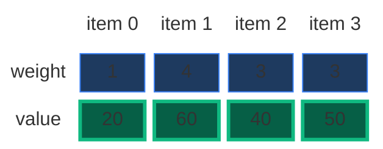

We use this example in every section below. It is small (a 4 × 7 grid), it has a repeated subproblem, and it fools **both** greedy ideas (Section 2).

### Constraints

GfG:

- `2 <= n <= 10^3` (`n` = number of items, `val` and `wt` have the same size)
- `1 <= W <= 10^3`
- `1 <= val[i] <= 10^3`
- `1 <= wt[i] <= 10^3`

Two things to notice:

- Every weight is at least 1. So an item never fits in a bag of size 0, and `wt[0]` can be bigger than `W` (then item 0 never fits).
- Values are never negative. So "not taking anything" (value 0) is always a safe answer.

### What the constraints tell us (simple theory)

A **constraint** is the biggest input the judge will ever give you. It quietly tells you how fast your code must be.

**Rule of thumb:** a computer does about **100 million (10^8) simple steps per second**. Count how many steps your idea needs for the biggest input, and compare.

| Biggest input `n` | Steps you can afford | Ideas that fit |
|:---:|:---:|:---|
| up to ~20 | about `2^n` | Plain recursion, try everything |
| up to ~500 | about `n^3` | Three nested loops |
| up to ~5,000 | about `n^2` | Two nested loops |
| up to ~1,000,000 | about `n` or `n log n` | One loop, DP over `n` states |

**For this problem:** `n` is at most `1000` and `W` is at most `1000`.

- Trying every way to choose items needs `2^1000` checks. That number has 302 digits. Impossible.
- The DP fills a grid of `n × (W + 1) = 1000 × 1001 ≈ 1 million` cells. That runs in well under a second.

The key: the input has two sizes, `n` and `W`. The DP work is their **product** `n · W`, not `2^n`.

**How the work grows as `n` grows**

Here every item weighs 1 and `W = n` (the worst case for recursion: every call can pick and not pick). Red bars = calls made by plain recursion. Green line = cells in the DP grid, `n · (W + 1)` (it stays flat near zero).

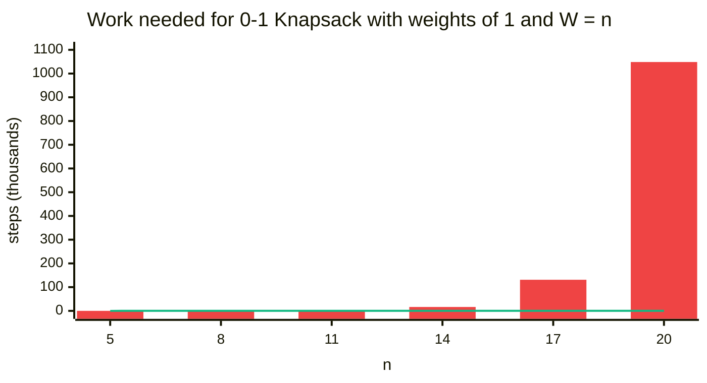

| `n` (and `W`) | Recursion calls | DP cells `n · (W + 1)` |
|:---:|:---:|:---:|
| 5 | 31 | 30 |
| 8 | 255 | 72 |
| 11 | 2,047 | 132 |
| 14 | 16,383 | 210 |
| 17 | 131,071 | 306 |
| 20 | 1,048,575 | 420 |

The recursion calls are exactly `2^n - 1` here: they double with every extra item. The DP cells grow slowly. (These numbers were counted by running the code, not guessed.)

## 2. Core Theory

This note builds on [Subset Sum Equal To K](01.%20Subset%20Sum%20Equal%20To%20K.md). Same grid, same "pick / not pick". The only change: the answer in a cell is no longer `True / False`, it is a **number** (the best value), and we combine the two choices with `max` instead of `OR`.

### Why greedy does not work

A **greedy** idea makes the choice that looks best right now and never looks back. Two greedy ideas come to mind. Both fail.

**Greedy 1: take the most valuable item first.** Board example from my notes: `wt = [3, 2, 5]`, `val = [30, 40, 60]`, `W = 6`.

- Greedy takes the 60 (kg 5). Only 1 kg is left. Nothing else fits. Total **60**.
- Better: kg 3 + kg 2 = 5 kg, value `30 + 40 =` **70**.

**Greedy 2: take the best value per kg first** (the "ratio" `val / wt`). Board example from my notes: `wt = [3, 4, 5]`, `val = [30, 50, 60]`, `W = 8`.

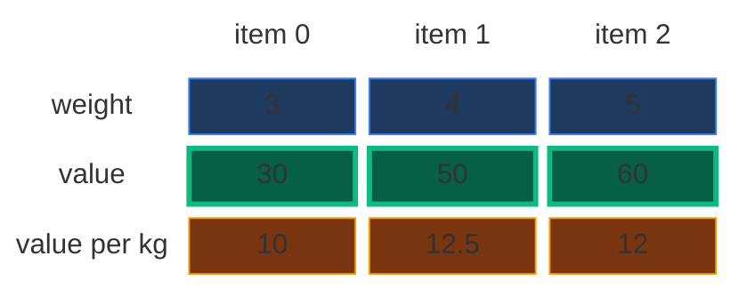

- Ratios: `30 / 3 = 10`, `50 / 4 = 12.5`, `60 / 5 = 12`. Greedy takes kg 4 first (12.5). 4 kg left.
- Next best ratio: kg 5 (12). Does not fit (`4 + 5 = 9 > 8`). Skip.
- Next: kg 3 fits (`4 + 3 = 7`). Total `50 + 30 =` **80**, and 1 kg of the bag stays empty.
- Better: kg 3 + kg 5 = exactly 8 kg, value `30 + 60 =` **90**.

**Our example fools both:** greedy by value takes 60 (kg 4) then 20 (kg 1) = **80**. Greedy by ratio takes 20 (kg 1, ratio 20) then 50 (kg 3, ratio 16.7), then nothing fits = **70**. The real best is kg 3 + kg 3 = **90**.

**Why greedy fails (my notes: "no uniformity").** Items cannot be cut. A great item can leave an awkward gap that no other item fills, so the "good-looking" first choice blocks a better combination. If you **could** cut items (the *fractional* knapsack), the ratio greedy is correct: you fill the gap with a slice of the next item. In 0/1, there are no slices.

So, as my notes say: **try out all combinations** (recursion), and **take the best total** (the maximum value). Then make it fast with DP.

Here is the brute force (try every subset with a bit mask), and the two greedy ideas, so the tests can show that greedy is wrong.

```python
# Imports used by every code block in this note
from typing import List

# For the recursion limit and the tests
import sys

# For random tests at the end
import random


# Brute force: try every subset of items with a bit mask
class SolutionBrute:

    # Main method (same name as GfG)
    def knapsack(self, W: int, val: List[int], wt: List[int]) -> int:

        # Number of items
        n = len(wt)

        # Best value found so far
        best = 0

        # Every mask from 0 to 2^n - 1 is one choice of items
        for mask in range(1 << n):

            # Total weight of this choice
            weight = 0

            # Total value of this choice
            value = 0

            # Look at every item
            for i in range(n):

                # Bit i is 1: item i is in the bag
                if mask & (1 << i):

                    # Add its weight
                    weight += wt[i]

                    # Add its value
                    value += val[i]

            # Keep it only if the bag can carry it
            if weight <= W:

                # Remember the best value
                best = max(best, value)

        # The best over all choices
        return best


# Greedy idea 1: most valuable item first (WRONG for 0/1)
def greedy_by_value(W: int, val: List[int], wt: List[int]) -> int:

    # Item indexes, biggest value first
    order = sorted(range(len(wt)), key=lambda i: -val[i])

    # Value collected so far
    total = 0

    # Go through the items in that order
    for i in order:

        # Take it if it still fits
        if wt[i] <= W:

            # Less room left
            W -= wt[i]

            # Collect its value
            total += val[i]

    # Greedy result
    return total


# Greedy idea 2: best value per kg first (WRONG for 0/1)
def greedy_by_ratio(W: int, val: List[int], wt: List[int]) -> int:

    # Item indexes, best value per kg first
    order = sorted(range(len(wt)), key=lambda i: -val[i] / wt[i])

    # Value collected so far
    total = 0

    # Go through the items in that order
    for i in order:

        # Take it if it still fits
        if wt[i] <= W:

            # Less room left
            W -= wt[i]

            # Collect its value
            total += val[i]

    # Greedy result
    return total


# Board example 1: value greedy gets 60, the best is 70
assert greedy_by_value(6, [30, 40, 60], [3, 2, 5]) == 60

# Board example 2: ratio greedy gets 80, the best is 90
assert greedy_by_ratio(8, [30, 50, 60], [3, 4, 5]) == 80

# Our example: value greedy 80, ratio greedy 70, best 90
assert greedy_by_value(6, [20, 60, 40, 50], [1, 4, 3, 3]) == 80

# Ratio greedy on our example
assert greedy_by_ratio(6, [20, 60, 40, 50], [1, 4, 3, 3]) == 70

# Brute force finds the real best
assert SolutionBrute().knapsack(6, [20, 60, 40, 50], [1, 4, 3, 3]) == 90
```

### How to spot that it is DP

| Property | Plain meaning | In 0/1 Knapsack |
|:---|:---|:---|
| **Overlapping subproblems** | The same smaller question is asked many times | "Best value from items 0..1 with a 3 kg bag?" is asked twice in our example (Section 4) |
| **Optimal substructure** | The big answer is built from answers of smaller questions | The best for items 0..3 is built from the best for items 0..2 |

Also: "choose some items, each at most once, best total" = pick / not pick on subsets. That is the sign of this family.

### Why one number is not enough: the state needs two numbers

The **state** is the small piece of information that names one subproblem.

- When we **skip** an item, the bag's free room stays the same.
- When we **take** an item, the free room **shrinks** by its weight.

So the same items get asked about different bag sizes. "Best from items 0..2 with 6 kg?" and "with 3 kg?" are different questions. We need two numbers:

> `f(ind, W)` = "the best total value using only items `0, 1, ..., ind`, with a bag that can still carry `W` kg."

- `ind` = which items are still available (items `0 .. ind`).
- `W` = how much room is left in the bag.

The whole question is `f(n - 1, W)`. For our example that is `f(3, 6)`. On the board, Striver read `f(2, 6)` as: "till index 2, what is the max value you get with a bag of weight 6?"

### The grid: rows are items, columns are capacities

The answers fit in a **grid** of **items × capacity**:

- **Row `ind`** = "I may use items `0 .. ind`". Going down a row = one more item is allowed.
- **Column `W`** = the bag size, from `0` to `W`. That is `W + 1` columns.
- **Cell `[ind][W]`** = a number: the best value for `f(ind, W)`.

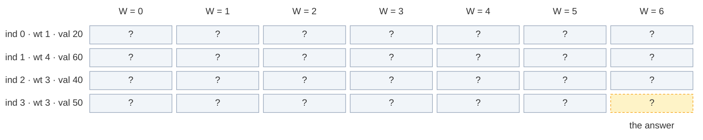

The grid has `n` rows and `W + 1` columns: here `4 × 7 = 28` cells. The answer is the bottom-right cell `[3][6]`.

### The recurrence: pick or not pick, take the max

My notes write the recursion in 3 steps (Striver's recipe):

1. **Express** the problem in terms of the state `(ind, W)`.
2. **Explore all possibilities** of that index: pick the item, or do not pick it.
3. **Return the max** of all possibilities.

In words: *look at the last allowed item `ind`. Either leave it: the best is whatever items `0 .. ind - 1` make with the same room. Or take it (only if it fits): you get `val[ind]` now, plus the best that items `0 .. ind - 1` make with the smaller room `W - wt[ind]`. Keep the bigger one.*

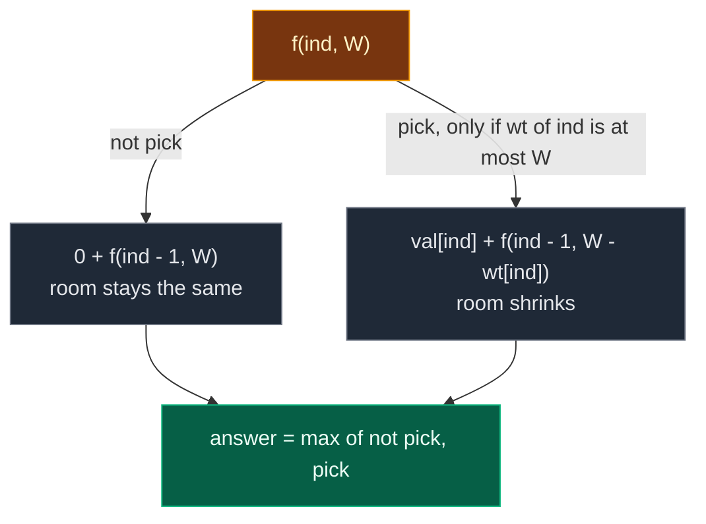

```text
not_pick = 0 + f(ind - 1, W)
pick     = val[ind] + f(ind - 1, W - wt[ind])     only if wt[ind] <= W
f(ind, W) = max(not_pick, pick)
```

`pick` starts as `float("-inf")` (minus infinity, "not allowed"). If the item does not fit, `pick` stays minus infinity and `max` picks `not_pick`. (Since values are never negative, starting `pick` at `0` also works, as in my GPT notes: `not_pick` is always at least 0.)

In the grid: **not pick reads the cell straight up** (same column, row above). **Pick reads the cell up and `wt[ind]` columns to the left, and adds `val[ind]`.**

### Base cases

A **base case** is a subproblem so small that we know the answer without more work. The recursion goes from `n - 1` down to `0`, so the base case is at `ind == 0`:

| Base case | Answer | Why |
|:---|:---:|:---|
| `ind == 0` and `wt[0] <= W` | `val[0]` | Only item 0 is left and it fits. Take it (values are never negative, so taking it never hurts) |
| `ind == 0` and `wt[0] > W` | `0` | Only item 0 is left and it does not fit. The bag stays empty |

Why no `W == 0` base case (like `target == 0` in Subset Sum)? It is not needed. With `W = 0` nothing fits (every weight is at least 1), so the recursion just keeps "not picking" down to `ind == 0`, which returns `0`. Correct on its own.

### Two ways to remember: memoization vs tabulation

| | Memoization | Tabulation |
|:---|:---|:---|
| Other name | **Top-down** | **Bottom-up** |
| Direction | Start from `f(n - 1, W)`, go down to row 0, come back up | Start from row 0, fill row by row down to `[n - 1][W]` |
| How | Recursion + a 2-D table | Two nested loops + a 2-D table |
| Computes | Only the cells it needs | Every cell |
| Stack | Recursion stack (depth up to `n`) | No recursion stack |

### The 4-step ladder

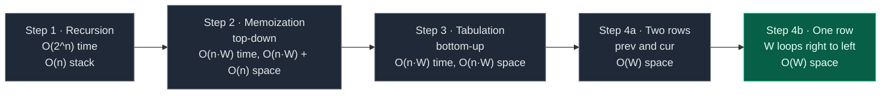

### The knapsack family

0/1 Knapsack is the **parent** of a whole group of problems. Learn this one well and the others are small changes:

| Problem | What changes |
|:---|:---|
| [Unbounded Knapsack](10.%20Unbounded%20Knapsack.md) | Each item can be taken **many times**. After a pick, stay at the same `ind`: `val[ind] + f(ind, W - wt[ind])`. In one array, loop `W` **left to right** |
| [Rod Cutting](11.%20Rod%20Cutting.md) | Unbounded Knapsack in disguise: piece lengths are the weights, prices are the values, rod length is `W` |
| [Subset Sum Equal To K](01.%20Subset%20Sum%20Equal%20To%20K.md) | Same grid, but `True / False` with `OR` instead of a value with `max` |
| [322. Coin Change](07.%20322.%20Coin%20Change.md) | Unbounded, and `min` number of coins instead of `max` value |

## 3. Edge Cases

| Case | Input | Expected | Why it matters |
|:---|:---:|:---:|:---|
| Nothing fits | `W = 3`, `wt = [4, 5, 6]`, `val = [1, 2, 3]` | `0` | Every call ends at "not pick". GfG example |
| First item too heavy | `W = 5`, `wt = [10, 1]`, `val = [100, 5]` | `5` | Base case returns 0 for item 0; the table loop `range(wt[0], W + 1)` is empty |
| Item exactly fills the bag | `W = 4`, `wt = [4]`, `val = [7]` | `7` | `wt[ind] <= W` must use `<=`, not `<` |
| Bag of size 0 | `W = 0`, `wt = [1, 2]`, `val = [5, 6]` | `0` | No special base case needed, nothing fits |
| Everything fits | `W = 10`, `wt = [1, 2, 3]`, `val = [5, 6, 7]` | `18` | Take every item once |
| Same weight twice | our example, two kg-3 items | `90` | Both can be taken (each once), but one item must never be taken twice |
| Greedy trap | our example | `90` | Value greedy gives 80, ratio greedy gives 70 |
| Biggest input | `n = 1000`, `W = 1000` | – | Python memoization needs a higher recursion limit (Section 5) |

## 4. Approach 1: Recursion

### Idea

Write the recurrence as code. Start with `f(n - 1, W)`. If `ind == 0`, use the base case. Otherwise try "not pick" and "pick" and return the bigger one.

### Recursion tree for `wt = [1, 4, 3, 3]`, `val = [20, 60, 40, 50]`, `W = 6`

Every box shows the call and what it returns. Calls happen depth-first, "not pick" first (like the code). The edge says what a pick adds.

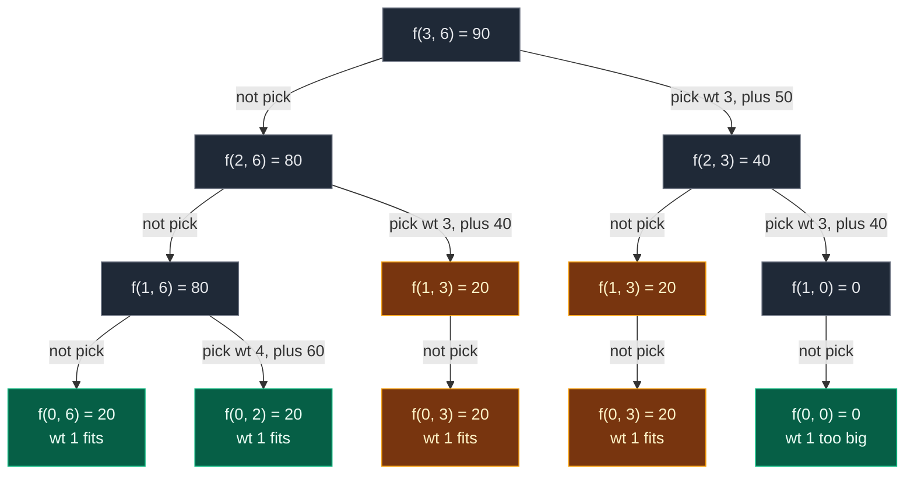

Gold = repeated work. Green = base cases that are not repeated.

`f(1, 3)` and `f(1, 0)` have only one child: item 1 weighs 4, which does not fit in a 3 kg or 0 kg bag, so "pick" stays minus infinity.

| State | Times computed |
|:---|:---:|
| `f(3, 6)`, `f(2, 6)`, `f(2, 3)`, `f(1, 6)`, `f(1, 0)` | 1 each |
| **`f(1, 3)`** | **2** |
| **`f(0, 3)`** | **2** (inside each `f(1, 3)`) |
| `f(0, 6)`, `f(0, 2)`, `f(0, 0)` | 1 each |

That is **12 calls** for just 4 items. `f(1, 3)` is the overlapping subproblem: it is reached by "skip item 3, take item 2" and by "take item 3, skip item 2". Both paths leave a 3 kg bag and items 0..1. They weigh the same (3 kg each), so the leftover question is the same.

**The exact order of calls.** One participant per row of the grid (`ind`). Solid arrows = calls, dashed arrows = returns.

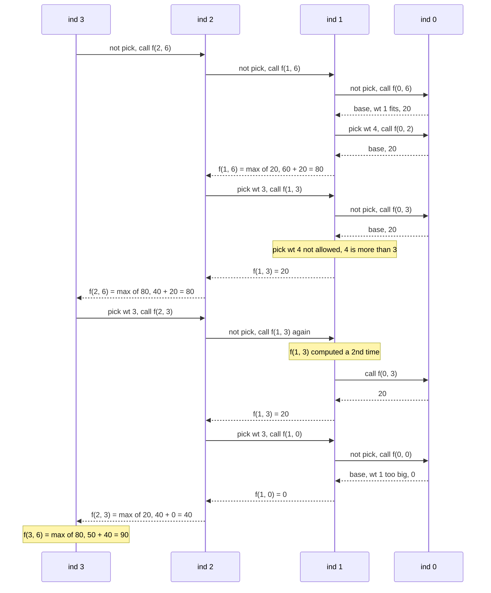

**Board dry run from my notes:** `wt = [3, 2, 5]`, `val = [30, 40, 60]`, `W = 6`. Call `f(2, 6)`:

- not pick → `f(1, 6)`: items kg 3 and kg 2 both fit, value `30 + 40 = 70`.
- pick kg 5 → `60 + f(1, 1)`. In `f(1, 1)`: not pick → `0 + f(0, 1) = 0` (kg 3 does not fit in 1 kg). Pick kg 2 → not allowed, stays minus infinity. So `f(1, 1) = 0` and pick = `60`.
- `f(2, 6) = max(70, 60) = 70`.

**Dry run from my GPT notes:** `wt = [1, 2, 4, 5]`, `val = [5, 4, 8, 6]`, `W = 5`. Call `solve(3, 5)` (item 3: kg 5, value 6):

- Do not take item 3 → `solve(2, 5)`. Item 2 is kg 4, value 8. Take it → `8 + solve(1, 1)`. `solve(1, 1)` cannot take kg 2, but can still use item 0 → 5. So `solve(2, 5) = 8 + 5 = 13`.
- Take item 3 → `6 + solve(2, 0) = 6 + 0 = 6`.
- Compare: 6 vs 13. Answer = **13**.

### Code

```python
# Plain recursion
class SolutionRecursion:

    # Helper: best value from items 0..index with capacity left
    def solve(self, index: int, capacity: int, val: List[int], wt: List[int]) -> int:

        # Base case: only item 0 is left
        if index == 0:

            # It fits: take it
            if wt[0] <= capacity:
                return val[0]

            # It does not fit: nothing more
            return 0

        # Choice 1: do not pick this item, room stays the same
        not_pick = 0 + self.solve(index - 1, capacity, val, wt)

        # Choice 2 starts as minus infinity (not allowed yet)
        pick = float("-inf")

        # Pick only if the item fits
        if wt[index] <= capacity:

            # Its value now, plus the best for the smaller room
            pick = val[index] + self.solve(index - 1, capacity - wt[index], val, wt)

        # Keep the better choice
        return max(not_pick, pick)

    # Main method (same name as GfG)
    def knapsack(self, W: int, val: List[int], wt: List[int]) -> int:

        # Start from the last item and the full bag
        return self.solve(len(wt) - 1, W, val, wt)
```

### Complexity

| Measure | Complexity | Why |
|:---|:---:|:---|
| **Time** | `O(2^n)` | Each item gives 2 choices (pick / not pick), so the tree can double at each level |
| **Space** | `O(n)` | Recursion stack. The deepest path goes `ind = n - 1, n - 2, ..., 0`, which is `n` frames |

## 5. Approach 2: Memoization (Top-Down)

### Idea

In the recursion, the same `(ind, W)` states are solved again and again. Store each answer the first time in a 2-D table `dp[ind][W]`, and reuse it.

**Size of the table (from the board).** `ind` goes from `0` to `n - 1` (that is `n` rows). `W` goes from `0` to `W` (that is `W + 1` columns). So `dp[N][W + 1]`. A value of `-1` means "not computed yet" (real answers are never negative, so `-1` is safe).

The same **3 steps** as always:

1. **Declare** `dp` with `n` rows and `W + 1` columns, filled with `-1`.
2. **Store** the answer before returning: `dp[ind][W] = max(not_pick, pick)`.
3. **Check** first: if `dp[ind][W] != -1`, return it and make no new calls.

Note: like in my notes' code, the base case `ind == 0` is checked **before** the table. So row 0 is never stored and stays `-1`. That is fine.

My GPT notes say it well: "If `solve(1, 1)` or `solve(2, 5)` is needed multiple times, memoization computes it once and reuses it."

**Python only:** with `n = 1000` the recursion goes 1000 calls deep, and Python's default limit is 1000. So we raise it with `sys.setrecursionlimit(...)`, or use tabulation, which has no recursion.

### Visual: when each `dp[ind][W]` gets filled

Colours: grey = `-1` (not computed), dashed yellow = computing (waiting for its children), green = just filled, blue = filled earlier, orange = cache hit.

**Start:** `dp` is `4 × 7`, all `-1`.

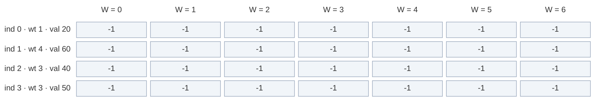

**Calls go down the "not pick" side:** `f(3, 6)` → `dp[3][6] = -1`, compute. `f(2, 6)` → `-1`, compute. `f(1, 6)` → `-1`, compute. `f(0, 6)` is a base case: 20.

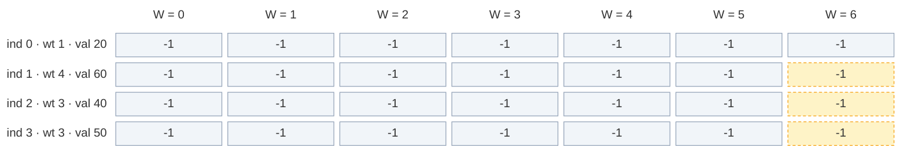

**Fill 1:** `f(1, 6)`: not pick = `f(0, 6) = 20`. Pick kg 4 = `60 + f(0, 2) = 60 + 20 = 80`. Store `dp[1][6] = 80`.

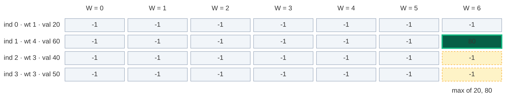

**Fill 2:** back in `f(2, 6)`, pick kg 3 calls `f(1, 3)`: not pick = `f(0, 3) = 20`, pick kg 4 not allowed. Store `dp[1][3] = 20`.

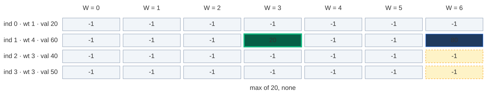

**Fill 3:** `f(2, 6) = max(80, 40 + 20) = 80`. Store `dp[2][6] = 80`.

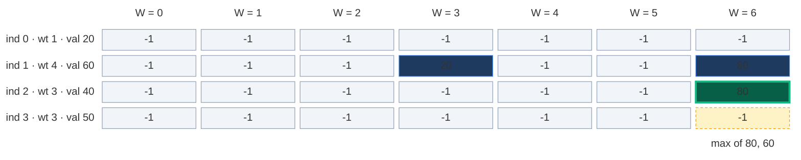

**Cache hit:** back in `f(3, 6)`, pick kg 3 calls `f(2, 3)`. Its "not pick" asks for `f(1, 3)`. `dp[1][3] = 20` is already known → return 20, **no new calls**. (In plain recursion this called `f(0, 3)` again.)

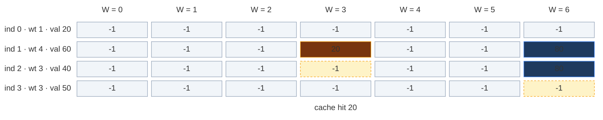

**Fill 4:** `f(2, 3)` pick kg 3 calls `f(1, 0)`: not pick = `f(0, 0) = 0`, pick kg 4 not allowed. Store `dp[1][0] = 0`.

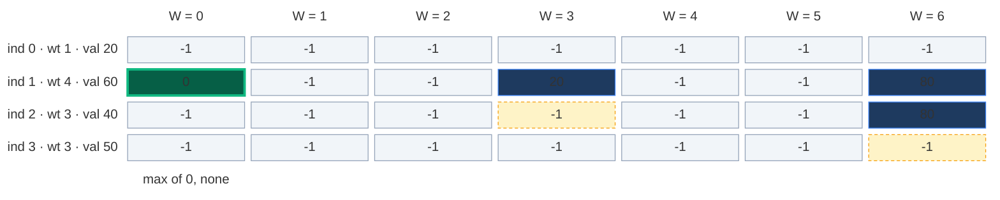

**Fill 5:** `f(2, 3) = max(20, 40 + 0) = 40`. Store `dp[2][3] = 40`.

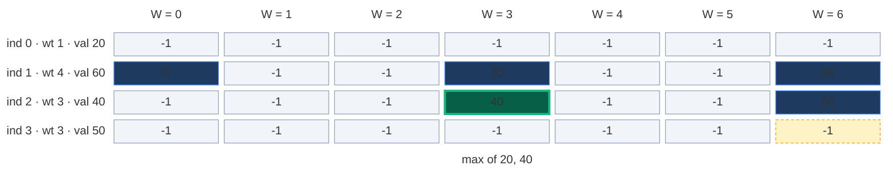

**Fill 6:** `f(3, 6) = max(80, 50 + 40) = 90`. Store `dp[3][6] = 90`. That is the answer.

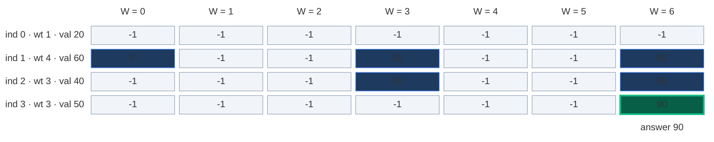

Only 6 of the 28 cells were ever stored. Memoization computes **only the states it needs**.

### The pruned recursion tree

Same tree, but the cache hit (dashed) stops right away.

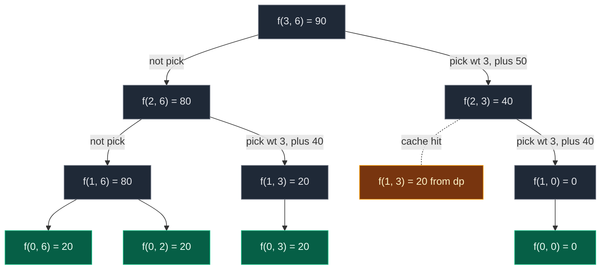

**11 calls** instead of 12. Small saving because the example is tiny. On bigger inputs the saving is huge: at most `n · (W + 1)` states are ever computed.

### Code

```python
# Memoization (top-down DP) with a 2-D table of -1
class SolutionMemo:

    # Helper: best value from items 0..index with capacity left, uses dp
    def solve(self, index: int, capacity: int, val: List[int], wt: List[int], dp: List[List[int]]) -> int:

        # Base case: only item 0 is left
        if index == 0:

            # It fits: take it
            if wt[0] <= capacity:
                return val[0]

            # It does not fit: nothing more
            return 0

        # Step 3 (check): already solved this (index, capacity)? Reuse it
        if dp[index][capacity] != -1:
            return dp[index][capacity]

        # Choice 1: do not pick this item
        not_pick = 0 + self.solve(index - 1, capacity, val, wt, dp)

        # Choice 2 starts as minus infinity (not allowed yet)
        pick = float("-inf")

        # Pick only if the item fits
        if wt[index] <= capacity:

            # Its value now, plus the best for the smaller room
            pick = val[index] + self.solve(index - 1, capacity - wt[index], val, wt, dp)

        # Step 2 (store): remember the better choice
        dp[index][capacity] = max(not_pick, pick)

        # Return the stored answer
        return dp[index][capacity]

    # Main method (same name as GfG)
    def knapsack(self, W: int, val: List[int], wt: List[int]) -> int:

        # Number of items
        n = len(wt)

        # Python only: allow recursion as deep as n (default limit is 1000)
        sys.setrecursionlimit(max(1000, 2 * n + 100))

        # Step 1 (declare): n rows, W + 1 columns, -1 means not solved yet
        dp = [[-1] * (W + 1) for _ in range(n)]

        # Keep the table so we can look at it after the run
        self.dp = dp

        # Start from the last item and the full bag
        return self.solve(n - 1, W, val, wt, dp)
```

### Complexity

| Measure | Complexity | Why |
|:---|:---:|:---|
| **Time** | `O(n · W)` | At most `n · (W + 1)` different states, each solved once with `O(1)` work |
| **Space: dp table** | `O(n · W)` | `n` rows × `W + 1` columns |
| **Space: recursion stack** | `O(n)` | The deepest path goes `ind = n - 1` down to `0` |
| **Total space** | `O(n · W) + O(n)` | Table plus stack |

## 6. Approach 3: Tabulation (Bottom-Up)

### Idea

Fill the whole grid with two loops, from the smallest states (row 0) to the answer (`[n - 1][W]`). No recursion, so no stack.

`dp[i][cap]` = "the best value using items `0 .. i` with a bag of size `cap`."

### How to convert memo → table, step by step

The 3 steps from the board (base case, loops, copy the recurrence), plus "same table" and "answer":

1. **Same grid:** `dp` with `n` rows and `W + 1` columns, all `0`. (Board: `dp[N][W + 1] = 0`.)
2. **Base case becomes cells:** `ind == 0 → val[0] if wt[0] <= cap` becomes: for every `cap` from `wt[0]` to `W`, `dp[0][cap] = val[0]`. The cells left of `wt[0]` stay `0`. If `wt[0] > W`, the loop does nothing, which is right.
3. **Two nested loops, in the opposite direction:** the recursion went `n - 1 → 0`. Reverse it: `ind` from `1` to `n - 1`, and inside, `cap` from `0` to `W`.
4. **Copy the recurrence:** replace `f(...)` with `dp[...]`:
   - `not_pick = dp[ind - 1][cap]`
   - `pick = val[ind] + dp[ind - 1][cap - wt[ind]]` if `wt[ind] <= cap`
   - `dp[ind][cap] = max(not_pick, pick)`
5. **Answer:** `dp[n - 1][W]`.

| Memoization | Becomes in tabulation |
|:---|:---|
| `dp[n][W + 1]` with `-1` | `dp[n][W + 1]` with `0` |
| `if ind == 0: return val[0] if wt[0] <= W else 0` | `dp[0][cap] = val[0]` for `cap = wt[0] .. W` |
| `f(n - 1, W)` going down | Loops `ind = 1 .. n - 1`, `cap = 0 .. W` going up |
| `f(ind - 1, W)` | `dp[ind - 1][cap]` |
| `val[ind] + f(ind - 1, W - wt[ind])` | `val[ind] + dp[ind - 1][cap - wt[ind]]` |
| `return f(n - 1, W)` | `return dp[n - 1][W]` |

**Picture rule:** to fill a cell, look **straight up** (not pick), and **up, then `wt[ind]` steps left, plus `val[ind]`** (pick). Write the bigger one.

### Visual table fill (`wt = [1, 4, 3, 3]`, `val = [20, 60, 40, 50]`, `W = 6`)

Colours: green = just filled, orange = the cells it reads, blue = filled earlier, grey `?` = not filled yet.

**Start: base case written in.** Item 0 weighs 1 kg, so every bag of 1 kg or more holds it: `dp[0][1 .. 6] = 20`. A 0 kg bag holds nothing: `dp[0][0] = 0`.

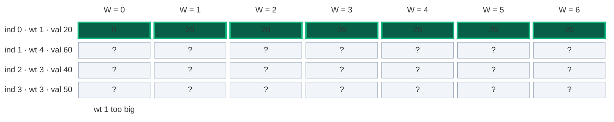

#### Row 1 (item 1: wt 4, val 60), cell by cell

**`dp[1][0]`:** not pick = `dp[0][0] = 0`. Pick: `4 > 0`, not allowed. Result `0`.

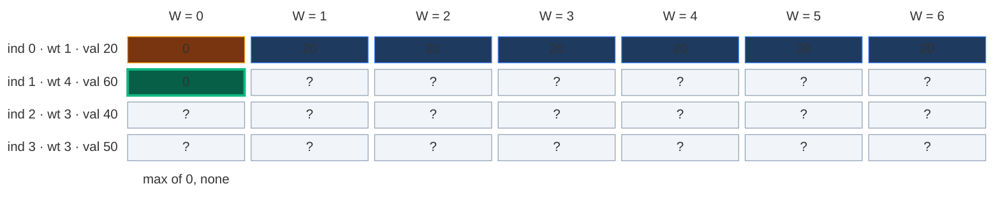

**`dp[1][1]`:** not pick = `dp[0][1] = 20`. Pick: `4 > 1`, not allowed. Result `20`.

```mermaid
block-beta
  columns 8
  hx[" "] h0["W = 0"] h1["W = 1"] h2["W = 2"] h3["W = 3"] h4["W = 4"] h5["W = 5"] h6["W = 6"]
  l0["ind 0 · wt 1 · val 20"] r0c0["0"] r0c1["20"] r0c2["20"] r0c3["20"] r0c4["20"] r0c5["20"] r0c6["20"]
  l1["ind 1 · wt 4 · val 60"] r1c0["0"] r1c1["20"] r1c2["?"] r1c3["?"] r1c4["?"] r1c5["?"] r1c6["?"]
  l2["ind 2 · wt 3 · val 40"] r2c0["?"] r2c1["?"] r2c2["?"] r2c3["?"] r2c4["?"] r2c5["?"] r2c6["?"]
  l3["ind 3 · wt 3 · val 50"] r3c0["?"] r3c1["?"] r3c2["?"] r3c3["?"] r3c4["?"] r3c5["?"] r3c6["?"]
  space space m1["max of 20, none"] space space space space space
  classDef head fill:none,stroke:none,color:#64748b
  class hx,h0,h1,h2,h3,h4,h5,h6,l0,l1,l2,l3 head
  classDef empty fill:#f1f5f9,stroke:#94a3b8,color:#64748b
  class r1c2,r1c3,r1c4,r1c5,r1c6,r2c0,r2c1,r2c2,r2c3,r2c4,r2c5,r2c6,r3c0,r3c1,r3c2,r3c3,r3c4,r3c5,r3c6 empty
  classDef done fill:#1e3a5f,stroke:#3b82f6,color:#dbeafe
  class r0c0,r0c2,r0c3,r0c4,r0c5,r0c6,r1c0 done
  classDef read fill:#78350f,stroke:#f59e0b,color:#fef3c7
  class r0c1 read
  classDef new fill:#065f46,stroke:#10b981,color:#ecfdf5,stroke-width:3px
  class r1c1 new
  classDef note fill:none,stroke:none,color:#b45309
  class m1 note
```

**`dp[1][2]`:** not pick = `dp[0][2] = 20`. Pick: `4 > 2`, not allowed. Result `20`.

```mermaid
block-beta
  columns 8
  hx[" "] h0["W = 0"] h1["W = 1"] h2["W = 2"] h3["W = 3"] h4["W = 4"] h5["W = 5"] h6["W = 6"]
  l0["ind 0 · wt 1 · val 20"] r0c0["0"] r0c1["20"] r0c2["20"] r0c3["20"] r0c4["20"] r0c5["20"] r0c6["20"]
  l1["ind 1 · wt 4 · val 60"] r1c0["0"] r1c1["20"] r1c2["20"] r1c3["?"] r1c4["?"] r1c5["?"] r1c6["?"]
  l2["ind 2 · wt 3 · val 40"] r2c0["?"] r2c1["?"] r2c2["?"] r2c3["?"] r2c4["?"] r2c5["?"] r2c6["?"]
  l3["ind 3 · wt 3 · val 50"] r3c0["?"] r3c1["?"] r3c2["?"] r3c3["?"] r3c4["?"] r3c5["?"] r3c6["?"]
  space space space m2["max of 20, none"] space space space space
  classDef head fill:none,stroke:none,color:#64748b
  class hx,h0,h1,h2,h3,h4,h5,h6,l0,l1,l2,l3 head
  classDef empty fill:#f1f5f9,stroke:#94a3b8,color:#64748b
  class r1c3,r1c4,r1c5,r1c6,r2c0,r2c1,r2c2,r2c3,r2c4,r2c5,r2c6,r3c0,r3c1,r3c2,r3c3,r3c4,r3c5,r3c6 empty
  classDef done fill:#1e3a5f,stroke:#3b82f6,color:#dbeafe
  class r0c0,r0c1,r0c3,r0c4,r0c5,r0c6,r1c0,r1c1 done
  classDef read fill:#78350f,stroke:#f59e0b,color:#fef3c7
  class r0c2 read
  classDef new fill:#065f46,stroke:#10b981,color:#ecfdf5,stroke-width:3px
  class r1c2 new
  classDef note fill:none,stroke:none,color:#b45309
  class m2 note
```

**`dp[1][3]`:** not pick = `dp[0][3] = 20`. Pick: `4 > 3`, not allowed. Result `20`.

```mermaid
block-beta
  columns 8
  hx[" "] h0["W = 0"] h1["W = 1"] h2["W = 2"] h3["W = 3"] h4["W = 4"] h5["W = 5"] h6["W = 6"]
  l0["ind 0 · wt 1 · val 20"] r0c0["0"] r0c1["20"] r0c2["20"] r0c3["20"] r0c4["20"] r0c5["20"] r0c6["20"]
  l1["ind 1 · wt 4 · val 60"] r1c0["0"] r1c1["20"] r1c2["20"] r1c3["20"] r1c4["?"] r1c5["?"] r1c6["?"]
  l2["ind 2 · wt 3 · val 40"] r2c0["?"] r2c1["?"] r2c2["?"] r2c3["?"] r2c4["?"] r2c5["?"] r2c6["?"]
  l3["ind 3 · wt 3 · val 50"] r3c0["?"] r3c1["?"] r3c2["?"] r3c3["?"] r3c4["?"] r3c5["?"] r3c6["?"]
  space space space space m3["max of 20, none"] space space space
  classDef head fill:none,stroke:none,color:#64748b
  class hx,h0,h1,h2,h3,h4,h5,h6,l0,l1,l2,l3 head
  classDef empty fill:#f1f5f9,stroke:#94a3b8,color:#64748b
  class r1c4,r1c5,r1c6,r2c0,r2c1,r2c2,r2c3,r2c4,r2c5,r2c6,r3c0,r3c1,r3c2,r3c3,r3c4,r3c5,r3c6 empty
  classDef done fill:#1e3a5f,stroke:#3b82f6,color:#dbeafe
  class r0c0,r0c1,r0c2,r0c4,r0c5,r0c6,r1c0,r1c1,r1c2 done
  classDef read fill:#78350f,stroke:#f59e0b,color:#fef3c7
  class r0c3 read
  classDef new fill:#065f46,stroke:#10b981,color:#ecfdf5,stroke-width:3px
  class r1c3 new
  classDef note fill:none,stroke:none,color:#b45309
  class m3 note
```

**`dp[1][4]`:** not pick = `dp[0][4] = 20`. Pick = `60 + dp[0][4 - 4] = 60 + dp[0][0] = 60`. Result `60`.

```mermaid
block-beta
  columns 8
  hx[" "] h0["W = 0"] h1["W = 1"] h2["W = 2"] h3["W = 3"] h4["W = 4"] h5["W = 5"] h6["W = 6"]
  l0["ind 0 · wt 1 · val 20"] r0c0["0"] r0c1["20"] r0c2["20"] r0c3["20"] r0c4["20"] r0c5["20"] r0c6["20"]
  l1["ind 1 · wt 4 · val 60"] r1c0["0"] r1c1["20"] r1c2["20"] r1c3["20"] r1c4["60"] r1c5["?"] r1c6["?"]
  l2["ind 2 · wt 3 · val 40"] r2c0["?"] r2c1["?"] r2c2["?"] r2c3["?"] r2c4["?"] r2c5["?"] r2c6["?"]
  l3["ind 3 · wt 3 · val 50"] r3c0["?"] r3c1["?"] r3c2["?"] r3c3["?"] r3c4["?"] r3c5["?"] r3c6["?"]
  space space space space space m4["max of 20, 60+0"] space space
  classDef head fill:none,stroke:none,color:#64748b
  class hx,h0,h1,h2,h3,h4,h5,h6,l0,l1,l2,l3 head
  classDef empty fill:#f1f5f9,stroke:#94a3b8,color:#64748b
  class r1c5,r1c6,r2c0,r2c1,r2c2,r2c3,r2c4,r2c5,r2c6,r3c0,r3c1,r3c2,r3c3,r3c4,r3c5,r3c6 empty
  classDef done fill:#1e3a5f,stroke:#3b82f6,color:#dbeafe
  class r0c1,r0c2,r0c3,r0c5,r0c6,r1c0,r1c1,r1c2,r1c3 done
  classDef read fill:#78350f,stroke:#f59e0b,color:#fef3c7
  class r0c0,r0c4 read
  classDef new fill:#065f46,stroke:#10b981,color:#ecfdf5,stroke-width:3px
  class r1c4 new
  classDef note fill:none,stroke:none,color:#b45309
  class m4 note
```

**`dp[1][5]`:** not pick = `dp[0][5] = 20`. Pick = `60 + dp[0][1] = 60 + 20 = 80`. Result `80` (items 1 and 0 together).

```mermaid
block-beta
  columns 8
  hx[" "] h0["W = 0"] h1["W = 1"] h2["W = 2"] h3["W = 3"] h4["W = 4"] h5["W = 5"] h6["W = 6"]
  l0["ind 0 · wt 1 · val 20"] r0c0["0"] r0c1["20"] r0c2["20"] r0c3["20"] r0c4["20"] r0c5["20"] r0c6["20"]
  l1["ind 1 · wt 4 · val 60"] r1c0["0"] r1c1["20"] r1c2["20"] r1c3["20"] r1c4["60"] r1c5["80"] r1c6["?"]
  l2["ind 2 · wt 3 · val 40"] r2c0["?"] r2c1["?"] r2c2["?"] r2c3["?"] r2c4["?"] r2c5["?"] r2c6["?"]
  l3["ind 3 · wt 3 · val 50"] r3c0["?"] r3c1["?"] r3c2["?"] r3c3["?"] r3c4["?"] r3c5["?"] r3c6["?"]
  space space space space space space m5["max of 20, 60+20"] space
  classDef head fill:none,stroke:none,color:#64748b
  class hx,h0,h1,h2,h3,h4,h5,h6,l0,l1,l2,l3 head
  classDef empty fill:#f1f5f9,stroke:#94a3b8,color:#64748b
  class r1c6,r2c0,r2c1,r2c2,r2c3,r2c4,r2c5,r2c6,r3c0,r3c1,r3c2,r3c3,r3c4,r3c5,r3c6 empty
  classDef done fill:#1e3a5f,stroke:#3b82f6,color:#dbeafe
  class r0c0,r0c2,r0c3,r0c4,r0c6,r1c0,r1c1,r1c2,r1c3,r1c4 done
  classDef read fill:#78350f,stroke:#f59e0b,color:#fef3c7
  class r0c1,r0c5 read
  classDef new fill:#065f46,stroke:#10b981,color:#ecfdf5,stroke-width:3px
  class r1c5 new
  classDef note fill:none,stroke:none,color:#b45309
  class m5 note
```

**`dp[1][6]`:** not pick = `dp[0][6] = 20`. Pick = `60 + dp[0][2] = 60 + 20 = 80`. Result `80`.

```mermaid
block-beta
  columns 8
  hx[" "] h0["W = 0"] h1["W = 1"] h2["W = 2"] h3["W = 3"] h4["W = 4"] h5["W = 5"] h6["W = 6"]
  l0["ind 0 · wt 1 · val 20"] r0c0["0"] r0c1["20"] r0c2["20"] r0c3["20"] r0c4["20"] r0c5["20"] r0c6["20"]
  l1["ind 1 · wt 4 · val 60"] r1c0["0"] r1c1["20"] r1c2["20"] r1c3["20"] r1c4["60"] r1c5["80"] r1c6["80"]
  l2["ind 2 · wt 3 · val 40"] r2c0["?"] r2c1["?"] r2c2["?"] r2c3["?"] r2c4["?"] r2c5["?"] r2c6["?"]
  l3["ind 3 · wt 3 · val 50"] r3c0["?"] r3c1["?"] r3c2["?"] r3c3["?"] r3c4["?"] r3c5["?"] r3c6["?"]
  space space space space space space space m6["max of 20, 60+20"]
  classDef head fill:none,stroke:none,color:#64748b
  class hx,h0,h1,h2,h3,h4,h5,h6,l0,l1,l2,l3 head
  classDef empty fill:#f1f5f9,stroke:#94a3b8,color:#64748b
  class r2c0,r2c1,r2c2,r2c3,r2c4,r2c5,r2c6,r3c0,r3c1,r3c2,r3c3,r3c4,r3c5,r3c6 empty
  classDef done fill:#1e3a5f,stroke:#3b82f6,color:#dbeafe
  class r0c0,r0c1,r0c3,r0c4,r0c5,r1c0,r1c1,r1c2,r1c3,r1c4,r1c5 done
  classDef read fill:#78350f,stroke:#f59e0b,color:#fef3c7
  class r0c2,r0c6 read
  classDef new fill:#065f46,stroke:#10b981,color:#ecfdf5,stroke-width:3px
  class r1c6 new
  classDef note fill:none,stroke:none,color:#b45309
  class m6 note
```

**After row 1:**

```mermaid
block-beta
  columns 8
  hx[" "] h0["W = 0"] h1["W = 1"] h2["W = 2"] h3["W = 3"] h4["W = 4"] h5["W = 5"] h6["W = 6"]
  l0["ind 0 · wt 1 · val 20"] r0c0["0"] r0c1["20"] r0c2["20"] r0c3["20"] r0c4["20"] r0c5["20"] r0c6["20"]
  l1["ind 1 · wt 4 · val 60"] r1c0["0"] r1c1["20"] r1c2["20"] r1c3["20"] r1c4["60"] r1c5["80"] r1c6["80"]
  l2["ind 2 · wt 3 · val 40"] r2c0["?"] r2c1["?"] r2c2["?"] r2c3["?"] r2c4["?"] r2c5["?"] r2c6["?"]
  l3["ind 3 · wt 3 · val 50"] r3c0["?"] r3c1["?"] r3c2["?"] r3c3["?"] r3c4["?"] r3c5["?"] r3c6["?"]
  classDef head fill:none,stroke:none,color:#64748b
  class hx,h0,h1,h2,h3,h4,h5,h6,l0,l1,l2,l3 head
  classDef empty fill:#f1f5f9,stroke:#94a3b8,color:#64748b
  class r2c0,r2c1,r2c2,r2c3,r2c4,r2c5,r2c6,r3c0,r3c1,r3c2,r3c3,r3c4,r3c5,r3c6 empty
  classDef done fill:#1e3a5f,stroke:#3b82f6,color:#dbeafe
  class r0c0,r0c1,r0c2,r0c3,r0c4,r0c5,r0c6,r1c0,r1c1,r1c2,r1c3,r1c4,r1c5,r1c6 done
```

#### Row 2 (item 2: wt 3, val 40)

| Cell | not pick (up) | pick (up, 3 left, plus 40) | Result |
|:---:|:---:|:---:|:---:|
| `dp[2][0]` | `0` | not allowed | `0` |
| `dp[2][1]` | `20` | not allowed | `20` |
| `dp[2][2]` | `20` | not allowed | `20` |
| `dp[2][3]` | `20` | `40 + dp[1][0] = 40` | **`40`** |
| `dp[2][4]` | `60` | `40 + dp[1][1] = 60` | `60` |
| `dp[2][5]` | `80` | `40 + dp[1][2] = 60` | `80` |
| `dp[2][6]` | `80` | `40 + dp[1][3] = 60` | `80` |

**After row 2:**

```mermaid
block-beta
  columns 8
  hx[" "] h0["W = 0"] h1["W = 1"] h2["W = 2"] h3["W = 3"] h4["W = 4"] h5["W = 5"] h6["W = 6"]
  l0["ind 0 · wt 1 · val 20"] r0c0["0"] r0c1["20"] r0c2["20"] r0c3["20"] r0c4["20"] r0c5["20"] r0c6["20"]
  l1["ind 1 · wt 4 · val 60"] r1c0["0"] r1c1["20"] r1c2["20"] r1c3["20"] r1c4["60"] r1c5["80"] r1c6["80"]
  l2["ind 2 · wt 3 · val 40"] r2c0["0"] r2c1["20"] r2c2["20"] r2c3["40"] r2c4["60"] r2c5["80"] r2c6["80"]
  l3["ind 3 · wt 3 · val 50"] r3c0["?"] r3c1["?"] r3c2["?"] r3c3["?"] r3c4["?"] r3c5["?"] r3c6["?"]
  classDef head fill:none,stroke:none,color:#64748b
  class hx,h0,h1,h2,h3,h4,h5,h6,l0,l1,l2,l3 head
  classDef empty fill:#f1f5f9,stroke:#94a3b8,color:#64748b
  class r3c0,r3c1,r3c2,r3c3,r3c4,r3c5,r3c6 empty
  classDef done fill:#1e3a5f,stroke:#3b82f6,color:#dbeafe
  class r0c0,r0c1,r0c2,r0c3,r0c4,r0c5,r0c6,r1c0,r1c1,r1c2,r1c3,r1c4,r1c5,r1c6 done
  classDef new fill:#065f46,stroke:#10b981,color:#ecfdf5,stroke-width:3px
  class r2c0,r2c1,r2c2,r2c3,r2c4,r2c5,r2c6 new
```

#### Row 3 (item 3: wt 3, val 50)

| Cell | not pick (up) | pick (up, 3 left, plus 50) | Result |
|:---:|:---:|:---:|:---:|
| `dp[3][0]` | `0` | not allowed | `0` |
| `dp[3][1]` | `20` | not allowed | `20` |
| `dp[3][2]` | `20` | not allowed | `20` |
| `dp[3][3]` | `40` | `50 + dp[2][0] = 50` | **`50`** |
| `dp[3][4]` | `60` | `50 + dp[2][1] = 70` | **`70`** |
| `dp[3][5]` | `80` | `50 + dp[2][2] = 70` | `80` |
| `dp[3][6]` | `80` | `50 + dp[2][3] = 90` | **`90`** |

The answer cell `dp[3][6]` reads `dp[2][6] = 80` (straight up) and `dp[2][3] = 40` (up, 3 left), and keeps `50 + 40 = 90`:

```mermaid
block-beta
  columns 8
  hx[" "] h0["W = 0"] h1["W = 1"] h2["W = 2"] h3["W = 3"] h4["W = 4"] h5["W = 5"] h6["W = 6"]
  l0["ind 0 · wt 1 · val 20"] r0c0["0"] r0c1["20"] r0c2["20"] r0c3["20"] r0c4["20"] r0c5["20"] r0c6["20"]
  l1["ind 1 · wt 4 · val 60"] r1c0["0"] r1c1["20"] r1c2["20"] r1c3["20"] r1c4["60"] r1c5["80"] r1c6["80"]
  l2["ind 2 · wt 3 · val 40"] r2c0["0"] r2c1["20"] r2c2["20"] r2c3["40"] r2c4["60"] r2c5["80"] r2c6["80"]
  l3["ind 3 · wt 3 · val 50"] r3c0["0"] r3c1["20"] r3c2["20"] r3c3["50"] r3c4["70"] r3c5["80"] r3c6["90"]
  space space space space space space space m6["max of 80, 50+40"]
  classDef head fill:none,stroke:none,color:#64748b
  class hx,h0,h1,h2,h3,h4,h5,h6,l0,l1,l2,l3 head
  classDef done fill:#1e3a5f,stroke:#3b82f6,color:#dbeafe
  class r0c0,r0c1,r0c2,r0c3,r0c4,r0c5,r0c6,r1c0,r1c1,r1c2,r1c3,r1c4,r1c5,r1c6,r2c0,r2c1,r2c2,r2c4,r2c5,r3c0,r3c1,r3c2,r3c3,r3c4,r3c5 done
  classDef read fill:#78350f,stroke:#f59e0b,color:#fef3c7
  class r2c3,r2c6 read
  classDef new fill:#065f46,stroke:#10b981,color:#ecfdf5,stroke-width:3px
  class r3c6 new
  classDef note fill:none,stroke:none,color:#b45309
  class m6 note
```

**After row 3 (the full grid):**

```mermaid
block-beta
  columns 8
  hx[" "] h0["W = 0"] h1["W = 1"] h2["W = 2"] h3["W = 3"] h4["W = 4"] h5["W = 5"] h6["W = 6"]
  l0["ind 0 · wt 1 · val 20"] r0c0["0"] r0c1["20"] r0c2["20"] r0c3["20"] r0c4["20"] r0c5["20"] r0c6["20"]
  l1["ind 1 · wt 4 · val 60"] r1c0["0"] r1c1["20"] r1c2["20"] r1c3["20"] r1c4["60"] r1c5["80"] r1c6["80"]
  l2["ind 2 · wt 3 · val 40"] r2c0["0"] r2c1["20"] r2c2["20"] r2c3["40"] r2c4["60"] r2c5["80"] r2c6["80"]
  l3["ind 3 · wt 3 · val 50"] r3c0["0"] r3c1["20"] r3c2["20"] r3c3["50"] r3c4["70"] r3c5["80"] r3c6["90"]
  classDef head fill:none,stroke:none,color:#64748b
  class hx,h0,h1,h2,h3,h4,h5,h6,l0,l1,l2,l3 head
  classDef done fill:#1e3a5f,stroke:#3b82f6,color:#dbeafe
  class r0c0,r0c1,r0c2,r0c3,r0c4,r0c5,r0c6,r1c0,r1c1,r1c2,r1c3,r1c4,r1c5,r1c6,r2c0,r2c1,r2c2,r2c3,r2c4,r2c5,r2c6 done
  classDef new fill:#065f46,stroke:#10b981,color:#ecfdf5,stroke-width:3px
  class r3c0,r3c1,r3c2,r3c3,r3c4,r3c5,r3c6 new
```

**Answer:** `dp[3][6] = 90`.

**Which items? Walk back.** Start at `dp[n - 1][W]`. If the cell equals the cell straight up, the item was not needed: go up. Otherwise it was taken: go up and `wt[i]` columns left.

- `dp[3][6] = 90`, up is `dp[2][6] = 80`. Different → **take item 3** (kg 3). Go to `dp[2][3]`.
- `dp[2][3] = 40`, up is `dp[1][3] = 20`. Different → **take item 2** (kg 3). Go to `dp[1][0]`.
- `dp[1][0] = 0`, up is `dp[0][0] = 0`. Same → skip item 1. Go to `dp[0][0]`.
- Row 0 with 0 kg left: item 0 does not fit. Stop. Items = `{2, 3}`, value `40 + 50 = 90` ✓.

Green = taken, light grey = skipped, orange = where we stop.

```mermaid
block-beta
  columns 8
  hx[" "] h0["W = 0"] h1["W = 1"] h2["W = 2"] h3["W = 3"] h4["W = 4"] h5["W = 5"] h6["W = 6"]
  l0["ind 0 · wt 1 · val 20"] r0c0["0"] r0c1["20"] r0c2["20"] r0c3["20"] r0c4["20"] r0c5["20"] r0c6["20"]
  l1["ind 1 · wt 4 · val 60"] r1c0["0"] r1c1["20"] r1c2["20"] r1c3["20"] r1c4["60"] r1c5["80"] r1c6["80"]
  l2["ind 2 · wt 3 · val 40"] r2c0["0"] r2c1["20"] r2c2["20"] r2c3["40"] r2c4["60"] r2c5["80"] r2c6["80"]
  l3["ind 3 · wt 3 · val 50"] r3c0["0"] r3c1["20"] r3c2["20"] r3c3["50"] r3c4["70"] r3c5["80"] r3c6["90"]
  classDef head fill:none,stroke:none,color:#64748b
  class hx,h0,h1,h2,h3,h4,h5,h6,l0,l1,l2,l3 head
  classDef old fill:#e2e8f0,stroke:#64748b,color:#0f172a
  class r1c0 old
  classDef done fill:#1e3a5f,stroke:#3b82f6,color:#dbeafe
  class r0c1,r0c2,r0c3,r0c4,r0c5,r0c6,r1c1,r1c2,r1c3,r1c4,r1c5,r1c6,r2c0,r2c1,r2c2,r2c4,r2c5,r2c6,r3c0,r3c1,r3c2,r3c3,r3c4,r3c5 done
  classDef read fill:#78350f,stroke:#f59e0b,color:#fef3c7
  class r0c0 read
  classDef new fill:#065f46,stroke:#10b981,color:#ecfdf5,stroke-width:3px
  class r2c3,r3c6 new
```

**Second example from my notes:** `wt = [1, 2, 4, 5]`, `val = [5, 4, 8, 6]`, `W = 5`.

- Row 0 (item kg 1, value 5): every capacity `>= 1` becomes 5: `0 5 5 5 5 5`.
- Row 1 (kg 2, value 4): at capacity 2, not take = 5, take = 4, best 5. At capacity 3, not take = 5, take = `4 + dp[0][1] = 9`, best 9. Row: `0 5 5 9 9 9`.
- Row 2 (kg 4, value 8): at capacity 5, not take = 9, take = `8 + dp[1][1] = 13`, best 13.
- Row 3 (kg 5, value 6): at capacity 5, not take = 13, take = `6 + 0 = 6`. Answer stays **13**.

```mermaid
block-beta
  columns 7
  hx[" "] h0["W = 0"] h1["W = 1"] h2["W = 2"] h3["W = 3"] h4["W = 4"] h5["W = 5"]
  l0["ind 0 · wt 1 · val 5"] r0c0["0"] r0c1["5"] r0c2["5"] r0c3["5"] r0c4["5"] r0c5["5"]
  l1["ind 1 · wt 2 · val 4"] r1c0["0"] r1c1["5"] r1c2["5"] r1c3["9"] r1c4["9"] r1c5["9"]
  l2["ind 2 · wt 4 · val 8"] r2c0["0"] r2c1["5"] r2c2["5"] r2c3["9"] r2c4["9"] r2c5["13"]
  l3["ind 3 · wt 5 · val 6"] r3c0["0"] r3c1["5"] r3c2["5"] r3c3["9"] r3c4["9"] r3c5["13"]
  classDef head fill:none,stroke:none,color:#64748b
  class hx,h0,h1,h2,h3,h4,h5,l0,l1,l2,l3 head
  classDef done fill:#1e3a5f,stroke:#3b82f6,color:#dbeafe
  class r0c0,r0c1,r0c2,r0c3,r0c4,r0c5,r1c0,r1c1,r1c2,r1c4,r1c5,r2c0,r2c1,r2c2,r2c3,r2c4,r3c0,r3c1,r3c2,r3c3,r3c4 done
  classDef read fill:#78350f,stroke:#f59e0b,color:#fef3c7
  class r1c3,r2c5 read
  classDef new fill:#065f46,stroke:#10b981,color:#ecfdf5,stroke-width:3px
  class r3c5 new
```

### Code

```python
# Tabulation (bottom-up DP)
class SolutionTab:

    # Main method (same name as GfG)
    def knapsack(self, W: int, val: List[int], wt: List[int]) -> int:

        # Number of items
        n = len(wt)

        # Step 1: n rows, W + 1 columns, all 0
        dp = [[0] * (W + 1) for _ in range(n)]

        # Step 2: base case, item 0 fits in every bag from wt[0] to W
        for capacity in range(wt[0], W + 1):

            # Only item 0 is available, take it
            dp[0][capacity] = val[0]

        # Step 3: fill row by row, from item 1 to item n - 1
        for index in range(1, n):

            # Every capacity from 0 to W
            for capacity in range(W + 1):

                # Not pick: look straight up
                not_pick = dp[index - 1][capacity]

                # Pick starts as minus infinity (not allowed yet)
                pick = float("-inf")

                # Pick only if the item fits
                if wt[index] <= capacity:

                    # Pick: look up, wt[index] columns left, add the value
                    pick = val[index] + dp[index - 1][capacity - wt[index]]

                # Step 4: copy the recurrence
                dp[index][capacity] = max(not_pick, pick)

        # Keep the table so we can look at it after the run
        self.dp = dp

        # Step 5: the answer is the bottom-right cell
        return dp[n - 1][W]
```

### Complexity

| Measure | Complexity | Why |
|:---|:---:|:---|
| **Time** | `O(n · W)` | Two nested loops: `n - 1` rows × `W + 1` capacities |
| **Space** | `O(n · W)` | The full grid. No recursion stack any more |

## 7. Approach 4: Space Optimization (Optimal)

### Idea

Look at the table fill again. Every cell of row `ind` only reads cells from **row `ind - 1`**: `dp[ind - 1][cap]` (straight up) and `dp[ind - 1][cap - wt[ind]]` (up and left). Rows `ind - 2`, `ind - 3`, ... are never read again.

**Step 4a, two rows (board: "2 row optimization").** Keep only:

- `prev` = the row above (answers for `ind - 1`).
- `cur` = the row we are filling now (answers for `ind`).

After the row is done: `prev = cur`. Only 2 rows ever exist.

**Step 4b, one row (board: "1 row optimization").** Look at *where* the reads are: straight up, and up **to the left**. Never to the right. So we can keep **one** array and overwrite it in place, as long as we go **from right to left** (from `W` down to `wt[ind]`):

- When we write `dp[cap]`, we read `dp[cap]` (still the old value, we have not written it yet) and `dp[cap - wt[ind]]` (a smaller index, to the left, **not written yet in this round**, so it is still the old "previous row" value).
- If we went **left to right**, `dp[cap - wt[ind]]` would already hold the **new** value, which may already contain the current item. Then the item gets used twice. That turns the problem into **Unbounded Knapsack**. (Board: "left → right" crossed out, "right → left" circled.)
- Cells with `cap < wt[ind]` are not touched at all: the item does not fit, so "not pick" keeps the old value, which is already there.

My GPT notes call the one-array version "the most important optimized version".

**Why `O(W)` and not `O(1)`?** In Fibonacci each cell read only two fixed neighbours, so two variables were enough. Here a cell reads `prev[cap - wt[ind]]`, and `wt[ind]` can be any size. So a cell may need **any** cell of the row above. We must keep a whole row: `W + 1` values. That is `O(W)`.

### Visual Walkthrough (Story Version)

**The story:** Maya is packing a toy bag for a trip to grandma's. The bag can hold **6 kg**. Each toy has a weight and some **stars** (how much she loves it):

| Toy | Weight | Stars |
|:---|:---:|:---:|
| teddy | 1 kg | 20 |
| robot | 4 kg | 60 |
| drum | 3 kg | 40 |
| train | 3 kg | 50 |

Maya has a **scoreboard** with 7 slots, `0 kg` to `6 kg`. Slot `w` says: "the most stars I can pack if my bag could hold only `w` kg, using the toys I have looked at so far."

She looks at the toys one by one. For each new toy she updates the board **from the right (6 kg) to the left**. For a slot she asks: *keep the old number (skip the toy), or take the toy and add its stars to the old number in the slot `toy weight` steps to the left?* Because she walks right to left, the slots on her left still show the **old** numbers, so she never packs the same toy twice.

**Start: only the teddy.** A 0 kg bag holds nothing. Every bag of 1 kg or more holds the teddy: 20 stars.

```mermaid
block-beta
  columns 8
  hx[" "] h0["0 kg"] h1["1 kg"] h2["2 kg"] h3["3 kg"] h4["4 kg"] h5["5 kg"] h6["6 kg"]
  l0["board · teddy"] r0c0["0"] r0c1["20"] r0c2["20"] r0c3["20"] r0c4["20"] r0c5["20"] r0c6["20"]
  space m0["too small"] m1["teddy"] m2["teddy"] m3["teddy"] m4["teddy"] m5["teddy"] m6["teddy"]
  classDef head fill:none,stroke:none,color:#64748b
  class hx,h0,h1,h2,h3,h4,h5,h6,l0 head
  classDef empty fill:#f1f5f9,stroke:#94a3b8,color:#64748b
  class r0c0 empty
  classDef new fill:#065f46,stroke:#10b981,color:#ecfdf5,stroke-width:3px
  class r0c1,r0c2,r0c3,r0c4,r0c5,r0c6 new
  classDef note fill:none,stroke:none,color:#b45309
  class m0,m1,m2,m3,m4,m5,m6 note
```

**Step 1: the robot (4 kg, 60 stars).** She starts at 6 kg: `60 + slot 2 (20) = 80` beats 20. Then 5 kg: `60 + slot 1 (20) = 80`. Then 4 kg: `60 + slot 0 (0) = 60`. She stops at 4 kg: the robot does not fit in smaller bags.

```mermaid
block-beta
  columns 8
  hx[" "] h0["0 kg"] h1["1 kg"] h2["2 kg"] h3["3 kg"] h4["4 kg"] h5["5 kg"] h6["6 kg"]
  l0["old board"] r0c0["0"] r0c1["20"] r0c2["20"] r0c3["20"] r0c4["20"] r0c5["20"] r0c6["20"]
  l1["new board · robot"] r1c0["0"] r1c1["20"] r1c2["20"] r1c3["20"] r1c4["60"] r1c5["80"] r1c6["80"]
  space space space space space m4["robot"] m5["robot + teddy"] m6["robot + teddy"]
  classDef head fill:none,stroke:none,color:#64748b
  class hx,h0,h1,h2,h3,h4,h5,h6,l0,l1 head
  classDef old fill:#e2e8f0,stroke:#64748b,color:#0f172a
  class r0c0,r0c1,r0c2,r0c3,r0c4,r0c5,r0c6 old
  classDef done fill:#1e3a5f,stroke:#3b82f6,color:#dbeafe
  class r1c0,r1c1,r1c2,r1c3 done
  classDef new fill:#065f46,stroke:#10b981,color:#ecfdf5,stroke-width:3px
  class r1c4,r1c5,r1c6 new
  classDef note fill:none,stroke:none,color:#b45309
  class m4,m5,m6 note
```

**Step 2: the drum (3 kg, 40 stars).** 6 kg: `40 + slot 3 (20) = 60`, but 80 is better, keep 80. 5 kg: `40 + 20 = 60` < 80, keep. 4 kg: `40 + 20 = 60`, a tie, keep 60. 3 kg: `40 + slot 0 (0) = 40` beats 20.

```mermaid
block-beta
  columns 8
  hx[" "] h0["0 kg"] h1["1 kg"] h2["2 kg"] h3["3 kg"] h4["4 kg"] h5["5 kg"] h6["6 kg"]
  l0["old board"] r0c0["0"] r0c1["20"] r0c2["20"] r0c3["20"] r0c4["60"] r0c5["80"] r0c6["80"]
  l1["new board · drum"] r1c0["0"] r1c1["20"] r1c2["20"] r1c3["40"] r1c4["60"] r1c5["80"] r1c6["80"]
  space space space space m3["drum"] space space space
  classDef head fill:none,stroke:none,color:#64748b
  class hx,h0,h1,h2,h3,h4,h5,h6,l0,l1 head
  classDef old fill:#e2e8f0,stroke:#64748b,color:#0f172a
  class r0c0,r0c1,r0c2,r0c3,r0c4,r0c5,r0c6 old
  classDef done fill:#1e3a5f,stroke:#3b82f6,color:#dbeafe
  class r1c0,r1c1,r1c2,r1c4,r1c5,r1c6 done
  classDef new fill:#065f46,stroke:#10b981,color:#ecfdf5,stroke-width:3px
  class r1c3 new
  classDef note fill:none,stroke:none,color:#b45309
  class m3 note
```

**Step 3: the train (3 kg, 50 stars).** 6 kg first: `50 + slot 3`. Slot 3 still shows the **old** 40 (the drum), so `50 + 40 = 90` beats 80. 5 kg: `50 + 20 = 70` < 80, keep. 4 kg: `50 + 20 = 70` beats 60. 3 kg: `50 + 0 = 50` beats 40.

```mermaid
block-beta
  columns 8
  hx[" "] h0["0 kg"] h1["1 kg"] h2["2 kg"] h3["3 kg"] h4["4 kg"] h5["5 kg"] h6["6 kg"]
  l0["old board"] r0c0["0"] r0c1["20"] r0c2["20"] r0c3["40"] r0c4["60"] r0c5["80"] r0c6["80"]
  l1["new board · train"] r1c0["0"] r1c1["20"] r1c2["20"] r1c3["50"] r1c4["70"] r1c5["80"] r1c6["90"]
  space space space space m3["train"] m4["train + teddy"] space m6["train + drum"]
  classDef head fill:none,stroke:none,color:#64748b
  class hx,h0,h1,h2,h3,h4,h5,h6,l0,l1 head
  classDef old fill:#e2e8f0,stroke:#64748b,color:#0f172a
  class r0c0,r0c1,r0c2,r0c3,r0c4,r0c5,r0c6 old
  classDef done fill:#1e3a5f,stroke:#3b82f6,color:#dbeafe
  class r1c0,r1c1,r1c2,r1c5 done
  classDef new fill:#065f46,stroke:#10b981,color:#ecfdf5,stroke-width:3px
  class r1c3,r1c4,r1c6 new
  classDef note fill:none,stroke:none,color:#b45309
  class m3,m4,m6 note
```

**The end:** slot `6 kg` shows **90 stars**: the drum and the train.

**All steps at a glance**

| Step | Toy | Slots that changed | Board after |
|:---:|:---|:---|:---|
| start | teddy (1 kg, 20) | 1..6 kg → 20 | `0 20 20 20 20 20 20` |
| 1 | robot (4 kg, 60) | 4 → 60, 5 → 80, 6 → 80 | `0 20 20 20 60 80 80` |
| 2 | drum (3 kg, 40) | 3 → 40 | `0 20 20 40 60 80 80` |
| 3 | train (3 kg, 50) | 3 → 50, 4 → 70, 6 → 90 | `0 20 20 50 70 80 90` |

**What the story teaches**

| In the story | In the code |
|:---|:---|
| A toy | item `ind` |
| Toy weight / stars | `wt[ind]` / `val[ind]` |
| Slot `w kg` | `dp[cap]` with `cap = w` |
| Board after the teddy | base case: `dp[cap] = val[0]` for `cap >= wt[0]` |
| Keep the old number (skip the toy) | `not_pick = dp[cap]` (old value) |
| Toy stars + old number `weight` slots left | `pick = val[ind] + dp[cap - wt[ind]]` |
| Walk from 6 kg down to the toy's weight | `for cap in range(W, wt[ind] - 1, -1)` |
| Slots on the left still show old numbers | right to left keeps the "previous row" alive |
| Never pack the same toy twice | 0/1: each item at most once |
| Read slot `6 kg` at the end | `return dp[W]` |

### Step-by-Step Example

`wt = [1, 4, 3, 3]`, `val = [20, 60, 40, 50]`, `W = 6`.

#### Part A: two rows (`prev` and `cur`)

**Start:** `prev` = row 0. Item 0 (kg 1) fits from capacity 1 up: `prev = [0, 20, 20, 20, 20, 20, 20]`.

```mermaid
block-beta
  columns 8
  hx[" "] h0["W = 0"] h1["W = 1"] h2["W = 2"] h3["W = 3"] h4["W = 4"] h5["W = 5"] h6["W = 6"]
  l0["prev · row 0"] r0c0["0"] r0c1["20"] r0c2["20"] r0c3["20"] r0c4["20"] r0c5["20"] r0c6["20"]
  space m0["wt 1 too big"] m1["val 20"] space space space space space
  classDef head fill:none,stroke:none,color:#64748b
  class hx,h0,h1,h2,h3,h4,h5,h6,l0 head
  classDef new fill:#065f46,stroke:#10b981,color:#ecfdf5,stroke-width:3px
  class r0c0,r0c1,r0c2,r0c3,r0c4,r0c5,r0c6 new
  classDef note fill:none,stroke:none,color:#b45309
  class m0,m1 note
```

**`ind = 1` (wt 4, val 60).** Every capacity reads `prev[cap]` and, if `4 <= cap`, `prev[cap - 4]`:

| `cap` | not pick `prev[cap]` | pick `60 + prev[cap - 4]` | `cur[cap]` |
|:---:|:---:|:---:|:---:|
| 0 | 0 | not allowed | 0 |
| 1 | 20 | not allowed | 20 |
| 2 | 20 | not allowed | 20 |
| 3 | 20 | not allowed | 20 |
| 4 | 20 | `60 + 0 = 60` | 60 |
| 5 | 20 | `60 + 20 = 80` | 80 |
| 6 | 20 | `60 + 20 = 80` | 80 |

```mermaid
block-beta
  columns 8
  hx[" "] h0["W = 0"] h1["W = 1"] h2["W = 2"] h3["W = 3"] h4["W = 4"] h5["W = 5"] h6["W = 6"]
  l0["prev · rows 0..0"] r0c0["0"] r0c1["20"] r0c2["20"] r0c3["20"] r0c4["20"] r0c5["20"] r0c6["20"]
  l1["cur · wt 4 · val 60"] r1c0["0"] r1c1["20"] r1c2["20"] r1c3["20"] r1c4["60"] r1c5["80"] r1c6["80"]
  space m0["0, no pick"] m1["20, no pick"] m2["20, no pick"] m3["20, no pick"] m4["max of 20, 60+0"] m5["max of 20, 60+20"] m6["max of 20, 60+20"]
  classDef head fill:none,stroke:none,color:#64748b
  class hx,h0,h1,h2,h3,h4,h5,h6,l0,l1 head
  classDef read fill:#78350f,stroke:#f59e0b,color:#fef3c7
  class r0c0,r0c1,r0c2,r0c3,r0c4,r0c5,r0c6 read
  classDef new fill:#065f46,stroke:#10b981,color:#ecfdf5,stroke-width:3px
  class r1c0,r1c1,r1c2,r1c3,r1c4,r1c5,r1c6 new
  classDef note fill:none,stroke:none,color:#b45309
  class m0,m1,m2,m3,m4,m5,m6 note
```

Then `prev = cur`.

**`ind = 2` (wt 3, val 40).**

| `cap` | not pick `prev[cap]` | pick `40 + prev[cap - 3]` | `cur[cap]` |
|:---:|:---:|:---:|:---:|
| 0 | 0 | not allowed | 0 |
| 1 | 20 | not allowed | 20 |
| 2 | 20 | not allowed | 20 |
| 3 | 20 | `40 + 0 = 40` | 40 |
| 4 | 60 | `40 + 20 = 60` | 60 |
| 5 | 80 | `40 + 20 = 60` | 80 |
| 6 | 80 | `40 + 20 = 60` | 80 |

```mermaid
block-beta
  columns 8
  hx[" "] h0["W = 0"] h1["W = 1"] h2["W = 2"] h3["W = 3"] h4["W = 4"] h5["W = 5"] h6["W = 6"]
  l0["prev · rows 0..1"] r0c0["0"] r0c1["20"] r0c2["20"] r0c3["20"] r0c4["60"] r0c5["80"] r0c6["80"]
  l1["cur · wt 3 · val 40"] r1c0["0"] r1c1["20"] r1c2["20"] r1c3["40"] r1c4["60"] r1c5["80"] r1c6["80"]
  space m0["0, no pick"] m1["20, no pick"] m2["20, no pick"] m3["max of 20, 40+0"] m4["max of 60, 40+20"] m5["max of 80, 40+20"] m6["max of 80, 40+20"]
  classDef head fill:none,stroke:none,color:#64748b
  class hx,h0,h1,h2,h3,h4,h5,h6,l0,l1 head
  classDef read fill:#78350f,stroke:#f59e0b,color:#fef3c7
  class r0c0,r0c1,r0c2,r0c3,r0c4,r0c5,r0c6 read
  classDef new fill:#065f46,stroke:#10b981,color:#ecfdf5,stroke-width:3px
  class r1c0,r1c1,r1c2,r1c3,r1c4,r1c5,r1c6 new
  classDef note fill:none,stroke:none,color:#b45309
  class m0,m1,m2,m3,m4,m5,m6 note
```

Then `prev = cur`.

**`ind = 3` (wt 3, val 50).**

| `cap` | not pick `prev[cap]` | pick `50 + prev[cap - 3]` | `cur[cap]` |
|:---:|:---:|:---:|:---:|
| 0 | 0 | not allowed | 0 |
| 1 | 20 | not allowed | 20 |
| 2 | 20 | not allowed | 20 |
| 3 | 40 | `50 + 0 = 50` | 50 |
| 4 | 60 | `50 + 20 = 70` | 70 |
| 5 | 80 | `50 + 20 = 70` | 80 |
| 6 | 80 | `50 + 40 = 90` | 90 |

```mermaid
block-beta
  columns 8
  hx[" "] h0["W = 0"] h1["W = 1"] h2["W = 2"] h3["W = 3"] h4["W = 4"] h5["W = 5"] h6["W = 6"]
  l0["prev · rows 0..2"] r0c0["0"] r0c1["20"] r0c2["20"] r0c3["40"] r0c4["60"] r0c5["80"] r0c6["80"]
  l1["cur · wt 3 · val 50"] r1c0["0"] r1c1["20"] r1c2["20"] r1c3["50"] r1c4["70"] r1c5["80"] r1c6["90"]
  space m0["0, no pick"] m1["20, no pick"] m2["20, no pick"] m3["max of 40, 50+0"] m4["max of 60, 50+20"] m5["max of 80, 50+20"] m6["max of 80, 50+40"]
  classDef head fill:none,stroke:none,color:#64748b
  class hx,h0,h1,h2,h3,h4,h5,h6,l0,l1 head
  classDef read fill:#78350f,stroke:#f59e0b,color:#fef3c7
  class r0c0,r0c1,r0c2,r0c3,r0c4,r0c5,r0c6 read
  classDef new fill:#065f46,stroke:#10b981,color:#ecfdf5,stroke-width:3px
  class r1c0,r1c1,r1c2,r1c3,r1c4,r1c5,r1c6 new
  classDef note fill:none,stroke:none,color:#b45309
  class m0,m1,m2,m3,m4,m5,m6 note
```

Then `prev = cur`. The loop ends. Return `prev[6] = 90`. Same as `dp[3][6]` in the table.

**The rows, one after another** (only the last one is kept in memory at the end):

```mermaid
block-beta
  columns 8
  hx[" "] h0["W = 0"] h1["W = 1"] h2["W = 2"] h3["W = 3"] h4["W = 4"] h5["W = 5"] h6["W = 6"]
  l0["start · item 0"] r0c0["0"] r0c1["20"] r0c2["20"] r0c3["20"] r0c4["20"] r0c5["20"] r0c6["20"]
  l1["after item 1"] r1c0["0"] r1c1["20"] r1c2["20"] r1c3["20"] r1c4["60"] r1c5["80"] r1c6["80"]
  l2["after item 2"] r2c0["0"] r2c1["20"] r2c2["20"] r2c3["40"] r2c4["60"] r2c5["80"] r2c6["80"]
  l3["after item 3"] r3c0["0"] r3c1["20"] r3c2["20"] r3c3["50"] r3c4["70"] r3c5["80"] r3c6["90"]
  classDef head fill:none,stroke:none,color:#64748b
  class hx,h0,h1,h2,h3,h4,h5,h6,l0,l1,l2,l3 head
  classDef old fill:#e2e8f0,stroke:#64748b,color:#0f172a
  class r0c0,r0c1,r0c2,r0c3,r0c4,r0c5,r0c6,r1c0,r1c1,r1c2,r1c3,r1c4,r1c5,r1c6 old
  classDef read fill:#78350f,stroke:#f59e0b,color:#fef3c7
  class r2c0,r2c1,r2c2,r2c3,r2c4,r2c5,r2c6 read
  classDef new fill:#065f46,stroke:#10b981,color:#ecfdf5,stroke-width:3px
  class r3c0,r3c1,r3c2,r3c3,r3c4,r3c5,r3c6 new
```

My GPT notes' two-row trace on `wt = [1, 2, 4, 5]`, `val = [5, 4, 8, 6]`, `W = 5`: after the first item `prev = [0, 5, 5, 5, 5, 5]`, after the second `[0, 5, 5, 9, 9, 9]`, after the third `[0, 5, 5, 9, 9, 13]`, after the fourth `[0, 5, 5, 9, 9, 13]`. Answer 13.

```python
# Two rows: prev (row above) and cur (row being filled)
class SolutionTwoRows:

    # Main method (same name as GfG)
    def knapsack(self, W: int, val: List[int], wt: List[int]) -> int:

        # Number of items
        n = len(wt)

        # prev = row 0, all 0 to start
        prev = [0] * (W + 1)

        # Base case: item 0 fits in every bag from wt[0] to W
        for capacity in range(wt[0], W + 1):

            # Take item 0
            prev[capacity] = val[0]

        # Keep every row so the tests can check the trace
        self.rows = [prev]

        # Build one row per item, from item 1 to item n - 1
        for index in range(1, n):

            # The new row for this item
            cur = [0] * (W + 1)

            # Every capacity from 0 to W
            for capacity in range(W + 1):

                # Not pick: same capacity in the row above
                not_pick = prev[capacity]

                # Pick starts as minus infinity (not allowed yet)
                pick = float("-inf")

                # Pick only if the item fits
                if wt[index] <= capacity:

                    # Its value plus the smaller capacity in the row above
                    pick = val[index] + prev[capacity - wt[index]]

                # The better choice
                cur[capacity] = max(not_pick, pick)

            # Remember this row for the tests
            self.rows.append(cur)

            # The current row becomes the previous row
            prev = cur

        # Best value for all items and the full bag
        return prev[W]
```

#### Part B: one array, `W` from right to left

**Start:** `dp = [0, 20, 20, 20, 20, 20, 20]` (the base row).

**Item 1 (wt 4, val 60).** `cap` goes `6, 5, 4`. Cells `0..3` are not touched.

| Order | `cap` | old `dp[cap]` | `60 + dp[cap - 4]` (still old) | new `dp[cap]` |
|:---:|:---:|:---:|:---:|:---:|
| 1st | 6 | 20 | `60 + dp[2] = 80` | 80 |
| 2nd | 5 | 20 | `60 + dp[1] = 80` | 80 |
| 3rd | 4 | 20 | `60 + dp[0] = 60` | 60 |

```mermaid
block-beta
  columns 8
  hx[" "] h0["W = 0"] h1["W = 1"] h2["W = 2"] h3["W = 3"] h4["W = 4"] h5["W = 5"] h6["W = 6"]
  l0["dp before"] r0c0["0"] r0c1["20"] r0c2["20"] r0c3["20"] r0c4["20"] r0c5["20"] r0c6["20"]
  l1["dp after item 1"] r1c0["0"] r1c1["20"] r1c2["20"] r1c3["20"] r1c4["60"] r1c5["80"] r1c6["80"]
  space m0["not touched"] m1["not touched"] m2["not touched"] m3["not touched"] m4["max of 20, 60+0"] m5["max of 20, 60+20"] m6["max of 20, 60+20"]
  classDef head fill:none,stroke:none,color:#64748b
  class hx,h0,h1,h2,h3,h4,h5,h6,l0,l1 head
  classDef old fill:#e2e8f0,stroke:#64748b,color:#0f172a
  class r1c0,r1c1,r1c2,r1c3 old
  classDef done fill:#1e3a5f,stroke:#3b82f6,color:#dbeafe
  class r0c3 done
  classDef read fill:#78350f,stroke:#f59e0b,color:#fef3c7
  class r0c0,r0c1,r0c2,r0c4,r0c5,r0c6 read
  classDef new fill:#065f46,stroke:#10b981,color:#ecfdf5,stroke-width:3px
  class r1c4,r1c5,r1c6 new
  classDef note fill:none,stroke:none,color:#b45309
  class m0,m1,m2,m3,m4,m5,m6 note
```

**Item 2 (wt 3, val 40).** `cap` goes `6, 5, 4, 3`.

| Order | `cap` | old `dp[cap]` | `40 + dp[cap - 3]` (still old) | new `dp[cap]` |
|:---:|:---:|:---:|:---:|:---:|
| 1st | 6 | 80 | `40 + dp[3] = 60` | 80 |
| 2nd | 5 | 80 | `40 + dp[2] = 60` | 80 |
| 3rd | 4 | 60 | `40 + dp[1] = 60` | 60 |
| 4th | 3 | 20 | `40 + dp[0] = 40` | 40 |

```mermaid
block-beta
  columns 8
  hx[" "] h0["W = 0"] h1["W = 1"] h2["W = 2"] h3["W = 3"] h4["W = 4"] h5["W = 5"] h6["W = 6"]
  l0["dp before"] r0c0["0"] r0c1["20"] r0c2["20"] r0c3["20"] r0c4["60"] r0c5["80"] r0c6["80"]
  l1["dp after item 2"] r1c0["0"] r1c1["20"] r1c2["20"] r1c3["40"] r1c4["60"] r1c5["80"] r1c6["80"]
  space m0["not touched"] m1["not touched"] m2["not touched"] m3["max of 20, 40+0"] m4["max of 60, 40+20"] m5["max of 80, 40+20"] m6["max of 80, 40+20"]
  classDef head fill:none,stroke:none,color:#64748b
  class hx,h0,h1,h2,h3,h4,h5,h6,l0,l1 head
  classDef old fill:#e2e8f0,stroke:#64748b,color:#0f172a
  class r1c0,r1c1,r1c2 old
  classDef done fill:#1e3a5f,stroke:#3b82f6,color:#dbeafe
  class r1c4,r1c5,r1c6 done
  classDef read fill:#78350f,stroke:#f59e0b,color:#fef3c7
  class r0c0,r0c1,r0c2,r0c3,r0c4,r0c5,r0c6 read
  classDef new fill:#065f46,stroke:#10b981,color:#ecfdf5,stroke-width:3px
  class r1c3 new
  classDef note fill:none,stroke:none,color:#b45309
  class m0,m1,m2,m3,m4,m5,m6 note
```

**Item 3 (wt 3, val 50).** `cap` goes `6, 5, 4, 3`. Watch `cap = 6`: it reads `dp[3]` **before** `dp[3]` is updated in this round, so it sees the drum's 40, not the train's own 50.

| Order | `cap` | old `dp[cap]` | `50 + dp[cap - 3]` (still old) | new `dp[cap]` |
|:---:|:---:|:---:|:---:|:---:|
| 1st | 6 | 80 | `50 + dp[3] = 50 + 40 = 90` | 90 |
| 2nd | 5 | 80 | `50 + dp[2] = 70` | 80 |
| 3rd | 4 | 60 | `50 + dp[1] = 70` | 70 |
| 4th | 3 | 40 | `50 + dp[0] = 50` | 50 |

```mermaid
block-beta
  columns 8
  hx[" "] h0["W = 0"] h1["W = 1"] h2["W = 2"] h3["W = 3"] h4["W = 4"] h5["W = 5"] h6["W = 6"]
  l0["dp before"] r0c0["0"] r0c1["20"] r0c2["20"] r0c3["40"] r0c4["60"] r0c5["80"] r0c6["80"]
  l1["dp after item 3"] r1c0["0"] r1c1["20"] r1c2["20"] r1c3["50"] r1c4["70"] r1c5["80"] r1c6["90"]
  space m0["not touched"] m1["not touched"] m2["not touched"] m3["max of 40, 50+0"] m4["max of 60, 50+20"] m5["max of 80, 50+20"] m6["max of 80, 50+40"]
  classDef head fill:none,stroke:none,color:#64748b
  class hx,h0,h1,h2,h3,h4,h5,h6,l0,l1 head
  classDef old fill:#e2e8f0,stroke:#64748b,color:#0f172a
  class r1c0,r1c1,r1c2 old
  classDef done fill:#1e3a5f,stroke:#3b82f6,color:#dbeafe
  class r1c5 done
  classDef read fill:#78350f,stroke:#f59e0b,color:#fef3c7
  class r0c0,r0c1,r0c2,r0c3,r0c4,r0c5,r0c6 read
  classDef new fill:#065f46,stroke:#10b981,color:#ecfdf5,stroke-width:3px
  class r1c3,r1c4,r1c6 new
  classDef note fill:none,stroke:none,color:#b45309
  class m0,m1,m2,m3,m4,m5,m6 note
```

**What goes wrong left to right.** Same item 3, but `cap` goes `3, 4, 5, 6`. At `cap = 3`, `dp[3]` becomes 50 (the train). Later, at `cap = 6`, it reads `dp[3] = 50`, which **already contains the train**: `50 + 50 = 100`. The train was packed twice. Wrong for 0/1:

```mermaid
block-beta
  columns 8
  hx[" "] h0["W = 0"] h1["W = 1"] h2["W = 2"] h3["W = 3"] h4["W = 4"] h5["W = 5"] h6["W = 6"]
  l0["dp before item 3"] r0c0["0"] r0c1["20"] r0c2["20"] r0c3["40"] r0c4["60"] r0c5["80"] r0c6["80"]
  l1["forward, wrong"] r1c0["0"] r1c1["20"] r1c2["20"] r1c3["50"] r1c4["70"] r1c5["80"] r1c6["100"]
  space space space space m3["uses item 3"] space space m6["item 3 twice, 100"]
  classDef head fill:none,stroke:none,color:#64748b
  class hx,h0,h1,h2,h3,h4,h5,h6,l0,l1 head
  classDef done fill:#1e3a5f,stroke:#3b82f6,color:#dbeafe
  class r0c0,r0c1,r0c2,r0c3,r0c4,r0c5,r0c6,r1c0,r1c1,r1c2,r1c4,r1c5 done
  classDef wait fill:#fef3c7,stroke:#f59e0b,color:#78350f,stroke-dasharray:4 3
  class r1c6 wait
  classDef new fill:#065f46,stroke:#10b981,color:#ecfdf5,stroke-width:3px
  class r1c3 new
  classDef note fill:none,stroke:none,color:#b45309
  class m3,m6 note
```

Right to left, `cap = 6` is done first and reads the old `dp[3] = 40`:

```mermaid
block-beta
  columns 8
  hx[" "] h0["W = 0"] h1["W = 1"] h2["W = 2"] h3["W = 3"] h4["W = 4"] h5["W = 5"] h6["W = 6"]
  l0["dp before item 3"] r0c0["0"] r0c1["20"] r0c2["20"] r0c3["40"] r0c4["60"] r0c5["80"] r0c6["80"]
  l1["backward, right"] r1c0["0"] r1c1["20"] r1c2["20"] r1c3["50"] r1c4["70"] r1c5["80"] r1c6["90"]
  space space space space m3["uses item 3"] space space m6["50 + 40 = 90"]
  classDef head fill:none,stroke:none,color:#64748b
  class hx,h0,h1,h2,h3,h4,h5,h6,l0,l1 head
  classDef done fill:#1e3a5f,stroke:#3b82f6,color:#dbeafe
  class r0c0,r0c1,r0c2,r0c3,r0c4,r0c5,r0c6,r1c0,r1c1,r1c2,r1c5 done
  classDef new fill:#065f46,stroke:#10b981,color:#ecfdf5,stroke-width:3px
  class r1c3,r1c4,r1c6 new
  classDef note fill:none,stroke:none,color:#b45309
  class m3,m6 note
```

(Left to right is exactly the trick for [Unbounded Knapsack](10.%20Unbounded%20Knapsack.md), where an item may be reused.)

**The array after each item:**

```mermaid
block-beta
  columns 8
  hx[" "] h0["W = 0"] h1["W = 1"] h2["W = 2"] h3["W = 3"] h4["W = 4"] h5["W = 5"] h6["W = 6"]
  l0["start · item 0"] r0c0["0"] r0c1["20"] r0c2["20"] r0c3["20"] r0c4["20"] r0c5["20"] r0c6["20"]
  l1["after item 1"] r1c0["0"] r1c1["20"] r1c2["20"] r1c3["20"] r1c4["60"] r1c5["80"] r1c6["80"]
  l2["after item 2"] r2c0["0"] r2c1["20"] r2c2["20"] r2c3["40"] r2c4["60"] r2c5["80"] r2c6["80"]
  l3["after item 3"] r3c0["0"] r3c1["20"] r3c2["20"] r3c3["50"] r3c4["70"] r3c5["80"] r3c6["90"]
  classDef head fill:none,stroke:none,color:#64748b
  class hx,h0,h1,h2,h3,h4,h5,h6,l0,l1,l2,l3 head
  classDef done fill:#1e3a5f,stroke:#3b82f6,color:#dbeafe
  class r0c0,r0c1,r0c2,r0c3,r0c4,r0c5,r0c6,r1c0,r1c1,r1c2,r1c3,r1c4,r1c5,r1c6,r2c0,r2c1,r2c2,r2c3,r2c4,r2c5,r2c6 done
  classDef new fill:#065f46,stroke:#10b981,color:#ecfdf5,stroke-width:3px
  class r3c0,r3c1,r3c2,r3c3,r3c4,r3c5,r3c6 new
```

My GPT notes' one-array trace on `wt = [1, 2, 4, 5]`, `val = [5, 4, 8, 6]`, `W = 5`: start `[0, 5, 5, 5, 5, 5]`. Item (kg 2, value 4) backward: cap 5 → `max(5, 4 + 5) = 9`, cap 4 → 9, cap 3 → 9, cap 2 → `max(5, 4 + 0) = 5`. Now `[0, 5, 5, 9, 9, 9]`. Item (kg 4, value 8): cap 5 → `max(9, 8 + dp[1]) = 13`. Final answer 13.

### Code

```python
# Space optimized: one array, capacities from right to left
class Solution:

    # Main method (same name as GfG)
    def knapsack(self, W: int, val: List[int], wt: List[int]) -> int:

        # Number of items
        n = len(wt)

        # dp[capacity] = best value for that capacity so far
        dp = [0] * (W + 1)

        # Base case: item 0 fits in every bag from wt[0] to W
        for capacity in range(wt[0], W + 1):

            # Take item 0
            dp[capacity] = val[0]

        # Keep a copy after each item so the tests can check the trace
        self.rows = [dp[:]]

        # Process the remaining items
        for index in range(1, n):

            # Right to left, so each item is used at most once
            for capacity in range(W, wt[index] - 1, -1):

                # Not pick (old dp[capacity]) or pick (value + old dp[capacity - wt])
                dp[capacity] = max(dp[capacity], val[index] + dp[capacity - wt[index]])

            # Remember the array after this item
            self.rows.append(dp[:])

        # Best value for the full bag
        return dp[W]

    # Same thing with the signature from my notes (Coding Ninjas style)
    def knapSack(self, n: int, maxWeight: int, value: List[int], weight: List[int]) -> int:

        # Reorder the arguments and reuse the main method
        return self.knapsack(maxWeight, value[:n], weight[:n])


# ---------- Tests ----------

# Our example
wt = [1, 4, 3, 3]

# Values
val = [20, 60, 40, 50]

# Bag size
W = 6


# Recursion: a version of the helper that counts calls
class CountingRecursion(SolutionRecursion):

    # Set up the counter
    def __init__(self):

        # No calls yet
        self.calls = 0

    # Count the call, then do the normal work
    def solve(self, index, capacity, val, wt):

        # One more call
        self.calls += 1

        # Same logic as SolutionRecursion
        return super().solve(index, capacity, val, wt)


# Make the counting version
counter = CountingRecursion()

# Recursion tree: f(3, 6) = 90
assert counter.knapsack(W, val, wt) == 90

# Recursion tree: 12 calls
assert counter.calls == 12


# Memoization: a version of the helper that counts calls
class CountingMemo(SolutionMemo):

    # Set up the counter
    def __init__(self):

        # No calls yet
        self.calls = 0

    # Count the call, then do the normal work
    def solve(self, index, capacity, val, wt, dp):

        # One more call
        self.calls += 1

        # Same logic as SolutionMemo
        return super().solve(index, capacity, val, wt, dp)


# Make the counting memo version
memo = CountingMemo()

# Memoization answer
assert memo.knapsack(W, val, wt) == 90

# Pruned tree: 11 calls (the cache hit on f(1, 3) saves 1 call)
assert memo.calls == 11

# Short name for "not computed"
X = -1

# Memo table after the run: 6 cells stored, row 0 stays -1
assert memo.dp == [[X, X, X, X, X, X, X], [0, X, X, 20, X, X, 80], [X, X, X, 40, X, X, 80], [X, X, X, X, X, X, 90]]

# Tabulation
tab = SolutionTab()

# Tabulation answer
assert tab.knapsack(W, val, wt) == 90

# Rows 0, 1, 2, 3 as drawn in Section 6
grid = [[0, 20, 20, 20, 20, 20, 20], [0, 20, 20, 20, 60, 80, 80], [0, 20, 20, 40, 60, 80, 80], [0, 20, 20, 50, 70, 80, 90]]

# The full grid matches
assert tab.dp == grid

# Walk back the chosen items from the full grid
picked = []

# Start at the bottom-right cell
i, cap = len(wt) - 1, W

# Walk up to row 1
while i > 0:

    # Different from the cell above: item i was taken
    if tab.dp[i][cap] != tab.dp[i - 1][cap]:

        # Remember it
        picked.append(i)

        # Less room left
        cap -= wt[i]

    # Next row up
    i -= 1

# Row 0: item 0 is taken if it fits in what is left
if wt[0] <= cap:

    # Take item 0
    picked.append(0)

# The walk back finds item 3 and item 2
assert picked == [3, 2]

# Two rows: same rows as the grid
two = SolutionTwoRows()

# Two-row answer
assert two.knapsack(W, val, wt) == 90

# prev after every step matches Part A
assert two.rows == grid

# One array answer
one = Solution()

# One array on our example
assert one.knapsack(W, val, wt) == 90

# The array after each item matches Part B
assert one.rows == grid

# Left to right on item 3 would pack the train twice
fwd = [0, 20, 20, 40, 60, 80, 80]

# Forward loop (the wrong direction)
for c in range(3, W + 1):

    # Reads a value that may already include item 3
    fwd[c] = max(fwd[c], 50 + fwd[c - 3])

# 100 = 50 + 50, the same item twice
assert fwd[6] == 100

# Notes example: two-row trace
two.knapsack(5, [5, 4, 8, 6], [1, 2, 4, 5])

# Rows from my GPT notes
assert two.rows == [[0, 5, 5, 5, 5, 5], [0, 5, 5, 9, 9, 9], [0, 5, 5, 9, 9, 13], [0, 5, 5, 9, 9, 13]]

# Notes signature works too
assert Solution().knapSack(4, 5, [5, 4, 8, 6], [1, 2, 4, 5]) == 13

# All the versions we test
versions = [SolutionBrute(), SolutionRecursion(), SolutionMemo(), SolutionTab(), SolutionTwoRows(), Solution()]

# Examples from my notes and GfG: (W, val, wt, expected)
samples = [
    (6, [20, 60, 40, 50], [1, 4, 3, 3], 90),
    (8, [30, 50, 60], [3, 4, 5], 90),
    (6, [30, 40, 60], [3, 2, 5], 70),
    (5, [5, 4, 8, 6], [1, 2, 4, 5], 13),
    (4, [1, 2, 3], [4, 5, 1], 3),
    (3, [1, 2, 3], [4, 5, 6], 0),
    (5, [10, 40, 30, 50], [5, 4, 2, 3], 80),
]

# Edge cases from Section 3
edges = [
    (5, [100, 5], [10, 1], 5),
    (4, [7], [4], 7),
    (0, [5, 6], [1, 2], 0),
    (10, [5, 6, 7], [1, 2, 3], 18),
]

# Every version on every sample and edge case
for cap_, values, weights, expected in samples + edges:

    # Each version
    for v in versions:

        # Same answer as expected
        assert v.knapsack(cap_, values, weights) == expected

# All versions agree with brute force on random inputs
random.seed(19)

# Many random tests
for _ in range(400):

    # Random number of items 1 to 10
    size = random.randint(1, 10)

    # Random weights 1 to 8
    weights = [random.randint(1, 8) for _ in range(size)]

    # Random values 1 to 50
    values = [random.randint(1, 50) for _ in range(size)]

    # Random bag 0 to 25
    cap_ = random.randint(0, 25)

    # Brute force answer
    expected = SolutionBrute().knapsack(cap_, values, weights)

    # Each DP version
    for v in versions[1:]:

        # Must agree
        assert v.knapsack(cap_, values, weights) == expected

    # Greedy is never better than the real best
    assert greedy_by_ratio(cap_, values, weights) <= expected

# Biggest input: n = 1000, W = 1000, memoization needs the higher recursion limit
assert SolutionMemo().knapsack(1000, [1] * 1000, [1] * 1000) == 1000

# Biggest input for the one-array version
assert Solution().knapsack(1000, [1] * 1000, [1] * 1000) == 1000

# All checks passed
print("All tests passed")
```

### Complexity

| Approach | Time | Space | Stack |
|:---|:---:|:---:|:---:|
| Brute force (bit masks) | `O(2^n · n)` | `O(1)` | none |
| Recursion | `O(2^n)` | `O(1)` extra | `O(n)` |
| Memoization | `O(n · W)` | `O(n · W)` dp | `O(n)` |
| Tabulation | `O(n · W)` | `O(n · W)` dp | none |
| Space optimized (2 rows) | `O(n · W)` | `O(W)` | none |
| **Space optimized (1 array, right to left)** | **`O(n · W)`** | **`O(W)`** | **none** |

## 8. Common Mistakes

| Mistake | What goes wrong | Fix |
|:---|:---|:---|
| Using greedy (best value, or best value per kg) | Our example: 80 or 70 instead of 90 | Items cannot be cut: try pick / not pick with DP |
| Looping `W` left to right in the one-array version | An item is used twice (the train gives 100). That is Unbounded Knapsack | Loop `cap` from `W` down to `wt[ind]` |
| Base case `ind == 0` returns `val[0]` always | Item 0 is taken even when it is too heavy | `val[0] if wt[0] <= W else 0` |
| Tabulation base `dp[0][wt[0]] = val[0]` only | Bigger bags in row 0 stay 0, but they also hold item 0 | Fill `dp[0][cap] = val[0]` for every `cap` from `wt[0]` to `W` |
| Picking without `wt[ind] <= W` | Negative capacity, negative index (Python wraps around silently) | Only pick if the item fits |
| `wt[ind] < W` instead of `<=` | An item that exactly fills the bag is never taken | Use `<=` |
| dp width `W` instead of `W + 1` | `dp[i][W]` is out of range | Capacities go `0 .. W`, that is `W + 1` columns |
| State with only `ind` | `f(2, 6)` and `f(2, 3)` get mixed up | The state is `(ind, W)` |
| `pick = 0` when values could be negative | A "not allowed" pick could win | Start `pick` at minus infinity (`float("-inf")`). With non-negative values, `0` also works |
| Two rows but forgetting `prev = cur` | Every row is built from row 0 | Swap after each row |
| Python memo with `n = 1000` | `RecursionError` | `sys.setrecursionlimit(...)`, or use tabulation |

## 9. Interview Follow-ups

### Q1. Why does greedy fail here, and when does it work?

**Answer:**
- In 0/1 you take an item whole or not at all. A good-looking item can leave a gap nothing fills (`wt = [3, 4, 5]`, `W = 8`: ratio greedy 80, best 90).
- If items **can be cut** (Fractional Knapsack), sort by value per kg and take greedily, cutting the last item. That is optimal there.
- My notes' word for it: there is no "uniformity" in 0/1, so greedy has nothing to stand on.

### Q2. Why does the one-array version loop `W` from right to left?

**Answer:**
- `dp[cap]` reads `dp[cap - wt]`, a cell to the **left**.
- Right to left, that cell is not updated yet in this round, so it still holds the "previous row" value. Each item is used at most once.
- Left to right, it may already include the current item, so the item gets reused. That is the Unbounded Knapsack loop.

### Q3. Can you return the chosen items, not just the value?

**Answer:**
- Fill the full table, then walk back from `dp[n - 1][W]`.
- If `dp[i][cap] != dp[i - 1][cap]`, item `i` was taken: subtract its weight. Go up a row either way.
- At row 0, item 0 is taken if it fits in what is left.

```python
# Return the indexes of one best choice of items
def chosen_items(W: int, val: List[int], wt: List[int]) -> List[int]:

    # Fill the full table first
    tab = SolutionTab()

    # Run it
    tab.knapsack(W, val, wt)

    # The filled grid
    dp = tab.dp

    # Items we take
    picked = []

    # Start at the bottom-right cell
    i, cap = len(wt) - 1, W

    # Walk up to row 1
    while i > 0:

        # Value changed: item i was taken
        if dp[i][cap] != dp[i - 1][cap]:

            # Remember it
            picked.append(i)

            # Less room left
            cap -= wt[i]

        # Go up
        i -= 1

    # Row 0: take item 0 if it fits in the rest
    if wt[0] <= cap:

        # Take it
        picked.append(0)

    # Return in index order
    return picked[::-1]


# Our example: drum and train
assert chosen_items(6, [20, 60, 40, 50], [1, 4, 3, 3]) == [2, 3]

# Board example: kg 3 and kg 5
assert chosen_items(8, [30, 50, 60], [3, 4, 5]) == [0, 2]
```

### Q4. What if `W` is huge (like `10^9`) but values are small?

**Answer:**
- A grid with `W + 1` columns is too big. Swap the roles: let the columns be **values**.
- `dp[v]` = the **smallest weight** needed to get value exactly `v`. Same pick / not pick, same right-to-left loop, `min` instead of `max`.
- The answer is the biggest `v` with `dp[v] <= W`. Work: `O(n · total value)`.

```python
# 0/1 knapsack when W is huge: dp over values
def knapsack_by_value(W: int, val: List[int], wt: List[int]) -> int:

    # Biggest value we could ever collect
    total = sum(val)

    # Stands for "impossible"
    INF = float("inf")

    # dp[v] = smallest weight that gives value exactly v
    dp = [INF] * (total + 1)

    # Value 0 needs weight 0
    dp[0] = 0

    # Each item once
    for i in range(len(wt)):

        # Right to left over values, so each item is used once
        for v in range(total, val[i] - 1, -1):

            # Not pick, or pick (weight of the rest plus this item)
            dp[v] = min(dp[v], dp[v - val[i]] + wt[i])

    # The best value whose weight fits in the bag
    return max(v for v in range(total + 1) if dp[v] <= W)


# Same answers as the normal DP
for cap_, values, weights, expected in samples + edges:

    # Agrees
    assert knapsack_by_value(cap_, values, weights) == expected

# A huge bag is no problem
assert knapsack_by_value(10 ** 9, [5, 6], [10 ** 8, 10 ** 9]) == 6
```

### Q5. How do Unbounded Knapsack and Rod Cutting come from this?

**Answer:**
- 0/1 Knapsack is the parent. In **Unbounded Knapsack** an item may be taken again, so after a pick you stay at the same `ind`: `val[ind] + f(ind, W - wt[ind])`.
- In one array that is just the **left to right** loop (the "bug" from Q2 becomes the feature).
- **Rod Cutting** is Unbounded Knapsack: piece length = weight, price = value, rod length = `W`.

```python
# Unbounded knapsack: the same one-array code, but left to right
def unbounded(W: int, val: List[int], wt: List[int]) -> int:

    # dp[capacity] = best value, items may repeat
    dp = [0] * (W + 1)

    # Every item
    for i in range(len(wt)):

        # Left to right: dp[cap - wt] may already use item i, which is allowed now
        for capacity in range(wt[i], W + 1):

            # Not pick, or pick item i (again)
            dp[capacity] = max(dp[capacity], val[i] + dp[capacity - wt[i]])

    # Best value for the full bag
    return dp[W]


# Our example: six teddies (1 kg each) give 120 when repeats are allowed
assert unbounded(6, [20, 60, 40, 50], [1, 4, 3, 3]) == 120
```

### Q6. Why is it called "0/1" Knapsack?

**Answer:**
- For every item there are only 2 possibilities: take it **0 times** or **1 time**. Not more.
- That is exactly what makes it different from Unbounded Knapsack, where an item can be taken many times.

### Q7. What should I practice next with the same pattern?

**Answer:**

| Problem | Change from this one |
|:---|:---|
| [Unbounded Knapsack](10.%20Unbounded%20Knapsack.md) | Stay at `ind` after a pick, loop left to right |
| [Rod Cutting](11.%20Rod%20Cutting.md) | Unbounded Knapsack with lengths and prices |
| [322. Coin Change](07.%20322.%20Coin%20Change.md) | Unbounded, `min` coins |
| [518. Coin Change II](08.%20518.%20Coin%20Change%20II.md) | Unbounded, count the ways |
| [494. Target Sum](09.%20494.%20Target%20Sum.md) | Count subsets, a 0/1 grid again |

## 10. Memory Hook

- **Every item says: "take me or leave me, but only once". DP remembers the best value for each `(ind, W)`.**
- Greedy fails: items cannot be cut. Try all with recursion, take the max.
- Base case: `ind == 0 → val[0] if wt[0] <= W else 0`.
- Recurrence: `max(f(ind - 1, W), val[ind] + f(ind - 1, W - wt[ind]))`, pick only if it fits.
- Table: `dp[0][cap] = val[0]` for `cap >= wt[0]`, loops `ind = 1 → n - 1`, `cap = 0 → W`, answer `dp[n - 1][W]`.
- Grid picture: **straight up = not pick, up and `wt` left plus `val` = pick**.
- One array: **loop `W` right to left** (left to right = Unbounded).

**Pattern in one line:** at every item, either include it (add its value, lose its weight) or exclude it, and use DP so each `(index, capacity)` state is solved once.

## 11. Interview Explanation

> At each item, I either include it or exclude it. If I include it, I add its value and reduce the remaining capacity by its weight. If I exclude it, the capacity stays the same. Greedy by value or by value per kg fails because items cannot be cut. So f(ind, W) is the best value from items 0..ind with capacity W: not pick is f(ind - 1, W), pick is val[ind] + f(ind - 1, W - wt[ind]) if it fits, and I take the max. The base case at index 0 is val[0] if wt[0] <= W, else 0. Since many (index, capacity) states repeat, I memoize in an n × (W + 1) table for O(n·W) time. Bottom-up, row 0 is val[0] from wt[0] onward and each cell reads the row above. Since only the previous row is needed, I keep one array of size W + 1 and loop capacity from right to left so each item is used once: O(n·W) time, O(W) space.
