# 07. 322. Coin Change

| Difficulty | Pattern | Source | Time | Space |
|:---:|:---:|:---:|:---:|:---:|
| **Medium** | DP on Subsets and Subsequences | [322. Coin Change](https://leetcode.com/problems/coin-change/) | `O(n·amount)` | `O(amount)` |

## 1. Problem Statement

You are given an array `coins` of different coin values (denominations) and a number `amount`. Return the **fewest number of coins** that add up to exactly `amount`. If no mix of coins can make the amount, return `-1`.

You have an **infinite number of each kind of coin**. That one sentence changes everything in this note.

The same problem in Striver's DP series is lecture 20, **"Minimum Coins"**.

LeetCode examples (from my notes):

| `coins` | `amount` | Output | Why |
|:---|:---:|:---:|:---|
| `[1, 2, 5]` | 11 | `3` | `11 = 5 + 5 + 1` |
| `[2]` | 3 | `-1` | Only 2s: you can make 2 or 4, never 3 |
| `[1]` | 0 | `0` | Amount 0 needs no coins |

The board example from my notes: `coins = {1, 2, 3}`, `target = 7`. The best is `(3, 3, 1)`, which is **3 coins**. `(2, 2, 2, 1)` also makes 7, but it uses 4 coins, so it loses.

### Example

```text
coins  = [2, 3, 6]
amount = 7

Ways to make 7:  2 + 2 + 3        → 3 coins   (the 2 is used twice)
                 6 + ?            → 1 is left, no coin of 1 → does not work
Output: 3
```

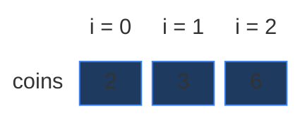

We use this example in every section below. It is small (a `3 × 8` grid), it reuses a coin (`2` twice), it has a target that the first coin alone cannot make (odd numbers with only 2s), it has a repeated subproblem, and it is an example where the "greedy" idea fails (Section 2).

### Constraints

From LeetCode (in my notes):

- `1 <= coins.length <= 12`
- `1 <= coins[i] <= 2^31 - 1`
- `0 <= amount <= 10^4`

Two things to notice:

- A coin can be much bigger than `amount` (up to about 2 billion). Such a coin can never be taken. Every "take" must check `coins[ind] <= target` first.
- `amount` can be `0`. The answer is then `0` coins, not `-1`.

### What the constraints tell us (simple theory)

A **constraint** is the biggest input the judge will ever give you. It quietly tells you how fast your code must be.

**Rule of thumb:** a computer does about **100 million (10^8) simple steps per second**. Count how many steps your idea needs for the biggest input, and compare.

| Biggest input `n` | Steps you can afford | Ideas that fit |
|:---:|:---:|:---|
| up to ~20 | about `2^n` | Plain recursion, try everything |
| up to ~500 | about `n^3` | Three nested loops |
| up to ~5,000 | about `n^2` | Two nested loops |
| up to ~1,000,000 | about `n` or `n log n` | One loop, DP over `n` states |

**For this problem:** there are at most `12` coins and `amount` is at most `10,000`.

- Plain recursion tries every way to build the amount. Because a coin can be taken again and again, the tree is not `12` levels deep but up to `10,000` levels deep. With only 12 coins and amount 60 it already makes **783,718** calls (chart below). For amount 10,000 the count is astronomically large. Impossible.
- The DP fills a grid of `n × (amount + 1) = 12 × 10,001 = 120,012` cells, each in `O(1)`. That is about **0.1 million** steps. It runs in a few milliseconds.

The key: the input has two sizes, `n` and `amount`. The DP work is their **product** `n · amount`.

**How the work grows as `n` grows**

Here `coins = [1, 2, ..., n]` and `amount = 5n`. Red bars = calls made by plain recursion. Green line = cells in the DP grid, `n · (amount + 1)` (it stays flat near zero).

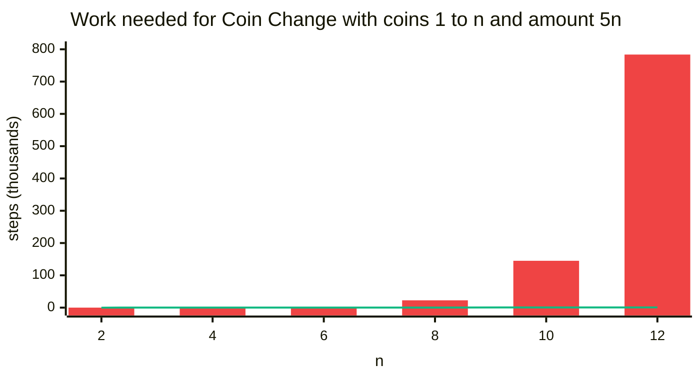

| `n` | `amount` | Recursion calls | DP cells `n · (amount + 1)` |
|:---:|:---:|:---:|:---:|
| 2 | 10 | 12 | 22 |
| 4 | 20 | 246 | 84 |
| 6 | 30 | 2,791 | 186 |
| 8 | 40 | 22,593 | 328 |
| 10 | 50 | 145,057 | 510 |
| 12 | 60 | 783,718 | 732 |

For the tiniest input the recursion is even a bit cheaper (12 calls against 22 cells). But every step to the right multiplies the recursion by about 5 to 20, while the DP grid only grows a little. Every number here was counted by running the code.

## 2. Core Theory

This note builds on [Subset Sum Equal To K](01.%20Subset%20Sum%20Equal%20To%20K.md), which teaches 2-D DP from zero (the `(ind, target)` state, the grid, pick / not pick). Here we add **one new idea**: a coin can be used again and again.

### What the problem really asks

My notes say it in one line: **try all combinations, and take the combination that has the minimum number of coins.** Two words matter:

- **combination:** the order of coins does not matter. `2 + 2 + 3` and `3 + 2 + 2` are the same.
- **minimum:** we want the smallest count, so we combine choices with `min`, not with `OR` like in Subset Sum.

### Why greedy fails

**Greedy** means: always grab the biggest coin that still fits, and never look back. It feels right, because big coins cover the amount faster.

On the board example `{1, 2, 3}`, `target = 7`, greedy works (from my notes):

- `7 / 3 = 2` → take two 3s, `1` is left.
- `1 / 2 = 0` → no 2s.
- `1 / 1 = 1` → one 1. Total `2 + 0 + 1 = 3` coins. Correct.

**Where does greedy fail?** My notes: `coins = {9, 6, 5, 1}`, `target = 11`.

- Greedy: `11 / 9 = 1` → one 9, `2` is left. `2 / 1 = 2` → two 1s. That is `{9, 1, 1}` = **3 coins**.
- Best: `{6, 5}` = **2 coins**.

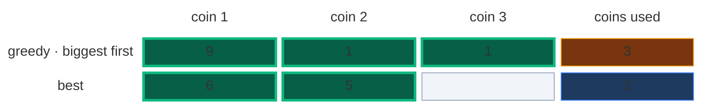

On our example it is even worse. Greedy takes `6`, then `1` is left and no coin fits. Greedy gets **stuck** and says `-1`, but `2 + 2 + 3` works with 3 coins.

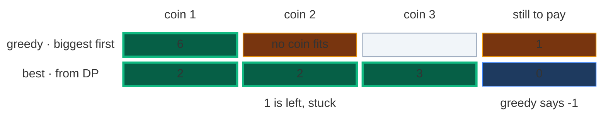

Greedy only works when the coin values have a special **uniformity** (my notes' word), like real money: `1, 2, 5, 10, 20, ...`. For random coin values there is no such guarantee. So we must try **all** combinations, and that means recursion, and then DP. Here is greedy as code. We only keep it to show (in the tests) that it gives wrong answers.

```python
# Imports used by every code block in this note
from typing import List

# For the recursion limit and the tests
import sys

# For random tests at the end
import random

# "Impossible" marker: bigger than any real coin count
INF = float('inf')


# Greedy (WRONG in general): always take the biggest coin that fits
class SolutionGreedy:

    # Same name as LeetCode
    def coinChange(self, coins: List[int], amount: int) -> int:

        # Coins taken so far
        count = 0

        # Look at coins from biggest to smallest
        for coin in sorted(coins, reverse=True):

            # Take this coin as many times as it fits
            count += amount // coin

            # What is still left to pay
            amount %= coin

        # Something left that no coin could pay: greedy is stuck
        if amount != 0:
            return -1

        # Greedy's count (not always the minimum)
        return count
```

### How to spot that it is DP

| Property | Plain meaning | In Coin Change |
|:---|:---|:---|
| **Overlapping subproblems** | The same smaller question is asked many times | "Fewest coins to make 1 using `[2, 3]`?" is asked twice in our example (Section 4) |
| **Optimal substructure** | The big answer is built from answers of smaller questions | The best way to pay 7 = one coin + the best way to pay the rest |

Also: "fewest / minimum" + "choose items" + "a target sum" is the classic sign of DP on subsequences.

### The 3 rules (Striver's recipe from my notes)

1. **Express** everything in terms of `(ind, T)`: `f(ind, T)`.
2. **Express all possibilities:** take the coin, or do not take the coin.
3. **Min of all:** return the smaller of the two.

### The state: two numbers again

> `f(ind, T)` = "the **minimum number of coins** needed to make exactly `T`, using only the coins `coins[0], coins[1], ..., coins[ind]` (each as many times as you like)". If it cannot be done, the answer is `∞` (infinity).

- `ind` = which coin types are still allowed.
- `T` = how much money is still left to pay.

We start with `f(n - 1, amount)`: all coins allowed, the full amount to pay. For our example that is `f(2, 7)`. My notes picture the array `0 ... n-1` and start at the right end with `f(n - 1, T)`.

The grid has one row per coin and one column per target:

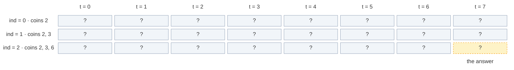

### The new idea: infinite supply, so "take" stays on the same index

In Subset Sum (0/1), every element is used **at most once**. After picking `arr[ind]` we moved to `ind - 1`, because that element was used up.

Here the supply is **infinite**. After taking one coin of value `3`, the jar still has more 3s. We might want another 3! So after taking, we **stay on the same index**:

```text
not take = 0 + f(ind - 1, T)                     # skip this coin type for good, nothing added
take     = 1 + f(ind, T - coins[ind])            # use one coin (+1), STAY on ind
           only if coins[ind] <= T
f(ind, T) = min(take, not take)
```

My notes' board picture: coin `3`, target `8`. Take a 3 → target `5`, still on the 3. Take a 3 again → target `2`, still on the 3. Now `3 > 2`, so we cannot take it any more, and only then we "not take" and move left. Staying on `ind` is how the same coin gets used many times (**infinite supply = multiple use**).

Why does "not take" add `0` and "take" add `1`? We are **counting coins**. Skipping a coin type puts no coin in your hand. Taking one puts exactly one coin in your hand.

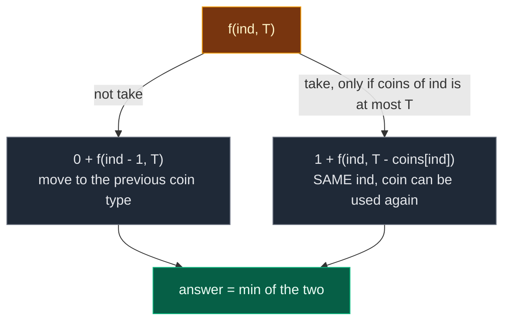

**In the grid, the difference is one row.** Take the cell `[1][6]` (coin 3, target 6). Both versions read the cell straight up for "skip". But for "take":

0/1 (Subset Sum, 0/1 Knapsack): pick reads the **row above**, 3 columns left. The 3 is gone after one use.

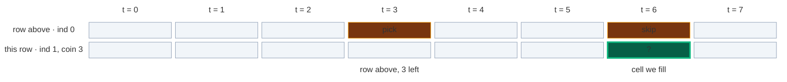

Unbounded (this problem): take reads the **same row**, 3 columns left. That cell may itself already contain a 3, so the 3 can be used again.

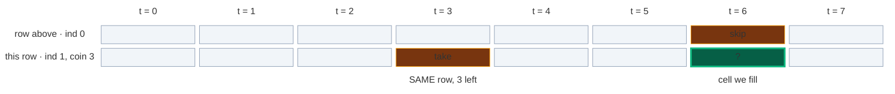

**Key difference vs 0/1 Knapsack (from my notes):**

| Feature | 0/1 Knapsack / Subset Sum | Coin Change |
|:---|:---:|:---:|
| Take again? | No | Yes |
| After taking, go to | `ind - 1` | `ind` (same) |
| In the grid, take reads | the row above | the same row |
| One-array loop direction | backward (right to left) | forward (left to right) |
| Goal | max value / true-false | min coins |

### Base cases

| Base case | Answer | Why |
|:---|:---:|:---|
| `ind == 0` and `T % coins[0] == 0` | `T // coins[0]` | Only the first coin is left. It can be used many times. If it divides `T` exactly, we need `T / coins[0]` of them |
| `ind == 0` and `T % coins[0] != 0` | `∞` (`1e9` in C++/Java) | The first coin alone can never make `T`. "Impossible" |

My notes' example: only coin `4` is left and the target is `12`. `12 % 4 == 0`, so we need `12 / 4 = 3` coins. In words: the base case returns "the min number of coins that you will take to achieve this target `T`".

On our example: only coin `2`. Target 6 → `6 / 2 = 3` coins. Target 7 → `7 % 2 = 1`, not 0 → `∞`.

**Why infinity, and why not `INT_MAX`?** Infinity means "impossible", and `min` will never pick it while a real answer exists. In C++ or Java, my notes use `1e9` and **not** `INT_MAX`: the code does `1 + f(...)`, and `1 + INT_MAX` overflows to a negative number, which `min` would happily pick. `1e9` is far bigger than any real coin count (at most `10^4`) and `1 + 1e9` is still safe. In Python, `float('inf')` is safe: `1 + inf` is still `inf`.

**Why no `T == 0` base case?** It is not needed. `f(ind, 0)` keeps "not taking" (no coin fits in 0) until it reaches `f(0, 0)`, and `0 % coins[0] == 0`, so it returns `0 // coins[0] = 0`. Zero coins for zero money. Correct.

**The final answer:** if `f(n - 1, amount)` is still `∞`, nothing works, so return `-1`. Otherwise return the number.

### Two ways to remember: memoization vs tabulation

| | Memoization | Tabulation |
|:---|:---|:---|
| Other name | **Top-down** | **Bottom-up** |
| Direction | Start from `f(n - 1, amount)`, go down to the base cases, come back up | Start from row 0 (base cases), fill row by row down to `[n - 1][amount]` |
| How | Recursion + a 2-D table of `-1` | Two nested loops + a 2-D table |
| Computes | Only the cells it needs | Every cell |
| Stack | Recursion stack, depth up to `amount + n` | No recursion stack |

### The 4-step ladder

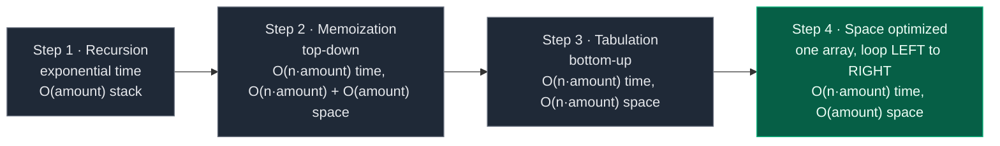

## 3. Edge Cases

| Case | Input | Expected | Why it matters |
|:---|:---:|:---:|:---|
| Amount 0 | `coins = [1]`, `amount = 0` | `0` | Zero coins, not `-1`. Base case gives `0 // coins[0] = 0` |
| Impossible | `coins = [2]`, `amount = 3` | `-1` | Base case returns `∞`, turned into `-1` at the end |
| Coin bigger than amount | `coins = [2147483647, 2]`, `amount = 4` | `2` | The take branch must check `coins[ind] <= T` |
| Only one coin, divides | `coins = [5]`, `amount = 15` | `3` | Pure base case: `15 // 5` |
| Greedy fails (gets stuck) | `coins = [2, 3, 6]`, `amount = 7` | `3` | Greedy takes 6 and is stuck with 1 |
| Greedy fails (too many coins) | `coins = [9, 6, 5, 1]`, `amount = 11` | `2` | Greedy gives `9 + 1 + 1` = 3 |
| Coins not sorted | `coins = [5, 1, 2]`, `amount = 11` | `3` | The DP never needs sorted coins |
| Same coin many times | `coins = [3]`, `amount = 6` | `2` | Infinite supply: `3 + 3` |
| Biggest input | 12 coins, `amount = 10^4` | – | Python memoization needs a higher recursion limit (Section 5) |

## 4. Approach 1: Recursion

### Idea

Write the recurrence as code. Start with `f(n - 1, amount)`. At `ind == 0`, use the base case. Otherwise try "not take" and "take" and return the smaller one. At the very end, turn `∞` into `-1`.

### Recursion tree for `coins = [2, 3, 6]`, `amount = 7`

Every box shows the call and what it returns. Calls happen depth-first, "not take" first (like the code). Look at the **take** edges: they keep the same first number (`ind`). Only the target shrinks.

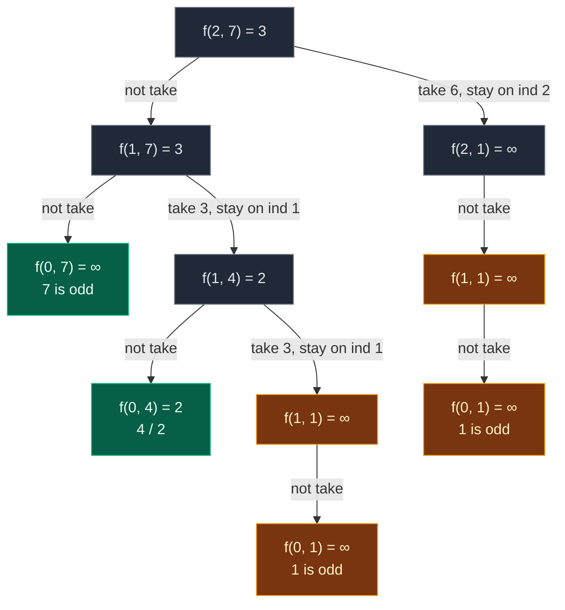

Gold = repeated work. Green = base cases that are not repeated.

`f(1, 1)` and `f(2, 1)` have only one child: the coin (`3` or `6`) is bigger than the target `1`, so "take" is not allowed.

| State | Times computed |
|:---|:---:|
| `f(2, 7)`, `f(1, 7)`, `f(2, 1)`, `f(1, 4)` | 1 each |
| **`f(1, 1)`** | **2** |
| **`f(0, 1)`** | **2** (inside each `f(1, 1)`) |
| `f(0, 7)`, `f(0, 4)` | 1 each |

That is **10 calls**. `f(1, 1)` is the overlapping subproblem: "fewest coins to make 1 with `[2, 3]`?" It is reached by "take 3, take 3 from 7" and by "take 6 from 7". Both paths leave `1` to pay.

The answer path: `f(2, 7)` → not take 6 → `f(1, 7)` → take 3 → `f(1, 4)` → not take 3 → `f(0, 4)` = two 2s. Coins used: `3 + 2 + 2 = 7`, that is **3 coins**.

**The exact order of calls.** One participant per coin row (`ind`). An arrow from a participant **to itself** is a "take": the call stays on the same index.

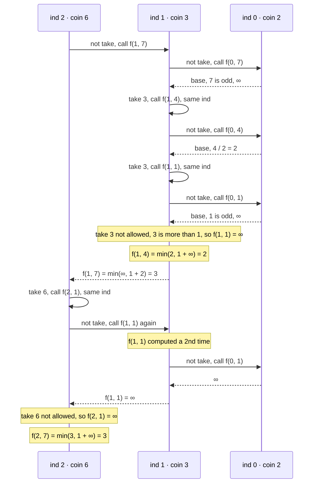

**The board tree from my notes:** `coins = {1, 2, 3}`, `target = 8`. Striver circled the repeats on the board. Counted by code: **23 calls**, and `f(1, 2)`, `f(0, 2)`, `f(1, 0)`, `f(0, 0)` are each computed twice. Answer `3` (`3 + 3 + 2`).

**The working example from my notes:** `coins = [1, 2, 3]`, `target = 7`. Call `solve(2, 7)`. At coin 3: not take → `solve(1, 7)`, take → `1 + solve(2, 4)`. From `solve(2, 4)`: take again → `1 + solve(2, 1)`. Eventually: `3 + 3 + 1` → **3 coins**. (19 calls, counted by code.)

### Code

```python
# Plain recursion
class SolutionRecursion:

    # Helper: fewest coins to make target using coins[0..index]
    def solve(self, index: int, target: int, coins: List[int]) -> float:

        # Base case: only the first coin is left
        if index == 0:

            # It divides target exactly: use it target // coins[0] times
            if target % coins[0] == 0:
                return target // coins[0]

            # It can never make target: impossible
            return INF

        # Not take: move to the previous coin type, add no coin
        not_take = 0 + self.solve(index - 1, target, coins)

        # Take starts as impossible (not allowed yet)
        take = INF

        # Take only if this coin fits in target
        if coins[index] <= target:

            # Use one coin (+1) and STAY on the same index (infinite supply)
            take = 1 + self.solve(index, target - coins[index], coins)

        # The better of the two choices
        return min(take, not_take)

    # Main method (same name as LeetCode)
    def coinChange(self, coins: List[int], amount: int) -> int:

        # Start from the last coin and the full amount
        ans = self.solve(len(coins) - 1, amount, coins)

        # Infinity means no combination works
        return -1 if ans == INF else ans
```

### Complexity

| Measure | Complexity | Why |
|:---|:---:|:---|
| **Time** | exponential, much more than `O(2^n)` | In 0/1 problems the tree is `n` levels deep, so at most about `2^n` calls. Here "take" stays on the same index, so a path can be up to `amount` levels long. My notes write it as `>> O(2^n)` (the summary in my notes also writes `O(2^n · target)`). Either way: exponential |
| **Space** | `O(amount)` | Recursion stack. It is **not** `O(n)`: with a coin of value 1, "take" can repeat `amount` times on the same index, and every take is one more stack frame. So the deepest path is about `amount + n` calls, which is `O(target)` |

## 5. Approach 2: Memoization (Top-Down)

### Idea

Same states `(ind, target)` repeat (from my notes: "Why? Same states repeat."). Store each answer the first time in a 2-D table `dp[ind][target]`, and reuse it.

| Value | Meaning |
|:---:|:---|
| `-1` | Not computed yet |
| `∞` | Computed, and it is impossible |
| any other number | Computed, the fewest coins |

Note that "impossible" is stored as `∞`, **not** as `-1`. If we stored `-1` for "impossible", the table could not tell "impossible" apart from "not computed yet", and every impossible state would be solved again and again.

**Size of the table.** `ind` goes from `0` to `n - 1` (`n` rows). `target` goes from `0` to `amount` (`amount + 1` columns). So `dp` is `n × (amount + 1)`.

The same **3 steps** as always:

1. **Declare** `dp` with `n` rows and `amount + 1` columns, filled with `-1`.
2. **Store** the answer before returning: `dp[ind][target] = min(take, not_take)`.
3. **Check** first: if `dp[ind][target] != -1`, return it and make no new calls.

Base-case cells (row 0) are never stored: the `ind == 0` check answers them before the table is looked at (same as the code in my notes). So row 0 stays `-1`.

**Python only:** the recursion can go about `amount + n` calls deep (Section 4). With `amount = 10^4` that is far above Python's default limit of 1000, and Python raises `RecursionError`. Fix: `sys.setrecursionlimit(...)`, or use tabulation, which has no recursion.

### Visual: when each `dp[ind][target]` gets filled

Colours: grey = `-1` (not computed), dashed yellow = computing (waiting for its children), green = just filled, blue = filled earlier, orange = cache hit.

**Start:** `dp` is `3 × 8`, all `-1`.

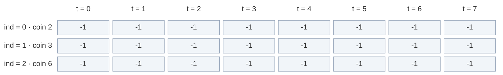

**Calls go down:** `f(2, 7)` → `-1`, compute. Not take → `f(1, 7)` → `-1`, compute. Its "not take" `f(0, 7)` is a base case (`∞`). Its "take 3" → `f(1, 4)` → `-1`, compute. Its "not take" `f(0, 4)` is a base case (`2`). Its "take 3" → `f(1, 1)` → `-1`, compute. Four calls are now waiting, two of them on the **same row** (take stays on `ind = 1`).

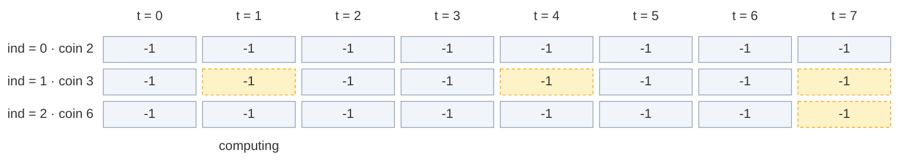

**Fill 1:** `f(1, 1)` asks `f(0, 1)` (base, 1 is odd → `∞`). Take 3 is not allowed (`3 > 1`). `min(∞, ∞) = ∞`. Store `dp[1][1] = ∞`.

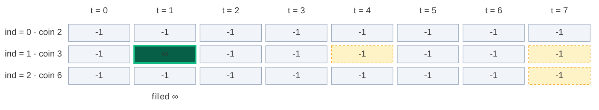

**Fill 2:** back in `f(1, 4)`: `min(not take 2, take 1 + ∞) = 2`. Store `dp[1][4] = 2`.

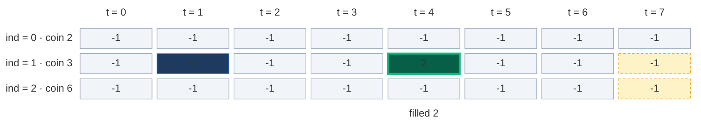

**Fill 3:** back in `f(1, 7)`: `min(not take ∞, take 1 + 2) = 3`. Store `dp[1][7] = 3`.

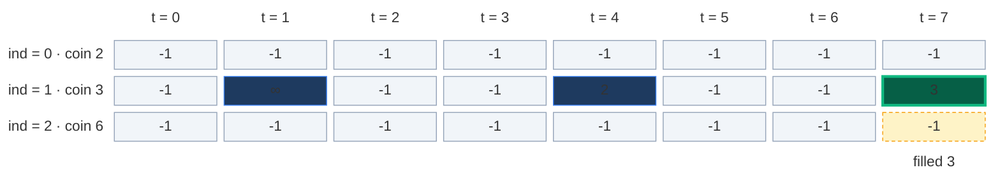

**Cache hit:** `f(2, 7)` now tries "take 6" → `f(2, 1)` → `-1`, compute. Its "not take" asks `f(1, 1)`. `dp[1][1] = ∞`, not `-1` → return `∞`, **no new calls**. The call to `f(0, 1)` below it is skipped.

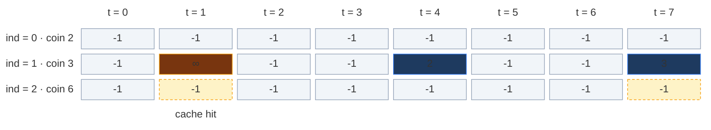

**Fill 4:** `f(2, 1)`: take 6 is not allowed (`6 > 1`). `min(∞, ∞) = ∞`. Store `dp[2][1] = ∞`.

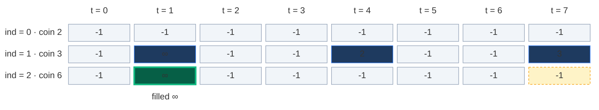

**Fill 5:** `f(2, 7) = min(not take 3, take 1 + ∞) = 3`. Store `dp[2][7] = 3`. That is the answer.

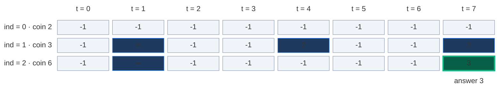

Only 5 of the 24 cells were ever stored. Memoization computes **only the states it needs**.

### The pruned recursion tree

Same tree, but the cache hit (dashed) stops right away.

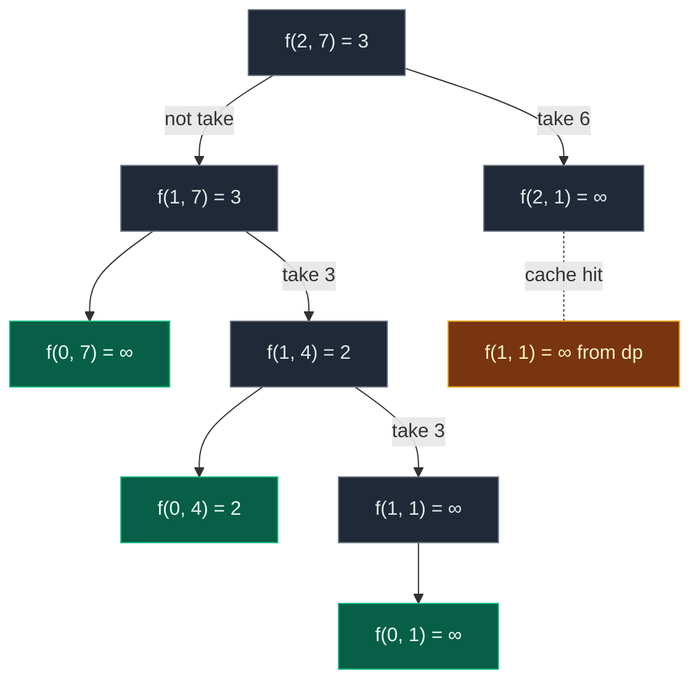

**9 calls** instead of 10. A small saving because the example is tiny. On bigger inputs the saving is huge: at most `n · (amount + 1)` states are ever computed (for 12 coins and amount 60: 732 states instead of 783,718 calls).

### Code

```python
# Memoization (top-down DP) with a 2-D table of -1
class SolutionMemo:

    # Helper: fewest coins to make target using coins[0..index], uses dp
    def solve(self, index: int, target: int, coins: List[int], dp: List[List[float]]) -> float:

        # Base case: only the first coin is left
        if index == 0:

            # It divides target exactly
            if target % coins[0] == 0:
                return target // coins[0]

            # It can never make target
            return INF

        # Step 3 (check): already solved this (index, target)? Reuse it
        if dp[index][target] != -1:
            return dp[index][target]

        # Not take: previous coin type, no coin added
        not_take = 0 + self.solve(index - 1, target, coins, dp)

        # Take starts as impossible
        take = INF

        # Take only if this coin fits
        if coins[index] <= target:

            # One coin, same index (infinite supply)
            take = 1 + self.solve(index, target - coins[index], coins, dp)

        # Step 2 (store): the better choice
        dp[index][target] = min(take, not_take)

        # Return it
        return dp[index][target]

    # Main method (same name as LeetCode)
    def coinChange(self, coins: List[int], amount: int) -> int:

        # Number of coin types
        n = len(coins)

        # Python only: the stack can be about amount + n calls deep
        sys.setrecursionlimit(max(1000, amount + n + 100))

        # Step 1 (declare): n rows, amount + 1 columns, -1 means not solved yet
        dp = [[-1] * (amount + 1) for _ in range(n)]

        # Keep the table so we can look at it after the run
        self.dp = dp

        # Start from the last coin and the full amount
        ans = self.solve(n - 1, amount, coins, dp)

        # Infinity means impossible
        return -1 if ans == INF else ans
```

### Complexity

| Measure | Complexity | Why |
|:---|:---:|:---|
| **Time** | `O(n · amount)` | At most `n · (amount + 1)` different states, each solved once with `O(1)` work |
| **Space: dp table** | `O(n · amount)` | `n` rows × `amount + 1` columns |
| **Space: recursion stack** | `O(amount)` | "Take" stays on the same index, so the deepest path is about `amount + n` calls |
| **Total space** | `O(n · amount) + O(amount)` | Table plus stack (my notes: `O(N×T) + O(T)`) |

## 6. Approach 3: Tabulation (Bottom-Up)

### Idea

Fill the whole grid with two loops, from row 0 (only the first coin) down to the answer `[n - 1][amount]`. No recursion, so no stack.

`dp[i][t]` = "the minimum number of coins to make `t` using coins `0..i`" (my notes).

### How to convert memo → table, step by step

My notes write the conversion in 3 steps: **(1) base case, (2) `ind` from 1 → n-1 and `tar` from 0 → T, (3) copy the recurrence.** In full:

1. **Same grid:** `dp` with `n` rows and `amount + 1` columns (my notes: `dp[n][tar + 1]`), all `∞`.
2. **Base case becomes row 0:** for every `T` from `0` to `amount`: if `T % coins[0] == 0`, then `dp[0][T] = T // coins[0]`, else it stays `∞`.
3. **Two nested loops, in the opposite direction:** the recursion went `n - 1 → 0`. Reverse it: `ind` from `1` to `n - 1`, and inside, `target` from `0` to `amount`. The inner loop must go **left to right**: "take" reads a cell on the left in the same row, so that cell must already be filled.
4. **Copy the recurrence:** replace `f(...)` with `dp[...]`:
   - `not_take = dp[ind - 1][target]` (row above)
   - `take = 1 + dp[ind][target - coins[ind]]` if `coins[ind] <= target` (**same row!**)
   - `dp[ind][target] = min(take, not_take)`
5. **Answer:** `dp[n - 1][amount]`, or `-1` if it is `∞`.

| Memoization | Becomes in tabulation |
|:---|:---|
| `dp[n][amount + 1]` with `-1` | `dp[n][amount + 1]` with `∞` |
| `if ind == 0: return T // coins[0] or ∞` | Row 0 filled by a loop over `T` |
| `f(n - 1, amount)` going down | Loops `ind = 1 .. n - 1`, `target = 0 .. amount` going up |
| `f(ind - 1, target)` | `dp[ind - 1][target]` |
| `f(ind, target - coins[ind])` | `dp[ind][target - coins[ind]]` (same row) |
| `return f(n - 1, amount)` | `return dp[n - 1][amount]` |

**Picture rule (my notes: "SAME ROW, because unlimited coins"):** to fill a cell, look **straight up** (not take) and **in the same row, `coins[ind]` steps to the left**, plus one coin (take). Write the smaller.

### Visual table fill (`coins = [2, 3, 6]`, `amount = 7`)

Colours: green = just filled, orange = the cells it reads, blue = filled earlier, grey `?` = not filled yet. The label under the new cell is `min(up, 1 + left)`.

**Start: base case row.** Only coin 2: even targets need `t / 2` coins, odd targets are `∞`.

```mermaid
block-beta
  columns 9
  hx[" "] h0["t = 0"] h1["t = 1"] h2["t = 2"] h3["t = 3"] h4["t = 4"] h5["t = 5"] h6["t = 6"] h7["t = 7"]
  l0["ind = 0 · coin 2"] r0c0["0"] r0c1["∞"] r0c2["1"] r0c3["∞"] r0c4["2"] r0c5["∞"] r0c6["3"] r0c7["∞"]
  l1["ind = 1 · coin 3"] r1c0["?"] r1c1["?"] r1c2["?"] r1c3["?"] r1c4["?"] r1c5["?"] r1c6["?"] r1c7["?"]
  l2["ind = 2 · coin 6"] r2c0["?"] r2c1["?"] r2c2["?"] r2c3["?"] r2c4["?"] r2c5["?"] r2c6["?"] r2c7["?"]
  space m0["0 / 2"] m1["odd"] m2["2 / 2"] m3["odd"] m4["4 / 2"] m5["odd"] m6["6 / 2"] m7["odd"]
  classDef head fill:none,stroke:none,color:#64748b
  class hx,h0,h1,h2,h3,h4,h5,h6,h7,l0,l1,l2 head
  classDef new fill:#065f46,stroke:#10b981,color:#ecfdf5,stroke-width:3px
  class r0c0,r0c1,r0c2,r0c3,r0c4,r0c5,r0c6,r0c7 new
  classDef empty fill:#f1f5f9,stroke:#94a3b8,color:#64748b
  class r1c0,r1c1,r1c2,r1c3,r1c4,r1c5,r1c6,r1c7,r2c0,r2c1,r2c2,r2c3,r2c4,r2c5,r2c6,r2c7 empty
  classDef note fill:none,stroke:none,color:#b45309
  class m0,m1,m2,m3,m4,m5,m6,m7 note
```

#### Row 1 (`coins[1] = 3`), cell by cell

**`dp[1][0]`:** not take = `dp[0][0] = 0`. Take: `3 > 0`, not allowed. Result `0`.

```mermaid
block-beta
  columns 9
  hx[" "] h0["t = 0"] h1["t = 1"] h2["t = 2"] h3["t = 3"] h4["t = 4"] h5["t = 5"] h6["t = 6"] h7["t = 7"]
  l0["ind = 0 · coin 2"] r0c0["0"] r0c1["∞"] r0c2["1"] r0c3["∞"] r0c4["2"] r0c5["∞"] r0c6["3"] r0c7["∞"]
  l1["ind = 1 · coin 3"] r1c0["0"] r1c1["?"] r1c2["?"] r1c3["?"] r1c4["?"] r1c5["?"] r1c6["?"] r1c7["?"]
  l2["ind = 2 · coin 6"] r2c0["?"] r2c1["?"] r2c2["?"] r2c3["?"] r2c4["?"] r2c5["?"] r2c6["?"] r2c7["?"]
  space m0["min(0, none)"] space space space space space space space
  classDef head fill:none,stroke:none,color:#64748b
  class hx,h0,h1,h2,h3,h4,h5,h6,h7,l0,l1,l2 head
  classDef read fill:#78350f,stroke:#f59e0b,color:#fef3c7
  class r0c0 read
  classDef done fill:#1e3a5f,stroke:#3b82f6,color:#dbeafe
  class r0c1,r0c2,r0c3,r0c4,r0c5,r0c6,r0c7 done
  classDef new fill:#065f46,stroke:#10b981,color:#ecfdf5,stroke-width:3px
  class r1c0 new
  classDef empty fill:#f1f5f9,stroke:#94a3b8,color:#64748b
  class r1c1,r1c2,r1c3,r1c4,r1c5,r1c6,r1c7,r2c0,r2c1,r2c2,r2c3,r2c4,r2c5,r2c6,r2c7 empty
  classDef note fill:none,stroke:none,color:#b45309
  class m0 note
```

**`dp[1][1]`:** not take = `dp[0][1] = ∞`. Take: `3 > 1`, not allowed. Result `∞`.

```mermaid
block-beta
  columns 9
  hx[" "] h0["t = 0"] h1["t = 1"] h2["t = 2"] h3["t = 3"] h4["t = 4"] h5["t = 5"] h6["t = 6"] h7["t = 7"]
  l0["ind = 0 · coin 2"] r0c0["0"] r0c1["∞"] r0c2["1"] r0c3["∞"] r0c4["2"] r0c5["∞"] r0c6["3"] r0c7["∞"]
  l1["ind = 1 · coin 3"] r1c0["0"] r1c1["∞"] r1c2["?"] r1c3["?"] r1c4["?"] r1c5["?"] r1c6["?"] r1c7["?"]
  l2["ind = 2 · coin 6"] r2c0["?"] r2c1["?"] r2c2["?"] r2c3["?"] r2c4["?"] r2c5["?"] r2c6["?"] r2c7["?"]
  space space m1["min(∞, none)"] space space space space space space
  classDef head fill:none,stroke:none,color:#64748b
  class hx,h0,h1,h2,h3,h4,h5,h6,h7,l0,l1,l2 head
  classDef done fill:#1e3a5f,stroke:#3b82f6,color:#dbeafe
  class r0c0,r0c2,r0c3,r0c4,r0c5,r0c6,r0c7,r1c0 done
  classDef read fill:#78350f,stroke:#f59e0b,color:#fef3c7
  class r0c1 read
  classDef new fill:#065f46,stroke:#10b981,color:#ecfdf5,stroke-width:3px
  class r1c1 new
  classDef empty fill:#f1f5f9,stroke:#94a3b8,color:#64748b
  class r1c2,r1c3,r1c4,r1c5,r1c6,r1c7,r2c0,r2c1,r2c2,r2c3,r2c4,r2c5,r2c6,r2c7 empty
  classDef note fill:none,stroke:none,color:#b45309
  class m1 note
```

**`dp[1][2]`:** not take = `dp[0][2] = 1`. Take: `3 > 2`, not allowed. Result `1`.

```mermaid
block-beta
  columns 9
  hx[" "] h0["t = 0"] h1["t = 1"] h2["t = 2"] h3["t = 3"] h4["t = 4"] h5["t = 5"] h6["t = 6"] h7["t = 7"]
  l0["ind = 0 · coin 2"] r0c0["0"] r0c1["∞"] r0c2["1"] r0c3["∞"] r0c4["2"] r0c5["∞"] r0c6["3"] r0c7["∞"]
  l1["ind = 1 · coin 3"] r1c0["0"] r1c1["∞"] r1c2["1"] r1c3["?"] r1c4["?"] r1c5["?"] r1c6["?"] r1c7["?"]
  l2["ind = 2 · coin 6"] r2c0["?"] r2c1["?"] r2c2["?"] r2c3["?"] r2c4["?"] r2c5["?"] r2c6["?"] r2c7["?"]
  space space space m2["min(1, none)"] space space space space space
  classDef head fill:none,stroke:none,color:#64748b
  class hx,h0,h1,h2,h3,h4,h5,h6,h7,l0,l1,l2 head
  classDef done fill:#1e3a5f,stroke:#3b82f6,color:#dbeafe
  class r0c0,r0c1,r0c3,r0c4,r0c5,r0c6,r0c7,r1c0,r1c1 done
  classDef read fill:#78350f,stroke:#f59e0b,color:#fef3c7
  class r0c2 read
  classDef new fill:#065f46,stroke:#10b981,color:#ecfdf5,stroke-width:3px
  class r1c2 new
  classDef empty fill:#f1f5f9,stroke:#94a3b8,color:#64748b
  class r1c3,r1c4,r1c5,r1c6,r1c7,r2c0,r2c1,r2c2,r2c3,r2c4,r2c5,r2c6,r2c7 empty
  classDef note fill:none,stroke:none,color:#b45309
  class m2 note
```

**`dp[1][3]`:** not take = `dp[0][3] = ∞`. Take = `1 + dp[1][0] = 1 + 0 = 1` (same row, 3 to the left). Result `1`. (One 3.)

```mermaid
block-beta
  columns 9
  hx[" "] h0["t = 0"] h1["t = 1"] h2["t = 2"] h3["t = 3"] h4["t = 4"] h5["t = 5"] h6["t = 6"] h7["t = 7"]
  l0["ind = 0 · coin 2"] r0c0["0"] r0c1["∞"] r0c2["1"] r0c3["∞"] r0c4["2"] r0c5["∞"] r0c6["3"] r0c7["∞"]
  l1["ind = 1 · coin 3"] r1c0["0"] r1c1["∞"] r1c2["1"] r1c3["1"] r1c4["?"] r1c5["?"] r1c6["?"] r1c7["?"]
  l2["ind = 2 · coin 6"] r2c0["?"] r2c1["?"] r2c2["?"] r2c3["?"] r2c4["?"] r2c5["?"] r2c6["?"] r2c7["?"]
  space space space space m3["min(∞, 1 + 0)"] space space space space
  classDef head fill:none,stroke:none,color:#64748b
  class hx,h0,h1,h2,h3,h4,h5,h6,h7,l0,l1,l2 head
  classDef done fill:#1e3a5f,stroke:#3b82f6,color:#dbeafe
  class r0c0,r0c1,r0c2,r0c4,r0c5,r0c6,r0c7,r1c1,r1c2 done
  classDef read fill:#78350f,stroke:#f59e0b,color:#fef3c7
  class r0c3,r1c0 read
  classDef new fill:#065f46,stroke:#10b981,color:#ecfdf5,stroke-width:3px
  class r1c3 new
  classDef empty fill:#f1f5f9,stroke:#94a3b8,color:#64748b
  class r1c4,r1c5,r1c6,r1c7,r2c0,r2c1,r2c2,r2c3,r2c4,r2c5,r2c6,r2c7 empty
  classDef note fill:none,stroke:none,color:#b45309
  class m3 note
```

**`dp[1][4]`:** not take = `dp[0][4] = 2`. Take = `1 + dp[1][1] = 1 + ∞ = ∞`. Result `2`. (Two 2s.)

```mermaid
block-beta
  columns 9
  hx[" "] h0["t = 0"] h1["t = 1"] h2["t = 2"] h3["t = 3"] h4["t = 4"] h5["t = 5"] h6["t = 6"] h7["t = 7"]
  l0["ind = 0 · coin 2"] r0c0["0"] r0c1["∞"] r0c2["1"] r0c3["∞"] r0c4["2"] r0c5["∞"] r0c6["3"] r0c7["∞"]
  l1["ind = 1 · coin 3"] r1c0["0"] r1c1["∞"] r1c2["1"] r1c3["1"] r1c4["2"] r1c5["?"] r1c6["?"] r1c7["?"]
  l2["ind = 2 · coin 6"] r2c0["?"] r2c1["?"] r2c2["?"] r2c3["?"] r2c4["?"] r2c5["?"] r2c6["?"] r2c7["?"]
  space space space space space m4["min(2, 1 + ∞)"] space space space
  classDef head fill:none,stroke:none,color:#64748b
  class hx,h0,h1,h2,h3,h4,h5,h6,h7,l0,l1,l2 head
  classDef done fill:#1e3a5f,stroke:#3b82f6,color:#dbeafe
  class r0c0,r0c1,r0c2,r0c3,r0c5,r0c6,r0c7,r1c0,r1c2,r1c3 done
  classDef read fill:#78350f,stroke:#f59e0b,color:#fef3c7
  class r0c4,r1c1 read
  classDef new fill:#065f46,stroke:#10b981,color:#ecfdf5,stroke-width:3px
  class r1c4 new
  classDef empty fill:#f1f5f9,stroke:#94a3b8,color:#64748b
  class r1c5,r1c6,r1c7,r2c0,r2c1,r2c2,r2c3,r2c4,r2c5,r2c6,r2c7 empty
  classDef note fill:none,stroke:none,color:#b45309
  class m4 note
```

**`dp[1][5]`:** not take = `dp[0][5] = ∞`. Take = `1 + dp[1][2] = 1 + 1 = 2`. Result `2`. (`3 + 2`.)

```mermaid
block-beta
  columns 9
  hx[" "] h0["t = 0"] h1["t = 1"] h2["t = 2"] h3["t = 3"] h4["t = 4"] h5["t = 5"] h6["t = 6"] h7["t = 7"]
  l0["ind = 0 · coin 2"] r0c0["0"] r0c1["∞"] r0c2["1"] r0c3["∞"] r0c4["2"] r0c5["∞"] r0c6["3"] r0c7["∞"]
  l1["ind = 1 · coin 3"] r1c0["0"] r1c1["∞"] r1c2["1"] r1c3["1"] r1c4["2"] r1c5["2"] r1c6["?"] r1c7["?"]
  l2["ind = 2 · coin 6"] r2c0["?"] r2c1["?"] r2c2["?"] r2c3["?"] r2c4["?"] r2c5["?"] r2c6["?"] r2c7["?"]
  space space space space space space m5["min(∞, 1 + 1)"] space space
  classDef head fill:none,stroke:none,color:#64748b
  class hx,h0,h1,h2,h3,h4,h5,h6,h7,l0,l1,l2 head
  classDef done fill:#1e3a5f,stroke:#3b82f6,color:#dbeafe
  class r0c0,r0c1,r0c2,r0c3,r0c4,r0c6,r0c7,r1c0,r1c1,r1c3,r1c4 done
  classDef read fill:#78350f,stroke:#f59e0b,color:#fef3c7
  class r0c5,r1c2 read
  classDef new fill:#065f46,stroke:#10b981,color:#ecfdf5,stroke-width:3px
  class r1c5 new
  classDef empty fill:#f1f5f9,stroke:#94a3b8,color:#64748b
  class r1c6,r1c7,r2c0,r2c1,r2c2,r2c3,r2c4,r2c5,r2c6,r2c7 empty
  classDef note fill:none,stroke:none,color:#b45309
  class m5 note
```

**`dp[1][6]`:** not take = `dp[0][6] = 3` (three 2s). Take = `1 + dp[1][3] = 1 + 1 = 2`. Result `2`. Look closely: `dp[1][3]` is a cell **of this same row** that already used one 3. Adding another 3 gives `3 + 3`. **This is the infinite supply at work.** A 0/1 table would have read `dp[0][3] = ∞` and could never use the 3 twice.

```mermaid
block-beta
  columns 9
  hx[" "] h0["t = 0"] h1["t = 1"] h2["t = 2"] h3["t = 3"] h4["t = 4"] h5["t = 5"] h6["t = 6"] h7["t = 7"]
  l0["ind = 0 · coin 2"] r0c0["0"] r0c1["∞"] r0c2["1"] r0c3["∞"] r0c4["2"] r0c5["∞"] r0c6["3"] r0c7["∞"]
  l1["ind = 1 · coin 3"] r1c0["0"] r1c1["∞"] r1c2["1"] r1c3["1"] r1c4["2"] r1c5["2"] r1c6["2"] r1c7["?"]
  l2["ind = 2 · coin 6"] r2c0["?"] r2c1["?"] r2c2["?"] r2c3["?"] r2c4["?"] r2c5["?"] r2c6["?"] r2c7["?"]
  space space space space space space space m6["min(3, 1 + 1)"] space
  classDef head fill:none,stroke:none,color:#64748b
  class hx,h0,h1,h2,h3,h4,h5,h6,h7,l0,l1,l2 head
  classDef done fill:#1e3a5f,stroke:#3b82f6,color:#dbeafe
  class r0c0,r0c1,r0c2,r0c3,r0c4,r0c5,r0c7,r1c0,r1c1,r1c2,r1c4,r1c5 done
  classDef read fill:#78350f,stroke:#f59e0b,color:#fef3c7
  class r0c6,r1c3 read
  classDef new fill:#065f46,stroke:#10b981,color:#ecfdf5,stroke-width:3px
  class r1c6 new
  classDef empty fill:#f1f5f9,stroke:#94a3b8,color:#64748b
  class r1c7,r2c0,r2c1,r2c2,r2c3,r2c4,r2c5,r2c6,r2c7 empty
  classDef note fill:none,stroke:none,color:#b45309
  class m6 note
```

**`dp[1][7]`:** not take = `dp[0][7] = ∞`. Take = `1 + dp[1][4] = 1 + 2 = 3`. Result `3`. (`3 + 2 + 2`.)

```mermaid
block-beta
  columns 9
  hx[" "] h0["t = 0"] h1["t = 1"] h2["t = 2"] h3["t = 3"] h4["t = 4"] h5["t = 5"] h6["t = 6"] h7["t = 7"]
  l0["ind = 0 · coin 2"] r0c0["0"] r0c1["∞"] r0c2["1"] r0c3["∞"] r0c4["2"] r0c5["∞"] r0c6["3"] r0c7["∞"]
  l1["ind = 1 · coin 3"] r1c0["0"] r1c1["∞"] r1c2["1"] r1c3["1"] r1c4["2"] r1c5["2"] r1c6["2"] r1c7["3"]
  l2["ind = 2 · coin 6"] r2c0["?"] r2c1["?"] r2c2["?"] r2c3["?"] r2c4["?"] r2c5["?"] r2c6["?"] r2c7["?"]
  space space space space space space space space m7["min(∞, 1 + 2)"]
  classDef head fill:none,stroke:none,color:#64748b
  class hx,h0,h1,h2,h3,h4,h5,h6,h7,l0,l1,l2 head
  classDef done fill:#1e3a5f,stroke:#3b82f6,color:#dbeafe
  class r0c0,r0c1,r0c2,r0c3,r0c4,r0c5,r0c6,r1c0,r1c1,r1c2,r1c3,r1c5,r1c6 done
  classDef read fill:#78350f,stroke:#f59e0b,color:#fef3c7
  class r0c7,r1c4 read
  classDef new fill:#065f46,stroke:#10b981,color:#ecfdf5,stroke-width:3px
  class r1c7 new
  classDef empty fill:#f1f5f9,stroke:#94a3b8,color:#64748b
  class r2c0,r2c1,r2c2,r2c3,r2c4,r2c5,r2c6,r2c7 empty
  classDef note fill:none,stroke:none,color:#b45309
  class m7 note
```

**After row 1:** with 2s and 3s, every target except 1 can be made.

```mermaid
block-beta
  columns 9
  hx[" "] h0["t = 0"] h1["t = 1"] h2["t = 2"] h3["t = 3"] h4["t = 4"] h5["t = 5"] h6["t = 6"] h7["t = 7"]
  l0["ind = 0 · coin 2"] r0c0["0"] r0c1["∞"] r0c2["1"] r0c3["∞"] r0c4["2"] r0c5["∞"] r0c6["3"] r0c7["∞"]
  l1["ind = 1 · coin 3"] r1c0["0"] r1c1["∞"] r1c2["1"] r1c3["1"] r1c4["2"] r1c5["2"] r1c6["2"] r1c7["3"]
  l2["ind = 2 · coin 6"] r2c0["?"] r2c1["?"] r2c2["?"] r2c3["?"] r2c4["?"] r2c5["?"] r2c6["?"] r2c7["?"]
  classDef head fill:none,stroke:none,color:#64748b
  class hx,h0,h1,h2,h3,h4,h5,h6,h7,l0,l1,l2 head
  classDef done fill:#1e3a5f,stroke:#3b82f6,color:#dbeafe
  class r0c0,r0c1,r0c2,r0c3,r0c4,r0c5,r0c6,r0c7,r1c0,r1c1,r1c2,r1c3,r1c4,r1c5,r1c6,r1c7 done
  classDef empty fill:#f1f5f9,stroke:#94a3b8,color:#64748b
  class r2c0,r2c1,r2c2,r2c3,r2c4,r2c5,r2c6,r2c7 empty
```

#### Row 2 (`coins[2] = 6`)

For `t = 0 .. 5`, the coin 6 does not fit, so every cell just copies the cell straight up:

| Cell | not take (up) | take (same row, 6 left) | Result |
|:---:|:---:|:---:|:---:|
| `dp[2][0]` | `dp[1][0] = 0` | not allowed | `0` |
| `dp[2][1]` | `dp[1][1] = ∞` | not allowed | `∞` |
| `dp[2][2]` | `dp[1][2] = 1` | not allowed | `1` |
| `dp[2][3]` | `dp[1][3] = 1` | not allowed | `1` |
| `dp[2][4]` | `dp[1][4] = 2` | not allowed | `2` |
| `dp[2][5]` | `dp[1][5] = 2` | not allowed | `2` |

**`dp[2][6]`:** not take = `dp[1][6] = 2`. Take = `1 + dp[2][0] = 1 + 0 = 1`. Result `1`. (Just one 6.)

```mermaid
block-beta
  columns 9
  hx[" "] h0["t = 0"] h1["t = 1"] h2["t = 2"] h3["t = 3"] h4["t = 4"] h5["t = 5"] h6["t = 6"] h7["t = 7"]
  l0["ind = 0 · coin 2"] r0c0["0"] r0c1["∞"] r0c2["1"] r0c3["∞"] r0c4["2"] r0c5["∞"] r0c6["3"] r0c7["∞"]
  l1["ind = 1 · coin 3"] r1c0["0"] r1c1["∞"] r1c2["1"] r1c3["1"] r1c4["2"] r1c5["2"] r1c6["2"] r1c7["3"]
  l2["ind = 2 · coin 6"] r2c0["0"] r2c1["∞"] r2c2["1"] r2c3["1"] r2c4["2"] r2c5["2"] r2c6["1"] r2c7["?"]
  space space space space space space space m6["min(2, 1 + 0)"] space
  classDef head fill:none,stroke:none,color:#64748b
  class hx,h0,h1,h2,h3,h4,h5,h6,h7,l0,l1,l2 head
  classDef done fill:#1e3a5f,stroke:#3b82f6,color:#dbeafe
  class r0c0,r0c1,r0c2,r0c3,r0c4,r0c5,r0c6,r0c7,r1c0,r1c1,r1c2,r1c3,r1c4,r1c5,r1c7,r2c1,r2c2,r2c3,r2c4,r2c5 done
  classDef read fill:#78350f,stroke:#f59e0b,color:#fef3c7
  class r1c6,r2c0 read
  classDef new fill:#065f46,stroke:#10b981,color:#ecfdf5,stroke-width:3px
  class r2c6 new
  classDef empty fill:#f1f5f9,stroke:#94a3b8,color:#64748b
  class r2c7 empty
  classDef note fill:none,stroke:none,color:#b45309
  class m6 note
```

**`dp[2][7]`:** not take = `dp[1][7] = 3`. Take = `1 + dp[2][1] = 1 + ∞ = ∞`. Result `3`. This is exactly where greedy went wrong: taking the 6 leaves `1`, and `1` is impossible.

```mermaid
block-beta
  columns 9
  hx[" "] h0["t = 0"] h1["t = 1"] h2["t = 2"] h3["t = 3"] h4["t = 4"] h5["t = 5"] h6["t = 6"] h7["t = 7"]
  l0["ind = 0 · coin 2"] r0c0["0"] r0c1["∞"] r0c2["1"] r0c3["∞"] r0c4["2"] r0c5["∞"] r0c6["3"] r0c7["∞"]
  l1["ind = 1 · coin 3"] r1c0["0"] r1c1["∞"] r1c2["1"] r1c3["1"] r1c4["2"] r1c5["2"] r1c6["2"] r1c7["3"]
  l2["ind = 2 · coin 6"] r2c0["0"] r2c1["∞"] r2c2["1"] r2c3["1"] r2c4["2"] r2c5["2"] r2c6["1"] r2c7["3"]
  space space space space space space space space m7["min(3, 1 + ∞)"]
  classDef head fill:none,stroke:none,color:#64748b
  class hx,h0,h1,h2,h3,h4,h5,h6,h7,l0,l1,l2 head
  classDef done fill:#1e3a5f,stroke:#3b82f6,color:#dbeafe
  class r0c0,r0c1,r0c2,r0c3,r0c4,r0c5,r0c6,r0c7,r1c0,r1c1,r1c2,r1c3,r1c4,r1c5,r1c6,r2c0,r2c2,r2c3,r2c4,r2c5,r2c6 done
  classDef read fill:#78350f,stroke:#f59e0b,color:#fef3c7
  class r1c7,r2c1 read
  classDef new fill:#065f46,stroke:#10b981,color:#ecfdf5,stroke-width:3px
  class r2c7 new
  classDef note fill:none,stroke:none,color:#b45309
  class m7 note
```

**After row 2 (the full table):**

```mermaid
block-beta
  columns 9
  hx[" "] h0["t = 0"] h1["t = 1"] h2["t = 2"] h3["t = 3"] h4["t = 4"] h5["t = 5"] h6["t = 6"] h7["t = 7"]
  l0["ind = 0 · coin 2"] r0c0["0"] r0c1["∞"] r0c2["1"] r0c3["∞"] r0c4["2"] r0c5["∞"] r0c6["3"] r0c7["∞"]
  l1["ind = 1 · coin 3"] r1c0["0"] r1c1["∞"] r1c2["1"] r1c3["1"] r1c4["2"] r1c5["2"] r1c6["2"] r1c7["3"]
  l2["ind = 2 · coin 6"] r2c0["0"] r2c1["∞"] r2c2["1"] r2c3["1"] r2c4["2"] r2c5["2"] r2c6["1"] r2c7["3"]
  space space space space space space space space m7["answer 3"]
  classDef head fill:none,stroke:none,color:#64748b
  class hx,h0,h1,h2,h3,h4,h5,h6,h7,l0,l1,l2 head
  classDef done fill:#1e3a5f,stroke:#3b82f6,color:#dbeafe
  class r0c0,r0c1,r0c2,r0c3,r0c4,r0c5,r0c6,r0c7,r1c0,r1c1,r1c2,r1c3,r1c4,r1c5,r1c6,r1c7,r2c0,r2c1,r2c2,r2c3,r2c4,r2c5,r2c6 done
  classDef new fill:#065f46,stroke:#10b981,color:#ecfdf5,stroke-width:3px
  class r2c7 new
  classDef note fill:none,stroke:none,color:#b45309
  class m7 note
```

**Answer:** `dp[2][7] = 3`.

**Which coins? Walk back** from `dp[n - 1][amount]`. If the cell equals the cell straight up, this coin was not needed: go up. Otherwise one coin of this value was taken: **stay in the same row** and move `coins[i]` columns left. In row 0, the rest is `t / coins[0]` coins of `coins[0]`.

- `dp[2][7] = 3`, up is `dp[1][7] = 3`: equal → coin 6 not used, go up.
- `dp[1][7] = 3`, up is `dp[0][7] = ∞`: different → **one 3 used**, move to `dp[1][4]` (same row).
- `dp[1][4] = 2`, up is `dp[0][4] = 2`: equal → go up.
- `dp[0][4] = 2`: row 0 → `4 / 2` = **two 2s**. Coins: `3, 2, 2`. ✓

Green = a coin is taken here, light grey = passed through.

```mermaid
block-beta
  columns 9
  hx[" "] h0["t = 0"] h1["t = 1"] h2["t = 2"] h3["t = 3"] h4["t = 4"] h5["t = 5"] h6["t = 6"] h7["t = 7"]
  l0["ind = 0 · coin 2"] r0c0["0"] r0c1["∞"] r0c2["1"] r0c3["∞"] r0c4["2"] r0c5["∞"] r0c6["3"] r0c7["∞"]
  l1["ind = 1 · coin 3"] r1c0["0"] r1c1["∞"] r1c2["1"] r1c3["1"] r1c4["2"] r1c5["2"] r1c6["2"] r1c7["3"]
  l2["ind = 2 · coin 6"] r2c0["0"] r2c1["∞"] r2c2["1"] r2c3["1"] r2c4["2"] r2c5["2"] r2c6["1"] r2c7["3"]
  space space space space space m4["two 2s"] space space m7["coin 3 used"]
  classDef head fill:none,stroke:none,color:#64748b
  class hx,h0,h1,h2,h3,h4,h5,h6,h7,l0,l1,l2 head
  classDef done fill:#1e3a5f,stroke:#3b82f6,color:#dbeafe
  class r0c0,r0c1,r0c2,r0c3,r0c5,r0c6,r0c7,r1c0,r1c1,r1c2,r1c3,r1c5,r1c6,r2c0,r2c1,r2c2,r2c3,r2c4,r2c5,r2c6 done
  classDef new fill:#065f46,stroke:#10b981,color:#ecfdf5,stroke-width:3px
  class r0c4,r1c7 new
  classDef old fill:#e2e8f0,stroke:#64748b,color:#0f172a
  class r1c4,r2c7 old
  classDef note fill:none,stroke:none,color:#b45309
  class m4,m7 note
```

**The working example from my notes:** `coins = [1, 2, 5]`, `target = 11`. Row 0 (coin 1): `dp[0] = [0, 1, 2, ..., 11]`. Row 1 (coin 2): `dp[1][4] = min(4, 2) = 2`, `dp[1][6] = min(6, 3) = 3`. Row 2 (coin 5): `dp[2][10] = 2`, `dp[2][11] = 3`. Answer `3`. Those four cells are green:

```mermaid
block-beta
  columns 13
  hx[" "] h0["t = 0"] h1["t = 1"] h2["t = 2"] h3["t = 3"] h4["t = 4"] h5["t = 5"] h6["t = 6"] h7["t = 7"] h8["t = 8"] h9["t = 9"] h10["t = 10"] h11["t = 11"]
  l0["ind = 0 · coin 1"] r0c0["0"] r0c1["1"] r0c2["2"] r0c3["3"] r0c4["4"] r0c5["5"] r0c6["6"] r0c7["7"] r0c8["8"] r0c9["9"] r0c10["10"] r0c11["11"]
  l1["ind = 1 · coin 2"] r1c0["0"] r1c1["1"] r1c2["1"] r1c3["2"] r1c4["2"] r1c5["3"] r1c6["3"] r1c7["4"] r1c8["4"] r1c9["5"] r1c10["5"] r1c11["6"]
  l2["ind = 2 · coin 5"] r2c0["0"] r2c1["1"] r2c2["1"] r2c3["2"] r2c4["2"] r2c5["1"] r2c6["2"] r2c7["2"] r2c8["3"] r2c9["3"] r2c10["2"] r2c11["3"]
  classDef head fill:none,stroke:none,color:#64748b
  class hx,h0,h1,h2,h3,h4,h5,h6,h7,h8,h9,h10,h11,l0,l1,l2 head
  classDef done fill:#1e3a5f,stroke:#3b82f6,color:#dbeafe
  class r0c0,r0c1,r0c2,r0c3,r0c4,r0c5,r0c6,r0c7,r0c8,r0c9,r0c10,r0c11,r1c0,r1c1,r1c2,r1c3,r1c5,r1c7,r1c8,r1c9,r1c10,r1c11,r2c0,r2c1,r2c2,r2c3,r2c4,r2c5,r2c6,r2c7,r2c8,r2c9 done
  classDef new fill:#065f46,stroke:#10b981,color:#ecfdf5,stroke-width:3px
  class r1c4,r1c6,r2c10,r2c11 new
```

### Code

```python
# Tabulation (bottom-up DP)
class SolutionTab:

    # Main method (same name as LeetCode)
    def coinChange(self, coins: List[int], amount: int) -> int:

        # Number of coin types
        n = len(coins)

        # Step 1: n rows, amount + 1 columns, all impossible
        dp = [[INF] * (amount + 1) for _ in range(n)]

        # Step 2: base case row, only the first coin
        for target in range(amount + 1):

            # The first coin divides this target exactly
            if target % coins[0] == 0:

                # Use it target // coins[0] times
                dp[0][target] = target // coins[0]

        # Step 3: fill row by row, from index 1 to n - 1
        for index in range(1, n):

            # Every target from 0 to amount, left to right
            for target in range(amount + 1):

                # Not take: look straight up
                not_take = dp[index - 1][target]

                # Take starts as impossible
                take = INF

                # Take only if the coin fits
                if coins[index] <= target:

                    # Take: SAME row, coins[index] columns to the left, plus one coin
                    take = 1 + dp[index][target - coins[index]]

                # Step 4: copy the recurrence
                dp[index][target] = min(take, not_take)

        # Keep the table so we can look at it after the run
        self.dp = dp

        # Step 5: the answer is the bottom-right cell
        ans = dp[n - 1][amount]

        # Infinity means impossible
        return -1 if ans == INF else ans
```

### Complexity

| Measure | Complexity | Why |
|:---|:---:|:---|
| **Time** | `O(n · amount)` | Two nested loops: `n` rows × `amount + 1` targets |
| **Space** | `O(n · amount)` | The full grid. No recursion stack any more |

## 7. Approach 4: Space Optimization (Optimal)

### Idea

Look at the table fill again. A cell of row `ind` reads:

- the cell **straight up** (row `ind - 1`, not take), and
- a cell **to the left in its own row** (row `ind`, take).

Rows `ind - 2`, `ind - 3`, ... are never read again. So two rows are enough (this is the version in my notes):

- `prev` = the row above (answers using coins `0 .. ind - 1`).
- `cur` = the row we are filling now. Because "take" reads `cur[t - coins[ind]]`, `cur` must be filled **left to right**.

After the row is done: `prev = cur`.

**Why `O(amount)` and not `O(1)`?** A cell reads `cur[t - coins[ind]]`, and `coins[ind]` can be any size. So a cell may need **any** earlier cell of the row. We must keep whole rows of `amount + 1` values. That is `O(amount)`.

At the end of this section we go one step further: **one single array**, looped left to right.

### Visual Walkthrough (Story Version)

**The story:** Leo wants to buy a sticker that costs `7`. His coin jar has **endless** coins of `2`, `3` and `6`. He hates carrying many coins, so he wants to pay with as **few coins** as possible.

Leo makes a **price board** with 8 boxes: `pay 0` to `pay 7`. In each box he writes the fewest coins that pay exactly that price. `∞` means "I cannot pay this".

He unlocks the coin types one by one. Each time he makes a **new board**, walking from the cheapest box to the most expensive:

- *Do not use the new coin:* copy the number from the old board (look straight up).
- *Use one new coin:* one coin plus the box `price - coin` **on the new board** (look left on the same board). That box may already use the new coin, so the new coin can be used again and again.
- Write the smaller of the two.

He never needs boards older than the last one.

**Start: only 2s are unlocked.** Even prices need `price / 2` coins. Odd prices are impossible with only 2s.

```mermaid
block-beta
  columns 9
  hx[" "] h0["pay 0"] h1["pay 1"] h2["pay 2"] h3["pay 3"] h4["pay 4"] h5["pay 5"] h6["pay 6"] h7["pay 7"]
  l0["board · only 2s"] r0c0["0"] r0c1["∞"] r0c2["1"] r0c3["∞"] r0c4["2"] r0c5["∞"] r0c6["3"] r0c7["∞"]
  space m0["nothing"] space m2["2"] space m4["2 + 2"] space m6["2 + 2 + 2"] m7["can not"]
  classDef head fill:none,stroke:none,color:#64748b
  class hx,h0,h1,h2,h3,h4,h5,h6,h7,l0 head
  classDef new fill:#065f46,stroke:#10b981,color:#ecfdf5,stroke-width:3px
  class r0c0,r0c2,r0c4,r0c6 new
  classDef empty fill:#f1f5f9,stroke:#94a3b8,color:#64748b
  class r0c1,r0c3,r0c5,r0c7 empty
  classDef note fill:none,stroke:none,color:#b45309
  class m0,m2,m4,m6,m7 note
```

**Step 1: 3s are unlocked.** Walking left to right: `pay 3` = one 3. `pay 5` = one 3 + `pay 2` (one 2) = 2 coins. `pay 6` = one 3 + `pay 3` **on the new board** (one 3) = 2 coins, better than three 2s. `pay 7` = one 3 + `pay 4` (two 2s) = 3 coins.

```mermaid
block-beta
  columns 9
  hx[" "] h0["pay 0"] h1["pay 1"] h2["pay 2"] h3["pay 3"] h4["pay 4"] h5["pay 5"] h6["pay 6"] h7["pay 7"]
  l0["old board · 2s"] r0c0["0"] r0c1["∞"] r0c2["1"] r0c3["∞"] r0c4["2"] r0c5["∞"] r0c6["3"] r0c7["∞"]
  l1["new board · 2s and 3s"] r1c0["0"] r1c1["∞"] r1c2["1"] r1c3["1"] r1c4["2"] r1c5["2"] r1c6["2"] r1c7["3"]
  space space space space m3["3"] space m5["3 + 2"] m6["3 + 3"] m7["3 + 2 + 2"]
  classDef head fill:none,stroke:none,color:#64748b
  class hx,h0,h1,h2,h3,h4,h5,h6,h7,l0,l1 head
  classDef done fill:#1e3a5f,stroke:#3b82f6,color:#dbeafe
  class r0c0,r0c2,r0c4,r0c6,r1c0,r1c2,r1c4 done
  classDef empty fill:#f1f5f9,stroke:#94a3b8,color:#64748b
  class r0c1,r0c3,r0c5,r0c7,r1c1 empty
  classDef new fill:#065f46,stroke:#10b981,color:#ecfdf5,stroke-width:3px
  class r1c3,r1c5,r1c6,r1c7 new
  classDef note fill:none,stroke:none,color:#b45309
  class m3,m5,m6,m7 note
```

Then the new board becomes the old board.

**Step 2: 6s are unlocked.** Only `pay 6` and `pay 7` can use a 6. `pay 6` = one 6 = 1 coin, better than 2. `pay 7` = one 6 + `pay 1` = `∞`, so Leo keeps the old 3 coins.

```mermaid
block-beta
  columns 9
  hx[" "] h0["pay 0"] h1["pay 1"] h2["pay 2"] h3["pay 3"] h4["pay 4"] h5["pay 5"] h6["pay 6"] h7["pay 7"]
  l0["old board · 2s, 3s"] r0c0["0"] r0c1["∞"] r0c2["1"] r0c3["1"] r0c4["2"] r0c5["2"] r0c6["2"] r0c7["3"]
  l1["new board · 2s, 3s, 6s"] r1c0["0"] r1c1["∞"] r1c2["1"] r1c3["1"] r1c4["2"] r1c5["2"] r1c6["1"] r1c7["3"]
  space space space space space space space m6["just 6"] m7["still 3"]
  classDef head fill:none,stroke:none,color:#64748b
  class hx,h0,h1,h2,h3,h4,h5,h6,h7,l0,l1 head
  classDef done fill:#1e3a5f,stroke:#3b82f6,color:#dbeafe
  class r0c0,r0c2,r0c3,r0c4,r0c5,r0c6,r0c7,r1c0,r1c2,r1c3,r1c4,r1c5,r1c7 done
  classDef empty fill:#f1f5f9,stroke:#94a3b8,color:#64748b
  class r0c1,r1c1 empty
  classDef new fill:#065f46,stroke:#10b981,color:#ecfdf5,stroke-width:3px
  class r1c6 new
  classDef note fill:none,stroke:none,color:#b45309
  class m6,m7 note
```

**The end:** the `pay 7` box says **3**. Leo pays `3 + 2 + 2`.

**All steps at a glance**

| Step | Coin unlocked | Boxes that got better | Board after |
|:---:|:---:|:---|:---|
| start | 2 | `pay 0, 2, 4, 6` | `0, ∞, 1, ∞, 2, ∞, 3, ∞` |
| 1 | 3 | `pay 3, 5, 6, 7` | `0, ∞, 1, 1, 2, 2, 2, 3` |
| 2 | 6 | `pay 6` | `0, ∞, 1, 1, 2, 2, 1, 3` |

**What the story teaches**

| In the story | In the code |
|:---|:---|
| A coin type | `coins[ind]` |
| Box `pay p` | Column `target = p` |
| Number in the box | Fewest coins, or `∞` |
| Old board | `prev` (row `ind - 1`) |
| New board | `cur` (row `ind`) |
| Box `pay 0` holds 0 | `0 // coins[0] = 0` |
| Do not use the new coin | `not_take = prev[target]` |
| One new coin + box on the left of the new board | `take = 1 + cur[target - coins[ind]]` |
| Walk cheapest to most expensive | Loop `target` left to right |
| Coin too big for the price | `coins[ind] <= target` check |
| New board becomes old board | `prev = cur` |
| `∞` in the `pay 7` box | Return `-1` |

### Step-by-Step Example

`coins = [2, 3, 6]`, `amount = 7`.

**Start:** `prev` = row 0 (base case, only coin 2).

```mermaid
block-beta
  columns 9
  hx[" "] h0["t = 0"] h1["t = 1"] h2["t = 2"] h3["t = 3"] h4["t = 4"] h5["t = 5"] h6["t = 6"] h7["t = 7"]
  l0["prev · row 0 · coin 2"] r0c0["0"] r0c1["∞"] r0c2["1"] r0c3["∞"] r0c4["2"] r0c5["∞"] r0c6["3"] r0c7["∞"]
  space m0["0 coins"] m1["odd"] m2["one 2"] m3["odd"] m4["two 2s"] m5["odd"] m6["three 2s"] m7["odd"]
  classDef head fill:none,stroke:none,color:#64748b
  class hx,h0,h1,h2,h3,h4,h5,h6,h7,l0 head
  classDef new fill:#065f46,stroke:#10b981,color:#ecfdf5,stroke-width:3px
  class r0c0,r0c1,r0c2,r0c3,r0c4,r0c5,r0c6,r0c7 new
  classDef note fill:none,stroke:none,color:#b45309
  class m0,m1,m2,m3,m4,m5,m6,m7 note
```

**`ind = 1` (`coins[1] = 3`).** Fill `cur` left to right:

| `t` | not take `prev[t]` | take `1 + cur[t - 3]` | `cur[t]` |
|:---:|:---:|:---:|:---:|
| 0 | `0` | not allowed | `0` |
| 1 | `∞` | not allowed | `∞` |
| 2 | `1` | not allowed | `1` |
| 3 | `∞` | `1 + cur[0] = 1` | `1` |
| 4 | `2` | `1 + cur[1] = ∞` | `2` |
| 5 | `∞` | `1 + cur[2] = 2` | `2` |
| 6 | `3` | `1 + cur[3] = 2` | `2` |
| 7 | `∞` | `1 + cur[4] = 3` | `3` |

```mermaid
block-beta
  columns 9
  hx[" "] h0["t = 0"] h1["t = 1"] h2["t = 2"] h3["t = 3"] h4["t = 4"] h5["t = 5"] h6["t = 6"] h7["t = 7"]
  l0["prev · up to coin 2"] r0c0["0"] r0c1["∞"] r0c2["1"] r0c3["∞"] r0c4["2"] r0c5["∞"] r0c6["3"] r0c7["∞"]
  l1["cur · coin 3"] r1c0["0"] r1c1["∞"] r1c2["1"] r1c3["1"] r1c4["2"] r1c5["2"] r1c6["2"] r1c7["3"]
  space m0["min(0, none)"] m1["min(∞, none)"] m2["min(1, none)"] m3["min(∞, 1 + 0)"] m4["min(2, 1 + ∞)"] m5["min(∞, 1 + 1)"] m6["min(3, 1 + 1)"] m7["min(∞, 1 + 2)"]
  classDef head fill:none,stroke:none,color:#64748b
  class hx,h0,h1,h2,h3,h4,h5,h6,h7,l0,l1 head
  classDef read fill:#78350f,stroke:#f59e0b,color:#fef3c7
  class r0c0,r0c1,r0c2,r0c3,r0c4,r0c5,r0c6,r0c7 read
  classDef new fill:#065f46,stroke:#10b981,color:#ecfdf5,stroke-width:3px
  class r1c0,r1c1,r1c2,r1c3,r1c4,r1c5,r1c6,r1c7 new
  classDef note fill:none,stroke:none,color:#b45309
  class m0,m1,m2,m3,m4,m5,m6,m7 note
```

Then `prev = cur`.

**`ind = 2` (`coins[2] = 6`).**

| `t` | not take `prev[t]` | take `1 + cur[t - 6]` | `cur[t]` |
|:---:|:---:|:---:|:---:|
| 0 .. 5 | `0, ∞, 1, 1, 2, 2` | not allowed | same as `prev` |
| 6 | `2` | `1 + cur[0] = 1` | `1` |
| 7 | `3` | `1 + cur[1] = ∞` | `3` |

```mermaid
block-beta
  columns 9
  hx[" "] h0["t = 0"] h1["t = 1"] h2["t = 2"] h3["t = 3"] h4["t = 4"] h5["t = 5"] h6["t = 6"] h7["t = 7"]
  l0["prev · up to coin 3"] r0c0["0"] r0c1["∞"] r0c2["1"] r0c3["1"] r0c4["2"] r0c5["2"] r0c6["2"] r0c7["3"]
  l1["cur · coin 6"] r1c0["0"] r1c1["∞"] r1c2["1"] r1c3["1"] r1c4["2"] r1c5["2"] r1c6["1"] r1c7["3"]
  space m0["min(0, none)"] m1["min(∞, none)"] m2["min(1, none)"] m3["min(1, none)"] m4["min(2, none)"] m5["min(2, none)"] m6["min(2, 1 + 0)"] m7["min(3, 1 + ∞)"]
  classDef head fill:none,stroke:none,color:#64748b
  class hx,h0,h1,h2,h3,h4,h5,h6,h7,l0,l1 head
  classDef read fill:#78350f,stroke:#f59e0b,color:#fef3c7
  class r0c0,r0c1,r0c2,r0c3,r0c4,r0c5,r0c6,r0c7 read
  classDef new fill:#065f46,stroke:#10b981,color:#ecfdf5,stroke-width:3px
  class r1c0,r1c1,r1c2,r1c3,r1c4,r1c5,r1c6,r1c7 new
  classDef note fill:none,stroke:none,color:#b45309
  class m0,m1,m2,m3,m4,m5,m6,m7 note
```

Then `prev = cur`. The loop ends. Return `prev[7] = 3`. Same as `dp[2][7]` in the table.

**The rows, one after another** (only the last one is kept in memory at the end):

```mermaid
block-beta
  columns 9
  hx[" "] h0["t = 0"] h1["t = 1"] h2["t = 2"] h3["t = 3"] h4["t = 4"] h5["t = 5"] h6["t = 6"] h7["t = 7"]
  l0["start · coin 2"] r0c0["0"] r0c1["∞"] r0c2["1"] r0c3["∞"] r0c4["2"] r0c5["∞"] r0c6["3"] r0c7["∞"]
  l1["after coin 3"] r1c0["0"] r1c1["∞"] r1c2["1"] r1c3["1"] r1c4["2"] r1c5["2"] r1c6["2"] r1c7["3"]
  l2["after coin 6"] r2c0["0"] r2c1["∞"] r2c2["1"] r2c3["1"] r2c4["2"] r2c5["2"] r2c6["1"] r2c7["3"]
  classDef head fill:none,stroke:none,color:#64748b
  class hx,h0,h1,h2,h3,h4,h5,h6,h7,l0,l1,l2 head
  classDef old fill:#e2e8f0,stroke:#64748b,color:#0f172a
  class r0c0,r0c1,r0c2,r0c3,r0c4,r0c5,r0c6,r0c7 old
  classDef read fill:#78350f,stroke:#f59e0b,color:#fef3c7
  class r1c0,r1c1,r1c2,r1c3,r1c4,r1c5,r1c6,r1c7 read
  classDef new fill:#065f46,stroke:#10b981,color:#ecfdf5,stroke-width:3px
  class r2c0,r2c1,r2c2,r2c3,r2c4,r2c5,r2c6,r2c7 new
```

```python
# Space optimized: the previous row and the current row (as in my notes)
class SolutionTwoRows:

    # Main method (same name as LeetCode)
    def coinChange(self, coins: List[int], amount: int) -> int:

        # Number of coin types
        n = len(coins)

        # prev = row 0, all impossible at first
        prev = [INF] * (amount + 1)

        # Base case: only the first coin
        for target in range(amount + 1):

            # The first coin divides this target exactly
            if target % coins[0] == 0:

                # Use it target // coins[0] times
                prev[target] = target // coins[0]

        # One row per coin type, from index 1 to n - 1
        for index in range(1, n):

            # The new row for this coin
            cur = [INF] * (amount + 1)

            # Every target, left to right (take reads cur on the left)
            for target in range(amount + 1):

                # Not take: same target in the row above
                not_take = prev[target]

                # Take starts as impossible
                take = INF

                # Take only if the coin fits
                if coins[index] <= target:

                    # Take: one coin + the SAME row, coins[index] to the left
                    take = 1 + cur[target - coins[index]]

                # The better choice
                cur[target] = min(take, not_take)

            # The current row becomes the previous row
            prev = cur

        # Infinity means impossible
        return -1 if prev[amount] == INF else prev[amount]
```

### Even smaller: one array, looped LEFT to RIGHT

My notes go one step further: keep **one** array `dp` of size `amount + 1` and update it in place:

```text
dp = [0, ∞, ∞, ..., ∞]
for each coin in coins:
    for t from coin up to amount:          # LEFT to RIGHT
        dp[t] = min(dp[t], 1 + dp[t - coin])
```

Why does this work? When we are about to update `dp[t]`:

- `dp[t]` still holds the **old** value (the row above): that is "not take".
- `dp[t - coin]` sits to the **left**, so it was **already updated** in this pass (it is the current row): that is "take", exactly what infinite supply needs.

The start `dp = [0, ∞, ...]` plus the pass for the first coin builds the same base row: `dp[t] = t // coins[0]` when it divides, else `∞`.

**Start:** only `pay 0` is possible, with 0 coins.

```mermaid
block-beta
  columns 9
  hx[" "] h0["t = 0"] h1["t = 1"] h2["t = 2"] h3["t = 3"] h4["t = 4"] h5["t = 5"] h6["t = 6"] h7["t = 7"]
  l0["dp · start"] r0c0["0"] r0c1["∞"] r0c2["∞"] r0c3["∞"] r0c4["∞"] r0c5["∞"] r0c6["∞"] r0c7["∞"]
  space m0["pay 0 with 0 coins"] space space space space space space space
  classDef head fill:none,stroke:none,color:#64748b
  class hx,h0,h1,h2,h3,h4,h5,h6,h7,l0 head
  classDef new fill:#065f46,stroke:#10b981,color:#ecfdf5,stroke-width:3px
  class r0c0 new
  classDef empty fill:#f1f5f9,stroke:#94a3b8,color:#64748b
  class r0c1,r0c2,r0c3,r0c4,r0c5,r0c6,r0c7 empty
  classDef note fill:none,stroke:none,color:#b45309
  class m0 note
```

**After coin 2:** `dp[2] = 1`, `dp[4] = 1 + dp[2] = 2`, `dp[6] = 1 + dp[4] = 3`. Each one reads the cell just updated on its left. That is the base row.

```mermaid
block-beta
  columns 9
  hx[" "] h0["t = 0"] h1["t = 1"] h2["t = 2"] h3["t = 3"] h4["t = 4"] h5["t = 5"] h6["t = 6"] h7["t = 7"]
  l0["dp · after coin 2"] r0c0["0"] r0c1["∞"] r0c2["1"] r0c3["∞"] r0c4["2"] r0c5["∞"] r0c6["3"] r0c7["∞"]
  classDef head fill:none,stroke:none,color:#64748b
  class hx,h0,h1,h2,h3,h4,h5,h6,h7,l0 head
  classDef done fill:#1e3a5f,stroke:#3b82f6,color:#dbeafe
  class r0c0 done
  classDef empty fill:#f1f5f9,stroke:#94a3b8,color:#64748b
  class r0c1,r0c3,r0c5,r0c7 empty
  classDef new fill:#065f46,stroke:#10b981,color:#ecfdf5,stroke-width:3px
  class r0c2,r0c4,r0c6 new
```

**Coin 3 pass, cell by cell** (orange = the cell on the left it reads, green = the cell it updates):

`t = 3`: `min(∞, 1 + dp[0]) = min(∞, 1) = 1`.

```mermaid
block-beta
  columns 9
  hx[" "] h0["t = 0"] h1["t = 1"] h2["t = 2"] h3["t = 3"] h4["t = 4"] h5["t = 5"] h6["t = 6"] h7["t = 7"]
  l0["dp · coin 3 pass"] r0c0["0"] r0c1["∞"] r0c2["1"] r0c3["1"] r0c4["2"] r0c5["∞"] r0c6["3"] r0c7["∞"]
  space space space space m3["min(∞, 1 + 0)"] space space space space
  classDef head fill:none,stroke:none,color:#64748b
  class hx,h0,h1,h2,h3,h4,h5,h6,h7,l0 head
  classDef read fill:#78350f,stroke:#f59e0b,color:#fef3c7
  class r0c0 read
  classDef empty fill:#f1f5f9,stroke:#94a3b8,color:#64748b
  class r0c1,r0c5,r0c7 empty
  classDef done fill:#1e3a5f,stroke:#3b82f6,color:#dbeafe
  class r0c2 done
  classDef new fill:#065f46,stroke:#10b981,color:#ecfdf5,stroke-width:3px
  class r0c3 new
  classDef old fill:#e2e8f0,stroke:#64748b,color:#0f172a
  class r0c4,r0c6 old
  classDef note fill:none,stroke:none,color:#b45309
  class m3 note
```

`t = 4`: `min(2, 1 + dp[1]) = min(2, ∞) = 2`.

```mermaid
block-beta
  columns 9
  hx[" "] h0["t = 0"] h1["t = 1"] h2["t = 2"] h3["t = 3"] h4["t = 4"] h5["t = 5"] h6["t = 6"] h7["t = 7"]
  l0["dp · coin 3 pass"] r0c0["0"] r0c1["∞"] r0c2["1"] r0c3["1"] r0c4["2"] r0c5["∞"] r0c6["3"] r0c7["∞"]
  space space space space space m4["min(2, 1 + ∞)"] space space space
  classDef head fill:none,stroke:none,color:#64748b
  class hx,h0,h1,h2,h3,h4,h5,h6,h7,l0 head
  classDef done fill:#1e3a5f,stroke:#3b82f6,color:#dbeafe
  class r0c0,r0c2,r0c3 done
  classDef read fill:#78350f,stroke:#f59e0b,color:#fef3c7
  class r0c1 read
  classDef new fill:#065f46,stroke:#10b981,color:#ecfdf5,stroke-width:3px
  class r0c4 new
  classDef empty fill:#f1f5f9,stroke:#94a3b8,color:#64748b
  class r0c5,r0c7 empty
  classDef old fill:#e2e8f0,stroke:#64748b,color:#0f172a
  class r0c6 old
  classDef note fill:none,stroke:none,color:#b45309
  class m4 note
```

`t = 5`: `min(∞, 1 + dp[2]) = min(∞, 2) = 2`.

```mermaid
block-beta
  columns 9
  hx[" "] h0["t = 0"] h1["t = 1"] h2["t = 2"] h3["t = 3"] h4["t = 4"] h5["t = 5"] h6["t = 6"] h7["t = 7"]
  l0["dp · coin 3 pass"] r0c0["0"] r0c1["∞"] r0c2["1"] r0c3["1"] r0c4["2"] r0c5["2"] r0c6["3"] r0c7["∞"]
  space space space space space space m5["min(∞, 1 + 1)"] space space
  classDef head fill:none,stroke:none,color:#64748b
  class hx,h0,h1,h2,h3,h4,h5,h6,h7,l0 head
  classDef done fill:#1e3a5f,stroke:#3b82f6,color:#dbeafe
  class r0c0,r0c3,r0c4 done
  classDef empty fill:#f1f5f9,stroke:#94a3b8,color:#64748b
  class r0c1,r0c7 empty
  classDef read fill:#78350f,stroke:#f59e0b,color:#fef3c7
  class r0c2 read
  classDef new fill:#065f46,stroke:#10b981,color:#ecfdf5,stroke-width:3px
  class r0c5 new
  classDef old fill:#e2e8f0,stroke:#64748b,color:#0f172a
  class r0c6 old
  classDef note fill:none,stroke:none,color:#b45309
  class m5 note
```

`t = 6`: `min(3, 1 + dp[3]) = min(3, 2) = 2`. `dp[3]` was updated **in this same pass** (it already holds one 3), so this is `3 + 3`. The 3 is reused.

```mermaid
block-beta
  columns 9
  hx[" "] h0["t = 0"] h1["t = 1"] h2["t = 2"] h3["t = 3"] h4["t = 4"] h5["t = 5"] h6["t = 6"] h7["t = 7"]
  l0["dp · coin 3 pass"] r0c0["0"] r0c1["∞"] r0c2["1"] r0c3["1"] r0c4["2"] r0c5["2"] r0c6["2"] r0c7["∞"]
  space space space space m3["updated this pass"] space space m6["min(3, 1 + 1)"] space
  classDef head fill:none,stroke:none,color:#64748b
  class hx,h0,h1,h2,h3,h4,h5,h6,h7,l0 head
  classDef done fill:#1e3a5f,stroke:#3b82f6,color:#dbeafe
  class r0c0,r0c2,r0c4,r0c5 done
  classDef empty fill:#f1f5f9,stroke:#94a3b8,color:#64748b
  class r0c1,r0c7 empty
  classDef read fill:#78350f,stroke:#f59e0b,color:#fef3c7
  class r0c3 read
  classDef new fill:#065f46,stroke:#10b981,color:#ecfdf5,stroke-width:3px
  class r0c6 new
  classDef note fill:none,stroke:none,color:#b45309
  class m3,m6 note
```

`t = 7`: `min(∞, 1 + dp[4]) = min(∞, 3) = 3`.

```mermaid
block-beta
  columns 9
  hx[" "] h0["t = 0"] h1["t = 1"] h2["t = 2"] h3["t = 3"] h4["t = 4"] h5["t = 5"] h6["t = 6"] h7["t = 7"]
  l0["dp · coin 3 pass"] r0c0["0"] r0c1["∞"] r0c2["1"] r0c3["1"] r0c4["2"] r0c5["2"] r0c6["2"] r0c7["3"]
  space space space space space space space space m7["min(∞, 1 + 2)"]
  classDef head fill:none,stroke:none,color:#64748b
  class hx,h0,h1,h2,h3,h4,h5,h6,h7,l0 head
  classDef done fill:#1e3a5f,stroke:#3b82f6,color:#dbeafe
  class r0c0,r0c2,r0c3,r0c5,r0c6 done
  classDef empty fill:#f1f5f9,stroke:#94a3b8,color:#64748b
  class r0c1 empty
  classDef read fill:#78350f,stroke:#f59e0b,color:#fef3c7
  class r0c4 read
  classDef new fill:#065f46,stroke:#10b981,color:#ecfdf5,stroke-width:3px
  class r0c7 new
  classDef note fill:none,stroke:none,color:#b45309
  class m7 note
```

**After coin 6:** only `t = 6` improves: `min(2, 1 + dp[0]) = 1`. `t = 7`: `min(3, 1 + dp[1]) = 3`.

```mermaid
block-beta
  columns 9
  hx[" "] h0["t = 0"] h1["t = 1"] h2["t = 2"] h3["t = 3"] h4["t = 4"] h5["t = 5"] h6["t = 6"] h7["t = 7"]
  l0["dp · after coin 6"] r0c0["0"] r0c1["∞"] r0c2["1"] r0c3["1"] r0c4["2"] r0c5["2"] r0c6["1"] r0c7["3"]
  space space space space space space space m6["one 6"] space
  classDef head fill:none,stroke:none,color:#64748b
  class hx,h0,h1,h2,h3,h4,h5,h6,h7,l0 head
  classDef done fill:#1e3a5f,stroke:#3b82f6,color:#dbeafe
  class r0c0,r0c2,r0c3,r0c4,r0c5,r0c7 done
  classDef empty fill:#f1f5f9,stroke:#94a3b8,color:#64748b
  class r0c1 empty
  classDef new fill:#065f46,stroke:#10b981,color:#ecfdf5,stroke-width:3px
  class r0c6 new
  classDef note fill:none,stroke:none,color:#b45309
  class m6 note
```

The array after each coin. It matches the rows of the table exactly:

```mermaid
block-beta
  columns 9
  hx[" "] h0["t = 0"] h1["t = 1"] h2["t = 2"] h3["t = 3"] h4["t = 4"] h5["t = 5"] h6["t = 6"] h7["t = 7"]
  l0["start"] r0c0["0"] r0c1["∞"] r0c2["∞"] r0c3["∞"] r0c4["∞"] r0c5["∞"] r0c6["∞"] r0c7["∞"]
  l1["after coin 2"] r1c0["0"] r1c1["∞"] r1c2["1"] r1c3["∞"] r1c4["2"] r1c5["∞"] r1c6["3"] r1c7["∞"]
  l2["after coin 3"] r2c0["0"] r2c1["∞"] r2c2["1"] r2c3["1"] r2c4["2"] r2c5["2"] r2c6["2"] r2c7["3"]
  l3["after coin 6"] r3c0["0"] r3c1["∞"] r3c2["1"] r3c3["1"] r3c4["2"] r3c5["2"] r3c6["1"] r3c7["3"]
  classDef head fill:none,stroke:none,color:#64748b
  class hx,h0,h1,h2,h3,h4,h5,h6,h7,l0,l1,l2,l3 head
  classDef done fill:#1e3a5f,stroke:#3b82f6,color:#dbeafe
  class r0c0,r1c0,r1c2,r1c4,r1c6,r2c0,r2c2,r2c3,r2c4,r2c5,r2c6,r2c7,r3c0,r3c2,r3c3,r3c4,r3c5,r3c6 done
  classDef empty fill:#f1f5f9,stroke:#94a3b8,color:#64748b
  class r0c1,r0c2,r0c3,r0c4,r0c5,r0c6,r0c7,r1c1,r1c3,r1c5,r1c7,r2c1,r3c1 empty
  classDef new fill:#065f46,stroke:#10b981,color:#ecfdf5,stroke-width:3px
  class r3c7 new
```

**Left to right here, right to left in 0/1.** Proof with `coins = [3]`, `amount = 6`. Left to right: at `t = 3`, `dp[3] = 1`. Then at `t = 6`, `dp[6] = 1 + dp[3] = 2`. It used the 3 twice. **Correct here**, because the supply is infinite:

```mermaid
block-beta
  columns 8
  hx[" "] h0["t = 0"] h1["t = 1"] h2["t = 2"] h3["t = 3"] h4["t = 4"] h5["t = 5"] h6["t = 6"]
  l0["left to right"] r0c0["0"] r0c1["∞"] r0c2["∞"] r0c3["1"] r0c4["∞"] r0c5["∞"] r0c6["2"]
  space space space space m3["one 3"] space space m6["3 + 3, correct"]
  classDef head fill:none,stroke:none,color:#64748b
  class hx,h0,h1,h2,h3,h4,h5,h6,l0 head
  classDef done fill:#1e3a5f,stroke:#3b82f6,color:#dbeafe
  class r0c0 done
  classDef empty fill:#f1f5f9,stroke:#94a3b8,color:#64748b
  class r0c1,r0c2,r0c4,r0c5 empty
  classDef new fill:#065f46,stroke:#10b981,color:#ecfdf5,stroke-width:3px
  class r0c3,r0c6 new
  classDef note fill:none,stroke:none,color:#b45309
  class m3,m6 note
```

Right to left (the 0/1 Subset Sum loop): `t = 6` first, `dp[6] = 1 + dp[3] = 1 + ∞ = ∞` (the 3 is not placed yet). Then `t = 3`: `1`. The 3 can only be used once, so `dp[6]` stays `∞`. **Wrong here** (but exactly right for 0/1 problems):

```mermaid
block-beta
  columns 8
  hx[" "] h0["t = 0"] h1["t = 1"] h2["t = 2"] h3["t = 3"] h4["t = 4"] h5["t = 5"] h6["t = 6"]
  l0["right to left"] r0c0["0"] r0c1["∞"] r0c2["∞"] r0c3["1"] r0c4["∞"] r0c5["∞"] r0c6["∞"]
  space space space space m3["one 3"] space space m6["3 used once only"]
  classDef head fill:none,stroke:none,color:#64748b
  class hx,h0,h1,h2,h3,h4,h5,h6,l0 head
  classDef done fill:#1e3a5f,stroke:#3b82f6,color:#dbeafe
  class r0c0 done
  classDef empty fill:#f1f5f9,stroke:#94a3b8,color:#64748b
  class r0c1,r0c2,r0c4,r0c5 empty
  classDef new fill:#065f46,stroke:#10b981,color:#ecfdf5,stroke-width:3px
  class r0c3 new
  classDef wait fill:#fef3c7,stroke:#f59e0b,color:#78350f,stroke-dasharray:4 3
  class r0c6 wait
  classDef note fill:none,stroke:none,color:#b45309
  class m3,m6 note
```

| Problem | Each item used | One-array loop |
|:---|:---|:---|
| Subset Sum, 0/1 Knapsack | at most once | right to left (reads old values) |
| Coin Change, Unbounded Knapsack | any number of times | left to right (reads new values) |

**The working example from my notes:** `coins = [1, 2, 5]`, `target = 11`. Start `dp = [0, ∞, ∞, ...]`. After coin 1: `dp = [0, 1, 2, ..., 11]`. After coin 2: `dp[4] = 2`, `dp[6] = 3`. After coin 5: `dp[10] = 2`, `dp[11] = 3`. Answer `3`.

### Code

```python
# Space optimized: one array, targets looped LEFT to RIGHT
class Solution:

    # Main method (same name as LeetCode)
    def coinChange(self, coins: List[int], amount: int) -> int:

        # dp[t] = fewest coins to make t with the coins seen so far
        dp = [INF] * (amount + 1)

        # Base case: 0 coins make amount 0
        dp[0] = 0

        # Process the coin types one by one
        for coin in coins:

            # LEFT to RIGHT, so dp[t - coin] may already use this coin (reuse)
            for t in range(coin, amount + 1):

                # Not take (old dp[t]) or take one coin (1 + dp[t - coin])
                dp[t] = min(dp[t], 1 + dp[t - coin])

        # Infinity means impossible
        return -1 if dp[amount] == INF else dp[amount]


# ---------- Tests ----------

# Our example
coins = [2, 3, 6]

# Our amount
amount = 7


# Recursion: a version of the helper that counts calls
class CountingRecursion(SolutionRecursion):

    # Set up the counter
    def __init__(self):

        # No calls yet
        self.calls = 0

    # Count the call, then do the normal work
    def solve(self, index, target, coins):

        # One more call
        self.calls += 1

        # Same logic as SolutionRecursion
        return super().solve(index, target, coins)


# Make the counting version
counter = CountingRecursion()

# Recursion tree: f(2, 7) = 3
assert counter.coinChange(coins, amount) == 3

# Recursion tree: 10 calls
assert counter.calls == 10


# Memoization: a version of the helper that counts calls
class CountingMemo(SolutionMemo):

    # Set up the counter
    def __init__(self):

        # No calls yet
        self.calls = 0

    # Count the call, then do the normal work
    def solve(self, index, target, coins, dp):

        # One more call
        self.calls += 1

        # Same logic as SolutionMemo
        return super().solve(index, target, coins, dp)


# Make the counting memo version
memo = CountingMemo()

# Memoization answer
assert memo.coinChange(coins, amount) == 3

# Pruned tree: 9 calls (the cache hit on f(1, 1) skips f(0, 1))
assert memo.calls == 9

# Memo table after the run: 5 cells stored, row 0 stays -1
assert memo.dp == [[-1] * 8, [-1, INF, -1, -1, 2, -1, -1, 3], [-1, INF, -1, -1, -1, -1, -1, 3]]

# Tabulation trace
tab = SolutionTab()

# Tabulation answer
assert tab.coinChange(coins, amount) == 3

# The full grid, row by row, as drawn in Section 6
assert tab.dp == [[0, INF, 1, INF, 2, INF, 3, INF], [0, INF, 1, 1, 2, 2, 2, 3], [0, INF, 1, 1, 2, 2, 1, 3]]

# Walk back the coins from the full grid
used = []

# Start at the bottom-right cell
i, t = len(coins) - 1, amount

# Walk until we reach row 0
while i > 0:

    # Same as the cell straight up: this coin is not needed
    if tab.dp[i][t] == tab.dp[i - 1][t]:

        # Go up
        i -= 1

    # Otherwise one coin of this value was taken
    else:

        # Remember it
        used.append(coins[i])

        # Stay in the same row, move coins[i] columns left
        t -= coins[i]

# Row 0: the rest is paid with coins[0]
used += [coins[0]] * (t // coins[0])

# The walk back finds 3, 2, 2
assert used == [3, 2, 2]

# Two-row trace: rows after each step
prev = [0, INF, 1, INF, 2, INF, 3, INF]

# The rows we expect after ind = 1 and ind = 2
expected_rows = [[0, INF, 1, 1, 2, 2, 2, 3], [0, INF, 1, 1, 2, 2, 1, 3]]

# Same loop as SolutionTwoRows
for index in range(1, len(coins)):

    # New row, all impossible
    cur = [INF] * (amount + 1)

    # Every target, left to right
    for target in range(amount + 1):

        # Take only if it fits, reading the SAME row on the left
        take = 1 + cur[target - coins[index]] if coins[index] <= target else INF

        # Better of not take and take
        cur[target] = min(prev[target], take)

    # Matches the Step-by-Step tables
    assert cur == expected_rows[index - 1]

    # Slide down one row
    prev = cur

# One-array trace: start
dp = [0] + [INF] * amount

# The array we expect after each coin
expected_arrays = [[0, INF, 1, INF, 2, INF, 3, INF], [0, INF, 1, 1, 2, 2, 2, 3], [0, INF, 1, 1, 2, 2, 1, 3]]

# Values written during the coin 3 pass, (t, new dp[t])
coin3_steps = []

# Same loops as Solution.coinChange
for k, coin in enumerate(coins):

    # Left to right
    for t in range(coin, amount + 1):

        # Not take or take
        dp[t] = min(dp[t], 1 + dp[t - coin])

        # Record the coin 3 pass
        if coin == 3:

            # Remember this step
            coin3_steps.append((t, dp[t]))

    # Matches the pictures after each coin
    assert dp == expected_arrays[k]

# The coin 3 pass, cell by cell
assert coin3_steps == [(3, 1), (4, 2), (5, 2), (6, 2), (7, 3)]

# Direction proof with coins = [3], amount = 6: left to right
lr = [0] + [INF] * 6

# Left to right pass for coin 3
for t in range(3, 7):

    # Reads the new value on the left
    lr[t] = min(lr[t], 1 + lr[t - 3])

# 3 + 3: correct for infinite supply
assert lr[6] == 2

# Right to left (0/1 loop)
rl = [0] + [INF] * 6

# Right to left pass for coin 3
for t in range(6, 2, -1):

    # Reads the old value on the left
    rl[t] = min(rl[t], 1 + rl[t - 3])

# The 3 was used only once: wrong for Coin Change
assert rl[6] == INF

# Greedy fails on our example (stuck), DP finds 3
assert SolutionGreedy().coinChange([2, 3, 6], 7) == -1

# Greedy fails on the notes' example: 9 + 1 + 1
assert SolutionGreedy().coinChange([9, 6, 5, 1], 11) == 3

# Greedy happens to work on the board example 3 + 3 + 1
assert SolutionGreedy().coinChange([1, 2, 3], 7) == 3

# The notes' tabulation example [1, 2, 5], 11
tab2 = SolutionTab()

# Answer 3
assert tab2.coinChange([1, 2, 5], 11) == 3

# Row 0 with coin 1 is 0, 1, 2, ..., 11
assert tab2.dp[0] == list(range(12))

# The four cells from the notes
assert (tab2.dp[1][4], tab2.dp[1][6], tab2.dp[2][10], tab2.dp[2][11]) == (2, 3, 2, 3)

# All the versions we test
versions = [SolutionRecursion(), SolutionMemo(), SolutionTab(), SolutionTwoRows(), Solution()]

# LeetCode examples and examples from my notes
samples = [
    ([1, 2, 5], 11, 3),
    ([2], 3, -1),
    ([1], 0, 0),
    ([1, 2, 3], 7, 3),
    ([1, 2, 3], 8, 3),
    ([9, 6, 5, 1], 11, 2),
]

# Edge cases from Section 3
edges = [
    ([1], 0, 0),
    ([2], 3, -1),
    ([2147483647, 2], 4, 2),
    ([5], 15, 3),
    ([2, 3, 6], 7, 3),
    ([9, 6, 5, 1], 11, 2),
    ([5, 1, 2], 11, 3),
    ([3], 6, 2),
]

# Every version on every sample and edge case
for cs, amt, expected in samples + edges:

    # Each version
    for v in versions:

        # Same answer as expected
        assert v.coinChange(cs, amt) == expected

# All versions agree with plain recursion on random small inputs
random.seed(20)

# Many random tests
for _ in range(400):

    # 1 to 4 different coin values from 1 to 10
    cs = random.sample(range(1, 11), random.randint(1, 4))

    # Random amount 0 to 25
    amt = random.randint(0, 25)

    # Plain recursion is the reference
    expected = SolutionRecursion().coinChange(cs, amt)

    # Each DP version
    for v in versions[1:]:

        # Must agree
        assert v.coinChange(cs, amt) == expected

    # Greedy is never better than the true minimum
    g = SolutionGreedy().coinChange(cs, amt)

    # When greedy finds an answer, it is at least the DP answer
    assert g == -1 or g >= expected

# Biggest input: 12 coins, amount 10^4, the loop versions
big = [1, 7, 13, 29, 53, 97, 151, 233, 389, 613, 997, 1499]

# One array and the full table agree
assert Solution().coinChange(big, 10 ** 4) == SolutionTab().coinChange(big, 10 ** 4)

# Two rows agree too
assert SolutionTwoRows().coinChange(big, 10 ** 4) == Solution().coinChange(big, 10 ** 4)

# Memoization with a 10^4 deep stack ([2, 1]: coin 1 taken again and again)
assert SolutionMemo().coinChange([2, 1], 10 ** 4) == 5000

# All checks passed
print("All tests passed")
```

### Complexity

The summary table from my notes, with the stack listed on its own:

| Approach | Time | Space | Stack |
|:---|:---:|:---:|:---:|
| Greedy (wrong in general) | `O(n log n)` | `O(1)` | none |
| Recursion | exponential (`>> O(2^n)`) | `O(1)` extra | `O(amount)` |
| Memoization | `O(n · amount)` | `O(n · amount)` dp | `O(amount)` |
| Tabulation | `O(n · amount)` | `O(n · amount)` dp | none |
| Space optimized (2 rows) | `O(n · amount)` | `O(amount)` | none |
| **Space optimized (1 array, left to right)** | **`O(n · amount)`** | **`O(amount)`** | **none** |

## 8. Common Mistakes

| Mistake | What goes wrong | Fix |
|:---|:---|:---|
| Take goes to `ind - 1` (the 0/1 habit) | Each coin is used at most once: `[3]`, `amount = 6` gives `-1` instead of `2` | Take stays on `ind`: `1 + f(ind, T - coins[ind])` |
| Using greedy (biggest coin first) | `[9, 6, 5, 1]`, 11 gives 3 instead of 2. `[2, 3, 6]`, 7 gets stuck | Try all combinations with DP |
| `INT_MAX` as "impossible" in C++ / Java | `1 + INT_MAX` overflows to a negative number, and `min` picks it | Use `1e9` (my notes) |
| Storing `-1` for "impossible" in the memo table | "Impossible" looks like "not computed", so it is solved again and again | Store `∞` (or `1e9`), keep `-1` only for "not computed" |
| Returning `∞` (or `1e9`) as the answer | LeetCode wants `-1` | `return -1 if ans == INF else ans` |
| Base case without the `%` check | `T // coins[0]` for `T = 7`, coin 2 gives 3, which is wrong | Return `T // coins[0]` only if `T % coins[0] == 0`, else `∞` |
| Inner loop from `t = 1` (the Subset Sum habit) | `dp[i][0]` stays `∞`, so a take that lands on `0` fails | Loop `t` from `0` (or set `dp[i][0] = 0`) |
| In the 2-row version, take reads `prev[t - coin]` | It becomes 0/1: a coin is used once | Take reads `cur[t - coin]` |
| One-array loop right to left (the 0/1 habit) | `[3]`, 6 gives `-1` | Loop `t` from `coin` up to `amount` (left to right) |
| No `coins[ind] <= T` check | Negative target. In Python a negative index wraps around silently | Only take if the coin fits |
| Returning `-1` for `amount = 0` | Expected `0` | Base case gives `0 // coins[0] = 0` |
| Python memo with `amount = 10^4` | `RecursionError` (stack about `amount + n` deep) | `sys.setrecursionlimit(...)`, or use tabulation |

## 9. Interview Follow-ups

### Q1. Why does "take" stay on the same index?

**Answer:**
- The supply of each coin is infinite. After taking one 3, more 3s are still in the jar.
- Staying on `ind` lets the next call take the same coin again. We move to `ind - 1` only when we decide to stop using this coin ("not take").
- In the table, this is why take reads the **same row**, not the row above.

### Q2. Why does greedy fail, and when does it work?

**Answer:**
- Greedy takes the biggest coin and never looks back. A big coin can leave a remainder that is expensive or impossible: `[9, 6, 5, 1]`, 11 → `9 + 1 + 1` (3) instead of `6 + 5` (2). `[2, 3, 6]`, 7 → `6` then stuck.
- It works for "uniform" (canonical) coin systems like real money `1, 2, 5, 10, ...`. For any coin set, only DP is safe.

### Q3. Why `1e9` and not `INT_MAX`? Why not `-1` for impossible?

**Answer:**
- The code does `1 + f(...)`. `1 + INT_MAX` overflows in C++ / Java and becomes negative, so `min` would pick it. `1e9` is far above any real answer (at most `10^4` coins) and `1 + 1e9` is safe.
- `-1` already means "not computed" in the memo table. If "impossible" were also `-1`, impossible states would be recomputed every time.

### Q4. Can you return which coins are used?

**Answer:**
- Fill the full table, then walk back from `dp[n - 1][amount]`.
- If the cell equals the cell straight up, this coin is not used: go up.
- Otherwise one coin is used: **stay in the same row** and move `coins[i]` left (it may be used again).
- In row 0, the rest is `t // coins[0]` coins of `coins[0]`.

```python
# Fewest coins as a list (or None if impossible)
def coins_used(coins: List[int], amount: int):

    # Fill the full table first
    tab = SolutionTab()

    # Impossible
    if tab.coinChange(coins, amount) == -1:
        return None

    # The filled grid
    dp = tab.dp

    # Coins we take
    picked = []

    # Start at the bottom-right cell
    i, t = len(coins) - 1, amount

    # Walk until row 0
    while i > 0:

        # Not used: the row above already gives the same count
        if dp[i][t] == dp[i - 1][t]:

            # Go up
            i -= 1

        # Used once more
        else:

            # Remember the coin
            picked.append(coins[i])

            # Same row, smaller target
            t -= coins[i]

    # Row 0 pays the rest
    picked += [coins[0]] * (t // coins[0])

    # The list of coins
    return picked


# Our example: 3 + 2 + 2
assert coins_used([2, 3, 6], 7) == [3, 2, 2]

# LeetCode example: 5 + 5 + 1
assert sorted(coins_used([1, 2, 5], 11)) == [1, 5, 5]

# Impossible
assert coins_used([2], 3) is None
```

### Q5. Can you solve it as a shortest path (BFS)?

**Answer:**
- Think of every amount `0 .. amount` as a node. From node `x`, one coin moves you to `x + coin`.
- The fewest coins = the fewest edges from `0` to `amount`. BFS finds that level by level.
- Same `O(n · amount)` time in the worst case. A nice second answer in interviews.

```python
# Fewest coins with BFS over amounts
def coin_change_bfs(coins: List[int], amount: int) -> int:

    # Amount 0 needs no coins
    if amount == 0:
        return 0

    # Amounts reached so far
    seen = {0}

    # Amounts reached with the current number of coins
    level = [0]

    # Number of coins used so far
    steps = 0

    # Go level by level while there is something new
    while level:

        # One more coin
        steps += 1

        # Amounts reachable with one more coin
        nxt = []

        # Every amount in this level
        for x in level:

            # Try every coin
            for c in coins:

                # The new amount
                y = x + c

                # Reached the target with the fewest coins
                if y == amount:
                    return steps

                # New and not too big
                if y < amount and y not in seen:

                    # Mark it
                    seen.add(y)

                    # Visit it in the next level
                    nxt.append(y)

        # Move to the next level
        level = nxt

    # The target can not be reached
    return -1


# Same answers as the DP on the samples and edge cases
for cs, amt, expected in samples + edges:

    # BFS agrees
    assert coin_change_bfs(cs, amt) == expected

# And on random inputs
for _ in range(300):

    # Random coins
    cs = random.sample(range(1, 15), random.randint(1, 5))

    # Random amount
    amt = random.randint(0, 60)

    # BFS agrees with the DP
    assert coin_change_bfs(cs, amt) == Solution().coinChange(cs, amt)
```

### Q6. Does the loop order matter (coins outside or amounts outside)?

**Answer:**
- For the **minimum** it does not. "For every amount, try every coin" gives the same answer: `dp[t] = min over coins of 1 + dp[t - coin]`.
- For **counting ways** (Coin Change II) it matters: coins outside counts combinations, amounts outside counts orderings (permutations).

```python
# Amounts outside, coins inside
def coin_change_amount_outer(coins: List[int], amount: int) -> int:

    # dp[t] = fewest coins for t
    dp = [0] + [INF] * amount

    # Every amount, small to big
    for t in range(1, amount + 1):

        # Try every coin as the last coin
        for c in coins:

            # The coin fits
            if c <= t:

                # One coin plus the best for the rest
                dp[t] = min(dp[t], 1 + dp[t - c])

    # Infinity means impossible
    return -1 if dp[amount] == INF else dp[amount]


# Same answers as the main solution
for cs, amt, expected in samples + edges:

    # Agrees
    assert coin_change_amount_outer(cs, amt) == expected
```

### Q7. How is 518. Coin Change II different?

**Answer:**
- It asks for the **number of ways**, not the fewest coins.
- `min(take, not_take)` becomes `take + not_take`, and "take" no longer adds `+1`.
- Base case at `ind == 0`: `1` way if `T % coins[0] == 0`, else `0`.
- The same "stay on the same index" idea and the same left-to-right one-array loop.

### Q8. What should I practice next with the same pattern?

**Answer:**

| Problem | Change from this one |
|:---|:---|
| 518. Coin Change II | Count ways: `min` → `+`, no `+1` |
| Unbounded Knapsack | Same "stay on `ind`", maximise value instead of minimising count |
| Rod Cutting | Unbounded Knapsack with piece lengths `1 .. n` |
| 279. Perfect Squares | Coins are `1, 4, 9, 16, ...` |
| 0/1 Knapsack | The 0/1 version: take moves to `ind - 1` |

## 10. Memory Hook

- **Infinite supply = take and STAY. `1 + f(ind, T - coins[ind])`.**
- Not take = `0 + f(ind - 1, T)`, answer = `min` of the two (rules: express in `(ind, T)`, all possibilities, min of all).
- Base: `ind == 0` → `T // coins[0]` if `T % coins[0] == 0`, else `∞` (`1e9`, never `INT_MAX`).
- `∞` at the end → return `-1`.
- Grid picture: **up = not take, same row `coins[i]` left = take.**
- One array: **left to right** for unlimited, right to left for 0/1.
- Greedy fails: `[9, 6, 5, 1]`, 11 → greedy 3, best 2.

**Pattern in one line:** at every coin, either skip it for good or take one and stay on it, keep the minimum, and use DP so every `(index, target)` is solved once.

## 11. Interview Explanation

> Greedy fails here (with 9, 6, 5, 1 and amount 11 it takes 9 + 1 + 1, but 6 + 5 is better), so I try all combinations. f(ind, T) is the fewest coins to make T using coins 0..ind. Not take is f(ind - 1, T). Take is 1 + f(ind, T - coins[ind]) when the coin fits, and I stay on the same index because the supply is infinite. The answer is the min. At index 0 the answer is T / coins[0] if it divides, else infinity, and I use 1e9 instead of INT_MAX so 1 + it cannot overflow. Infinity at the end means -1. Memoizing the n × (amount + 1) states gives O(n · amount) time. Bottom-up, take reads the same row to the left, so I can keep one array of size amount + 1 and loop the targets left to right, which lets a coin be reused: O(n · amount) time and O(amount) space.
