# 08. 518. Coin Change II

| Difficulty | Pattern | Source | Time | Space |
|:---:|:---:|:---:|:---:|:---:|
| **Medium** | 2-D DP: Unlimited Pick / Not Pick, Count the Ways | [518. Coin Change II](https://leetcode.com/problems/coin-change-ii/) | `O(n · amount)` | `O(amount)` |

## 1. Problem Statement

You are given an integer array `coins` (coins of different values) and an integer `amount` (a total amount of money).

Return the **number of combinations** that make up that amount. If no combination of the coins can make the amount, return `0`.

- You have an **infinite number** of each kind of coin.
- The answer is guaranteed to fit into a signed **32-bit** integer.

The same problem is **Striver's DP series, lecture 22 (DP 22)**.

In my notes' words: you get `coins[]` (the coin values) and `amount` (the target sum). Return the **number of ways** to make the amount using an **infinite supply** of coins.

- **Order does NOT matter.**
- `[1, 2]` and `[2, 1]` are the **same** way.

LeetCode examples:

| `amount` | `coins` | Output | Why |
|:---:|:---|:---:|:---|
| 5 | `[1, 2, 5]` | 4 | `5`, `2 + 2 + 1`, `2 + 1 + 1 + 1`, `1 + 1 + 1 + 1 + 1` |
| 3 | `[2]` | 0 | 3 cannot be made with only 2s |
| 10 | `[10]` | 1 | Just one 10 |

My notes also use `coins = [1, 2, 3]`, `target = 4`. The ways are `1 + 1 + 1 + 1`, `1 + 1 + 2`, `2 + 2` and `1 + 3`, so the answer is **4**.

### Example

We use the same coins as my notes' example, `1`, `2` and `3`, with `amount = 4`. I only put the `2` first:

```text
coins  = [2, 1, 3]
amount = 4

Ways (order does not matter):
  2 + 2
  2 + 1 + 1
  1 + 1 + 1 + 1
  3 + 1

Output: 4
```

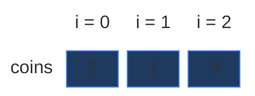

Why put the `2` first? The order of the coins in the array never changes the count (it is the same bag of coins). But the first coin decides the base case (`target % coins[0] == 0`, Section 2). With `coins[0] = 2`, that base case gives a mix of `1`s and `0`s, so you can see it work. With `coins[0] = 1` every target would just be `1`.

The grid for this example is `3 × 5`. It is small, but it already has a repeated subproblem. We use it in every section below.

### Constraints

From LeetCode (in my notes):

- `1 <= coins.length <= 300`
- `1 <= coins[i] <= 5000`
- All the values of `coins` are **unique**.
- `0 <= amount <= 5000`

Two things to notice:

- `amount` can be `0`. There is exactly **one** way to pay 0: take no coins at all (the empty combination). So the answer is `1`, not `0`.
- The coins are unique, so we never have to worry about two equal coins being counted as two different ways.

### What the constraints tell us (simple theory)

A **constraint** is the biggest input the judge will ever give you. It quietly tells you how fast your code must be.

**Rule of thumb:** a computer does about **100 million (10^8) simple steps per second**. Count how many steps your idea needs for the biggest input, and compare.

| Biggest input `n` | Steps you can afford | Ideas that fit |
|:---:|:---:|:---|
| up to ~20 | about `2^n` | Plain recursion, try everything |
| up to ~500 | about `n^3` | Three nested loops |
| up to ~5,000 | about `n^2` | Two nested loops |
| up to ~1,000,000 | about `n` or `n log n` | One loop, DP over `n` states |

**For this problem:** there are at most `300` coins and `amount` is at most `5000`.

- Plain recursion tries every combination. With small coins and a big amount, the number of combinations explodes. Already with coins `1 .. 60` and amount `60`, the recursion makes about **2.4 million** calls (chart below). With `amount = 5000` it would never finish.
- The DP fills a grid of `n × (amount + 1) = 300 × 5001 = 1,500,300` cells, each with `O(1)` work. That is about **1.5 million** steps. Well under a second.

The key: the input has two sizes, `n` (coins) and `amount`. The DP work is their **product** `n · amount`.

**How the work grows as `n` grows**

Here the coins are `1, 2, ..., n` and `amount = n` (lots of small coins, so lots of ways). Red bars = calls made by plain recursion. Green line = cells in the DP grid, `n · (amount + 1)` (it stays flat near zero).

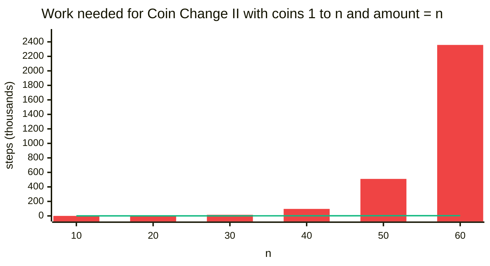

| `n` (and `amount`) | Recursion calls | DP cells `n · (amount + 1)` | Answer (ways) |
|:---:|:---:|:---:|:---:|
| 10 | 144 | 110 | 42 |
| 20 | 1,881 | 420 | 627 |
| 30 | 15,317 | 930 | 5,604 |
| 40 | 96,611 | 1,640 | 37,338 |
| 50 | 510,346 | 2,550 | 204,226 |
| 60 | 2,357,581 | 3,660 | 966,467 |

All numbers were counted by running the code (the counts are checked in the tests at the bottom). The recursion calls grow faster than any power of `n`: they grow like the number of ways itself, which explodes. The DP cells only grow like `n^2` here.

## 2. Core Theory

This note builds on [01. Subset Sum Equal To K](01.%20Subset%20Sum%20Equal%20To%20K.md), which teaches 2-D DP from zero (the grid, rows and columns, pick / not pick). Here we change **two small things**: a coin can be picked **again**, and we **count** ways instead of saying yes / no.

### What the problem really asks

Choose how many of each coin to use (zero, one, two, ...) so that the values add up to `amount`. Count how many different choices there are.

A **combination** is a group where order does not matter: `2 + 1 + 1` and `1 + 2 + 1` are the same group (one 2 and two 1s). A **permutation** is an ordered list: `2 + 1 + 1` and `1 + 2 + 1` are different lists. This problem counts **combinations**. (Section 7 shows exactly where this matters in the code.)

### Why we can't just list them all

Here is a brute force that lists every combination. It walks the coins in array order and, for each coin, tries "use it zero times, once, twice, ...". Because it never goes back to an earlier coin, every group is listed once, never in two orders.

```python
# Imports used by every code block in this note
from typing import List

# For the recursion limit and the tests
import sys

# For random tests at the end
import random


# Brute force: list every combination, then count them
class SolutionBrute:

    # Return every combination as a list of coins
    def list_ways(self, coins: List[int], amount: int) -> List[List[int]]:

        # All the combinations found
        found = []

        # Try coin number index, with target left to pay and the coins chosen so far
        def go(index: int, target: int, chosen: List[int]) -> None:

            # Nothing left to pay: one complete combination
            if target == 0:

                # Save a copy of it
                found.append(chosen[:])

                # Stop this branch
                return

            # No coins left, but target is not 0: dead end
            if index == len(coins):
                return

            # Use this coin 0 times: move to the next coin
            go(index + 1, target, chosen)

            # How many copies of this coin we are using now
            copies = 0

            # Add one more copy while it still fits
            while (copies + 1) * coins[index] <= target:

                # One more copy
                copies += 1

                # Put it in the group
                chosen.append(coins[index])

                # Move to the next coin with the smaller target
                go(index + 1, target - copies * coins[index], chosen)

            # Take all the copies back out (undo)
            del chosen[len(chosen) - copies:]

        # Start with the first coin, the full amount and an empty group
        go(0, amount, [])

        # Every combination
        return found

    # Main method (same name as LeetCode)
    def change(self, amount: int, coins: List[int]) -> int:

        # The count is the number of combinations listed
        return len(self.list_ways(coins, amount))
```

On our example it finds exactly the 4 ways, in this order: `[1, 3]`, `[1, 1, 1, 1]`, `[2, 1, 1]`, `[2, 2]` (each group lists its coins in array order: the 1 comes before the 3). The problem: listing every way takes at least one step per way, and the number of ways can be huge (the answer may be up to `2^31 - 1`, about 2 billion). We need to **count without listing**. That is DP.

### How to spot that it is DP

| Property | Plain meaning | In Coin Change II |
|:---|:---|:---|
| **Overlapping subproblems** | The same smaller question is asked many times | "How many ways can coins `[2, 1]` make 1?" is asked twice in our example (Section 4) |
| **Optimal substructure** | The big answer is built from answers of smaller questions | "Ways with `[2, 1, 3]` to make 4" = "ways without the 3" + "ways with at least one 3" |

Also: the problem says **"number of ways"** and **"infinite coins"**. My notes' interview insight: when you see those two phrases, think **Unbounded DP + addition**.

### Why one number is not enough: the state needs two numbers

The **state** is the small piece of information that names one subproblem.

- When we **skip** a coin for good, the target stays the same, but the set of coins we may use gets smaller.
- When we **pick** a coin, the target **shrinks** by the coin's value.

So we must remember two things: which coins are still allowed, and how much is still left to pay. From my notes:

> `f(ind, target)` = the number of ways to make `target` using coins `0 .. ind` (each as many times as we like).

- `ind` = which coins are still allowed: `coins[0], coins[1], ..., coins[ind]`.
- `target` = how much we still need to pay.

The whole question is `f(n - 1, amount)`. For our example that is `f(2, 4)`.

### The grid: rows are coins, columns are targets

Same picture as in Subset Sum. **Row `ind`** = "I may use coins `0 .. ind`". **Column `t`** = "the amount I want to make", from `0` to `amount`. **Cell `[ind][t]`** = a **count** now, not `True` / `False`.

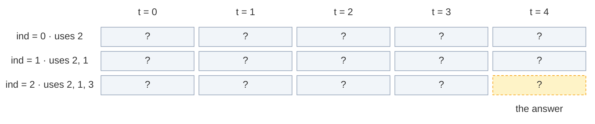

The grid has `n` rows and `amount + 1` columns: here `3 × 5 = 15` cells. The answer is the bottom-right cell `[2][4]`.

### The recurrence: not pick, or pick and stay

The **recurrence** is the rule that builds a bigger answer from smaller ones. My notes' intuition: at each coin we have 2 choices:

1. **Do not take the coin.** We will never use it again: go to `ind - 1`, target unchanged.
2. **Take the coin (again allowed).** Pay `coins[ind]`, but **stay at the same index**, because we may want this coin again.

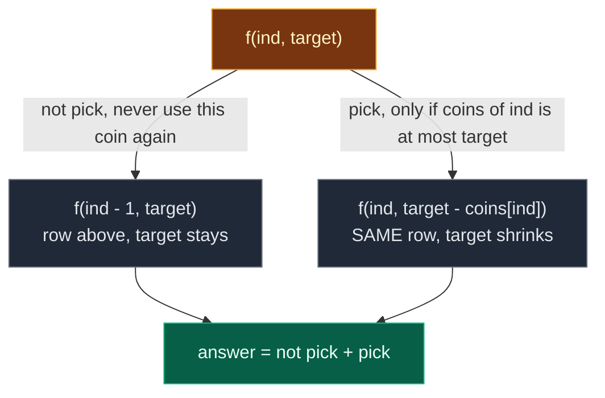

```text
f(ind, target) =
      f(ind - 1, target)                # not take
    + f(ind, target - coins[ind])       # take (stay at the same index), only if coins[ind] <= target
```

Two things are **important** (from my notes):

- We use **addition**, because we **count ways**. Every way either skips this coin or uses it, never both, so the two groups do not overlap and we can just add them. (Subset Sum used OR because it only asked yes / no.)
- We **stay at the same index** when we take, because the supply is **infinite**.

### The same-row read: the one picture to remember

In the grid, "not pick" reads the cell **straight up** (row `ind - 1`, same column). "Pick" reads **left by `coins[ind]` columns**. The only question is: in which row?

**Subset Sum (each element once, 0/1):** pick reads the row **above**. To fill `[2][4]` with element `3`, it reads `[1][4]` and `[1][1]`.

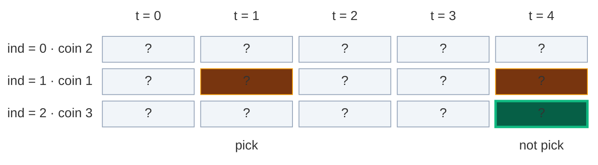

**Coin Change II (unlimited coins):** pick reads the **same row**. To fill `[2][4]` with coin `3`, it reads `[1][4]` (straight up) and `[2][1]` (same row, 3 to the left).

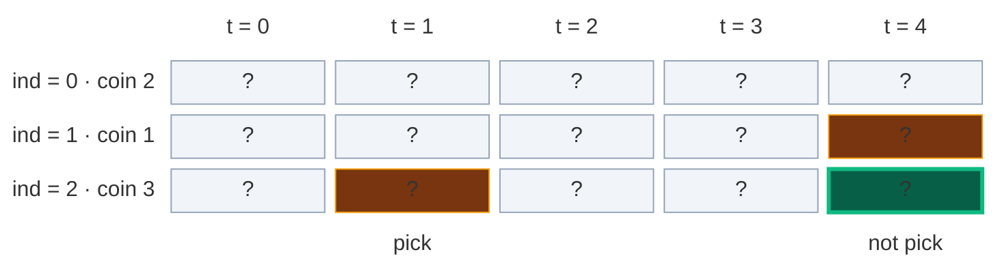

Why the same row? Cell `[2][1]` means "ways to make 1 using coins `0 .. 2`", and that still **includes the 3**. So after paying one 3, we may pay another 3 later. Reading the row above (`[1][1]`) would mean "no more 3s", and that is the 0/1 rule.

### Base cases

A **base case** is a subproblem so small that we know the answer without more work.

From my notes: **if `index == 0`**, only `coins[0]` is left, and we can use it as many times as we like.

```text
if target % coins[0] == 0:  return 1
else:                       return 0
```

**Why?** Because we can only use that one coin, multiple times. With only 2s, we can make 0, 2, 4, 6, ... in exactly one way each (zero 2s, one 2, two 2s, ...). We can never make 1, 3, 5, ... So: "is the target a multiple of `coins[0]`?"

| Call | `target % 2` | Answer | The one way |
|:---|:---:|:---:|:---|
| `f(0, 0)` | 0 | 1 | no coins |
| `f(0, 1)` | 1 | 0 | – |
| `f(0, 2)` | 0 | 1 | `2` |
| `f(0, 3)` | 1 | 0 | – |
| `f(0, 4)` | 0 | 1 | `2 + 2` |

Notice that `target = 0` is covered for free: `0 % coins[0] == 0`, so `f(0, 0) = 1` (the empty way). And at any `ind > 0`, `f(ind, 0)` keeps "not picking" down to `f(0, 0) = 1`, because no coin fits into 0 (all coins are at least 1). So `f(ind, 0) = 1` everywhere. We do not need a separate `target == 0` check.

### Two ways to remember: memoization vs tabulation

| | Memoization | Tabulation |
|:---|:---|:---|
| Other name | **Top-down** | **Bottom-up** |
| Direction | Start from `f(n - 1, amount)`, go down to the base cases, come back up | Start from row 0 (the base cases), fill row by row down to `[n - 1][amount]` |
| How | Recursion + a 2-D table | Two nested loops + a 2-D table |
| Computes | Only the cells it needs | Every cell |
| Stack | Uses the recursion stack (depth up to `n + amount`) | No recursion stack |

### The 4-step ladder

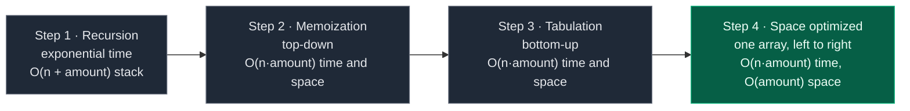

## 3. Edge Cases

| Case | Input | Expected | Why it matters |
|:---|:---:|:---:|:---|
| Amount 0 | `amount = 0`, `coins = [7]` | 1 | The empty combination. `0 % 7 == 0` gives 1 |
| Cannot make it | `amount = 3`, `coins = [2]` | 0 | LeetCode example 2. `3 % 2 != 0` |
| One coin equals amount | `amount = 10`, `coins = [10]` | 1 | LeetCode example 3 |
| Coin bigger than amount | `amount = 3`, `coins = [5]` | 0 | Pick is never allowed |
| Same coin many times | `amount = 4`, `coins = [2]` | 1 | `2 + 2`: pick must stay at the same index |
| Order does not matter | `amount = 4`, `coins = [2, 1, 3]` | 4 | Not 7 (that would count `1 + 3` and `3 + 1` twice) |
| A smaller target has more ways | `coins = [2, 3]`: `amount = 6` → 2, `amount = 7` → 1 | – | Cells inside the table can be bigger than the final answer (matters for overflow in C++ / Java) |
| Biggest input | 300 coins, `amount = 5000` | – | Python memoization needs a higher recursion limit (depth up to `n + amount`) |

## 4. Approach 1: Recursion

### Idea

Write the recurrence as code. Start with `f(n - 1, amount)`. If `ind == 0`, use the base case. Otherwise add "not take" and "take (stay)".

What does the start call mean? `f(2, 4)` = "how many ways can coins `[2, 1, 3]` make 4?"

### Recursion tree for `coins = [2, 1, 3]`, `amount = 4`

Every box shows the call and what it returns. Calls happen depth-first, "not pick" first (like the code). **Pick edges stay on the same `ind`.**

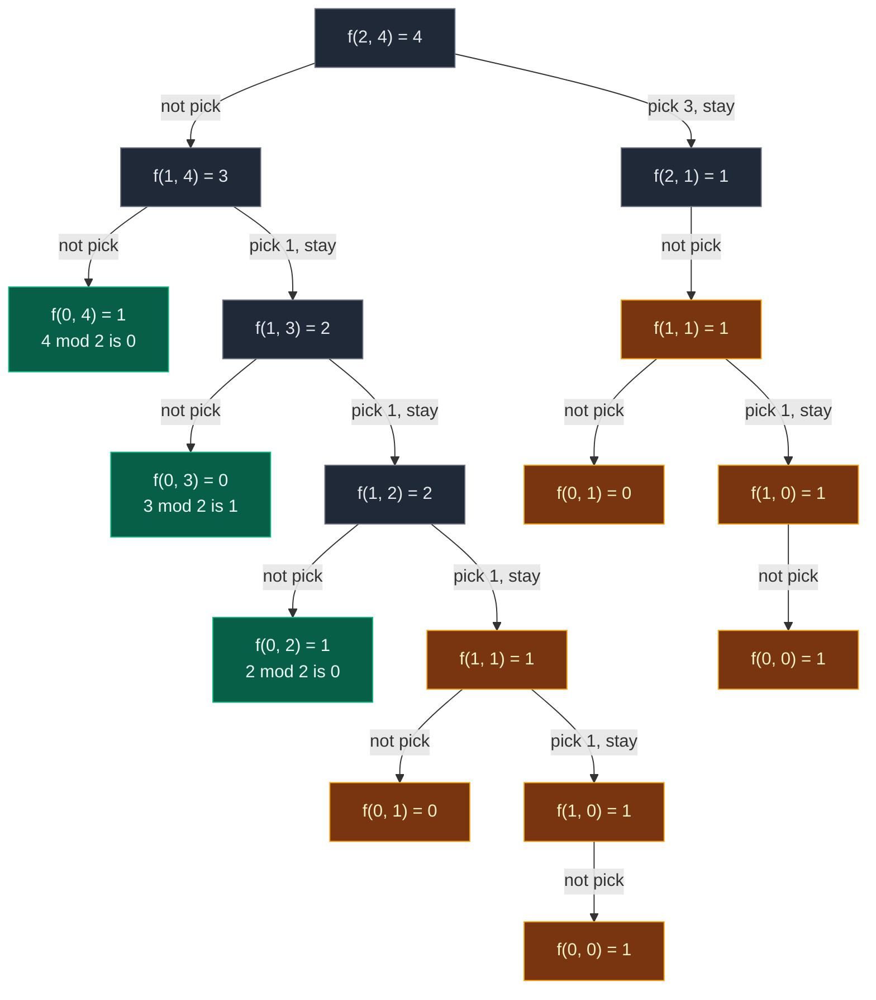

Gold = repeated work. Green = base cases that are not repeated.

Some boxes have only one child: in `f(1, 0)` the coin `1` is bigger than the target `0`, and in `f(2, 1)` the coin `3` is bigger than `1`, so "pick" is not allowed.

| State | Times computed |
|:---|:---:|
| `f(2, 4)`, `f(1, 4)`, `f(1, 3)`, `f(1, 2)`, `f(2, 1)` | 1 each |
| **`f(1, 1)`** | **2** |
| **`f(1, 0)`** | **2** (inside each `f(1, 1)`) |
| **`f(0, 1)`** | **2** (inside each `f(1, 1)`) |
| **`f(0, 0)`** | **2** (inside each `f(1, 0)`) |
| `f(0, 4)`, `f(0, 3)`, `f(0, 2)` | 1 each |

That is **16 calls** for 3 coins and amount 4. `f(1, 1)` is the overlapping subproblem: it is reached by "skip the 3, then pay 1 + 1 + 1 with 1s" and by "pay one 3, then skip the 3". Both paths leave the same question: "how many ways can `[2, 1]` make 1?"

The 4 ways can be read off the tree: every path that ends in a base case returning 1 is one way.

- `f(0, 4) = 1` after "skip 3, skip 1" → `2 + 2`.
- `f(0, 2) = 1` after "skip 3, pick 1, pick 1, skip 1" → `2 + 1 + 1`.
- `f(0, 0) = 1` on the left → `1 + 1 + 1 + 1`.
- `f(0, 0) = 1` on the right → `3 + 1`.

**The exact order of calls.** One participant per row of the grid (`ind`). Solid arrows = calls, dashed arrows = returns. **A pick is an arrow to itself**: it stays on the same `ind`.

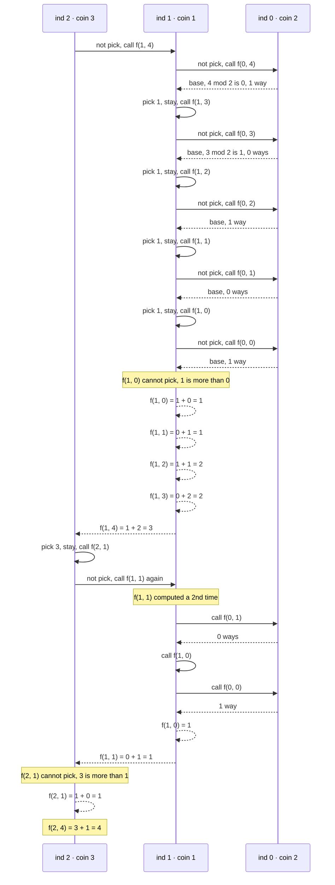

**The dry run from my notes:** `coins = [1, 2]`, `target = 3`. Call `solve(1, 3)`. At coin 2:

- not take → `solve(0, 3)`: only 1s, `3 % 1 == 0` → 1 way → `[1 + 1 + 1]`.
- take → `solve(1, 1)` (still at coin 2). Now `solve(1, 1)`:
  - not take → `solve(0, 1)` → 1 way → `[1]` (so with the 2 already paid: `2 + 1`).
  - take → not possible (`2 > 1`).
- Total: **2 ways** (`1 + 1 + 1` and `2 + 1`).

### Code

```python
# Plain recursion
class SolutionRecursion:

    # Helper: number of ways to make target with coins[0..index]
    def solve(self, index: int, target: int, coins: List[int]) -> int:

        # Base case: only coins[0] is left
        if index == 0:

            # If target is divisible by coins[0], there is exactly one way
            if target % coins[0] == 0:
                return 1

            # Otherwise it cannot be made
            return 0

        # Not take: never use coins[index] again, target stays
        not_take = self.solve(index - 1, target, coins)

        # Take starts at 0 (not allowed yet)
        take = 0

        # Take only if the coin fits in the target
        if coins[index] <= target:

            # Take: pay one coin and STAY at the same index (infinite supply)
            take = self.solve(index, target - coins[index], coins)

        # Count ways: add the two groups
        return take + not_take

    # Main method (same name as LeetCode)
    def change(self, amount: int, coins: List[int]) -> int:

        # Start from the last coin and the full amount
        return self.solve(len(coins) - 1, amount, coins)
```

### Complexity

| Measure | Complexity | Why |
|:---|:---:|:---|
| **Time** | Exponential | Each call can branch into two, and "pick" does not move the index, so paths are long. The chart in Section 1 shows the calls exploding |
| **Space** | `O(n + amount)` | Recursion stack. My notes say `O(target)`: a "pick" path can go `amount` levels deep (paying 1 at a time), and "not pick" adds up to `n` more levels. So the deepest path is at most `n + amount` frames |

## 5. Approach 2: Memoization (Top-Down)

### Idea

The same `(ind, target)` states are solved again and again. Store each answer the first time in `dp[index][target]` (from my notes), and reuse it.

**Size of the table.** `ind` goes from `0` to `n - 1` (`n` rows). `target` goes from `0` to `amount` (`amount + 1` columns). So `dp` is `n × (amount + 1)`, filled with `-1` (`-1` means "not computed yet"; a real count is never negative).

The same **3 steps** as always:

1. **Declare** `dp` with `n` rows and `amount + 1` columns, filled with `-1`.
2. **Store** the answer before returning: `dp[index][target] = take + not_take`.
3. **Check** first: if `dp[index][target] != -1`, return it and make no new calls.

Note: in my notes' code the base case (`index == 0`) is checked **before** the table. So row 0 is never stored and stays `-1`. That is fine, the base case answers it instantly.

**Python only:** the recursion can be `n + amount` calls deep (up to `5300`). Python's default limit is `1000`, so we raise it with `sys.setrecursionlimit(...)`. Tabulation does not have this problem.

### Visual: when each `dp[ind][target]` gets filled

Colours: grey = `-1` (not computed), dashed yellow = computing (waiting for its children), green = just filled, blue = filled earlier, orange = cache hit.

**Start:** `dp` is `3 × 5`, all `-1`.

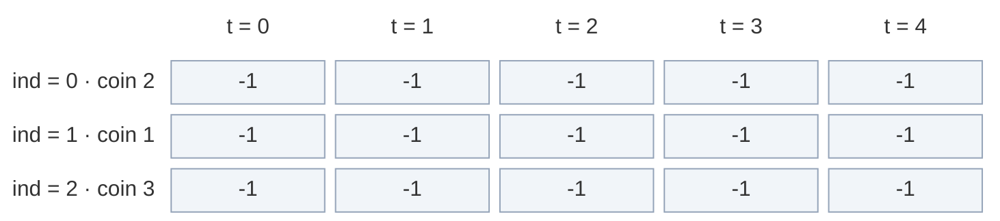

**Calls go down:** `f(2, 4)` → `-1`, compute. "Not pick" → `f(1, 4)` → `-1`, compute. It asks `f(0, 4)` (base → 1). Then "pick 1, stay" → `f(1, 3)` → `f(1, 2)` → `f(1, 1)` → `f(1, 0)`, all `-1`, all computing. Each asks its base cell on row 0 on the way.

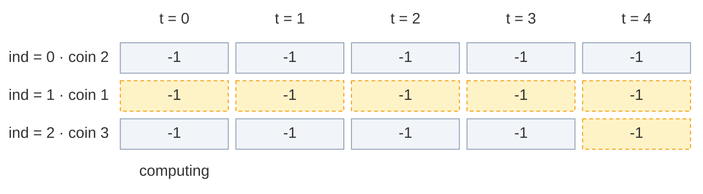

**Fill 1:** `f(1, 0)`: not pick = `f(0, 0)` = 1 (base, `0 % 2 == 0`). Pick: `1 > 0`, not allowed. Store `dp[1][0] = 1 + 0 = 1`.

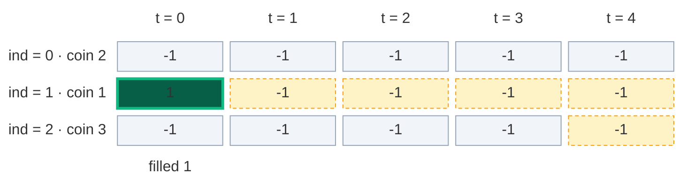

**Fill 2:** back in `f(1, 1)`: not pick = `f(0, 1)` = 0 (base), pick = `f(1, 0)` = 1. Store `dp[1][1] = 0 + 1 = 1`.

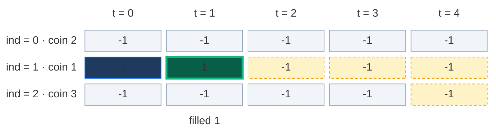

**Fill 3:** back in `f(1, 2)`: not pick = `f(0, 2)` = 1, pick = `f(1, 1)` = 1. Store `dp[1][2] = 1 + 1 = 2`.

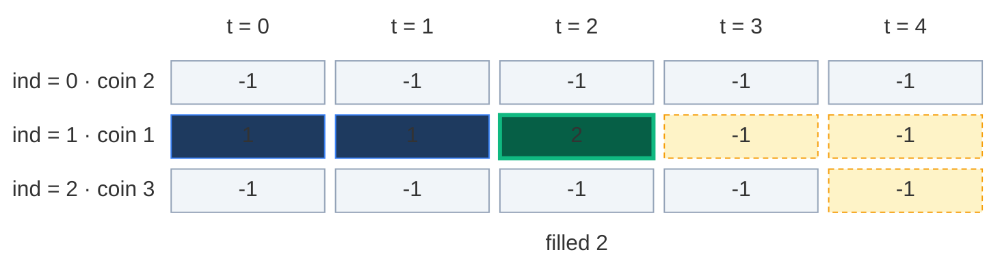

**Fill 4:** back in `f(1, 3)`: not pick = `f(0, 3)` = 0, pick = `f(1, 2)` = 2. Store `dp[1][3] = 0 + 2 = 2`.

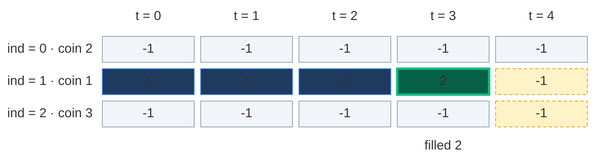

**Fill 5:** back in `f(1, 4)`: not pick = `f(0, 4)` = 1, pick = `f(1, 3)` = 2. Store `dp[1][4] = 1 + 2 = 3`. Row 1 is complete: all of it was needed.

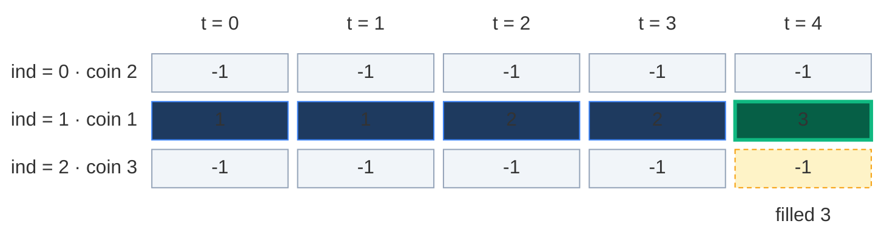

**Cache hit:** `f(2, 4)` now tries "pick 3, stay" → `f(2, 1)` → `-1`, compute. Its "not pick" asks `f(1, 1)`. `dp[1][1] = 1`, not `-1` → return 1, **no new calls**. The whole `f(1, 1)` subtree (3 more calls below it) is skipped.

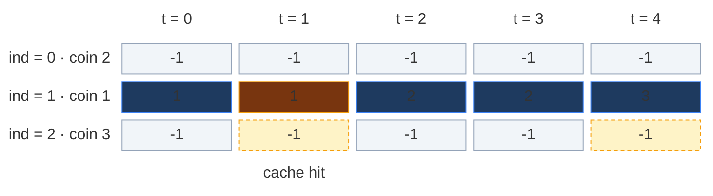

**Fill 6:** `f(2, 1)`: pick 3 is not allowed (`3 > 1`). Store `dp[2][1] = 1 + 0 = 1`.

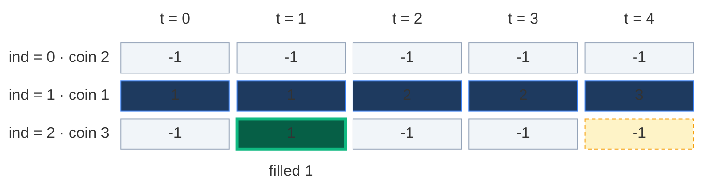

**Fill 7:** `f(2, 4) = 3 + 1 = 4`. Store `dp[2][4] = 4`. That is the answer.

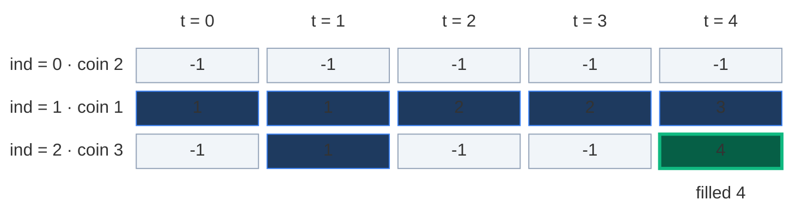

Only 7 of the 15 cells were ever stored. Memoization computes **only the states it needs**.

### The pruned recursion tree

Same tree, but the cache hit (dashed) stops right away.

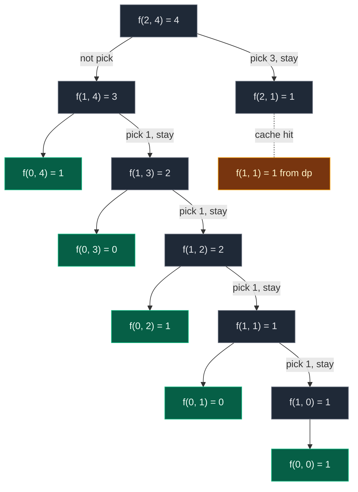

**13 calls** instead of 16. Small saving because the example is tiny. On bigger inputs the saving is huge: at most `n · (amount + 1)` states are ever computed (compare the red bars and the green line in Section 1).

### Code

```python
# Memoization (top-down DP) with a 2-D table of -1
class SolutionMemo:

    # Helper: ways to make target with coins[0..index], uses and fills dp
    def solve(self, index: int, target: int, coins: List[int], dp: List[List[int]]) -> int:

        # Base case: only coins[0] is left
        if index == 0:

            # Divisible: exactly one way (use coins[0] again and again)
            if target % coins[0] == 0:
                return 1

            # Not divisible: no way
            return 0

        # Step 3 (check): already solved this (index, target)? Reuse it
        if dp[index][target] != -1:
            return dp[index][target]

        # Not take: move to the previous coin, target stays
        not_take = self.solve(index - 1, target, coins, dp)

        # Take starts at 0 (not allowed yet)
        take = 0

        # Take only if the coin fits
        if coins[index] <= target:

            # Take: pay one coin, stay at the same index
            take = self.solve(index, target - coins[index], coins, dp)

        # Step 2 (store): the number of ways for this state
        dp[index][target] = take + not_take

        # Return the stored answer
        return dp[index][target]

    # Main method (same name as LeetCode)
    def change(self, amount: int, coins: List[int]) -> int:

        # Number of coins
        n = len(coins)

        # Python only: the stack can be n + amount calls deep
        sys.setrecursionlimit(max(1000, 2 * (n + amount) + 100))

        # Step 1 (declare): n rows, amount + 1 columns, -1 means not solved yet
        dp = [[-1 for _ in range(amount + 1)] for _ in range(n)]

        # Keep the table so we can look at it after the run
        self.dp = dp

        # Start from the last coin and the full amount
        return self.solve(n - 1, amount, coins, dp)
```

### Complexity

| Measure | Complexity | Why |
|:---|:---:|:---|
| **Time** | `O(n · amount)` | At most `n · (amount + 1)` different states, each solved once with `O(1)` work |
| **Space: dp table** | `O(n · amount)` | `n` rows × `amount + 1` columns (my notes: `O(n * target)`) |
| **Space: recursion stack** | `O(n + amount)` | A path can pick `amount` times and skip `n` times |
| **Total space** | `O(n · amount) + O(n + amount)` | Table plus stack |

## 6. Approach 3: Tabulation (Bottom-Up)

### Idea

Fill the whole grid with two loops, from row 0 (the base cases) to the answer `[n - 1][amount]`. No recursion, so no stack.

From my notes: `dp[i][t]` = number of ways to form `t` using coins `0 .. i`.

### How to convert memo → table, step by step

1. **Same grid:** `dp` with `n` rows and `amount + 1` columns, all `0`.
2. **Base case becomes row 0** (my notes' "base initialization for the first coin"): for every `t` from `0` to `amount`, `if t % coins[0] == 0: dp[0][t] = 1`.
3. **Two nested loops, in the opposite direction:** the recursion went from `n - 1` down to `0`. Reverse it: `i` from `1` to `n - 1`, and inside, `t` from **`0`** to `amount`.
4. **Copy the recurrence:** replace `f(...)` with `dp[...]`:
   - `not_take = dp[i - 1][t]`
   - `take = dp[i][t - coins[i]]` if `coins[i] <= t` (**same row `i`**, not `i - 1`)
   - `dp[i][t] = take + not_take`
5. **Answer:** `dp[n - 1][amount]`.

| Memoization | Becomes in tabulation |
|:---|:---|
| `dp[n][amount + 1]` with `-1` | `dp[n][amount + 1]` with `0` |
| `if index == 0: return 1 if target % coins[0] == 0 else 0` | `dp[0][t] = 1` for every `t` with `t % coins[0] == 0` |
| `f(n - 1, amount)` going down | Loops `i = 1 .. n - 1`, `t = 0 .. amount` going up |
| `f(index - 1, target)` | `dp[i - 1][t]` |
| `f(index, target - coins[index])` | `dp[i][t - coins[i]]` |
| `return f(n - 1, amount)` | `return dp[n - 1][amount]` |

**Why must `t` go left to right inside a row?** The pick reads `dp[i][t - coins[i]]`, a cell in the **same row** to the **left**. It must be filled before we use it. Left to right guarantees that.

**Why does `t` start at 0 (not 1)?** Column 0 of rows `1 .. n - 1` must become `1` (the empty way), because a pick can land exactly on target 0 (in our example `dp[2][3]` reads `dp[2][0]`). With `t = 0`, "not take" copies `dp[i - 1][0] = 1` and "take" is not allowed, so `dp[i][0] = 1`.

**Picture rule:** to fill a cell, look **straight up** (not pick) and **left by `coins[i]` in the same row** (pick). Add them.

### Visual table fill (`coins = [2, 1, 3]`, `amount = 4`)

Colours: green = just filled, orange = the two cells it reads, blue = filled earlier, grey `?` = not filled yet.

**Start: base row written in.** Row 0 uses only the coin `2`. `dp[0][t] = 1` when `t % 2 == 0`, so targets 0, 2 and 4 get `1`, and 1, 3 get `0`.

```mermaid
block-beta
  columns 6
  hx[" "] h0["t = 0"] h1["t = 1"] h2["t = 2"] h3["t = 3"] h4["t = 4"]
  l0["ind = 0 · coin 2"] r0c0["1"] r0c1["0"] r0c2["1"] r0c3["0"] r0c4["1"]
  l1["ind = 1 · coin 1"] r1c0["?"] r1c1["?"] r1c2["?"] r1c3["?"] r1c4["?"]
  l2["ind = 2 · coin 3"] r2c0["?"] r2c1["?"] r2c2["?"] r2c3["?"] r2c4["?"]
  space m0["0 mod 2"] m1["1 mod 2"] m2["2 mod 2"] m3["3 mod 2"] m4["4 mod 2"]
  classDef head fill:none,stroke:none,color:#64748b
  class hx,h0,h1,h2,h3,h4,l0,l1,l2 head
  classDef new fill:#065f46,stroke:#10b981,color:#ecfdf5,stroke-width:3px
  class r0c0,r0c1,r0c2,r0c3,r0c4 new
  classDef empty fill:#f1f5f9,stroke:#94a3b8,color:#64748b
  class r1c0,r1c1,r1c2,r1c3,r1c4,r2c0,r2c1,r2c2,r2c3,r2c4 empty
  classDef note fill:none,stroke:none,color:#b45309
  class m0,m1,m2,m3,m4 note
```

#### Row 1 (`coins[1] = 1`), cell by cell

**`dp[1][0]`:** not pick = `dp[0][0] = 1`. Pick: `1 > 0`, not allowed. Result `1`.

```mermaid
block-beta
  columns 6
  hx[" "] h0["t = 0"] h1["t = 1"] h2["t = 2"] h3["t = 3"] h4["t = 4"]
  l0["ind = 0 · coin 2"] r0c0["1"] r0c1["0"] r0c2["1"] r0c3["0"] r0c4["1"]
  l1["ind = 1 · coin 1"] r1c0["1"] r1c1["?"] r1c2["?"] r1c3["?"] r1c4["?"]
  l2["ind = 2 · coin 3"] r2c0["?"] r2c1["?"] r2c2["?"] r2c3["?"] r2c4["?"]
  space m0["= 1 + no pick"] space space space space
  classDef head fill:none,stroke:none,color:#64748b
  class hx,h0,h1,h2,h3,h4,l0,l1,l2 head
  classDef read fill:#78350f,stroke:#f59e0b,color:#fef3c7
  class r0c0 read
  classDef done fill:#1e3a5f,stroke:#3b82f6,color:#dbeafe
  class r0c1,r0c2,r0c3,r0c4 done
  classDef new fill:#065f46,stroke:#10b981,color:#ecfdf5,stroke-width:3px
  class r1c0 new
  classDef empty fill:#f1f5f9,stroke:#94a3b8,color:#64748b
  class r1c1,r1c2,r1c3,r1c4,r2c0,r2c1,r2c2,r2c3,r2c4 empty
  classDef note fill:none,stroke:none,color:#b45309
  class m0 note
```

**`dp[1][1]`:** not pick = `dp[0][1] = 0`. Pick = `dp[1][1 - 1] = dp[1][0] = 1` (same row). Result `0 + 1 = 1`.

```mermaid
block-beta
  columns 6
  hx[" "] h0["t = 0"] h1["t = 1"] h2["t = 2"] h3["t = 3"] h4["t = 4"]
  l0["ind = 0 · coin 2"] r0c0["1"] r0c1["0"] r0c2["1"] r0c3["0"] r0c4["1"]
  l1["ind = 1 · coin 1"] r1c0["1"] r1c1["1"] r1c2["?"] r1c3["?"] r1c4["?"]
  l2["ind = 2 · coin 3"] r2c0["?"] r2c1["?"] r2c2["?"] r2c3["?"] r2c4["?"]
  space space m1["= 0 + 1"] space space space
  classDef head fill:none,stroke:none,color:#64748b
  class hx,h0,h1,h2,h3,h4,l0,l1,l2 head
  classDef done fill:#1e3a5f,stroke:#3b82f6,color:#dbeafe
  class r0c0,r0c2,r0c3,r0c4 done
  classDef read fill:#78350f,stroke:#f59e0b,color:#fef3c7
  class r0c1,r1c0 read
  classDef new fill:#065f46,stroke:#10b981,color:#ecfdf5,stroke-width:3px
  class r1c1 new
  classDef empty fill:#f1f5f9,stroke:#94a3b8,color:#64748b
  class r1c2,r1c3,r1c4,r2c0,r2c1,r2c2,r2c3,r2c4 empty
  classDef note fill:none,stroke:none,color:#b45309
  class m1 note
```

**`dp[1][2]`:** not pick = `dp[0][2] = 1`. Pick = `dp[1][1] = 1`. Result `1 + 1 = 2` (the ways `2` and `1 + 1`).

```mermaid
block-beta
  columns 6
  hx[" "] h0["t = 0"] h1["t = 1"] h2["t = 2"] h3["t = 3"] h4["t = 4"]
  l0["ind = 0 · coin 2"] r0c0["1"] r0c1["0"] r0c2["1"] r0c3["0"] r0c4["1"]
  l1["ind = 1 · coin 1"] r1c0["1"] r1c1["1"] r1c2["2"] r1c3["?"] r1c4["?"]
  l2["ind = 2 · coin 3"] r2c0["?"] r2c1["?"] r2c2["?"] r2c3["?"] r2c4["?"]
  space space space m2["= 1 + 1"] space space
  classDef head fill:none,stroke:none,color:#64748b
  class hx,h0,h1,h2,h3,h4,l0,l1,l2 head
  classDef done fill:#1e3a5f,stroke:#3b82f6,color:#dbeafe
  class r0c0,r0c1,r0c3,r0c4,r1c0 done
  classDef read fill:#78350f,stroke:#f59e0b,color:#fef3c7
  class r0c2,r1c1 read
  classDef new fill:#065f46,stroke:#10b981,color:#ecfdf5,stroke-width:3px
  class r1c2 new
  classDef empty fill:#f1f5f9,stroke:#94a3b8,color:#64748b
  class r1c3,r1c4,r2c0,r2c1,r2c2,r2c3,r2c4 empty
  classDef note fill:none,stroke:none,color:#b45309
  class m2 note
```

**`dp[1][3]`:** not pick = `dp[0][3] = 0`. Pick = `dp[1][2] = 2`. Result `0 + 2 = 2` (the ways `2 + 1` and `1 + 1 + 1`).

```mermaid
block-beta
  columns 6
  hx[" "] h0["t = 0"] h1["t = 1"] h2["t = 2"] h3["t = 3"] h4["t = 4"]
  l0["ind = 0 · coin 2"] r0c0["1"] r0c1["0"] r0c2["1"] r0c3["0"] r0c4["1"]
  l1["ind = 1 · coin 1"] r1c0["1"] r1c1["1"] r1c2["2"] r1c3["2"] r1c4["?"]
  l2["ind = 2 · coin 3"] r2c0["?"] r2c1["?"] r2c2["?"] r2c3["?"] r2c4["?"]
  space space space space m3["= 0 + 2"] space
  classDef head fill:none,stroke:none,color:#64748b
  class hx,h0,h1,h2,h3,h4,l0,l1,l2 head
  classDef done fill:#1e3a5f,stroke:#3b82f6,color:#dbeafe
  class r0c0,r0c1,r0c2,r0c4,r1c0,r1c1 done
  classDef read fill:#78350f,stroke:#f59e0b,color:#fef3c7
  class r0c3,r1c2 read
  classDef new fill:#065f46,stroke:#10b981,color:#ecfdf5,stroke-width:3px
  class r1c3 new
  classDef empty fill:#f1f5f9,stroke:#94a3b8,color:#64748b
  class r1c4,r2c0,r2c1,r2c2,r2c3,r2c4 empty
  classDef note fill:none,stroke:none,color:#b45309
  class m3 note
```

**`dp[1][4]`:** not pick = `dp[0][4] = 1`. Pick = `dp[1][3] = 2`. Result `1 + 2 = 3` (the ways `2 + 2`, `2 + 1 + 1`, `1 + 1 + 1 + 1`).

```mermaid
block-beta
  columns 6
  hx[" "] h0["t = 0"] h1["t = 1"] h2["t = 2"] h3["t = 3"] h4["t = 4"]
  l0["ind = 0 · coin 2"] r0c0["1"] r0c1["0"] r0c2["1"] r0c3["0"] r0c4["1"]
  l1["ind = 1 · coin 1"] r1c0["1"] r1c1["1"] r1c2["2"] r1c3["2"] r1c4["3"]
  l2["ind = 2 · coin 3"] r2c0["?"] r2c1["?"] r2c2["?"] r2c3["?"] r2c4["?"]
  space space space space space m4["= 1 + 2"]
  classDef head fill:none,stroke:none,color:#64748b
  class hx,h0,h1,h2,h3,h4,l0,l1,l2 head
  classDef done fill:#1e3a5f,stroke:#3b82f6,color:#dbeafe
  class r0c0,r0c1,r0c2,r0c3,r1c0,r1c1,r1c2 done
  classDef read fill:#78350f,stroke:#f59e0b,color:#fef3c7
  class r0c4,r1c3 read
  classDef new fill:#065f46,stroke:#10b981,color:#ecfdf5,stroke-width:3px
  class r1c4 new
  classDef empty fill:#f1f5f9,stroke:#94a3b8,color:#64748b
  class r2c0,r2c1,r2c2,r2c3,r2c4 empty
  classDef note fill:none,stroke:none,color:#b45309
  class m4 note
```

See how the pick in row 1 reads the cell **right next to it on the left, in the same row**. The new value is used again at once. That is "use the coin 1 again and again".

#### Row 2 (`coins[2] = 3`), cell by cell

**`dp[2][0]`:** not pick = `dp[1][0] = 1`. Pick: `3 > 0`, not allowed. Result `1`.

```mermaid
block-beta
  columns 6
  hx[" "] h0["t = 0"] h1["t = 1"] h2["t = 2"] h3["t = 3"] h4["t = 4"]
  l0["ind = 0 · coin 2"] r0c0["1"] r0c1["0"] r0c2["1"] r0c3["0"] r0c4["1"]
  l1["ind = 1 · coin 1"] r1c0["1"] r1c1["1"] r1c2["2"] r1c3["2"] r1c4["3"]
  l2["ind = 2 · coin 3"] r2c0["1"] r2c1["?"] r2c2["?"] r2c3["?"] r2c4["?"]
  space m0["= 1 + no pick"] space space space space
  classDef head fill:none,stroke:none,color:#64748b
  class hx,h0,h1,h2,h3,h4,l0,l1,l2 head
  classDef done fill:#1e3a5f,stroke:#3b82f6,color:#dbeafe
  class r0c0,r0c1,r0c2,r0c3,r0c4,r1c1,r1c2,r1c3,r1c4 done
  classDef read fill:#78350f,stroke:#f59e0b,color:#fef3c7
  class r1c0 read
  classDef new fill:#065f46,stroke:#10b981,color:#ecfdf5,stroke-width:3px
  class r2c0 new
  classDef empty fill:#f1f5f9,stroke:#94a3b8,color:#64748b
  class r2c1,r2c2,r2c3,r2c4 empty
  classDef note fill:none,stroke:none,color:#b45309
  class m0 note
```

**`dp[2][1]`:** not pick = `dp[1][1] = 1`. Pick: `3 > 1`, not allowed. Result `1`.

```mermaid
block-beta
  columns 6
  hx[" "] h0["t = 0"] h1["t = 1"] h2["t = 2"] h3["t = 3"] h4["t = 4"]
  l0["ind = 0 · coin 2"] r0c0["1"] r0c1["0"] r0c2["1"] r0c3["0"] r0c4["1"]
  l1["ind = 1 · coin 1"] r1c0["1"] r1c1["1"] r1c2["2"] r1c3["2"] r1c4["3"]
  l2["ind = 2 · coin 3"] r2c0["1"] r2c1["1"] r2c2["?"] r2c3["?"] r2c4["?"]
  space space m1["= 1 + no pick"] space space space
  classDef head fill:none,stroke:none,color:#64748b
  class hx,h0,h1,h2,h3,h4,l0,l1,l2 head
  classDef done fill:#1e3a5f,stroke:#3b82f6,color:#dbeafe
  class r0c0,r0c1,r0c2,r0c3,r0c4,r1c0,r1c2,r1c3,r1c4,r2c0 done
  classDef read fill:#78350f,stroke:#f59e0b,color:#fef3c7
  class r1c1 read
  classDef new fill:#065f46,stroke:#10b981,color:#ecfdf5,stroke-width:3px
  class r2c1 new
  classDef empty fill:#f1f5f9,stroke:#94a3b8,color:#64748b
  class r2c2,r2c3,r2c4 empty
  classDef note fill:none,stroke:none,color:#b45309
  class m1 note
```

**`dp[2][2]`:** not pick = `dp[1][2] = 2`. Pick: `3 > 2`, not allowed. Result `2`.

```mermaid
block-beta
  columns 6
  hx[" "] h0["t = 0"] h1["t = 1"] h2["t = 2"] h3["t = 3"] h4["t = 4"]
  l0["ind = 0 · coin 2"] r0c0["1"] r0c1["0"] r0c2["1"] r0c3["0"] r0c4["1"]
  l1["ind = 1 · coin 1"] r1c0["1"] r1c1["1"] r1c2["2"] r1c3["2"] r1c4["3"]
  l2["ind = 2 · coin 3"] r2c0["1"] r2c1["1"] r2c2["2"] r2c3["?"] r2c4["?"]
  space space space m2["= 2 + no pick"] space space
  classDef head fill:none,stroke:none,color:#64748b
  class hx,h0,h1,h2,h3,h4,l0,l1,l2 head
  classDef done fill:#1e3a5f,stroke:#3b82f6,color:#dbeafe
  class r0c0,r0c1,r0c2,r0c3,r0c4,r1c0,r1c1,r1c3,r1c4,r2c0,r2c1 done
  classDef read fill:#78350f,stroke:#f59e0b,color:#fef3c7
  class r1c2 read
  classDef new fill:#065f46,stroke:#10b981,color:#ecfdf5,stroke-width:3px
  class r2c2 new
  classDef empty fill:#f1f5f9,stroke:#94a3b8,color:#64748b
  class r2c3,r2c4 empty
  classDef note fill:none,stroke:none,color:#b45309
  class m2 note
```

**`dp[2][3]`:** not pick = `dp[1][3] = 2`. Pick = `dp[2][3 - 3] = dp[2][0] = 1`. Result `2 + 1 = 3` (adds the way `3`).

```mermaid
block-beta
  columns 6
  hx[" "] h0["t = 0"] h1["t = 1"] h2["t = 2"] h3["t = 3"] h4["t = 4"]
  l0["ind = 0 · coin 2"] r0c0["1"] r0c1["0"] r0c2["1"] r0c3["0"] r0c4["1"]
  l1["ind = 1 · coin 1"] r1c0["1"] r1c1["1"] r1c2["2"] r1c3["2"] r1c4["3"]
  l2["ind = 2 · coin 3"] r2c0["1"] r2c1["1"] r2c2["2"] r2c3["3"] r2c4["?"]
  space space space space m3["= 2 + 1"] space
  classDef head fill:none,stroke:none,color:#64748b
  class hx,h0,h1,h2,h3,h4,l0,l1,l2 head
  classDef done fill:#1e3a5f,stroke:#3b82f6,color:#dbeafe
  class r0c0,r0c1,r0c2,r0c3,r0c4,r1c0,r1c1,r1c2,r1c4,r2c1,r2c2 done
  classDef read fill:#78350f,stroke:#f59e0b,color:#fef3c7
  class r1c3,r2c0 read
  classDef new fill:#065f46,stroke:#10b981,color:#ecfdf5,stroke-width:3px
  class r2c3 new
  classDef empty fill:#f1f5f9,stroke:#94a3b8,color:#64748b
  class r2c4 empty
  classDef note fill:none,stroke:none,color:#b45309
  class m3 note
```

**`dp[2][4]`:** not pick = `dp[1][4] = 3`. Pick = `dp[2][4 - 3] = dp[2][1] = 1`. Result `3 + 1 = 4` (adds the way `3 + 1`).

```mermaid
block-beta
  columns 6
  hx[" "] h0["t = 0"] h1["t = 1"] h2["t = 2"] h3["t = 3"] h4["t = 4"]
  l0["ind = 0 · coin 2"] r0c0["1"] r0c1["0"] r0c2["1"] r0c3["0"] r0c4["1"]
  l1["ind = 1 · coin 1"] r1c0["1"] r1c1["1"] r1c2["2"] r1c3["2"] r1c4["3"]
  l2["ind = 2 · coin 3"] r2c0["1"] r2c1["1"] r2c2["2"] r2c3["3"] r2c4["4"]
  space space space space space m4["= 3 + 1"]
  classDef head fill:none,stroke:none,color:#64748b
  class hx,h0,h1,h2,h3,h4,l0,l1,l2 head
  classDef done fill:#1e3a5f,stroke:#3b82f6,color:#dbeafe
  class r0c0,r0c1,r0c2,r0c3,r0c4,r1c0,r1c1,r1c2,r1c3,r2c0,r2c2,r2c3 done
  classDef read fill:#78350f,stroke:#f59e0b,color:#fef3c7
  class r1c4,r2c1 read
  classDef new fill:#065f46,stroke:#10b981,color:#ecfdf5,stroke-width:3px
  class r2c4 new
  classDef note fill:none,stroke:none,color:#b45309
  class m4 note
```

**The full table:**

```mermaid
block-beta
  columns 6
  hx[" "] h0["t = 0"] h1["t = 1"] h2["t = 2"] h3["t = 3"] h4["t = 4"]
  l0["ind = 0 · coin 2"] r0c0["1"] r0c1["0"] r0c2["1"] r0c3["0"] r0c4["1"]
  l1["ind = 1 · coin 1"] r1c0["1"] r1c1["1"] r1c2["2"] r1c3["2"] r1c4["3"]
  l2["ind = 2 · coin 3"] r2c0["1"] r2c1["1"] r2c2["2"] r2c3["3"] r2c4["4"]
  space space space space space m4["answer 4"]
  classDef head fill:none,stroke:none,color:#64748b
  class hx,h0,h1,h2,h3,h4,l0,l1,l2 head
  classDef done fill:#1e3a5f,stroke:#3b82f6,color:#dbeafe
  class r0c0,r0c1,r0c2,r0c3,r0c4,r1c0,r1c1,r1c2,r1c3,r1c4,r2c0,r2c1,r2c2,r2c3 done
  classDef new fill:#065f46,stroke:#10b981,color:#ecfdf5,stroke-width:3px
  class r2c4 new
  classDef note fill:none,stroke:none,color:#b45309
  class m4 note
```

**Answer:** `dp[2][4] = 4`. Same as memoization, and the memo's row 1 and `dp[2][1]`, `dp[2][4]` match these cells exactly.

| Row | Cells (`t = 0 .. 4`) | Meaning |
|:---|:---|:---|
| `ind = 0` (coin 2) | `1 0 1 0 1` | Only 2s: even targets have one way |
| `ind = 1` (coins 2, 1) | `1 1 2 2 3` | Adding the 1 |
| `ind = 2` (coins 2, 1, 3) | `1 1 2 3 4` | Adding the 3: targets 3 and 4 get one more way each |

**The working example from my notes:** `coins = [1, 2, 5]`, `amount = 5`.

- Row 0 (coin 1): **1 way for all targets** (only 1s, every number is a multiple of 1).
- Row 1 (coin 2): `dp[1][4] = dp[0][4] + dp[1][2] = 1 + 2 = 3`.

```mermaid
block-beta
  columns 7
  hx[" "] h0["t = 0"] h1["t = 1"] h2["t = 2"] h3["t = 3"] h4["t = 4"] h5["t = 5"]
  l0["ind = 0 · coin 1"] r0c0["1"] r0c1["1"] r0c2["1"] r0c3["1"] r0c4["1"] r0c5["1"]
  l1["ind = 1 · coin 2"] r1c0["1"] r1c1["1"] r1c2["2"] r1c3["2"] r1c4["3"] r1c5["3"]
  l2["ind = 2 · coin 5"] r2c0["1"] r2c1["1"] r2c2["2"] r2c3["2"] r2c4["3"] r2c5["4"]
  space space space space space m4["= 1 + 2"] space
  classDef head fill:none,stroke:none,color:#64748b
  class hx,h0,h1,h2,h3,h4,h5,l0,l1,l2 head
  classDef done fill:#1e3a5f,stroke:#3b82f6,color:#dbeafe
  class r0c0,r0c1,r0c2,r0c3,r0c5,r1c0,r1c1,r1c3,r1c5,r2c0,r2c1,r2c2,r2c3,r2c4,r2c5 done
  classDef read fill:#78350f,stroke:#f59e0b,color:#fef3c7
  class r0c4,r1c2 read
  classDef new fill:#065f46,stroke:#10b981,color:#ecfdf5,stroke-width:3px
  class r1c4 new
  classDef note fill:none,stroke:none,color:#b45309
  class m4 note
```

- Row 2 (coin 5): `dp[2][5] = dp[1][5] + dp[2][0] = 3 + 1 = 4`. **Answer = 4.**

```mermaid
block-beta
  columns 7
  hx[" "] h0["t = 0"] h1["t = 1"] h2["t = 2"] h3["t = 3"] h4["t = 4"] h5["t = 5"]
  l0["ind = 0 · coin 1"] r0c0["1"] r0c1["1"] r0c2["1"] r0c3["1"] r0c4["1"] r0c5["1"]
  l1["ind = 1 · coin 2"] r1c0["1"] r1c1["1"] r1c2["2"] r1c3["2"] r1c4["3"] r1c5["3"]
  l2["ind = 2 · coin 5"] r2c0["1"] r2c1["1"] r2c2["2"] r2c3["2"] r2c4["3"] r2c5["4"]
  space space space space space space m5["= 3 + 1"]
  classDef head fill:none,stroke:none,color:#64748b
  class hx,h0,h1,h2,h3,h4,h5,l0,l1,l2 head
  classDef done fill:#1e3a5f,stroke:#3b82f6,color:#dbeafe
  class r0c0,r0c1,r0c2,r0c3,r0c4,r0c5,r1c0,r1c1,r1c2,r1c3,r1c4,r2c1,r2c2,r2c3,r2c4 done
  classDef read fill:#78350f,stroke:#f59e0b,color:#fef3c7
  class r1c5,r2c0 read
  classDef new fill:#065f46,stroke:#10b981,color:#ecfdf5,stroke-width:3px
  class r2c5 new
  classDef note fill:none,stroke:none,color:#b45309
  class m5 note
```

### Code

```python
# Tabulation (bottom-up DP)
class SolutionTab:

    # Main method (same name as LeetCode)
    def change(self, amount: int, coins: List[int]) -> int:

        # Number of coins
        n = len(coins)

        # Step 1: n rows, amount + 1 columns, all 0
        dp = [[0 for _ in range(amount + 1)] for _ in range(n)]

        # Step 2: base row, only coins[0] can be used
        for t in range(amount + 1):

            # A multiple of coins[0] has exactly one way
            if t % coins[0] == 0:
                dp[0][t] = 1

        # Step 3: fill row by row, from coin 1 to coin n - 1
        for i in range(1, n):

            # Every target from 0 to amount, left to right
            for t in range(amount + 1):

                # Not take: the cell straight up
                not_take = dp[i - 1][t]

                # Take starts at 0 (not allowed yet)
                take = 0

                # Take only if the coin fits
                if coins[i] <= t:

                    # Take: SAME row, coins[i] columns to the left
                    take = dp[i][t - coins[i]]

                # Step 4: copy the recurrence
                dp[i][t] = take + not_take

        # Keep the table so we can look at it after the run
        self.dp = dp

        # Step 5: the answer is the bottom-right cell
        return dp[n - 1][amount]
```

### Complexity

| Measure | Complexity | Why |
|:---|:---:|:---|
| **Time** | `O(n · amount)` | Two nested loops: `n` rows × `amount + 1` targets |
| **Space** | `O(n · amount)` | The full grid. No recursion stack any more |

## 7. Approach 4: Space Optimization (Optimal)

### Idea

Look at the table fill again. A cell of row `i` reads only two places:

- `dp[i - 1][t]`: the row **above** (not pick).
- `dp[i][t - coin]`: the **same** row, to the left (pick).

Rows `i - 2`, `i - 3`, ... are never read again. So two rows are enough: `prev` (row `i - 1`) and `cur` (row `i`), with `cur[t] = prev[t] + cur[t - coin]`.

**Start:** `prev` = row 0.

```mermaid
block-beta
  columns 6
  hx[" "] h0["t = 0"] h1["t = 1"] h2["t = 2"] h3["t = 3"] h4["t = 4"]
  l0["prev · row 0"] r0c0["1"] r0c1["0"] r0c2["1"] r0c3["0"] r0c4["1"]
  space m0["0 mod 2"] m1["1 mod 2"] m2["2 mod 2"] m3["3 mod 2"] m4["4 mod 2"]
  classDef head fill:none,stroke:none,color:#64748b
  class hx,h0,h1,h2,h3,h4,l0 head
  classDef new fill:#065f46,stroke:#10b981,color:#ecfdf5,stroke-width:3px
  class r0c0,r0c1,r0c2,r0c3,r0c4 new
  classDef note fill:none,stroke:none,color:#b45309
  class m0,m1,m2,m3,m4 note
```

**Row for coin 1:** each `cur[t]` = `prev[t]` (straight up) `+ cur[t - 1]` (same row, left). Then `prev = cur`.

```mermaid
block-beta
  columns 6
  hx[" "] h0["t = 0"] h1["t = 1"] h2["t = 2"] h3["t = 3"] h4["t = 4"]
  l0["prev · row 0"] r0c0["1"] r0c1["0"] r0c2["1"] r0c3["0"] r0c4["1"]
  l1["cur · coin 1"] r1c0["1"] r1c1["1"] r1c2["2"] r1c3["2"] r1c4["3"]
  space m0["1 + none"] m1["0 + 1"] m2["1 + 1"] m3["0 + 2"] m4["1 + 2"]
  classDef head fill:none,stroke:none,color:#64748b
  class hx,h0,h1,h2,h3,h4,l0,l1 head
  classDef read fill:#78350f,stroke:#f59e0b,color:#fef3c7
  class r0c0,r0c1,r0c2,r0c3,r0c4 read
  classDef new fill:#065f46,stroke:#10b981,color:#ecfdf5,stroke-width:3px
  class r1c0,r1c1,r1c2,r1c3,r1c4 new
  classDef note fill:none,stroke:none,color:#b45309
  class m0,m1,m2,m3,m4 note
```

**Row for coin 3:** each `cur[t]` = `prev[t] + cur[t - 3]`. Then `prev = cur`, and the answer is `prev[4] = 4`.

```mermaid
block-beta
  columns 6
  hx[" "] h0["t = 0"] h1["t = 1"] h2["t = 2"] h3["t = 3"] h4["t = 4"]
  l0["prev · row 1"] r0c0["1"] r0c1["1"] r0c2["2"] r0c3["2"] r0c4["3"]
  l1["cur · coin 3"] r1c0["1"] r1c1["1"] r1c2["2"] r1c3["3"] r1c4["4"]
  space m0["1 + none"] m1["1 + none"] m2["2 + none"] m3["2 + 1"] m4["3 + 1"]
  classDef head fill:none,stroke:none,color:#64748b
  class hx,h0,h1,h2,h3,h4,l0,l1 head
  classDef read fill:#78350f,stroke:#f59e0b,color:#fef3c7
  class r0c0,r0c1,r0c2,r0c3,r0c4 read
  classDef new fill:#065f46,stroke:#10b981,color:#ecfdf5,stroke-width:3px
  class r1c0,r1c1,r1c2,r1c3,r1c4 new
  classDef note fill:none,stroke:none,color:#b45309
  class m0,m1,m2,m3,m4 note
```

```python
# Space optimized step 1: two rows, prev and cur
class SolutionTwoRows:

    # Main method (same name as LeetCode)
    def change(self, amount: int, coins: List[int]) -> int:

        # prev = row 0: only coins[0] can be used
        prev = [0] * (amount + 1)

        # Every target
        for t in range(amount + 1):

            # A multiple of coins[0] has exactly one way
            if t % coins[0] == 0:
                prev[t] = 1

        # One new row per coin, from coin 1 to the last
        for i in range(1, len(coins)):

            # The row we fill now
            cur = [0] * (amount + 1)

            # Left to right, so cur[t - coin] is ready
            for t in range(amount + 1):

                # Not take: straight up
                not_take = prev[t]

                # Take starts at 0
                take = 0

                # Take only if the coin fits
                if coins[i] <= t:

                    # Take: same row, to the left
                    take = cur[t - coins[i]]

                # Add the two groups
                cur[t] = take + not_take

            # The current row becomes the previous row
            prev = cur

        # Answer for all coins and the full amount
        return prev[amount]
```

**Now the last trick: one array.** Write the update as `cur[t] = prev[t] + cur[t - coin]`. Use **one** array `dp` for both:

- Before we touch `dp[t]` in this round, it still holds the **old** value: that is `prev[t]` (not pick).
- `dp[t - coin]` sits to the left. If we go **left to right**, it was **already updated** in this round: that is `cur[t - coin]` (pick, same row).

So `dp[t] += dp[t - coin]`, looping `t` **left to right**, does exactly the two-row update with one array. This is my notes' final code:

```text
dp = [0] * (amount + 1)
dp[0] = 1
for coin in coins:
    for t in range(coin, amount + 1):
        dp[t] += dp[t - coin]
```

Two more details:

- `dp[0] = 1` and then processing **every** coin (also `coins[0]`) builds row 0 by itself: after the first coin `2`, `dp = [1, 0, 1, 0, 1]`, exactly the base row `t % 2 == 0`.
- `t` starts at `coin`: smaller targets cannot take this coin, so they just keep their old value (not pick).

**Why `O(amount)` and not `O(1)`?** A cell reads `t - coin`, and the coin can be any size. So a cell may need **any** earlier cell of the row. We must keep the whole row: `amount + 1` numbers.

### Visual Walkthrough (Story Version)

**The story:** Riya wants to buy a toy that costs `4` rupees. She has three jars of coins: a jar of **2**-rupee coins, a jar of **1**-rupee coins and a jar of **3**-rupee coins. Each jar never runs out. She wants to know: **in how many different ways can she pay exactly 4?** (Two piles with the same coins count once, the order she hands them over does not matter.)

She keeps a **scoreboard** with 5 slots, `pay 0` to `pay 4`. Each slot shows "the number of ways to pay this much with the jars opened so far". She opens the jars **one at a time** and walks the scoreboard **from left to right**:

- *Don't use the new jar:* the old number stays (`dp[t]` keeps its value).
- *Use the new jar once more:* take any way to pay `t - coin` that is **already on the board**, even one that uses this jar already, and add one more coin from this jar (`+= dp[t - coin]`).

**Start: no jar opened yet.** There is exactly one way to pay 0: hand over nothing.

```mermaid
block-beta
  columns 6
  hx[" "] h0["pay 0"] h1["pay 1"] h2["pay 2"] h3["pay 3"] h4["pay 4"]
  l0["board · no jar yet"] r0c0["1"] r0c1["0"] r0c2["0"] r0c3["0"] r0c4["0"]
  space m0["pay nothing"] space space space space
  classDef head fill:none,stroke:none,color:#64748b
  class hx,h0,h1,h2,h3,h4,l0 head
  classDef new fill:#065f46,stroke:#10b981,color:#ecfdf5,stroke-width:3px
  class r0c0 new
  classDef empty fill:#f1f5f9,stroke:#94a3b8,color:#64748b
  class r0c1,r0c2,r0c3,r0c4 empty
  classDef note fill:none,stroke:none,color:#b45309
  class m0 note
```

**Step 1: she opens the jar of 2s.** Pay 2 = one 2. Pay 4 = pay 2 (already on the board, with a 2) plus one more 2 → `2 + 2`. Odd amounts stay 0.

```mermaid
block-beta
  columns 6
  hx[" "] h0["pay 0"] h1["pay 1"] h2["pay 2"] h3["pay 3"] h4["pay 4"]
  l0["old board"] r0c0["1"] r0c1["0"] r0c2["0"] r0c3["0"] r0c4["0"]
  l1["new board · jar of 2"] r1c0["1"] r1c1["0"] r1c2["1"] r1c3["0"] r1c4["1"]
  space space space m2["+1"] space m4["+1"]
  classDef head fill:none,stroke:none,color:#64748b
  class hx,h0,h1,h2,h3,h4,l0,l1 head
  classDef read fill:#78350f,stroke:#f59e0b,color:#fef3c7
  class r0c0 read
  classDef empty fill:#f1f5f9,stroke:#94a3b8,color:#64748b
  class r0c1,r0c2,r0c3,r0c4,r1c1,r1c3 empty
  classDef done fill:#1e3a5f,stroke:#3b82f6,color:#dbeafe
  class r1c0 done
  classDef new fill:#065f46,stroke:#10b981,color:#ecfdf5,stroke-width:3px
  class r1c2,r1c4 new
  classDef note fill:none,stroke:none,color:#b45309
  class m2,m4 note
```

**Step 2: she opens the jar of 1s.** Pay 1 gets `1`. Pay 2 gets `1 + 1` (now 2 ways). Pay 3 gets `2 + 1` and `1 + 1 + 1` (2 ways). Pay 4 gets `2 + 1 + 1` and `1 + 1 + 1 + 1` (now 3 ways).

```mermaid
block-beta
  columns 6
  hx[" "] h0["pay 0"] h1["pay 1"] h2["pay 2"] h3["pay 3"] h4["pay 4"]
  l0["old board"] r0c0["1"] r0c1["0"] r0c2["1"] r0c3["0"] r0c4["1"]
  l1["new board · jar of 1"] r1c0["1"] r1c1["1"] r1c2["2"] r1c3["2"] r1c4["3"]
  space space m1["+1"] m2["+1"] m3["+2"] m4["+2"]
  classDef head fill:none,stroke:none,color:#64748b
  class hx,h0,h1,h2,h3,h4,l0,l1 head
  classDef read fill:#78350f,stroke:#f59e0b,color:#fef3c7
  class r0c0,r0c2,r0c4 read
  classDef empty fill:#f1f5f9,stroke:#94a3b8,color:#64748b
  class r0c1,r0c3 empty
  classDef done fill:#1e3a5f,stroke:#3b82f6,color:#dbeafe
  class r1c0 done
  classDef new fill:#065f46,stroke:#10b981,color:#ecfdf5,stroke-width:3px
  class r1c1,r1c2,r1c3,r1c4 new
  classDef note fill:none,stroke:none,color:#b45309
  class m1,m2,m3,m4 note
```

**Step 3: she opens the jar of 3s.** Pay 3 gets `3` (now 3 ways). Pay 4 gets `3 + 1` (now 4 ways).

```mermaid
block-beta
  columns 6
  hx[" "] h0["pay 0"] h1["pay 1"] h2["pay 2"] h3["pay 3"] h4["pay 4"]
  l0["old board"] r0c0["1"] r0c1["1"] r0c2["2"] r0c3["2"] r0c4["3"]
  l1["new board · jar of 3"] r1c0["1"] r1c1["1"] r1c2["2"] r1c3["3"] r1c4["4"]
  space space space space m3["+1"] m4["+1"]
  classDef head fill:none,stroke:none,color:#64748b
  class hx,h0,h1,h2,h3,h4,l0,l1 head
  classDef read fill:#78350f,stroke:#f59e0b,color:#fef3c7
  class r0c0,r0c1,r0c2,r0c3,r0c4 read
  classDef done fill:#1e3a5f,stroke:#3b82f6,color:#dbeafe
  class r1c0,r1c1,r1c2 done
  classDef new fill:#065f46,stroke:#10b981,color:#ecfdf5,stroke-width:3px
  class r1c3,r1c4 new
  classDef note fill:none,stroke:none,color:#b45309
  class m3,m4 note
```

**The end:** the `pay 4` slot says **4**. Riya can pay in 4 different ways.

**All steps at a glance**

| Step | Jar | Board before | New ways | Board after |
|:---:|:---:|:---|:---|:---|
| start | – | – | pay nothing | `1 0 0 0 0` |
| 1 | 2 | `1 0 0 0 0` | `2`, `2 + 2` | `1 0 1 0 1` |
| 2 | 1 | `1 0 1 0 1` | `1`, `1 + 1`, `2 + 1`, `1 + 1 + 1`, `2 + 1 + 1`, `1 + 1 + 1 + 1` | `1 1 2 2 3` |
| 3 | 3 | `1 1 2 2 3` | `3`, `3 + 1` | `1 1 2 3 4` |

**What the story teaches**

| In the story | In the code |
|:---|:---|
| A jar of coins that never runs out | `coin` in `coins`, infinite supply |
| Scoreboard slot `pay t` | `dp[t]` |
| One way to pay nothing | `dp[0] = 1` |
| Open the jars one at a time | Outer loop `for coin in coins` |
| Walk the board from left to right | Inner loop `for t in range(coin, amount + 1)` |
| Don't use the new jar, the number stays | `dp[t]` keeps its old value (not pick) |
| Add one more coin to a way already on the board | `dp[t] += dp[t - coin]` (pick, stay on the same coin) |
| A jar is opened once and never again | Each combination is counted once (order does not matter) |
| Read the `pay 4` slot | `return dp[amount]` |

### Step-by-Step Example

`coins = [2, 1, 3]`, `amount = 4`. One array `dp`, every single update. Orange = `dp[t - coin]` (read), green = `dp[t]` (just updated).

**Start:** `dp = [1, 0, 0, 0, 0]`.

```mermaid
block-beta
  columns 6
  hx[" "] h0["t = 0"] h1["t = 1"] h2["t = 2"] h3["t = 3"] h4["t = 4"]
  l0["dp"] r0c0["1"] r0c1["0"] r0c2["0"] r0c3["0"] r0c4["0"]
  space m0["empty way"] space space space space
  classDef head fill:none,stroke:none,color:#64748b
  class hx,h0,h1,h2,h3,h4,l0 head
  classDef new fill:#065f46,stroke:#10b981,color:#ecfdf5,stroke-width:3px
  class r0c0 new
  classDef empty fill:#f1f5f9,stroke:#94a3b8,color:#64748b
  class r0c1,r0c2,r0c3,r0c4 empty
  classDef note fill:none,stroke:none,color:#b45309
  class m0 note
```

**Coin 2** (`t` from 2 to 4):

| `t` | old `dp[t]` | `dp[t - 2]` | new `dp[t]` |
|:---:|:---:|:---:|:---:|
| 2 | 0 | `dp[0] = 1` | 1 |
| 3 | 0 | `dp[1] = 0` | 0 |
| 4 | 0 | `dp[2] = 1` (just updated) | 1 |

```mermaid
block-beta
  columns 6
  hx[" "] h0["t = 0"] h1["t = 1"] h2["t = 2"] h3["t = 3"] h4["t = 4"]
  l0["coin 2 · t = 2"] r0c0["1"] r0c1["0"] r0c2["1"] r0c3["0"] r0c4["0"]
  space m0["t - 2"] space m2["= 0 + 1"] space space
  classDef head fill:none,stroke:none,color:#64748b
  class hx,h0,h1,h2,h3,h4,l0 head
  classDef read fill:#78350f,stroke:#f59e0b,color:#fef3c7
  class r0c0 read
  classDef empty fill:#f1f5f9,stroke:#94a3b8,color:#64748b
  class r0c1,r0c3,r0c4 empty
  classDef new fill:#065f46,stroke:#10b981,color:#ecfdf5,stroke-width:3px
  class r0c2 new
  classDef note fill:none,stroke:none,color:#b45309
  class m0,m2 note
```

```mermaid
block-beta
  columns 6
  hx[" "] h0["t = 0"] h1["t = 1"] h2["t = 2"] h3["t = 3"] h4["t = 4"]
  l0["coin 2 · t = 3"] r0c0["1"] r0c1["0"] r0c2["1"] r0c3["0"] r0c4["0"]
  space space m1["t - 2"] space m3["= 0 + 0"] space
  classDef head fill:none,stroke:none,color:#64748b
  class hx,h0,h1,h2,h3,h4,l0 head
  classDef done fill:#1e3a5f,stroke:#3b82f6,color:#dbeafe
  class r0c0,r0c2 done
  classDef read fill:#78350f,stroke:#f59e0b,color:#fef3c7
  class r0c1 read
  classDef new fill:#065f46,stroke:#10b981,color:#ecfdf5,stroke-width:3px
  class r0c3 new
  classDef empty fill:#f1f5f9,stroke:#94a3b8,color:#64748b
  class r0c4 empty
  classDef note fill:none,stroke:none,color:#b45309
  class m1,m3 note
```

```mermaid
block-beta
  columns 6
  hx[" "] h0["t = 0"] h1["t = 1"] h2["t = 2"] h3["t = 3"] h4["t = 4"]
  l0["coin 2 · t = 4"] r0c0["1"] r0c1["0"] r0c2["1"] r0c3["0"] r0c4["1"]
  space space space m2["t - 2"] space m4["= 0 + 1"]
  classDef head fill:none,stroke:none,color:#64748b
  class hx,h0,h1,h2,h3,h4,l0 head
  classDef done fill:#1e3a5f,stroke:#3b82f6,color:#dbeafe
  class r0c0 done
  classDef empty fill:#f1f5f9,stroke:#94a3b8,color:#64748b
  class r0c1,r0c3 empty
  classDef read fill:#78350f,stroke:#f59e0b,color:#fef3c7
  class r0c2 read
  classDef new fill:#065f46,stroke:#10b981,color:#ecfdf5,stroke-width:3px
  class r0c4 new
  classDef note fill:none,stroke:none,color:#b45309
  class m2,m4 note
```

At `t = 4`, `dp[2]` was **already updated** with the coin 2. So `dp[4]` builds on a way that already used a 2: that is `2 + 2`. Left to right = the coin can be used again.

**Coin 1** (`t` from 1 to 4):

| `t` | old `dp[t]` | `dp[t - 1]` | new `dp[t]` |
|:---:|:---:|:---:|:---:|
| 1 | 0 | `dp[0] = 1` | 1 |
| 2 | 1 | `dp[1] = 1` | 2 |
| 3 | 0 | `dp[2] = 2` | 2 |
| 4 | 1 | `dp[3] = 2` | 3 |

```mermaid
block-beta
  columns 6
  hx[" "] h0["t = 0"] h1["t = 1"] h2["t = 2"] h3["t = 3"] h4["t = 4"]
  l0["coin 1 · t = 1"] r0c0["1"] r0c1["1"] r0c2["1"] r0c3["0"] r0c4["1"]
  space m0["t - 1"] m1["= 0 + 1"] space space space
  classDef head fill:none,stroke:none,color:#64748b
  class hx,h0,h1,h2,h3,h4,l0 head
  classDef read fill:#78350f,stroke:#f59e0b,color:#fef3c7
  class r0c0 read
  classDef new fill:#065f46,stroke:#10b981,color:#ecfdf5,stroke-width:3px
  class r0c1 new
  classDef done fill:#1e3a5f,stroke:#3b82f6,color:#dbeafe
  class r0c2,r0c4 done
  classDef empty fill:#f1f5f9,stroke:#94a3b8,color:#64748b
  class r0c3 empty
  classDef note fill:none,stroke:none,color:#b45309
  class m0,m1 note
```

```mermaid
block-beta
  columns 6
  hx[" "] h0["t = 0"] h1["t = 1"] h2["t = 2"] h3["t = 3"] h4["t = 4"]
  l0["coin 1 · t = 2"] r0c0["1"] r0c1["1"] r0c2["2"] r0c3["0"] r0c4["1"]
  space space m1["t - 1"] m2["= 1 + 1"] space space
  classDef head fill:none,stroke:none,color:#64748b
  class hx,h0,h1,h2,h3,h4,l0 head
  classDef done fill:#1e3a5f,stroke:#3b82f6,color:#dbeafe
  class r0c0,r0c4 done
  classDef read fill:#78350f,stroke:#f59e0b,color:#fef3c7
  class r0c1 read
  classDef new fill:#065f46,stroke:#10b981,color:#ecfdf5,stroke-width:3px
  class r0c2 new
  classDef empty fill:#f1f5f9,stroke:#94a3b8,color:#64748b
  class r0c3 empty
  classDef note fill:none,stroke:none,color:#b45309
  class m1,m2 note
```

```mermaid
block-beta
  columns 6
  hx[" "] h0["t = 0"] h1["t = 1"] h2["t = 2"] h3["t = 3"] h4["t = 4"]
  l0["coin 1 · t = 3"] r0c0["1"] r0c1["1"] r0c2["2"] r0c3["2"] r0c4["1"]
  space space space m2["t - 1"] m3["= 0 + 2"] space
  classDef head fill:none,stroke:none,color:#64748b
  class hx,h0,h1,h2,h3,h4,l0 head
  classDef done fill:#1e3a5f,stroke:#3b82f6,color:#dbeafe
  class r0c0,r0c1,r0c4 done
  classDef read fill:#78350f,stroke:#f59e0b,color:#fef3c7
  class r0c2 read
  classDef new fill:#065f46,stroke:#10b981,color:#ecfdf5,stroke-width:3px
  class r0c3 new
  classDef note fill:none,stroke:none,color:#b45309
  class m2,m3 note
```

```mermaid
block-beta
  columns 6
  hx[" "] h0["t = 0"] h1["t = 1"] h2["t = 2"] h3["t = 3"] h4["t = 4"]
  l0["coin 1 · t = 4"] r0c0["1"] r0c1["1"] r0c2["2"] r0c3["2"] r0c4["3"]
  space space space space m3["t - 1"] m4["= 1 + 2"]
  classDef head fill:none,stroke:none,color:#64748b
  class hx,h0,h1,h2,h3,h4,l0 head
  classDef done fill:#1e3a5f,stroke:#3b82f6,color:#dbeafe
  class r0c0,r0c1,r0c2 done
  classDef read fill:#78350f,stroke:#f59e0b,color:#fef3c7
  class r0c3 read
  classDef new fill:#065f46,stroke:#10b981,color:#ecfdf5,stroke-width:3px
  class r0c4 new
  classDef note fill:none,stroke:none,color:#b45309
  class m3,m4 note
```

**Coin 3** (`t` from 3 to 4):

| `t` | old `dp[t]` | `dp[t - 3]` | new `dp[t]` |
|:---:|:---:|:---:|:---:|
| 3 | 2 | `dp[0] = 1` | 3 |
| 4 | 3 | `dp[1] = 1` | 4 |

```mermaid
block-beta
  columns 6
  hx[" "] h0["t = 0"] h1["t = 1"] h2["t = 2"] h3["t = 3"] h4["t = 4"]
  l0["coin 3 · t = 3"] r0c0["1"] r0c1["1"] r0c2["2"] r0c3["3"] r0c4["3"]
  space m0["t - 3"] space space m3["= 2 + 1"] space
  classDef head fill:none,stroke:none,color:#64748b
  class hx,h0,h1,h2,h3,h4,l0 head
  classDef read fill:#78350f,stroke:#f59e0b,color:#fef3c7
  class r0c0 read
  classDef done fill:#1e3a5f,stroke:#3b82f6,color:#dbeafe
  class r0c1,r0c2,r0c4 done
  classDef new fill:#065f46,stroke:#10b981,color:#ecfdf5,stroke-width:3px
  class r0c3 new
  classDef note fill:none,stroke:none,color:#b45309
  class m0,m3 note
```

```mermaid
block-beta
  columns 6
  hx[" "] h0["t = 0"] h1["t = 1"] h2["t = 2"] h3["t = 3"] h4["t = 4"]
  l0["coin 3 · t = 4"] r0c0["1"] r0c1["1"] r0c2["2"] r0c3["3"] r0c4["4"]
  space space m1["t - 3"] space space m4["= 3 + 1"]
  classDef head fill:none,stroke:none,color:#64748b
  class hx,h0,h1,h2,h3,h4,l0 head
  classDef done fill:#1e3a5f,stroke:#3b82f6,color:#dbeafe
  class r0c0,r0c2,r0c3 done
  classDef read fill:#78350f,stroke:#f59e0b,color:#fef3c7
  class r0c1 read
  classDef new fill:#065f46,stroke:#10b981,color:#ecfdf5,stroke-width:3px
  class r0c4 new
  classDef note fill:none,stroke:none,color:#b45309
  class m1,m4 note
```

Return `dp[4] = 4`.

**The array after each coin** (only the last line is in memory at the end). Each line equals one row of the tabulation grid:

```mermaid
block-beta
  columns 6
  hx[" "] h0["t = 0"] h1["t = 1"] h2["t = 2"] h3["t = 3"] h4["t = 4"]
  l0["start"] r0c0["1"] r0c1["0"] r0c2["0"] r0c3["0"] r0c4["0"]
  l1["after coin 2"] r1c0["1"] r1c1["0"] r1c2["1"] r1c3["0"] r1c4["1"]
  l2["after coin 1"] r2c0["1"] r2c1["1"] r2c2["2"] r2c3["2"] r2c4["3"]
  l3["after coin 3"] r3c0["1"] r3c1["1"] r3c2["2"] r3c3["3"] r3c4["4"]
  classDef head fill:none,stroke:none,color:#64748b
  class hx,h0,h1,h2,h3,h4,l0,l1,l2,l3 head
  classDef old fill:#e2e8f0,stroke:#64748b,color:#0f172a
  class r0c0,r0c1,r0c2,r0c3,r0c4,r1c0,r1c1,r1c2,r1c3,r1c4,r2c0,r2c1,r2c2,r2c3,r2c4 old
  classDef new fill:#065f46,stroke:#10b981,color:#ecfdf5,stroke-width:3px
  class r3c0,r3c1,r3c2,r3c3,r3c4 new
```

**My notes' working example**, `coins = [1, 2, 5]`, `amount = 5`:

| Moment | `dp` |
|:---|:---|
| Start | `[1, 0, 0, 0, 0, 0]` |
| After coin 1 | `[1, 1, 1, 1, 1, 1]` |
| After coin 2 | `[1, 1, 2, 2, 3, 3]` |
| After coin 5 | `[1, 1, 2, 2, 3, 4]` |

Answer = 4.

### Loop direction: left to right here, right to left in 0/1 knapsack

From my notes:

| Problem | Inner loop | Direction | Why |
|:---|:---|:---:|:---|
| Count ways, infinite coins (this problem) | `for t in range(coin, target + 1)` | left to right | `dp[t - coin]` is already the new value, so the coin can be used again |
| 0/1 knapsack, Subset Sum (each item once) | `for t in range(target, coin - 1, -1)` | right to left | `dp[t - coin]` is still the old value, so each item is used at most once |

With one coin `2` and `amount = 4`: left to right finds `2 + 2` (1 way, correct here). Right to left finds 0 ways, because `dp[2]` is still 0 when `dp[4]` reads it (correct for 0/1, wrong here).

```mermaid
block-beta
  columns 6
  hx[" "] h0["t = 0"] h1["t = 1"] h2["t = 2"] h3["t = 3"] h4["t = 4"]
  l0["forward · coin 2"] r0c0["1"] r0c1["0"] r0c2["1"] r0c3["0"] r0c4["1"]
  space space space m2["2"] space m4["2 + 2 allowed"]
  classDef head fill:none,stroke:none,color:#64748b
  class hx,h0,h1,h2,h3,h4,l0 head
  classDef done fill:#1e3a5f,stroke:#3b82f6,color:#dbeafe
  class r0c0,r0c2 done
  classDef empty fill:#f1f5f9,stroke:#94a3b8,color:#64748b
  class r0c1,r0c3 empty
  classDef new fill:#065f46,stroke:#10b981,color:#ecfdf5,stroke-width:3px
  class r0c4 new
  classDef note fill:none,stroke:none,color:#b45309
  class m2,m4 note
```

```mermaid
block-beta
  columns 6
  hx[" "] h0["t = 0"] h1["t = 1"] h2["t = 2"] h3["t = 3"] h4["t = 4"]
  l0["backward · coin 2"] r0c0["1"] r0c1["0"] r0c2["1"] r0c3["0"] r0c4["0"]
  space space space m2["2"] space m4["2 used once"]
  classDef head fill:none,stroke:none,color:#64748b
  class hx,h0,h1,h2,h3,h4,l0 head
  classDef done fill:#1e3a5f,stroke:#3b82f6,color:#dbeafe
  class r0c0,r0c4 done
  classDef empty fill:#f1f5f9,stroke:#94a3b8,color:#64748b
  class r0c1,r0c3 empty
  classDef new fill:#065f46,stroke:#10b981,color:#ecfdf5,stroke-width:3px
  class r0c2 new
  classDef note fill:none,stroke:none,color:#b45309
  class m2,m4 note
```

### Why the coin loop is outside: combinations vs permutations

Our loops are **coin outside, amount inside**:

```text
for coin in coins:                 # outer: coins
    for t in range(coin, amount + 1):  # inner: amounts
        dp[t] += dp[t - coin]
```

What does this order do? All the 2s are handled first, then all the 1s, then all the 3s. Every combination is built in one fixed order: "first the 2s, then the 1s, then the 3s". So `3 + 1` can only be built as "the 1, then the 3", never as "the 3, then the 1". Each **combination** is counted **once**. This is exactly the 2-D state `(ind, target)`: "only coins `0 .. ind`".

**Swap the loops** (amount outside, coins inside) and you get a different problem: **LC 377. Combination Sum IV**.

```text
for t in range(1, amount + 1):     # outer: amounts
    for coin in coins:             # inner: coins
        if coin <= t:
            dp[t] += dp[t - coin]
```

Now for each amount `t`, **every** coin is tried as the **last** coin. A way ending in 3 (`1 + 3`) and a way ending in 1 (`3 + 1`) are both counted. Order matters: these are **permutations** (ordered sequences). For our example:

```mermaid
block-beta
  columns 6
  hx[" "] h0["t = 0"] h1["t = 1"] h2["t = 2"] h3["t = 3"] h4["t = 4"]
  l0["Coin Change II"] r0c0["1"] r0c1["1"] r0c2["2"] r0c3["3"] r0c4["4"]
  l1["Combination Sum IV"] r1c0["1"] r1c1["1"] r1c2["2"] r1c3["4"] r1c4["7"]
  space space m1["1"] m2["1 + 1"] m3["1 + 2 + 1"] m4["2 + 4 + 1"]
  classDef head fill:none,stroke:none,color:#64748b
  class hx,h0,h1,h2,h3,h4,l0,l1 head
  classDef done fill:#1e3a5f,stroke:#3b82f6,color:#dbeafe
  class r0c0,r0c1,r0c2,r0c3,r0c4,r1c0,r1c1,r1c2,r1c3 done
  classDef new fill:#065f46,stroke:#10b981,color:#ecfdf5,stroke-width:3px
  class r1c4 new
  classDef note fill:none,stroke:none,color:#b45309
  class m1,m2,m3,m4 note
```

| | 518. Coin Change II | 377. Combination Sum IV |
|:---|:---|:---|
| Counts | Combinations (order does not matter) | Permutations (order matters) |
| Outer loop | Coins | Amounts |
| Inner loop | Amounts, left to right | Coins |
| State | `(ind, target)`: 2-D, squashed into 1 array | `target` only: truly 1-D |
| `coins = [2, 1, 3]`, amount 4 | **4**: `2+2`, `2+1+1`, `1+1+1+1`, `3+1` | **7**: `2+2`, `2+1+1`, `1+2+1`, `1+1+2`, `1+1+1+1`, `3+1`, `1+3` |

A memory trick: **"coins outside = combinations"**. Both start with "co".

```python
# LC 377 Combination Sum IV: same coins, but order matters (permutations)
class SolutionPermutations:

    # Main method (same name as LeetCode 377)
    def combinationSum4(self, nums: List[int], target: int) -> int:

        # dp[t] = number of ordered sequences that sum to t
        dp = [0] * (target + 1)

        # One way to make 0: the empty sequence
        dp[0] = 1

        # Outer loop over AMOUNTS
        for t in range(1, target + 1):

            # Inner loop over coins: each one may be the last coin
            for num in nums:

                # Only if it fits
                if num <= t:

                    # Add the sequences for t - num, then put num at the end
                    dp[t] += dp[t - num]

        # Number of sequences for the full target
        return dp[target]
```

### Code

```python
# Space optimized: one array, coins outside, amounts inside, left to right
class Solution:

    # Main method (same name as LeetCode)
    def change(self, amount: int, coins: List[int]) -> int:

        # dp[t] = number of ways to make sum t
        dp = [0] * (amount + 1)

        # Base case: one way to make 0 (take nothing)
        dp[0] = 1

        # Process coins one by one (outer loop = combinations)
        for coin in coins:

            # Iterate on the target, left to right so the coin can be reused
            for t in range(coin, amount + 1):

                # Old dp[t] = not take, dp[t - coin] = take (already this round)
                dp[t] += dp[t - coin]

        # Return dp[amount] as the required answer
        return dp[amount]


# ---------- Tests ----------

# Our example
coins = [2, 1, 3]

# Our amount
amount = 4


# Recursion: a version of the helper that counts calls
class CountingRecursion(SolutionRecursion):

    # Set up the counter
    def __init__(self):

        # No calls yet
        self.calls = 0

    # Count the call, then do the normal work
    def solve(self, index, target, coins):

        # One more call
        self.calls += 1

        # Same logic as SolutionRecursion
        return super().solve(index, target, coins)


# Make the counting version
counter = CountingRecursion()

# Recursion tree: f(2, 4) = 4
assert counter.change(amount, coins) == 4

# Recursion tree: 16 calls
assert counter.calls == 16

# Brute force lists the 4 ways (coins in array order inside each group)
assert SolutionBrute().list_ways(coins, amount) == [[1, 3], [1, 1, 1, 1], [2, 1, 1], [2, 2]]


# Memoization: a version that counts calls and cache hits
class CountingMemo(SolutionMemo):

    # Set up the counters
    def __init__(self):

        # No calls yet
        self.calls = 0

        # The cells answered from dp
        self.hits = []

    # Count the call (and a cache hit), then do the normal work
    def solve(self, index, target, coins, dp):

        # One more call
        self.calls += 1

        # A cache hit: not row 0, and the cell is already filled
        if index > 0 and dp[index][target] != -1:

            # Remember which cell it was
            self.hits.append((index, target))

        # Same logic as SolutionMemo
        return super().solve(index, target, coins, dp)


# Make the counting version
memo = CountingMemo()

# Memoization: f(2, 4) = 4
assert memo.change(amount, coins) == 4

# Pruned tree: 13 calls
assert memo.calls == 13

# Exactly one cache hit, on dp[1][1]
assert memo.hits == [(1, 1)]

# The memo grid after the run (row 0 is never stored)
assert memo.dp == [[-1, -1, -1, -1, -1], [1, 1, 2, 2, 3], [-1, 1, -1, -1, 4]]

# 7 cells were filled
assert sum(cell != -1 for row in memo.dp for cell in row) == 7

# Tabulation: make the table
tab = SolutionTab()

# Tabulation answer
assert tab.change(amount, coins) == 4

# Row 0: only 2s, even targets have one way
assert tab.dp[0] == [1, 0, 1, 0, 1]

# Row 1: coins 2 and 1
assert tab.dp[1] == [1, 1, 2, 2, 3]

# Row 2: coins 2, 1 and 3
assert tab.dp[2] == [1, 1, 2, 3, 4]

# Memo cells match the table wherever the memo filled them
for i in range(1, len(coins)):

    # Every target
    for t in range(amount + 1):

        # Filled by the memo
        if memo.dp[i][t] != -1:

            # Same value as the table
            assert memo.dp[i][t] == tab.dp[i][t]

# Two rows: same answer
assert SolutionTwoRows().change(amount, coins) == 4

# One array trace: the array after each coin
dp = [1] + [0] * amount

# The rows we expect after coin 2, coin 1 and coin 3
expected_after = [[1, 0, 1, 0, 1], [1, 1, 2, 2, 3], [1, 1, 2, 3, 4]]

# Same loops as Solution.change
for coin, expected in zip(coins, expected_after):

    # Left to right
    for t in range(coin, amount + 1):

        # Not take (old dp[t]) + take (dp[t - coin])
        dp[t] += dp[t - coin]

    # Matches the Step-by-Step pictures
    assert dp == expected

# My notes' working example, the array after each coin
dp = [1, 0, 0, 0, 0, 0]

# The rows we expect after coin 1, coin 2 and coin 5
expected_after = [[1, 1, 1, 1, 1, 1], [1, 1, 2, 2, 3, 3], [1, 1, 2, 2, 3, 4]]

# Same loops again
for coin, expected in zip([1, 2, 5], expected_after):

    # Left to right
    for t in range(coin, 6):

        # Add the take part
        dp[t] += dp[t - coin]

    # Matches the table in Step-by-Step
    assert dp == expected

# Final space optimized answer
assert Solution().change(amount, coins) == 4

# Loops swapped (LC 377): order matters, 7 sequences
assert SolutionPermutations().combinationSum4(coins, amount) == 7

# Wrong direction: backward loop with one coin 2 uses it only once
dp = [1, 0, 0, 0, 0]

# Right to left (the 0/1 knapsack loop)
for t in range(4, 1, -1):

    # dp[t - 2] is still the old value
    dp[t] += dp[t - 2]

# 2 + 2 is lost: dp[4] stays 0
assert dp == [1, 0, 1, 0, 0]

# All the versions we test
versions = [SolutionBrute(), SolutionRecursion(), SolutionMemo(), SolutionTab(), SolutionTwoRows(), Solution()]

# LeetCode examples: (amount, coins, expected)
samples = [
    (5, [1, 2, 5], 4),
    (3, [2], 0),
    (10, [10], 1),
    (4, [1, 2, 3], 4),
    (3, [1, 2], 2),
]

# Edge cases from Section 3
edges = [
    (0, [7], 1),
    (3, [2], 0),
    (10, [10], 1),
    (3, [5], 0),
    (4, [2], 1),
    (4, [2, 1, 3], 4),
    (6, [2, 3], 2),
    (7, [2, 3], 1),
]

# Every version on every sample and edge case
for a, cs, expected in samples + edges:

    # Each version
    for v in versions:

        # Same answer as expected
        assert v.change(a, cs) == expected

# All versions agree with brute force on random inputs
random.seed(518)

# Many random tests
for _ in range(300):

    # Random number of coins, 1 to 5
    size = random.randint(1, 5)

    # Unique coin values 1 to 12
    cs = random.sample(range(1, 13), size)

    # Random amount 0 to 25
    a = random.randint(0, 25)

    # Brute force answer
    expected = SolutionBrute().change(a, cs)

    # Each DP version
    for v in versions[1:]:

        # Must agree
        assert v.change(a, cs) == expected

    # Coin order never changes the count
    assert Solution().change(a, cs[::-1]) == expected

    # Permutations are never fewer than combinations
    assert SolutionPermutations().combinationSum4(cs, a) >= expected

# Chart numbers in Section 1: (n, recursion calls, DP cells, ways)
chart = [
    (10, 144, 110, 42),
    (20, 1881, 420, 627),
    (30, 15317, 930, 5604),
    (40, 96611, 1640, 37338),
    (50, 510346, 2550, 204226),
    (60, 2357581, 3660, 966467),
]

# Higher limit: the recursion goes up to n + amount = 120 deep
sys.setrecursionlimit(10000)

# Check every row of the chart table
for n, calls, cells, ways in chart:

    # Coins 1 .. n, amount n
    cs = list(range(1, n + 1))

    # Fast DP gives the number of ways
    assert Solution().change(n, cs) == ways

    # Grid size
    assert n * (n + 1) == cells

    # Count calls for the smaller sizes only (the big ones take a few seconds)
    if n <= 30:

        # Fresh counter
        counter = CountingRecursion()

        # Same answer
        assert counter.change(n, cs) == ways

        # Same number of calls as the chart
        assert counter.calls == calls

# Biggest input: 300 coins, amount 5000, memoization needs the higher limit
big_coins = list(range(1, 301))

# The loop answer
big = Solution().change(5000, big_coins)

# Memoization agrees on the biggest input
assert SolutionMemo().change(5000, big_coins) == big

# Tabulation agrees too
assert SolutionTab().change(5000, big_coins) == big

# All checks passed
print("All tests passed")
```

### Complexity

| Approach | Time | Space | Stack |
|:---|:---:|:---:|:---:|
| Brute force (list every way) | at least the number of ways (exponential) | `O(amount)` for one group | `O(n + amount)` |
| Recursion | Exponential | `O(1)` extra | `O(n + amount)` |
| Memoization | `O(n · amount)` | `O(n · amount)` dp | `O(n + amount)` |
| Tabulation | `O(n · amount)` | `O(n · amount)` dp | none |
| Space optimized (2 rows) | `O(n · amount)` | `O(amount)` | none |
| **Space optimized (1 array, left to right)** | **`O(n · amount)`** | **`O(amount)`** | **none** |

My notes' final complexity: time `O(n * amount)`, space `O(amount)`.

## 8. Common Mistakes

| Mistake | What goes wrong | Fix |
|:---|:---|:---|
| Pick moves to `ind - 1` (the 0/1 rule) | Each coin is used at most once: `coins = [2]`, `amount = 4` gives 0, not 1 | Pick stays at the same index: `f(ind, target - coins[ind])` |
| Base case `target == coins[0]` (copied from Subset Sum) | With only 2s, target 4 gives 0, but `2 + 2` works | `target % coins[0] == 0` → 1, else 0 |
| Using `max` or `min` instead of `+` | Returns one value, not the number of ways | Count ways: `take + not_take` |
| Using `or` (Subset Sum habit) | Returns `True` / `False`, not a count | Add the two counts |
| Answer 0 for `amount = 0` | LeetCode expects 1: the empty combination | `dp[0] = 1` (and `0 % coins[0] == 0` in the base row) |
| Inner loop starts at `t = 1` in the 2-D table | `dp[i][0]` stays 0 for rows `1 .. n - 1`, so a pick that lands on target 0 counts nothing (our example returns 2, not 4) | Loop `t` from 0, or set `dp[i][0] = 1` for every row |
| Pick reads `dp[i - 1][t - coin]` in the table | That is the 0/1 rule again | Pick reads the same row: `dp[i][t - coin]` |
| One array looped right to left | Each coin used once: with coin 2, `2 + 2` is lost | Loop `t` left to right, from `coin` to `amount` |
| Loops swapped (amount outside, coins inside) | Counts permutations: 7 instead of 4 on our example (that is LC 377) | Coins outside, amounts inside |
| Starting the inner loop at 0 in the one array | `dp[t - coin]` with negative index wraps around in Python | `for t in range(coin, amount + 1)` |
| Python memo on the biggest input | `RecursionError` (depth up to `n + amount`) | `sys.setrecursionlimit(...)`, or use the loops |
| Thinking table cells are at most the answer | Inner cells can be bigger (`[2, 3]`: 6 → 2 ways, 7 → 1 way), so they can overflow 32 bits in C++ / Java | Use `long` / `unsigned` for the cells, or follow the LeetCode note that the answer fits |

## 9. Interview Follow-ups

### Q1. Why does "pick" stay at the same index?

**Answer:**
- The supply of every coin is infinite. After paying one `coins[ind]`, we may want to pay another one.
- Staying at `ind` keeps that coin allowed. Moving to `ind - 1` would mean "this coin is finished", and that is the 0/1 rule (Subset Sum, 0/1 Knapsack).
- In the grid: pick reads the **same row**, not the row above.

### Q2. Why is the base case `target % coins[0] == 0`?

**Answer:**
- At `ind == 0` only `coins[0]` is left, and we may use it any number of times.
- We can make `0, coins[0], 2 · coins[0], ...` in exactly one way each, and nothing else.
- It also covers `target == 0`: `0 % coins[0] == 0`, so the empty way counts as 1.

### Q3. How is this different from Coin Change I (322)?

**Answer:**
- Same state `f(ind, target)`, same choices (not pick, or pick and stay). Only the **question** changes, so only the combine step, the base case and the return value change. See [07. 322. Coin Change](07.%20322.%20Coin%20Change.md).

| Feature | Coin Change I (322) | Coin Change II (518) |
|:---|:---|:---|
| Goal | Fewest coins | Number of ways |
| Recurrence | `min(not_take, 1 + take)` | `not_take + take` |
| Base case (`ind == 0`) | `target // coins[0]` if divisible, else infinity (a very big number = impossible) | `1` if divisible, else `0` |
| Empty amount | `amount = 0` → 0 coins | `amount = 0` → 1 way |
| Return | The count of coins, or `-1` if it is still infinity | The count of ways (0 if none) |
| One-array loops | Same: coins outside, amounts left to right | Same |

```python
# Coin Change I (322) with the same one-array loops, for comparison
def coin_change_min(coins: List[int], amount: int) -> int:

    # Infinity: "cannot make this amount"
    INF = float("inf")

    # dp[t] = fewest coins for t, all impossible at first
    dp = [INF] * (amount + 1)

    # Zero coins make 0
    dp[0] = 0

    # Coins outside
    for coin in coins:

        # Amounts left to right (unlimited coins)
        for t in range(coin, amount + 1):

            # min instead of +, and 1 more coin for the take
            dp[t] = min(dp[t], dp[t - coin] + 1)

    # Infinity means impossible: return -1
    return dp[amount] if dp[amount] != INF else -1


# Our example: 4 ways, but the fewest coins is 2 (2 + 2 or 3 + 1)
assert coin_change_min([2, 1, 3], 4) == 2

# LeetCode 322 example: 11 = 5 + 5 + 1
assert coin_change_min([1, 2, 5], 11) == 3

# Impossible: -1 in 322, but 0 ways in 518
assert coin_change_min([2], 3) == -1 and Solution().change(3, [2]) == 0

# Amount 0: 0 coins in 322, but 1 way in 518
assert coin_change_min([7], 0) == 0 and Solution().change(0, [7]) == 1
```

### Q4. What if order matters (`1 + 3` and `3 + 1` are different)?

**Answer:**
- That is **LC 377. Combination Sum IV**. Swap the loops: amounts outside, coins inside.
- For each amount, every coin gets a turn as the **last** coin, so every order is counted.
- On our example, `coins = [2, 1, 3]`, `amount = 4`, it gives **7** instead of 4: `2+2`, `2+1+1`, `1+2+1`, `1+1+2`, `1+1+1+1`, `3+1`, `1+3`.
- The code is `SolutionPermutations` in Section 7. Memory trick: **coins outside = combinations**.

### Q5. Why does one array with a left-to-right loop work?

**Answer:**
- The update is `cur[t] = prev[t] + cur[t - coin]`.
- Before we touch `dp[t]`, it still holds the old value: that is `prev[t]` (not pick).
- `dp[t - coin]` is to the left, so it was already updated in this round: that is `cur[t - coin]` (pick, same coin again).
- Right to left would read the old `dp[t - coin]` instead, which means "each coin once" (the 0/1 knapsack loop).

### Q6. Can you list the actual combinations, not just count them?

**Answer:**
- Yes, but only with backtracking (the brute force `SolutionBrute.list_ways` in Section 2). Listing takes at least one step per way, and there can be billions of ways.
- If you need just one way, fill the 2-D table and walk back from `[n - 1][amount]`: if the same-row cell `dp[i][t - coin]` is more than 0, take the coin and stay in the row; otherwise go up.

```python
# Find one combination for the amount (or None), using the full table
def find_one_way(amount: int, coins: List[int]):

    # Fill the full table first
    tab = SolutionTab()

    # No way at all
    if tab.change(amount, coins) == 0:
        return None

    # The filled grid
    dp = tab.dp

    # Coins we take
    picked = []

    # Start at the bottom-right cell
    i, t = len(coins) - 1, amount

    # Walk until the amount is paid or we reach row 0
    while t > 0 and i > 0:

        # Taking this coin still leaves some way to finish
        if coins[i] <= t and dp[i][t - coins[i]] > 0:

            # Take it and stay in the same row
            picked.append(coins[i])

            # Smaller amount
            t -= coins[i]

        # Otherwise skip this coin for good
        else:

            # Go up one row
            i -= 1

    # Row 0: the rest is paid with coins[0] only
    while t > 0:

        # One more coins[0]
        picked.append(coins[0])

        # Smaller amount
        t -= coins[0]

    # The coins we used
    return picked


# Our example: the walk finds 3 + 1
assert find_one_way(4, [2, 1, 3]) == [3, 1]

# Only 2s: 2 + 2
assert find_one_way(4, [2]) == [2, 2]

# No way
assert find_one_way(3, [2]) is None
```

### Q7. How do I spot this pattern in a new problem?

**Answer:**
- My notes' interview insight: if the problem says **"number of ways"** and **"infinite coins"** (or "unlimited supply"), think **Unbounded DP + addition**.
- "Number of ways" → combine with `+`. "Fewest" → `min`. "Possible?" → `or`.
- "Unlimited" → pick stays at the same index (one array: left to right). "Each item once" → pick goes to `ind - 1` (one array: right to left).

### Q8. What should I practice next with the same pattern?

**Answer:**

| Problem | Change from this one |
|:---|:---|
| [07. 322. Coin Change](07.%20322.%20Coin%20Change.md) | `+` becomes `min`, base case infinity, return `-1` if impossible |
| 377. Combination Sum IV | Loops swapped: counts permutations |
| [04. Count Subsets with Sum K](04.%20Count%20Subsets%20with%20Sum%20K.md) | Same counting with `+`, but each number once (pick goes up a row) |
| [10. Unbounded Knapsack](10.%20Unbounded%20Knapsack.md) | Same "stay at the same index", but `max` of values |
| [11. Rod Cutting](11.%20Rod%20Cutting.md) | Unbounded knapsack where the piece lengths are `1 .. n` |

## 10. Memory Hook

- **"Number of ways" + "infinite coins" → Unbounded DP + addition.**
- Two choices at every coin: **not take** (`ind - 1`, target stays) or **take and stay** (`ind`, target shrinks).
- Base case: `ind == 0` → `1` if `target % coins[0] == 0`, else `0`.
- Grid picture: **straight up = not pick, same row and `coin` to the left = pick**. Add them.
- One array: `dp[0] = 1`, **coins outside, amounts inside, left to right**, `dp[t] += dp[t - coin]`.
- **Coins outside = combinations** (518). Amounts outside = permutations (377).
- Coin Change I vs II: `min` vs `+`, infinity vs `0 / 1`, value-or-`-1` vs count.

**Pattern in one line:** at every coin, either skip it for good or use it once more and stay on it, add the two counts, and let DP remember each `(ind, target)` answer once.

## 11. Interview Explanation

> I need the number of combinations of coins, with unlimited copies, that add up to amount. f(ind, target) is the number of ways to make target using coins 0 to ind. At each coin I either skip it for good, f(ind - 1, target), or take one more and stay on it, f(ind, target - coins[ind]) when the coin fits, and I add the two because the groups do not overlap. The base case is ind == 0: one way if target is a multiple of coins[0], else zero, which also gives 1 for target 0. Plain recursion is exponential, but there are only n × (amount + 1) states, so memoization gives O(n·amount) time and space plus an O(n + amount) stack. Bottom-up, row 0 is the base case and each cell adds the cell above and the cell coins[i] to the left in the same row. Since a row only needs the row above and itself, I use one array with dp[0] = 1, coins in the outer loop and amounts going left to right, dp[t] += dp[t - coin]: O(n·amount) time and O(amount) space. The coin loop must be outside, otherwise I would count permutations, which is Combination Sum IV.
