# 09. 494. Target Sum

| Difficulty | Pattern | Source | Time | Space |
|:---:|:---:|:---:|:---:|:---:|
| **Medium** | 2-D DP: Count Subsets (Plus / Minus Split) | [494. Target Sum](https://leetcode.com/problems/target-sum/) | `O(n·S)` | `O(S)` |

## 1. Problem Statement

The LeetCode statement, as in my notes:

> You are given an integer array `nums` and an integer `target`.
>
> You want to build an **expression** out of nums by adding one of the symbols `'+'` and `'-'` before each integer in nums and then concatenate all the integers.
>
> - For example, if `nums = [2, 1]`, you can add a `'+'` before `2` and a `'-'` before `1` and concatenate them to build the expression `"+2-1"`.
>
> Return the number of different **expressions** that you can build, which evaluates to `target`.

In short (my notes): give every number a `+` or a `-` sign. Return the **number of ways** to get a final sum equal to `target`.

This is lecture 21 of Striver's DP series (DP 21). On the board he wrote it as: "**assign** `+` or `-`, **how many ways**?"

LeetCode examples:

| `nums` | `target` | Output | Why |
|:---|:---:|:---:|:---|
| `[1, 1, 1, 1, 1]` | 3 | `5` | The 5 expressions are listed below |
| `[1]` | 1 | `1` | Only `+1` works |

The 5 ways for example 1:

```text
-1 + 1 + 1 + 1 + 1 = 3
+1 - 1 + 1 + 1 + 1 = 3
+1 + 1 - 1 + 1 + 1 = 3
+1 + 1 + 1 - 1 + 1 = 3
+1 + 1 + 1 + 1 - 1 = 3
```

Striver's board example: `arr = [1, 2, 3, 1]`, `target = 3`. Some sign patterns:

| Signs | Expression | Value | Hits 3? |
|:---:|:---|:---:|:---:|
| `+ + - -` | `+1 + 2 - 3 - 1` | `-1` | |
| `- + + -` | `-1 + 2 + 3 - 1` | `3` | ✓ |
| `+ - + +` | `+1 - 2 + 3 + 1` | `3` | ✓ |

All 16 patterns checked, exactly these **2 ways** hit 3. So the answer is `2`.

### Example

```text
nums   = [0, 1, 3, 3]
target = 1

Ways:  +0 +1 +3 -3 = 1
       +0 +1 -3 +3 = 1
       -0 +1 +3 -3 = 1
       -0 +1 -3 +3 = 1

Output: 4
```

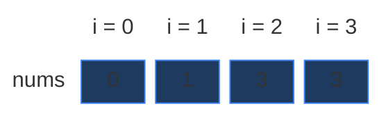

We use this example in every section below. It is small (the DP grid is 4 × 5), but it has the one trap that makes Target Sum harder than plain counting: a **zero**. `+0` and `-0` give the same value, but LeetCode counts them as **two different expressions**. That is why the answer is 4 and not 2.

Each row is one way. Green = `+` (Plus team), orange = `-` (Minus team):

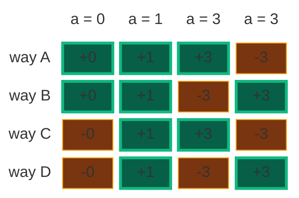

### Constraints

From LeetCode (in my notes):

- `1 <= nums.length <= 20`
- `0 <= nums[i] <= 1000`
- `0 <= sum(nums[i]) <= 1000`
- `-1000 <= target <= 1000`

Two things to notice:

- `nums[i]` can be `0`. Zeros need a special base case (Section 2).
- `target` can be **negative**. With the math trick below, a negative target just gives a smaller subset target. A target smaller than `-sum` must return 0 before we touch the table.

### What the constraints tell us (simple theory)

A **constraint** is the biggest input the judge will ever give you. It quietly tells you how fast your code must be.

**Rule of thumb:** a computer does about **100 million (10^8) simple steps per second**. Count how many steps your idea needs for the biggest input, and compare.

| Biggest input `n` | Steps you can afford | Ideas that fit |
|:---:|:---:|:---|
| up to ~20 | about `2^n` | Plain recursion, try everything |
| up to ~500 | about `n^3` | Three nested loops |
| up to ~5,000 | about `n^2` | Two nested loops |
| up to ~1,000,000 | about `n` or `n log n` | One loop, DP over `n` states |

**For this problem:** `n` is at most `20`, and the sum of all numbers is at most `1000`.

- Trying every sign pattern is `2^20 = 1,048,576` patterns. The plain `+ / -` recursion makes about 1 million calls. That is right at the edge: it passes in a fast language, and is slow in Python.
- The DP target is `S = (target + total) / 2`, and it is at most `(1000 + 1000) / 2 = 1000`. The DP grid has `n × (S + 1) <= 20 × 1001 = 20,020` cells. That is nothing.

The key: the DP work is `n · S`, not `2^n`.

**How the work grows as `n` grows**

Here `nums` is all ones and `target = 0`, so `S = n / 2`. Red bars = calls made by the plain recursion of Section 4. Green line = cells in the DP grid, `n · (S + 1)` (it stays flat near zero).

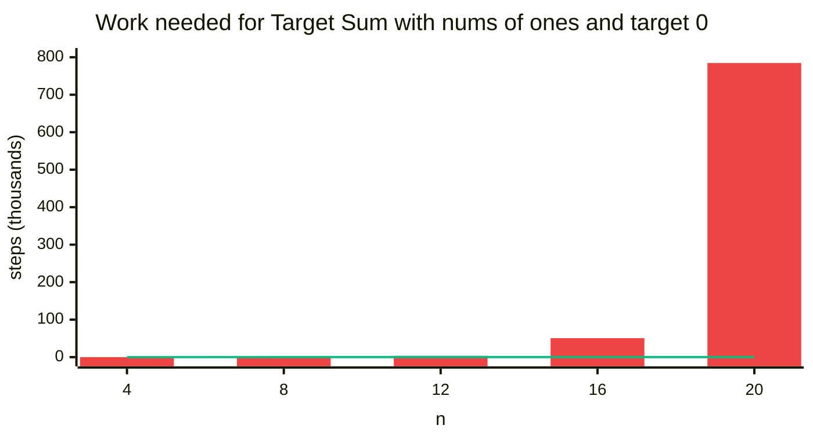

| `n` | Answer | Recursion calls (Section 4) | `+ / -` recursion calls | DP cells `n · (S + 1)` |
|:---:|:---:|:---:|:---:|:---:|
| 4 | 6 | 14 | 15 | 12 |
| 8 | 70 | 218 | 255 | 40 |
| 12 | 924 | 3,301 | 4,095 | 84 |
| 16 | 12,870 | 50,642 | 65,535 | 144 |
| 20 | 184,756 | 784,625 | 1,048,575 | 220 |

The `+ / -` recursion always makes exactly `2^n - 1` calls. The subset recursion makes a bit fewer (it cannot pick a number bigger than the target), but it still grows about 15 times for every 4 extra numbers. The DP cells grow slowly.

## 2. Core Theory

This note builds on [Count Subsets with Sum K](04.%20Count%20Subsets%20with%20Sum%20K.md) and [Partitions With Given Difference](05.%20Partitions%20With%20Given%20Difference.md). If 2-D DP is new to you, read [Subset Sum Equal To K](01.%20Subset%20Sum%20Equal%20To%20K.md) first: it teaches the grid from zero.

### First idea: just try both signs (Striver's direct recursion)

On the board, Striver first wrote the most direct recursion. `f(ind, T)` = "how many ways can `arr[0..ind]` make `T` with signs?" The last number `arr[ind]` gets a sign:

- **plus:** `arr[ind]` adds to the sum, so the rest must make `T - arr[ind]`.
- **minus:** `arr[ind]` takes away from the sum, so the rest must make `T + arr[ind]`.
- **return** `plus + minus` (we count ways, so we add).

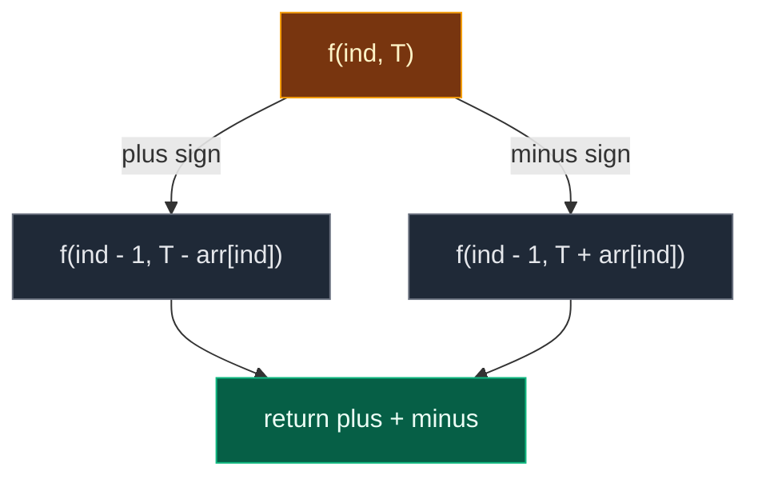

Base case at `ind == 0`: count how many of `+arr[0]` and `-arr[0]` equal `T`. If `arr[0] = 0` and `T = 0`, **both** work, so that is 2 ways. This version is correct, but it tries all `2^n` sign patterns. `T` can also go negative, so it does not fit nicely in a table. We use it as the brute force to check the other answers.

```python
# Imports used by every code block in this note
from typing import List

# For the recursion limit and the tests
import sys

# For random tests at the end
import random

# For an independent check over every sign pattern
from itertools import product


# Brute force: Striver's direct recursion, try + and - on every number
class SolutionBrute:

    # Helper: ways for nums[0..index] to make target with signs
    def solve(self, index: int, target: int, nums: List[int]) -> int:

        # Base case: only nums[0] is left
        if index == 0:

            # Count the ways
            ways = 0

            # Plus sign on nums[0] works
            if nums[0] == target:
                ways += 1

            # Minus sign on nums[0] works (for 0 both signs work: 2 ways)
            if -nums[0] == target:
                ways += 1

            # Return the ways from the first number
            return ways

        # Plus sign: the rest must make target - nums[index]
        plus = self.solve(index - 1, target - nums[index], nums)

        # Minus sign: the rest must make target + nums[index]
        minus = self.solve(index - 1, target + nums[index], nums)

        # Total ways: plus + minus
        return plus + minus

    # Main method (same name as LeetCode)
    def findTargetSumWays(self, nums: List[int], target: int) -> int:

        # Start from the last index
        return self.solve(len(nums) - 1, target, nums)
```

### The trick: plus and minus split the array into two groups

Look at the board example again: signs `- + + -` on `[1, 2, 3, 1]`. Move the plus numbers to the front: `3 + 2 - 1 - 1 = 3`. Group them: `(3 + 2) - (1 + 1) = 5 - 2 = 3`.

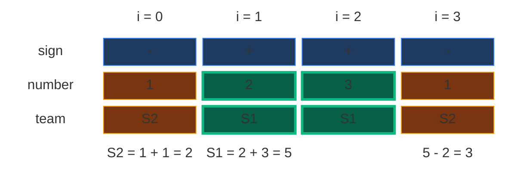

Every sign pattern **splits the array into two groups**:

- **Group P** = the numbers with a `+` sign (on the board: `S1`).
- **Group N** = the numbers with a `-` sign (on the board: `S2`).

The expression's value is just `sum(P) - sum(N)`. So the question becomes "count the splits where `S1 - S2 = D`", with `D = target`. That is exactly [Partitions With Given Difference](05.%20Partitions%20With%20Given%20Difference.md). Striver drew the arrow on the board: Target Sum → count `S1 - S2 = D` → subset sum.

### Build the equations (VERY IMPORTANT)

Let `P` = sum of the plus group and `N` = sum of the minus group.

```text
From the problem:   P - N = target      ...(1)
Every number is in one group:
                    P + N = totalSum    ...(2)

Add (1) and (2):    2P = target + totalSum
So:                 P  = (target + totalSum) / 2
```

**Final transformation:** count the subsets with sum `P = (target + totalSum) / 2`. Once we pick the plus group, the minus group is "everything else", so each such subset is exactly one sign pattern. That is [Count Subsets with Sum K](04.%20Count%20Subsets%20with%20Sum%20K.md) with `K = P`. In the code we call it `S` (the subset target).

For our example: `totalSum = 0 + 1 + 3 + 3 = 7`, so `S = (1 + 7) / 2 = 4`. The 4 subsets with sum 4 are `{0, 1, 3a}`, `{0, 1, 3b}`, `{1, 3a}`, `{1, 3b}` (`3a` and `3b` are the two 3s). Each one is one of the 4 ways above: the subset gets `+`, the rest gets `-`.

### Validity check (VERY IMPORTANT)

Before solving, check two things. If either fails, return `0` right away:

| Check | Why |
|:---|:---|
| `(target + totalSum)` must be **even** | `2P = target + totalSum`. An odd number cannot be `2P` for a whole number `P` |
| `totalSum >= abs(target)` | Even all `+` gives only `totalSum`, all `-` gives only `-totalSum`. If `target < -totalSum`, `P` would be negative, which is an impossible sum (and a negative list index) |

My notes write the second check as `target <= totalSum`. The code in my notes uses the safer `totalSum < abs(target) → return 0`, which also catches big negative targets. We use that.

Examples: `nums = [1, 1]`, `target = 1` → `1 + 2 = 3` is odd → `0`. `nums = [1, 2, 3]`, `target = -7` → `abs(-7) > 6` → `0`.

**Walkthrough from my notes:** `nums = [1, 1, 1, 1, 1]`, `target = 3`. Total sum `5`. `P = (5 + 3) / 2 = 4`. Count subsets with sum 4: pick any 4 ones out of 5. That is 5 ways. Answer `5`.

### The state, and why it needs two numbers

The **state** is the small piece of information that names one subproblem.

> `f(ind, t)` = "how many subsets of `nums[0], nums[1], ..., nums[ind]` have sum exactly `t`?" Answer: a count (0, 1, 2, ...).

One number is not enough: when we pick a number the target shrinks, when we skip it the target stays. "How many subsets of `nums[0..2]` make 4?" and "... make 1?" are different questions. So the state is `(ind, t)`: **2-D DP**. The whole answer is `f(n - 1, S)`, for us `f(3, 4)`.

### The grid: rows are numbers, columns are targets

- **Row `ind`** = "I may use `nums[0..ind]`". Going down a row = one more number is allowed.
- **Column `t`** = the sum I want, from `0` to `S`: `S + 1` columns.
- **Cell `[ind][t]`** = the number of ways (a count, not True / False).

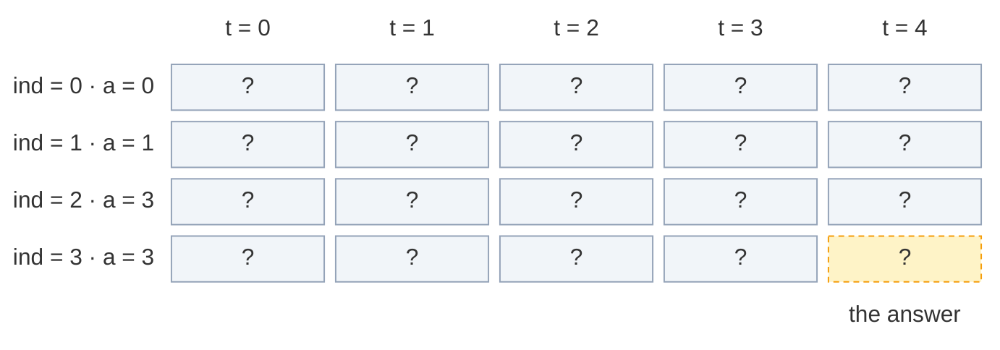

The grid has `n × (S + 1) = 4 × 5 = 20` cells. The answer is the bottom-right cell `[3][4]`.

### The recurrence: pick or not pick, then ADD

In words: *look at the last allowed number `nums[ind]`. Either skip it (it goes to the minus team) and count the ways the earlier numbers make all of `t`. Or pick it (plus team) and count the ways the earlier numbers make `t - nums[ind]`. The two groups of ways never overlap, so add them.*

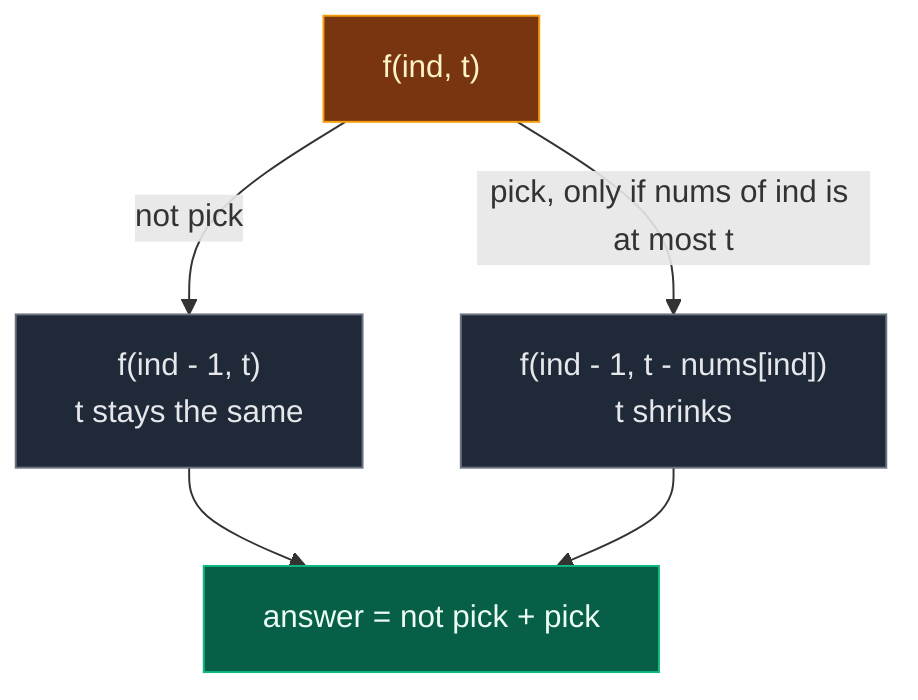

```text
not_pick = f(ind - 1, t)
pick     = f(ind - 1, t - nums[ind])     only if nums[ind] <= t
f(ind, t) = not_pick + pick
```

Subset Sum used `OR` (is there **any** way?). Here we use `+` (**how many** ways?).

### Base cases (IMPORTANT: they handle zeros)

A **base case** is a subproblem so small that we know the answer without more work. Here there is only one stopping point: `ind == 0` (only `nums[0]` is left).

| Situation at `ind == 0` | Ways | Why |
|:---|:---:|:---|
| `t == 0` and `nums[0] == 0` | `2` | Two subsets have sum 0: `{}` (skip the 0) and `{0}` (take the 0). In signs: `+0` and `-0` |
| `t == 0` (and `nums[0] != 0`) | `1` | Only the empty subset `{}` |
| `t == nums[0]` (and `nums[0] != 0`) | `1` | Only `{nums[0]}` |
| anything else | `0` | No way |

```text
if ind == 0:
    if t == 0 and nums[0] == 0: return 2
    if t == 0 or t == nums[0]:  return 1
    return 0
```

**Why not the Subset Sum base case `t == 0 → return 1` first?** It stops as soon as the target is 0 and says "1 way". But there may be zeros **still waiting** below. Each zero doubles the ways (take it or skip it). Stopping early forgets them. On our example the early stop returns **2 instead of 4**: it never sees that `nums[0] = 0` can go either way. So the zero-safe recursion **never** stops at `t == 0`, it always walks down to `ind == 0`.

### Two ways to remember: memoization vs tabulation

| | Memoization | Tabulation |
|:---|:---|:---|
| Other name | **Top-down** | **Bottom-up** |
| Direction | Start from `f(n - 1, S)`, go down to `ind == 0`, come back up | Start from row 0, fill row by row down to `[n - 1][S]` |
| How | Recursion + a 2-D table | Two nested loops + a 2-D table |
| Computes | Only the cells it needs | Every cell |
| Stack | Recursion stack (depth up to `n`) | No recursion stack |

### The 4-step ladder

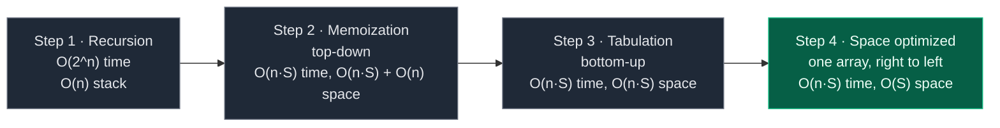

## 3. Edge Cases

| Case | Input | Expected | Why it matters |
|:---|:---:|:---:|:---|
| Single number, hits | `nums = [1]`, `target = 1` | `1` | LeetCode example 2 |
| Target too big | `nums = [1]`, `target = 2` | `0` | `abs(target) > totalSum`: return 0 early |
| Target too small | `nums = [1, 2, 3]`, `target = -7` | `0` | `P` would be `-1`: a negative index without the check |
| Odd `target + totalSum` | `nums = [1, 1]`, `target = 1` | `0` | `2P = 3` has no whole-number `P` |
| Negative target | `nums = [1, 2]`, `target = -1` | `1` | `P = 1`: only `+1 - 2` |
| `P = 0` (all minus) | `nums = [1000]`, `target = -1000` | `1` | Column 0 is the answer |
| All zeros | `nums = [0, 0, 0]`, `target = 0` | `8` | Every zero doubles: `2^3` |
| Zero at index 0, `P = 0` | `nums = [0, 1]`, `target = -1` | `2` | `+0 - 1` and `-0 - 1`. Base case `dp[0][0] = 2` |
| Zero later | `nums = [1, 0]`, `target = 1` | `2` | The loop over `t` must start at `0` so the zero doubles column 0 |
| Our example | `nums = [0, 1, 3, 3]`, `target = 1` | `4` | Traced in every section |
| Biggest input | `n = 20`, sum `1000` | – | DP is tiny: at most `20 × 1001` cells |

## 4. Approach 1: Recursion

### Idea

Reduce first, then recurse. Compute `totalSum`, do the two validity checks, set `S = (target + totalSum) / 2`. Then count the subsets of `nums` with sum `S` with the pick / not pick recursion and the zero-safe base case.

The start call is `f(n - 1, S) = f(3, 4)`: "how many subsets of `nums[0..3]` have sum 4?"

### Recursion tree for `nums = [0, 1, 3, 3]`, `S = 4`

Every box shows the call and the number of ways it returns. Calls happen depth-first, "not pick" first (like the code).

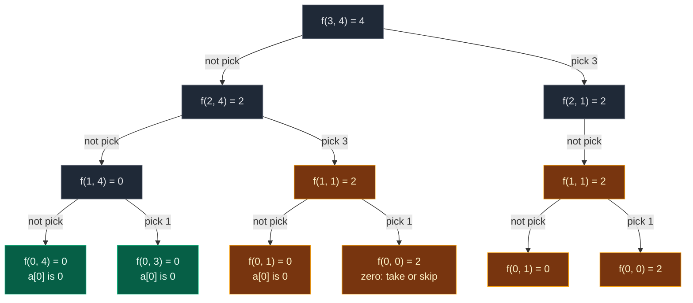

Gold = repeated work. Green = base cases that are not repeated.

`f(2, 1)` has only one child: `nums[2] = 3` is bigger than the target `1`, so "pick" is not allowed.

| State | Times computed |
|:---|:---:|
| `f(3, 4)`, `f(2, 4)`, `f(2, 1)`, `f(1, 4)` | 1 each |
| **`f(1, 1)`** | **2** |
| **`f(0, 1)`** | **2** (inside each `f(1, 1)`) |
| **`f(0, 0)`** | **2** (inside each `f(1, 1)`) |
| `f(0, 4)`, `f(0, 3)` | 1 each |

That is **12 calls** for 4 numbers. `f(1, 1)` is the overlapping subproblem: it is reached by "skip the last 3, pick the other 3" and by "pick the last 3, skip the other 3". Both paths leave the same question: "how many subsets of `[0, 1]` make 1?" (Answer 2: `{1}` and `{0, 1}`.)

Look at `f(0, 0) = 2`. That is the zero at work: `{}` and `{0}` both make 0. With the subset-sum style early stop (`t == 0 → return 1`), `f(0, 0)` returns `1` instead. Then each `f(1, 1)` becomes `0 + 1 = 1`, and the answer becomes `1 + 1 = 2`. Wrong: the two `-0` ways are lost.

**The exact order of calls.** One participant per row of the grid (`ind`). Solid arrows = calls, dashed arrows = returns.

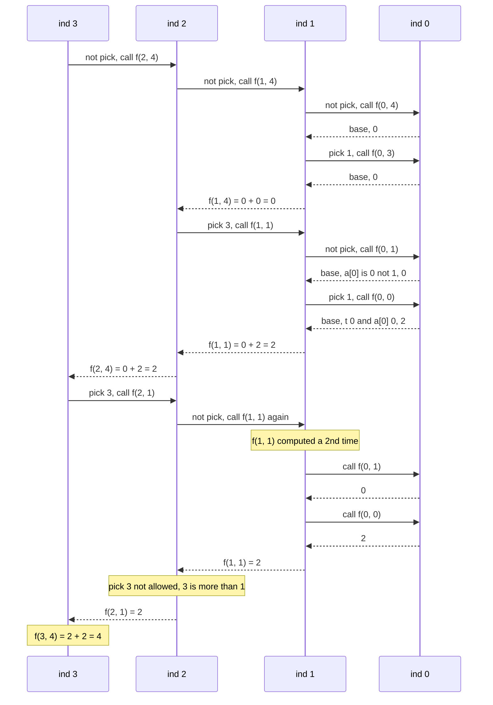

### Code

```python
# Plain recursion on the reduced problem: count subsets with sum S
class SolutionRecursion:

    # Helper: number of subsets of nums[0..index] with sum target
    def solve(self, index: int, target: int, nums: List[int]) -> int:

        # Base case: only nums[0] is left
        if index == 0:

            # Target 0 and nums[0] is 0: take it or skip it, 2 ways
            if target == 0 and nums[0] == 0:
                return 2

            # Target 0 (skip nums[0]) or target equals nums[0] (take it): 1 way
            if target == 0 or target == nums[0]:
                return 1

            # Otherwise no way
            return 0

        # Choice 1: do not pick nums[index] (it goes to the minus team)
        not_take = self.solve(index - 1, target, nums)

        # Choice 2 starts as 0 ways (not allowed yet)
        take = 0

        # Pick nums[index] only if it is not bigger than target
        if nums[index] <= target:

            # Picking it (plus team) shrinks the target
            take = self.solve(index - 1, target - nums[index], nums)

        # Count both groups of ways
        return take + not_take

    # Main method (same name as LeetCode)
    def findTargetSumWays(self, nums: List[int], target: int) -> int:

        # Sum of all numbers
        total_sum = sum(nums)

        # Target out of reach: even all + or all - cannot make it
        if total_sum < abs(target):
            return 0

        # 2P = target + total_sum must be even
        if (total_sum + target) % 2 != 0:
            return 0

        # The plus team must sum to this
        subset_target = (total_sum + target) // 2

        # Count subsets of all numbers with that sum
        return self.solve(len(nums) - 1, subset_target, nums)
```

### Complexity

| Measure | Complexity | Why |
|:---|:---:|:---|
| **Time** | `O(2^n)` | At each index there are 2 choices (take / not take), so the recursion explores almost all subsets |
| **Space** | `O(n)` | Recursion stack depth goes up to `n` |

## 5. Approach 2: Memoization (Top-Down)

### Idea

The recursion solves the same `(ind, t)` state more than once. Save each count the first time in a 2-D table `dp[ind][t]`, then reuse it.

| Value | Meaning |
|:---:|:---|
| `-1` | Not computed yet |
| `0, 1, 2, ...` | Computed: the number of ways |

`-1` is safe as "not computed" because a count is never negative.

**Size of the table.** `ind` goes `0 .. n - 1` (`n` rows), `t` goes `0 .. S` (`S + 1` columns). So `dp` is `n × (S + 1)`. For us: `4 × 5`.

The same **3 steps** as always:

1. **Declare** `dp` with `n` rows and `S + 1` columns, all `-1`.
2. **Store** the count before returning: `dp[ind][t] = take + not_take`.
3. **Check** first: if `dp[ind][t] != -1`, return it and make no new calls.

Base-case cells (row 0) are never stored. The `ind == 0` check answers them before the table is used, so row 0 stays `-1`.

**Memoization example from my notes:** `nums = [1, 1, 1, 1, 1]`, `target = 3`, `subset_target = 4`. The notes say "suppose `solve(2, 2)` is needed many times: compute it once, then return `dp[2][2]`". That is the right idea, but I counted every call with code: `solve(2, 2)` is reached only **once** there. The states that really repeat are `solve(2, 3)`, `solve(1, 2)`, `solve(1, 3)` and some row-0 calls. Plain recursion makes 31 calls on that input.

### Visual: when each `dp[ind][t]` gets filled

Colours: grey = `-1`, dashed yellow = computing (waiting for its children), green = just filled, blue = filled earlier, orange = cache hit.

**Start:** `dp` is `4 × 5`, all `-1`.

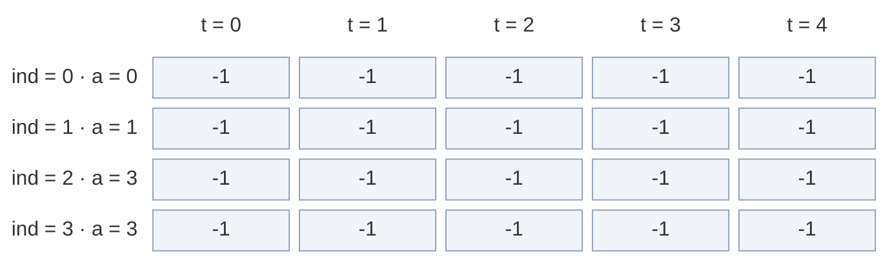

**Calls go down the "not pick" side:** `f(3, 4)`, `f(2, 4)`, `f(1, 4)` all see `-1` and start computing.

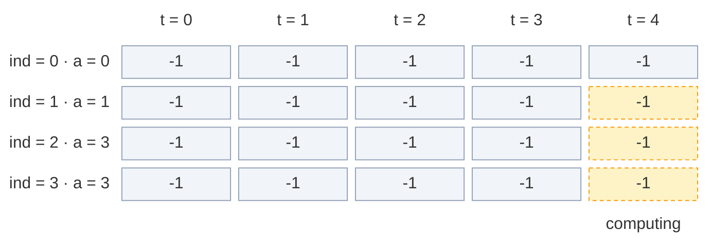

**Fill 1:** `f(1, 4)` asks `f(0, 4)` (base → 0) and `f(0, 3)` (base → 0). `0 + 0 = 0`. Store `dp[1][4] = 0`.

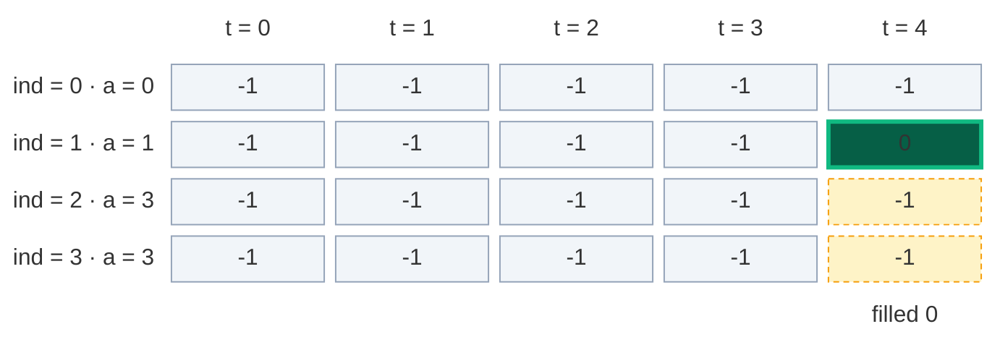

**Fill 2:** back in `f(2, 4)`, "pick 3" calls `f(1, 1)`, which is `-1`. It asks `f(0, 1)` (base → 0) and `f(0, 0)` (base, zero → 2). `0 + 2 = 2`. Store `dp[1][1] = 2`.

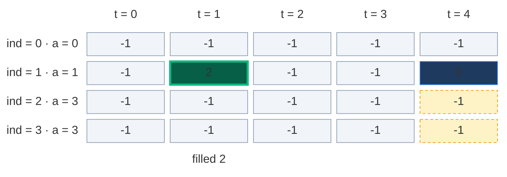

**Fill 3:** `f(2, 4) = 0 + 2 = 2`. Store `dp[2][4] = 2`.

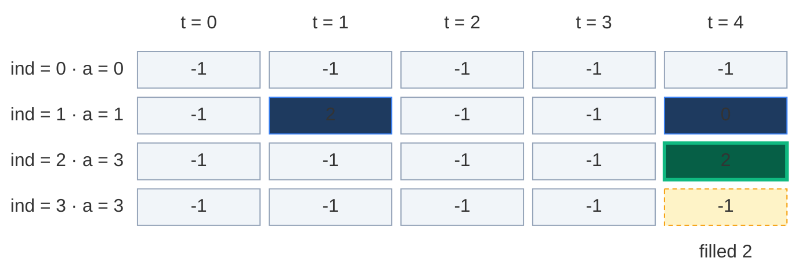

**Cache hit:** `f(3, 4)` now tries "pick 3" → `f(2, 1)`, which is `-1`. Its "not pick" asks `f(1, 1)`. `dp[1][1] = 2` is not `-1`, so it returns 2 with **no new calls**. The 2 calls under `f(1, 1)` are skipped.

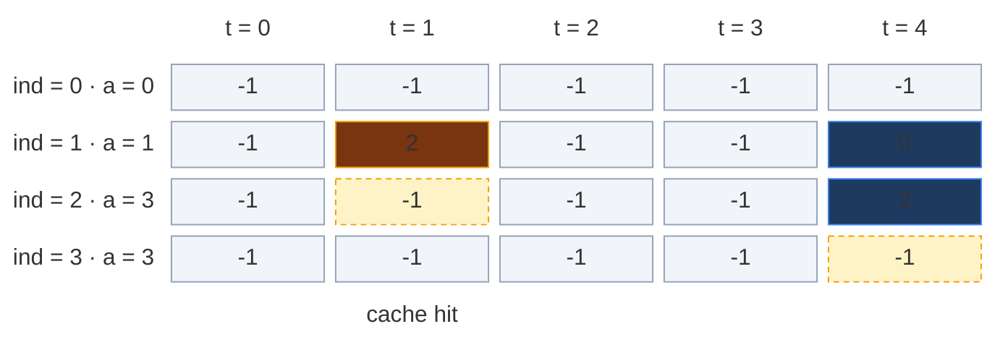

**Fill 4:** in `f(2, 1)`, "pick 3" is not allowed (`3 > 1`). So `f(2, 1) = 2 + 0 = 2`. Store `dp[2][1] = 2`.

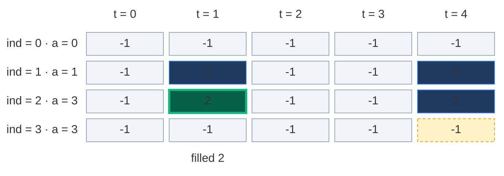

**Fill 5:** `f(3, 4) = 2 + 2 = 4`. Store `dp[3][4] = 4`. That is the answer.

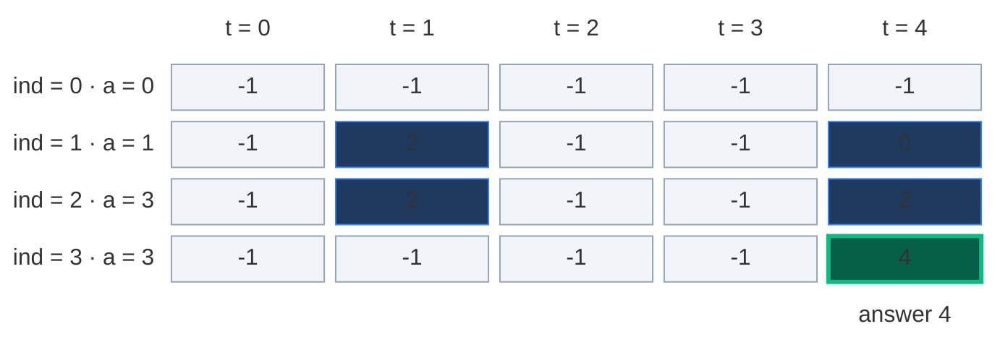

Only 5 of the 20 cells were stored. Memoization computes only the states it needs.

### The pruned recursion tree

The same tree, but the cache hit (dashed) stops right away.

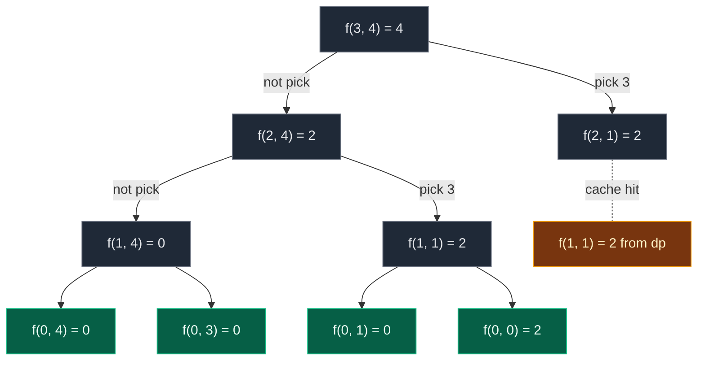

**10 calls** instead of 12. On bigger inputs the saving is huge: at most `n · (S + 1)` states are ever computed.

### Code

```python
# Memoization (top-down DP) with a 2-D table of -1
class SolutionMemo:

    # Helper: number of subsets of nums[0..index] with sum target
    def solve(self, index: int, target: int, nums: List[int], dp: List[List[int]]) -> int:

        # Base case: only nums[0] is left
        if index == 0:

            # Target 0 and nums[0] is 0: take it or skip it, 2 ways
            if target == 0 and nums[0] == 0:
                return 2

            # Skip nums[0] for target 0, or take it when it equals target: 1 way
            if target == 0 or target == nums[0]:
                return 1

            # Otherwise no way
            return 0

        # Step 3 (check): already solved? Reuse it
        if dp[index][target] != -1:
            return dp[index][target]

        # Choice 1: do not take nums[index]
        not_take = self.solve(index - 1, target, nums, dp)

        # Choice 2 starts as 0 ways
        take = 0

        # Take nums[index] only if it fits
        if nums[index] <= target:

            # Taking it shrinks the target
            take = self.solve(index - 1, target - nums[index], nums, dp)

        # Step 2 (store): the total count
        dp[index][target] = take + not_take

        # Return the stored count
        return dp[index][target]

    # Main method (same name as LeetCode)
    def findTargetSumWays(self, nums: List[int], target: int) -> int:

        # Sum of all numbers
        total_sum = sum(nums)

        # Target out of reach
        if total_sum < abs(target):
            return 0

        # target + total_sum must be even
        if (total_sum + target) % 2 != 0:
            return 0

        # The plus team must sum to this
        subset_target = (total_sum + target) // 2

        # Number of numbers
        n = len(nums)

        # Python only: allow recursion as deep as n
        sys.setrecursionlimit(max(1000, 2 * n + 100))

        # Step 1 (declare): n rows, subset_target + 1 columns, all -1
        dp = [[-1] * (subset_target + 1) for _ in range(n)]

        # Keep the table so the tests can look at it
        self.dp = dp

        # Start from the last index and the full subset target
        return self.solve(n - 1, subset_target, nums, dp)
```

### Complexity

| Measure | Complexity | Why |
|:---|:---:|:---|
| **Time** | `O(n · S)` | At most `n · (S + 1)` states (`index = 0 .. n - 1`, `target = 0 .. S`), each solved once |
| **Space: dp table** | `O(n · S)` | `n` rows × `S + 1` columns |
| **Space: recursion stack** | `O(n)` | The deepest path goes from `n - 1` down to `0` |
| **Total space** | `O(n · S) + O(n)` | Table plus stack |

## 6. Approach 3: Tabulation (Bottom-Up)

### Idea

Fill the whole grid with two loops, from row 0 down to the answer `[n - 1][S]`. No recursion, so no stack.

`dp[i][t]` = "number of ways to make sum `t` using the numbers from index `0` to `i`".

### How to convert memo → table, step by step

1. **Same grid:** `dp` with `n` rows and `S + 1` columns, all `0`.
2. **Base cases become cells (row 0):**
   - If `nums[0] == 0`: `dp[0][0] = 2` (take the zero or skip it).
   - Else: `dp[0][0] = 1` (choose nothing).
   - If `nums[0] != 0` and `nums[0] <= S`: `dp[0][nums[0]] = 1` (take it, one way).
3. **Two nested loops, in the opposite direction:** `ind` from `1` to `n - 1`, and `t` from **`0`** to `S`.
4. **Copy the recurrence:** `dp[ind][t] = dp[ind - 1][t] + dp[ind - 1][t - nums[ind]]` (the second part only if `nums[ind] <= t`).
5. **Answer:** `dp[n - 1][S]`.

**Why does `t` start at 0 here?** In Subset Sum, column 0 was always `True`, so we wrote it once and started at 1. Here column 0 is a **count**, and it grows every time a zero shows up. For `nums = [1, 0]`, `dp[1][0]` must be `2` (`{}` and `{0}`). Starting at `t = 0` lets the normal recurrence compute it: `dp[1][0] = dp[0][0] + dp[0][0 - 0] = 1 + 1 = 2`.

**Why the `nums[0] != 0` check?** If `nums[0] == 0`, then `dp[0][nums[0]]` is `dp[0][0]`. Writing `1` there would overwrite the `2`.

| Memoization | Becomes in tabulation |
|:---|:---|
| `dp[n][S + 1]` with `-1` | `dp[n][S + 1]` with `0` |
| `ind == 0` base cases | Row 0: `dp[0][0] = 2 or 1`, `dp[0][nums[0]] = 1` |
| `f(n - 1, S)` going down | Loops `ind = 1 .. n - 1`, `t = 0 .. S` going up |
| `f(ind - 1, t)` | `dp[ind - 1][t]` |
| `f(ind - 1, t - nums[ind])` | `dp[ind - 1][t - nums[ind]]` |
| `return f(n - 1, S)` | `return dp[n - 1][S]` |

**Picture rule:** to fill a cell, look **straight up** (not take) and **up, then `nums[ind]` steps left** (take). Add them.

### Visual table fill (`nums = [0, 1, 3, 3]`, `S = 4`)

Colours: green = just filled, orange = the cells it reads, blue = filled earlier, grey `?` = not filled yet.

**Start: row 0.** `nums[0] = 0`, so `dp[0][0] = 2`. Every other target is 0 ways.

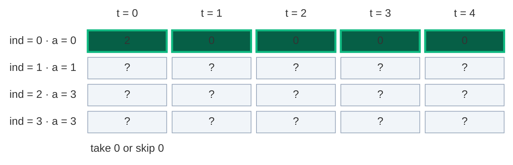

#### Row 1 (`nums[1] = 1`), cell by cell

**`dp[1][0]`:** not take = `dp[0][0] = 2`. Take: `1 > 0`, not allowed. Result `2`.

```mermaid
block-beta
  columns 6
  hx[" "] h0["t = 0"] h1["t = 1"] h2["t = 2"] h3["t = 3"] h4["t = 4"]
  l0["ind = 0 · a = 0"] r0c0["2"] r0c1["0"] r0c2["0"] r0c3["0"] r0c4["0"]
  l1["ind = 1 · a = 1"] r1c0["2"] r1c1["?"] r1c2["?"] r1c3["?"] r1c4["?"]
  l2["ind = 2 · a = 3"] r2c0["?"] r2c1["?"] r2c2["?"] r2c3["?"] r2c4["?"]
  l3["ind = 3 · a = 3"] r3c0["?"] r3c1["?"] r3c2["?"] r3c3["?"] r3c4["?"]
  space m0["= 2 + no pick"] space space space space
  classDef head fill:none,stroke:none,color:#64748b
  class hx,h0,h1,h2,h3,h4,l0,l1,l2,l3 head
  classDef read fill:#78350f,stroke:#f59e0b,color:#fef3c7
  class r0c0 read
  classDef done fill:#1e3a5f,stroke:#3b82f6,color:#dbeafe
  class r0c1,r0c2,r0c3,r0c4 done
  classDef new fill:#065f46,stroke:#10b981,color:#ecfdf5,stroke-width:3px
  class r1c0 new
  classDef empty fill:#f1f5f9,stroke:#94a3b8,color:#64748b
  class r1c1,r1c2,r1c3,r1c4,r2c0,r2c1,r2c2,r2c3,r2c4,r3c0,r3c1,r3c2,r3c3,r3c4 empty
  classDef note fill:none,stroke:none,color:#b45309
  class m0 note
```

**`dp[1][1]`:** not take = `dp[0][1] = 0`. Take = `dp[0][0] = 2`. Result `2`.

```mermaid
block-beta
  columns 6
  hx[" "] h0["t = 0"] h1["t = 1"] h2["t = 2"] h3["t = 3"] h4["t = 4"]
  l0["ind = 0 · a = 0"] r0c0["2"] r0c1["0"] r0c2["0"] r0c3["0"] r0c4["0"]
  l1["ind = 1 · a = 1"] r1c0["2"] r1c1["2"] r1c2["?"] r1c3["?"] r1c4["?"]
  l2["ind = 2 · a = 3"] r2c0["?"] r2c1["?"] r2c2["?"] r2c3["?"] r2c4["?"]
  l3["ind = 3 · a = 3"] r3c0["?"] r3c1["?"] r3c2["?"] r3c3["?"] r3c4["?"]
  space space m1["= 0 + 2"] space space space
  classDef head fill:none,stroke:none,color:#64748b
  class hx,h0,h1,h2,h3,h4,l0,l1,l2,l3 head
  classDef read fill:#78350f,stroke:#f59e0b,color:#fef3c7
  class r0c0,r0c1 read
  classDef done fill:#1e3a5f,stroke:#3b82f6,color:#dbeafe
  class r0c2,r0c3,r0c4,r1c0 done
  classDef new fill:#065f46,stroke:#10b981,color:#ecfdf5,stroke-width:3px
  class r1c1 new
  classDef empty fill:#f1f5f9,stroke:#94a3b8,color:#64748b
  class r1c2,r1c3,r1c4,r2c0,r2c1,r2c2,r2c3,r2c4,r3c0,r3c1,r3c2,r3c3,r3c4 empty
  classDef note fill:none,stroke:none,color:#b45309
  class m1 note
```

**`dp[1][2]`:** not take = `dp[0][2] = 0`. Take = `dp[0][1] = 0`. Result `0`.

```mermaid
block-beta
  columns 6
  hx[" "] h0["t = 0"] h1["t = 1"] h2["t = 2"] h3["t = 3"] h4["t = 4"]
  l0["ind = 0 · a = 0"] r0c0["2"] r0c1["0"] r0c2["0"] r0c3["0"] r0c4["0"]
  l1["ind = 1 · a = 1"] r1c0["2"] r1c1["2"] r1c2["0"] r1c3["?"] r1c4["?"]
  l2["ind = 2 · a = 3"] r2c0["?"] r2c1["?"] r2c2["?"] r2c3["?"] r2c4["?"]
  l3["ind = 3 · a = 3"] r3c0["?"] r3c1["?"] r3c2["?"] r3c3["?"] r3c4["?"]
  space space space m2["= 0 + 0"] space space
  classDef head fill:none,stroke:none,color:#64748b
  class hx,h0,h1,h2,h3,h4,l0,l1,l2,l3 head
  classDef done fill:#1e3a5f,stroke:#3b82f6,color:#dbeafe
  class r0c0,r0c3,r0c4,r1c0,r1c1 done
  classDef read fill:#78350f,stroke:#f59e0b,color:#fef3c7
  class r0c1,r0c2 read
  classDef new fill:#065f46,stroke:#10b981,color:#ecfdf5,stroke-width:3px
  class r1c2 new
  classDef empty fill:#f1f5f9,stroke:#94a3b8,color:#64748b
  class r1c3,r1c4,r2c0,r2c1,r2c2,r2c3,r2c4,r3c0,r3c1,r3c2,r3c3,r3c4 empty
  classDef note fill:none,stroke:none,color:#b45309
  class m2 note
```

**`dp[1][3]`:** not take = `dp[0][3] = 0`. Take = `dp[0][2] = 0`. Result `0`.

```mermaid
block-beta
  columns 6
  hx[" "] h0["t = 0"] h1["t = 1"] h2["t = 2"] h3["t = 3"] h4["t = 4"]
  l0["ind = 0 · a = 0"] r0c0["2"] r0c1["0"] r0c2["0"] r0c3["0"] r0c4["0"]
  l1["ind = 1 · a = 1"] r1c0["2"] r1c1["2"] r1c2["0"] r1c3["0"] r1c4["?"]
  l2["ind = 2 · a = 3"] r2c0["?"] r2c1["?"] r2c2["?"] r2c3["?"] r2c4["?"]
  l3["ind = 3 · a = 3"] r3c0["?"] r3c1["?"] r3c2["?"] r3c3["?"] r3c4["?"]
  space space space space m3["= 0 + 0"] space
  classDef head fill:none,stroke:none,color:#64748b
  class hx,h0,h1,h2,h3,h4,l0,l1,l2,l3 head
  classDef done fill:#1e3a5f,stroke:#3b82f6,color:#dbeafe
  class r0c0,r0c1,r0c4,r1c0,r1c1,r1c2 done
  classDef read fill:#78350f,stroke:#f59e0b,color:#fef3c7
  class r0c2,r0c3 read
  classDef new fill:#065f46,stroke:#10b981,color:#ecfdf5,stroke-width:3px
  class r1c3 new
  classDef empty fill:#f1f5f9,stroke:#94a3b8,color:#64748b
  class r1c4,r2c0,r2c1,r2c2,r2c3,r2c4,r3c0,r3c1,r3c2,r3c3,r3c4 empty
  classDef note fill:none,stroke:none,color:#b45309
  class m3 note
```

**`dp[1][4]`:** not take = `dp[0][4] = 0`. Take = `dp[0][3] = 0`. Result `0`.

```mermaid
block-beta
  columns 6
  hx[" "] h0["t = 0"] h1["t = 1"] h2["t = 2"] h3["t = 3"] h4["t = 4"]
  l0["ind = 0 · a = 0"] r0c0["2"] r0c1["0"] r0c2["0"] r0c3["0"] r0c4["0"]
  l1["ind = 1 · a = 1"] r1c0["2"] r1c1["2"] r1c2["0"] r1c3["0"] r1c4["0"]
  l2["ind = 2 · a = 3"] r2c0["?"] r2c1["?"] r2c2["?"] r2c3["?"] r2c4["?"]
  l3["ind = 3 · a = 3"] r3c0["?"] r3c1["?"] r3c2["?"] r3c3["?"] r3c4["?"]
  space space space space space m4["= 0 + 0"]
  classDef head fill:none,stroke:none,color:#64748b
  class hx,h0,h1,h2,h3,h4,l0,l1,l2,l3 head
  classDef done fill:#1e3a5f,stroke:#3b82f6,color:#dbeafe
  class r0c0,r0c1,r0c2,r1c0,r1c1,r1c2,r1c3 done
  classDef read fill:#78350f,stroke:#f59e0b,color:#fef3c7
  class r0c3,r0c4 read
  classDef new fill:#065f46,stroke:#10b981,color:#ecfdf5,stroke-width:3px
  class r1c4 new
  classDef empty fill:#f1f5f9,stroke:#94a3b8,color:#64748b
  class r2c0,r2c1,r2c2,r2c3,r2c4,r3c0,r3c1,r3c2,r3c3,r3c4 empty
  classDef note fill:none,stroke:none,color:#b45309
  class m4 note
```

**After row 1:** with `{0, 1}` we can make 0 in 2 ways and 1 in 2 ways.

```mermaid
block-beta
  columns 6
  hx[" "] h0["t = 0"] h1["t = 1"] h2["t = 2"] h3["t = 3"] h4["t = 4"]
  l0["ind = 0 · a = 0"] r0c0["2"] r0c1["0"] r0c2["0"] r0c3["0"] r0c4["0"]
  l1["ind = 1 · a = 1"] r1c0["2"] r1c1["2"] r1c2["0"] r1c3["0"] r1c4["0"]
  l2["ind = 2 · a = 3"] r2c0["?"] r2c1["?"] r2c2["?"] r2c3["?"] r2c4["?"]
  l3["ind = 3 · a = 3"] r3c0["?"] r3c1["?"] r3c2["?"] r3c3["?"] r3c4["?"]
  classDef head fill:none,stroke:none,color:#64748b
  class hx,h0,h1,h2,h3,h4,l0,l1,l2,l3 head
  classDef done fill:#1e3a5f,stroke:#3b82f6,color:#dbeafe
  class r0c0,r0c1,r0c2,r0c3,r0c4,r1c0,r1c1,r1c2,r1c3,r1c4 done
  classDef empty fill:#f1f5f9,stroke:#94a3b8,color:#64748b
  class r2c0,r2c1,r2c2,r2c3,r2c4,r3c0,r3c1,r3c2,r3c3,r3c4 empty
```

#### Row 2 (`nums[2] = 3`), cell by cell

**`dp[2][0]`:** not take = `dp[1][0] = 2`. Take: `3 > 0`, not allowed. Result `2`.

```mermaid
block-beta
  columns 6
  hx[" "] h0["t = 0"] h1["t = 1"] h2["t = 2"] h3["t = 3"] h4["t = 4"]
  l0["ind = 0 · a = 0"] r0c0["2"] r0c1["0"] r0c2["0"] r0c3["0"] r0c4["0"]
  l1["ind = 1 · a = 1"] r1c0["2"] r1c1["2"] r1c2["0"] r1c3["0"] r1c4["0"]
  l2["ind = 2 · a = 3"] r2c0["2"] r2c1["?"] r2c2["?"] r2c3["?"] r2c4["?"]
  l3["ind = 3 · a = 3"] r3c0["?"] r3c1["?"] r3c2["?"] r3c3["?"] r3c4["?"]
  space m0["= 2 + no pick"] space space space space
  classDef head fill:none,stroke:none,color:#64748b
  class hx,h0,h1,h2,h3,h4,l0,l1,l2,l3 head
  classDef done fill:#1e3a5f,stroke:#3b82f6,color:#dbeafe
  class r0c0,r0c1,r0c2,r0c3,r0c4,r1c1,r1c2,r1c3,r1c4 done
  classDef read fill:#78350f,stroke:#f59e0b,color:#fef3c7
  class r1c0 read
  classDef new fill:#065f46,stroke:#10b981,color:#ecfdf5,stroke-width:3px
  class r2c0 new
  classDef empty fill:#f1f5f9,stroke:#94a3b8,color:#64748b
  class r2c1,r2c2,r2c3,r2c4,r3c0,r3c1,r3c2,r3c3,r3c4 empty
  classDef note fill:none,stroke:none,color:#b45309
  class m0 note
```

**`dp[2][1]`:** not take = `dp[1][1] = 2`. Take: `3 > 1`, not allowed. Result `2`.

```mermaid
block-beta
  columns 6
  hx[" "] h0["t = 0"] h1["t = 1"] h2["t = 2"] h3["t = 3"] h4["t = 4"]
  l0["ind = 0 · a = 0"] r0c0["2"] r0c1["0"] r0c2["0"] r0c3["0"] r0c4["0"]
  l1["ind = 1 · a = 1"] r1c0["2"] r1c1["2"] r1c2["0"] r1c3["0"] r1c4["0"]
  l2["ind = 2 · a = 3"] r2c0["2"] r2c1["2"] r2c2["?"] r2c3["?"] r2c4["?"]
  l3["ind = 3 · a = 3"] r3c0["?"] r3c1["?"] r3c2["?"] r3c3["?"] r3c4["?"]
  space space m1["= 2 + no pick"] space space space
  classDef head fill:none,stroke:none,color:#64748b
  class hx,h0,h1,h2,h3,h4,l0,l1,l2,l3 head
  classDef done fill:#1e3a5f,stroke:#3b82f6,color:#dbeafe
  class r0c0,r0c1,r0c2,r0c3,r0c4,r1c0,r1c2,r1c3,r1c4,r2c0 done
  classDef read fill:#78350f,stroke:#f59e0b,color:#fef3c7
  class r1c1 read
  classDef new fill:#065f46,stroke:#10b981,color:#ecfdf5,stroke-width:3px
  class r2c1 new
  classDef empty fill:#f1f5f9,stroke:#94a3b8,color:#64748b
  class r2c2,r2c3,r2c4,r3c0,r3c1,r3c2,r3c3,r3c4 empty
  classDef note fill:none,stroke:none,color:#b45309
  class m1 note
```

**`dp[2][2]`:** not take = `dp[1][2] = 0`. Take: `3 > 2`, not allowed. Result `0`.

```mermaid
block-beta
  columns 6
  hx[" "] h0["t = 0"] h1["t = 1"] h2["t = 2"] h3["t = 3"] h4["t = 4"]
  l0["ind = 0 · a = 0"] r0c0["2"] r0c1["0"] r0c2["0"] r0c3["0"] r0c4["0"]
  l1["ind = 1 · a = 1"] r1c0["2"] r1c1["2"] r1c2["0"] r1c3["0"] r1c4["0"]
  l2["ind = 2 · a = 3"] r2c0["2"] r2c1["2"] r2c2["0"] r2c3["?"] r2c4["?"]
  l3["ind = 3 · a = 3"] r3c0["?"] r3c1["?"] r3c2["?"] r3c3["?"] r3c4["?"]
  space space space m2["= 0 + no pick"] space space
  classDef head fill:none,stroke:none,color:#64748b
  class hx,h0,h1,h2,h3,h4,l0,l1,l2,l3 head
  classDef done fill:#1e3a5f,stroke:#3b82f6,color:#dbeafe
  class r0c0,r0c1,r0c2,r0c3,r0c4,r1c0,r1c1,r1c3,r1c4,r2c0,r2c1 done
  classDef read fill:#78350f,stroke:#f59e0b,color:#fef3c7
  class r1c2 read
  classDef new fill:#065f46,stroke:#10b981,color:#ecfdf5,stroke-width:3px
  class r2c2 new
  classDef empty fill:#f1f5f9,stroke:#94a3b8,color:#64748b
  class r2c3,r2c4,r3c0,r3c1,r3c2,r3c3,r3c4 empty
  classDef note fill:none,stroke:none,color:#b45309
  class m2 note
```

**`dp[2][3]`:** not take = `dp[1][3] = 0`. Take = `dp[1][0] = 2`. Result `2`.

```mermaid
block-beta
  columns 6
  hx[" "] h0["t = 0"] h1["t = 1"] h2["t = 2"] h3["t = 3"] h4["t = 4"]
  l0["ind = 0 · a = 0"] r0c0["2"] r0c1["0"] r0c2["0"] r0c3["0"] r0c4["0"]
  l1["ind = 1 · a = 1"] r1c0["2"] r1c1["2"] r1c2["0"] r1c3["0"] r1c4["0"]
  l2["ind = 2 · a = 3"] r2c0["2"] r2c1["2"] r2c2["0"] r2c3["2"] r2c4["?"]
  l3["ind = 3 · a = 3"] r3c0["?"] r3c1["?"] r3c2["?"] r3c3["?"] r3c4["?"]
  space space space space m3["= 0 + 2"] space
  classDef head fill:none,stroke:none,color:#64748b
  class hx,h0,h1,h2,h3,h4,l0,l1,l2,l3 head
  classDef done fill:#1e3a5f,stroke:#3b82f6,color:#dbeafe
  class r0c0,r0c1,r0c2,r0c3,r0c4,r1c1,r1c2,r1c4,r2c0,r2c1,r2c2 done
  classDef read fill:#78350f,stroke:#f59e0b,color:#fef3c7
  class r1c0,r1c3 read
  classDef new fill:#065f46,stroke:#10b981,color:#ecfdf5,stroke-width:3px
  class r2c3 new
  classDef empty fill:#f1f5f9,stroke:#94a3b8,color:#64748b
  class r2c4,r3c0,r3c1,r3c2,r3c3,r3c4 empty
  classDef note fill:none,stroke:none,color:#b45309
  class m3 note
```

**`dp[2][4]`:** not take = `dp[1][4] = 0`. Take = `dp[1][1] = 2`. Result `2`.

```mermaid
block-beta
  columns 6
  hx[" "] h0["t = 0"] h1["t = 1"] h2["t = 2"] h3["t = 3"] h4["t = 4"]
  l0["ind = 0 · a = 0"] r0c0["2"] r0c1["0"] r0c2["0"] r0c3["0"] r0c4["0"]
  l1["ind = 1 · a = 1"] r1c0["2"] r1c1["2"] r1c2["0"] r1c3["0"] r1c4["0"]
  l2["ind = 2 · a = 3"] r2c0["2"] r2c1["2"] r2c2["0"] r2c3["2"] r2c4["2"]
  l3["ind = 3 · a = 3"] r3c0["?"] r3c1["?"] r3c2["?"] r3c3["?"] r3c4["?"]
  space space space space space m4["= 0 + 2"]
  classDef head fill:none,stroke:none,color:#64748b
  class hx,h0,h1,h2,h3,h4,l0,l1,l2,l3 head
  classDef done fill:#1e3a5f,stroke:#3b82f6,color:#dbeafe
  class r0c0,r0c1,r0c2,r0c3,r0c4,r1c0,r1c2,r1c3,r2c0,r2c1,r2c2,r2c3 done
  classDef read fill:#78350f,stroke:#f59e0b,color:#fef3c7
  class r1c1,r1c4 read
  classDef new fill:#065f46,stroke:#10b981,color:#ecfdf5,stroke-width:3px
  class r2c4 new
  classDef empty fill:#f1f5f9,stroke:#94a3b8,color:#64748b
  class r3c0,r3c1,r3c2,r3c3,r3c4 empty
  classDef note fill:none,stroke:none,color:#b45309
  class m4 note
```

**After row 2:**

```mermaid
block-beta
  columns 6
  hx[" "] h0["t = 0"] h1["t = 1"] h2["t = 2"] h3["t = 3"] h4["t = 4"]
  l0["ind = 0 · a = 0"] r0c0["2"] r0c1["0"] r0c2["0"] r0c3["0"] r0c4["0"]
  l1["ind = 1 · a = 1"] r1c0["2"] r1c1["2"] r1c2["0"] r1c3["0"] r1c4["0"]
  l2["ind = 2 · a = 3"] r2c0["2"] r2c1["2"] r2c2["0"] r2c3["2"] r2c4["2"]
  l3["ind = 3 · a = 3"] r3c0["?"] r3c1["?"] r3c2["?"] r3c3["?"] r3c4["?"]
  classDef head fill:none,stroke:none,color:#64748b
  class hx,h0,h1,h2,h3,h4,l0,l1,l2,l3 head
  classDef done fill:#1e3a5f,stroke:#3b82f6,color:#dbeafe
  class r0c0,r0c1,r0c2,r0c3,r0c4,r1c0,r1c1,r1c2,r1c3,r1c4,r2c0,r2c1,r2c2,r2c3,r2c4 done
  classDef empty fill:#f1f5f9,stroke:#94a3b8,color:#64748b
  class r3c0,r3c1,r3c2,r3c3,r3c4 empty
```

#### Row 3 (`nums[3] = 3`)

| Cell | not take (up) | take (up, 3 left) | Result |
|:---:|:---:|:---:|:---:|
| `dp[3][0]` | `dp[2][0] = 2` | not allowed | `2` |
| `dp[3][1]` | `dp[2][1] = 2` | not allowed | `2` |
| `dp[3][2]` | `dp[2][2] = 0` | not allowed | `0` |
| `dp[3][3]` | `dp[2][3] = 2` | `dp[2][0] = 2` | `4` |
| `dp[3][4]` | `dp[2][4] = 2` | `dp[2][1] = 2` | `4` |

```mermaid
block-beta
  columns 6
  hx[" "] h0["t = 0"] h1["t = 1"] h2["t = 2"] h3["t = 3"] h4["t = 4"]
  l0["ind = 0 · a = 0"] r0c0["2"] r0c1["0"] r0c2["0"] r0c3["0"] r0c4["0"]
  l1["ind = 1 · a = 1"] r1c0["2"] r1c1["2"] r1c2["0"] r1c3["0"] r1c4["0"]
  l2["ind = 2 · a = 3"] r2c0["2"] r2c1["2"] r2c2["0"] r2c3["2"] r2c4["2"]
  l3["ind = 3 · a = 3"] r3c0["2"] r3c1["2"] r3c2["0"] r3c3["4"] r3c4["4"]
  space space space space space m4["answer 4"]
  classDef head fill:none,stroke:none,color:#64748b
  class hx,h0,h1,h2,h3,h4,l0,l1,l2,l3 head
  classDef done fill:#1e3a5f,stroke:#3b82f6,color:#dbeafe
  class r0c0,r0c1,r0c2,r0c3,r0c4,r1c0,r1c1,r1c2,r1c3,r1c4,r2c0,r2c1,r2c2,r2c3,r2c4,r3c0,r3c1,r3c2,r3c3 done
  classDef new fill:#065f46,stroke:#10b981,color:#ecfdf5,stroke-width:3px
  class r3c4 new
  classDef note fill:none,stroke:none,color:#b45309
  class m4 note
```

**Answer:** `dp[3][4] = 4`.

**Tabulation example from my notes:** `nums = [1, 1, 1, 1, 1]`, `target = 3`, `subset_target = 4`. We build the table for sums `0 .. 4`. After all 5 ones, the last row gives `dp[4][4] = 5`. Answer `5`.

### Code

```python
# Tabulation (bottom-up DP)
class SolutionTab:

    # Main method (same name as LeetCode)
    def findTargetSumWays(self, nums: List[int], target: int) -> int:

        # Sum of all numbers
        total_sum = sum(nums)

        # Target out of reach
        if total_sum < abs(target):
            return 0

        # target + total_sum must be even
        if (total_sum + target) % 2 != 0:
            return 0

        # The plus team must sum to this
        subset_target = (total_sum + target) // 2

        # Number of numbers
        n = len(nums)

        # Step 1: dp[i][t] = ways to make t with nums[0..i], all 0
        dp = [[0] * (subset_target + 1) for _ in range(n)]

        # Step 2a: the first number is 0
        if nums[0] == 0:

            # Two ways to make 0: take the zero or skip it
            dp[0][0] = 2

        # The first number is not 0
        else:

            # One way to make 0: choose nothing
            dp[0][0] = 1

        # Step 2b: a non-zero first number that fits makes itself
        if nums[0] != 0 and nums[0] <= subset_target:

            # Exactly one way
            dp[0][nums[0]] = 1

        # Step 3: fill row by row
        for index in range(1, n):

            # Every target, starting at 0 (zeros change column 0)
            for curr_target in range(0, subset_target + 1):

                # Choice 1: do not take the current number
                not_take = dp[index - 1][curr_target]

                # Choice 2 starts as 0 ways
                take = 0

                # Take only if the number fits
                if nums[index] <= curr_target:

                    # Ways from the smaller target in the row above
                    take = dp[index - 1][curr_target - nums[index]]

                # Step 4: total ways for this cell
                dp[index][curr_target] = take + not_take

        # Keep the table so the tests can look at it
        self.dp = dp

        # Step 5: the answer is the bottom-right cell
        return dp[n - 1][subset_target]
```

### Complexity

| Measure | Complexity | Why |
|:---|:---:|:---|
| **Time** | `O(n · S)` | We fill an `n × (S + 1)` table |
| **Space** | `O(n · S)` | The full table is stored. No recursion stack |

## 7. Approach 4: Space Optimization (Optimal)

### Idea

Every cell of row `ind` reads only **row `ind - 1`** (straight up, and up-left). Older rows are never read again. So two rows are enough: `prev` (row `ind - 1`) and `cur` (row `ind`).

**Why `O(S)` and not `O(1)`?** A cell reads `prev[t - nums[ind]]`, and `nums[ind]` can be any size. So a cell may need **any** cell of the row above. We must keep the whole row: `S + 1` values.

**Two rows on our example.** Start with `prev` = row 0:

```mermaid
block-beta
  columns 6
  hx[" "] h0["t = 0"] h1["t = 1"] h2["t = 2"] h3["t = 3"] h4["t = 4"]
  l0["prev · row 0"] r0c0["2"] r0c1["0"] r0c2["0"] r0c3["0"] r0c4["0"]
  space m0["take 0 or skip 0"] space space space space
  classDef head fill:none,stroke:none,color:#64748b
  class hx,h0,h1,h2,h3,h4,l0 head
  classDef new fill:#065f46,stroke:#10b981,color:#ecfdf5,stroke-width:3px
  class r0c0,r0c1,r0c2,r0c3,r0c4 new
  classDef note fill:none,stroke:none,color:#b45309
  class m0 note
```

`ind = 1` (`nums[1] = 1`): each `cur[t]` = `prev[t]` + `prev[t - 1]`.

```mermaid
block-beta
  columns 6
  hx[" "] h0["t = 0"] h1["t = 1"] h2["t = 2"] h3["t = 3"] h4["t = 4"]
  l0["prev · rows 0..0"] r0c0["2"] r0c1["0"] r0c2["0"] r0c3["0"] r0c4["0"]
  l1["cur · a = 1"] r1c0["2"] r1c1["2"] r1c2["0"] r1c3["0"] r1c4["0"]
  space m0["2 + none"] m1["0 + 2"] m2["0 + 0"] m3["0 + 0"] m4["0 + 0"]
  classDef head fill:none,stroke:none,color:#64748b
  class hx,h0,h1,h2,h3,h4,l0,l1 head
  classDef read fill:#78350f,stroke:#f59e0b,color:#fef3c7
  class r0c0,r0c1,r0c2,r0c3,r0c4 read
  classDef new fill:#065f46,stroke:#10b981,color:#ecfdf5,stroke-width:3px
  class r1c0,r1c1,r1c2,r1c3,r1c4 new
  classDef note fill:none,stroke:none,color:#b45309
  class m0,m1,m2,m3,m4 note
```

`ind = 2` (`nums[2] = 3`): each `cur[t]` = `prev[t]` + `prev[t - 3]`.

```mermaid
block-beta
  columns 6
  hx[" "] h0["t = 0"] h1["t = 1"] h2["t = 2"] h3["t = 3"] h4["t = 4"]
  l0["prev · rows 0..1"] r0c0["2"] r0c1["2"] r0c2["0"] r0c3["0"] r0c4["0"]
  l1["cur · a = 3"] r1c0["2"] r1c1["2"] r1c2["0"] r1c3["2"] r1c4["2"]
  space m0["2 + none"] m1["2 + none"] m2["0 + none"] m3["0 + 2"] m4["0 + 2"]
  classDef head fill:none,stroke:none,color:#64748b
  class hx,h0,h1,h2,h3,h4,l0,l1 head
  classDef read fill:#78350f,stroke:#f59e0b,color:#fef3c7
  class r0c0,r0c1,r0c2,r0c3,r0c4 read
  classDef new fill:#065f46,stroke:#10b981,color:#ecfdf5,stroke-width:3px
  class r1c0,r1c1,r1c2,r1c3,r1c4 new
  classDef note fill:none,stroke:none,color:#b45309
  class m0,m1,m2,m3,m4 note
```

`ind = 3` (`nums[3] = 3`): the answer `cur[4] = 4`.

```mermaid
block-beta
  columns 6
  hx[" "] h0["t = 0"] h1["t = 1"] h2["t = 2"] h3["t = 3"] h4["t = 4"]
  l0["prev · rows 0..2"] r0c0["2"] r0c1["2"] r0c2["0"] r0c3["2"] r0c4["2"]
  l1["cur · a = 3"] r1c0["2"] r1c1["2"] r1c2["0"] r1c3["4"] r1c4["4"]
  space m0["2 + none"] m1["2 + none"] m2["0 + none"] m3["2 + 2"] m4["2 + 2"]
  classDef head fill:none,stroke:none,color:#64748b
  class hx,h0,h1,h2,h3,h4,l0,l1 head
  classDef read fill:#78350f,stroke:#f59e0b,color:#fef3c7
  class r0c0,r0c1,r0c2,r0c3,r0c4 read
  classDef new fill:#065f46,stroke:#10b981,color:#ecfdf5,stroke-width:3px
  class r1c0,r1c1,r1c2,r1c3,r1c4 new
  classDef note fill:none,stroke:none,color:#b45309
  class m0,m1,m2,m3,m4 note
```

```python
# Space optimized with two rows: prev and cur
class SolutionTwoRows:

    # Main method (same name as LeetCode)
    def findTargetSumWays(self, nums: List[int], target: int) -> int:

        # Sum of all numbers
        total_sum = sum(nums)

        # Target out of reach, or odd target + total_sum
        if total_sum < abs(target) or (total_sum + target) % 2 != 0:
            return 0

        # The plus team must sum to this
        s = (total_sum + target) // 2

        # prev = row 0, all 0 to start
        prev = [0] * (s + 1)

        # Ways to make 0 with nums[0]: 2 if it is 0, else 1
        prev[0] = 2 if nums[0] == 0 else 1

        # A non-zero first number that fits makes itself
        if nums[0] != 0 and nums[0] <= s:

            # One way
            prev[nums[0]] = 1

        # One new row per number
        for index in range(1, len(nums)):

            # The new row
            cur = [0] * (s + 1)

            # Every target from 0
            for t in range(s + 1):

                # Not take: same target in the row above
                cur[t] = prev[t]

                # Take, if the number fits
                if nums[index] <= t:

                    # Add the ways from the smaller target
                    cur[t] += prev[t - nums[index]]

            # The current row becomes the previous row
            prev = cur

        # Answer for all numbers and target s
        return prev[s]
```

**One array (my notes' version).** The current row depends only on the previous row, so we can keep just **one** array and update it in place. Since this is a **0/1** counting DP (each number used at most once), we must move the target from **right to left**. Going backward, `dp[t - num]` is still the old value (the "row above") when we read it.

For a zero, the loop also covers `t = 0`, and `dp[t] += dp[t - 0]` simply doubles every count. That is "take the zero or skip it" for free, with no special base case.

### Visual Walkthrough (Story Version)

**The story:** four friends hold number cards `0`, `1`, `3`, `3`. Each friend joins the **Plus team** or the **Minus team**. The game score is "Plus team total minus Minus team total". They want the score to be exactly `1`.

Coach Lina does the math: all cards add up to 7. If the score must be 1, the Plus team must hold `(1 + 7) / 2 = 4` points. So she only has to count the ways to build a Plus team worth 4.

She draws a **tally board** with slots `0 pts` to `4 pts`. Each slot shows "in how many ways can the Plus team hold exactly this many points?". When a new card arrives, she walks the slots **from right to left**: slot `w` gets **plus** the old count of slot `w - card` (the new friend joins the Plus team). The old count stays too (the friend joins the Minus team).

**Start: no cards yet.** The only Plus team is the empty team, worth 0 points: 1 way.

```mermaid
block-beta
  columns 6
  hx[" "] h0["0 pts"] h1["1 pt"] h2["2 pts"] h3["3 pts"] h4["4 pts"]
  l0["tally · no cards"] r0c0["1"] r0c1["0"] r0c2["0"] r0c3["0"] r0c4["0"]
  space m0["empty team"] space space space space
  classDef head fill:none,stroke:none,color:#64748b
  class hx,h0,h1,h2,h3,h4,l0 head
  classDef new fill:#065f46,stroke:#10b981,color:#ecfdf5,stroke-width:3px
  class r0c0 new
  classDef done fill:#1e3a5f,stroke:#3b82f6,color:#dbeafe
  class r0c1,r0c2,r0c3,r0c4 done
  classDef note fill:none,stroke:none,color:#b45309
  class m0 note
```

**Step 1: card 0 arrives.** Slot `0 pts`: the zero friend can join Plus or Minus and the score is still 0. `1 + 1 = 2` ways.

```mermaid
block-beta
  columns 6
  hx[" "] h0["0 pts"] h1["1 pt"] h2["2 pts"] h3["3 pts"] h4["4 pts"]
  l0["old tally"] r0c0["1"] r0c1["0"] r0c2["0"] r0c3["0"] r0c4["0"]
  l1["new tally · card 0"] r1c0["2"] r1c1["0"] r1c2["0"] r1c3["0"] r1c4["0"]
  space m0["1 + 1"] space space space space
  classDef head fill:none,stroke:none,color:#64748b
  class hx,h0,h1,h2,h3,h4,l0,l1 head
  classDef read fill:#78350f,stroke:#f59e0b,color:#fef3c7
  class r0c0 read
  classDef done fill:#1e3a5f,stroke:#3b82f6,color:#dbeafe
  class r0c1,r0c2,r0c3,r0c4,r1c1,r1c2,r1c3,r1c4 done
  classDef new fill:#065f46,stroke:#10b981,color:#ecfdf5,stroke-width:3px
  class r1c0 new
  classDef note fill:none,stroke:none,color:#b45309
  class m0 note
```

**Step 2: card 1 arrives.** Slot `1 pts` = old `1 pts` (0) + old `0 pts` (2) = 2. Nothing else changes.

```mermaid
block-beta
  columns 6
  hx[" "] h0["0 pts"] h1["1 pt"] h2["2 pts"] h3["3 pts"] h4["4 pts"]
  l0["old tally"] r0c0["2"] r0c1["0"] r0c2["0"] r0c3["0"] r0c4["0"]
  l1["new tally · card 1"] r1c0["2"] r1c1["2"] r1c2["0"] r1c3["0"] r1c4["0"]
  space space m1["0 + 2"] space space space
  classDef head fill:none,stroke:none,color:#64748b
  class hx,h0,h1,h2,h3,h4,l0,l1 head
  classDef read fill:#78350f,stroke:#f59e0b,color:#fef3c7
  class r0c0 read
  classDef done fill:#1e3a5f,stroke:#3b82f6,color:#dbeafe
  class r0c1,r0c2,r0c3,r0c4,r1c0,r1c2,r1c3,r1c4 done
  classDef new fill:#065f46,stroke:#10b981,color:#ecfdf5,stroke-width:3px
  class r1c1 new
  classDef note fill:none,stroke:none,color:#b45309
  class m1 note
```

**Step 3: the first card 3 arrives.** Slot `4 pts` = old 0 + old `1 pts` (2) = 2. Slot `3 pts` = old 0 + old `0 pts` (2) = 2.

```mermaid
block-beta
  columns 6
  hx[" "] h0["0 pts"] h1["1 pt"] h2["2 pts"] h3["3 pts"] h4["4 pts"]
  l0["old tally"] r0c0["2"] r0c1["2"] r0c2["0"] r0c3["0"] r0c4["0"]
  l1["new tally · card 3"] r1c0["2"] r1c1["2"] r1c2["0"] r1c3["2"] r1c4["2"]
  space space space space m3["0 + 2"] m4["0 + 2"]
  classDef head fill:none,stroke:none,color:#64748b
  class hx,h0,h1,h2,h3,h4,l0,l1 head
  classDef read fill:#78350f,stroke:#f59e0b,color:#fef3c7
  class r0c0,r0c1 read
  classDef done fill:#1e3a5f,stroke:#3b82f6,color:#dbeafe
  class r0c2,r0c3,r0c4,r1c0,r1c1,r1c2 done
  classDef new fill:#065f46,stroke:#10b981,color:#ecfdf5,stroke-width:3px
  class r1c3,r1c4 new
  classDef note fill:none,stroke:none,color:#b45309
  class m3,m4 note
```

**Step 4: the second card 3 arrives.** Slot `4 pts` = old 2 + old `1 pts` (2) = 4. Slot `3 pts` = old 2 + old `0 pts` (2) = 4.

```mermaid
block-beta
  columns 6
  hx[" "] h0["0 pts"] h1["1 pt"] h2["2 pts"] h3["3 pts"] h4["4 pts"]
  l0["old tally"] r0c0["2"] r0c1["2"] r0c2["0"] r0c3["2"] r0c4["2"]
  l1["new tally · card 3"] r1c0["2"] r1c1["2"] r1c2["0"] r1c3["4"] r1c4["4"]
  space space space space m3["2 + 2"] m4["2 + 2"]
  classDef head fill:none,stroke:none,color:#64748b
  class hx,h0,h1,h2,h3,h4,l0,l1 head
  classDef read fill:#78350f,stroke:#f59e0b,color:#fef3c7
  class r0c0,r0c1 read
  classDef done fill:#1e3a5f,stroke:#3b82f6,color:#dbeafe
  class r0c2,r0c3,r0c4,r1c0,r1c1,r1c2 done
  classDef new fill:#065f46,stroke:#10b981,color:#ecfdf5,stroke-width:3px
  class r1c3,r1c4 new
  classDef note fill:none,stroke:none,color:#b45309
  class m3,m4 note
```

**The end:** slot `4 pts` shows **4**. There are 4 ways to pick signs.

**All steps at a glance**

| Step | Card | Board before | Changes | Board after |
|:---:|:---:|:---|:---|:---|
| start | – | – | slot 0 = 1 | `[1, 0, 0, 0, 0]` |
| 1 | 0 | `[1, 0, 0, 0, 0]` | slot 0: `1 + 1` | `[2, 0, 0, 0, 0]` |
| 2 | 1 | `[2, 0, 0, 0, 0]` | slot 1: `0 + 2` | `[2, 2, 0, 0, 0]` |
| 3 | 3 | `[2, 2, 0, 0, 0]` | slot 4: `0 + 2`, slot 3: `0 + 2` | `[2, 2, 0, 2, 2]` |
| 4 | 3 | `[2, 2, 0, 2, 2]` | slot 4: `2 + 2`, slot 3: `2 + 2` | `[2, 2, 0, 4, 4]` |

**What the story teaches**

| In the story | In the code |
|:---|:---|
| A friend's card | `num` |
| Plus team / Minus team | Take / not take |
| Plus team must hold 4 points | `subset_target = (target + total_sum) // 2` |
| Slot `w pts` | `dp[w]` |
| Empty team, 1 way | `dp[0] = 1` |
| Walk the slots right to left | `range(subset_target, num - 1, -1)` |
| Slot `w` gets old slot `w - card` added | `dp[w] += dp[w - num]` |
| The zero friend doubles slot 0 | For `num = 0`, `dp[0] += dp[0]` |
| Read slot `4 pts` | `return dp[subset_target]` |

### Step-by-Step Example

`nums = [0, 1, 3, 3]`, `target = 1`. `total_sum = 7`. `abs(1) <= 7` ✓. `1 + 7 = 8` is even ✓. `subset_target = 4`. Start: `dp = [1, 0, 0, 0, 0]`.

Every loop step (`t` goes from 4 down to `num`):

| `num` | `t` | old `dp[t]` | `dp[t - num]` | new `dp[t]` | `dp` after the step |
|:---:|:---:|:---:|:---:|:---:|:---|
| 0 | 4 | 0 | 0 | 0 | `[1, 0, 0, 0, 0]` |
| 0 | 3 | 0 | 0 | 0 | `[1, 0, 0, 0, 0]` |
| 0 | 2 | 0 | 0 | 0 | `[1, 0, 0, 0, 0]` |
| 0 | 1 | 0 | 0 | 0 | `[1, 0, 0, 0, 0]` |
| 0 | 0 | 1 | 1 | 2 | `[2, 0, 0, 0, 0]` |
| 1 | 4 | 0 | `dp[3] = 0` | 0 | `[2, 0, 0, 0, 0]` |
| 1 | 3 | 0 | `dp[2] = 0` | 0 | `[2, 0, 0, 0, 0]` |
| 1 | 2 | 0 | `dp[1] = 0` | 0 | `[2, 0, 0, 0, 0]` |
| 1 | 1 | 0 | `dp[0] = 2` | 2 | `[2, 2, 0, 0, 0]` |
| 3 | 4 | 0 | `dp[1] = 2` | 2 | `[2, 2, 0, 0, 2]` |
| 3 | 3 | 0 | `dp[0] = 2` | 2 | `[2, 2, 0, 2, 2]` |
| 3 | 4 | 2 | `dp[1] = 2` | 4 | `[2, 2, 0, 2, 4]` |
| 3 | 3 | 2 | `dp[0] = 2` | 4 | `[2, 2, 0, 4, 4]` |

The array after each number (green = changed):

```mermaid
block-beta
  columns 6
  hx[" "] h0["t = 0"] h1["t = 1"] h2["t = 2"] h3["t = 3"] h4["t = 4"]
  l0["start"] r0c0["1"] r0c1["0"] r0c2["0"] r0c3["0"] r0c4["0"]
  l1["after card 0"] r1c0["2"] r1c1["0"] r1c2["0"] r1c3["0"] r1c4["0"]
  l2["after card 1"] r2c0["2"] r2c1["2"] r2c2["0"] r2c3["0"] r2c4["0"]
  l3["after card 3"] r3c0["2"] r3c1["2"] r3c2["0"] r3c3["2"] r3c4["2"]
  l4["after card 3"] r4c0["2"] r4c1["2"] r4c2["0"] r4c3["4"] r4c4["4"]
  classDef head fill:none,stroke:none,color:#64748b
  class hx,h0,h1,h2,h3,h4,l0,l1,l2,l3,l4 head
  classDef done fill:#1e3a5f,stroke:#3b82f6,color:#dbeafe
  class r0c0,r0c1,r0c2,r0c3,r0c4,r1c1,r1c2,r1c3,r1c4,r2c0,r2c2,r2c3,r2c4,r3c0,r3c1,r3c2,r4c0,r4c1,r4c2 done
  classDef new fill:#065f46,stroke:#10b981,color:#ecfdf5,stroke-width:3px
  class r1c0,r2c1,r3c3,r3c4,r4c3,r4c4 new
```

Return `dp[4] = 4`. Same as `dp[3][4]` in the table.

**Space optimization example from my notes:** `nums = [1, 1, 1, 1, 1]`, `target = 3`, `subset_target = 4`. Start `dp = [1, 0, 0, 0, 0]`. After the 1st one: `[1, 1, 0, 0, 0]`. 2nd: `[1, 2, 1, 0, 0]`. 3rd: `[1, 3, 3, 1, 0]`. 4th: `[1, 4, 6, 4, 1]`. 5th: `[1, 5, 10, 10, 5]`. So `dp[4] = 5`. Answer `5`. (These are the rows of Pascal's triangle: choosing 4 ones out of 5.)

```mermaid
block-beta
  columns 6
  hx[" "] h0["t = 0"] h1["t = 1"] h2["t = 2"] h3["t = 3"] h4["t = 4"]
  l0["start"] r0c0["1"] r0c1["0"] r0c2["0"] r0c3["0"] r0c4["0"]
  l1["after 1st 1"] r1c0["1"] r1c1["1"] r1c2["0"] r1c3["0"] r1c4["0"]
  l2["after 2nd 1"] r2c0["1"] r2c1["2"] r2c2["1"] r2c3["0"] r2c4["0"]
  l3["after 3rd 1"] r3c0["1"] r3c1["3"] r3c2["3"] r3c3["1"] r3c4["0"]
  l4["after 4th 1"] r4c0["1"] r4c1["4"] r4c2["6"] r4c3["4"] r4c4["1"]
  l5["after 5th 1"] r5c0["1"] r5c1["5"] r5c2["10"] r5c3["10"] r5c4["5"]
  classDef head fill:none,stroke:none,color:#64748b
  class hx,h0,h1,h2,h3,h4,l0,l1,l2,l3,l4,l5 head
  classDef done fill:#1e3a5f,stroke:#3b82f6,color:#dbeafe
  class r0c0,r0c1,r0c2,r0c3,r0c4,r1c0,r1c2,r1c3,r1c4,r2c0,r2c3,r2c4,r3c0,r3c4,r4c0,r5c0 done
  classDef new fill:#065f46,stroke:#10b981,color:#ecfdf5,stroke-width:3px
  class r1c1,r2c1,r2c2,r3c1,r3c2,r3c3,r4c1,r4c2,r4c3,r4c4,r5c1,r5c2,r5c3 new
  classDef read fill:#78350f,stroke:#f59e0b,color:#fef3c7
  class r5c4 read
```

**Why right to left?** Take `[3]` with a subset target of 6. Going forward, `dp[3]` becomes 1, then `dp[6]` reads the **new** `dp[3]` and becomes 1: the 3 was used twice. Wrong:

```mermaid
block-beta
  columns 8
  hx[" "] h0["t = 0"] h1["t = 1"] h2["t = 2"] h3["t = 3"] h4["t = 4"] h5["t = 5"] h6["t = 6"]
  l0["forward"] r0c0["1"] r0c1["0"] r0c2["0"] r0c3["1"] r0c4["0"] r0c5["0"] r0c6["1"]
  space space space space m3["uses 3"] space space m6["3 used twice"]
  classDef head fill:none,stroke:none,color:#64748b
  class hx,h0,h1,h2,h3,h4,h5,h6,l0 head
  classDef done fill:#1e3a5f,stroke:#3b82f6,color:#dbeafe
  class r0c0,r0c1,r0c2,r0c3,r0c4,r0c5 done
  classDef wait fill:#fef3c7,stroke:#f59e0b,color:#78350f,stroke-dasharray:4 3
  class r0c6 wait
  classDef note fill:none,stroke:none,color:#b45309
  class m3,m6 note
```

Going backward, `dp[6]` reads `dp[3]` while it is still 0. Correct:

```mermaid
block-beta
  columns 8
  hx[" "] h0["t = 0"] h1["t = 1"] h2["t = 2"] h3["t = 3"] h4["t = 4"] h5["t = 5"] h6["t = 6"]
  l0["backward"] r0c0["1"] r0c1["0"] r0c2["0"] r0c3["1"] r0c4["0"] r0c5["0"] r0c6["0"]
  space space space space m3["uses 3"] space space m6["correct 0"]
  classDef head fill:none,stroke:none,color:#64748b
  class hx,h0,h1,h2,h3,h4,h5,h6,l0 head
  classDef done fill:#1e3a5f,stroke:#3b82f6,color:#dbeafe
  class r0c0,r0c1,r0c2,r0c4,r0c5,r0c6 done
  classDef new fill:#065f46,stroke:#10b981,color:#ecfdf5,stroke-width:3px
  class r0c3 new
  classDef note fill:none,stroke:none,color:#b45309
  class m3,m6 note
```

### Code

```python
# Space optimized: one array, targets from right to left
class Solution:

    # Main method (same name as LeetCode)
    def findTargetSumWays(self, nums: List[int], target: int) -> int:

        # Sum of all numbers
        total_sum = sum(nums)

        # Target too large in size: no expression can reach it
        if total_sum < abs(target):
            return 0

        # total_sum + target odd: the subset target is not a whole number
        if (total_sum + target) % 2 != 0:
            return 0

        # Turn Target Sum into Count Subsets with sum subset_target
        subset_target = (total_sum + target) // 2

        # dp[t] = number of ways to make sum t with the numbers seen so far
        dp = [0] * (subset_target + 1)

        # One way to make 0 at the start: the empty subset
        dp[0] = 1

        # Process every number one by one
        for num in nums:

            # Go backward so the same number is not reused
            for curr_target in range(subset_target, num - 1, -1):

                # Add the ways of making the smaller target
                dp[curr_target] = dp[curr_target] + dp[curr_target - num]

        # Final answer
        return dp[subset_target]


# ---------- Tests ----------

# Our example
nums = [0, 1, 3, 3]

# Our target
target = 1


# Recursion: a version of the helper that counts calls
class CountingRecursion(SolutionRecursion):

    # Set up the counter
    def __init__(self):

        # No calls yet
        self.calls = 0

    # Count the call, then do the normal work
    def solve(self, index, t, arr):

        # One more call
        self.calls += 1

        # Same logic as SolutionRecursion
        return super().solve(index, t, arr)


# Make the counting version
counter = CountingRecursion()

# Recursion tree: f(3, 4) = 4
assert counter.findTargetSumWays(nums, target) == 4

# Recursion tree: 12 calls
assert counter.calls == 12


# Memoization: a version of the helper that counts calls
class CountingMemo(SolutionMemo):

    # Set up the counter
    def __init__(self):

        # No calls yet
        self.calls = 0

    # Count the call, then do the normal work
    def solve(self, index, t, arr, dp):

        # One more call
        self.calls += 1

        # Same logic as SolutionMemo
        return super().solve(index, t, arr, dp)


# Make the counting memo version
memo = CountingMemo()

# Memoization answer
assert memo.findTargetSumWays(nums, target) == 4

# Pruned tree: 10 calls
assert memo.calls == 10

# Memo table after the run: 5 cells stored, row 0 stays -1
assert memo.dp == [[-1, -1, -1, -1, -1], [-1, 2, -1, -1, 0], [-1, 2, -1, -1, 2], [-1, -1, -1, -1, 4]]


# The zeros trap: Subset Sum style base case (t == 0 first)
def trap(index, t, arr):

    # Stops too early: forgets zeros still waiting below
    if t == 0:
        return 1

    # Only arr[0] left
    if index == 0:
        return 1 if arr[0] == t else 0

    # Not take
    ways = trap(index - 1, t, arr)

    # Take, if it fits
    if arr[index] <= t:

        # Add the take ways
        ways += trap(index - 1, t - arr[index], arr)

    # Total
    return ways


# The trap gives 2 instead of 4
assert trap(3, 4, nums) == 2

# Tabulation answer
tab = SolutionTab()

# Same answer
assert tab.findTargetSumWays(nums, target) == 4

# The grid after every row, as drawn in Section 6
assert tab.dp == [[2, 0, 0, 0, 0], [2, 2, 0, 0, 0], [2, 2, 0, 2, 2], [2, 2, 0, 4, 4]]

# Two rows answer
assert SolutionTwoRows().findTargetSumWays(nums, target) == 4

# One array trace: the dp after every number
dp = [1, 0, 0, 0, 0]

# Expected rows after 0, 1, 3, 3
expected_rows = [[2, 0, 0, 0, 0], [2, 2, 0, 0, 0], [2, 2, 0, 2, 2], [2, 2, 0, 4, 4]]

# Same loop as Solution
for i, num in enumerate(nums):

    # Right to left
    for t in range(4, num - 1, -1):

        # Add the smaller target
        dp[t] += dp[t - num]

    # Matches the Step-by-Step table
    assert dp == expected_rows[i]

# My notes' trace on [1, 1, 1, 1, 1] with subset target 4
dp = [1, 0, 0, 0, 0]

# Expected after each 1
ones_rows = [[1, 1, 0, 0, 0], [1, 2, 1, 0, 0], [1, 3, 3, 1, 0], [1, 4, 6, 4, 1], [1, 5, 10, 10, 5]]

# Each of the five ones
for i in range(5):

    # Right to left
    for t in range(4, 0, -1):

        # Add the smaller target
        dp[t] += dp[t - 1]

    # Matches the notes
    assert dp == ones_rows[i]

# Striver's board example: 2 ways
assert SolutionBrute().findTargetSumWays([1, 2, 3, 1], 3) == 2

# Final answer
assert Solution().findTargetSumWays(nums, target) == 4

# All versions
versions = [SolutionBrute(), SolutionRecursion(), SolutionMemo(), SolutionTab(), SolutionTwoRows(), Solution()]

# LeetCode examples, board example and edge cases from Section 3
cases = [
    ([1, 1, 1, 1, 1], 3, 5),
    ([1], 1, 1),
    ([1, 2, 3, 1], 3, 2),
    ([1], 2, 0),
    ([1, 2, 3], -7, 0),
    ([1, 1], 1, 0),
    ([1, 2], -1, 1),
    ([1000], -1000, 1),
    ([0, 0, 0], 0, 8),
    ([0, 1], -1, 2),
    ([1, 0], 1, 2),
    ([0, 1, 3, 3], 1, 4),
]

# Every version on every case
for arr, tg, expected in cases:

    # Each version
    for v in versions:

        # Same answer as expected
        assert v.findTargetSumWays(arr, tg) == expected


# Independent check: try every sign pattern
def by_signs(arr, tg):

    # Count patterns whose value is tg
    return sum(1 for signs in product((1, -1), repeat=len(arr)) if sum(s * x for s, x in zip(signs, arr)) == tg)


# Random tests (zeros and negative targets included)
random.seed(494)

# Many random tests
for _ in range(300):

    # Random size 1 to 9
    size = random.randint(1, 9)

    # Random numbers 0 to 6
    arr = [random.randint(0, 6) for _ in range(size)]

    # Random target, sometimes out of reach
    tg = random.randint(-sum(arr) - 2, sum(arr) + 2)

    # The true count
    expected = by_signs(arr, tg)

    # Each version must agree
    for v in versions:

        # Same count
        assert v.findTargetSumWays(arr, tg) == expected

# Biggest input: n = 20, sum 1000
big = [50] * 20

# Loop version on the biggest input
assert Solution().findTargetSumWays(big, 0) == SolutionTab().findTargetSumWays(big, 0) == 184756

# Memoization on the biggest input
assert SolutionMemo().findTargetSumWays(big, 0) == 184756

# All checks passed
print("All tests passed")
```

### Complexity

| Approach | Time | Space | Stack |
|:---|:---:|:---:|:---:|
| Brute force (`+ / -` recursion) | `O(2^n)` | `O(1)` extra | `O(n)` |
| Recursion (subset count) | `O(2^n)` | `O(1)` extra | `O(n)` |
| Memoization | `O(n · S)` | `O(n · S)` dp | `O(n)` |
| Tabulation | `O(n · S)` | `O(n · S)` dp | none |
| Two rows | `O(n · S)` | `O(S)` | none |
| **One array, right to left** | **`O(n · S)`** | **`O(S)`** | **none** |

Here `S = subset_target = (total_sum + target) / 2`. For every number we go through all target values once, and only one array is kept.

## 8. Common Mistakes

| Mistake | What goes wrong | Fix |
|:---|:---|:---|
| No parity check | `(target + total) // 2` rounds down, and we count the wrong subsets | `if (total + target) % 2 != 0: return 0` |
| Checking only `target <= total` | `target = -7` with total 6 gives `P = -1`: a broken table | `if total < abs(target): return 0` |
| Subset Sum base case `t == 0 → 1` first | Zeros still waiting below are forgotten. Our example gives 2 instead of 4 | Stop only at `ind == 0`, with `t == 0 and nums[0] == 0 → 2` |
| `dp[0][0] = 1` even when `nums[0] == 0` | Loses the `-0` ways | `dp[0][0] = 2` if `nums[0] == 0` |
| `dp[0][nums[0]] = 1` without `nums[0] != 0` | When `nums[0] == 0` it overwrites the `2` with `1` | Guard with `nums[0] != 0 and nums[0] <= S` |
| Target loop starting at `1`, with `dp[i][0] = 1` preset | A zero after index 0 never doubles column 0. `[1, 0]`, `target = -1` gives 1 instead of 2 | Loop `t` from `0` |
| Forward loop in the one-array version | A number is used twice | Loop `t` from `S` down to `num` |
| Using `OR` instead of `+` | Returns True / False, not a count | Add `take + not_take` |
| Treating `+0` and `-0` as one way | Undercounts. `[0, 0, 0]`, `target = 0` is 8, not 1 | Each zero doubles the count |

## 9. Interview Follow-ups

### Q1. Why is the subset target `(target + totalSum) / 2`?

**Answer:**
- Let `P` = sum of the `+` numbers and `N` = sum of the `-` numbers.
- `P - N = target` and `P + N = totalSum`.
- Add them: `2P = target + totalSum`, so `P = (target + totalSum) / 2`.
- Picking the plus group fixes the minus group (everything else), so each subset with sum `P` is exactly one expression.

### Q2. Why the two validity checks?

**Answer:**
- `target + totalSum` odd → `2P` is odd → no whole-number `P` → 0 ways.
- `abs(target) > totalSum` → even all `+` or all `-` cannot reach it. For a very negative target, `P` would be negative, which is also a bad list index.

### Q3. Why does a zero need special care?

**Answer:**
- `+0` and `-0` are different expressions, but they give the same value.
- In subset terms, `{}` and `{0}` both have sum 0. Each zero doubles the count.
- So the recursion must not stop early at `t == 0`, and the base case at `ind == 0` returns 2 when `nums[0] == 0`.
- Another fix: remove the zeros, solve the rest, and multiply by `2^(number of zeros)`.

```python
# Target Sum by removing zeros and multiplying by 2 per zero
def target_sum_zeros(nums: List[int], target: int) -> int:

    # Count the zeros
    zeros = nums.count(0)

    # The numbers that are not zero
    rest = [x for x in nums if x != 0]

    # No numbers left: only the empty sum 0 is possible
    if not rest:
        return 2 ** zeros if target == 0 else 0

    # Each zero doubles the ways
    return Solution().findTargetSumWays(rest, target) * 2 ** zeros


# Same answers as before
assert target_sum_zeros([0, 1, 3, 3], 1) == 4

# All zeros
assert target_sum_zeros([0, 0, 0], 0) == 8
```

### Q4. Can we count the minus group instead?

**Answer:**
- Yes. Subtract the equations: `2N = totalSum - target`, so `N = (totalSum - target) / 2`.
- That is the form used in [Partitions With Given Difference](05.%20Partitions%20With%20Given%20Difference.md) (count `S2 = (total - D) / 2`).
- Same answer. When `target > 0`, `N` is smaller than `P`, so the table is smaller.

```python
# Count subsets for the minus group instead
def target_sum_minus(nums: List[int], target: int) -> int:

    # Sum of all numbers
    total = sum(nums)

    # Same two checks
    if total < abs(target) or (total - target) % 2 != 0:
        return 0

    # The minus team must sum to this
    n_target = (total - target) // 2

    # One array, right to left
    dp = [1] + [0] * n_target

    # Each number
    for num in nums:

        # Backward
        for t in range(n_target, num - 1, -1):

            # Add the smaller target
            dp[t] += dp[t - num]

    # Ways to build the minus team
    return dp[n_target]


# Same as the plus-team count
assert target_sum_minus([0, 1, 3, 3], 1) == 4

# LeetCode example 1
assert target_sum_minus([1, 1, 1, 1, 1], 3) == 5
```

### Q5. Can you solve it without the math trick?

**Answer:**
- Yes: keep a map from "running sum" to "number of ways". Start with `{0: 1}`.
- For each number, every sum `s` moves to `s + x` and `s - x`.
- Sums go from `-total` to `total`, so it is `O(n · total)` time. It works, but the reduction is shorter and needs a smaller table.

```python
# Direct DP over running sums with a dictionary
def target_sum_map(nums: List[int], target: int) -> int:

    # Sum 0 can be made in 1 way before any number
    ways = {0: 1}

    # Each number gets a + or a -
    for x in nums:

        # The next map
        nxt = {}

        # Every sum we can reach so far
        for s, c in ways.items():

            # Plus sign
            nxt[s + x] = nxt.get(s + x, 0) + c

            # Minus sign
            nxt[s - x] = nxt.get(s - x, 0) + c

        # Move on
        ways = nxt

    # Ways to reach target
    return ways.get(target, 0)


# Same answers
assert target_sum_map([0, 1, 3, 3], 1) == 4

# Board example
assert target_sum_map([1, 2, 3, 1], 3) == 2
```

### Q6. What should I practice next with the same pattern?

**Answer:**

| Problem | Change from this one |
|:---|:---|
| [Count Subsets with Sum K](04.%20Count%20Subsets%20with%20Sum%20K.md) | The core counting DP used here |
| [Partitions With Given Difference](05.%20Partitions%20With%20Given%20Difference.md) | Same reduction, with `S2 = (total - D) / 2` |
| 0/1 Knapsack | Counts become max value |
| 518. Coin Change II | Counting ways, but each coin can be reused (forward loop) |

## 10. Memory Hook

- **Signs split the array into a Plus team and a Minus team. Count the Plus teams worth `(target + total) / 2`.**
- Check first: `(target + total)` even and `total >= abs(target)`, else `0`.
- Base case at `ind == 0`: `t == 0 and nums[0] == 0 → 2`, `t == 0 or t == nums[0] → 1`, else `0`.
- Table: target loop starts at `0`. One array: loop targets **right to left**.

**Pattern in one line:** turn "assign `+` / `-`" into "count subsets with a given sum", then use the 0/1 counting DP.

## 11. Interview Explanation

> Let P be the sum of the numbers that get a plus and N the sum of those that get a minus. Then P − N = target and P + N = totalSum. Adding both gives 2P = target + totalSum, so P = (target + totalSum) / 2, and the problem reduces to counting subsets with sum P. If target + totalSum is odd, or abs(target) is bigger than totalSum, the answer is 0. To count, f(ind, t) = f(ind − 1, t) + f(ind − 1, t − nums[ind]) when nums[ind] ≤ t. The base case at index 0 handles zeros: target 0 with nums[0] = 0 gives 2 ways, target 0 or target equal to nums[0] gives 1. Plain recursion is O(2^n). Memoization is O(n·S) time and O(n·S) + O(n) space, tabulation is O(n·S) for both, and a single array updated from right to left brings space down to O(S).
