# 10. Unbounded Knapsack

| Difficulty | Pattern | Source | Time | Space |
|:---:|:---:|:---:|:---:|:---:|
| **Medium** | 2-D DP: Pick / Not Pick with Unlimited Supply | [Knapsack with Duplicate Items](https://www.geeksforgeeks.org/problems/knapsack-with-duplicate-items4201/1) | `O(n·W)` | `O(W)` |

## 1. Problem Statement

You have `n` kinds of items. Item `i` has a weight `wt[i]` and a value `val[i]`. You have a bag (a **knapsack**) that can carry at most `W` weight. Fill the bag so that the total value is as **big** as possible.

The twist: there is an **infinite supply** of every item. You may take an item:

- 0 times,
- 1 time,
- 2 times,
- any number of times.

Return the **maximum value** you can carry without going over the capacity `W`.

The same problem appears on three sites:

- **GeeksforGeeks:** "Knapsack with Duplicate Items" (the link above). The method is `knapSack(val, wt, capacity)`.
- **Coding Ninjas:** "Unbounded Knapsack" (the version from my notes, below). There the values are called `profit` and the weights `weight`.
- **Striver's DP series:** lecture 23 (DP 23, "Unbounded Knapsack | 1-D Array Space Optimised Approach").

This is the sister of [06. 0-1 Knapsack](06.%200-1%20Knapsack.md). In 0/1 Knapsack every item can be taken **at most once**. Here every item can be taken **as many times as you like**. That one change moves a single index in the recurrence, and it flips the loop direction of the one-array version. Both changes are explained below.

The Coding Ninjas statement, as in my notes:

> You are given `n` items with certain `profit` and `weight` and a knapsack with weight capacity `w`. You need to fill the knapsack with the items in such a way that you get the maximum profit. You are allowed to take one item multiple times.

The Coding Ninjas example: `n = 3`, `w = 10`, `profit = [5, 11, 13]`, `weight = [2, 4, 6]`. We can fill the knapsack as:

| Fill | Weight | Profit |
|:---|:---:|:---:|
| 1 item of weight 6 and 1 item of weight 4 | `6 + 4 = 10` | `13 + 11 = 24` |
| 1 item of weight 6 and 2 items of weight 2 | `6 + 2 + 2 = 10` | `13 + 5 + 5 = 23` |
| **2 items of weight 4 and 1 item of weight 2** | `4 + 4 + 2 = 10` | **`11 + 11 + 5 = 27`** |
| 5 items of weight 2 | `5 × 2 = 10` | `5 × 5 = 25` |

The maximum profit is case 3: `11 + 11 + 5 = 27`. Striver wrote the same four fills on the board and boxed `27` as the "maximum possible value".

Sample tests from my notes (first line `n w`, then the profits, then the weights):

| Input | Expected | Why |
|:---|:---:|:---|
| `3 15` / `7 2 4` / `5 10 20` | `21` | Take item 1 (weight 5, profit 7) three times: `[1, 1, 1]` gives `21`. `[1, 2]` gives only `9` |
| `2 3` / `6 12` / `4 17` | `0` | No item has weight at most 3. Nothing fits in the bag |

Coding Ninjas also says: **expected time complexity `O(n * w)`**.

GfG examples:

| `val` | `wt` | `capacity` | Output | Why |
|:---|:---|:---:|:---:|:---|
| `[1, 1]` | `[2, 1]` | 3 | `3` | Three copies of the weight-1 item |
| `[10, 40, 50, 70]` | `[1, 3, 4, 5]` | 8 | `110` | `40 + 70`, weights `3 + 5 = 8` |
| `[6, 8, 7, 100]` | `[2, 3, 4, 5]` | 1 | `0` | Every item is heavier than 1 |

### Example

```text
wt  = [2, 3, 6]
val = [5, 8, 11]
W   = 7

Best fill: two items of weight 2 and one item of weight 3
           weight 2 + 2 + 3 = 7, value 5 + 5 + 8 = 18

Output: 18
```

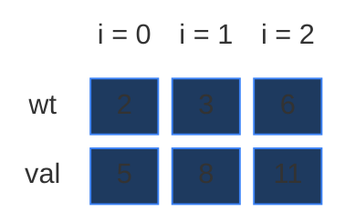

Why this example and not the one from the board? The board example (`W = 10`) is great for the tables, and we use it again as a second example in Sections 6 and 7. But in its recursion **no state repeats** (I traced all 12 calls), so it cannot show why we need DP. This small example (a `3 × 8` grid) has a real repeated state, and it also shows that "take the best value per kg first" (greedy) fails: greedy takes two weight-3 items (`8 + 8 = 16`), then 1 kg is left and nothing fits. The true best is `18`.

### Constraints

Coding Ninjas (from my notes):

- `1 <= n <= 10^3`
- `1 <= w <= 10^3`
- `1 <= profit[i], weight[i] <= 10^8`
- Time limit: 1 second.

GfG uses limits of the same size (up to about 1000 items and capacity 1000).

Two things to notice:

- Every weight is **at least 1**. That matters: "pick" stays on the same item, so if a weight could be 0, we could pick that item forever and the recursion would never stop.
- A weight can be `10^8`, much bigger than `w`. Such an item simply never fits. All solutions below handle it (the check `wt[ind] <= W`, and `W // wt[0] = 0`).

### What the constraints tell us (simple theory)

A **constraint** is the biggest input the judge will ever give you. It quietly tells you how fast your code must be.

**Rule of thumb:** a computer does about **100 million (10^8) simple steps per second**. Count how many steps your idea needs for the biggest input, and compare.

| Biggest input `n` | Steps you can afford | Ideas that fit |
|:---:|:---:|:---|
| up to ~20 | about `2^n` | Plain recursion, try everything |
| up to ~500 | about `n^3` | Three nested loops |
| up to ~5,000 | about `n^2` | Two nested loops |
| up to ~1,000,000 | about `n` or `n log n` | One loop, DP over `n` states |

**For this problem:** `n` is at most `1000` and `W` is at most `1000`.

- Plain recursion tries every way to fill the bag. Even with just 12 items of weight 1 and `W = 12` it already makes almost **4 million** calls (chart below). With 1000 items it would never finish.
- The DP fills a grid of `n × (W + 1) = 1000 × 1001 ≈ 1 million` cells, each in `O(1)`. That is about 1 million steps: far below one second. This is the `O(n * w)` that Coding Ninjas asks for.

The key: the input has two sizes, `n` and `W`. The DP work is their **product** `n · W`.

**How the work grows as `n` grows**

Here every weight is `1` and `W = n` (a bad case for recursion: every call can both pick and not pick). Red bars = calls made by plain recursion. Green line = cells in the DP grid, `n · (W + 1)` (it stays flat near zero).

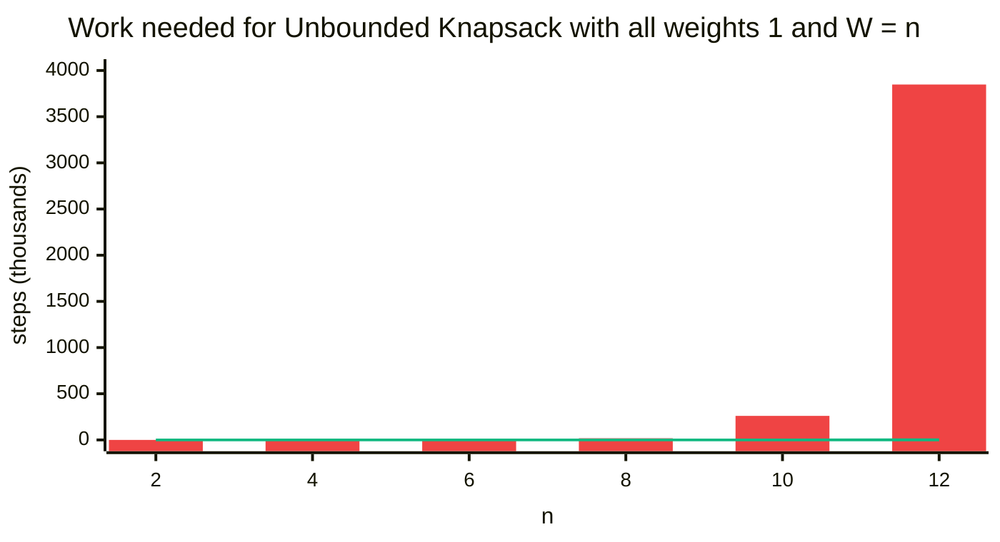

| `n` (and `W`) | Recursion calls | DP cells `n · (W + 1)` |
|:---:|:---:|:---:|
| 2 | 6 | 6 |
| 4 | 90 | 20 |
| 6 | 1,253 | 42 |
| 8 | 17,874 | 72 |
| 10 | 260,337 | 110 |
| 12 | 3,848,221 | 156 |

The recursion calls grow about **15 times** for every 2 extra items. The DP cells grow slowly. (The call counts were measured by running the recursion with a counter; the final code block re-checks the first four.)

## 2. Core Theory

If you have not read [01. Subset Sum Equal To K](01.%20Subset%20Sum%20Equal%20To%20K.md) and [06. 0-1 Knapsack](06.%200-1%20Knapsack.md), this section still starts from the basics. It focuses on the **one thing that is new**: an item can be used again.

### What "unbounded" means

On the board Striver wrote: **Unbounded Knapsack → infinite supply**. The shop never runs out. If an item is good, you may put it in the bag again and again, as long as the bag still has room.

| | 0/1 Knapsack | Unbounded Knapsack |
|:---|:---|:---|
| Copies of each item | 0 or 1 | 0, 1, 2, ... any number |
| Our example's answer | `13` (items 2 + 3, values `5 + 8`) | `18` (items 2 + 2 + 3, values `5 + 5 + 8`) |

### Why we can't just try them all

To try everything, we choose **how many copies** of each item to take: item 0 can be taken `0 .. W // wt[0]` times, item 1 `0 .. W // wt[1]` times, and so on. For our example that is `4 × 3 × 2 = 24` combinations, and we keep the best one that fits. With 1000 items this explodes. We need DP. Here is the "try every count" version. We only use it to check the other answers on small inputs.

We also write a **greedy** version (take the item with the best value per kg first, as many as fit, then the next best). It looks clever, but it is wrong on our example.

```python
# Imports used by every code block in this note
from typing import List

# For the recursion limit and the tests
import sys

# For random tests at the end
import random


# Brute force: try every number of copies of every item
class SolutionBrute:

    # Try counts for item i, with room left and value so far
    def go(self, i: int, room: int, value: int, val: List[int], wt: List[int]) -> None:

        # All items decided: keep the best value
        if i == len(val):

            # Remember the best total
            self.best = max(self.best, value)

            # Nothing more to decide
            return

        # Take item i 0, 1, 2, ... times while it fits
        for count in range(room // wt[i] + 1):

            # Decide the next item with the room that is left
            self.go(i + 1, room - count * wt[i], value + count * val[i], val, wt)

    # Main method (same name as GfG)
    def knapSack(self, val: List[int], wt: List[int], capacity: int) -> int:

        # Best value found so far
        self.best = 0

        # Start with item 0, the full bag and value 0
        self.go(0, capacity, 0, val, wt)

        # The best fill
        return self.best


# Greedy by value per kg (WRONG in general, shown only as a warning)
def greedy_by_ratio(val: List[int], wt: List[int], capacity: int) -> int:

    # Item indexes sorted by value per kg, best first
    order = sorted(range(len(val)), key=lambda i: val[i] / wt[i], reverse=True)

    # Total value taken
    total = 0

    # Go through the items, best ratio first
    for i in order:

        # Take as many copies as fit
        copies = capacity // wt[i]

        # Add their value
        total += copies * val[i]

        # Use up their weight
        capacity -= copies * wt[i]

    # Greedy answer
    return total
```

On our example: value per kg is `5 / 2 = 2.5`, `8 / 3 ≈ 2.67`, `11 / 6 ≈ 1.83`. Greedy takes two weight-3 items (`16`), then only 1 kg is left and nothing fits. Answer `16`. The real best is `18`. Greedy fails because the leftover space is wasted. DP checks every choice.

### How to spot that it is DP

| Property | Plain meaning | In Unbounded Knapsack |
|:---|:---|:---|
| **Overlapping subproblems** | The same smaller question is asked many times | "Best value with items 0..1 and 1 kg free?" is asked twice in our example (Section 4) |
| **Optimal substructure** | The big answer is built from answers of smaller questions | The best for 7 kg is built from the best for 4 kg (after one weight-3 item) |

Also the words give it away. My notes' interview line: whenever you see **maximize profit**, **exact or limited capacity**, and **an item can be chosen multiple times**, think **Unbounded Knapsack**.

### The state: two numbers

The **state** is the small piece of information that names one subproblem.

> `f(ind, W)` = "the **maximum value** I can get using only items `0 .. ind`, when the bag still has `W` capacity free."

- `ind` = which items are still allowed (items `0 .. ind`).
- `W` = how much room is left in the bag. It can be any of `0, 1, 2, ..., W` (Striver underlined this on the board: `W → 0 | 1 | 2 | ... | W`).

Why one number is not enough: when we pick an item, the free room **shrinks**. "Best with items 0..1 and 7 kg" and "best with items 0..1 and 4 kg" are different questions. So the room must be part of the state. Two numbers = **2-D DP**. The whole question is `f(n - 1, W)`. For our example that is `f(2, 7)`.

My notes say it the same way: `solve(index, capacity)` = maximum profit we can get using items from `0..index` with current remaining capacity = `capacity`.

### The grid: rows are items, columns are capacities

- **Row `ind`** = "I may use items `0 .. ind`". Going down a row = one more kind of item is allowed.
- **Column `W`** = "the free room in the bag". From `0` to `W`, so there are `W + 1` columns.
- **Cell `[ind][W]`** = the best value, `f(ind, W)`.

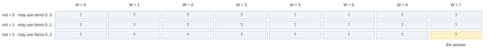

The grid has `n` rows and `W + 1` columns: here `3 × 8 = 24` cells. Striver wrote the size on the board as `dp[n][W + 1]`. The answer is the bottom-right cell `[2][7]`.

### The recurrence: pick or not pick (and stay)

The **recurrence** is the rule that builds a bigger answer from smaller ones. My notes use Striver's 3 steps:

1. **Express** everything in terms of `(ind, W)`.
2. **Explore all possibilities** of that index: pick the item, or do not pick it.
3. **Return the max** of every possibility.

In words: *look at item `ind`. Either do not pick it: then we are done with this item, move to item `ind - 1` with the same room. Or pick it (only if it fits): add its value, the room shrinks by its weight, and **stay on item `ind`**, because we may want another copy.*

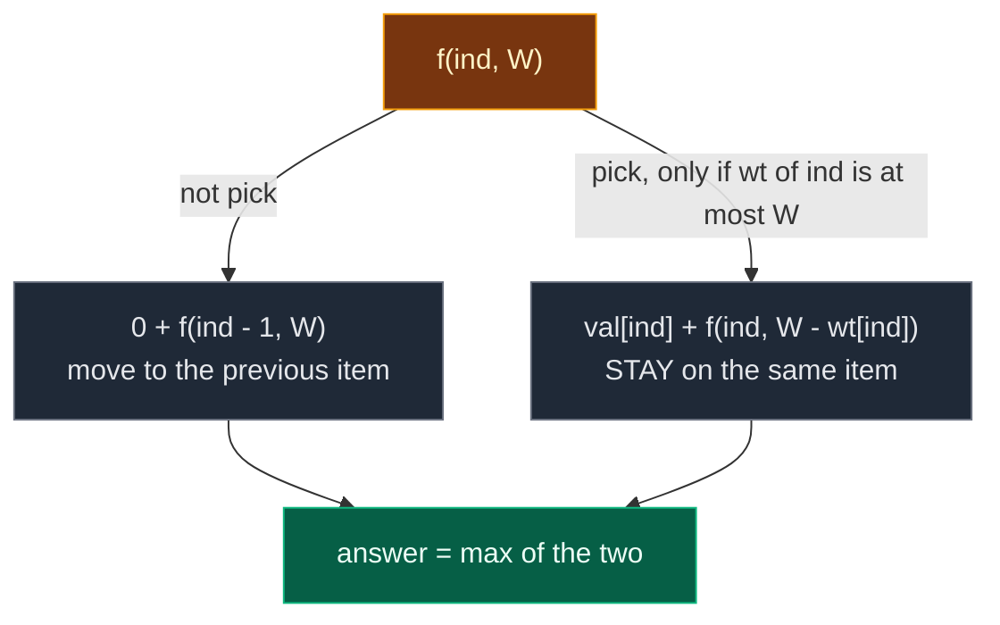

```text
not_pick = 0 + f(ind - 1, W)
pick     = val[ind] + f(ind, W - wt[ind])      only if wt[ind] <= W
f(ind, W) = max(pick, not_pick)
```

Three details from the board:

- `not_pick = 0 + f(ind - 1, W)`: the `0 +` is there on purpose. Not picking adds no value.
- `pick` starts as `float("-inf")` (minus infinity). We are taking a **max**, so "not allowed" must be a value that can never win.
- In `f(ind, W - wt[ind])`, Striver boxed the `ind`: **this is the only change from 0/1 Knapsack**, where it is `ind - 1`.

**Why are two choices enough for "any number of copies"?** Taking 3 copies of an item is just: pick, pick, pick, then not pick. Each pick stays on the same item, so the next call can pick it again. The not pick says "no more copies of this item", and moves on.

### Base case

A **base case** is a subproblem so small that we know the answer without more work.

| Base case | Answer | Why |
|:---|:---:|:---|
| `ind == 0` | `(W // wt[0]) * val[0]` | Only item 0 is left, and it has an infinite supply. Fill the bag with as many copies as fit |

`W // wt[0]` is whole-number division: how many copies **fit**. Striver's board examples, with `val[0] = 10` and `wt[0] = 3`:

- `W = 8`: `8 // 3 = 2` copies (6 kg), value `2 × 10 = 20`. The last 2 kg stay empty.
- `W = 13`: `13 // 3 = 4` copies (12 kg), value `4 × 10 = 40`.

Compare with 0/1 Knapsack, where the base case is "`val[0]` if `wt[0] <= W`, else 0": there you can take item 0 only once. Here you take it as many times as it fits.

Do we need a `W == 0` base case? No. With `W = 0` nothing fits (every weight is at least 1), so pick is never allowed, and not pick walks down to `ind == 0`, which returns `(0 // wt[0]) * val[0] = 0`.

### 0/1 vs Unbounded: the picture

In the grid, **not pick** reads the cell straight up, in both problems. The difference is **pick**:

- **0/1:** pick reads the **row above**, `wt[ind]` columns to the left. The row above has never seen item `ind`, so the item is used at most once.
- **Unbounded:** pick reads the **same row**, `wt[ind]` columns to the left. That cell may **already contain** item `ind`, so the item can be used again.

The cell `[1][6]` of our example (item 1 has weight 3, value 8), side by side:

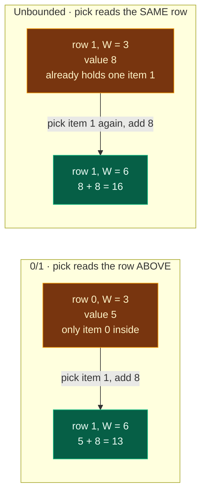

The same cell in the real grids. Orange = the two cells read, green = the cell being filled.

0/1 Knapsack: `max(up 5, 8 + up-left 5) = 13`.

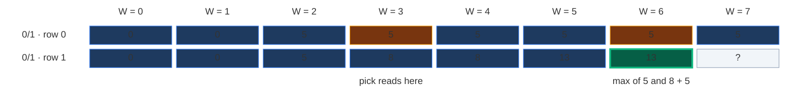

Unbounded Knapsack: `max(up 15, 8 + same-row-left 8) = 16`. Two copies of item 1.

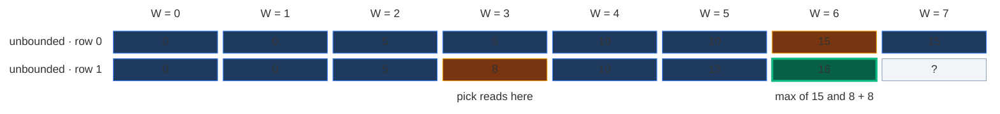

Notice that even **row 0 is different**: in 0/1 it is `5` everywhere item 0 fits (one copy), in Unbounded it grows `5, 10, 15` (more copies).

The table from my notes:

| Feature | 0/1 Knapsack | Unbounded Knapsack |
|:---|:---|:---|
| Item reuse | No | Yes |
| Take recurrence | `index - 1` | `index` (same) |
| Tabulation take source | previous row | same row |
| 1D loop direction | right to left | left to right |

Here is a tiny 0/1 version, only so the tests can compare the two:

```python
# 0/1 Knapsack (each item at most once), one array, right to left
def knapsack_01(val: List[int], wt: List[int], capacity: int) -> int:

    # dp[c] = best value with capacity c, using the items seen so far
    dp = [0] * (capacity + 1)

    # Add items one by one
    for i in range(len(val)):

        # Right to left: dp[c - wt[i]] is still the old row, so item i is used once
        for c in range(capacity, wt[i] - 1, -1):

            # Not pick or pick once
            dp[c] = max(dp[c], val[i] + dp[c - wt[i]])

    # Best value for the full bag
    return dp[capacity]
```

### Two ways to remember: memoization vs tabulation

| | Memoization | Tabulation |
|:---|:---|:---|
| Other name | **Top-down** | **Bottom-up** |
| Direction | Start from `f(n - 1, W)`, go down to the base case, come back up | Start from row 0, fill row by row down to `[n - 1][W]` |
| How | Recursion + a 2-D table | Two nested loops + a 2-D table |
| Computes | Only the cells it needs | Every cell |
| Stack | Recursion stack, depth up to `n + W` | No recursion stack |

### The 4-step ladder

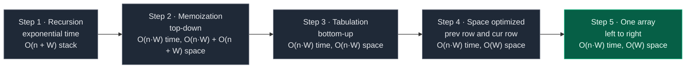

My notes call the one-array version "the best practical version".

## 3. Edge Cases

| Case | Input | Expected | Why it matters |
|:---|:---:|:---:|:---|
| Nothing fits | `val = [6, 12]`, `wt = [4, 17]`, `W = 3` | `0` | Coding Ninjas sample 2. Pick is never allowed |
| Every item too heavy | `val = [6, 8, 7, 100]`, `wt = [2, 3, 4, 5]`, `W = 1` | `0` | GfG example 3 |
| Capacity 0 | `val = [5]`, `wt = [2]`, `W = 0` | `0` | `0 // 2 = 0` copies |
| Single item, leftover room | `val = [10]`, `wt = [3]`, `W = 8` | `20` | Board base case: `8 // 3 = 2` copies |
| Single item, bigger bag | `val = [10]`, `wt = [3]`, `W = 13` | `40` | Board base case: `13 // 3 = 4` copies |
| Same item many times | `val = [7, 2, 4]`, `wt = [5, 10, 20]`, `W = 15` | `21` | Coding Ninjas sample 1: item 0 three times |
| Huge weight | `val = [9, 1]`, `wt = [10^8, 1]`, `W = 5` | `5` | Item 0 never fits, `5 // 10^8 = 0` |
| Greedy trap | `val = [5, 8, 11]`, `wt = [2, 3, 6]`, `W = 7` | `18` | Best value per kg first gives only `16` |
| Our example vs 0/1 | same | `18` (0/1 gives `13`) | Reuse matters |
| Biggest input | `n = 1000`, `W = 1000` | – | Recursion depth can reach `n + W`, Python memoization needs a higher limit |

## 4. Approach 1: Recursion

### Idea

Write the recurrence as code. Start with `f(n - 1, W)`. If `ind == 0`, fill the bag with item 0. Otherwise try "not pick" and "pick (and stay)" and return the max.

What does the start call mean? `f(2, 7)` = "using items 0, 1, 2 and a bag with 7 kg free, what is the best value?"

### Recursion tree for `wt = [2, 3, 6]`, `val = [5, 8, 11]`, `W = 7`

Every box shows the call and what it returns. Calls happen depth-first, "not pick" first (like the code). Look at the **pick** edges: the first number (`ind`) does **not** go down.

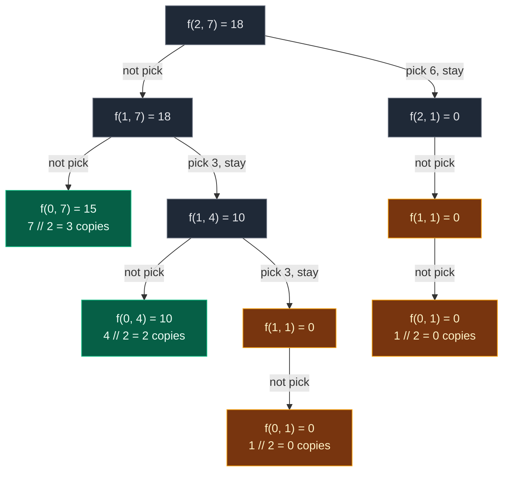

Gold = repeated work. Green = base cases that are not repeated.

Some calls have only one child, because pick is not allowed there:

- `f(1, 1)`: item 1 weighs 3, more than 1 kg free.
- `f(2, 1)`: item 2 weighs 6, more than 1 kg free.

| State | Times computed |
|:---|:---:|
| `f(2, 7)`, `f(1, 7)`, `f(1, 4)`, `f(2, 1)` | 1 each |
| `f(0, 7)`, `f(0, 4)` | 1 each |
| **`f(1, 1)`** | **2** |
| **`f(0, 1)`** | **2** (inside each `f(1, 1)`) |

That is **10 calls** for 3 items. `f(1, 1)` is reached in two different ways:

- not pick item 2, then pick item 1 twice (`7 - 3 - 3 = 1`),
- pick item 2 once (`7 - 6 = 1`), then not pick it any more.

Both paths leave the same question: "best with items 0..1 and 1 kg free?"

**The exact order of calls.** One participant per row of the grid (`ind`). Solid arrows = calls, dashed arrows = returns. An arrow from a row **to itself** is a pick: we stay on the same item.

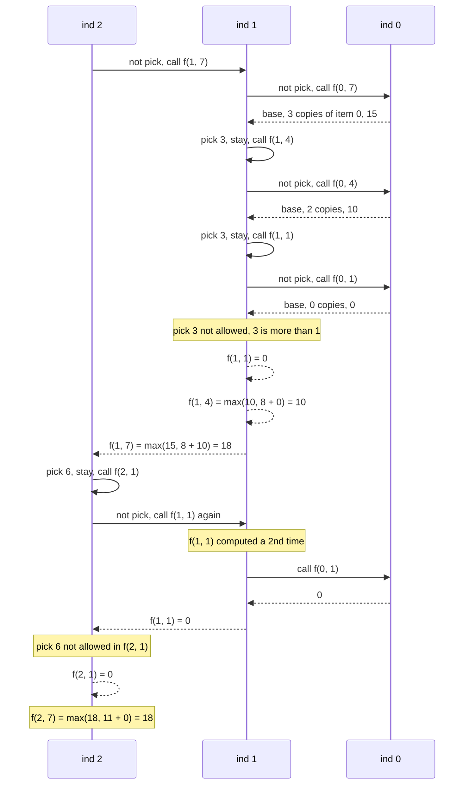

**The recursive working example from my notes:** `profit = [5, 11, 13]`, `weight = [2, 4, 6]`, `W = 10`. Call `solve(2, 10)`. At index 2: item weight 6, profit 13.

- Not take → `solve(1, 10)`.
- Take → `13 + solve(2, 4)`.
- Now at `solve(1, 10)`: item weight 4, profit 11. We can take it again and again: `11 + solve(1, 6)`, then `11 + solve(1, 2)`.
- Best combination: `4 + 4 + 2`, profit `11 + 11 + 5 = 27`. So the answer is `27`.

### Code

```python
# Plain recursion
class SolutionRecursion:

    # Helper: best value using items 0..ind with W capacity free
    def solve(self, ind: int, W: int, val: List[int], wt: List[int]) -> int:

        # Base case: only item 0 is left, take as many copies as fit
        if ind == 0:
            return (W // wt[0]) * val[0]

        # Choice 1: not pick, add nothing, move to the previous item
        not_pick = 0 + self.solve(ind - 1, W, val, wt)

        # Choice 2 starts as minus infinity (not allowed yet)
        pick = float("-inf")

        # Pick only if the item fits
        if wt[ind] <= W:

            # Pick: add its value, STAY on ind so it can be picked again
            pick = val[ind] + self.solve(ind, W - wt[ind], val, wt)

        # The better of the two choices
        return max(pick, not_pick)

    # Main method (same name as GfG)
    def knapSack(self, val: List[int], wt: List[int], capacity: int) -> int:

        # Start from the last item and the full bag
        return self.solve(len(val) - 1, capacity, val, wt)
```

### Complexity

| Measure | Complexity | Why |
|:---|:---:|:---|
| **Time** | Exponential | Every call can branch into 2 calls, and the same states are solved again and again. My notes: "interview-wise we write `O(2^n * W)` (informal exponential behaviour). The safest understanding: pure recursion is exponential because of repeated overlapping subproblems" |
| **Space** | `O(n + W)` | Recursion stack. A pick keeps `ind` and lowers the capacity, a not pick lowers `ind`. The deepest path can do both: up to `W` picks (weight 1) plus `n` not picks |

The stack is **deeper than in 0/1 Knapsack** (`O(n)` there), because a pick no longer moves to the next item.

## 5. Approach 2: Memoization (Top-Down)

### Idea

The same state `(ind, W)` gets computed many times. Store each answer the first time in a 2-D table `dp[ind][W]`, and reuse it. My notes: `dp[i][c]` = max profit using items `0..i` with capacity `c`.

**Size of the table.** `ind` goes from `0` to `n - 1` (`n` rows). `W` goes from `0` to `W` (`W + 1` columns). Striver: `dp[n][W + 1]`. Rows = items, columns = capacity.

The same **3 steps** as always:

1. **Declare** `dp` with `n` rows and `W + 1` columns, filled with `-1` ("not computed yet"). Values are never negative, so `-1` is safe.
2. **Store** the answer before returning: `dp[ind][W] = max(pick, not_pick)`.
3. **Check** first: if `dp[ind][W] != -1`, return it and make no new calls.

Note: the base case `ind == 0` is answered before the table is looked at, so row 0 is never stored and stays `-1`. That is fine.

**Python only:** the recursion can go `n + W` calls deep (up to about 2000). Python's default limit is 1000, so we raise it with `sys.setrecursionlimit(...)`. Tabulation has no recursion at all.

### Visual: when each `dp[ind][W]` gets filled

Colours: grey = `-1` (not computed), dashed yellow = computing (waiting for its children), green = just filled, blue = filled earlier, orange = cache hit.

**Start:** `dp` is `3 × 8`, all `-1`.

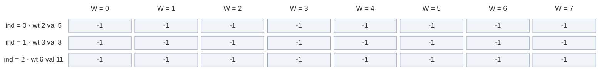

**Calls go down the "not pick" side:** `f(2, 7)` → `-1`, compute. `f(1, 7)` → `-1`, compute. Its not pick is the base case `f(0, 7) = 15` (3 copies of item 0, not stored).

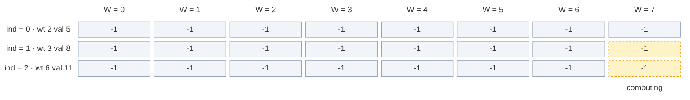

**Pick and stay:** `f(1, 7)` picks item 1 → `f(1, 4)` → `-1`, compute. Its not pick is base `f(0, 4) = 10`. It picks item 1 again → `f(1, 1)` → `-1`, compute. Same row, columns going left.

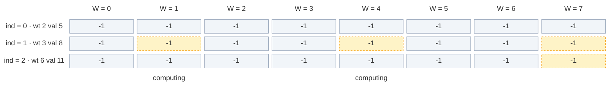

**Fill 1:** `f(1, 1)`: not pick = `f(0, 1) = 0` (`1 // 2 = 0` copies). Pick not allowed (`3 > 1`). Store `dp[1][1] = 0`.

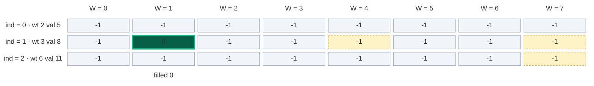

**Fill 2:** back in `f(1, 4)`: `max(not pick 10, pick 8 + 0) = 10`. Store `dp[1][4] = 10`.

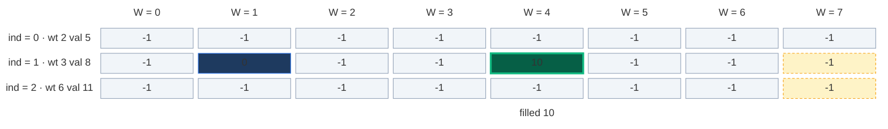

**Fill 3:** back in `f(1, 7)`: `max(not pick 15, pick 8 + 10) = 18`. Store `dp[1][7] = 18`.

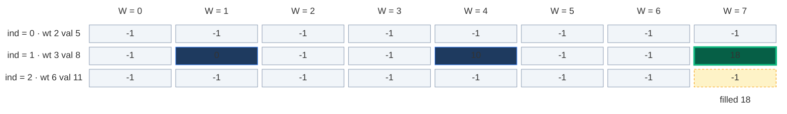

**Cache hit:** `f(2, 7)` now picks item 2 → `f(2, 1)` → `-1`, compute. Its not pick asks `f(1, 1)`. `dp[1][1] = 0`, not `-1` → return `0`, **no new calls**. The call `f(0, 1)` below it is skipped.

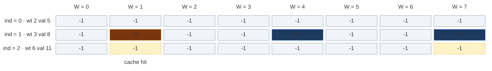

**Fill 4:** `f(2, 1)`: pick not allowed (`6 > 1`). Store `dp[2][1] = 0`.

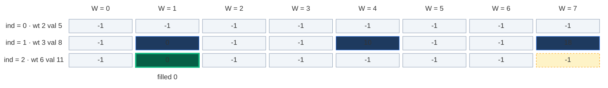

**Fill 5:** `f(2, 7) = max(not pick 18, pick 11 + 0) = 18`. Store `dp[2][7] = 18`. That is the answer.

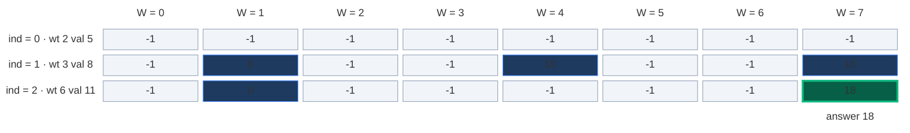

Only 5 of the 24 cells were ever stored. Memoization computes **only the states it needs**.

About the example in my notes: they say "if `solve(1, 6)` is needed many times, memoization computes it once and reuses it". That is the right idea. In that small board example (`W = 10`) it is a "suppose": I traced every call, and `solve(1, 6)` is reached only once there (no state repeats at all). Our example shows a real repeat: `f(1, 1)`.

### The pruned recursion tree

Same tree, but the cache hit (dashed) stops right away.

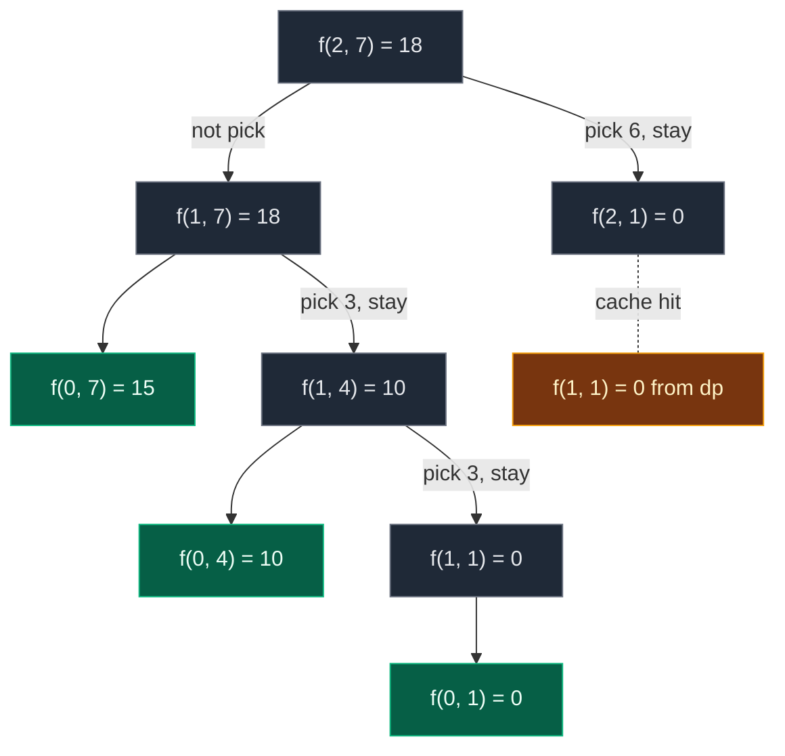

**9 calls** instead of 10. Small saving here because the example is tiny. On bigger inputs the saving is huge: at most `n · (W + 1)` states are ever computed.

### Code

```python
# Memoization (top-down DP) with a 2-D table of -1
class SolutionMemo:

    # Helper: best value using items 0..ind with W free, uses and fills dp
    def solve(self, ind: int, W: int, val: List[int], wt: List[int], dp: List[List[int]]) -> int:

        # Base case: only item 0 is left, take as many copies as fit
        if ind == 0:
            return (W // wt[0]) * val[0]

        # Step 3 (check): already solved this (ind, W)? Reuse it
        if dp[ind][W] != -1:
            return dp[ind][W]

        # Choice 1: not pick, move to the previous item
        not_pick = 0 + self.solve(ind - 1, W, val, wt, dp)

        # Choice 2 starts as minus infinity (not allowed yet)
        pick = float("-inf")

        # Pick only if the item fits
        if wt[ind] <= W:

            # Pick: add its value and stay on ind
            pick = val[ind] + self.solve(ind, W - wt[ind], val, wt, dp)

        # Step 2 (store): remember the best value of this state
        dp[ind][W] = max(pick, not_pick)

        # Return the stored answer
        return dp[ind][W]

    # Main method (same name as GfG)
    def knapSack(self, val: List[int], wt: List[int], capacity: int) -> int:

        # Number of items
        n = len(val)

        # Python only: the stack can go n + capacity deep
        sys.setrecursionlimit(max(1000, 2 * (n + capacity) + 100))

        # Step 1 (declare): n rows, capacity + 1 columns, -1 means not solved yet
        dp = [[-1] * (capacity + 1) for _ in range(n)]

        # Keep the table so we can look at it after the run
        self.dp = dp

        # Start from the last item and the full bag
        return self.solve(n - 1, capacity, val, wt, dp)
```

### Complexity

| Measure | Complexity | Why |
|:---|:---:|:---|
| **Time** | `O(n · W)` | `ind` ranges `0 .. n - 1`, capacity `0 .. W`: at most `n · (W + 1)` states, each solved once with `O(1)` work |
| **Space: dp table** | `O(n · W)` | `n` rows × `W + 1` columns |
| **Space: recursion stack** | `O(n + W)` | Worst case path: all the picks plus all the not picks |
| **Total space** | `O(n · W) + O(n + W)` | Table plus stack (as in my notes) |

## 6. Approach 3: Tabulation (Bottom-Up)

### Idea

Fill the whole grid with two loops, from row 0 down to the answer `[n - 1][W]`. No recursion, so no stack.

`dp[i][c]` = "the maximum profit using items `0..i` with capacity `c`" (from my notes).

### How to convert memo → table, step by step

Striver's 3 steps on the board (Tabulation → Bottom Up), plus "same table" and "answer":

1. **Same grid:** `dp` with `n` rows and `W + 1` columns (`dp[n][W + 1]`).
2. **Base case becomes a row:** `ind == 0 → (W // wt[0]) * val[0]` becomes `dp[0][c] = (c // wt[0]) * val[0]` for **every** capacity `c` from `0` to `W`.
3. **Two nested loops, in the opposite direction:** `ind` from `1` to `n - 1`, and inside, `c` from `0` to `W`.
4. **Copy the recurrence:** replace `f(...)` with `dp[...]`:
   - `not_pick = dp[ind - 1][c]`
   - `pick = val[ind] + dp[ind][c - wt[ind]]` if `wt[ind] <= c` (**same row!**)
   - `dp[ind][c] = max(pick, not_pick)`
5. **Answer:** `dp[n - 1][W]`.

| Memoization | Becomes in tabulation |
|:---|:---|
| `dp[n][W + 1]` with `-1` | `dp[n][W + 1]` with `0` |
| `if ind == 0: return (W // wt[0]) * val[0]` | `dp[0][c] = (c // wt[0]) * val[0]` for every `c` |
| `f(n - 1, W)` going down | Loops `ind = 1 .. n - 1`, `c = 0 .. W` going up |
| `f(ind - 1, W)` | `dp[ind - 1][c]` (row above) |
| `f(ind, W - wt[ind])` | `dp[ind][c - wt[ind]]` (**same row**) |
| `return f(n - 1, W)` | `return dp[n - 1][W]` |

**Why can we read the same row?** We fill each row from left to right (`c` going up). The cell `dp[ind][c - wt[ind]]` is to the **left**, so it is already filled in this row. And because it is in the same row, it may already include copies of item `ind`. My notes write it in capitals: **SAME ROW**, because the item can be reused.

**Picture rule:** to fill a cell, look **straight up** (not pick) and **`wt[ind]` steps left in the same row** (pick). Take the bigger of `up` and `val[ind] + left`.

### Visual table fill (`wt = [2, 3, 6]`, `val = [5, 8, 11]`, `W = 7`)

Colours: green = just filled, orange = the cells it reads, blue = filled earlier, grey `?` = not filled yet.

**Start: the base row.** Only item 0 (weight 2, value 5). Each capacity takes `c // 2` copies: `0, 0, 5, 5, 10, 10, 15, 15`.

```mermaid
block-beta
  columns 9
  hx[" "] h0["W = 0"] h1["W = 1"] h2["W = 2"] h3["W = 3"] h4["W = 4"] h5["W = 5"] h6["W = 6"] h7["W = 7"]
  l0["ind = 0 · wt 2 val 5"] r0c0["0"] r0c1["0"] r0c2["5"] r0c3["5"] r0c4["10"] r0c5["10"] r0c6["15"] r0c7["15"]
  l1["ind = 1 · wt 3 val 8"] r1c0["?"] r1c1["?"] r1c2["?"] r1c3["?"] r1c4["?"] r1c5["?"] r1c6["?"] r1c7["?"]
  l2["ind = 2 · wt 6 val 11"] r2c0["?"] r2c1["?"] r2c2["?"] r2c3["?"] r2c4["?"] r2c5["?"] r2c6["?"] r2c7["?"]
  space m0["0 copies"] space m2["1 copy"] space m4["2 copies"] space m6["3 copies"] space
  classDef head fill:none,stroke:none,color:#64748b
  class hx,h0,h1,h2,h3,h4,h5,h6,h7,l0,l1,l2 head
  classDef new fill:#065f46,stroke:#10b981,color:#ecfdf5,stroke-width:3px
  class r0c0,r0c1,r0c2,r0c3,r0c4,r0c5,r0c6,r0c7 new
  classDef empty fill:#f1f5f9,stroke:#94a3b8,color:#64748b
  class r1c0,r1c1,r1c2,r1c3,r1c4,r1c5,r1c6,r1c7,r2c0,r2c1,r2c2,r2c3,r2c4,r2c5,r2c6,r2c7 empty
  classDef note fill:none,stroke:none,color:#b45309
  class m0,m2,m4,m6 note
```

#### Row 1 (`wt[1] = 3`, `val[1] = 8`), cell by cell

**`dp[1][0]`:** not pick = `dp[0][0] = 0`. Pick: `3 > 0`, not allowed. Result `0`.

```mermaid
block-beta
  columns 9
  hx[" "] h0["W = 0"] h1["W = 1"] h2["W = 2"] h3["W = 3"] h4["W = 4"] h5["W = 5"] h6["W = 6"] h7["W = 7"]
  l0["ind = 0 · wt 2 val 5"] r0c0["0"] r0c1["0"] r0c2["5"] r0c3["5"] r0c4["10"] r0c5["10"] r0c6["15"] r0c7["15"]
  l1["ind = 1 · wt 3 val 8"] r1c0["0"] r1c1["?"] r1c2["?"] r1c3["?"] r1c4["?"] r1c5["?"] r1c6["?"] r1c7["?"]
  l2["ind = 2 · wt 6 val 11"] r2c0["?"] r2c1["?"] r2c2["?"] r2c3["?"] r2c4["?"] r2c5["?"] r2c6["?"] r2c7["?"]
  space m0["max of 0 and no pick"] space space space space space space space
  classDef head fill:none,stroke:none,color:#64748b
  class hx,h0,h1,h2,h3,h4,h5,h6,h7,l0,l1,l2 head
  classDef read fill:#78350f,stroke:#f59e0b,color:#fef3c7
  class r0c0 read
  classDef done fill:#1e3a5f,stroke:#3b82f6,color:#dbeafe
  class r0c1,r0c2,r0c3,r0c4,r0c5,r0c6,r0c7 done
  classDef new fill:#065f46,stroke:#10b981,color:#ecfdf5,stroke-width:3px
  class r1c0 new
  classDef empty fill:#f1f5f9,stroke:#94a3b8,color:#64748b
  class r1c1,r1c2,r1c3,r1c4,r1c5,r1c6,r1c7,r2c0,r2c1,r2c2,r2c3,r2c4,r2c5,r2c6,r2c7 empty
  classDef note fill:none,stroke:none,color:#b45309
  class m0 note
```

**`dp[1][1]`:** not pick = `dp[0][1] = 0`. Pick: `3 > 1`, not allowed. Result `0`.

```mermaid
block-beta
  columns 9
  hx[" "] h0["W = 0"] h1["W = 1"] h2["W = 2"] h3["W = 3"] h4["W = 4"] h5["W = 5"] h6["W = 6"] h7["W = 7"]
  l0["ind = 0 · wt 2 val 5"] r0c0["0"] r0c1["0"] r0c2["5"] r0c3["5"] r0c4["10"] r0c5["10"] r0c6["15"] r0c7["15"]
  l1["ind = 1 · wt 3 val 8"] r1c0["0"] r1c1["0"] r1c2["?"] r1c3["?"] r1c4["?"] r1c5["?"] r1c6["?"] r1c7["?"]
  l2["ind = 2 · wt 6 val 11"] r2c0["?"] r2c1["?"] r2c2["?"] r2c3["?"] r2c4["?"] r2c5["?"] r2c6["?"] r2c7["?"]
  space space m1["max of 0 and no pick"] space space space space space space
  classDef head fill:none,stroke:none,color:#64748b
  class hx,h0,h1,h2,h3,h4,h5,h6,h7,l0,l1,l2 head
  classDef done fill:#1e3a5f,stroke:#3b82f6,color:#dbeafe
  class r0c0,r0c2,r0c3,r0c4,r0c5,r0c6,r0c7,r1c0 done
  classDef read fill:#78350f,stroke:#f59e0b,color:#fef3c7
  class r0c1 read
  classDef new fill:#065f46,stroke:#10b981,color:#ecfdf5,stroke-width:3px
  class r1c1 new
  classDef empty fill:#f1f5f9,stroke:#94a3b8,color:#64748b
  class r1c2,r1c3,r1c4,r1c5,r1c6,r1c7,r2c0,r2c1,r2c2,r2c3,r2c4,r2c5,r2c6,r2c7 empty
  classDef note fill:none,stroke:none,color:#b45309
  class m1 note
```

**`dp[1][2]`:** not pick = `dp[0][2] = 5`. Pick: `3 > 2`, not allowed. Result `5`.

```mermaid
block-beta
  columns 9
  hx[" "] h0["W = 0"] h1["W = 1"] h2["W = 2"] h3["W = 3"] h4["W = 4"] h5["W = 5"] h6["W = 6"] h7["W = 7"]
  l0["ind = 0 · wt 2 val 5"] r0c0["0"] r0c1["0"] r0c2["5"] r0c3["5"] r0c4["10"] r0c5["10"] r0c6["15"] r0c7["15"]
  l1["ind = 1 · wt 3 val 8"] r1c0["0"] r1c1["0"] r1c2["5"] r1c3["?"] r1c4["?"] r1c5["?"] r1c6["?"] r1c7["?"]
  l2["ind = 2 · wt 6 val 11"] r2c0["?"] r2c1["?"] r2c2["?"] r2c3["?"] r2c4["?"] r2c5["?"] r2c6["?"] r2c7["?"]
  space space space m2["max of 5 and no pick"] space space space space space
  classDef head fill:none,stroke:none,color:#64748b
  class hx,h0,h1,h2,h3,h4,h5,h6,h7,l0,l1,l2 head
  classDef done fill:#1e3a5f,stroke:#3b82f6,color:#dbeafe
  class r0c0,r0c1,r0c3,r0c4,r0c5,r0c6,r0c7,r1c0,r1c1 done
  classDef read fill:#78350f,stroke:#f59e0b,color:#fef3c7
  class r0c2 read
  classDef new fill:#065f46,stroke:#10b981,color:#ecfdf5,stroke-width:3px
  class r1c2 new
  classDef empty fill:#f1f5f9,stroke:#94a3b8,color:#64748b
  class r1c3,r1c4,r1c5,r1c6,r1c7,r2c0,r2c1,r2c2,r2c3,r2c4,r2c5,r2c6,r2c7 empty
  classDef note fill:none,stroke:none,color:#b45309
  class m2 note
```

**`dp[1][3]`:** not pick = `dp[0][3] = 5`. Pick = `8 + dp[1][0] = 8 + 0 = 8`. Result `8` (one item 1).

```mermaid
block-beta
  columns 9
  hx[" "] h0["W = 0"] h1["W = 1"] h2["W = 2"] h3["W = 3"] h4["W = 4"] h5["W = 5"] h6["W = 6"] h7["W = 7"]
  l0["ind = 0 · wt 2 val 5"] r0c0["0"] r0c1["0"] r0c2["5"] r0c3["5"] r0c4["10"] r0c5["10"] r0c6["15"] r0c7["15"]
  l1["ind = 1 · wt 3 val 8"] r1c0["0"] r1c1["0"] r1c2["5"] r1c3["8"] r1c4["?"] r1c5["?"] r1c6["?"] r1c7["?"]
  l2["ind = 2 · wt 6 val 11"] r2c0["?"] r2c1["?"] r2c2["?"] r2c3["?"] r2c4["?"] r2c5["?"] r2c6["?"] r2c7["?"]
  space space space space m3["max of 5 and 8 + 0"] space space space space
  classDef head fill:none,stroke:none,color:#64748b
  class hx,h0,h1,h2,h3,h4,h5,h6,h7,l0,l1,l2 head
  classDef done fill:#1e3a5f,stroke:#3b82f6,color:#dbeafe
  class r0c0,r0c1,r0c2,r0c4,r0c5,r0c6,r0c7,r1c1,r1c2 done
  classDef read fill:#78350f,stroke:#f59e0b,color:#fef3c7
  class r0c3,r1c0 read
  classDef new fill:#065f46,stroke:#10b981,color:#ecfdf5,stroke-width:3px
  class r1c3 new
  classDef empty fill:#f1f5f9,stroke:#94a3b8,color:#64748b
  class r1c4,r1c5,r1c6,r1c7,r2c0,r2c1,r2c2,r2c3,r2c4,r2c5,r2c6,r2c7 empty
  classDef note fill:none,stroke:none,color:#b45309
  class m3 note
```

**`dp[1][4]`:** not pick = `dp[0][4] = 10`. Pick = `8 + dp[1][1] = 8 + 0 = 8`. Result `10` (two items 0).

```mermaid
block-beta
  columns 9
  hx[" "] h0["W = 0"] h1["W = 1"] h2["W = 2"] h3["W = 3"] h4["W = 4"] h5["W = 5"] h6["W = 6"] h7["W = 7"]
  l0["ind = 0 · wt 2 val 5"] r0c0["0"] r0c1["0"] r0c2["5"] r0c3["5"] r0c4["10"] r0c5["10"] r0c6["15"] r0c7["15"]
  l1["ind = 1 · wt 3 val 8"] r1c0["0"] r1c1["0"] r1c2["5"] r1c3["8"] r1c4["10"] r1c5["?"] r1c6["?"] r1c7["?"]
  l2["ind = 2 · wt 6 val 11"] r2c0["?"] r2c1["?"] r2c2["?"] r2c3["?"] r2c4["?"] r2c5["?"] r2c6["?"] r2c7["?"]
  space space space space space m4["max of 10 and 8 + 0"] space space space
  classDef head fill:none,stroke:none,color:#64748b
  class hx,h0,h1,h2,h3,h4,h5,h6,h7,l0,l1,l2 head
  classDef done fill:#1e3a5f,stroke:#3b82f6,color:#dbeafe
  class r0c0,r0c1,r0c2,r0c3,r0c5,r0c6,r0c7,r1c0,r1c2,r1c3 done
  classDef read fill:#78350f,stroke:#f59e0b,color:#fef3c7
  class r0c4,r1c1 read
  classDef new fill:#065f46,stroke:#10b981,color:#ecfdf5,stroke-width:3px
  class r1c4 new
  classDef empty fill:#f1f5f9,stroke:#94a3b8,color:#64748b
  class r1c5,r1c6,r1c7,r2c0,r2c1,r2c2,r2c3,r2c4,r2c5,r2c6,r2c7 empty
  classDef note fill:none,stroke:none,color:#b45309
  class m4 note
```

**`dp[1][5]`:** not pick = `dp[0][5] = 10`. Pick = `8 + dp[1][2] = 8 + 5 = 13`. Result `13` (item 1 + item 0).

```mermaid
block-beta
  columns 9
  hx[" "] h0["W = 0"] h1["W = 1"] h2["W = 2"] h3["W = 3"] h4["W = 4"] h5["W = 5"] h6["W = 6"] h7["W = 7"]
  l0["ind = 0 · wt 2 val 5"] r0c0["0"] r0c1["0"] r0c2["5"] r0c3["5"] r0c4["10"] r0c5["10"] r0c6["15"] r0c7["15"]
  l1["ind = 1 · wt 3 val 8"] r1c0["0"] r1c1["0"] r1c2["5"] r1c3["8"] r1c4["10"] r1c5["13"] r1c6["?"] r1c7["?"]
  l2["ind = 2 · wt 6 val 11"] r2c0["?"] r2c1["?"] r2c2["?"] r2c3["?"] r2c4["?"] r2c5["?"] r2c6["?"] r2c7["?"]
  space space space space space space m5["max of 10 and 8 + 5"] space space
  classDef head fill:none,stroke:none,color:#64748b
  class hx,h0,h1,h2,h3,h4,h5,h6,h7,l0,l1,l2 head
  classDef done fill:#1e3a5f,stroke:#3b82f6,color:#dbeafe
  class r0c0,r0c1,r0c2,r0c3,r0c4,r0c6,r0c7,r1c0,r1c1,r1c3,r1c4 done
  classDef read fill:#78350f,stroke:#f59e0b,color:#fef3c7
  class r0c5,r1c2 read
  classDef new fill:#065f46,stroke:#10b981,color:#ecfdf5,stroke-width:3px
  class r1c5 new
  classDef empty fill:#f1f5f9,stroke:#94a3b8,color:#64748b
  class r1c6,r1c7,r2c0,r2c1,r2c2,r2c3,r2c4,r2c5,r2c6,r2c7 empty
  classDef note fill:none,stroke:none,color:#b45309
  class m5 note
```

**`dp[1][6]`:** not pick = `dp[0][6] = 15`. Pick = `8 + dp[1][3] = 8 + 8 = 16`. Result `16`. Here the reuse happens: `dp[1][3]` already holds one item 1, so this is **two items 1**. In 0/1 Knapsack this cell would read the row above and give only `13`.

```mermaid
block-beta
  columns 9
  hx[" "] h0["W = 0"] h1["W = 1"] h2["W = 2"] h3["W = 3"] h4["W = 4"] h5["W = 5"] h6["W = 6"] h7["W = 7"]
  l0["ind = 0 · wt 2 val 5"] r0c0["0"] r0c1["0"] r0c2["5"] r0c3["5"] r0c4["10"] r0c5["10"] r0c6["15"] r0c7["15"]
  l1["ind = 1 · wt 3 val 8"] r1c0["0"] r1c1["0"] r1c2["5"] r1c3["8"] r1c4["10"] r1c5["13"] r1c6["16"] r1c7["?"]
  l2["ind = 2 · wt 6 val 11"] r2c0["?"] r2c1["?"] r2c2["?"] r2c3["?"] r2c4["?"] r2c5["?"] r2c6["?"] r2c7["?"]
  space space space space space space space m6["max of 15 and 8 + 8"] space
  classDef head fill:none,stroke:none,color:#64748b
  class hx,h0,h1,h2,h3,h4,h5,h6,h7,l0,l1,l2 head
  classDef done fill:#1e3a5f,stroke:#3b82f6,color:#dbeafe
  class r0c0,r0c1,r0c2,r0c3,r0c4,r0c5,r0c7,r1c0,r1c1,r1c2,r1c4,r1c5 done
  classDef read fill:#78350f,stroke:#f59e0b,color:#fef3c7
  class r0c6,r1c3 read
  classDef new fill:#065f46,stroke:#10b981,color:#ecfdf5,stroke-width:3px
  class r1c6 new
  classDef empty fill:#f1f5f9,stroke:#94a3b8,color:#64748b
  class r1c7,r2c0,r2c1,r2c2,r2c3,r2c4,r2c5,r2c6,r2c7 empty
  classDef note fill:none,stroke:none,color:#b45309
  class m6 note
```

**`dp[1][7]`:** not pick = `dp[0][7] = 15`. Pick = `8 + dp[1][4] = 8 + 10 = 18`. Result `18` (item 1 + two items 0).

```mermaid
block-beta
  columns 9
  hx[" "] h0["W = 0"] h1["W = 1"] h2["W = 2"] h3["W = 3"] h4["W = 4"] h5["W = 5"] h6["W = 6"] h7["W = 7"]
  l0["ind = 0 · wt 2 val 5"] r0c0["0"] r0c1["0"] r0c2["5"] r0c3["5"] r0c4["10"] r0c5["10"] r0c6["15"] r0c7["15"]
  l1["ind = 1 · wt 3 val 8"] r1c0["0"] r1c1["0"] r1c2["5"] r1c3["8"] r1c4["10"] r1c5["13"] r1c6["16"] r1c7["18"]
  l2["ind = 2 · wt 6 val 11"] r2c0["?"] r2c1["?"] r2c2["?"] r2c3["?"] r2c4["?"] r2c5["?"] r2c6["?"] r2c7["?"]
  space space space space space space space space m7["max of 15 and 8 + 10"]
  classDef head fill:none,stroke:none,color:#64748b
  class hx,h0,h1,h2,h3,h4,h5,h6,h7,l0,l1,l2 head
  classDef done fill:#1e3a5f,stroke:#3b82f6,color:#dbeafe
  class r0c0,r0c1,r0c2,r0c3,r0c4,r0c5,r0c6,r1c0,r1c1,r1c2,r1c3,r1c5,r1c6 done
  classDef read fill:#78350f,stroke:#f59e0b,color:#fef3c7
  class r0c7,r1c4 read
  classDef new fill:#065f46,stroke:#10b981,color:#ecfdf5,stroke-width:3px
  class r1c7 new
  classDef empty fill:#f1f5f9,stroke:#94a3b8,color:#64748b
  class r2c0,r2c1,r2c2,r2c3,r2c4,r2c5,r2c6,r2c7 empty
  classDef note fill:none,stroke:none,color:#b45309
  class m7 note
```

**After row 1:** with items 0 and 1 the best values are `0, 0, 5, 8, 10, 13, 16, 18`.

```mermaid
block-beta
  columns 9
  hx[" "] h0["W = 0"] h1["W = 1"] h2["W = 2"] h3["W = 3"] h4["W = 4"] h5["W = 5"] h6["W = 6"] h7["W = 7"]
  l0["ind = 0 · wt 2 val 5"] r0c0["0"] r0c1["0"] r0c2["5"] r0c3["5"] r0c4["10"] r0c5["10"] r0c6["15"] r0c7["15"]
  l1["ind = 1 · wt 3 val 8"] r1c0["0"] r1c1["0"] r1c2["5"] r1c3["8"] r1c4["10"] r1c5["13"] r1c6["16"] r1c7["18"]
  l2["ind = 2 · wt 6 val 11"] r2c0["?"] r2c1["?"] r2c2["?"] r2c3["?"] r2c4["?"] r2c5["?"] r2c6["?"] r2c7["?"]
  classDef head fill:none,stroke:none,color:#64748b
  class hx,h0,h1,h2,h3,h4,h5,h6,h7,l0,l1,l2 head
  classDef done fill:#1e3a5f,stroke:#3b82f6,color:#dbeafe
  class r0c0,r0c1,r0c2,r0c3,r0c4,r0c5,r0c6,r0c7,r1c0,r1c1,r1c2,r1c3,r1c4,r1c5,r1c6,r1c7 done
  classDef empty fill:#f1f5f9,stroke:#94a3b8,color:#64748b
  class r2c0,r2c1,r2c2,r2c3,r2c4,r2c5,r2c6,r2c7 empty
```

#### Row 2 (`wt[2] = 6`, `val[2] = 11`)

| `c` | not pick `dp[1][c]` | pick `11 + dp[2][c - 6]` | `dp[2][c]` |
|:---:|:---:|:---:|:---:|
| 0 | 0 | not allowed (`6 > 0`) | 0 |
| 1 | 0 | not allowed | 0 |
| 2 | 5 | not allowed | 5 |
| 3 | 8 | not allowed | 8 |
| 4 | 10 | not allowed | 10 |
| 5 | 13 | not allowed | 13 |
| 6 | 16 | `11 + dp[2][0] = 11` | 16 |
| 7 | 18 | `11 + dp[2][1] = 11` | 18 |

Item 2 never helps: 6 kg for 11 is worse than what items 0 and 1 already give. The row is copied from above.

```mermaid
block-beta
  columns 9
  hx[" "] h0["W = 0"] h1["W = 1"] h2["W = 2"] h3["W = 3"] h4["W = 4"] h5["W = 5"] h6["W = 6"] h7["W = 7"]
  l0["ind = 0 · wt 2 val 5"] r0c0["0"] r0c1["0"] r0c2["5"] r0c3["5"] r0c4["10"] r0c5["10"] r0c6["15"] r0c7["15"]
  l1["ind = 1 · wt 3 val 8"] r1c0["0"] r1c1["0"] r1c2["5"] r1c3["8"] r1c4["10"] r1c5["13"] r1c6["16"] r1c7["18"]
  l2["ind = 2 · wt 6 val 11"] r2c0["0"] r2c1["0"] r2c2["5"] r2c3["8"] r2c4["10"] r2c5["13"] r2c6["16"] r2c7["18"]
  classDef head fill:none,stroke:none,color:#64748b
  class hx,h0,h1,h2,h3,h4,h5,h6,h7,l0,l1,l2 head
  classDef done fill:#1e3a5f,stroke:#3b82f6,color:#dbeafe
  class r0c0,r0c1,r0c2,r0c3,r0c4,r0c5,r0c6,r0c7,r1c0,r1c1,r1c2,r1c3,r1c4,r1c5,r1c6,r1c7 done
  classDef new fill:#065f46,stroke:#10b981,color:#ecfdf5,stroke-width:3px
  class r2c0,r2c1,r2c2,r2c3,r2c4,r2c5,r2c6,r2c7 new
```

**The answer cell `dp[2][7]`:** `max(up 18, 11 + dp[2][1] = 11) = 18`.

```mermaid
block-beta
  columns 9
  hx[" "] h0["W = 0"] h1["W = 1"] h2["W = 2"] h3["W = 3"] h4["W = 4"] h5["W = 5"] h6["W = 6"] h7["W = 7"]
  l0["ind = 0 · wt 2 val 5"] r0c0["0"] r0c1["0"] r0c2["5"] r0c3["5"] r0c4["10"] r0c5["10"] r0c6["15"] r0c7["15"]
  l1["ind = 1 · wt 3 val 8"] r1c0["0"] r1c1["0"] r1c2["5"] r1c3["8"] r1c4["10"] r1c5["13"] r1c6["16"] r1c7["18"]
  l2["ind = 2 · wt 6 val 11"] r2c0["0"] r2c1["0"] r2c2["5"] r2c3["8"] r2c4["10"] r2c5["13"] r2c6["16"] r2c7["18"]
  space space m1["pick 6 reads 0"] space space space space space m7["max of 18 and 11 + 0"]
  classDef head fill:none,stroke:none,color:#64748b
  class hx,h0,h1,h2,h3,h4,h5,h6,h7,l0,l1,l2 head
  classDef done fill:#1e3a5f,stroke:#3b82f6,color:#dbeafe
  class r0c0,r0c1,r0c2,r0c3,r0c4,r0c5,r0c6,r0c7,r1c0,r1c1,r1c2,r1c3,r1c4,r1c5,r1c6,r2c0,r2c2,r2c3,r2c4,r2c5,r2c6 done
  classDef read fill:#78350f,stroke:#f59e0b,color:#fef3c7
  class r1c7,r2c1 read
  classDef new fill:#065f46,stroke:#10b981,color:#ecfdf5,stroke-width:3px
  class r2c7 new
  classDef note fill:none,stroke:none,color:#b45309
  class m1,m7 note
```

**The tabulation working example from my notes:** `profit = [5, 11, 13]`, `weight = [2, 4, 6]`, `W = 10`.

- Row 0 using only item 0 (weight 2, profit 5): `0 0 5 5 10 10 15 15 20 20 25`.
- Row 1 using item 1 also (weight 4, profit 11):
  - capacity 4: not take = `10`, take = `11 + dp[1][0] = 11`. Best `11`.
  - capacity 8: not take = `20`, take = `11 + dp[1][4] = 22`. Best `22`.
  - capacity 10: not take = `25`, take = `11 + dp[1][6] = 11 + 16 = 27`. Best `27`.
- So the answer becomes `27`.

```mermaid
block-beta
  columns 12
  hx[" "] h0["W = 0"] h1["W = 1"] h2["W = 2"] h3["W = 3"] h4["W = 4"] h5["W = 5"] h6["W = 6"] h7["W = 7"] h8["W = 8"] h9["W = 9"] h10["W = 10"]
  l0["ind = 0 · wt 2 val 5"] r0c0["0"] r0c1["0"] r0c2["5"] r0c3["5"] r0c4["10"] r0c5["10"] r0c6["15"] r0c7["15"] r0c8["20"] r0c9["20"] r0c10["25"]
  l1["ind = 1 · wt 4 val 11"] r1c0["0"] r1c1["0"] r1c2["5"] r1c3["5"] r1c4["11"] r1c5["11"] r1c6["16"] r1c7["16"] r1c8["22"] r1c9["22"] r1c10["27"]
  l2["ind = 2 · wt 6 val 13"] r2c0["0"] r2c1["0"] r2c2["5"] r2c3["5"] r2c4["11"] r2c5["11"] r2c6["16"] r2c7["16"] r2c8["22"] r2c9["22"] r2c10["27"]
  space space space space space m4["max of 10 and 11"] space space space m8["max of 20 and 22"] space m10["max of 25 and 27"]
  classDef head fill:none,stroke:none,color:#64748b
  class hx,h0,h1,h2,h3,h4,h5,h6,h7,h8,h9,h10,l0,l1,l2 head
  classDef done fill:#1e3a5f,stroke:#3b82f6,color:#dbeafe
  class r0c0,r0c1,r0c2,r0c3,r0c5,r0c6,r0c7,r0c9,r1c0,r1c1,r1c2,r1c3,r1c5,r1c6,r1c7,r1c9,r2c0,r2c1,r2c2,r2c3,r2c4,r2c5,r2c6,r2c7,r2c8,r2c9,r2c10 done
  classDef read fill:#78350f,stroke:#f59e0b,color:#fef3c7
  class r0c4,r0c8,r0c10 read
  classDef new fill:#065f46,stroke:#10b981,color:#ecfdf5,stroke-width:3px
  class r1c4,r1c8,r1c10 new
  classDef note fill:none,stroke:none,color:#b45309
  class m4,m8,m10 note
```

### Code

```python
# Tabulation (bottom-up DP)
class SolutionTab:

    # Main method (same name as GfG)
    def knapSack(self, val: List[int], wt: List[int], capacity: int) -> int:

        # Number of items
        n = len(val)

        # Step 1: dp[ind][c] = best value with items 0..ind and capacity c
        dp = [[0] * (capacity + 1) for _ in range(n)]

        # Step 2: base row, item 0 alone
        for c in range(capacity + 1):

            # Take as many copies of item 0 as fit
            dp[0][c] = (c // wt[0]) * val[0]

        # Step 3: fill row by row, from item 1 to item n - 1
        for ind in range(1, n):

            # Every capacity from 0 to capacity, left to right
            for c in range(capacity + 1):

                # Not pick: look straight up
                not_pick = 0 + dp[ind - 1][c]

                # Pick starts as minus infinity (not allowed yet)
                pick = float("-inf")

                # Pick only if the item fits
                if wt[ind] <= c:

                    # Pick: SAME row, wt[ind] columns to the left
                    pick = val[ind] + dp[ind][c - wt[ind]]

                # Step 4: copy the recurrence
                dp[ind][c] = max(pick, not_pick)

        # Keep the table so we can look at it after the run
        self.dp = dp

        # Step 5: the answer is the bottom-right cell
        return dp[n - 1][capacity]
```

### Complexity

| Measure | Complexity | Why |
|:---|:---:|:---|
| **Time** | `O(n · W)` | We fill an `n × (W + 1)` table, `O(1)` per cell |
| **Space** | `O(n · W)` | The full table is stored. No recursion stack any more |

## 7. Approach 4: Space Optimization (Optimal)

### Idea

Look at the table fill again. Each cell of row `ind` reads:

- the **previous row** for not pick (`dp[ind - 1][c]`),
- the **current row** for pick (`dp[ind][c - wt[ind]]`).

Rows `ind - 2`, `ind - 3`, ... are never read again. So two 1-D arrays are enough (my notes):

- `prev` = the row above (answers for `ind - 1`).
- `cur` = the row we are filling now. Pick reads `cur[c - wt[ind]]`, **not** `prev`.

After the row is done: `prev = cur`. Space drops from `O(n · W)` to `O(W)`.

**Why `O(W)` and not `O(1)`?** A cell reads `c - wt[ind]` columns back, and `wt[ind]` can be any size. So we must keep a whole row of `W + 1` values.

**One array is enough (the best practical version).** Now put `prev` and `cur` in the **same** array `dp`, and loop the capacity **left to right**:

```text
for each item ind from 1 to n - 1:
    for c from wt[ind] up to W:
        dp[c] = max(dp[c], val[ind] + dp[c - wt[ind]])
```

- When we reach `dp[c]`, it still holds the old value from the row above: that is **not pick**.
- `dp[c - wt[ind]]` is to the left, so it was **already updated** in this round: it is the current row, and may already contain item `ind`. That is **pick and stay**. Exactly what Unbounded Knapsack wants.

My notes: "Since in unbounded knapsack we are allowed to reuse the same item multiple times, we must iterate capacity **left to right**, because the current row depends on the current row itself."

Starting the loop at `c = wt[ind]` skips the capacities where the item does not fit: there `dp[c]` just keeps the not pick value.

### Visual Walkthrough (Story Version)

**The story:** Sam goes to a sweet shop with a bag that holds **7 kg**. The shop has three kinds of sweet boxes, and it **never runs out**:

- Box **A**: 2 kg, worth 5 coins.
- Box **B**: 3 kg, worth 8 coins.
- Box **C**: 6 kg, worth 11 coins.

Sam keeps **one board** with 8 slots, `0 kg` to `7 kg`. Slot `t` says: "the most coins I can get with a bag of size `t`". He looks at one kind of box at a time, and walks along the board **from left to right**. At each slot he asks: "is it better to add one more box to the slot `box weight` steps to my left?" Because he walks left to right, that slot may already contain the same kind of box. That is fine: the shop never runs out.

**Start: only A boxes.** A bag of size `t` holds `t // 2` A boxes.

```mermaid
block-beta
  columns 9
  hx[" "] h0["0 kg"] h1["1 kg"] h2["2 kg"] h3["3 kg"] h4["4 kg"] h5["5 kg"] h6["6 kg"] h7["7 kg"]
  l0["best coins"] r0c0["0"] r0c1["0"] r0c2["5"] r0c3["5"] r0c4["10"] r0c5["10"] r0c6["15"] r0c7["15"]
  space m0["empty"] space m2["one A"] space m4["two A"] space m6["three A"] space
  classDef head fill:none,stroke:none,color:#64748b
  class hx,h0,h1,h2,h3,h4,h5,h6,h7,l0 head
  classDef new fill:#065f46,stroke:#10b981,color:#ecfdf5,stroke-width:3px
  class r0c0,r0c1,r0c2,r0c3,r0c4,r0c5,r0c6,r0c7 new
  classDef note fill:none,stroke:none,color:#b45309
  class m0,m2,m4,m6 note
```

**Step 1: B boxes, slot 3 kg.** One B box plus slot `0 kg` (empty): `8 + 0 = 8`. Better than `5`. Write 8.

```mermaid
block-beta
  columns 9
  hx[" "] h0["0 kg"] h1["1 kg"] h2["2 kg"] h3["3 kg"] h4["4 kg"] h5["5 kg"] h6["6 kg"] h7["7 kg"]
  l0["best coins"] r0c0["0"] r0c1["0"] r0c2["5"] r0c3["8"] r0c4["10"] r0c5["10"] r0c6["15"] r0c7["15"]
  space m0["reads"] space space m3["8 wins"] space space space space
  classDef head fill:none,stroke:none,color:#64748b
  class hx,h0,h1,h2,h3,h4,h5,h6,h7,l0 head
  classDef read fill:#78350f,stroke:#f59e0b,color:#fef3c7
  class r0c0 read
  classDef done fill:#1e3a5f,stroke:#3b82f6,color:#dbeafe
  class r0c1,r0c2,r0c4,r0c5,r0c6,r0c7 done
  classDef new fill:#065f46,stroke:#10b981,color:#ecfdf5,stroke-width:3px
  class r0c3 new
  classDef note fill:none,stroke:none,color:#b45309
  class m0,m3 note
```

**Step 2: B boxes, slot 4 kg.** One B box plus slot `1 kg`: `8 + 0 = 8`. Two A boxes (`10`) are better. Keep 10.

```mermaid
block-beta
  columns 9
  hx[" "] h0["0 kg"] h1["1 kg"] h2["2 kg"] h3["3 kg"] h4["4 kg"] h5["5 kg"] h6["6 kg"] h7["7 kg"]
  l0["best coins"] r0c0["0"] r0c1["0"] r0c2["5"] r0c3["8"] r0c4["10"] r0c5["10"] r0c6["15"] r0c7["15"]
  space space m1["reads"] space space m4["keeps 10"] space space space
  classDef head fill:none,stroke:none,color:#64748b
  class hx,h0,h1,h2,h3,h4,h5,h6,h7,l0 head
  classDef done fill:#1e3a5f,stroke:#3b82f6,color:#dbeafe
  class r0c0,r0c2,r0c3,r0c5,r0c6,r0c7 done
  classDef read fill:#78350f,stroke:#f59e0b,color:#fef3c7
  class r0c1 read
  classDef old fill:#e2e8f0,stroke:#64748b,color:#0f172a
  class r0c4 old
  classDef note fill:none,stroke:none,color:#b45309
  class m1,m4 note
```

**Step 3: B boxes, slot 5 kg.** One B box plus slot `2 kg` (one A): `8 + 5 = 13`. Better than `10`. Write 13.

```mermaid
block-beta
  columns 9
  hx[" "] h0["0 kg"] h1["1 kg"] h2["2 kg"] h3["3 kg"] h4["4 kg"] h5["5 kg"] h6["6 kg"] h7["7 kg"]
  l0["best coins"] r0c0["0"] r0c1["0"] r0c2["5"] r0c3["8"] r0c4["10"] r0c5["13"] r0c6["15"] r0c7["15"]
  space space space m2["reads"] space space m5["13 wins"] space space
  classDef head fill:none,stroke:none,color:#64748b
  class hx,h0,h1,h2,h3,h4,h5,h6,h7,l0 head
  classDef done fill:#1e3a5f,stroke:#3b82f6,color:#dbeafe
  class r0c0,r0c1,r0c3,r0c4,r0c6,r0c7 done
  classDef read fill:#78350f,stroke:#f59e0b,color:#fef3c7
  class r0c2 read
  classDef new fill:#065f46,stroke:#10b981,color:#ecfdf5,stroke-width:3px
  class r0c5 new
  classDef note fill:none,stroke:none,color:#b45309
  class m2,m5 note
```

**Step 4: B boxes, slot 6 kg.** One B box plus slot `3 kg`. Slot 3 **already holds a B box** (from step 1)! `8 + 8 = 16`: two B boxes. Better than `15`. Write 16.

```mermaid
block-beta
  columns 9
  hx[" "] h0["0 kg"] h1["1 kg"] h2["2 kg"] h3["3 kg"] h4["4 kg"] h5["5 kg"] h6["6 kg"] h7["7 kg"]
  l0["best coins"] r0c0["0"] r0c1["0"] r0c2["5"] r0c3["8"] r0c4["10"] r0c5["13"] r0c6["16"] r0c7["15"]
  space space space space m3["reads"] space space m6["16 wins"] space
  classDef head fill:none,stroke:none,color:#64748b
  class hx,h0,h1,h2,h3,h4,h5,h6,h7,l0 head
  classDef done fill:#1e3a5f,stroke:#3b82f6,color:#dbeafe
  class r0c0,r0c1,r0c2,r0c4,r0c5,r0c7 done
  classDef read fill:#78350f,stroke:#f59e0b,color:#fef3c7
  class r0c3 read
  classDef new fill:#065f46,stroke:#10b981,color:#ecfdf5,stroke-width:3px
  class r0c6 new
  classDef note fill:none,stroke:none,color:#b45309
  class m3,m6 note
```

**Step 5: B boxes, slot 7 kg.** One B box plus slot `4 kg` (two A): `8 + 10 = 18`. Better than `15`. Write 18.

```mermaid
block-beta
  columns 9
  hx[" "] h0["0 kg"] h1["1 kg"] h2["2 kg"] h3["3 kg"] h4["4 kg"] h5["5 kg"] h6["6 kg"] h7["7 kg"]
  l0["best coins"] r0c0["0"] r0c1["0"] r0c2["5"] r0c3["8"] r0c4["10"] r0c5["13"] r0c6["16"] r0c7["18"]
  space space space space space m4["reads"] space space m7["18 wins"]
  classDef head fill:none,stroke:none,color:#64748b
  class hx,h0,h1,h2,h3,h4,h5,h6,h7,l0 head
  classDef done fill:#1e3a5f,stroke:#3b82f6,color:#dbeafe
  class r0c0,r0c1,r0c2,r0c3,r0c5,r0c6 done
  classDef read fill:#78350f,stroke:#f59e0b,color:#fef3c7
  class r0c4 read
  classDef new fill:#065f46,stroke:#10b981,color:#ecfdf5,stroke-width:3px
  class r0c7 new
  classDef note fill:none,stroke:none,color:#b45309
  class m4,m7 note
```

**Step 6: C boxes, slot 6 kg.** (Slots 0 to 5 are too small for a 6 kg box.) One C box plus slot `0 kg`: `11 + 0 = 11`. Two B boxes (`16`) are better. Keep 16.

```mermaid
block-beta
  columns 9
  hx[" "] h0["0 kg"] h1["1 kg"] h2["2 kg"] h3["3 kg"] h4["4 kg"] h5["5 kg"] h6["6 kg"] h7["7 kg"]
  l0["best coins"] r0c0["0"] r0c1["0"] r0c2["5"] r0c3["8"] r0c4["10"] r0c5["13"] r0c6["16"] r0c7["18"]
  space m0["reads"] space space space space space m6["keeps 16"] space
  classDef head fill:none,stroke:none,color:#64748b
  class hx,h0,h1,h2,h3,h4,h5,h6,h7,l0 head
  classDef read fill:#78350f,stroke:#f59e0b,color:#fef3c7
  class r0c0 read
  classDef done fill:#1e3a5f,stroke:#3b82f6,color:#dbeafe
  class r0c1,r0c2,r0c3,r0c4,r0c5,r0c7 done
  classDef old fill:#e2e8f0,stroke:#64748b,color:#0f172a
  class r0c6 old
  classDef note fill:none,stroke:none,color:#b45309
  class m0,m6 note
```

**Step 7: C boxes, slot 7 kg.** One C box plus slot `1 kg`: `11 + 0 = 11`. Keep 18.

```mermaid
block-beta
  columns 9
  hx[" "] h0["0 kg"] h1["1 kg"] h2["2 kg"] h3["3 kg"] h4["4 kg"] h5["5 kg"] h6["6 kg"] h7["7 kg"]
  l0["best coins"] r0c0["0"] r0c1["0"] r0c2["5"] r0c3["8"] r0c4["10"] r0c5["13"] r0c6["16"] r0c7["18"]
  space space m1["reads"] space space space space space m7["keeps 18"]
  classDef head fill:none,stroke:none,color:#64748b
  class hx,h0,h1,h2,h3,h4,h5,h6,h7,l0 head
  classDef done fill:#1e3a5f,stroke:#3b82f6,color:#dbeafe
  class r0c0,r0c2,r0c3,r0c4,r0c5,r0c6 done
  classDef read fill:#78350f,stroke:#f59e0b,color:#fef3c7
  class r0c1 read
  classDef old fill:#e2e8f0,stroke:#64748b,color:#0f172a
  class r0c7 old
  classDef note fill:none,stroke:none,color:#b45309
  class m1,m7 note
```

**The end:** the `7 kg` slot says **18 coins**: two A boxes and one B box.

**All steps at a glance**

| Step | Box | Slot | Old value | One more box | Board after |
|:---:|:---:|:---:|:---:|:---|:---|
| start | A | all | – | – | `0 0 5 5 10 10 15 15` |
| 1 | B | 3 kg | 5 | `8 + 0 = 8` wins | `0 0 5 8 10 10 15 15` |
| 2 | B | 4 kg | 10 | `8 + 0 = 8` loses | `0 0 5 8 10 10 15 15` |
| 3 | B | 5 kg | 10 | `8 + 5 = 13` wins | `0 0 5 8 10 13 15 15` |
| 4 | B | 6 kg | 15 | `8 + 8 = 16` wins (two B) | `0 0 5 8 10 13 16 15` |
| 5 | B | 7 kg | 15 | `8 + 10 = 18` wins | `0 0 5 8 10 13 16 18` |
| 6 | C | 6 kg | 16 | `11 + 0 = 11` loses | `0 0 5 8 10 13 16 18` |
| 7 | C | 7 kg | 18 | `11 + 0 = 11` loses | `0 0 5 8 10 13 16 18` |

**What the story teaches**

| In the story | In the code |
|:---|:---|
| A kind of sweet box | Item `ind` |
| Box weight / coins | `wt[ind]` / `val[ind]` |
| The shop never runs out | Unbounded: pick stays on `ind` |
| Slot `t kg` | `dp[t]` |
| Start with only A boxes | `dp[c] = (c // wt[0]) * val[0]` |
| Keep the old value | Not pick: `dp[c]` |
| One more box on the slot to the left | Pick: `val[ind] + dp[c - wt[ind]]` |
| Walk left to right | `for c in range(wt[ind], W + 1)` |
| Slot 3 already holds a B box | `dp[c - wt[ind]]` is already this round's value |
| Slot too small for the box | Loop starts at `wt[ind]` |
| Read the `7 kg` slot | `return dp[W]` |

### Step-by-Step Example

`wt = [2, 3, 6]`, `val = [5, 8, 11]`, `W = 7`.

#### First, the two-array version (`prev` and `cur`)

**Start:** `prev` = row 0 = `[0, 0, 5, 5, 10, 10, 15, 15]`.

**`ind = 1` (`wt = 3`, `val = 8`).** `cur` starts as zeros and is filled left to right:

| `c` | not pick `prev[c]` | pick `8 + cur[c - 3]` | `cur[c]` |
|:---:|:---:|:---:|:---:|
| 0 | 0 | not allowed | 0 |
| 1 | 0 | not allowed | 0 |
| 2 | 5 | not allowed | 5 |
| 3 | 5 | `8 + cur[0] = 8` | 8 |
| 4 | 10 | `8 + cur[1] = 8` | 10 |
| 5 | 10 | `8 + cur[2] = 13` | 13 |
| 6 | 15 | `8 + cur[3] = 16` | 16 |
| 7 | 15 | `8 + cur[4] = 18` | 18 |

```mermaid
block-beta
  columns 9
  hx[" "] h0["W = 0"] h1["W = 1"] h2["W = 2"] h3["W = 3"] h4["W = 4"] h5["W = 5"] h6["W = 6"] h7["W = 7"]
  l0["prev · row 0"] r0c0["0"] r0c1["0"] r0c2["5"] r0c3["5"] r0c4["10"] r0c5["10"] r0c6["15"] r0c7["15"]
  l1["cur · wt 3 val 8"] r1c0["0"] r1c1["0"] r1c2["5"] r1c3["8"] r1c4["10"] r1c5["13"] r1c6["16"] r1c7["18"]
  space m0["0"] m1["0"] m2["5"] m3["8 + cur 0"] m4["10"] m5["8 + cur 5"] m6["8 + cur 8"] m7["8 + cur 10"]
  classDef head fill:none,stroke:none,color:#64748b
  class hx,h0,h1,h2,h3,h4,h5,h6,h7,l0,l1 head
  classDef read fill:#78350f,stroke:#f59e0b,color:#fef3c7
  class r0c0,r0c1,r0c2,r0c3,r0c4,r0c5,r0c6,r0c7 read
  classDef new fill:#065f46,stroke:#10b981,color:#ecfdf5,stroke-width:3px
  class r1c0,r1c1,r1c2,r1c3,r1c4,r1c5,r1c6,r1c7 new
  classDef note fill:none,stroke:none,color:#b45309
  class m0,m1,m2,m3,m4,m5,m6,m7 note
```

Then `prev = cur`.

**`ind = 2` (`wt = 6`, `val = 11`).** For `c < 6` pick is not allowed, `cur[c] = prev[c]`. `cur[6] = max(16, 11 + cur[0]) = 16`. `cur[7] = max(18, 11 + cur[1]) = 18`.

```mermaid
block-beta
  columns 9
  hx[" "] h0["W = 0"] h1["W = 1"] h2["W = 2"] h3["W = 3"] h4["W = 4"] h5["W = 5"] h6["W = 6"] h7["W = 7"]
  l0["prev · rows 0..1"] r0c0["0"] r0c1["0"] r0c2["5"] r0c3["8"] r0c4["10"] r0c5["13"] r0c6["16"] r0c7["18"]
  l1["cur · wt 6 val 11"] r1c0["0"] r1c1["0"] r1c2["5"] r1c3["8"] r1c4["10"] r1c5["13"] r1c6["16"] r1c7["18"]
  space m0["up"] m1["up"] m2["up"] m3["up"] m4["up"] m5["up"] m6["up 16"] m7["up 18"]
  classDef head fill:none,stroke:none,color:#64748b
  class hx,h0,h1,h2,h3,h4,h5,h6,h7,l0,l1 head
  classDef read fill:#78350f,stroke:#f59e0b,color:#fef3c7
  class r0c0,r0c1,r0c2,r0c3,r0c4,r0c5,r0c6,r0c7 read
  classDef new fill:#065f46,stroke:#10b981,color:#ecfdf5,stroke-width:3px
  class r1c0,r1c1,r1c2,r1c3,r1c4,r1c5,r1c6,r1c7 new
  classDef note fill:none,stroke:none,color:#b45309
  class m0,m1,m2,m3,m4,m5,m6,m7 note
```

Then `prev = cur`. Return `prev[7] = 18`. Same as `dp[2][7]` in the table.

#### Then the one-array version

**Start:** `dp = [0, 0, 5, 5, 10, 10, 15, 15]` (item 0 only).

**Item 1 (`wt = 3`, `val = 8`), `c` from 3 to 7, left to right:**

| `c` | old `dp[c]` (not pick) | `8 + dp[c - 3]` (pick) | new `dp[c]` | `dp` after |
|:---:|:---:|:---:|:---:|:---|
| 3 | 5 | `8 + dp[0] = 8` | 8 | `[0, 0, 5, 8, 10, 10, 15, 15]` |
| 4 | 10 | `8 + dp[1] = 8` | 10 | `[0, 0, 5, 8, 10, 10, 15, 15]` |
| 5 | 10 | `8 + dp[2] = 13` | 13 | `[0, 0, 5, 8, 10, 13, 15, 15]` |
| 6 | 15 | `8 + dp[3] = 16` (new `dp[3]`!) | 16 | `[0, 0, 5, 8, 10, 13, 16, 15]` |
| 7 | 15 | `8 + dp[4] = 18` | 18 | `[0, 0, 5, 8, 10, 13, 16, 18]` |

**Item 2 (`wt = 6`, `val = 11`), `c` from 6 to 7:**

| `c` | old `dp[c]` | `11 + dp[c - 6]` | new `dp[c]` | `dp` after |
|:---:|:---:|:---:|:---:|:---|
| 6 | 16 | `11 + dp[0] = 11` | 16 | `[0, 0, 5, 8, 10, 13, 16, 18]` |
| 7 | 18 | `11 + dp[1] = 11` | 18 | `[0, 0, 5, 8, 10, 13, 16, 18]` |

The one array after each item (grey = start, green = changed by item 1):

```mermaid
block-beta
  columns 9
  hx[" "] h0["W = 0"] h1["W = 1"] h2["W = 2"] h3["W = 3"] h4["W = 4"] h5["W = 5"] h6["W = 6"] h7["W = 7"]
  l0["start · item 0 only"] r0c0["0"] r0c1["0"] r0c2["5"] r0c3["5"] r0c4["10"] r0c5["10"] r0c6["15"] r0c7["15"]
  l1["after item 1"] r1c0["0"] r1c1["0"] r1c2["5"] r1c3["8"] r1c4["10"] r1c5["13"] r1c6["16"] r1c7["18"]
  l2["after item 2"] r2c0["0"] r2c1["0"] r2c2["5"] r2c3["8"] r2c4["10"] r2c5["13"] r2c6["16"] r2c7["18"]
  classDef head fill:none,stroke:none,color:#64748b
  class hx,h0,h1,h2,h3,h4,h5,h6,h7,l0,l1,l2 head
  classDef old fill:#e2e8f0,stroke:#64748b,color:#0f172a
  class r0c0,r0c1,r0c2,r0c3,r0c4,r0c5,r0c6,r0c7 old
  classDef done fill:#1e3a5f,stroke:#3b82f6,color:#dbeafe
  class r1c0,r1c1,r1c2,r1c4,r2c0,r2c1,r2c2,r2c3,r2c4,r2c5,r2c6,r2c7 done
  classDef new fill:#065f46,stroke:#10b981,color:#ecfdf5,stroke-width:3px
  class r1c3,r1c5,r1c6,r1c7 new
```

Return `dp[7] = 18`.

**Why left to right? A proof with one item.** Take a single item with `wt = 3`, `val = 8`, and `W = 6`, starting from `dp = [0] * 7`. Two copies fit (`3 + 3 = 6`), so the right answer is `16`.

Left to right: at `c = 3`, `dp[3] = 8 + dp[0] = 8`. Later at `c = 6`, `dp[6] = 8 + dp[3] = 16`: it reads the **new** `dp[3]`, so the item is used twice. Correct for Unbounded:

```mermaid
block-beta
  columns 8
  hx[" "] h0["W = 0"] h1["W = 1"] h2["W = 2"] h3["W = 3"] h4["W = 4"] h5["W = 5"] h6["W = 6"]
  l0["left to right"] r0c0["0"] r0c1["0"] r0c2["0"] r0c3["8"] r0c4["8"] r0c5["8"] r0c6["16"]
  space space space space m3["8 + dp 0"] space space m6["8 + dp 3 = 16"]
  classDef head fill:none,stroke:none,color:#64748b
  class hx,h0,h1,h2,h3,h4,h5,h6,l0 head
  classDef empty fill:#f1f5f9,stroke:#94a3b8,color:#64748b
  class r0c0,r0c1,r0c2 empty
  classDef new fill:#065f46,stroke:#10b981,color:#ecfdf5,stroke-width:3px
  class r0c3,r0c4,r0c5,r0c6 new
  classDef note fill:none,stroke:none,color:#b45309
  class m3,m6 note
```

Right to left: `c = 6` comes first: `dp[6] = 8 + dp[3] = 8 + 0 = 8`, because `dp[3]` is still old. Then `dp[3] = 8`. Only one copy: that is **0/1 behaviour**, wrong here:

```mermaid
block-beta
  columns 8
  hx[" "] h0["W = 0"] h1["W = 1"] h2["W = 2"] h3["W = 3"] h4["W = 4"] h5["W = 5"] h6["W = 6"]
  l0["right to left"] r0c0["0"] r0c1["0"] r0c2["0"] r0c3["8"] r0c4["8"] r0c5["8"] r0c6["8"]
  space space space space m3["8 + dp 0"] space space m6["8 + old dp 3 = 8"]
  classDef head fill:none,stroke:none,color:#64748b
  class hx,h0,h1,h2,h3,h4,h5,h6,l0 head
  classDef empty fill:#f1f5f9,stroke:#94a3b8,color:#64748b
  class r0c0,r0c1,r0c2 empty
  classDef done fill:#1e3a5f,stroke:#3b82f6,color:#dbeafe
  class r0c3,r0c4,r0c5 done
  classDef wait fill:#fef3c7,stroke:#f59e0b,color:#78350f,stroke-dasharray:4 3
  class r0c6 wait
  classDef note fill:none,stroke:none,color:#b45309
  class m3,m6 note
```

My notes, "Why left to right here?": in **0/1 Knapsack** we move **right to left**, because one item can be used only once. In **Unbounded Knapsack** we move **left to right**, because we want the current item to be reusable. When we do `dp[c] = max(dp[c], val[ind] + dp[c - wt[ind]])`, the value `dp[c - wt[ind]]` should **already include the effect of taking the same item again**.

**The single array working example from my notes:** `profit = [5, 11, 13]`, `weight = [2, 4, 6]`, `W = 10`.

- After base initialization using item 0: `dp = [0, 0, 5, 5, 10, 10, 15, 15, 20, 20, 25]`.
- Process item 1 (weight 4, profit 11):
  - capacity 4: `dp[4] = max(10, 11 + dp[0]) = 11`
  - capacity 8: `dp[8] = max(20, 11 + dp[4]) = 22` (uses the new `dp[4]`: two items of weight 4)
  - capacity 10: `dp[10] = max(25, 11 + dp[6]) = 27`
- Final answer: `27`.

```mermaid
block-beta
  columns 12
  hx[" "] h0["W = 0"] h1["W = 1"] h2["W = 2"] h3["W = 3"] h4["W = 4"] h5["W = 5"] h6["W = 6"] h7["W = 7"] h8["W = 8"] h9["W = 9"] h10["W = 10"]
  l0["after item 0"] r0c0["0"] r0c1["0"] r0c2["5"] r0c3["5"] r0c4["10"] r0c5["10"] r0c6["15"] r0c7["15"] r0c8["20"] r0c9["20"] r0c10["25"]
  l1["after item 1"] r1c0["0"] r1c1["0"] r1c2["5"] r1c3["5"] r1c4["11"] r1c5["11"] r1c6["16"] r1c7["16"] r1c8["22"] r1c9["22"] r1c10["27"]
  l2["after item 2"] r2c0["0"] r2c1["0"] r2c2["5"] r2c3["5"] r2c4["11"] r2c5["11"] r2c6["16"] r2c7["16"] r2c8["22"] r2c9["22"] r2c10["27"]
  space space space space space m4["11 + dp 0"] space space space m8["11 + dp 4"] space m10["11 + dp 6"]
  classDef head fill:none,stroke:none,color:#64748b
  class hx,h0,h1,h2,h3,h4,h5,h6,h7,h8,h9,h10,l0,l1,l2 head
  classDef old fill:#e2e8f0,stroke:#64748b,color:#0f172a
  class r0c0,r0c1,r0c2,r0c3,r0c4,r0c5,r0c6,r0c7,r0c8,r0c9,r0c10 old
  classDef done fill:#1e3a5f,stroke:#3b82f6,color:#dbeafe
  class r1c0,r1c1,r1c2,r1c3,r1c5,r1c7,r1c9,r2c0,r2c1,r2c2,r2c3,r2c4,r2c5,r2c6,r2c7,r2c8,r2c9,r2c10 done
  classDef new fill:#065f46,stroke:#10b981,color:#ecfdf5,stroke-width:3px
  class r1c4,r1c6,r1c8,r1c10 new
  classDef note fill:none,stroke:none,color:#b45309
  class m4,m8,m10 note
```

### Code

The two-array version first (from my notes):

```python
# Space optimized: previous row and current row
class SolutionTwoRows:

    # Main method (same name as GfG)
    def knapSack(self, val: List[int], wt: List[int], capacity: int) -> int:

        # Number of items
        n = len(val)

        # prev = row 0: item 0 alone, as many copies as fit
        prev = [(c // wt[0]) * val[0] for c in range(capacity + 1)]

        # Process the remaining items
        for ind in range(1, n):

            # The current row
            cur = [0] * (capacity + 1)

            # Every capacity, left to right
            for c in range(capacity + 1):

                # Not pick: previous row
                not_pick = prev[c]

                # Pick starts as minus infinity (not allowed yet)
                pick = float("-inf")

                # Pick only if the item fits
                if wt[ind] <= c:

                    # Pick: CURRENT row, so the item can be reused
                    pick = val[ind] + cur[c - wt[ind]]

                # Store the better choice
                cur[c] = max(pick, not_pick)

            # Move the current row into the previous row
            prev = cur

        # Answer for the full capacity
        return prev[capacity]
```

The final version: one array, left to right.

```python
# Space optimized: one array, capacity loop LEFT TO RIGHT
class Solution:

    # Main method (same name as GfG)
    def knapSack(self, val: List[int], wt: List[int], capacity: int) -> int:

        # Number of items
        n = len(val)

        # dp[c] = best value for capacity c; start with item 0 alone
        dp = [(c // wt[0]) * val[0] for c in range(capacity + 1)]

        # Process the remaining items
        for ind in range(1, n):

            # Left to right, only where the item fits, so the item can be reused
            for c in range(wt[ind], capacity + 1):

                # Not pick (old dp[c]) or pick and stay (new dp[c - wt[ind]])
                dp[c] = max(dp[c], val[ind] + dp[c - wt[ind]])

        # Answer for the full capacity
        return dp[capacity]


# ---------- Tests ----------

# Our example
wt = [2, 3, 6]

# Values of our example
val = [5, 8, 11]

# Capacity of our example
W = 7


# Recursion: a version of the helper that counts calls
class CountingRecursion(SolutionRecursion):

    # Set up the counter
    def __init__(self):

        # No calls yet
        self.calls = 0

    # Count the call, then do the normal work
    def solve(self, ind, W, val, wt):

        # One more call
        self.calls += 1

        # Same logic as SolutionRecursion
        return super().solve(ind, W, val, wt)


# Make the counting version
counter = CountingRecursion()

# Recursion tree: f(2, 7) = 18
assert counter.knapSack(val, wt, W) == 18

# Recursion tree: 10 calls
assert counter.calls == 10


# Memoization: a version of the helper that counts calls
class CountingMemo(SolutionMemo):

    # Set up the counter
    def __init__(self):

        # No calls yet
        self.calls = 0

    # Count the call, then do the normal work
    def solve(self, ind, W, val, wt, dp):

        # One more call
        self.calls += 1

        # Same logic as SolutionMemo
        return super().solve(ind, W, val, wt, dp)


# Make the counting memo version
memo = CountingMemo()

# Memoization answer
assert memo.knapSack(val, wt, W) == 18

# Pruned tree: 9 calls (one cache hit)
assert memo.calls == 9

# Memo table after the run: 5 cells stored, row 0 stays -1
assert memo.dp == [[-1] * 8, [-1, 0, -1, -1, 10, -1, -1, 18], [-1, 0, -1, -1, -1, -1, -1, 18]]

# Tabulation: the full grid
tab = SolutionTab()

# Tabulation answer
assert tab.knapSack(val, wt, W) == 18

# Rows 0, 1, 2 as drawn in Section 6
assert tab.dp == [[0, 0, 5, 5, 10, 10, 15, 15], [0, 0, 5, 8, 10, 13, 16, 18], [0, 0, 5, 8, 10, 13, 16, 18]]

# Notes' example table rows (W = 10)
tab.knapSack([5, 11, 13], [2, 4, 6], 10)

# Row 0 and row 1 from my notes
assert tab.dp[0] == [0, 0, 5, 5, 10, 10, 15, 15, 20, 20, 25]

# Row 1: 11 at capacity 4, 22 at 8, 27 at 10
assert tab.dp[1] == [0, 0, 5, 5, 11, 11, 16, 16, 22, 22, 27]

# One array trace: start with item 0
board = [(c // wt[0]) * val[0] for c in range(W + 1)]

# The board after every story step (item, capacity)
expected_steps = [
    [0, 0, 5, 8, 10, 10, 15, 15],
    [0, 0, 5, 8, 10, 10, 15, 15],
    [0, 0, 5, 8, 10, 13, 15, 15],
    [0, 0, 5, 8, 10, 13, 16, 15],
    [0, 0, 5, 8, 10, 13, 16, 18],
    [0, 0, 5, 8, 10, 13, 16, 18],
    [0, 0, 5, 8, 10, 13, 16, 18],
]

# Step counter
step = 0

# Same loops as Solution.knapSack
for ind in range(1, len(val)):

    # Left to right
    for c in range(wt[ind], W + 1):

        # Not pick or pick and stay
        board[c] = max(board[c], val[ind] + board[c - wt[ind]])

        # Matches the story step
        assert board == expected_steps[step]

        # Next step
        step += 1

# Seven story steps
assert step == 7

# Left to right with one item (wt 3, val 8, W 6): two copies, 16
fwd = [0] * 7

# Left to right loop
for c in range(3, 7):

    # Reads the new value on the left
    fwd[c] = max(fwd[c], 8 + fwd[c - 3])

# Two copies used
assert fwd == [0, 0, 0, 8, 8, 8, 16]

# Right to left with the same item: only one copy, 8
bwd = [0] * 7

# Right to left loop
for c in range(6, 2, -1):

    # Reads the old value on the left
    bwd[c] = max(bwd[c], 8 + bwd[c - 3])

# 0/1 behaviour
assert bwd == [0, 0, 0, 8, 8, 8, 8]

# Two rows and one array give the answer
assert SolutionTwoRows().knapSack(val, wt, W) == 18

# Final answer
assert Solution().knapSack(val, wt, W) == 18

# 0/1 Knapsack gives less: 13
assert knapsack_01(val, wt, W) == 13

# Greedy by value per kg gives 16: wrong
assert greedy_by_ratio(val, wt, W) == 16

# All the versions we test
versions = [SolutionBrute(), SolutionRecursion(), SolutionMemo(), SolutionTab(), SolutionTwoRows(), Solution()]

# Notes' example, Coding Ninjas samples and GfG examples: (val, wt, capacity, expected)
samples = [
    ([5, 11, 13], [2, 4, 6], 10, 27),
    ([7, 2, 4], [5, 10, 20], 15, 21),
    ([6, 12], [4, 17], 3, 0),
    ([1, 1], [2, 1], 3, 3),
    ([10, 40, 50, 70], [1, 3, 4, 5], 8, 110),
    ([6, 8, 7, 100], [2, 3, 4, 5], 1, 0),
]

# Edge cases from Section 3
edges = [
    ([5], [2], 0, 0),
    ([10], [3], 8, 20),
    ([10], [3], 13, 40),
    ([9, 1], [10 ** 8, 1], 5, 5),
    ([5, 8, 11], [2, 3, 6], 7, 18),
]

# Every version on every sample and edge case
for v_list, w_list, cap, expected in samples + edges:

    # Each version
    for v in versions:

        # Same answer as expected
        assert v.knapSack(v_list, w_list, cap) == expected

# All versions agree with brute force on random inputs
random.seed(23)

# Many random tests
for _ in range(300):

    # Random number of items 1 to 5
    size = random.randint(1, 5)

    # Random weights 1 to 6
    w_list = [random.randint(1, 6) for _ in range(size)]

    # Random values 1 to 20
    v_list = [random.randint(1, 20) for _ in range(size)]

    # Random capacity 0 to 15
    cap = random.randint(0, 15)

    # Brute force answer
    expected = SolutionBrute().knapSack(v_list, w_list, cap)

    # Each DP version
    for v in versions[1:]:

        # Must agree
        assert v.knapSack(v_list, w_list, cap) == expected

    # Unbounded is never worse than 0/1
    assert expected >= knapsack_01(v_list, w_list, cap)

# Chart numbers: recursion calls with all weights 1 and W = n
for size, calls in [(2, 6), (4, 90), (6, 1253), (8, 17874)]:

    # Fresh counter
    counter = CountingRecursion()

    # Run the recursion
    counter.knapSack([1] * size, [1] * size, size)

    # Same count as in the chart
    assert counter.calls == calls

# Biggest input for the loop versions: n = 1000, W = 1000
big_val = [random.randint(1, 10 ** 8) for _ in range(1000)]

# Random weights for the big test
big_wt = [random.randint(1, 1000) for _ in range(1000)]

# Tabulation and one array agree on the biggest input
assert Solution().knapSack(big_val, big_wt, 1000) == SolutionTab().knapSack(big_val, big_wt, 1000)

# Memoization with a deep stack: weight 1 items, depth about n + W = 1100
assert SolutionMemo().knapSack([1] * 100, [1] * 100, 1000) == 1000

# All checks passed
print("All tests passed")
```

### Complexity

| Approach | Time | Space | Stack |
|:---|:---:|:---:|:---:|
| Brute force (every count) | exponential | `O(1)` extra | `O(n)` |
| Recursion | exponential (informally `O(2^n · W)`) | `O(1)` extra | `O(n + W)` |
| Memoization | `O(n · W)` | `O(n · W)` dp | `O(n + W)` |
| Tabulation | `O(n · W)` | `O(n · W)` dp | none |
| Space optimized (2 arrays) | `O(n · W)` | `O(W)` | none |
| **Space optimized (1 array, left to right)** | **`O(n · W)`** | **`O(W)`** | **none** |

All DP versions still process every item and every capacity, so the time stays `O(n · W)`. Only the memory shrinks.

## 8. Common Mistakes

| Mistake | What goes wrong | Fix |
|:---|:---|:---|
| Pick calls `f(ind - 1, W - wt[ind])` | That is 0/1 Knapsack: each item used at most once (`13` instead of `18`) | Pick stays: `f(ind, W - wt[ind])` |
| Base case `val[0] if wt[0] <= W` | Takes item 0 only once (`5` instead of `15` for 7 kg) | `(W // wt[0]) * val[0]` |
| One array looped right to left | 0/1 behaviour: the item is not reused (single item `wt 3`, `W = 6` gives `8`, not `16`) | Loop `c` from `wt[ind]` up to `W` |
| Two-row version reads `prev[c - wt[ind]]` for pick | Again 0/1 behaviour | Pick reads `cur[c - wt[ind]]` |
| Using `W / wt[0]` in Python | Gives a float (`7 / 2 = 3.5`) | Use `//` (whole copies only) |
| `pick = 0` when not allowed | Works here (values are positive) but hides the meaning; breaks variants like "fill exactly" | Start with minus infinity (`float("-inf")`) |
| dp width `W` instead of `W + 1` | `dp[i][W]` is out of range | Capacities go `0 .. W` |
| Thinking the stack is `O(n)` | Picks keep `ind`, so the depth is up to `n + W`; Python hits `RecursionError` | `sys.setrecursionlimit(...)`, or use tabulation |
| A weight of 0 | Pick stays on the same item and never shrinks the room: infinite recursion | Weights are at least 1 by the constraints; reject or skip zero weights |
| Greedy by value per kg | Wastes leftover room (`16` instead of `18`) | Use DP |

## 9. Interview Follow-ups

### Q1. What is the only difference from 0/1 Knapsack?

**Answer:**
- When I pick an item, I **stay on the same index**: `val[ind] + f(ind, W - wt[ind])`, because I may take it again.
- Because of that, the base case takes `W // wt[0]` copies of item 0, not just one.
- In the table, pick reads the **same row**; in one array, the loop goes **left to right**.

### Q2. Why left to right in the one-array version?

**Answer:**
- `dp[c - wt[ind]]` is to the left. Going left to right, it is already updated for this item, so it may already contain the item. That is "pick and stay".
- Going right to left, it would still hold the previous row: each item used at most once, which is 0/1 Knapsack.

### Q3. Can the loops be swapped (capacity outside, items inside)?

**Answer:**
- Yes, for a max (or min) problem. `dp[c] = max over all items that fit of val[i] + dp[c - wt[i]]`. Each capacity looks at every item.
- Careful with **counting** problems: for Coin Change II, capacity outside counts orders (permutations), items outside counts combinations.

```python
# Unbounded knapsack with the capacity loop outside
def knapsack_capacity_first(val: List[int], wt: List[int], capacity: int) -> int:

    # dp[c] = best value for capacity c (0 if nothing fits)
    dp = [0] * (capacity + 1)

    # Every capacity from 1 to capacity
    for c in range(1, capacity + 1):

        # Try every item as the last one added
        for i in range(len(val)):

            # Only if it fits
            if wt[i] <= c:

                # Best of keeping dp[c] or adding item i to dp[c - wt[i]]
                dp[c] = max(dp[c], val[i] + dp[c - wt[i]])

    # Best value for the full bag
    return dp[capacity]


# Same answers as the DP on the samples and edge cases
for v_list, w_list, cap, expected in samples + edges:

    # Capacity-first agrees
    assert knapsack_capacity_first(v_list, w_list, cap) == expected
```

### Q4. Can you say how many copies of each item to take?

**Answer:**
- Yes. Fill the full table, then walk back from `dp[n - 1][W]`.
- If `dp[i][c] == dp[i - 1][c]`, item `i` is not needed: go up.
- Otherwise take one copy of item `i`, `c -= wt[i]`, and **stay in row `i`** (it may be taken again).
- In row 0, take `c // wt[0]` copies of item 0.

```python
# How many copies of each item make the best value
def find_counts(val: List[int], wt: List[int], capacity: int) -> List[int]:

    # Fill the full table first
    tab = SolutionTab()

    # Run it (we only need the table)
    tab.knapSack(val, wt, capacity)

    # The filled grid
    dp = tab.dp

    # Copies of each item
    counts = [0] * len(val)

    # Start at the bottom-right cell
    i, c = len(val) - 1, capacity

    # Walk until row 0
    while i > 0:

        # Same value without item i: go up
        if dp[i][c] == dp[i - 1][c]:

            # Previous item
            i -= 1

        # Item i was used
        else:

            # One more copy
            counts[i] += 1

            # Less room; stay in the same row
            c -= wt[i]

    # Row 0: as many copies of item 0 as fit
    counts[0] = c // wt[0]

    # Copies per item
    return counts


# Our example: two items of weight 2 and one of weight 3
assert find_counts([5, 8, 11], [2, 3, 6], 7) == [2, 1, 0]

# Notes' example: one item of weight 2 and two of weight 4
assert find_counts([5, 11, 13], [2, 4, 6], 10) == [1, 2, 0]
```

### Q5. What if the bag must be filled exactly?

**Answer:**
- Then some capacities are impossible. Use minus infinity for "impossible" instead of 0.
- Base case: `(W // wt[0]) * val[0]` only if `W % wt[0] == 0`, else minus infinity.
- The recurrence stays the same. At the end, minus infinity means "no exact fill".

### Q6. Why is the recursion stack `O(n + W)` and not `O(n)`?

**Answer:**
- In the take case, the capacity keeps decreasing and the index stays. In the not take case, the index decreases (my notes).
- One path can do both: up to `W` picks of a weight-1 item, plus `n` not picks.

### Q7. What should I practice next with the same pattern?

**Answer:**

| Problem | Change from this one |
|:---|:---|
| [06. 0-1 Knapsack](06.%200-1%20Knapsack.md) | Pick moves to `ind - 1`, loop right to left |
| [07. 322. Coin Change](07.%20322.%20Coin%20Change.md) (Striver DP 20) | Minimum number of coins, exact amount, unlimited coins |
| [08. 518. Coin Change II](08.%20518.%20Coin%20Change%20II.md) (Striver DP 22) | Count the ways, unlimited coins |
| [11. Rod Cutting](11.%20Rod%20Cutting.md) | Same as this note: piece lengths are the weights, prices are the values |

Striver mentions the coin lectures (DP 20 and DP 22) right at the start of DP 23: they use the same "infinite supply, stay on the same index" idea.

## 10. Memory Hook

- **Infinite supply = pick and stay.** `pick = val[ind] + f(ind, W - wt[ind])`.
- Base case: `ind == 0 → (W // wt[0]) * val[0]`, as many copies as fit.
- Table: pick reads the **same row**. One array: loop **left to right** (0/1 goes right to left).
- Whenever you see **maximize profit**, **a capacity limit**, and **an item can be chosen multiple times**, think **Unbounded Knapsack**.
- My notes' line: *"The only difference from 0/1 knapsack is that if I take an item, I stay on the same index because I am allowed to reuse it."*

**Pattern in one line:** at every item, either move on (not pick) or take one more copy and stay on the same item, and use DP to avoid recomputing repeated `(index, capacity)` states.

## 11. Interview Explanation

> This is 0/1 Knapsack with an infinite supply of each item. f(ind, W) is the best value using items 0..ind with capacity W. Not pick is 0 + f(ind - 1, W). Pick, if wt[ind] <= W, is val[ind] + f(ind, W - wt[ind]): I stay on the same index because I may take the item again. The base case at index 0 fills the bag with item 0: (W // wt[0]) * val[0]. The recursion is exponential with an O(n + W) stack, but there are only n × (W + 1) states, so memoization gives O(n·W) time. Bottom-up, row 0 is (c // wt[0]) * val[0], and each cell takes the max of the cell above and val[ind] plus the cell wt[ind] to the left in the same row. Since a cell needs the row above and the current row, one array is enough if I loop the capacity left to right, so the left cell already includes this item: O(n·W) time and O(W) space.
