# 11. Rod Cutting

| Difficulty | Pattern | Source | Time | Space |
|:---:|:---:|:---:|:---:|:---:|
| **Medium** | DP on Subsets and Subsequences | [Rod Cutting](https://www.geeksforgeeks.org/problems/rod-cutting0840/1) | `O(N·N)` | `O(N)` |

## 1. Problem Statement

You have a rod of length `N`. You may cut it into pieces of whole lengths (1, 2, ..., `N`) and sell every piece. `price[i]` is the price of a piece of length `i + 1`. Find the **maximum money** you can get.

The same problem appears on three sites:

- **GeeksforGeeks:** "Rod Cutting" (the link above). The method is `cutRod(price)`. Some versions also pass `n`. If only `price` is given, `n = len(price)`.
- **Coding Ninjas:** "Rod cutting problem" (the version from my notes, below).
- **Striver's DP series:** lecture 24 (DP 24, "Rod Cutting Problem | 1D Array Space Optimised Approach").

The Coding Ninjas statement, as in my notes:

> Given a rod of length `N` units. The rod can be cut into different sizes and each size has a cost associated with it. Determine the maximum cost obtained by cutting the rod and selling its pieces.
>
> Note:
> 1. The sizes will range from 1 to `N` and will be integers.
> 2. The sum of the pieces cut should be equal to `N`.
> 3. Consider 1-based indexing.

"1-based indexing" means: the price at array index `0` is for a piece of length **1**, index `1` is for length **2**, and so on. So **piece length = index + 1**. This one fact causes most bugs in this problem.

Sample tests from my notes:

| `N` | `price` | Output | Why |
|:---:|:---|:---:|:---|
| 5 | `[2, 5, 7, 8, 10]` | 12 | Cut `2 + 3` (`5 + 7`) or `1 + 2 + 2` (`2 + 5 + 5`) |
| 8 | `[3, 5, 8, 9, 10, 17, 17, 20]` | 24 | Eight pieces of length 1: `8 × 3 = 24` |
| 6 | `[3, 5, 6, 7, 10, 12]` | 18 | Six pieces of length 1: `6 × 3 = 18` |

All the ways to cut the first sample (`N = 5`), from my notes:

| Cut | Money |
|:---|:---:|
| `1, 1, 1, 1, 1` | `2 + 2 + 2 + 2 + 2 = 10` |
| `1, 1, 1, 2` | `2 + 2 + 2 + 5 = 11` |
| `1, 1, 3` | `2 + 2 + 7 = 11` |
| `1, 4` | `2 + 8 = 10` |
| `5` | `10` |
| `2, 3` | `5 + 7 = 12` |
| `1, 2, 2` | `2 + 5 + 5 = 12` |

Cutting into `1, 2, 2` or `2, 3` gives the most: **12**. The second sample: 8 pieces of length 1 give `8 × 3 = 24`. Other cuts are smaller, for example `1,1,1,1,1,1,2` gives `6 × 3 + 5 = 23` and `1,1,1,1,2,2` gives `4 × 3 + 5 + 5 = 22`.

The two best cuts of the first sample, drawn as a rod (each box is a piece, its width is its length):

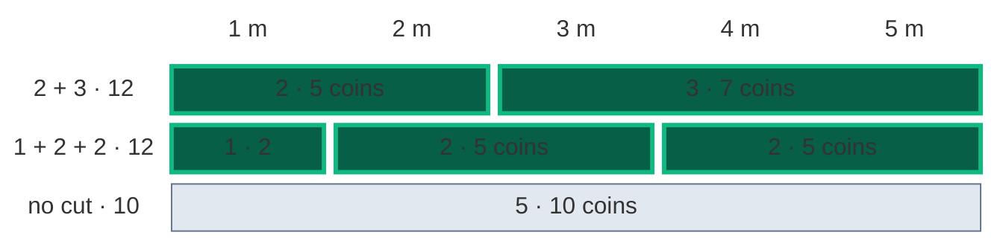

### Example

A smaller example (from the working examples in my notes) is used in every section below:

```text
price = [2, 5, 7, 8]     (piece 1 → 2, piece 2 → 5, piece 3 → 7, piece 4 → 8)
N     = 4

Best cut: 2 + 2 → 5 + 5 = 10
Output: 10
```

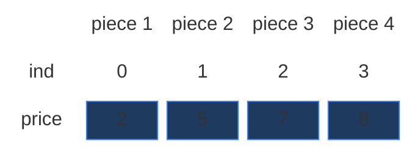

Every way to cut a rod of length 4 (the green one wins):

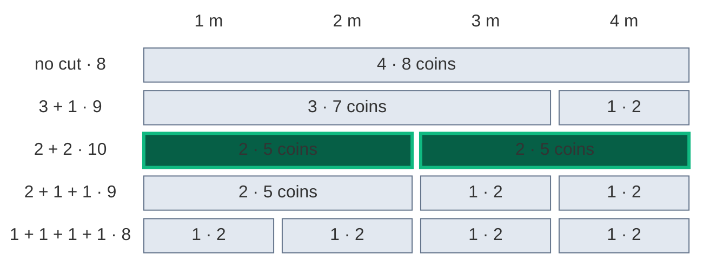

The full piece of length 4 gives only 8. Cutting it into `2 + 2` gives 10.

### Constraints

Coding Ninjas (from my notes):

- `1 <= T <= 50` (number of test cases)
- `1 <= N <= 100`
- `1 <= A[i] <= 100` (`A` is the price array)
- Time limit: 1 second.

GfG allows a longer rod (around `10^3`), so the Python memoization needs a higher recursion limit there (Section 5).

### What the constraints tell us (simple theory)

A **constraint** is the biggest input the judge will ever give you. It quietly tells you how fast your code must be.

**Rule of thumb:** a computer does about **100 million (10^8) simple steps per second**. Count how many steps your idea needs for the biggest input, and compare.

| Biggest input `n` | Steps you can afford | Ideas that fit |
|:---:|:---:|:---|
| up to ~20 | about `2^n` | Plain recursion, try everything |
| up to ~500 | about `n^3` | Three nested loops |
| up to ~5,000 | about `n^2` | Two nested loops |
| up to ~1,000,000 | about `n` or `n log n` | One loop, DP over `n` states |

**For this problem:** `N` is at most `100`.

- Plain recursion on `N = 100` makes **441,217,844 calls** (counted by code below). In Python that is several minutes. Way too slow, and that is for one test case out of 50.
- The DP fills a grid of `N × (N + 1) = 100 × 101 = 10,100` cells. Even with `T = 50` test cases that is about **half a million** steps. Instant.

The key: there are only `N` piece lengths and `N + 1` rod lengths, so only `N · (N + 1)` different questions. The DP work is `N · N`, not exponential.

**How the work grows as `N` grows**

Here `price` is all ones (the prices do not change the number of calls, only `N` does). Red bars = calls made by plain recursion. Green line = cells in the DP grid, `N · (N + 1)` (it stays flat near zero).

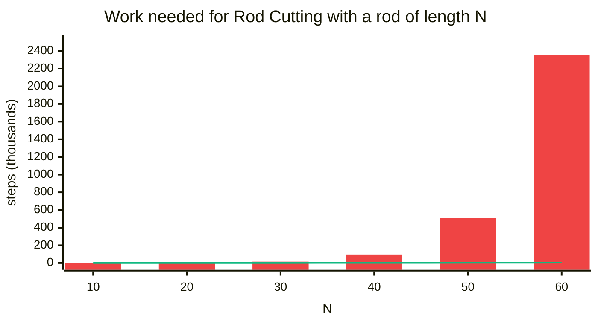

| `N` | Recursion calls | DP cells `N · (N + 1)` |
|:---:|:---:|:---:|
| 10 | 144 | 110 |
| 20 | 1,881 | 420 |
| 30 | 15,317 | 930 |
| 40 | 96,611 | 1,640 |
| 50 | 510,346 | 2,550 |
| 60 | 2,357,581 | 3,660 |
| 100 | 441,217,844 | 10,100 |

The recursion calls grow about 5 times for every 10 more units of rod. The DP cells grow slowly (`N²`).

## 2. Core Theory

This note builds on two earlier notes of this section: [06. 0-1 Knapsack](06.%200-1%20Knapsack.md) (pick each item at most once) and [10. Unbounded Knapsack](10.%20Unbounded%20Knapsack.md) (pick each item as often as you like). Rod Cutting is the second one in disguise. If you are new to 2-D DP, read [01. Subset Sum Equal To K](01.%20Subset%20Sum%20Equal%20To%20K.md) first: it explains the grid from zero.

### The big reframe: pieces are items, the rod is the bag

My notes (and Striver's board) turn the rod into a knapsack:

- Think of the rod length `N` as a **bag** that holds exactly `N` units.
- Every piece length is an **item**. Piece `i + 1` **weighs** `i + 1` and is **worth** `price[i]`.
- We must **collect rod lengths that add up to `N`** and **maximise the price**.
- After cutting one piece of length 2, we can still cut **another** piece of length 2. There is an **infinite supply** of every piece length (Striver circled "infinite supply of rods" on the board).

| Rod Cutting | Unbounded Knapsack |
|:---|:---|
| rod piece length `i + 1` | item weight |
| piece price `price[i]` | item value (profit) |
| rod total length `N` | bag capacity |
| same length can be cut many times | same item can be reused many times |

So this is **not** 0/1 Knapsack (each item once). It is **Unbounded Knapsack** (each item any number of times). If you know Unbounded Knapsack, Rod Cutting is the same logic.

One small difference makes Rod Cutting easier: a piece of length 1 always exists. So **every** leftover length can be filled. There is never an "impossible" state (Q2 below).

### Why we can't just try them all

A rod of length `N` has `N - 1` gaps between its units. At each gap we either cut or not. So there are `2^(N - 1)` ways to cut (order matters here: `1 + 2` and `2 + 1` are counted twice, but they give the same money). With `N = 100` that is `2^99` ways. Impossible.

The brute force below tries every cut pattern with a bit mask over the gaps. We only use it to check the other answers on small rods.

```python
# Imports used by every code block in this note
from typing import List

# For the recursion limit and the tests
import sys

# For random tests at the end
import random


# Brute force: try every way to cut the rod (a bit mask over the N - 1 gaps)
class SolutionBrute:

    # Main method (same name as GfG)
    def cutRod(self, price: List[int], n: int) -> int:

        # Best money found so far
        best = 0

        # Every mask is one cut pattern: bit g = 1 means cut after unit g + 1
        for mask in range(1 << (n - 1)):

            # Money for this cut pattern
            money = 0

            # Length of the piece we are building
            piece = 0

            # Walk over the n units of the rod
            for unit in range(n):

                # This unit belongs to the current piece
                piece += 1

                # Last unit, or there is a cut right after this unit
                if unit == n - 1 or mask & (1 << unit):

                    # Sell the piece (length piece costs price[piece - 1])
                    money += price[piece - 1]

                    # Start a new piece
                    piece = 0

            # Keep the best
            best = max(best, money)

        # The most money of all cut patterns
        return best
```

### How to spot that it is DP

| Property | Plain meaning | In Rod Cutting |
|:---|:---|:---|
| **Overlapping subproblems** | The same smaller question is asked many times | "Best money for a rod of length 0 using pieces 1 and 2?" is asked twice in our example (Section 4) |
| **Optimal substructure** | The big answer is built from answers of smaller questions | The best for length 4 = a piece of 2 (5 coins) + the best for the leftover length 2 |

Also: "cut into pieces, maximise value, piece lengths can be reused" is the sign of Unbounded Knapsack (my notes' interview line).

### The state needs two numbers

The **state** is the small piece of information that names one subproblem. Striver's 3-step recipe for writing the recurrence (from the board):

1. **Express** everything in terms of `(ind, N)`.
2. **Explore all possibilities**: not take, take.
3. **Maximise** over the possibilities.

> `f(ind, N)` = "using only piece lengths `1, 2, ..., ind + 1` (array indexes `0 .. ind`), what is the **maximum price** I can get for a rod of length `N`?"

- `ind` = which piece lengths are still allowed (the last allowed one is length `ind + 1`).
- `N` = how much rod is left to cut.

On the board: `f(4, N)` with `price = [2, 5, 7, 8, 10]` means "till index 4, what is the maximum price you can obtain?" The whole question is `f(n - 1, N)`. For our example that is `f(3, 4)`.

Why not one number? When we **skip** a piece length, `N` stays the same. When we **cut** a piece, `N` shrinks. The same piece lengths get asked about many different rod lengths. One number cannot tell "best for 4" and "best for 2" apart.

### The grid: rows are piece lengths, columns are rod lengths

- **Row `ind`** = "I may cut pieces of length `1 .. ind + 1`". Row 0 can only cut length-1 pieces. Row 3 can cut any length 1 to 4.
- **Column `N`** = "rod length still to cut". From `0` to `N`, so `N + 1` columns.
- **Cell `[ind][N]`** = the best money: the answer to `f(ind, N)`.

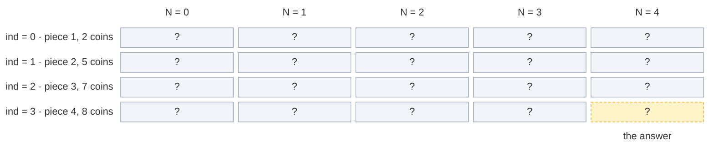

The grid has `n` rows and `N + 1` columns: here `4 × 5 = 20` cells. The answer is the bottom-right cell `[3][4]`.

### The recurrence: take or not take

In words: *look at the longest allowed piece, length `ind + 1`. Either never cut this length, and ask for the best using shorter pieces only. Or cut **one** piece of this length, earn `price[ind]`, and ask for the best of the leftover rod, **still allowed to cut this length again**. Take the bigger one.*

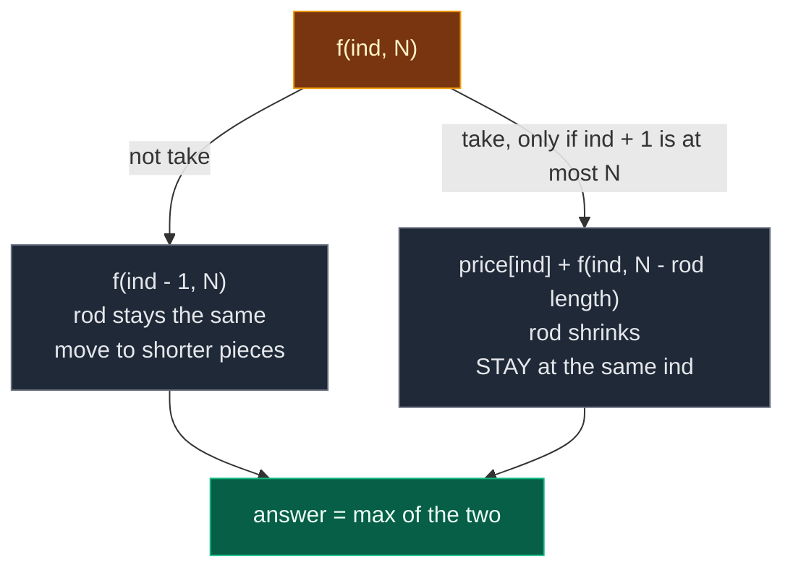

```text
rod_length = ind + 1
not_take   = 0 + f(ind - 1, N)
take       = price[ind] + f(ind, N - rod_length)     only if rod_length <= N
                                                      else take = -infinity
f(ind, N)  = max(not_take, take)
```

In Python: `not_take = f(ind - 1, N)`, `take = float('-inf')` (means "not possible"), `rod_length = ind + 1`, and `if rod_length <= N: take = price[ind] + f(ind, N - rod_length)`.

**The one line that makes it unbounded:** after "take", we call `f(ind, ...)`, **not** `f(ind - 1, ...)`. We stay at the same index, so the same piece length can be cut again. In 0/1 Knapsack the take goes to `ind - 1`.

Why `take = -infinity` when the piece does not fit? We are **maximising**. A choice that is not allowed must never win the `max`, so it starts as "very small". (Prices are positive, so `0` would also work here, but `-infinity` is the safe habit.)

In the grid: **not take reads the cell straight up** (row above, same column). **Take reads the same row, `ind + 1` columns to the left.** That "same row" is the whole difference from 0/1 Knapsack, which reads the row above.

### Base case

A **base case** is a subproblem so small that we know the answer without more work.

| Base case | Answer | Why |
|:---|:---:|:---|
| `ind == 0` | `N * price[0]` | Only pieces of length 1 are allowed. The only way to cut a rod of length `N` into length-1 pieces is `N` pieces, each worth `price[0]` |

The board: `if ind == 0: return N * price[0]`. In the table this becomes `dp[0][N] = N * price[0]` for every `N` from `0` to `N`.

No separate `N == 0` base case is needed. With `N = 0`, "take" is never allowed (`ind + 1 > 0`), so the calls just go down to `f(0, 0) = 0 * price[0] = 0`.

### Two ways to remember: memoization vs tabulation

| | Memoization | Tabulation |
|:---|:---|:---|
| Other name | **Top-down** | **Bottom-up** |
| Direction | Start from `f(n - 1, N)`, go down to the base case, come back up | Start from row 0, fill row by row down to `[n - 1][N]` |
| How | Recursion + a 2-D table | Two nested loops + a 2-D table |
| Computes | Only the cells it needs | Every cell |
| Stack | Uses the recursion stack | No recursion stack |

### The 5-step ladder

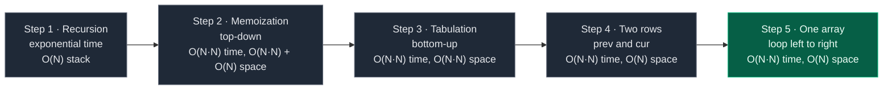

## 3. Edge Cases

| Case | Input | Expected | Why it matters |
|:---|:---:|:---:|:---|
| Rod of length 1 | `price = [3]`, `N = 1` | 3 | Only the base case `ind == 0` runs: `1 × 3` |
| All length-1 pieces win | `[3, 5, 8, 9, 10, 17, 17, 20]`, `N = 8` | 24 | Sample 2. The base case alone is the answer |
| The whole rod wins | `[1, 1, 1, 10]`, `N = 4` | 10 | "Not cutting" is also a valid choice (one piece of length `N`) |
| Short pieces are worth more | `[10, 1, 1, 1]`, `N = 4` | 40 | `N * price[0]` must be the base case, not `price[0]` |
| Two cuts tie | `[2, 5, 7, 8, 10]`, `N = 5` | 12 | `2 + 3` and `1 + 2 + 2` both give 12. `max` handles ties |
| Our example | `[2, 5, 7, 8]`, `N = 4` | 10 | Traced in every section |
| Biggest input | `N = 100` (or about `10^3` on GfG) | – | Python memoization needs a higher recursion limit (Section 5) |

## 4. Approach 1: Recursion

### Idea

Write the recurrence as code. Start with `f(n - 1, N)`: "with every piece length allowed, what is the best for the whole rod?" If `ind == 0`, return `N * price[0]`. Otherwise try "not take" and "take" and return the bigger one.

### Recursion tree for `price = [2, 5, 7, 8]`, `N = 4`

Every box shows the call and what it returns. Calls happen depth-first, "not take" first (like the code). The edge label "take 2" means "cut one piece of length 2".

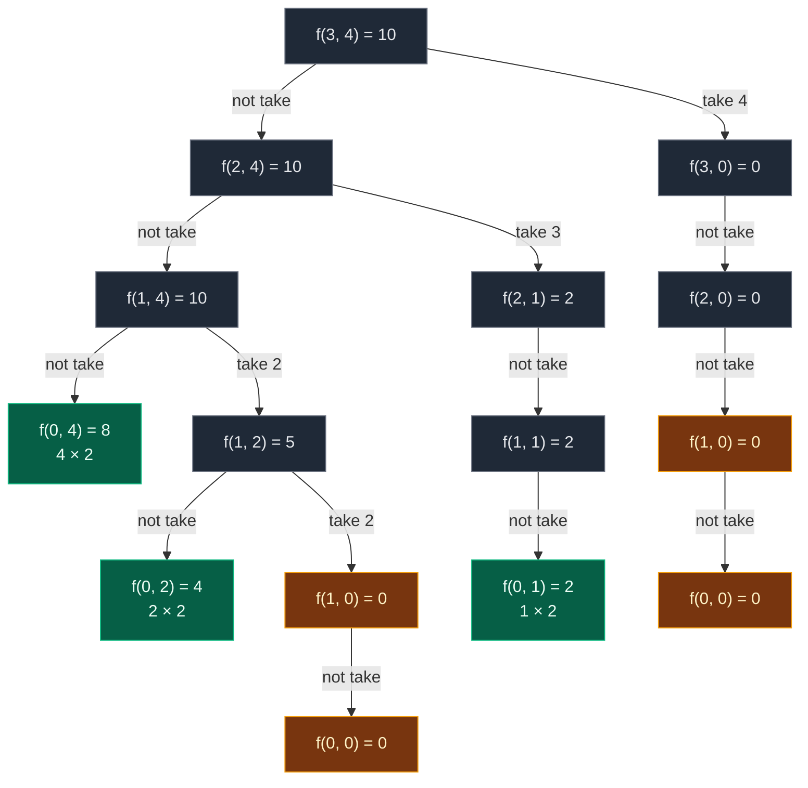

Gold = repeated work. Green = base cases that are not repeated.

Many nodes have only one child: "take" is not allowed when the piece is longer than the rod left (for example `f(2, 1)`: a piece of 3 does not fit in 1).

Note `f(1, 2)` "take 2" goes to `f(1, 0)`, **the same `ind = 1`**. That is the unbounded part: after cutting a piece of 2, we may cut another piece of 2.

| State | Times computed |
|:---|:---:|
| `f(3, 4)`, `f(2, 4)`, `f(1, 4)`, `f(1, 2)`, `f(2, 1)`, `f(1, 1)`, `f(3, 0)`, `f(2, 0)` | 1 each |
| **`f(1, 0)`** | **2** |
| **`f(0, 0)`** | **2** (inside each `f(1, 0)`) |
| `f(0, 4)`, `f(0, 2)`, `f(0, 1)` | 1 each |

That is **15 calls** for a rod of length 4. `f(1, 0)` ("nothing left to cut, pieces 1 and 2 allowed") is reached by two paths: "cut 2 + 2" and "cut a 4". Both leave an empty rod. On bigger rods the repeats explode (the chart in Section 1).

**The exact order of calls.** One participant per row of the grid (`ind`). Solid arrows = calls, dashed arrows = returns.

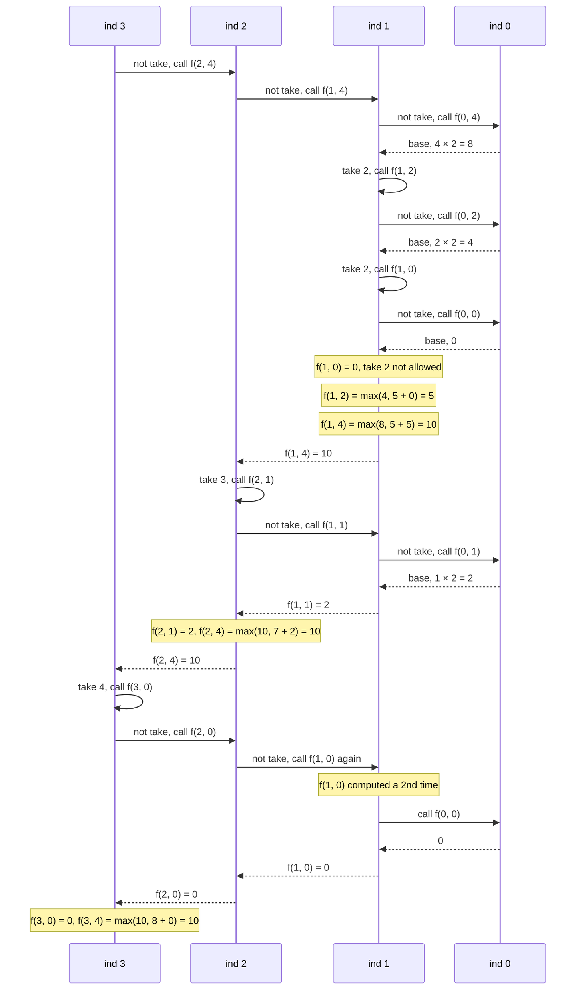

**The dry run in my notes, in words** (`price = [2, 5, 7, 8]`, `n = 4`, rod length 4):

- Call `solve(3, 4)`. At index 3 the piece length is 4, price 8.
- Not take → `solve(2, 4)`. Take → `8 + solve(3, 0)`.
- From `solve(2, 4)`: piece length 3, price 7. Not take → `solve(1, 4)`. Take → `7 + solve(2, 1)`.
- At `solve(1, 4)`: piece length 2, price 5. The best becomes `2 + 2`: value `5 + 5 = 10`.
- So the answer is **10**, because the full piece of length 4 gives only 8, but cutting into `2 + 2` gives 10.

### Code

```python
# Plain recursion
class SolutionRecursion:

    # Helper: best money for a rod of length `length`, using piece lengths 1 .. index + 1
    def solve(self, index: int, length: int, price: List[int]) -> int:

        # Base case: only piece length 1 is allowed, cut the whole rod into 1s
        if index == 0:
            return length * price[0]

        # Choice 1: do not take this piece length, move to shorter pieces
        not_take = 0 + self.solve(index - 1, length, price)

        # The real piece length for this index (1-based)
        rod_length = index + 1

        # Choice 2 starts very small, because we are maximising
        take = float("-inf")

        # Take only if the piece fits in the rod that is left
        if rod_length <= length:

            # Sell one piece and STAY at the same index (it may be cut again)
            take = price[index] + self.solve(index, length - rod_length, price)

        # The better of the two choices
        return max(not_take, take)

    # Main method (same name as GfG)
    def cutRod(self, price: List[int], n: int) -> int:

        # Start from the last index and the full rod
        return self.solve(n - 1, n, price)
```

### Complexity

| Measure | Complexity | Why |
|:---|:---:|:---|
| **Time** | Exponential | Each call can branch into 2. Interview line from my notes: "exponential due to overlapping subproblems". (It is a bit less than `2^N`, because "take" often does not fit: 441 million calls at `N = 100`) |
| **Space** | `O(N)` | Recursion stack. A path can go deep by reducing the index (up to `n` steps) or by reducing the rod length (up to `N` steps). That is `O(n + N)`, and since `n = N`, simply `O(N)`. The board writes it as `O(target)` |

## 5. Approach 2: Memoization (Top-Down)

### Idea

The same state `(index, length)` gets solved again and again. So we store it in `dp[index][length]`.

**Size of the table** (from the board): `ind` goes from `0` to `n - 1` (`n` rows), and the rod length goes from `0` to `N` (`N + 1` columns). So `dp` is `N × (N + 1)`.

The same **3 steps** as always:

1. **Declare** `dp` with `n` rows and `N + 1` columns, filled with `-1` ("not computed yet"). Prices are positive, so a real answer is never `-1`.
2. **Store** the answer before returning: `dp[index][length] = max(take, not_take)`.
3. **Check** first: if `dp[index][length] != -1`, return it and make no new calls.

Note: the base case `index == 0` is answered before the table is looked at, so row 0 stays `-1` in the memo table. That is fine.

My notes' example of why it helps: suppose `solve(1, 3)` appears many times. Plain recursion recomputes it every time. Memoization computes it the first time, stores it, and the next time returns `dp[1][3]` directly. The repeated work is removed. (In our small example the repeated state is `f(1, 0)`.)

**Python only:** each "take 1 more piece" or "move 1 index down" is one more stack frame, so a rod of length 1000 can go about 1500 calls deep. Python's default limit is 1000. Fix: `sys.setrecursionlimit(...)`, or use tabulation.

### Visual: when each `dp[ind][N]` gets filled

Colours: grey = `-1` (not computed), dashed yellow = computing (waiting for its children), green = just filled, blue = filled earlier, orange = cache hit.

**Start:** `dp` is `4 × 5`, all `-1`.

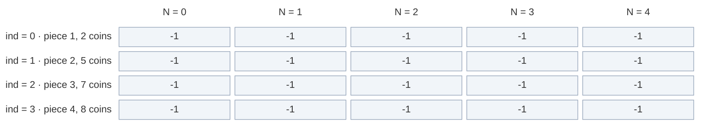

**Calls go down:** `f(3, 4)` → `f(2, 4)` → `f(1, 4)` → (`f(0, 4)` is a base case, 8) → take 2 → `f(1, 2)` → (`f(0, 2)` base, 4) → take 2 → `f(1, 0)`. All are `-1`, so all are computing.

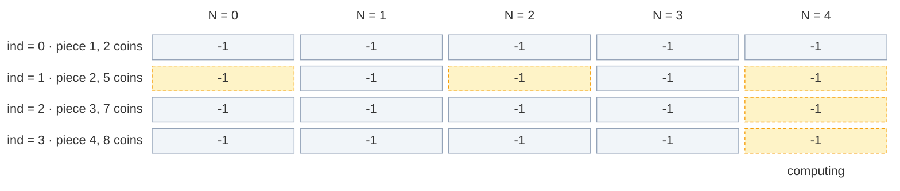

**Fill 1:** `f(1, 0)`: not take = `f(0, 0) = 0`. Take a piece of 2: does not fit in 0. Store `dp[1][0] = 0`.

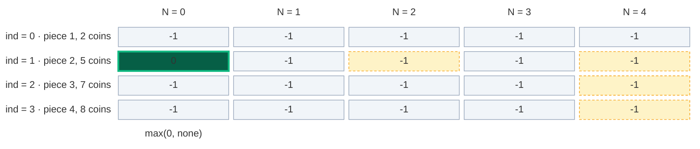

**Fill 2:** back in `f(1, 2)`: not take = `f(0, 2) = 4`, take = `5 + f(1, 0) = 5 + 0 = 5`. Store `dp[1][2] = 5`.

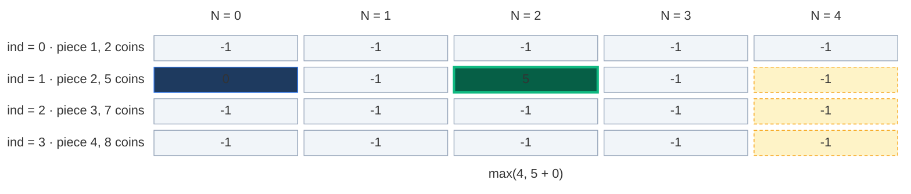

**Fill 3:** back in `f(1, 4)`: not take = `f(0, 4) = 8`, take = `5 + f(1, 2) = 5 + 5 = 10`. Store `dp[1][4] = 10`.

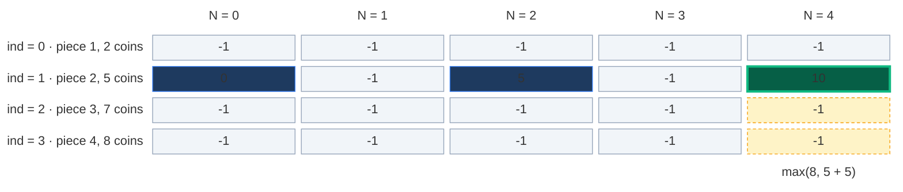

**Fill 4:** back in `f(2, 4)`, take a piece of 3 → `f(2, 1)` (computing) → not take → `f(1, 1)`: not take = `f(0, 1) = 2`, take a piece of 2 does not fit in 1. Store `dp[1][1] = 2`.

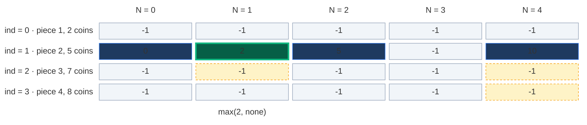

**Fill 5:** `f(2, 1)`: not take = 2, a piece of 3 does not fit in 1. Store `dp[2][1] = 2`.

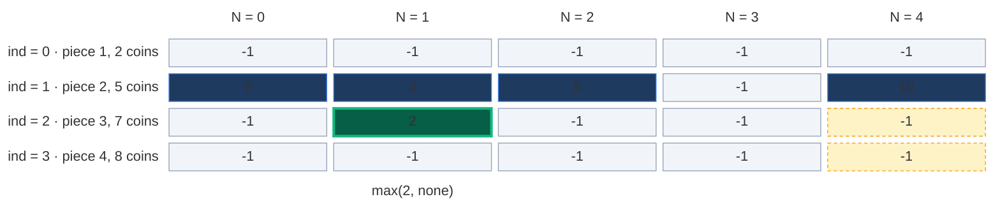

**Fill 6:** `f(2, 4)`: not take = 10, take = `7 + f(2, 1) = 7 + 2 = 9`. Store `dp[2][4] = 10`.

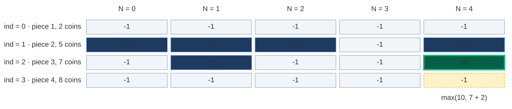

**Cache hit:** `f(3, 4)` now tries "take 4" → `f(3, 0)` → not take → `f(2, 0)` → not take → `f(1, 0)`. `dp[1][0] = 0`, not `-1` → return `0`, **no new calls**. The call to `f(0, 0)` below it is skipped.

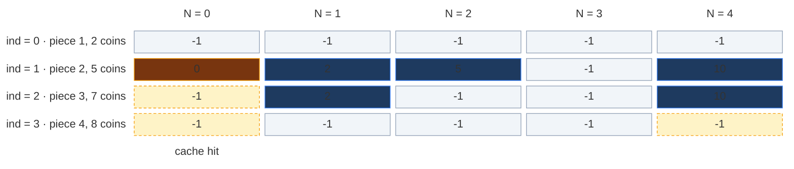

**Fill 7:** `f(2, 0) = max(0, none) = 0`. Store `dp[2][0] = 0`.

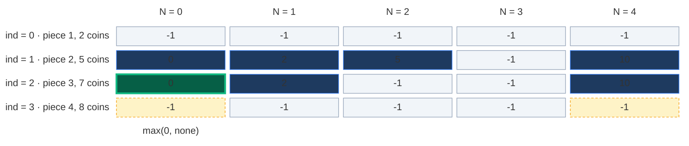

**Fill 8:** `f(3, 0) = max(0, none) = 0`. Store `dp[3][0] = 0`.

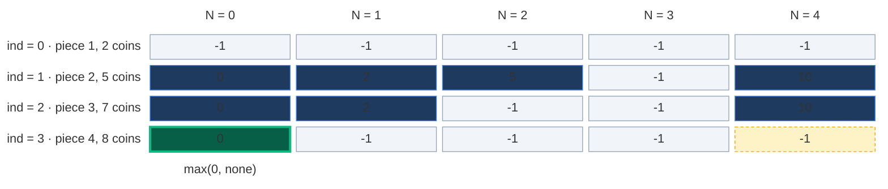

**Fill 9:** `f(3, 4)`: not take = 10, take = `8 + f(3, 0) = 8`. Store `dp[3][4] = 10`. That is the answer.

```mermaid
block-beta
  columns 6
  r0c0[" "] r0c1["N = 0"] r0c2["N = 1"] r0c3["N = 2"] r0c4["N = 3"] r0c5["N = 4"]
  r1c0["ind = 0 · piece 1, 2 coins"] r1c1["-1"] r1c2["-1"] r1c3["-1"] r1c4["-1"] r1c5["-1"]
  r2c0["ind = 1 · piece 2, 5 coins"] r2c1["0"] r2c2["2"] r2c3["5"] r2c4["-1"] r2c5["10"]
  r3c0["ind = 2 · piece 3, 7 coins"] r3c1["0"] r3c2["2"] r3c3["-1"] r3c4["-1"] r3c5["10"]
  r4c0["ind = 3 · piece 4, 8 coins"] r4c1["0"] r4c2["-1"] r4c3["-1"] r4c4["-1"] r4c5["10"]
  space space space space space r5c5["answer 10"]
  classDef head fill:none,stroke:none,color:#64748b
  class r0c0,r0c1,r0c2,r0c3,r0c4,r0c5,r1c0,r2c0,r3c0,r4c0 head
  classDef empty fill:#f1f5f9,stroke:#94a3b8,color:#64748b
  class r1c1,r1c2,r1c3,r1c4,r1c5,r2c4,r3c3,r3c4,r4c2,r4c3,r4c4 empty
  classDef done fill:#1e3a5f,stroke:#3b82f6,color:#dbeafe
  class r2c1,r2c2,r2c3,r2c5,r3c1,r3c2,r3c5,r4c1 done
  classDef new fill:#065f46,stroke:#10b981,color:#ecfdf5,stroke-width:3px
  class r4c5 new
  classDef note fill:none,stroke:none,color:#b45309
  class r5c5 note
```

Only 9 of the 20 cells were ever stored. Memoization computes **only the states it needs**.

### The pruned recursion tree

Same tree, but the cache hit (dashed) stops right away.

```mermaid
flowchart TD
    A["f(3, 4) = 10"]:::norm -->|not take| B["f(2, 4) = 10"]:::norm
    A -->|take 4| L["f(3, 0) = 0"]:::norm
    B -->|not take| C["f(1, 4) = 10"]:::norm
    B -->|take 3| I["f(2, 1) = 2"]:::norm
    C --> D["f(0, 4) = 8"]:::base
    C -->|take 2| E["f(1, 2) = 5"]:::norm
    E --> F["f(0, 2) = 4"]:::base
    E -->|take 2| G["f(1, 0) = 0"]:::norm
    G --> H["f(0, 0) = 0"]:::base
    I --> J["f(1, 1) = 2"]:::norm
    J --> K["f(0, 1) = 2"]:::base
    L --> M["f(2, 0) = 0"]:::norm
    M -.-|cache hit| N["f(1, 0) = 0 from dp"]:::hit

    classDef norm fill:#1f2937,stroke:#6b7280,color:#e5e7eb
    classDef hit fill:#78350f,stroke:#f59e0b,color:#fef3c7
    classDef base fill:#065f46,stroke:#10b981,color:#ecfdf5
```

**14 calls** instead of 15. A small saving because the example is tiny. On bigger rods the saving is huge: at most `N · (N + 1)` states are ever computed (10,100 for `N = 100` instead of 441 million calls).

### Code

```python
# Memoization (top-down DP) with a 2-D table of -1
class SolutionMemo:

    # Helper: best money for `length`, using piece lengths 1 .. index + 1, uses and fills dp
    def solve(self, index: int, length: int, price: List[int], dp: List[List[int]]) -> int:

        # Base case: only piece length 1 is allowed, cut the whole rod into 1s
        if index == 0:
            return length * price[0]

        # Step 3 (check): already solved this (index, length)? Reuse it
        if dp[index][length] != -1:
            return dp[index][length]

        # Choice 1: do not take this piece length
        not_take = 0 + self.solve(index - 1, length, price, dp)

        # The real piece length for this index
        rod_length = index + 1

        # Choice 2 starts very small
        take = float("-inf")

        # Take only if the piece fits
        if rod_length <= length:

            # Sell one piece and stay at the same index
            take = price[index] + self.solve(index, length - rod_length, price, dp)

        # Step 2 (store): remember the better choice
        dp[index][length] = max(take, not_take)

        # Return the stored answer
        return dp[index][length]

    # Main method (same name as GfG)
    def cutRod(self, price: List[int], n: int) -> int:

        # Python only: the stack can go about 1.5 × n deep
        sys.setrecursionlimit(max(1000, 3 * n + 100))

        # Step 1 (declare): n rows, n + 1 columns, -1 means not computed yet
        dp = [[-1] * (n + 1) for _ in range(n)]

        # Keep the table so we can look at it after the run
        self.dp = dp

        # Start from the last index and the full rod
        return self.solve(n - 1, n, price, dp)
```

### Complexity

| Measure | Complexity | Why |
|:---|:---:|:---|
| **Time** | `O(N · N)` | `index` goes `0 .. n - 1` and `length` goes `0 .. N`, so about `N · N` states, each solved once with `O(1)` work |
| **Space: dp table** | `O(N · N)` | `n` rows × `N + 1` columns |
| **Space: recursion stack** | `O(N)` | The deepest path |
| **Total space** | `O(N · N) + O(N)` | Table plus stack |

## 6. Approach 3: Tabulation (Bottom-Up)

### Idea

Fill the whole grid with two loops, from row 0 to the answer `[n - 1][N]`. No recursion, so no stack.

`dp[index][length]` = "the maximum money using piece lengths `1 .. index + 1` for a rod of length `length`."

### How to convert memo → table, step by step

1. **Same grid:** `dp` with `n` rows and `N + 1` columns, all `0`.
2. **Base case becomes a row:** `ind == 0 → N * price[0]` becomes `dp[0][length] = length * price[0]` for **every** `length` from `0` to `N`. (The board: "`N` goes from 0 to `n`, `dp[0][N] = N × price[0]`".)
3. **Two nested loops, in the opposite direction:** the recursion went from index `n - 1` down to `0`. Reverse it: `index` from `1` to `n - 1`, and inside, `length` from `0` to `N`.
4. **Copy the recurrence:** replace `f(...)` with `dp[...]`:
   - `not_take = dp[index - 1][length]` (row above)
   - `take = price[index] + dp[index][length - rod_length]` if `rod_length <= length` (**same row**, because the piece can be used again)
   - `dp[index][length] = max(take, not_take)`
5. **Answer:** `dp[n - 1][N]` (last row, full rod length column).

| Memoization | Becomes in tabulation |
|:---|:---|
| `dp[n][N + 1]` with `-1` | `dp[n][N + 1]` with `0` |
| `if index == 0: return length * price[0]` | `dp[0][length] = length * price[0]` for every `length` |
| `f(n - 1, N)` going down | Loops `index = 1 .. n - 1`, `length = 0 .. N` going up |
| `f(index - 1, length)` | `dp[index - 1][length]` |
| `f(index, length - rod_length)` | `dp[index][length - rod_length]` (same row) |
| `return f(n - 1, N)` | `return dp[n - 1][N]` |

**Picture rule:** to fill a cell, look **straight up** (not take) and **left by the piece length in the same row** (take). The same-row cell is already filled because we go left to right. Write the bigger one.

### Visual table fill (`price = [2, 5, 7, 8]`, `N = 4`)

Colours: green = just filled, orange = the cells it reads, blue = filled earlier, grey `?` = not filled yet.

**Start: the base row.** Row 0 can only cut pieces of length 1: `dp[0][N] = N × 2`.

```mermaid
block-beta
  columns 6
  r0c0[" "] r0c1["N = 0"] r0c2["N = 1"] r0c3["N = 2"] r0c4["N = 3"] r0c5["N = 4"]
  r1c0["ind = 0 · piece 1, 2 coins"] r1c1["0"] r1c2["2"] r1c3["4"] r1c4["6"] r1c5["8"]
  r2c0["ind = 1 · piece 2, 5 coins"] r2c1["?"] r2c2["?"] r2c3["?"] r2c4["?"] r2c5["?"]
  r3c0["ind = 2 · piece 3, 7 coins"] r3c1["?"] r3c2["?"] r3c3["?"] r3c4["?"] r3c5["?"]
  r4c0["ind = 3 · piece 4, 8 coins"] r4c1["?"] r4c2["?"] r4c3["?"] r4c4["?"] r4c5["?"]
  space r5c1["0 × 2"] r5c2["1 × 2"] r5c3["2 × 2"] r5c4["3 × 2"] r5c5["4 × 2"]
  classDef head fill:none,stroke:none,color:#64748b
  class r0c0,r0c1,r0c2,r0c3,r0c4,r0c5,r1c0,r2c0,r3c0,r4c0 head
  classDef new fill:#065f46,stroke:#10b981,color:#ecfdf5,stroke-width:3px
  class r1c1,r1c2,r1c3,r1c4,r1c5 new
  classDef empty fill:#f1f5f9,stroke:#94a3b8,color:#64748b
  class r2c1,r2c2,r2c3,r2c4,r2c5,r3c1,r3c2,r3c3,r3c4,r3c5,r4c1,r4c2,r4c3,r4c4,r4c5 empty
  classDef note fill:none,stroke:none,color:#b45309
  class r5c1,r5c2,r5c3,r5c4,r5c5 note
```

#### Row 1 (piece length 2, price 5), cell by cell

**`dp[1][0]`:** not take = `dp[0][0] = 0`. Take: a piece of 2 does not fit in 0. Result `0`.

```mermaid
block-beta
  columns 6
  r0c0[" "] r0c1["N = 0"] r0c2["N = 1"] r0c3["N = 2"] r0c4["N = 3"] r0c5["N = 4"]
  r1c0["ind = 0 · piece 1, 2 coins"] r1c1["0"] r1c2["2"] r1c3["4"] r1c4["6"] r1c5["8"]
  r2c0["ind = 1 · piece 2, 5 coins"] r2c1["0"] r2c2["?"] r2c3["?"] r2c4["?"] r2c5["?"]
  r3c0["ind = 2 · piece 3, 7 coins"] r3c1["?"] r3c2["?"] r3c3["?"] r3c4["?"] r3c5["?"]
  r4c0["ind = 3 · piece 4, 8 coins"] r4c1["?"] r4c2["?"] r4c3["?"] r4c4["?"] r4c5["?"]
  space r5c1["max(0, none)"] space space space space
  classDef head fill:none,stroke:none,color:#64748b
  class r0c0,r0c1,r0c2,r0c3,r0c4,r0c5,r1c0,r2c0,r3c0,r4c0 head
  classDef read fill:#78350f,stroke:#f59e0b,color:#fef3c7
  class r1c1 read
  classDef done fill:#1e3a5f,stroke:#3b82f6,color:#dbeafe
  class r1c2,r1c3,r1c4,r1c5 done
  classDef new fill:#065f46,stroke:#10b981,color:#ecfdf5,stroke-width:3px
  class r2c1 new
  classDef empty fill:#f1f5f9,stroke:#94a3b8,color:#64748b
  class r2c2,r2c3,r2c4,r2c5,r3c1,r3c2,r3c3,r3c4,r3c5,r4c1,r4c2,r4c3,r4c4,r4c5 empty
  classDef note fill:none,stroke:none,color:#b45309
  class r5c1 note
```

**`dp[1][1]`:** not take = `dp[0][1] = 2`. Take: 2 does not fit in 1. Result `2`.

```mermaid
block-beta
  columns 6
  r0c0[" "] r0c1["N = 0"] r0c2["N = 1"] r0c3["N = 2"] r0c4["N = 3"] r0c5["N = 4"]
  r1c0["ind = 0 · piece 1, 2 coins"] r1c1["0"] r1c2["2"] r1c3["4"] r1c4["6"] r1c5["8"]
  r2c0["ind = 1 · piece 2, 5 coins"] r2c1["0"] r2c2["2"] r2c3["?"] r2c4["?"] r2c5["?"]
  r3c0["ind = 2 · piece 3, 7 coins"] r3c1["?"] r3c2["?"] r3c3["?"] r3c4["?"] r3c5["?"]
  r4c0["ind = 3 · piece 4, 8 coins"] r4c1["?"] r4c2["?"] r4c3["?"] r4c4["?"] r4c5["?"]
  space space r5c2["max(2, none)"] space space space
  classDef head fill:none,stroke:none,color:#64748b
  class r0c0,r0c1,r0c2,r0c3,r0c4,r0c5,r1c0,r2c0,r3c0,r4c0 head
  classDef done fill:#1e3a5f,stroke:#3b82f6,color:#dbeafe
  class r1c1,r1c3,r1c4,r1c5,r2c1 done
  classDef read fill:#78350f,stroke:#f59e0b,color:#fef3c7
  class r1c2 read
  classDef new fill:#065f46,stroke:#10b981,color:#ecfdf5,stroke-width:3px
  class r2c2 new
  classDef empty fill:#f1f5f9,stroke:#94a3b8,color:#64748b
  class r2c3,r2c4,r2c5,r3c1,r3c2,r3c3,r3c4,r3c5,r4c1,r4c2,r4c3,r4c4,r4c5 empty
  classDef note fill:none,stroke:none,color:#b45309
  class r5c2 note
```

**`dp[1][2]`:** not take = `dp[0][2] = 4`. Take = `5 + dp[1][0] = 5 + 0 = 5` (same row, 2 to the left). Result `5`.

```mermaid
block-beta
  columns 6
  r0c0[" "] r0c1["N = 0"] r0c2["N = 1"] r0c3["N = 2"] r0c4["N = 3"] r0c5["N = 4"]
  r1c0["ind = 0 · piece 1, 2 coins"] r1c1["0"] r1c2["2"] r1c3["4"] r1c4["6"] r1c5["8"]
  r2c0["ind = 1 · piece 2, 5 coins"] r2c1["0"] r2c2["2"] r2c3["5"] r2c4["?"] r2c5["?"]
  r3c0["ind = 2 · piece 3, 7 coins"] r3c1["?"] r3c2["?"] r3c3["?"] r3c4["?"] r3c5["?"]
  r4c0["ind = 3 · piece 4, 8 coins"] r4c1["?"] r4c2["?"] r4c3["?"] r4c4["?"] r4c5["?"]
  space space space r5c3["max(4, 5 + 0)"] space space
  classDef head fill:none,stroke:none,color:#64748b
  class r0c0,r0c1,r0c2,r0c3,r0c4,r0c5,r1c0,r2c0,r3c0,r4c0 head
  classDef done fill:#1e3a5f,stroke:#3b82f6,color:#dbeafe
  class r1c1,r1c2,r1c4,r1c5,r2c2 done
  classDef read fill:#78350f,stroke:#f59e0b,color:#fef3c7
  class r1c3,r2c1 read
  classDef new fill:#065f46,stroke:#10b981,color:#ecfdf5,stroke-width:3px
  class r2c3 new
  classDef empty fill:#f1f5f9,stroke:#94a3b8,color:#64748b
  class r2c4,r2c5,r3c1,r3c2,r3c3,r3c4,r3c5,r4c1,r4c2,r4c3,r4c4,r4c5 empty
  classDef note fill:none,stroke:none,color:#b45309
  class r5c3 note
```

**`dp[1][3]`:** not take = `dp[0][3] = 6`. Take = `5 + dp[1][1] = 5 + 2 = 7`. Result `7` (cut `2 + 1`).

```mermaid
block-beta
  columns 6
  r0c0[" "] r0c1["N = 0"] r0c2["N = 1"] r0c3["N = 2"] r0c4["N = 3"] r0c5["N = 4"]
  r1c0["ind = 0 · piece 1, 2 coins"] r1c1["0"] r1c2["2"] r1c3["4"] r1c4["6"] r1c5["8"]
  r2c0["ind = 1 · piece 2, 5 coins"] r2c1["0"] r2c2["2"] r2c3["5"] r2c4["7"] r2c5["?"]
  r3c0["ind = 2 · piece 3, 7 coins"] r3c1["?"] r3c2["?"] r3c3["?"] r3c4["?"] r3c5["?"]
  r4c0["ind = 3 · piece 4, 8 coins"] r4c1["?"] r4c2["?"] r4c3["?"] r4c4["?"] r4c5["?"]
  space space space space r5c4["max(6, 5 + 2)"] space
  classDef head fill:none,stroke:none,color:#64748b
  class r0c0,r0c1,r0c2,r0c3,r0c4,r0c5,r1c0,r2c0,r3c0,r4c0 head
  classDef done fill:#1e3a5f,stroke:#3b82f6,color:#dbeafe
  class r1c1,r1c2,r1c3,r1c5,r2c1,r2c3 done
  classDef read fill:#78350f,stroke:#f59e0b,color:#fef3c7
  class r1c4,r2c2 read
  classDef new fill:#065f46,stroke:#10b981,color:#ecfdf5,stroke-width:3px
  class r2c4 new
  classDef empty fill:#f1f5f9,stroke:#94a3b8,color:#64748b
  class r2c5,r3c1,r3c2,r3c3,r3c4,r3c5,r4c1,r4c2,r4c3,r4c4,r4c5 empty
  classDef note fill:none,stroke:none,color:#b45309
  class r5c4 note
```

**`dp[1][4]`:** not take = `dp[0][4] = 8`. Take = `5 + dp[1][2] = 5 + 5 = 10`. Result `10`. Note that `dp[1][2]` was itself built with a piece of 2, so this cell uses **two** pieces of 2. That is the unbounded part.

```mermaid
block-beta
  columns 6
  r0c0[" "] r0c1["N = 0"] r0c2["N = 1"] r0c3["N = 2"] r0c4["N = 3"] r0c5["N = 4"]
  r1c0["ind = 0 · piece 1, 2 coins"] r1c1["0"] r1c2["2"] r1c3["4"] r1c4["6"] r1c5["8"]
  r2c0["ind = 1 · piece 2, 5 coins"] r2c1["0"] r2c2["2"] r2c3["5"] r2c4["7"] r2c5["10"]
  r3c0["ind = 2 · piece 3, 7 coins"] r3c1["?"] r3c2["?"] r3c3["?"] r3c4["?"] r3c5["?"]
  r4c0["ind = 3 · piece 4, 8 coins"] r4c1["?"] r4c2["?"] r4c3["?"] r4c4["?"] r4c5["?"]
  space space space space space r5c5["max(8, 5 + 5)"]
  classDef head fill:none,stroke:none,color:#64748b
  class r0c0,r0c1,r0c2,r0c3,r0c4,r0c5,r1c0,r2c0,r3c0,r4c0 head
  classDef done fill:#1e3a5f,stroke:#3b82f6,color:#dbeafe
  class r1c1,r1c2,r1c3,r1c4,r2c1,r2c2,r2c4 done
  classDef read fill:#78350f,stroke:#f59e0b,color:#fef3c7
  class r1c5,r2c3 read
  classDef new fill:#065f46,stroke:#10b981,color:#ecfdf5,stroke-width:3px
  class r2c5 new
  classDef empty fill:#f1f5f9,stroke:#94a3b8,color:#64748b
  class r3c1,r3c2,r3c3,r3c4,r3c5,r4c1,r4c2,r4c3,r4c4,r4c5 empty
  classDef note fill:none,stroke:none,color:#b45309
  class r5c5 note
```

My notes say the same: "At length 2: not take = 4, take = `5 + dp[1][0]` = 5, best = 5. At length 4: not take = 8, take = `5 + dp[1][2]` = 10, best = 10. So the answer becomes 10."

#### Row 2 (piece length 3, price 7)

| Cell | not take (up) | take (same row, 3 left) | Result |
|:---:|:---:|:---:|:---:|
| `dp[2][0]` | `dp[1][0] = 0` | does not fit | `0` |
| `dp[2][1]` | `dp[1][1] = 2` | does not fit | `2` |
| `dp[2][2]` | `dp[1][2] = 5` | does not fit | `5` |
| `dp[2][3]` | `dp[1][3] = 7` | `7 + dp[2][0] = 7` | `7` (tie) |
| `dp[2][4]` | `dp[1][4] = 10` | `7 + dp[2][1] = 9` | `10` |

```mermaid
block-beta
  columns 6
  r0c0[" "] r0c1["N = 0"] r0c2["N = 1"] r0c3["N = 2"] r0c4["N = 3"] r0c5["N = 4"]
  r1c0["ind = 0 · piece 1, 2 coins"] r1c1["0"] r1c2["2"] r1c3["4"] r1c4["6"] r1c5["8"]
  r2c0["ind = 1 · piece 2, 5 coins"] r2c1["0"] r2c2["2"] r2c3["5"] r2c4["7"] r2c5["10"]
  r3c0["ind = 2 · piece 3, 7 coins"] r3c1["0"] r3c2["2"] r3c3["5"] r3c4["7"] r3c5["10"]
  r4c0["ind = 3 · piece 4, 8 coins"] r4c1["?"] r4c2["?"] r4c3["?"] r4c4["?"] r4c5["?"]
  space r5c1["max(0, none)"] r5c2["max(2, none)"] r5c3["max(5, none)"] r5c4["max(7, 7 + 0)"] r5c5["max(10, 7 + 2)"]
  classDef head fill:none,stroke:none,color:#64748b
  class r0c0,r0c1,r0c2,r0c3,r0c4,r0c5,r1c0,r2c0,r3c0,r4c0 head
  classDef done fill:#1e3a5f,stroke:#3b82f6,color:#dbeafe
  class r1c1,r1c2,r1c3,r1c4,r1c5,r2c1,r2c2,r2c3,r2c4,r2c5 done
  classDef new fill:#065f46,stroke:#10b981,color:#ecfdf5,stroke-width:3px
  class r3c1,r3c2,r3c3,r3c4,r3c5 new
  classDef empty fill:#f1f5f9,stroke:#94a3b8,color:#64748b
  class r4c1,r4c2,r4c3,r4c4,r4c5 empty
  classDef note fill:none,stroke:none,color:#b45309
  class r5c1,r5c2,r5c3,r5c4,r5c5 note
```

#### Row 3 (piece length 4, price 8)

| Cell | not take (up) | take (same row, 4 left) | Result |
|:---:|:---:|:---:|:---:|
| `dp[3][0]` .. `dp[3][3]` | `0, 2, 5, 7` | does not fit | `0, 2, 5, 7` |
| `dp[3][4]` | `dp[2][4] = 10` | `8 + dp[3][0] = 8` | `10` |

```mermaid
block-beta
  columns 6
  r0c0[" "] r0c1["N = 0"] r0c2["N = 1"] r0c3["N = 2"] r0c4["N = 3"] r0c5["N = 4"]
  r1c0["ind = 0 · piece 1, 2 coins"] r1c1["0"] r1c2["2"] r1c3["4"] r1c4["6"] r1c5["8"]
  r2c0["ind = 1 · piece 2, 5 coins"] r2c1["0"] r2c2["2"] r2c3["5"] r2c4["7"] r2c5["10"]
  r3c0["ind = 2 · piece 3, 7 coins"] r3c1["0"] r3c2["2"] r3c3["5"] r3c4["7"] r3c5["10"]
  r4c0["ind = 3 · piece 4, 8 coins"] r4c1["0"] r4c2["2"] r4c3["5"] r4c4["7"] r4c5["10"]
  space r5c1["max(0, none)"] r5c2["max(2, none)"] r5c3["max(5, none)"] r5c4["max(7, none)"] r5c5["max(10, 8 + 0)"]
  classDef head fill:none,stroke:none,color:#64748b
  class r0c0,r0c1,r0c2,r0c3,r0c4,r0c5,r1c0,r2c0,r3c0,r4c0 head
  classDef done fill:#1e3a5f,stroke:#3b82f6,color:#dbeafe
  class r1c1,r1c2,r1c3,r1c4,r1c5,r2c1,r2c2,r2c3,r2c4,r2c5,r3c1,r3c2,r3c3,r3c4,r3c5 done
  classDef new fill:#065f46,stroke:#10b981,color:#ecfdf5,stroke-width:3px
  class r4c1,r4c2,r4c3,r4c4,r4c5 new
  classDef note fill:none,stroke:none,color:#b45309
  class r5c1,r5c2,r5c3,r5c4,r5c5 note
```

**Answer:** `dp[3][4] = 10`.

**Which cuts? (walk back).** Start at `dp[n - 1][N]`. If the cell straight up has the same value, this piece length was not needed: go up. Otherwise a piece was cut: stay in the row and move left by the piece length.

- `dp[3][4] = 10`, up is `dp[2][4] = 10` → no piece of 4, go up.
- `dp[2][4] = 10`, up is `dp[1][4] = 10` → no piece of 3, go up.
- `dp[1][4] = 10`, up is `dp[0][4] = 8` → cut a **2**, move to `dp[1][2]`.
- `dp[1][2] = 5`, up is `dp[0][2] = 4` → cut a **2**, move to `dp[1][0]`.
- Rod length 0: stop. Cuts = `2 + 2`, money `5 + 5 = 10` ✓.

Green = a piece was cut here, light grey = skipped, orange = where we stop.

```mermaid
block-beta
  columns 6
  r0c0[" "] r0c1["N = 0"] r0c2["N = 1"] r0c3["N = 2"] r0c4["N = 3"] r0c5["N = 4"]
  r1c0["ind = 0 · piece 1, 2 coins"] r1c1["0"] r1c2["2"] r1c3["4"] r1c4["6"] r1c5["8"]
  r2c0["ind = 1 · piece 2, 5 coins"] r2c1["0"] r2c2["2"] r2c3["5"] r2c4["7"] r2c5["10"]
  r3c0["ind = 2 · piece 3, 7 coins"] r3c1["0"] r3c2["2"] r3c3["5"] r3c4["7"] r3c5["10"]
  r4c0["ind = 3 · piece 4, 8 coins"] r4c1["0"] r4c2["2"] r4c3["5"] r4c4["7"] r4c5["10"]
  space r5c1["stop"] space r5c3["take 2"] space r5c5["take 2"]
  classDef head fill:none,stroke:none,color:#64748b
  class r0c0,r0c1,r0c2,r0c3,r0c4,r0c5,r1c0,r2c0,r3c0,r4c0 head
  classDef done fill:#1e3a5f,stroke:#3b82f6,color:#dbeafe
  class r1c1,r1c2,r1c3,r1c4,r1c5,r2c2,r2c4,r3c1,r3c2,r3c3,r3c4,r4c1,r4c2,r4c3,r4c4 done
  classDef read fill:#78350f,stroke:#f59e0b,color:#fef3c7
  class r2c1 read
  classDef new fill:#065f46,stroke:#10b981,color:#ecfdf5,stroke-width:3px
  class r2c3,r2c5 new
  classDef old fill:#e2e8f0,stroke:#64748b,color:#0f172a
  class r3c5,r4c5 old
  classDef note fill:none,stroke:none,color:#b45309
  class r5c1,r5c3,r5c5 note
```

### Code

```python
# Tabulation (bottom-up DP)
class SolutionTab:

    # Main method (same name as GfG)
    def cutRod(self, price: List[int], n: int) -> int:

        # Step 1: n rows (piece lengths), n + 1 columns (rod lengths 0 .. n)
        dp = [[0] * (n + 1) for _ in range(n)]

        # Step 2: base row, only piece length 1 is allowed
        for length in range(n + 1):

            # A rod of this length becomes `length` pieces of length 1
            dp[0][length] = length * price[0]

        # Step 3: fill the table row by row
        for index in range(1, n):

            # The real piece length for this row
            rod_length = index + 1

            # Every rod length from 0 to n
            for length in range(n + 1):

                # Not take: the row above, same rod length
                not_take = dp[index - 1][length]

                # Take starts very small
                take = float("-inf")

                # Take only if the piece fits
                if rod_length <= length:

                    # Take: SAME row, rod_length columns to the left
                    take = price[index] + dp[index][length - rod_length]

                # Step 4: copy the recurrence
                dp[index][length] = max(take, not_take)

        # Keep the table so we can look at it after the run
        self.dp = dp

        # Step 5: the answer is the last row, full rod length
        return dp[n - 1][n]
```

### Complexity

| Measure | Complexity | Why |
|:---|:---:|:---|
| **Time** | `O(N · N)` | We fill an `n × (N + 1)` table |
| **Space** | `O(N · N)` | The whole table is stored. No recursion stack any more |

## 7. Approach 4: Space Optimization (Optimal)

### Idea

Look at the table fill again. A cell of row `index` reads:

- the **previous row** (`not_take = dp[index - 1][length]`), and
- the **current row** (`take = dp[index][length - rod_length]`).

Rows `index - 2`, `index - 3`, ... are never read again.

**Step 4: two arrays (from my notes).** Keep `prev` (row `index - 1`) and `cur` (row `index`). `not_take = prev[length]`, `take = price[index] + cur[length - rod_length]`. After the row: `prev = cur`.

```mermaid
block-beta
  columns 6
  r0c0[" "] r0c1["N = 0"] r0c2["N = 1"] r0c3["N = 2"] r0c4["N = 3"] r0c5["N = 4"]
  r1c0["prev · row 0"] r1c1["0"] r1c2["2"] r1c3["4"] r1c4["6"] r1c5["8"]
  r2c0["cur · piece 2"] r2c1["0"] r2c2["2"] r2c3["5"] r2c4["7"] r2c5["10"]
  space r3c1["up only"] r3c2["up only"] r3c3["up + cur 0"] r3c4["up + cur 1"] r3c5["up + cur 2"]
  classDef head fill:none,stroke:none,color:#64748b
  class r0c0,r0c1,r0c2,r0c3,r0c4,r0c5,r1c0,r2c0 head
  classDef read fill:#78350f,stroke:#f59e0b,color:#fef3c7
  class r1c1,r1c2,r1c3,r1c4,r1c5 read
  classDef new fill:#065f46,stroke:#10b981,color:#ecfdf5,stroke-width:3px
  class r2c1,r2c2,r2c3,r2c4,r2c5 new
  classDef note fill:none,stroke:none,color:#b45309
  class r3c1,r3c2,r3c3,r3c4,r3c5 note
```

```python
# Space optimized with two arrays: prev row and current row
class SolutionTwoRows:

    # Main method (same name as GfG)
    def cutRod(self, price: List[int], n: int) -> int:

        # prev = row 0: only piece length 1
        prev = [0] * (n + 1)

        # Base row: fill the rod with pieces of length 1
        for length in range(n + 1):

            # length pieces, each worth price[0]
            prev[length] = length * price[0]

        # Process the other piece lengths
        for index in range(1, n):

            # The new row for this index
            cur = [0] * (n + 1)

            # The real piece length
            rod_length = index + 1

            # Every rod length
            for length in range(n + 1):

                # Not take: previous row
                not_take = prev[length]

                # Take starts very small
                take = float("-inf")

                # Take only if the piece fits
                if rod_length <= length:

                    # Take: current row (the piece may be used again)
                    take = price[index] + cur[length - rod_length]

                # Better of the two
                cur[length] = max(take, not_take)

            # The current row becomes the previous row
            prev = cur

        # Answer for the full rod
        return prev[n]
```

**Step 5: one array (the best version).** Striver goes one step further. Use a single array `dp` of size `N + 1` and update it in place:

```text
dp[length] = max(dp[length], price[index] + dp[length - rod_length])
```

- Before the update, `dp[length]` still holds the **old** value: the previous row. That is `not_take`.
- `dp[length - rod_length]` is a smaller index. If we loop **left to right**, it was **already updated** in this round, so it is the current row. That is exactly `take` in the unbounded recurrence: the same piece may be used again.

So the one array works only because we loop **left to right**. In 0/1 problems we loop right to left (one item, used once). In Rod Cutting / unbounded problems we loop left to right (the current piece can be used again). We also start the inner loop at `rod_length`, because shorter rods cannot take this piece and keep their old value.

**Why `O(N)` and not `O(1)`?** The take reads `dp[length - rod_length]`, and the piece length can be anything from 1 to `N`. So a cell may need **any** earlier cell. We must keep the whole row: `N + 1` values.

### Visual Walkthrough (Story Version)

**The story:** Tia has a candy stick 4 cm long. The sweet shop buys pieces by length: a 1 cm piece pays 2 coins, 2 cm pays 5 coins, 3 cm pays 7 coins and the whole 4 cm stick pays 8 coins. Tia wants the most coins.

She keeps a **notebook** with one box for every stick length from 0 to 4. Each box holds "the most coins I know for a stick this long". She learns one piece size at a time. For each new size she walks along the notebook **from short to long** and asks, for every length: *"If I snap off one piece of the new size, the coins for that piece plus the notebook box for what is left, is that more than what I wrote before?"*

The candy stick is drawn under the notebook: each box is a piece, its width is its length.

**Start: Tia only knows 1 cm pieces.** A stick of length `L` becomes `L` pieces of 1 cm, `L × 2` coins.

```mermaid
block-beta
  columns 6
  r0c0[" "] r0c1["length 0"] r0c2["length 1"] r0c3["length 2"] r0c4["length 3"] r0c5["length 4"]
  r1c0["notebook"] r1c1["0"] r1c2["2"] r1c3["4"] r1c4["6"] r1c5["8"]
  space r2c1["no candy"] r2c2["1"] r2c3["1+1"] r2c4["1+1+1"] r2c5["1+1+1+1"]
  r3c0["best for 4"] space r3c2["1 · 2"] r3c3["1 · 2"] r3c4["1 · 2"] r3c5["1 · 2"]
  classDef head fill:none,stroke:none,color:#64748b
  class r0c0,r0c1,r0c2,r0c3,r0c4,r0c5,r1c0,r3c0 head
  classDef new fill:#065f46,stroke:#10b981,color:#ecfdf5,stroke-width:3px
  class r1c1,r1c2,r1c3,r1c4,r1c5 new
  classDef note fill:none,stroke:none,color:#b45309
  class r2c1,r2c2,r2c3,r2c4,r2c5 note
  classDef old fill:#e2e8f0,stroke:#64748b,color:#0f172a
  class r3c2,r3c3,r3c4,r3c5 old
```

**Step 1: she learns 2 cm pieces (5 coins). Length 2.** Snap a 2 cm piece: `5 + notebook[0] = 5 + 0 = 5`. That beats 4. Write 5.

```mermaid
block-beta
  columns 6
  r0c0[" "] r0c1["length 0"] r0c2["length 1"] r0c3["length 2"] r0c4["length 3"] r0c5["length 4"]
  r1c0["notebook"] r1c1["0"] r1c2["2"] r1c3["5"] r1c4["6"] r1c5["8"]
  space space space r2c3["5 beats 4"] space space
  r3c0["best for 2"] space r3c2["piece 2 · 5 coins"]:2 space space
  classDef head fill:none,stroke:none,color:#64748b
  class r0c0,r0c1,r0c2,r0c3,r0c4,r0c5,r1c0,r3c0 head
  classDef done fill:#1e3a5f,stroke:#3b82f6,color:#dbeafe
  class r1c1,r1c2,r1c4,r1c5 done
  classDef new fill:#065f46,stroke:#10b981,color:#ecfdf5,stroke-width:3px
  class r1c3,r3c2 new
  classDef note fill:none,stroke:none,color:#b45309
  class r2c3 note
```

**Step 2: length 3.** Snap a 2 cm piece: `5 + notebook[1] = 5 + 2 = 7`. That beats 6. Write 7. The stick is `2 + 1`.

```mermaid
block-beta
  columns 6
  r0c0[" "] r0c1["length 0"] r0c2["length 1"] r0c3["length 2"] r0c4["length 3"] r0c5["length 4"]
  r1c0["notebook"] r1c1["0"] r1c2["2"] r1c3["5"] r1c4["7"] r1c5["8"]
  space space space space r2c4["7 beats 6"] space
  r3c0["best for 3"] space r3c2["piece 2 · 5 coins"]:2 r3c3["1 · 2"] space
  classDef head fill:none,stroke:none,color:#64748b
  class r0c0,r0c1,r0c2,r0c3,r0c4,r0c5,r1c0,r3c0 head
  classDef done fill:#1e3a5f,stroke:#3b82f6,color:#dbeafe
  class r1c1,r1c2,r1c3,r1c5 done
  classDef new fill:#065f46,stroke:#10b981,color:#ecfdf5,stroke-width:3px
  class r1c4,r3c2 new
  classDef note fill:none,stroke:none,color:#b45309
  class r2c4 note
  classDef old fill:#e2e8f0,stroke:#64748b,color:#0f172a
  class r3c3 old
```

**Step 3: length 4.** Snap a 2 cm piece: `5 + notebook[2]`. But `notebook[2]` was **just** updated to 5, and that 5 is itself a 2 cm piece! So `5 + 5 = 10`. That beats 8. Write 10. The stick is `2 + 2`: the same piece size used twice. This is why she walks from short to long.

```mermaid
block-beta
  columns 6
  r0c0[" "] r0c1["length 0"] r0c2["length 1"] r0c3["length 2"] r0c4["length 3"] r0c5["length 4"]
  r1c0["notebook"] r1c1["0"] r1c2["2"] r1c3["5"] r1c4["7"] r1c5["10"]
  space space space r2c3["reused"] space r2c5["10 beats 8"]
  r3c0["best for 4"] space r3c2["piece 2 · 5 coins"]:2 r3c3["piece 2 · 5 coins"]:2
  classDef head fill:none,stroke:none,color:#64748b
  class r0c0,r0c1,r0c2,r0c3,r0c4,r0c5,r1c0,r3c0 head
  classDef done fill:#1e3a5f,stroke:#3b82f6,color:#dbeafe
  class r1c1,r1c2,r1c4 done
  classDef read fill:#78350f,stroke:#f59e0b,color:#fef3c7
  class r1c3 read
  classDef new fill:#065f46,stroke:#10b981,color:#ecfdf5,stroke-width:3px
  class r1c5,r3c2,r3c3 new
  classDef note fill:none,stroke:none,color:#b45309
  class r2c3,r2c5 note
```

**Step 4: she learns 3 cm pieces (7 coins).** Length 3: `7 + notebook[0] = 7`, a tie with 7, keep it. Length 4: `7 + notebook[1] = 7 + 2 = 9`, loses to 10, keep 10. The stick `3 + 1` is not good enough.

```mermaid
block-beta
  columns 6
  r0c0[" "] r0c1["length 0"] r0c2["length 1"] r0c3["length 2"] r0c4["length 3"] r0c5["length 4"]
  r1c0["notebook"] r1c1["0"] r1c2["2"] r1c3["5"] r1c4["7"] r1c5["10"]
  space space space space r2c4["7 ties 7"] r2c5["9 loses to 10"]
  r3c0["try for 4"] space r3c2["piece 3 · 7 coins"]:3 r3c3["1 · 2"]
  classDef head fill:none,stroke:none,color:#64748b
  class r0c0,r0c1,r0c2,r0c3,r0c4,r0c5,r1c0,r3c0 head
  classDef done fill:#1e3a5f,stroke:#3b82f6,color:#dbeafe
  class r1c1,r1c2,r1c3 done
  classDef read fill:#78350f,stroke:#f59e0b,color:#fef3c7
  class r1c4,r1c5 read
  classDef note fill:none,stroke:none,color:#b45309
  class r2c4,r2c5 note
  classDef old fill:#e2e8f0,stroke:#64748b,color:#0f172a
  class r3c2,r3c3 old
```

**Step 5: she learns 4 cm pieces (8 coins).** Length 4: `8 + notebook[0] = 8`, loses to 10. Selling the stick whole is worse.

```mermaid
block-beta
  columns 6
  r0c0[" "] r0c1["length 0"] r0c2["length 1"] r0c3["length 2"] r0c4["length 3"] r0c5["length 4"]
  r1c0["notebook"] r1c1["0"] r1c2["2"] r1c3["5"] r1c4["7"] r1c5["10"]
  space space space space space r2c5["8 loses to 10"]
  r3c0["try for 4"] space r3c2["piece 4 · 8 coins"]:4
  classDef head fill:none,stroke:none,color:#64748b
  class r0c0,r0c1,r0c2,r0c3,r0c4,r0c5,r1c0,r3c0 head
  classDef done fill:#1e3a5f,stroke:#3b82f6,color:#dbeafe
  class r1c1,r1c2,r1c3,r1c4 done
  classDef new fill:#065f46,stroke:#10b981,color:#ecfdf5,stroke-width:3px
  class r1c5 new
  classDef note fill:none,stroke:none,color:#b45309
  class r2c5 note
  classDef old fill:#e2e8f0,stroke:#64748b,color:#0f172a
  class r3c2 old
```

**The end:** box 4 says 10 coins. Tia snaps the stick into two 2 cm pieces.

```mermaid
block-beta
  columns 6
  r0c0[" "] r0c1["length 0"] r0c2["length 1"] r0c3["length 2"] r0c4["length 3"] r0c5["length 4"]
  r1c0["notebook"] r1c1["0"] r1c2["2"] r1c3["5"] r1c4["7"] r1c5["10"]
  space space space space space r2c5["answer 10"]
  r3c0["final cut"] space r3c2["piece 2 · 5 coins"]:2 r3c3["piece 2 · 5 coins"]:2
  classDef head fill:none,stroke:none,color:#64748b
  class r0c0,r0c1,r0c2,r0c3,r0c4,r0c5,r1c0,r3c0 head
  classDef done fill:#1e3a5f,stroke:#3b82f6,color:#dbeafe
  class r1c1,r1c2,r1c3,r1c4 done
  classDef new fill:#065f46,stroke:#10b981,color:#ecfdf5,stroke-width:3px
  class r1c5,r3c2,r3c3 new
  classDef note fill:none,stroke:none,color:#b45309
  class r2c5 note
```

**All steps at a glance**

| Step | Piece size learned | Length checked | Snap one piece | Old box | New box |
|:---:|:---:|:---:|:---|:---:|:---:|
| start | 1 cm | 0 .. 4 | `L × 2` | – | `0, 2, 4, 6, 8` |
| 1 | 2 cm | 2 | `5 + 0 = 5` | 4 | **5** |
| 2 | 2 cm | 3 | `5 + 2 = 7` | 6 | **7** |
| 3 | 2 cm | 4 | `5 + 5 = 10` | 8 | **10** |
| 4 | 3 cm | 3, 4 | `7 + 0 = 7`, `7 + 2 = 9` | 7, 10 | 7, 10 |
| 5 | 4 cm | 4 | `8 + 0 = 8` | 10 | 10 |

**What the story teaches**

| In the story | In the code |
|:---|:---|
| Candy stick of 4 cm | rod length `n = 4` |
| A piece size (1 cm, 2 cm, ...) | `rod_length = index + 1` |
| Coins for a piece | `price[index]` |
| The notebook | the one array `dp` (size `n + 1`) |
| Only 1 cm pieces at the start | `dp[length] = length * price[0]` |
| Learning a new piece size | the outer loop over `index` |
| Walking from short to long | `for length in range(rod_length, n + 1)` (left to right) |
| What was in the box before | `not_take = dp[length]` (old value) |
| Snap one piece + box for the rest | `take = price[index] + dp[length - rod_length]` |
| The box for the rest already uses the new size | left to right = the piece can be reused |
| Box 4 at the end | `return dp[n]` |

### Step-by-Step Example

`price = [2, 5, 7, 8]`, `N = 4`. One array `dp` of size 5.

**Start (base row):** `dp[length] = length × price[0] = length × 2`.

```mermaid
block-beta
  columns 6
  r0c0[" "] r0c1["N = 0"] r0c2["N = 1"] r0c3["N = 2"] r0c4["N = 3"] r0c5["N = 4"]
  r1c0["dp · only piece 1"] r1c1["0"] r1c2["2"] r1c3["4"] r1c4["6"] r1c5["8"]
  space r2c1["0 × 2"] r2c2["1 × 2"] r2c3["2 × 2"] r2c4["3 × 2"] r2c5["4 × 2"]
  classDef head fill:none,stroke:none,color:#64748b
  class r0c0,r0c1,r0c2,r0c3,r0c4,r0c5,r1c0 head
  classDef new fill:#065f46,stroke:#10b981,color:#ecfdf5,stroke-width:3px
  class r1c1,r1c2,r1c3,r1c4,r1c5 new
  classDef note fill:none,stroke:none,color:#b45309
  class r2c1,r2c2,r2c3,r2c4,r2c5 note
```

**`index = 1` (piece length 2, price 5).** The inner loop runs `length = 2, 3, 4` (left to right).

`length = 2`: `dp[2] = max(dp[2], 5 + dp[0]) = max(4, 5) = 5`.

```mermaid
block-beta
  columns 6
  r0c0[" "] r0c1["N = 0"] r0c2["N = 1"] r0c3["N = 2"] r0c4["N = 3"] r0c5["N = 4"]
  r1c0["before"] r1c1["0"] r1c2["2"] r1c3["4"] r1c4["6"] r1c5["8"]
  r2c0["dp · N = 2"] r2c1["0"] r2c2["2"] r2c3["5"] r2c4["6"] r2c5["8"]
  space r3c1["reads this"] space r3c3["max(4, 5 + dp 0)"] space space
  classDef head fill:none,stroke:none,color:#64748b
  class r0c0,r0c1,r0c2,r0c3,r0c4,r0c5,r1c0,r2c0 head
  classDef old fill:#e2e8f0,stroke:#64748b,color:#0f172a
  class r1c1,r1c2,r1c3,r1c4,r1c5 old
  classDef read fill:#78350f,stroke:#f59e0b,color:#fef3c7
  class r2c1 read
  classDef done fill:#1e3a5f,stroke:#3b82f6,color:#dbeafe
  class r2c2,r2c4,r2c5 done
  classDef new fill:#065f46,stroke:#10b981,color:#ecfdf5,stroke-width:3px
  class r2c3 new
  classDef note fill:none,stroke:none,color:#b45309
  class r3c1,r3c3 note
```

`length = 3`: `dp[3] = max(dp[3], 5 + dp[1]) = max(6, 7) = 7`.

```mermaid
block-beta
  columns 6
  r0c0[" "] r0c1["N = 0"] r0c2["N = 1"] r0c3["N = 2"] r0c4["N = 3"] r0c5["N = 4"]
  r1c0["before"] r1c1["0"] r1c2["2"] r1c3["5"] r1c4["6"] r1c5["8"]
  r2c0["dp · N = 3"] r2c1["0"] r2c2["2"] r2c3["5"] r2c4["7"] r2c5["8"]
  space space r3c2["reads this"] space r3c4["max(6, 5 + dp 1)"] space
  classDef head fill:none,stroke:none,color:#64748b
  class r0c0,r0c1,r0c2,r0c3,r0c4,r0c5,r1c0,r2c0 head
  classDef old fill:#e2e8f0,stroke:#64748b,color:#0f172a
  class r1c1,r1c2,r1c3,r1c4,r1c5 old
  classDef done fill:#1e3a5f,stroke:#3b82f6,color:#dbeafe
  class r2c1,r2c3,r2c5 done
  classDef read fill:#78350f,stroke:#f59e0b,color:#fef3c7
  class r2c2 read
  classDef new fill:#065f46,stroke:#10b981,color:#ecfdf5,stroke-width:3px
  class r2c4 new
  classDef note fill:none,stroke:none,color:#b45309
  class r3c2,r3c4 note
```

`length = 4`: `dp[4] = max(dp[4], 5 + dp[2]) = max(8, 10) = 10`. `dp[2]` was already updated in this round (orange): it already holds one piece of 2.

```mermaid
block-beta
  columns 6
  r0c0[" "] r0c1["N = 0"] r0c2["N = 1"] r0c3["N = 2"] r0c4["N = 3"] r0c5["N = 4"]
  r1c0["before"] r1c1["0"] r1c2["2"] r1c3["5"] r1c4["7"] r1c5["8"]
  r2c0["dp · N = 4"] r2c1["0"] r2c2["2"] r2c3["5"] r2c4["7"] r2c5["10"]
  space space space r3c3["already updated"] space r3c5["max(8, 5 + dp 2)"]
  classDef head fill:none,stroke:none,color:#64748b
  class r0c0,r0c1,r0c2,r0c3,r0c4,r0c5,r1c0,r2c0 head
  classDef old fill:#e2e8f0,stroke:#64748b,color:#0f172a
  class r1c1,r1c2,r1c3,r1c4,r1c5 old
  classDef done fill:#1e3a5f,stroke:#3b82f6,color:#dbeafe
  class r2c1,r2c2,r2c4 done
  classDef read fill:#78350f,stroke:#f59e0b,color:#fef3c7
  class r2c3 read
  classDef new fill:#065f46,stroke:#10b981,color:#ecfdf5,stroke-width:3px
  class r2c5 new
  classDef note fill:none,stroke:none,color:#b45309
  class r3c3,r3c5 note
```

**`index = 2` (piece length 3, price 7).** The loop runs `length = 3, 4`.

| `length` | old `dp[length]` | `7 + dp[length - 3]` | new `dp[length]` |
|:---:|:---:|:---:|:---:|
| 3 | 7 | `7 + dp[0] = 7` | 7 |
| 4 | 10 | `7 + dp[1] = 9` | 10 |

```mermaid
block-beta
  columns 6
  r0c0[" "] r0c1["N = 0"] r0c2["N = 1"] r0c3["N = 2"] r0c4["N = 3"] r0c5["N = 4"]
  r1c0["before piece 3"] r1c1["0"] r1c2["2"] r1c3["5"] r1c4["7"] r1c5["10"]
  r2c0["after piece 3"] r2c1["0"] r2c2["2"] r2c3["5"] r2c4["7"] r2c5["10"]
  space space space space r3c4["max(7, 7 + 0)"] r3c5["max(10, 7 + 2)"]
  classDef head fill:none,stroke:none,color:#64748b
  class r0c0,r0c1,r0c2,r0c3,r0c4,r0c5,r1c0,r2c0 head
  classDef old fill:#e2e8f0,stroke:#64748b,color:#0f172a
  class r1c1,r1c2,r1c3,r1c4,r1c5 old
  classDef done fill:#1e3a5f,stroke:#3b82f6,color:#dbeafe
  class r2c1,r2c2,r2c3 done
  classDef read fill:#78350f,stroke:#f59e0b,color:#fef3c7
  class r2c4,r2c5 read
  classDef note fill:none,stroke:none,color:#b45309
  class r3c4,r3c5 note
```

**`index = 3` (piece length 4, price 8).** The loop runs `length = 4` only.

| `length` | old `dp[length]` | `8 + dp[length - 4]` | new `dp[length]` |
|:---:|:---:|:---:|:---:|
| 4 | 10 | `8 + dp[0] = 8` | 10 |

```mermaid
block-beta
  columns 6
  r0c0[" "] r0c1["N = 0"] r0c2["N = 1"] r0c3["N = 2"] r0c4["N = 3"] r0c5["N = 4"]
  r1c0["before piece 4"] r1c1["0"] r1c2["2"] r1c3["5"] r1c4["7"] r1c5["10"]
  r2c0["after piece 4"] r2c1["0"] r2c2["2"] r2c3["5"] r2c4["7"] r2c5["10"]
  space space space space space r3c5["max(10, 8 + 0)"]
  classDef head fill:none,stroke:none,color:#64748b
  class r0c0,r0c1,r0c2,r0c3,r0c4,r0c5,r1c0,r2c0 head
  classDef old fill:#e2e8f0,stroke:#64748b,color:#0f172a
  class r1c1,r1c2,r1c3,r1c4,r1c5 old
  classDef done fill:#1e3a5f,stroke:#3b82f6,color:#dbeafe
  class r2c1,r2c2,r2c3,r2c4 done
  classDef read fill:#78350f,stroke:#f59e0b,color:#fef3c7
  class r2c5 read
  classDef note fill:none,stroke:none,color:#b45309
  class r3c5 note
```

The loop ends. Return `dp[4] = 10`. Same as `dp[3][4]` in the table.

**The array after every piece size**, one after another (only the last one is kept in memory):

```mermaid
block-beta
  columns 6
  r0c0[" "] r0c1["N = 0"] r0c2["N = 1"] r0c3["N = 2"] r0c4["N = 3"] r0c5["N = 4"]
  r1c0["start · piece 1"] r1c1["0"] r1c2["2"] r1c3["4"] r1c4["6"] r1c5["8"]
  r2c0["after piece 2"] r2c1["0"] r2c2["2"] r2c3["5"] r2c4["7"] r2c5["10"]
  r3c0["after piece 3"] r3c1["0"] r3c2["2"] r3c3["5"] r3c4["7"] r3c5["10"]
  r4c0["after piece 4"] r4c1["0"] r4c2["2"] r4c3["5"] r4c4["7"] r4c5["10"]
  classDef head fill:none,stroke:none,color:#64748b
  class r0c0,r0c1,r0c2,r0c3,r0c4,r0c5,r1c0,r2c0,r3c0,r4c0 head
  classDef old fill:#e2e8f0,stroke:#64748b,color:#0f172a
  class r1c1,r1c2,r1c3,r1c4,r1c5,r2c1,r2c2,r3c1,r3c2,r3c3,r3c4,r3c5 old
  classDef new fill:#065f46,stroke:#10b981,color:#ecfdf5,stroke-width:3px
  class r2c3,r2c4,r2c5,r4c5 new
  classDef done fill:#1e3a5f,stroke:#3b82f6,color:#dbeafe
  class r4c1,r4c2,r4c3,r4c4 done
```

These rows are exactly the rows of the tabulation grid (Section 6). My notes give the same trace: base `dp = [0, 2, 4, 6, 8]`, then piece 2: `dp[2] = max(4, 5 + dp[0]) = 5`, `dp[4] = max(8, 5 + dp[2]) = 10`, so `dp = [0, 2, 5, 7, 10]`, answer 10.

**What if we loop right to left by mistake?** For piece 2 we would do `length = 4` first: `dp[4] = max(8, 5 + dp[2]) = max(8, 5 + 4) = 9`, because `dp[2]` is still the old 4. The second piece of 2 is never counted, and the final answer is **9**, not 10. Right to left is the 0/1 loop.

```mermaid
block-beta
  columns 6
  r0c0[" "] r0c1["N = 0"] r0c2["N = 1"] r0c3["N = 2"] r0c4["N = 3"] r0c5["N = 4"]
  r1c0["left to right"] r1c1["0"] r1c2["2"] r1c3["5"] r1c4["7"] r1c5["10"]
  r2c0["right to left"] r2c1["0"] r2c2["2"] r2c3["5"] r2c4["7"] r2c5["9"]
  space space space space space r3c5["10 vs 9"]
  classDef head fill:none,stroke:none,color:#64748b
  class r0c0,r0c1,r0c2,r0c3,r0c4,r0c5,r1c0,r2c0 head
  classDef done fill:#1e3a5f,stroke:#3b82f6,color:#dbeafe
  class r1c1,r1c2,r2c1,r2c2,r2c3,r2c4 done
  classDef new fill:#065f46,stroke:#10b981,color:#ecfdf5,stroke-width:3px
  class r1c3,r1c4,r1c5 new
  classDef wait fill:#fef3c7,stroke:#f59e0b,color:#78350f,stroke-dasharray:4 3
  class r2c5 wait
  classDef note fill:none,stroke:none,color:#b45309
  class r3c5 note
```

### Code

```python
# Space optimized: one array, inner loop left to right (unbounded)
class Solution:

    # Main method (same name as GfG)
    def cutRod(self, price: List[int], n: int) -> int:

        # dp[length] = best money for a rod of this length (pieces seen so far)
        dp = [0] * (n + 1)

        # Base row: only piece length 1
        for length in range(n + 1):

            # Fill the rod completely with pieces of length 1
            dp[length] = length * price[0]

        # Process the other piece lengths
        for index in range(1, n):

            # The real piece length for this index
            rod_length = index + 1

            # Left to right, so the same piece can be reused
            for length in range(rod_length, n + 1):

                # Old dp[length] = not take, price + dp[length - rod_length] = take
                dp[length] = max(dp[length], price[index] + dp[length - rod_length])

        # Answer for the full rod length
        return dp[n]


# ---------- Tests ----------

# Our example
price = [2, 5, 7, 8]

# Our rod length
n = 4


# Recursion: a version of the helper that counts calls
class CountingRecursion(SolutionRecursion):

    # Set up the counter
    def __init__(self):

        # No calls yet
        self.calls = 0

    # Count the call, then do the normal work
    def solve(self, index, length, price):

        # One more call
        self.calls += 1

        # Same logic as SolutionRecursion
        return super().solve(index, length, price)


# Make the counting version
counter = CountingRecursion()

# Recursion tree: f(3, 4) = 10
assert counter.cutRod(price, n) == 10

# Recursion tree: 15 calls
assert counter.calls == 15


# Memoization: a version of the helper that counts calls
class CountingMemo(SolutionMemo):

    # Set up the counter
    def __init__(self):

        # No calls yet
        self.calls = 0

    # Count the call, then do the normal work
    def solve(self, index, length, price, dp):

        # One more call
        self.calls += 1

        # Same logic as SolutionMemo
        return super().solve(index, length, price, dp)


# Make the counting memo version
memo = CountingMemo()

# Memoization answer
assert memo.cutRod(price, n) == 10

# Pruned tree: 14 calls (the cache hit on f(1, 0) skips f(0, 0))
assert memo.calls == 14

# Memo table after the run: 9 cells stored, row 0 stays -1
assert memo.dp == [[-1, -1, -1, -1, -1], [0, 2, 5, -1, 10], [0, 2, -1, -1, 10], [0, -1, -1, -1, 10]]

# Tabulation: the full grid
tab = SolutionTab()

# Tabulation answer
assert tab.cutRod(price, n) == 10

# Rows 0, 1, 2, 3 as drawn in Section 6
assert tab.dp == [[0, 2, 4, 6, 8], [0, 2, 5, 7, 10], [0, 2, 5, 7, 10], [0, 2, 5, 7, 10]]

# Walk back the cuts from the full grid
cuts = []

# Start at the bottom-right cell
i, length = n - 1, n

# Walk until the rod is used up
while length > 0:

    # Row 0: the rest is all pieces of length 1
    if i == 0:

        # Add length pieces of 1
        cuts += [1] * length

        # Nothing left
        length = 0

    # Same value straight up: this piece length was not used
    elif tab.dp[i][length] == tab.dp[i - 1][length]:

        # Go up
        i -= 1

    # Otherwise one piece of length i + 1 was cut
    else:

        # Remember the piece
        cuts.append(i + 1)

        # Stay in the row, move left by the piece length
        length -= i + 1

# The walk back finds 2 + 2
assert cuts == [2, 2]

# Two-row version: same answer
assert SolutionTwoRows().cutRod(price, n) == 10

# One array trace: the array after each piece length
dp = [length * price[0] for length in range(n + 1)]

# Start (base row)
assert dp == [0, 2, 4, 6, 8]

# Expected array after each cell of piece 2 (lengths 2, 3, 4)
expected_piece2 = [[0, 2, 5, 6, 8], [0, 2, 5, 7, 8], [0, 2, 5, 7, 10]]

# Piece length 2, left to right
for step, length in enumerate(range(2, n + 1)):

    # Same update as Solution.cutRod
    dp[length] = max(dp[length], price[1] + dp[length - 2])

    # Matches the Step-by-Step pictures
    assert dp == expected_piece2[step]

# Pieces 3 and 4
for index in (2, 3):

    # Left to right
    for length in range(index + 1, n + 1):

        # Same update
        dp[length] = max(dp[length], price[index] + dp[length - index - 1])

    # Nothing changes after piece 3 and piece 4
    assert dp == [0, 2, 5, 7, 10]

# The wrong right-to-left loop gives 9 (each piece used at most once)
wrong = [length * price[0] for length in range(n + 1)]

# Every piece length after the first
for index in range(1, n):

    # Right to left (the 0/1 loop)
    for length in range(n, index, -1):

        # Same update, wrong order
        wrong[length] = max(wrong[length], price[index] + wrong[length - index - 1])

# 9, not 10
assert wrong[n] == 9

# Final one-array answer
assert Solution().cutRod(price, n) == 10

# All the versions we test
versions = [SolutionBrute(), SolutionRecursion(), SolutionMemo(), SolutionTab(), SolutionTwoRows(), Solution()]

# Coding Ninjas samples, GfG examples and edge cases from Section 3
cases = [
    ([2, 5, 7, 8, 10], 5, 12),
    ([3, 5, 8, 9, 10, 17, 17, 20], 8, 24),
    ([3, 5, 6, 7, 10, 12], 6, 18),
    ([1, 5, 8, 9, 10, 17, 17, 20], 8, 22),
    ([3], 1, 3),
    ([1, 1, 1, 10], 4, 10),
    ([10, 1, 1, 1], 4, 40),
    ([2, 5, 7, 8], 4, 10),
]

# Every version on every case
for prices, length, expected in cases:

    # Each version
    for v in versions:

        # Same answer as expected
        assert v.cutRod(prices, length) == expected

# All versions agree with brute force on random rods
random.seed(24)

# Many random tests
for _ in range(300):

    # Random rod length 1 to 10
    size = random.randint(1, 10)

    # Random prices 1 to 100 (the Coding Ninjas range)
    prices = [random.randint(1, 100) for _ in range(size)]

    # Brute force answer
    expected = SolutionBrute().cutRod(prices, size)

    # Each DP version
    for v in versions[1:]:

        # Must agree
        assert v.cutRod(prices, size) == expected

# Biggest Coding Ninjas input: N = 100, all prices 100
assert Solution().cutRod([100] * 100, 100) == 10000

# A long GfG-size rod: memoization needs the higher recursion limit
assert SolutionMemo().cutRod([1] * 1000, 1000) == Solution().cutRod([1] * 1000, 1000) == 1000

# All checks passed
print("All tests passed")
```

### Complexity

My notes' full summary (`N` = rod length):

| Approach | Time | Space | Stack |
|:---|:---:|:---:|:---:|
| Brute force (bit masks over gaps) | `O(2^N · N)` | `O(1)` | none |
| Recursion | Exponential | `O(1)` extra | `O(N)` |
| Memoization | `O(N · N)` | `O(N · N)` dp | `O(N)` |
| Tabulation | `O(N · N)` | `O(N · N)` dp | none |
| Space optimization (2 arrays) | `O(N · N)` | `O(N)` (two arrays of `N + 1`) | none |
| **Space optimization (1 array, left to right)** | **`O(N · N)`** | **`O(N)`** (one array of `N + 1`) | **none** |

The one-array version is still `O(N · N)` time: the piece-lengths loop runs `N` times and the rod-length loop up to `N` times.

## 8. Common Mistakes

| Mistake | What goes wrong | Fix |
|:---|:---|:---|
| Using `index` as the piece length | Every piece is 1 shorter than it should be, answers are wrong | `rod_length = index + 1` (1-based lengths) |
| "Take" goes to `index - 1` | Each piece length can be cut only once: that is 0/1 Knapsack, `[2, 5, 7, 8]` gives 9 instead of 10 | After take, stay at `index`: `f(index, N - rod_length)` |
| Base case `return price[0]` | Only one piece of length 1 is counted (`[10, 1, 1, 1]`, `N = 4` gives the wrong answer) | `return N * price[0]` |
| One array looped right to left | Same bug as above: the piece is not reused (answer 9, not 10) | Loop `length` from `rod_length` up to `N` |
| Tabulation take reads the row above | Turns it into 0/1 again | Take reads `dp[index][length - rod_length]` (same row) |
| dp width `N` instead of `N + 1` | `dp[i][N]` is out of range | Rod lengths go `0 .. N`, that is `N + 1` columns |
| `take = 0` with a `max` and no fit check | Here harmless (prices are positive), but in other max problems a forbidden choice can win | Start `take` at `-infinity` and only compute it if the piece fits |
| Python memo on a long rod | `RecursionError` | `sys.setrecursionlimit(...)`, or use tabulation / the one array |

## 9. Interview Follow-ups

### Q1. Why do we stay at the same index after taking a piece?

**Answer:**
- After cutting one piece of length 2, we may want another piece of length 2 (our example: `2 + 2 = 10`).
- Staying at `ind` keeps that piece length allowed. Moving to `ind - 1` would forbid it.
- This is exactly the "infinite supply" rule of [Unbounded Knapsack](10.%20Unbounded%20Knapsack.md).

### Q2. Why is the base case simply `N * price[0]`, with no "impossible" answer?

**Answer:**
- At `ind == 0` only length-1 pieces are left, and a length-1 piece fits any rod.
- So any length `N` is cut into exactly `N` pieces: `N * price[0]`.
- In the general Unbounded Knapsack, `wt[0]` may not divide the capacity, so the base case needs a check (`(W // wt[0]) * val[0]`). Rod Cutting never needs it.

### Q3. Why does the one array loop left to right here, but right to left in 0/1 Knapsack?

**Answer:**
- Left to right: `dp[length - rod_length]` is already updated in this round, so it may already contain the current piece. The piece is reused. Right for unbounded problems (Rod Cutting, Coin Change, Unbounded Knapsack).
- Right to left: `dp[length - rod_length]` is still the old value, so each item is used at most once. Right for [0/1 Knapsack](06.%200-1%20Knapsack.md) and Subset Sum.

### Q4. Can you print the actual cuts, not just the money?

**Answer:**
- Yes. Fill the full table, then walk back from `dp[n - 1][N]`.
- If the cell straight up has the same value, this piece length was not used: go up. Otherwise cut one piece of length `i + 1` and move left by `i + 1` **in the same row**.
- At row 0, the rest is all pieces of length 1.

```python
# Find one best list of cuts
def find_cuts(price: List[int], n: int) -> List[int]:

    # Fill the full table first
    tab = SolutionTab()

    # Run it (we only need the table)
    tab.cutRod(price, n)

    # The filled grid
    dp = tab.dp

    # Pieces we cut
    cuts = []

    # Start at the bottom-right cell
    i, length = n - 1, n

    # Walk until the rod is used up
    while length > 0:

        # Row 0: only pieces of length 1 are left
        if i == 0:

            # Cut the rest into 1s
            cuts += [1] * length

            # Done
            break

        # Same value straight up: this piece length was not used
        if dp[i][length] == dp[i - 1][length]:

            # Go up
            i -= 1

        # A piece of length i + 1 was cut
        else:

            # Remember it
            cuts.append(i + 1)

            # Same row, move left
            length -= i + 1

    # The pieces
    return cuts


# Our example: 2 + 2
assert find_cuts([2, 5, 7, 8], 4) == [2, 2]

# Sample 1: one of the best cuts, it must earn 12 and use the whole rod
best = find_cuts([2, 5, 7, 8, 10], 5)

# Pieces add up to the rod length
assert sum(best) == 5

# The money is the best possible
assert sum([2, 5, 7, 8, 10][p - 1] for p in best) == 12
```

### Q5. Is there a 1-D way to think about it directly?

**Answer:**
- Yes, the textbook (CLRS) version: `best[L]` = the most money for a rod of length `L`.
- Choose the **first** piece `j` (1 to `L`): `best[L] = max(price[j - 1] + best[L - j])`, with `best[0] = 0`.
- Same `O(N²)` time and `O(N)` space. It is the same DP, just with the loops swapped (rod lengths outside, piece lengths inside).

```python
# Classic 1-D rod cutting: best[L] over the first piece
def cut_rod_1d(price: List[int], n: int) -> int:

    # best[L] = most money for a rod of length L, best[0] = 0
    best = [0] * (n + 1)

    # Every rod length from 1 to n
    for L in range(1, n + 1):

        # Try every first piece length j
        for j in range(1, L + 1):

            # Sell piece j, then the best for what is left
            best[L] = max(best[L], price[j - 1] + best[L - j])

    # The full rod
    return best[n]


# Same answers as the knapsack DP
for prices, length, expected in cases:

    # 1-D version agrees
    assert cut_rod_1d(prices, length) == expected
```

### Q6. What if every piece length may be cut at most once?

**Answer:**
- Then it is [0/1 Knapsack](06.%200-1%20Knapsack.md): after "take", move to `ind - 1`.
- The base case changes: at `ind == 0` you can only use one length-1 piece, so the rod may not be fully used. The problem must then allow leftover rod (or return "impossible").
- In the one array, loop right to left.

### Q7. How is this different from Unbounded Knapsack?

**Answer:**
- It is not different, it is a direct variation (my notes' table):

| Unbounded Knapsack | Rod Cutting |
|:---|:---|
| item weight | rod piece length (`ind + 1`) |
| item profit | price of the piece |
| capacity | rod total length |
| reuse items | reuse piece lengths |

- The only small change: weights are `1, 2, ..., N`, given by the index, not by a separate array.

### Q8. What should I practice next with the same pattern?

**Answer:**

| Problem | Change from this one |
|:---|:---|
| [10. Unbounded Knapsack](10.%20Unbounded%20Knapsack.md) | Weights come from an array, capacity need not be filled |
| [07. 322. Coin Change](07.%20322.%20Coin%20Change.md) | Minimise the number of coins, impossible states return infinity |
| [08. 518. Coin Change II](08.%20518.%20Coin%20Change%20II.md) | Count the ways instead of maximising |
| [06. 0-1 Knapsack](06.%200-1%20Knapsack.md) | Each item at most once: take goes to `ind - 1` |

## 10. Memory Hook

- **Cut a rod, maximise value, reuse piece lengths → think Unbounded Knapsack.**
- Piece length = `index + 1`. Weight = length, value = price, capacity = `N`.
- Base case: `ind == 0 → N * price[0]` (only length-1 pieces).
- Take **stays** at `ind`: `price[ind] + f(ind, N - (ind + 1))`. Not take goes to `ind - 1`.
- Table: take reads the **same row**. One array: loop **left to right**.

**Pattern in one line (my notes' interview line):** "This is unbounded knapsack because each rod piece length can be chosen multiple times, so when I take a piece I stay at the same index."

## 11. Interview Explanation

> I treat it as Unbounded Knapsack: piece length i + 1 is an item with weight i + 1 and value price[i], and the rod length N is the capacity. f(ind, N) is the best money using piece lengths 1 to ind + 1 for a rod of length N. Not take is f(ind - 1, N). Take is price[ind] + f(ind, N - (ind + 1)) if the piece fits, and I stay at ind because the same length can be cut again. The base case is ind == 0, where the only option is N pieces of length 1, so N * price[0]. Plain recursion is exponential, but there are only N × (N + 1) states, so memoization or a table gives O(N²) time. In the table, take reads the same row, so I can keep one array of size N + 1 and loop the lengths left to right: dp[len] = max(dp[len], price[ind] + dp[len - (ind + 1)]). That is O(N²) time and O(N) space.
