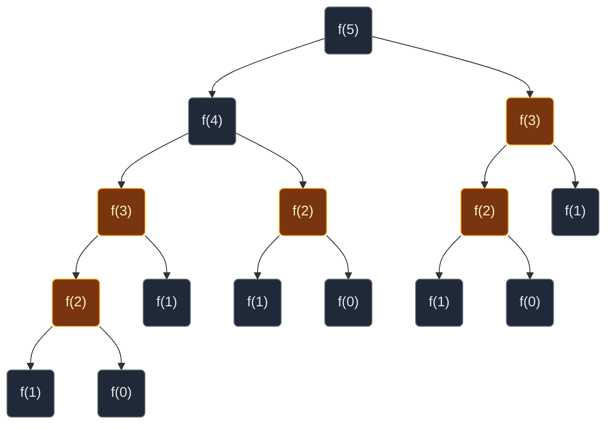
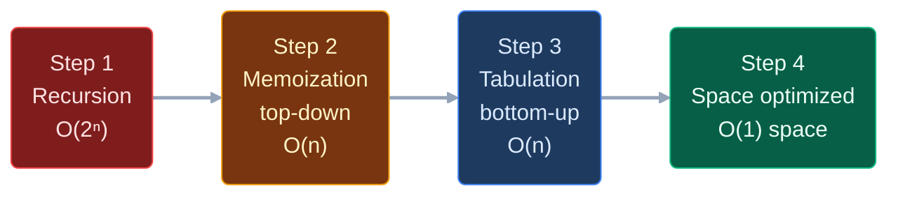
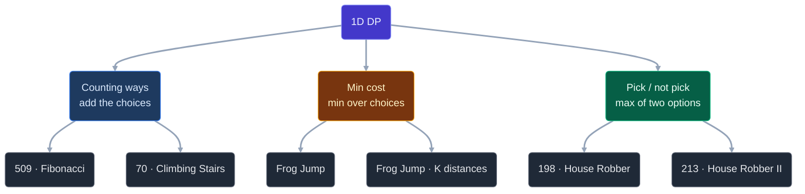

# 12. Dynamic Programming

Dynamic Programming (DP) sounds scary. It is not. **DP is recursion that remembers its answers.**

> "Those who cannot remember the past are condemned to repeat it."

Plain recursion keeps solving the same small problem again and again. DP solves each small problem once, writes the answer down, and reads it back next time.

This page teaches the idea once, slowly. Every problem note in this folder then follows the same four steps.

## Contents

1. [The Big Idea in One Picture](#1-the-big-idea-in-one-picture)
2. [How to Spot a DP Problem](#2-how-to-spot-a-dp-problem)
3. [The Five Words You Need](#3-the-five-words-you-need)
4. [The 4-Step Ladder](#4-the-4-step-ladder)
5. [Step 1: Recursion](#5-step-1-recursion)
6. [Step 2: Memoization (Top-Down)](#6-step-2-memoization-top-down)
7. [Step 3: Tabulation (Bottom-Up)](#7-step-3-tabulation-bottom-up)
8. [Step 4: Space Optimization](#8-step-4-space-optimization)
9. [The Three 1D DP Families](#9-the-three-1d-dp-families)
10. [Common Traps](#10-common-traps)
11. [Problems](#11-problems)
12. [What Comes Next](#12-what-comes-next)

## 1. The Big Idea in One Picture

Let us compute Fibonacci `f(5)` with plain recursion. `f(n) = f(n-1) + f(n-2)`.



Look at the gold boxes:

- `f(3)` is computed **2 times**.
- `f(2)` is computed **3 times**.

For `f(30)`, plain recursion makes about **2.7 million calls**. But there are only **31 different questions** (`f(0)` to `f(30)`). Everything else is repeated work.

**DP fix:** keep a notebook. Before solving `f(k)`, look in the notebook. If the answer is there, use it. If not, solve it once and write it down.

## 2. How to Spot a DP Problem

Ask two questions:

| Question | Name | Example |
|:---|:---|:---|
| Does the big problem use answers of smaller versions of itself? | **Optimal substructure** | Ways to reach stair 5 = ways to reach stair 4 + ways to reach stair 3 |
| Do the same smaller problems show up again and again? | **Overlapping subproblems** | `f(3)` appears twice in the tree above |

If both answers are yes, it is DP.

**Words in the question that hint at DP:**

- "count the number of ways"
- "minimum cost" / "maximum profit"
- "can you reach" / "is it possible"
- "longest" / "shortest" with choices at every step
- "you cannot pick two adjacent ones"

**Greedy vs DP.** Greedy picks the best-looking choice right now and never looks back. DP tries every choice and keeps the best. If a small example shows greedy giving a wrong answer, you need DP. The [Frog Jump](01.%20One%20Dimensional%20DP/03.%20Frog%20Jump.md) and [House Robber](01.%20One%20Dimensional%20DP/05.%20198.%20House%20Robber.md) notes each show one such example.

## 3. The Five Words You Need

| Word | Simple meaning | Fibonacci example |
|:---|:---|:---|
| **Subproblem** | A smaller version of the same question | "What is `f(3)`?" |
| **State** | The few numbers that describe one subproblem | `i` (which Fibonacci number) |
| **Recurrence** | The rule that builds a big answer from smaller answers | `f(i) = f(i-1) + f(i-2)` |
| **Base case** | The smallest answers you know without any work | `f(0) = 0`, `f(1) = 1` |
| **Memo / dp table** | The notebook where answers are saved | `dp[i]` holds `f(i)` |

**Golden rule:** say what `dp[i]` means in one plain sentence before you write any code. For example: "`dp[i]` is the minimum energy the frog needs to reach stone `i`." If you cannot say it, you are not ready to code.

## 4. The 4-Step Ladder

Every note in this folder climbs the same ladder.



| Step | What you do | Time | Extra space |
|:---|:---|:---:|:---|
| 1 · Recursion | Write the recurrence as a function | Exponential | Recursion stack `O(n)` |
| 2 · Memoization | Same function + a notebook | `O(n)` | Notebook `O(n)` + stack `O(n)` |
| 3 · Tabulation | Fill the notebook with a loop, small to big | `O(n)` | Table `O(n)`, no stack |
| 4 · Space optimized | Keep only the cells you still need | `O(n)` | `O(1)` (or `O(k)`) |

In an interview, always start at step 1 out loud. It shows you understand the problem. Then climb.

## 5. Step 1: Recursion

Write three things:

1. **The function's meaning.** `f(i)` = answer for the first `i` things (or for position `i`).
2. **Base cases.** The smallest `i` you can answer directly.
3. **The recurrence.** Try every choice, combine the smaller answers (add them for counting, `min` for cost, `max` for profit).

```python
# Plain recursion for Fibonacci
def f(i):

    # Base cases: f(0) = 0, f(1) = 1
    if i <= 1:
        return i

    # Recurrence: the sum of the two previous answers
    return f(i - 1) + f(i - 2)
```

It is correct but slow, because the tree repeats work.

## 6. Step 2: Memoization (Top-Down)

"Top-down" means you still start from the big question `f(n)` and go down. You only add a notebook. **Three steps:**

1. **Declare:** `dp = [-1] * (n + 1)`. `-1` means "not solved yet".
2. **Check:** at the start of `f(i)`, if `dp[i] != -1`, return `dp[i]`.
3. **Store:** before returning, save the answer: `dp[i] = ...`.

```python
# Memoized Fibonacci
def fib_memo(n):

    # Step 1: declare the notebook, -1 means "not solved yet"
    dp = [-1] * (n + 1)

    # The recursive helper
    def f(i):

        # Base cases
        if i <= 1:
            return i

        # Step 2: check the notebook first
        if dp[i] != -1:
            return dp[i]

        # Step 3: solve once and store the answer
        dp[i] = f(i - 1) + f(i - 2)

        # Return the stored answer
        return dp[i]

    # Start from the big question
    return f(n)
```

**How the notebook fills for `n = 5`.** The calls go down the left side first, so `dp[2]` fills first:

```text
call f(5) → f(4) → f(3) → f(2) → f(1)=1, f(0)=0

dp[2] = 1     dp: [-1][-1][ 1][-1][-1][-1]
dp[3] = 2     dp: [-1][-1][ 1][ 2][-1][-1]   (f(1) is a base case)
dp[4] = 3     dp: [-1][-1][ 1][ 2][ 3][-1]   (f(2) → notebook hit, no new calls)
dp[5] = 5     dp: [-1][-1][ 1][ 2][ 3][ 5]   (f(3) → notebook hit, no new calls)
```

Each `f(k)` is now solved once, so the work is `O(n)`.

## 7. Step 3: Tabulation (Bottom-Up)

"Bottom-up" means you start from the smallest answers and build up with a loop. No recursion, so no stack.

**How to turn memoization into tabulation, every time:**

| # | Do this | Fibonacci |
|:---:|:---|:---|
| 1 | Make the same dp array | `dp = [0] * (n + 1)` |
| 2 | Write the base cases into it | `dp[0] = 0`, `dp[1] = 1` |
| 3 | Loop the opposite way to the recursion: small to big | `for i in range(2, n + 1)` |
| 4 | Copy the recurrence, `f(...)` becomes `dp[...]` | `dp[i] = dp[i-1] + dp[i-2]` |
| 5 | The answer is in the last cell | `return dp[n]` |

**How the table fills for `n = 5`:**

```text
i:      0   1   2   3   4   5
start: [ 0][ 1][  ][  ][  ][  ]    base cases written

i = 2: [ 0][ 1][ 1][  ][  ][  ]    dp[2] = dp[1] + dp[0] = 1 + 0
i = 3: [ 0][ 1][ 1][ 2][  ][  ]    dp[3] = dp[2] + dp[1] = 1 + 1
i = 4: [ 0][ 1][ 1][ 2][ 3][  ]    dp[4] = dp[3] + dp[2] = 2 + 1
i = 5: [ 0][ 1][ 1][ 2][ 3][ 5]    dp[5] = dp[4] + dp[3] = 3 + 2

answer = dp[5] = 5
```

## 8. Step 4: Space Optimization

Look at the table fill above. To fill `dp[i]`, we only read `dp[i-1]` and `dp[i-2]`. Older cells are never read again. So we keep only two variables.

```text
          prev2  prev   curr
i = 2:      0     1  →   1     then slide: prev2 = 1, prev = 1
i = 3:      1     1  →   2     then slide: prev2 = 1, prev = 2
i = 4:      1     2  →   3     then slide: prev2 = 2, prev = 3
i = 5:      2     3  →   5     then slide: prev2 = 3, prev = 5

answer = prev = 5
```

**Rule:** if `dp[i]` only reads the last `k` cells, keep only `k` variables (or a list of size `k`). For Fibonacci, Climbing Stairs, Frog Jump and House Robber, `k = 2`, so space is `O(1)`. For Frog Jump with K distances, it is `O(k)`.

## 9. The Three 1D DP Families

All six 1D problems here belong to one of three families. Learn the family, and the next problem feels familiar.

| Family | Recurrence shape | Combine with | Problems |
|:---|:---|:---:|:---|
| **Counting ways** | `dp[i] = dp[i-1] + dp[i-2]` | `+` | Fibonacci, Climbing Stairs |
| **Minimum cost over choices** | `dp[i] = min(dp[i-j] + cost(j))` for each allowed jump `j` | `min` | Frog Jump, Frog Jump with K Distances |
| **Pick / not pick** | `dp[i] = max(nums[i] + dp[i-2], dp[i-1])` | `max` | House Robber, House Robber II |



## 10. Common Traps

| Trap | What goes wrong | Fix |
|:---|:---|:---|
| Writing code before defining `dp[i]` | Recurrence ends up wrong or off by one | Say what `dp[i]` means in one sentence first |
| Missing a base case | Wrong answer for `n = 0` or `n = 1`, or index errors | List every base case and test the tiny inputs |
| Loop stops at `n` instead of `n + 1` | Last answer never computed | `range(2, n + 1)` |
| Memo uses `0` as "not solved" | `0` can be a real answer, so it gets solved again | Use `-1` (or `None`) as "not solved" |
| Forgetting to store in memoization | Still exponential time | `dp[i] = ...` before `return` |
| Greedy instead of DP | Locally best choice gives a worse total | Try every choice and take the min/max |
| Recursion depth in Python | `RecursionError` for big `n` | Use tabulation or the space-optimized loop |
| Space optimizing too early | Hard to debug | Write the table version first, then shrink it |

## 11. Problems

### 01. One Dimensional DP

| # | Problem | Difficulty | Family | Status |
|:---:|:---|:---:|:---|:---:|
| 1 | [509. Fibonacci Number](01.%20One%20Dimensional%20DP/01.%20509.%20Fibonacci%20Number.md) | Easy | Counting ways | Written |
| 2 | [70. Climbing Stairs](01.%20One%20Dimensional%20DP/02.%2070.%20Climbing%20Stairs.md) | Easy | Counting ways | Written |
| 3 | [Frog Jump](01.%20One%20Dimensional%20DP/03.%20Frog%20Jump.md) | Medium | Min cost over choices | Written |
| 4 | [Frog Jump with K Distances](01.%20One%20Dimensional%20DP/04.%20Frog%20Jump%20with%20K%20Distances.md) | Medium | Min cost over choices | Written |
| 5 | [198. House Robber](01.%20One%20Dimensional%20DP/05.%20198.%20House%20Robber.md) | Medium | Pick / not pick | Written |
| 6 | [213. House Robber II](01.%20One%20Dimensional%20DP/06.%20213.%20House%20Robber%20II.md) | Medium | Pick / not pick (circle) | Written |

## 12. What Comes Next

These DP sections follow, in this order:

| # | Section | Status |
|:---:|:---|:---:|
| 01 | One Dimensional DP | Written |
| 02 | Two Dimensional DP (grids, paths) | Planned |
| 03 | Three Dimensional DP | Planned |
| 04 | DP on Subsets and Subsequences (knapsack, coin change, target sum) | Planned |
| 05 | DP on Strings (LCS, edit distance, wildcard) | Planned |
| 06 | DP on Stocks | Planned |
| 07 | DP on LIS | Planned |
| 08 | Matrix Chain / Partition DP | Planned |
| 09 | DP on Rectangles | Planned |
