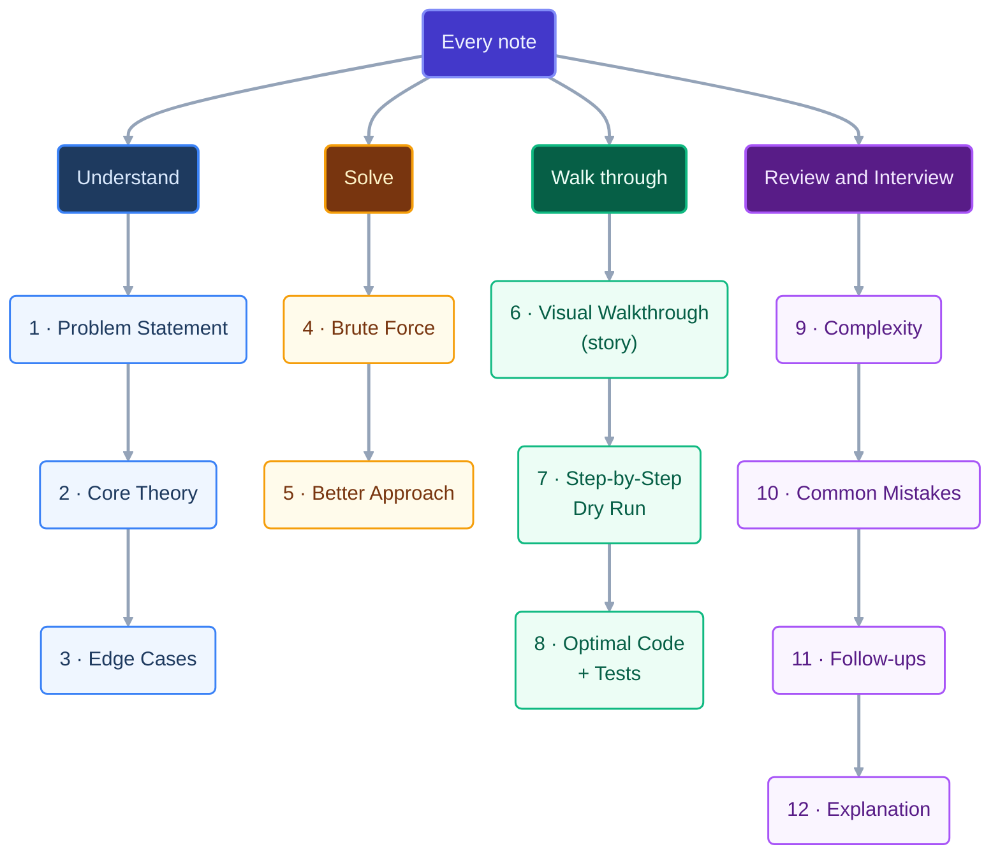
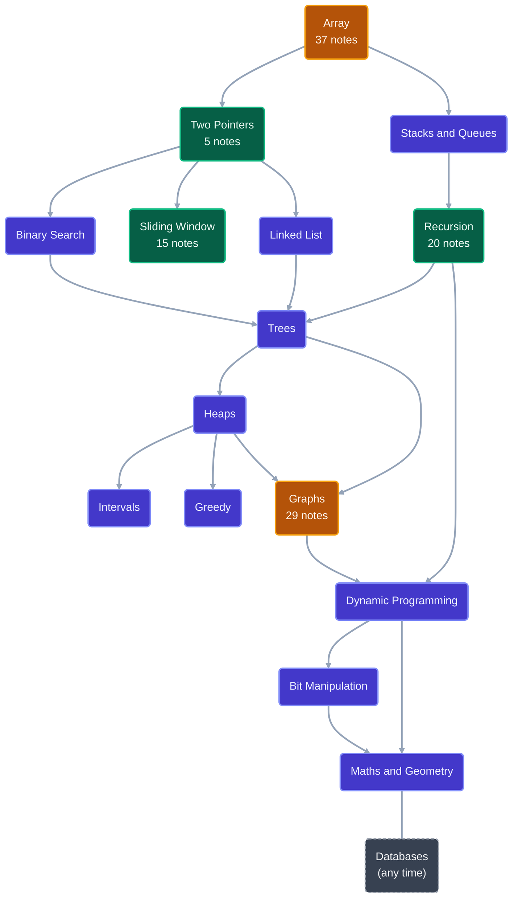

# DSA Notes

Structured notes for Data Structures & Algorithms.

Every problem note follows the same shape, so patterns stay comparable across topics:

Every code line has a comment above it. Each note traces one example step by step, first as a simple story with pictures, then with the exact arrays. The optimal code ends with asserts that check every traced step, so you can paste it straight into a REPL.

## Topics

Counts are problems written, broken down by difficulty tier.

| # | Topic | Core Focus | Easy | Medium | Hard | Total | Status |
|:---:|:---|:---|:---:|:---:|:---:|:---:|:---:|
| 01 | [**Array**](01.%20Array/) | Traversal, prefix sums, Kadane, cyclic sort, difference arrays | 16 | 19 | 2 | **37** | In progress |
| 02 | [**Two Pointers**](02.%20Two%20pointers/) | Converging pointers, fast/slow, fix one + scan | 1 | 3 | 1 | **5** | Complete |
| 03 | Stacks and Queues | Monotonic stack, next greater element | – | – | – | – | Planned |
| 04 | [**Sliding Window**](04.%20Sliding%20window/) | Fixed/variable windows, at-most trick | 6 | 7 | 2 | **15** | Complete |
| 05 | Linked List | Reversal, cycle detection, merge | – | – | – | – | Planned |
| 06 | Binary Search | On answer space, rotated arrays | – | – | – | – | Planned |
| 07 | [**Recursion**](07.%20Recursion/) | Pick/not-pick, backtracking, constraints | 2 | 5 | 13 | **20** | Complete |
| 08 | Trees | Traversals, BST properties, LCA | – | – | – | – | Planned |
| 09 | Heaps | Top-K, merge K sorted, running median | – | – | – | – | Planned |
| 10 | Greedy | Interval scheduling, exchange argument | – | – | – | – | Planned |
| 11 | [**Graphs**](11.%20Graphs/) | BFS/DFS, topo sort, Dijkstra, MST, DSU | 5 | 22 | 2 | **29** | In progress |
| 12 | Dynamic Programming | 1D/2D states, knapsack, LIS | – | – | – | – | Planned |
| 13 | Maths and Geometry | Number theory, matrix rotation, GCD | – | – | – | – | Planned |
| 14 | Bit Manipulation | XOR tricks, masks, bit counting | – | – | – | – | Planned |
| 15 | Intervals | Merge, insert, overlap counting | – | – | – | – | Planned |
| 16 | Databases | Joins, window functions, aggregation | – | – | – | – | Planned |
| | **Total** | | **30** | **56** | **20** | **106** | |

**Roadmap.** Arrows point from a topic to the topics that build on it. Start at the top and move down once every arrow into a topic is done. For example, Graphs needs Trees (graph traversal grows from tree traversal) and Heaps (Dijkstra uses a heap). Dynamic Programming needs Recursion and Graphs. Databases is a separate track you can do any time.

Green = complete, orange = in progress, blue = planned, dashed = separate track. The number in a box is how many notes are written.

## 01. Array

Foundation topic. Every later pattern — two pointers, sliding window, binary search — is first learned here.

**[Read the full Array guide →](01.%20Array/)** covers memory layout, operation costs, and every pattern with runnable code.

### Basic Traversal and Selection

| # | Problem | Difficulty | Key Idea | Source | Time | Space | Status |
|:---:|:---|:---:|:---|:---:|:---:|:---:|:---:|
| 1 | [Largest in Array](01.%20Array/01.%20Basic%20Traversal%20and%20Selection/01.%20Largest%20in%20Array.md) | Basic | Track the biggest value seen so far in one pass | [Largest Element in Array](https://www.geeksforgeeks.org/problems/largest-element-in-array4009/1) | `O(n)` | `O(1)` | Written |
| 2 | [Second Largest](01.%20Array/01.%20Basic%20Traversal%20and%20Selection/02.%20Second%20Largest.md) | Easy | Keep two trackers; demote the old max before promoting a new one | [Second Largest](https://www.geeksforgeeks.org/problems/second-largest3735/1) | `O(n)` | `O(1)` | Written |
| 3 | [Array Search](01.%20Array/01.%20Basic%20Traversal%20and%20Selection/03.%20Array%20Search.md) | Basic | Scan left to right and stop at the first match | [Array Search](https://www.geeksforgeeks.org/problems/search-an-element-in-an-array-1587115621/1) | `O(n)` | `O(1)` | Written |
| 4 | [485. Max Consecutive Ones](01.%20Array/01.%20Basic%20Traversal%20and%20Selection/04.%20485.%20Max%20Consecutive%20Ones.md) | Easy | Running streak that resets on a zero | [485. Max Consecutive Ones](https://leetcode.com/problems/max-consecutive-ones/) | `O(n)` | `O(1)` | Written |
| 5 | [Array Leaders](01.%20Array/01.%20Basic%20Traversal%20and%20Selection/05.%20Array%20Leaders.md) | Easy | Scan from the right with a running maximum | [Array Leaders](https://www.geeksforgeeks.org/problems/leaders-in-an-array-1587115620/1) | `O(n)` | `O(1)` extra | Written |
| 6 | [First and Second Smallests](01.%20Array/01.%20Basic%20Traversal%20and%20Selection/06.%20First%20and%20Second%20Smallests.md) | Easy | Second-largest trick mirrored for the minimum | [First and Second Smallests](https://www.geeksforgeeks.org/problems/smallest-and-second-smallest-element-in-an-array3226/1) | `O(n)` | `O(1)` | Written |
| 7 | [Find Second Smallest and Second Largest](01.%20Array/01.%20Basic%20Traversal%20and%20Selection/07.%20Find%20Second%20Smallest%20and%20Second%20Largest%20Element%20in%20an%20Array.md) | Easy | Four trackers updated in one pass | [Second Largest](https://www.geeksforgeeks.org/problems/second-largest3735/1) | `O(n)` | `O(1)` | Written |
| 8 | [1295. Find Numbers with Even Number of Digits](01.%20Array/01.%20Basic%20Traversal%20and%20Selection/08.%201295.%20Find%20Numbers%20with%20Even%20Number%20of%20Digits.md) | Easy | Count digits of each number and check if the count is even | [1295. Find Numbers with Even Number of Digits](https://leetcode.com/problems/find-numbers-with-even-number-of-digits/) | – | – | Pending |
| 9 | [1480. Running Sum of 1d Array](01.%20Array/01.%20Basic%20Traversal%20and%20Selection/09.%201480.%20Running%20Sum%20of%201d%20Array.md) | Easy | Each answer is the previous answer plus the current number | [1480. Running Sum of 1d Array](https://leetcode.com/problems/running-sum-of-1d-array/) | – | – | Pending |
| 10 | [1512. Number of Good Pairs](01.%20Array/01.%20Basic%20Traversal%20and%20Selection/10.%201512.%20Number%20of%20Good%20Pairs.md) | Easy | A value seen k times before adds k new pairs | [1512. Number of Good Pairs](https://leetcode.com/problems/number-of-good-pairs/) | – | – | Pending |
| 11 | [1672. Richest Customer Wealth](01.%20Array/01.%20Basic%20Traversal%20and%20Selection/11.%201672.%20Richest%20Customer%20Wealth.md) | Easy | Sum each row and keep the largest sum | [1672. Richest Customer Wealth](https://leetcode.com/problems/richest-customer-wealth/) | – | – | Pending |
| 12 | [1732. Find the Highest Altitude](01.%20Array/01.%20Basic%20Traversal%20and%20Selection/12.%201732.%20Find%20the%20Highest%20Altitude.md) | Easy | Running sum of gains; track its maximum including 0 | [1732. Find the Highest Altitude](https://leetcode.com/problems/find-the-highest-altitude/) | – | – | Pending |
| 13 | [1920. Build Array from Permutation](01.%20Array/01.%20Basic%20Traversal%20and%20Selection/13.%201920.%20Build%20Array%20from%20Permutation.md) | Easy | ans[i] = nums[nums[i]]; in-place trick stores two values in one cell | [1920. Build Array from Permutation](https://leetcode.com/problems/build-array-from-permutation/) | – | – | Pending |
| 14 | [1929. Concatenation of Array](01.%20Array/01.%20Basic%20Traversal%20and%20Selection/14.%201929.%20Concatenation%20of%20Array.md) | Easy | ans[i] and ans[i + n] both get nums[i] | [1929. Concatenation of Array](https://leetcode.com/problems/concatenation-of-array/) | – | – | Pending |
| 15 | [2011. Final Value of Variable After Performing Operations](01.%20Array/01.%20Basic%20Traversal%20and%20Selection/15.%202011.%20Final%20Value%20of%20Variable%20After%20Performing%20Operations.md) | Easy | Add 1 for every '++' operation and subtract 1 for every '--' | [2011. Final Value of Variable After Performing Operations](https://leetcode.com/problems/final-value-of-variable-after-performing-operations/) | – | – | Pending |
| 16 | [2114. Maximum Number of Words Found in Sentences](01.%20Array/01.%20Basic%20Traversal%20and%20Selection/16.%202114.%20Maximum%20Number%20of%20Words%20Found%20in%20Sentences.md) | Easy | Words = spaces + 1; keep the maximum | [2114. Maximum Number of Words Found in Sentences](https://leetcode.com/problems/maximum-number-of-words-found-in-sentences/) | – | – | Pending |
| 17 | [2176. Count Equal and Divisible Pairs in an Array](01.%20Array/01.%20Basic%20Traversal%20and%20Selection/17.%202176.%20Count%20Equal%20and%20Divisible%20Pairs%20in%20an%20Array.md) | Easy | Check every pair i < j for equal values and (i * j) % k == 0 | [2176. Count Equal and Divisible Pairs in an Array](https://leetcode.com/problems/count-equal-and-divisible-pairs-in-an-array/) | – | – | Pending |
| 18 | [2574. Left and Right Sum Differences](01.%20Array/01.%20Basic%20Traversal%20and%20Selection/18.%202574.%20Left%20and%20Right%20Sum%20Differences.md) | Easy | Right sum = total - left sum - current | [2574. Left and Right Sum Differences](https://leetcode.com/problems/left-and-right-sum-differences/) | – | – | Pending |
| 19 | [2652. Sum Multiples](01.%20Array/01.%20Basic%20Traversal%20and%20Selection/19.%202652.%20Sum%20Multiples.md) | Easy | Add every number from 1 to n divisible by 3, 5 or 7 | [2652. Sum Multiples](https://leetcode.com/problems/sum-multiples/) | – | – | Pending |
| 20 | [2798. Number of Employees Who Met the Target](01.%20Array/01.%20Basic%20Traversal%20and%20Selection/20.%202798.%20Number%20of%20Employees%20Who%20Met%20the%20Target.md) | Easy | Count hours that are at least the target | [2798. Number of Employees Who Met the Target](https://leetcode.com/problems/number-of-employees-who-met-the-target/) | – | – | Pending |
| 21 | [2824. Count Pairs Whose Sum is Less than Target](01.%20Array/01.%20Basic%20Traversal%20and%20Selection/21.%202824.%20Count%20Pairs%20Whose%20Sum%20is%20Less%20than%20Target.md) | Easy | Sort, then two pointers count many pairs at once | [2824. Count Pairs Whose Sum is Less than Target](https://leetcode.com/problems/count-pairs-whose-sum-is-less-than-target/) | – | – | Pending |
| 22 | [2942. Find Words Containing Character](01.%20Array/01.%20Basic%20Traversal%20and%20Selection/22.%202942.%20Find%20Words%20Containing%20Character.md) | Easy | Collect indices of words that contain the character | [2942. Find Words Containing Character](https://leetcode.com/problems/find-words-containing-character/) | – | – | Pending |
| 23 | [2951. Find the Peaks](01.%20Array/01.%20Basic%20Traversal%20and%20Selection/23.%202951.%20Find%20the%20Peaks.md) | Easy | An inner index is a peak if it beats both neighbors | [2951. Find the Peaks](https://leetcode.com/problems/find-the-peaks/) | – | – | Pending |
| 24 | [3005. Count Elements With Maximum Frequency](01.%20Array/20.%20Frequency%20Array%20%28Counting%20Buckets%29/03.%203005.%20Count%20Elements%20With%20Maximum%20Frequency.md) (see Frequency Array) | Easy | Count frequencies, then add all counts equal to the max | [3005. Count Elements With Maximum Frequency](https://leetcode.com/problems/count-elements-with-maximum-frequency/) | – | – | Pending |
| 25 | [3065. Minimum Operations to Exceed Threshold Value I](01.%20Array/01.%20Basic%20Traversal%20and%20Selection/25.%203065.%20Minimum%20Operations%20to%20Exceed%20Threshold%20Value%20I.md) | Easy | Count numbers smaller than k | [3065. Minimum Operations to Exceed Threshold Value I](https://leetcode.com/problems/minimum-operations-to-exceed-threshold-value-i/) | – | – | Pending |
| 26 | [3146. Permutation Difference between Two Strings](01.%20Array/01.%20Basic%20Traversal%20and%20Selection/26.%203146.%20Permutation%20Difference%20between%20Two%20Strings.md) | Easy | Store each character's index in s, sum |index in s - index in t| | [3146. Permutation Difference between Two Strings](https://leetcode.com/problems/permutation-difference-between-two-strings/) | – | – | Pending |
| 27 | [414. Third Maximum Number](01.%20Array/01.%20Basic%20Traversal%20and%20Selection/27.%20414.%20Third%20Maximum%20Number.md) | Easy | Three distinct trackers shifted down like second largest | [414. Third Maximum Number](https://leetcode.com/problems/third-maximum-number/) | – | – | Pending |
| 28 | [747. Largest Number At Least Twice of Others](01.%20Array/01.%20Basic%20Traversal%20and%20Selection/28.%20747.%20Largest%20Number%20At%20Least%20Twice%20of%20Others.md) | Easy | Track largest and second largest; compare largest >= 2 * second | [747. Largest Number At Least Twice of Others](https://leetcode.com/problems/largest-number-at-least-twice-of-others/) | – | – | Pending |
| 29 | [896. Monotonic Array](01.%20Array/01.%20Basic%20Traversal%20and%20Selection/29.%20896.%20Monotonic%20Array.md) | Easy | One pass with two flags: ever went up, ever went down | [896. Monotonic Array](https://leetcode.com/problems/monotonic-array/) | – | – | Pending |
| 30 | [941. Valid Mountain Array](01.%20Array/01.%20Basic%20Traversal%20and%20Selection/30.%20941.%20Valid%20Mountain%20Array.md) | Easy | Walk up while increasing, then down while decreasing; must end at the last index | [941. Valid Mountain Array](https://leetcode.com/problems/valid-mountain-array/) | – | – | Pending |
| 31 | [1299. Replace Elements with Greatest Element on Right Side](01.%20Array/01.%20Basic%20Traversal%20and%20Selection/31.%201299.%20Replace%20Elements%20with%20Greatest%20Element%20on%20Right%20Side.md) | Easy | Scan from the right with a running maximum | [1299. Replace Elements with Greatest Element on Right Side](https://leetcode.com/problems/replace-elements-with-greatest-element-on-right-side/) | – | – | Pending |
| 32 | [1431. Kids With the Greatest Number of Candies](01.%20Array/01.%20Basic%20Traversal%20and%20Selection/32.%201431.%20Kids%20With%20the%20Greatest%20Number%20of%20Candies.md) | Easy | Compare candies + extra with the current maximum | [1431. Kids With the Greatest Number of Candies](https://leetcode.com/problems/kids-with-the-greatest-number-of-candies/) | – | – | Pending |

### Rotation and Cyclic Arrays

| # | Problem | Difficulty | Key Idea | Source | Time | Space | Status |
|:---:|:---|:---:|:---|:---:|:---:|:---:|:---:|
| 1 | [1752. Check if Array Is Sorted and Rotated](01.%20Array/02.%20Rotation%20and%20Cyclic%20Arrays/01.%201752.%20Check%20if%20Array%20Is%20Sorted%20and%20Rotated.md) | Easy | Count drops around the circle; at most one is allowed | [1752. Check if Array Is Sorted and Rotated](https://leetcode.com/problems/check-if-array-is-sorted-and-rotated/) | `O(n)` | `O(1)` | Written |
| 2 | [189. Rotate Array](01.%20Array/02.%20Rotation%20and%20Cyclic%20Arrays/02.%20189.%20Rotate%20Array.md) | Medium | Reverse all, then reverse each part | [189. Rotate Array](https://leetcode.com/problems/rotate-array/) | `O(n)` | `O(1)` | Written |

### Two Pointers and In-place Rearrangement

| # | Problem | Difficulty | Key Idea | Source | Time | Space | Status |
|:---:|:---|:---:|:---|:---:|:---:|:---:|:---:|
| 1 | [283. Move Zeroes](01.%20Array/03.%20Two%20Pointers%20and%20In-place%20Rearrangement/01.%20283.%20Move%20Zeroes.md) | Easy | Slow pointer marks where the next non-zero goes | [283. Move Zeroes](https://leetcode.com/problems/move-zeroes/) | `O(n)` | `O(1)` | Written |
| 2 | [88. Merge Sorted Array](01.%20Array/03.%20Two%20Pointers%20and%20In-place%20Rearrangement/02.%2088.%20Merge%20Sorted%20Array.md) | Easy | Fill from the back so nothing is overwritten | [88. Merge Sorted Array](https://leetcode.com/problems/merge-sorted-array/) | `O(m + n)` | `O(1)` | Written |
| 3 | [2149. Rearrange Array Elements by Sign](01.%20Array/03.%20Two%20Pointers%20and%20In-place%20Rearrangement/03.%202149.%20Rearrange%20Array%20Elements%20by%20Sign.md) | Medium | Two write cursors stepping by two | [2149. Rearrange Array Elements by Sign](https://leetcode.com/problems/rearrange-array-elements-by-sign/) | `O(n)` | `O(n)` | Written |

### Hashing (Set)

| # | Problem | Difficulty | Key Idea | Source | Time | Space | Status |
|:---:|:---|:---:|:---|:---:|:---:|:---:|:---:|
| 1 | [128. Longest Consecutive Sequence](01.%20Array/04.%20Hashing%20%28Set%29/01.%20128.%20Longest%20Consecutive%20Sequence.md) | Medium | Start counting only from the first number of a run | [128. Longest Consecutive Sequence](https://leetcode.com/problems/longest-consecutive-sequence/) | `O(n)` | `O(n)` | Written |

### XOR and Math Tricks

| # | Problem | Difficulty | Key Idea | Source | Time | Space | Status |
|:---:|:---|:---:|:---|:---:|:---:|:---:|:---:|
| 1 | [136. Single Number](01.%20Array/05.%20XOR%20and%20Math%20Tricks/01.%20136.%20Single%20Number.md) | Easy | XOR everything; pairs cancel | [136. Single Number](https://leetcode.com/problems/single-number/) | `O(n)` | `O(1)` | Written |
| 2 | [268. Missing Number](01.%20Array/05.%20XOR%20and%20Math%20Tricks/02.%20268.%20Missing%20Number.md) | Easy | Expected sum minus actual sum, or XOR of indices and values | [268. Missing Number](https://leetcode.com/problems/missing-number/) | `O(n)` | `O(1)` | Written |
| 3 | [Missing And Repeating](01.%20Array/05.%20XOR%20and%20Math%20Tricks/03.%20Missing%20And%20Repeating.md) | Medium | Two equations from sum and sum of squares | [Missing And Repeating](https://www.geeksforgeeks.org/problems/find-missing-and-repeating2512/1) | `O(n)` | `O(1)` | Written |

### Sorting + Two Pointers

| # | Problem | Difficulty | Key Idea | Source | Time | Space | Status |
|:---:|:---|:---:|:---|:---:|:---:|:---:|:---:|
| 1 | [1. Two Sum](01.%20Array/06.%20Sorting%20%2B%20Two%20Pointers/01.%201.%20Two%20Sum.md) | Easy | Hash map of complements, or sort + two pointers | [1. Two Sum](https://leetcode.com/problems/two-sum/) | `O(n)` | `O(n)` | Written |
| 2 | [15. 3Sum](01.%20Array/06.%20Sorting%20%2B%20Two%20Pointers/02.%2015.%203Sum.md) | Medium | Fix one, two pointers on the rest, skip duplicates | [15. 3Sum](https://leetcode.com/problems/3sum/) | `O(n^2)` | `O(1)` extra | Written |
| 3 | [18. 4Sum](01.%20Array/06.%20Sorting%20%2B%20Two%20Pointers/03.%2018.%204Sum.md) | Medium | Fix two, two pointers on the rest | [18. 4Sum](https://leetcode.com/problems/4sum/) | `O(n^3)` | `O(1)` extra | Written |

### Dutch National Flag (Partitioning)

| # | Problem | Difficulty | Key Idea | Source | Time | Space | Status |
|:---:|:---|:---:|:---|:---:|:---:|:---:|:---:|
| 1 | [75. Sort Colors](01.%20Array/07.%20Dutch%20National%20Flag%20%28Partitioning%29/01.%2075.%20Sort%20Colors.md) | Medium | Three regions with low, mid, high pointers | [75. Sort Colors](https://leetcode.com/problems/sort-colors/) | `O(n)` | `O(1)` | Written |

### Prefix Sum + HashMap

| # | Problem | Difficulty | Key Idea | Source | Time | Space | Status |
|:---:|:---|:---:|:---|:---:|:---:|:---:|:---:|
| 1 | [Longest Subarray with Sum K](01.%20Array/08.%20Prefix%20Sum%20%2B%20HashMap/01.%20Longest%20Subarray%20with%20Sum%20K.md) | Medium | First index of each prefix sum gives the longest window | [Longest Sub-Array with Sum K](https://www.geeksforgeeks.org/problems/longest-sub-array-with-sum-k0809/1) | `O(n)` | `O(n)` | Written |
| 2 | [Largest subarray with 0 sum](01.%20Array/08.%20Prefix%20Sum%20%2B%20HashMap/02.%20Largest%20subarray%20with%200%20sum.md) | Medium | Two equal prefix sums mean the middle sums to zero | [Largest subarray with 0 sum](https://www.geeksforgeeks.org/problems/largest-subarray-with-0-sum/1) | `O(n)` | `O(n)` | Written |
| 3 | [560. Subarray Sum Equals K](01.%20Array/08.%20Prefix%20Sum%20%2B%20HashMap/03.%20560.%20Subarray%20Sum%20Equals%20K.md) | Medium | Count earlier prefixes equal to current - k | [560. Subarray Sum Equals K](https://leetcode.com/problems/subarray-sum-equals-k/) | `O(n)` | `O(n)` | Written |

### Prefix XOR + HashMap

| # | Problem | Difficulty | Key Idea | Source | Time | Space | Status |
|:---:|:---|:---:|:---|:---:|:---:|:---:|:---:|
| 1 | [Count Subarrays with given XOR](01.%20Array/09.%20Prefix%20XOR%20%2B%20HashMap/01.%20Count%20Subarrays%20with%20given%20XOR.md) | Medium | Count earlier prefix XORs equal to current ^ k | [Count Subarrays with given XOR](https://www.geeksforgeeks.org/problems/count-subarray-with-given-xor/1) | `O(n)` | `O(n)` | Written |

### Kadane (Running Optimization)

| # | Problem | Difficulty | Key Idea | Source | Time | Space | Status |
|:---:|:---|:---:|:---|:---:|:---:|:---:|:---:|
| 1 | [53. Maximum Subarray](01.%20Array/10.%20Kadane%20%28Running%20Optimization%29/01.%2053.%20Maximum%20Subarray.md) | Medium | Extend the running sum or restart here | [53. Maximum Subarray](https://leetcode.com/problems/maximum-subarray/) | `O(n)` | `O(1)` | Written |
| 2 | [121. Best Time to Buy and Sell Stock](01.%20Array/10.%20Kadane%20%28Running%20Optimization%29/02.%20121.%20Best%20Time%20to%20Buy%20and%20Sell%20Stock.md) | Easy | Track the lowest price so far | [121. Best Time to Buy and Sell Stock](https://leetcode.com/problems/best-time-to-buy-and-sell-stock/) | `O(n)` | `O(1)` | Written |
| 3 | [152. Maximum Product Subarray](01.%20Array/10.%20Kadane%20%28Running%20Optimization%29/03.%20152.%20Maximum%20Product%20Subarray.md) | Medium | Track running max and min; a negative swaps them | [152. Maximum Product Subarray](https://leetcode.com/problems/maximum-product-subarray/) | `O(n)` | `O(1)` | Written |

### Boyer-Moore Voting

| # | Problem | Difficulty | Key Idea | Source | Time | Space | Status |
|:---:|:---|:---:|:---|:---:|:---:|:---:|:---:|
| 1 | [169. Majority Element](01.%20Array/11.%20Boyer-Moore%20Voting/01.%20169.%20Majority%20Element.md) | Easy | Different values cancel; the majority survives | [169. Majority Element](https://leetcode.com/problems/majority-element/) | `O(n)` | `O(1)` | Written |
| 2 | [229. Majority Element II](01.%20Array/11.%20Boyer-Moore%20Voting/02.%20229.%20Majority%20Element%20II.md) | Medium | Two candidates, then verify their counts | [229. Majority Element II](https://leetcode.com/problems/majority-element-ii/) | `O(n)` | `O(1)` | Written |

### Permutation

| # | Problem | Difficulty | Key Idea | Source | Time | Space | Status |
|:---:|:---|:---:|:---|:---:|:---:|:---:|:---:|
| 1 | [31. Next Permutation](01.%20Array/12.%20Permutation/01.%2031.%20Next%20Permutation.md) | Medium | Find pivot, swap with next larger, reverse suffix | [31. Next Permutation](https://leetcode.com/problems/next-permutation/) | `O(n)` | `O(1)` | Written |

### Matrix Patterns

| # | Problem | Difficulty | Key Idea | Source | Time | Space | Status |
|:---:|:---|:---:|:---|:---:|:---:|:---:|:---:|
| 1 | [118. Pascal's Triangle](01.%20Array/13.%20Matrix%20Patterns/01.%20118.%20Pascal%27s%20Triangle.md) | Easy | Each row is built from the row above | [118. Pascal's Triangle](https://leetcode.com/problems/pascals-triangle/) | `O(numRows^2)` | `O(1)` extra | Written |
| 2 | [73. Set Matrix Zeroes](01.%20Array/13.%20Matrix%20Patterns/02.%2073.%20Set%20Matrix%20Zeroes.md) | Medium | Use row 0 and column 0 as markers | [73. Set Matrix Zeroes](https://leetcode.com/problems/set-matrix-zeroes/) | `O(m*n)` | `O(1)` | Written |
| 3 | [48. Rotate Image](01.%20Array/13.%20Matrix%20Patterns/03.%2048.%20Rotate%20Image.md) | Medium | Transpose, then reverse each row | [48. Rotate Image](https://leetcode.com/problems/rotate-image/) | `O(n^2)` | `O(1)` | Written |
| 4 | [54. Spiral Matrix](01.%20Array/13.%20Matrix%20Patterns/04.%2054.%20Spiral%20Matrix.md) | Medium | Four shrinking boundaries | [54. Spiral Matrix](https://leetcode.com/problems/spiral-matrix/) | `O(m*n)` | `O(1)` extra | Written |

### Intervals

| # | Problem | Difficulty | Key Idea | Source | Time | Space | Status |
|:---:|:---|:---:|:---|:---:|:---:|:---:|:---:|
| 1 | [56. Merge Intervals](01.%20Array/14.%20Intervals/01.%2056.%20Merge%20Intervals.md) | Medium | Sort by start, extend or close the current block | [56. Merge Intervals](https://leetcode.com/problems/merge-intervals/) | `O(n log n)` | `O(n)` | Written |

### Merge Sort Counting

| # | Problem | Difficulty | Key Idea | Source | Time | Space | Status |
|:---:|:---|:---:|:---|:---:|:---:|:---:|:---:|
| 1 | [Count Inversions](01.%20Array/15.%20Merge%20Sort%20Counting/01.%20Count%20Inversions.md) | Hard | During merge, one comparison counts a whole left block | [Count Inversions](https://www.geeksforgeeks.org/problems/inversion-of-array-1587115620/1) | `O(n log n)` | `O(n)` | Written |
| 2 | [493. Reverse Pairs](01.%20Array/15.%20Merge%20Sort%20Counting/02.%20493.%20Reverse%20Pairs.md) | Hard | Count pairs in a separate pass before each merge | [493. Reverse Pairs](https://leetcode.com/problems/reverse-pairs/) | `O(n log n)` | `O(n)` | Written |

### Prefix and Suffix Precomputation

| # | Problem | Difficulty | Key Idea | Source | Time | Space | Status |
|:---:|:---|:---:|:---|:---:|:---:|:---:|:---:|
| 1 | [238. Product of Array Except Self](01.%20Array/16.%20Prefix%20and%20Suffix%20Precomputation/01.%20238.%20Product%20of%20Array%20Except%20Self.md) | Medium | Product of everything left times product of everything right | [238. Product of Array Except Self](https://leetcode.com/problems/product-of-array-except-self/) | – | – | Pending |
| 2 | [724. Find Pivot Index](01.%20Array/16.%20Prefix%20and%20Suffix%20Precomputation/02.%20724.%20Find%20Pivot%20Index.md) | Easy | Left sum equals total - left sum - current | [724. Find Pivot Index](https://leetcode.com/problems/find-pivot-index/) | – | – | Pending |
| 3 | [1991. Find the Middle Index in Array](01.%20Array/16.%20Prefix%20and%20Suffix%20Precomputation/03.%201991.%20Find%20the%20Middle%20Index%20in%20Array.md) | Easy | Same as pivot index: left sum equals right sum | [1991. Find the Middle Index in Array](https://leetcode.com/problems/find-the-middle-index-in-array/) | – | – | Pending |
| 4 | [2012. Sum of Beauty in the Array](01.%20Array/16.%20Prefix%20and%20Suffix%20Precomputation/04.%202012.%20Sum%20of%20Beauty%20in%20the%20Array.md) | Medium | Prefix max and suffix min decide beauty 2; neighbors decide beauty 1 | [2012. Sum of Beauty in the Array](https://leetcode.com/problems/sum-of-beauty-in-the-array/) | – | – | Pending |
| 5 | [42. Trapping Rain Water (Prefix and Suffix)](01.%20Array/16.%20Prefix%20and%20Suffix%20Precomputation/05.%2042.%20Trapping%20Rain%20Water%20%28Prefix%20and%20Suffix%29.md) | Hard | Water at i = min(max on left, max on right) - height | [42. Trapping Rain Water (Prefix and Suffix)](https://leetcode.com/problems/trapping-rain-water/) | – | – | Pending |

### Cyclic Sort (Correct Index Placement)

| # | Problem | Difficulty | Key Idea | Source | Time | Space | Status |
|:---:|:---|:---:|:---|:---:|:---:|:---:|:---:|
| 1 | [268. Missing Number (Cyclic Sort)](01.%20Array/17.%20Cyclic%20Sort%20%28Correct%20Index%20Placement%29/01.%20268.%20Missing%20Number%20%28Cyclic%20Sort%29.md) | Easy | Put each value at its own index; the empty spot is missing | [268. Missing Number (Cyclic Sort)](https://leetcode.com/problems/missing-number/) | – | – | Pending |
| 2 | [645. Set Mismatch](01.%20Array/17.%20Cyclic%20Sort%20%28Correct%20Index%20Placement%29/02.%20645.%20Set%20Mismatch.md) | Easy | After cyclic sort, the wrong spot shows the duplicate and the missing value | [645. Set Mismatch](https://leetcode.com/problems/set-mismatch/) | – | – | Pending |
| 3 | [448. Find All Numbers Disappeared in an Array](01.%20Array/17.%20Cyclic%20Sort%20%28Correct%20Index%20Placement%29/03.%20448.%20Find%20All%20Numbers%20Disappeared%20in%20an%20Array.md) | Easy | After cyclic sort, every index with the wrong value is missing | [448. Find All Numbers Disappeared in an Array](https://leetcode.com/problems/find-all-numbers-disappeared-in-an-array/) | – | – | Pending |
| 4 | [442. Find All Duplicates in an Array](01.%20Array/17.%20Cyclic%20Sort%20%28Correct%20Index%20Placement%29/04.%20442.%20Find%20All%20Duplicates%20in%20an%20Array.md) | Medium | After cyclic sort, values in wrong spots are duplicates | [442. Find All Duplicates in an Array](https://leetcode.com/problems/find-all-duplicates-in-an-array/) | – | – | Pending |
| 5 | [41. First Missing Positive](01.%20Array/17.%20Cyclic%20Sort%20%28Correct%20Index%20Placement%29/05.%2041.%20First%20Missing%20Positive.md) | Hard | Place 1..n at index 0..n-1, then find the first wrong spot | [41. First Missing Positive](https://leetcode.com/problems/first-missing-positive/) | – | – | Pending |

### Difference Array (Range Update)

| # | Problem | Difficulty | Key Idea | Source | Time | Space | Status |
|:---:|:---|:---:|:---|:---:|:---:|:---:|:---:|
| 1 | [370. Range Addition](01.%20Array/18.%20Difference%20Array%20%28Range%20Update%29/01.%20370.%20Range%20Addition.md) | Medium | Add at start, subtract after end, then take a running sum | [370. Range Addition](https://leetcode.com/problems/range-addition/) | – | – | Pending |
| 2 | [1109. Corporate Flight Bookings](01.%20Array/18.%20Difference%20Array%20%28Range%20Update%29/02.%201109.%20Corporate%20Flight%20Bookings.md) | Medium | Each booking is one range addition on a difference array | [1109. Corporate Flight Bookings](https://leetcode.com/problems/corporate-flight-bookings/) | – | – | Pending |
| 3 | [1094. Car Pooling](01.%20Array/18.%20Difference%20Array%20%28Range%20Update%29/03.%201094.%20Car%20Pooling.md) | Medium | Add riders at pickup, remove at drop-off, check the running sum | [1094. Car Pooling](https://leetcode.com/problems/car-pooling/) | – | – | Pending |
| 4 | [2381. Shifting Letters II](01.%20Array/18.%20Difference%20Array%20%28Range%20Update%29/04.%202381.%20Shifting%20Letters%20II.md) | Medium | Difference array of shifts, then apply each running shift mod 26 | [2381. Shifting Letters II](https://leetcode.com/problems/shifting-letters-ii/) | – | – | Pending |
| 5 | [2772. Apply Operations to Make All Array Elements Equal to Zero](01.%20Array/18.%20Difference%20Array%20%28Range%20Update%29/05.%202772.%20Apply%20Operations%20to%20Make%20All%20Array%20Elements%20Equal%20to%20Zero.md) | Medium | Greedy left to right with a difference array of active decrements | [2772. Apply Operations to Make All Array Elements Equal to Zero](https://leetcode.com/problems/apply-operations-to-make-all-array-elements-equal-to-zero/) | – | – | Pending |

### 2D Prefix Sum

| # | Problem | Difficulty | Key Idea | Source | Time | Space | Status |
|:---:|:---|:---:|:---|:---:|:---:|:---:|:---:|
| 1 | [304. Range Sum Query 2D - Immutable](01.%20Array/19.%202D%20Prefix%20Sum/01.%20304.%20Range%20Sum%20Query%202D%20-%20Immutable.md) | Medium | Prefix sum grid; answer with four lookups | [304. Range Sum Query 2D - Immutable](https://leetcode.com/problems/range-sum-query-2d-immutable/) | – | – | Pending |
| 2 | [1314. Matrix Block Sum](01.%20Array/19.%202D%20Prefix%20Sum/02.%201314.%20Matrix%20Block%20Sum.md) | Medium | Clamp the block and use the 2D prefix sum | [1314. Matrix Block Sum](https://leetcode.com/problems/matrix-block-sum/) | – | – | Pending |
| 3 | [1074. Number of Submatrices That Sum to Target](01.%20Array/19.%202D%20Prefix%20Sum/03.%201074.%20Number%20of%20Submatrices%20That%20Sum%20to%20Target.md) | Hard | Fix two rows, then 560 on the column sums | [1074. Number of Submatrices That Sum to Target](https://leetcode.com/problems/number-of-submatrices-that-sum-to-target/) | – | – | Pending |

### Frequency Array (Counting Buckets)

| # | Problem | Difficulty | Key Idea | Source | Time | Space | Status |
|:---:|:---|:---:|:---|:---:|:---:|:---:|:---:|
| 1 | [1207. Unique Number of Occurrences](01.%20Array/20.%20Frequency%20Array%20%28Counting%20Buckets%29/01.%201207.%20Unique%20Number%20of%20Occurrences.md) | Easy | Count values, then check the counts are all different | [1207. Unique Number of Occurrences](https://leetcode.com/problems/unique-number-of-occurrences/) | – | – | Pending |
| 2 | [1748. Sum of Unique Elements](01.%20Array/20.%20Frequency%20Array%20%28Counting%20Buckets%29/02.%201748.%20Sum%20of%20Unique%20Elements.md) | Easy | Add values whose count is exactly 1 | [1748. Sum of Unique Elements](https://leetcode.com/problems/sum-of-unique-elements/) | – | – | Pending |
| 3 | [3005. Count Elements With Maximum Frequency](01.%20Array/20.%20Frequency%20Array%20%28Counting%20Buckets%29/03.%203005.%20Count%20Elements%20With%20Maximum%20Frequency.md) | Easy | Count frequencies, then add all counts equal to the max | [3005. Count Elements With Maximum Frequency](https://leetcode.com/problems/count-elements-with-maximum-frequency/) | – | – | Pending |
| 4 | [274. H-Index](01.%20Array/20.%20Frequency%20Array%20%28Counting%20Buckets%29/04.%20274.%20H-Index.md) | Medium | Bucket papers by citations, then scan from high to low | [274. H-Index](https://leetcode.com/problems/h-index/) | – | – | Pending |
| 5 | [1338. Reduce Array Size to The Half](01.%20Array/20.%20Frequency%20Array%20%28Counting%20Buckets%29/05.%201338.%20Reduce%20Array%20Size%20to%20The%20Half.md) | Medium | Remove the most frequent values first until half is gone | [1338. Reduce Array Size to The Half](https://leetcode.com/problems/reduce-array-size-to-the-half/) | – | – | Pending |

## 02. Two Pointers

Two indices moving under a rule, replacing a nested loop. The hard part is proving the pointer you move can be discarded safely.

**[Read the full Two Pointers guide →](02.%20Two%20pointers/)** covers all four forms and the correctness argument for each.

### Converging Pointers (start + end, walk inward)

| # | Problem | Difficulty | Key Idea | Source | Time | Space |
|:---:|:---|:---:|:---|:---:|:---:|:---:|
| 1 | [125. Valid Palindrome](02.%20Two%20pointers/01.%20Basics/01.%20125.%20Valid%20Palindrome.md) | Easy | Move both pointers inward, skipping non-alphanumeric characters, and compare cased-down letters as you go | [125. Valid Palindrome](https://leetcode.com/problems/valid-palindrome/) | `O(n)` | `O(1)` |
| 2 | [167. Two Sum II](02.%20Two%20pointers/02.%20Medium/02.%20167.%20Two%20Sum%20II%20-%20Input%20Array%20Is%20Sorted.md) | Medium | Because the array is sorted, comparing the pair sum to the target tells you exactly which pointer to move next | [167. Two Sum II - Input Array Is Sorted](https://leetcode.com/problems/two-sum-ii-input-array-is-sorted/) | `O(n)` | `O(1)` |
| 3 | [11. Container With Most Water](02.%20Two%20pointers/02.%20Medium/03.%2011.%20Container%20With%20Most%20Water.md) | Medium | Always advance the pointer at the shorter line, since keeping it can never yield a taller container | [11. Container With Most Water](https://leetcode.com/problems/container-with-most-water/) | `O(n)` | `O(1)` |
| 4 | [42. Trapping Rain Water](02.%20Two%20pointers/03.%20Hard/01.%2042.%20Trapping%20Rain%20Water.md) | Hard | Move the side with the smaller max height inward, since its own running max safely bounds the trapped water | [42. Trapping Rain Water](https://leetcode.com/problems/trapping-rain-water/) | `O(n)` | `O(1)` |

### Fix One + Scan (outer index, two-pointer the rest)

| # | Problem | Difficulty | Key Idea | Source | Time | Space |
|:---:|:---|:---:|:---|:---:|:---:|:---:|
| 1 | [15. 3Sum](02.%20Two%20pointers/02.%20Medium/01.%2015.%203Sum.md) | Medium | Sort the array, fix one element as the outer index, then use converging pointers to find the remaining pair | [15. 3Sum](https://leetcode.com/problems/3sum/) | `O(n^2)` | `O(1)` |

## 04. Sliding Window

Two pointers bound a region that grows right and shrinks left. Turns `O(n^2)` subarray scans into one `O(n)` pass.

**[Read the full Sliding Window guide →](04.%20Sliding%20window/)** covers both window shapes, the universal skeleton, and the at-most trick.

### Introduction

| # | Problem | Difficulty | Key Idea | Source | Time | Space |
|:---:|:---|:---:|:---|:---:|:---:|:---:|
| 1 | [Introduction to Sliding Window](04.%20Sliding%20window/01.%20Introduction/01.%20Introduction%20to%20Sliding%20Window.md) | – | Walks through the sliding window technique end to end, from the naive brute force to the optimized pointer approach | – | – | – |

### Fixed/Variable Window Basics

| # | Problem | Difficulty | Key Idea | Source | Time | Space |
|:---:|:---|:---:|:---|:---:|:---:|:---:|
| 1 | [1423. Maximum Points from Cards](04.%20Sliding%20window/02.%20Basic/01.%201423.%20Maximum%20Points%20You%20Can%20Obtain%20from%20Cards.md) | Medium | Taking cards from both ends is equivalent to leaving behind a contiguous middle window to minimise | [1423. Maximum Points You Can Obtain from Cards](https://leetcode.com/problems/maximum-points-you-can-obtain-from-cards/) | `O(n)` | `O(1)` |
| 2 | [3. Longest Substring Without Repeating Characters](04.%20Sliding%20window/02.%20Basic/02.%203.%20Longest%20Substring%20Without%20Repeating%20Characters.md) | Medium | Jump `left` past the earlier duplicate while tracking the best window length seen with a `max` guard | [3. Longest Substring Without Repeating Characters](https://leetcode.com/problems/longest-substring-without-repeating-characters/) | `O(n)` | `O(min(n,charset))` |
| 3 | [1004. Max Consecutive Ones III](04.%20Sliding%20window/02.%20Basic/03.%201004.%20Max%20Consecutive%20Ones%20III.md) | Medium | Reframe "flip at most k zeroes" as "find the longest window with at most k zeroes" | [1004. Max Consecutive Ones III](https://leetcode.com/problems/max-consecutive-ones-iii/) | `O(n)` | `O(1)` |
| 4 | [904. Fruit Into Baskets](04.%20Sliding%20window/02.%20Basic/04.%20904.%20Fruit%20Into%20Baskets.md) | Medium | A concrete story problem that is really "longest window with at most 2 distinct types" | [904. Fruit Into Baskets](https://leetcode.com/problems/fruit-into-baskets/) | `O(n)` | `O(1)` |
| 5 | [209. Minimum Size Subarray Sum](04.%20Sliding%20window/02.%20Basic/05.%20209.%20Minimum%20Size%20Subarray%20Sum.md) | Medium | When minimising window length, record the answer inside the shrink loop after the condition holds | [209. Minimum Size Subarray Sum](https://leetcode.com/problems/minimum-size-subarray-sum/) | `O(n)` | `O(1)` |
| 6 | [713. Subarray Product Less Than K](04.%20Sliding%20window/02.%20Basic/06.%20713.%20Subarray%20Product%20Less%20Than%20K.md) | Medium | Every valid window contributes `right - left + 1` new subarrays ending at `right` to the count | [713. Subarray Product Less Than K](https://leetcode.com/problems/subarray-product-less-than-k/) | `O(n)` | `O(1)` |

### At-Most-K Count-Map Template

| # | Problem | Difficulty | Key Idea | Source | Time | Space |
|:---:|:---|:---:|:---|:---:|:---:|:---:|
| 1 | [340. At Most K Distinct Characters](04.%20Sliding%20window/03.%20At%20Most/01.%20340.%20Longest%20Substring%20With%20At%20Most%20K%20Distinct%20Characters.md) | Medium | The parent count-map template: expand right, track distinct counts, shrink left while over the limit | [340. Longest Substring With At Most K Distinct Characters](https://leetcode.com/problems/longest-substring-with-at-most-k-distinct-characters/) | `O(n)` | `O(k)` |
| 2 | [159. At Most Two Distinct Characters](04.%20Sliding%20window/03.%20At%20Most/02.%20159.%20Longest%20Substring%20with%20At%20Most%20Two%20Distinct%20Characters.md) | Medium | The `k = 2` special case of the 340 count-map template applied directly | [159. Longest Substring with At Most Two Distinct Characters](https://leetcode.com/problems/longest-substring-with-at-most-two-distinct-characters/) | `O(n)` | `O(1)` |

### `exactly(k) = atMost(k) - atMost(k-1)` Trick

| # | Problem | Difficulty | Key Idea | Source | Time | Space |
|:---:|:---|:---:|:---|:---:|:---:|:---:|
| 1 | [930. Binary Subarrays With Sum](04.%20Sliding%20window/04.%20At%20Most%20Trick/01.%20930.%20Binary%20Subarrays%20With%20Sum.md) | Medium | Count subarrays summing to exactly k by subtracting `atMost(k-1)` from `atMost(k)` | [930. Binary Subarrays With Sum](https://leetcode.com/problems/binary-subarrays-with-sum/) | `O(n)` | `O(1)` |
| 2 | [1248. Count Number of Nice Subarrays](04.%20Sliding%20window/04.%20At%20Most%20Trick/02.%201248.%20Count%20Number%20of%20Nice%20Subarrays.md) | Medium | Map each odd number to 1 and each even number to 0, reducing the problem to 930 | [1248. Count Number of Nice Subarrays](https://leetcode.com/problems/count-number-of-nice-subarrays/) | `O(n)` | `O(1)` |
| 3 | [992. Subarrays with K Different Integers](04.%20Sliding%20window/04.%20At%20Most%20Trick/03.%20992.%20Subarrays%20with%20K%20Different%20Integers.md) | Hard | Apply the same exactly(k) trick on top of the at-most count-map template for distinct integers | [992. Subarrays with K Different Integers](https://leetcode.com/problems/subarrays-with-k-different-integers/) | `O(n)` | `O(k)` |

### Repeating-Character Windows

| # | Problem | Difficulty | Key Idea | Source | Time | Space |
|:---:|:---|:---:|:---|:---:|:---:|:---:|
| 1 | [1358. Substrings Containing All Three Characters](04.%20Sliding%20window/05.%20Repeating%20Characters/01.%201358.%20Number%20of%20Substrings%20Containing%20All%20Three%20Characters.md) | Medium | For each right end, add `min(last_a, last_b, last_c) + 1` valid starting positions to the count | [1358. Number of Substrings Containing All Three Characters](https://leetcode.com/problems/number-of-substrings-containing-all-three-characters/) | `O(n)` | `O(1)` |
| 2 | [424. Longest Repeating Character Replacement](04.%20Sliding%20window/05.%20Repeating%20Characters/02.%20424.%20Longest%20Repeating%20Character%20Replacement.md) | Medium | Window stays valid as long as `size - max_freq <= k`, meaning k replacements can fix the rest | [424. Longest Repeating Character Replacement](https://leetcode.com/problems/longest-repeating-character-replacement/) | `O(n)` | `O(1)` |

### Two-Pointer + Counter Hard Problems

| # | Problem | Difficulty | Key Idea | Source | Time | Space |
|:---:|:---|:---:|:---|:---:|:---:|:---:|
| 1 | [76. Minimum Window Substring](04.%20Sliding%20window/06.%20Hard/01.%2076.%20Minimum%20Window%20Substring.md) | Hard | Track a `have == required` counter to know instantly when the window satisfies every needed character | [76. Minimum Window Substring](https://leetcode.com/problems/minimum-window-substring/) | `O(n+m)` | `O(charset)` |

## 07. Recursion

One question repeated at every level: what are my choices here, and which do I try next? This topic builds from the call stack up through pick/not-pick to full backtracking with constraints.

**[Read the full Recursion guide →](07.%20Recursion/)** covers the call stack, the pick/not-pick pattern, the duplicate-skip trick, grid backtracking, and constraint backtracking.

### Foundations (call stack, parameterized vs functional, subsequences)

| # | Note / Problem | Difficulty | Key Idea | Source | Time | Space |
|:---:|:---|:---:|:---|:---:|:---:|:---:|
| 1 | [Introduction to Recursion](07.%20Recursion/01.%20Introduction/01.%20Introduction%20to%20Recursion.md) | – | Understand how each call pushes a new frame onto the stack until a base case unwinds it | – | – | – |
| 2 | [Problems on Recursion](07.%20Recursion/01.%20Introduction/02.%20Problems%20on%20Recursion.md) | – | Compare doing work before versus after the recursive call to control execution order | – | – | – |
| 3 | [Parameterized and Functional Recursion](07.%20Recursion/01.%20Introduction/03.%20Parameterized%20and%20Functional%20Recursion.md) | – | Contrast passing the answer down as a parameter versus building and returning it upward | – | – | – |
| 4 | [Problems on Functional Recursion](07.%20Recursion/01.%20Introduction/04.%20Problems%20on%20Functional%20Recursion.md) | – | Apply the functional-recursion style to a set of worked practice problems | – | – | – |
| 5 | [Multiple Recursion Calls](07.%20Recursion/01.%20Introduction/05.%20Multiple%20Recursion%20Calls.md) | – | Explore branching recursion through Fibonacci and the memoization that speeds it up | – | – | – |
| 6 | [Recursion on Subsequences](07.%20Recursion/01.%20Introduction/06.%20Recursion%20on%20Subsequences.md) | – | Learn the pick/not-pick pattern that underlies nearly every backtracking problem in this topic | – | – | – |
| 7 | [All Kinds of Patterns in Recursion](07.%20Recursion/01.%20Introduction/07.%20All%20Kinds%20of%20Patterns%20in%20Recursion.md) | – | Survey the recurring recursion shapes: print all results, find one, and count them | – | – | – |

### Pick/Not-Pick Backtracking (combinations, subsets, permutations)

| # | Problem | Difficulty | Key Idea | Source | Time | Space |
|:---:|:---|:---:|:---|:---:|:---:|:---:|
| 1 | [39. Combination Sum](07.%20Recursion/02.%20Standard%20Problems/01.%2039.%20Combination%20Sum.md) | Medium | Reuse the same index when picking an element so it can be chosen again unlimited times | [39. Combination Sum](https://leetcode.com/problems/combination-sum/) | `O(2^(target/min))` worst case | `O(target/min)` |
| 2 | [40. Combination Sum II](07.%20Recursion/02.%20Standard%20Problems/02.%2040.%20Combination%20Sum%20II.md) | Medium | Sort the array first, then skip adjacent duplicate siblings to avoid repeated combinations | [40. Combination Sum II](https://leetcode.com/problems/combination-sum-ii/) | `O(2^N)` worst case | `O(N)` |
| 3 | [Subset Sums](07.%20Recursion/02.%20Standard%20Problems/03.%20Subset%20Sums.md) | Easy | Recurse through pick and not-pick choices, recording the accumulated sum at every leaf | [Subset Sums — GfG](https://www.geeksforgeeks.org/problems/subset-sums2234/1) | `O(2^N)` (or `O(N * 2^N)` with sort) | `O(N)` auxiliary |
| 4 | [78. Subsets](07.%20Recursion/02.%20Standard%20Problems/04.%2078.%20Subsets.md) | Medium | Branch on including or excluding each element to enumerate all `2^n` possible subsets | [78. Subsets](https://leetcode.com/problems/subsets/) | `O(N * 2^N)` | `O(N)` auxiliary |
| 5 | [90. Subsets II](07.%20Recursion/02.%20Standard%20Problems/05.%2090.%20Subsets%20II.md) | Medium | Extend the subsets pattern with a duplicate-skip step to keep only unique subsets | [90. Subsets II](https://leetcode.com/problems/subsets-ii/) | `O(N * 2^N)` | `O(N)` auxiliary |
| 6 | [46. Permutations](07.%20Recursion/02.%20Standard%20Problems/06.%2046.%20Permutations.md) | Medium | At each position, try placing every element that hasn't been used yet | [46. Permutations](https://leetcode.com/problems/permutations/) | `O(n * n!)` | `O(n)` aux |
| 7 | [47. Permutations II](07.%20Recursion/02.%20Standard%20Problems/07.%2047.%20Permutations%20II.md) | Medium | Skip a duplicate value unless its previous copy was already used, via `not used[i-1]` | [47. Permutations II](https://leetcode.com/problems/permutations-ii/) | `O(n * n!)` | `O(n)` aux |

### Grid & Constraint Backtracking

| # | Problem | Difficulty | Key Idea | Source | Time | Space |
|:---:|:---|:---:|:---|:---:|:---:|:---:|
| 1 | [131. Palindrome Partitioning](07.%20Recursion/03.%20Hard%20Problems/01.%20131.%20Palindrome%20Partitioning.md) | Medium | Try every prefix that reads as a palindrome, then recurse on the remaining suffix | [131. Palindrome Partitioning](https://leetcode.com/problems/palindrome-partitioning/) | `O(N * 2^N)` | `O(N)` |
| 2 | [79. Word Search](07.%20Recursion/03.%20Hard%20Problems/02.%2079.%20Word%20Search.md) | Medium | Run DFS on the grid, marking visited cells and restoring them on backtrack | [79. Word Search](https://leetcode.com/problems/word-search/) | `O(M * N * 3^L)` | `O(L)` |
| 3 | [51. N-Queens](07.%20Recursion/03.%20Hard%20Problems/03.%2051.%20N-Queens.md) | Hard | Track columns and diagonals in hash sets for an O(1) placement safety check | [51. N-Queens](https://leetcode.com/problems/n-queens/) | `O(N!)` | `O(N^2)` |
| 4 | [Rat in a Maze](07.%20Recursion/03.%20Hard%20Problems/04.%20Rat%20in%20a%20Maze.md) | Hard | Explore the grid with DFS in all directions, collecting every valid path found | [Rat in a Maze — GfG](https://www.geeksforgeeks.org/problems/rat-in-a-maze-problem/1) | `O(4^(N^2))` worst case | `O(N^2)` |
| 5 | [M-Coloring Problem](07.%20Recursion/03.%20Hard%20Problems/05.%20M-Coloring%20Problem.md) | Hard | Assign colors to graph vertices one at a time, backtracking whenever a constraint is violated | [M-Coloring Problem](https://www.geeksforgeeks.org/problems/m-coloring-problem-1587115620/1) | `O(M^V)` | `O(V)` |
| 6 | [Sudoku Solver](07.%20Recursion/03.%20Hard%20Problems/06.%20Sudoku%20Solver.md) | Hard | Use boolean propagation to prune invalid digits and stop as soon as one solution is found | [37. Sudoku Solver](https://leetcode.com/problems/sudoku-solver/) | `O(9^E)` | `O(E)` |
| 7 | [Expression Add Operators](07.%20Recursion/03.%20Hard%20Problems/07.%20Expression%20Add%20Operators.md) | Hard | At each split point, branch over every operator choice between the digit groups | [282. Expression Add Operators](https://leetcode.com/problems/expression-add-operators/) | `O(N * 4^N)` | `O(N)` |

## 11. Graphs

The most general structure in the sheet — arrays, lists, and trees are all restricted graphs. Problems move from BFS/DFS patterns to ordering (topological sort), weighted shortest paths (Dijkstra), spanning trees, Disjoint Set Union, and the classic low-link algorithms.

**[Read the full Graphs guide →](11.%20Graphs/)** covers representations, BFS vs DFS, multi-source BFS, the reversed-thinking trick, and cycle detection for both undirected and directed graphs.

| Sub-topic | Patterns / focus |
|:---|:---|
| [BFS and DFS](11.%20Graphs/02.%20BFS%20and%20DFS/) | Components, multi-source BFS, cycle detection, boundary traversal, bipartite, shape hashing, distance BFS |
| [Topological Sort](11.%20Graphs/03.%20Topological%20Sort/) | DFS finish order, Kahn's algorithm, course schedule, alien dictionary, DAG shortest path |
| [Shortest Path](11.%20Graphs/04.%20Shortest%20Path/) | Unit-weight BFS, word ladder |
| [Dijkstra's Algorithm](11.%20Graphs/05.%20Dijkstra%27s%20Algorithm/) | Priority queue / set Dijkstra, path printing, variants (max probability, min effort, k stops, count ways) |
| [Minimum Spanning Tree](11.%20Graphs/06.%20Minimum%20Spanning%20Tree/) | Prim's, Kruskal's |
| [Disjoint Set Union](11.%20Graphs/07.%20Disjoint%20Set%20Union/) | Rank/size + path compression, connectivity, redundant edges, record merging, grid DSU |
| [Famous Graph Algorithms](11.%20Graphs/08.%20Famous%20Graph%20Algorithms/) | Kosaraju's SCC, Tarjan's bridges, articulation points |

**Status:** Written = full note with runnable Verify block. Pending = question added, note to follow.

### Foundations (representations, components, traversal)

| # | Note / Problem | Difficulty | Key Idea | Source | Time | Space |
|:---:|:---|:---:|:---|:---:|:---:|:---:|
| 1 | [Introduction to Graphs](11.%20Graphs/01.%20Introductions/01.%20Introduction%20to%20Graphs.md) | – | Covers vertices, edges, and how adjacency list vs. matrix representations trade off memory and lookup speed | – | – | – |
| 2 | [Connected Components in Graphs](11.%20Graphs/01.%20Introductions/02.%20Connected%20Components%20in%20Graphs.md) | – | Defines a connected component as a maximal set of nodes reachable from one another via some path | – | – | – |
| 3 | [Breadth First Search](11.%20Graphs/01.%20Introductions/03.%20Breadth%20First%20Search.md) | – | Explores the graph level by level using a queue, visiting all neighbors before going deeper | – | – | – |
| 4 | [Depth First Search](11.%20Graphs/01.%20Introductions/04.%20Depth%20First%20Search.md) | – | Explores as far as possible along each branch before backtracking, using recursion or an explicit stack | – | – | – |

### BFS and DFS

#### Connected Components (Grid and Matrix)

| # | Problem | Difficulty | Key Idea | Source | Time | Space | Status |
|:---:|:---|:---:|:---|:---:|:---:|:---:|:---:|
| 1 | [547. Number of Provinces](11.%20Graphs/02.%20BFS%20and%20DFS/01.%20Connected%20Components%20%28Grid%20and%20Matrix%29/01.%20547.%20Number%20of%20Provinces.md) | Medium | Count connected components on an adjacency matrix | [547. Number of Provinces](https://leetcode.com/problems/number-of-provinces/) | `O(n^2)` | `O(n)` | Written |
| 2 | [200. Number of Islands](11.%20Graphs/02.%20BFS%20and%20DFS/01.%20Connected%20Components%20%28Grid%20and%20Matrix%29/02.%20200.%20Number%20of%20Islands.md) | Medium | Components on a grid instead of a matrix | [200. Number of Islands](https://leetcode.com/problems/number-of-islands/) | `O(m*n)` | `O(m*n)` worst case | Written |
| 3 | [733. Flood Fill](11.%20Graphs/02.%20BFS%20and%20DFS/01.%20Connected%20Components%20%28Grid%20and%20Matrix%29/03.%20733.%20Flood%20Fill.md) | Easy | Same grid traversal, painting instead of counting | [733. Flood Fill](https://leetcode.com/problems/flood-fill/) | `O(m*n)` | `O(m*n)` worst case | Written |

#### Multi-Source BFS

| # | Problem | Difficulty | Key Idea | Source | Time | Space | Status |
|:---:|:---|:---:|:---|:---:|:---:|:---:|:---:|
| 1 | [994. Rotten Oranges](11.%20Graphs/02.%20BFS%20and%20DFS/02.%20Multi-Source%20BFS/01.%20994.%20Rotten%20Oranges.md) | Medium | Multi-source BFS, one level = one minute | [994. Rotting Oranges](https://leetcode.com/problems/rotting-oranges/) | `O(n*m)` | `O(n*m)` | Written |
| 2 | [542. 01 Matrix](11.%20Graphs/02.%20BFS%20and%20DFS/02.%20Multi-Source%20BFS/02.%20542.%2001%20Matrix.md) | Medium | Multi-source BFS from every zero | [542. 01 Matrix](https://leetcode.com/problems/01-matrix/) | `O(m*n)` | `O(m*n)` | Written |
| 3 | [286. Walls and Gates](11.%20Graphs/02.%20BFS%20and%20DFS/02.%20Multi-Source%20BFS/03.%20286.%20Walls%20and%20Gates.md) | Medium | Seed every gate at distance 0 and BFS outward into empty rooms | [286. Walls and Gates](https://leetcode.com/problems/walls-and-gates/) | – | – | Pending |
| 4 | [1162. As Far from Land as Possible](11.%20Graphs/02.%20BFS%20and%20DFS/02.%20Multi-Source%20BFS/04.%201162.%20As%20Far%20from%20Land%20as%20Possible.md) | Medium | Seed all land cells; the last water cell reached holds the answer | [1162. As Far from Land as Possible](https://leetcode.com/problems/as-far-from-land-as-possible/) | – | – | Pending |
| 5 | [1765. Map of Highest Peak](11.%20Graphs/02.%20BFS%20and%20DFS/02.%20Multi-Source%20BFS/05.%201765.%20Map%20of%20Highest%20Peak.md) | Medium | Water cells are height 0; BFS level = height, which keeps neighbors within 1 | [1765. Map of Highest Peak](https://leetcode.com/problems/map-of-highest-peak/) | – | – | Pending |
| 6 | [130. Surrounded Regions](11.%20Graphs/02.%20BFS%20and%20DFS/04.%20Boundary%20Traversal/01.%20130.%20Surrounded%20Regions.md) (see Boundary Traversal) | Medium | Seed all border 'O's at once, flip everything unreached | [130. Surrounded Regions](https://leetcode.com/problems/surrounded-regions/) | `O(m*n)` | `O(m*n)` | Written |
| 7 | [1020. Number of Enclaves](11.%20Graphs/02.%20BFS%20and%20DFS/04.%20Boundary%20Traversal/02.%201020.%20Number%20of%20Enclaves.md) (see Boundary Traversal) | Medium | Seed all border land at once, count land never reached | [1020. Number of Enclaves](https://leetcode.com/problems/number-of-enclaves/) | `O(m*n)` | `O(m*n)` | Written |
| 8 | [1254. Number of Closed Islands](11.%20Graphs/02.%20BFS%20and%20DFS/02.%20Multi-Source%20BFS/08.%201254.%20Number%20of%20Closed%20Islands.md) | Medium | Sink border-connected land first, then count the remaining islands | [1254. Number of Closed Islands](https://leetcode.com/problems/number-of-closed-islands/) | – | – | Pending |
| 9 | [417. Pacific Atlantic Water Flow](11.%20Graphs/02.%20BFS%20and%20DFS/02.%20Multi-Source%20BFS/09.%20417.%20Pacific%20Atlantic%20Water%20Flow.md) | Medium | BFS uphill from each ocean's border; answer is the intersection | [417. Pacific Atlantic Water Flow](https://leetcode.com/problems/pacific-atlantic-water-flow/) | – | – | Pending |
| 10 | [934. Shortest Bridge](11.%20Graphs/02.%20BFS%20and%20DFS/02.%20Multi-Source%20BFS/10.%20934.%20Shortest%20Bridge.md) | Medium | DFS to collect island one, then multi-source BFS from it to island two | [934. Shortest Bridge](https://leetcode.com/problems/shortest-bridge/) | – | – | Pending |
| 11 | [310. Minimum Height Trees](11.%20Graphs/02.%20BFS%20and%20DFS/02.%20Multi-Source%20BFS/11.%20310.%20Minimum%20Height%20Trees.md) | Medium | Peel leaves layer by layer from all leaves at once; the last 1-2 nodes are the centers | [310. Minimum Height Trees](https://leetcode.com/problems/minimum-height-trees/) | – | – | Pending |
| 12 | [2812. Find the Safest Path in a Grid](11.%20Graphs/02.%20BFS%20and%20DFS/02.%20Multi-Source%20BFS/12.%202812.%20Find%20the%20Safest%20Path%20in%20a%20Grid.md) | Medium | Multi-source BFS from thieves for safeness, then max-min path search | [2812. Find the Safest Path in a Grid](https://leetcode.com/problems/find-the-safest-path-in-a-grid/) | – | – | Pending |
| 13 | [2204. Distance to a Cycle in Undirected Graph](11.%20Graphs/02.%20BFS%20and%20DFS/02.%20Multi-Source%20BFS/13.%202204.%20Distance%20to%20a%20Cycle%20in%20Undirected%20Graph.md) | Hard | Trim leaves to isolate the cycle, then BFS outward from every cycle node | [2204. Distance to a Cycle in Undirected Graph](https://leetcode.com/problems/distance-to-a-cycle-in-undirected-graph/) | – | – | Pending |
| 14 | [847. Shortest Path Visiting All Nodes](11.%20Graphs/02.%20BFS%20and%20DFS/02.%20Multi-Source%20BFS/14.%20847.%20Shortest%20Path%20Visiting%20All%20Nodes.md) | Hard | BFS over (node, visited-mask) states, seeded from every node | [847. Shortest Path Visiting All Nodes](https://leetcode.com/problems/shortest-path-visiting-all-nodes/) | – | – | Pending |
| 15 | [2258. Escape the Spreading Fire](11.%20Graphs/02.%20BFS%20and%20DFS/02.%20Multi-Source%20BFS/15.%202258.%20Escape%20the%20Spreading%20Fire.md) | Hard | Multi-source BFS for fire arrival times, then binary search the wait time | [2258. Escape the Spreading Fire](https://leetcode.com/problems/escape-the-spreading-fire/) | – | – | Pending |
| 16 | [2603. Collect Coins in a Tree](11.%20Graphs/02.%20BFS%20and%20DFS/02.%20Multi-Source%20BFS/16.%202603.%20Collect%20Coins%20in%20a%20Tree.md) | Hard | Prune coinless leaves, then strip two more leaf layers; count remaining edges | [2603. Collect Coins in a Tree](https://leetcode.com/problems/collect-coins-in-a-tree/) | – | – | Pending |
| 17 | [317. Shortest Distance from All Buildings](11.%20Graphs/02.%20BFS%20and%20DFS/02.%20Multi-Source%20BFS/17.%20317.%20Shortest%20Distance%20from%20All%20Buildings.md) | Hard | BFS from each building, accumulate distance and reach count per empty cell | [317. Shortest Distance from All Buildings](https://leetcode.com/problems/shortest-distance-from-all-buildings/) | – | – | Pending |
| 18 | [407. Trapping Rain Water II](11.%20Graphs/02.%20BFS%20and%20DFS/02.%20Multi-Source%20BFS/18.%20407.%20Trapping%20Rain%20Water%20II.md) | Hard | Min-heap seeded with the border; always expand the lowest wall inward | [407. Trapping Rain Water II](https://leetcode.com/problems/trapping-rain-water-ii/) | – | – | Pending |

#### Undirected Cycle Detection

| # | Problem | Difficulty | Key Idea | Source | Time | Space | Status |
|:---:|:---|:---:|:---|:---:|:---:|:---:|:---:|
| 1 | [Detect Cycle in an Undirected Graph (BFS)](11.%20Graphs/02.%20BFS%20and%20DFS/03.%20Undirected%20Cycle%20Detection/01.%20Detect%20Cycle%20in%20an%20Undirected%20Graph%20using%20BFS.md) | Medium | Track (node, parent) pairs | [Detect cycle in an undirected graph](https://www.geeksforgeeks.org/problems/detect-cycle-in-an-undirected-graph/1) | `O(V + 2E)` | `O(V)` | Written |
| 2 | [Detect Cycle in an Undirected Graph (DFS)](11.%20Graphs/02.%20BFS%20and%20DFS/03.%20Undirected%20Cycle%20Detection/02.%20Detect%20Cycle%20in%20an%20Undirected%20Graph%20using%20DFS.md) | Medium | Same idea, recursion instead of a queue | [Detect cycle in an undirected graph](https://www.geeksforgeeks.org/problems/detect-cycle-in-an-undirected-graph/1) | `O(V + 2E)` | `O(V)` | Written |
| 3 | [1559. Detect Cycles in 2D Grid](11.%20Graphs/02.%20BFS%20and%20DFS/03.%20Undirected%20Cycle%20Detection/03.%201559.%20Detect%20Cycles%20in%202D%20Grid.md) | Medium | Same-value cells form the graph; a visited non-parent neighbor means a cycle | [1559. Detect Cycles in 2D Grid](https://leetcode.com/problems/detect-cycles-in-2d-grid/) | – | – | Pending |

#### Boundary Traversal

| # | Problem | Difficulty | Key Idea | Source | Time | Space | Status |
|:---:|:---|:---:|:---|:---:|:---:|:---:|:---:|
| 1 | [130. Surrounded Regions](11.%20Graphs/02.%20BFS%20and%20DFS/04.%20Boundary%20Traversal/01.%20130.%20Surrounded%20Regions.md) | Medium | Reversed thinking: mark from the border | [130. Surrounded Regions](https://leetcode.com/problems/surrounded-regions/) | `O(m*n)` | `O(m*n)` | Written |
| 2 | [1020. Number of Enclaves](11.%20Graphs/02.%20BFS%20and%20DFS/04.%20Boundary%20Traversal/02.%201020.%20Number%20of%20Enclaves.md) | Medium | Same reversed-thinking trick, count instead of flip | [1020. Number of Enclaves](https://leetcode.com/problems/number-of-enclaves/) | `O(m*n)` | `O(m*n)` | Written |

#### Bipartite Graph

| # | Problem | Difficulty | Key Idea | Source | Time | Space | Status |
|:---:|:---|:---:|:---|:---:|:---:|:---:|:---:|
| 1 | [785. Is Graph Bipartite (BFS)](11.%20Graphs/02.%20BFS%20and%20DFS/05.%20Bipartite%20Graph/01.%20785.%20Is%20Graph%20Bipartite%20%28BFS%29.md) | Medium | 2-coloring via BFS | [785. Is Graph Bipartite?](https://leetcode.com/problems/is-graph-bipartite/) | `O(V+E)` | `O(V)` | Written |
| 2 | [785. Is Graph Bipartite (DFS)](11.%20Graphs/02.%20BFS%20and%20DFS/05.%20Bipartite%20Graph/02.%20785.%20Is%20Graph%20Bipartite%20%28DFS%29.md) | Medium | Same 2-coloring, recursive | [785. Is Graph Bipartite?](https://leetcode.com/problems/is-graph-bipartite/) | `O(V+E)` | `O(V)` | Written |

#### Directed Cycle Detection

| # | Problem | Difficulty | Key Idea | Source | Time | Space | Status |
|:---:|:---|:---:|:---|:---:|:---:|:---:|:---:|
| 1 | [Detect Cycle in a Directed Graph (DFS)](11.%20Graphs/02.%20BFS%20and%20DFS/06.%20Directed%20Cycle%20Detection/01.%20Detect%20Cycle%20in%20a%20Directed%20Graph%20using%20DFS.md) | Medium | visited + path_visited, back-edge vs cross-edge | [Directed Graph Cycle](https://www.geeksforgeeks.org/problems/detect-cycle-in-a-directed-graph/1) | `O(V+E)` | `O(V)` | Written |
| 2 | [802. Find Eventual Safe States (DFS)](11.%20Graphs/02.%20BFS%20and%20DFS/06.%20Directed%20Cycle%20Detection/02.%20802.%20Find%20Eventual%20Safe%20States.md) | Medium | Same machinery, memoized safe/unsafe per node | [802. Find Eventual Safe States](https://leetcode.com/problems/find-eventual-safe-states/) | `O(V+E)` | `O(V)` | Written |

#### Component Shape Hashing

| # | Problem | Difficulty | Key Idea | Source | Time | Space | Status |
|:---:|:---|:---:|:---|:---:|:---:|:---:|:---:|
| 1 | [Number of Distinct Islands](11.%20Graphs/02.%20BFS%20and%20DFS/07.%20Component%20Shape%20Hashing/01.%20Number%20of%20Distinct%20Islands.md) | Medium | Normalize shape to relative coordinates | [Number of Distinct Islands](https://leetcode.com/problems/number-of-distinct-islands/) | `O(m*n)` | `O(m*n)` | Written |

#### Distance-Based BFS

| # | Problem | Difficulty | Key Idea | Source | Time | Space | Status |
|:---:|:---|:---:|:---|:---:|:---:|:---:|:---:|
| 1 | [Minimum Multiplications to Reach End](11.%20Graphs/02.%20BFS%20and%20DFS/08.%20Distance-Based%20BFS/01.%20Minimum%20Multiplications%20to%20Reach%20End.md) | Medium | Nodes are values mod 100000; BFS level = number of multiplications | [Minimum Multiplications to Reach End](https://www.geeksforgeeks.org/problems/minimum-multiplications-to-reach-end/1) | – | – | Pending |
| 2 | [1091. Shortest Path in Binary Matrix](11.%20Graphs/02.%20BFS%20and%20DFS/08.%20Distance-Based%20BFS/02.%201091.%20Shortest%20Path%20in%20Binary%20Matrix.md) | Medium | Plain BFS over 8 directions; first arrival at the corner is shortest | [1091. Shortest Path in Binary Matrix](https://leetcode.com/problems/shortest-path-in-binary-matrix/) | – | – | Pending |

### Topological Sort

| # | Problem | Difficulty | Key Idea | Source | Time | Space | Status |
|:---:|:---|:---:|:---|:---:|:---:|:---:|:---:|
| 1 | [Topological Sort using DFS](11.%20Graphs/03.%20Topological%20Sort/01.%20Topological%20Sort%20using%20DFS.md) | Medium | Push a node onto a stack after all its descendants finish; reverse finish order | [Topological sort](https://www.geeksforgeeks.org/problems/topological-sort/1) | – | – | Pending |
| 2 | [Kahn's Algorithm using BFS](11.%20Graphs/03.%20Topological%20Sort/02.%20Kahn%27s%20Algorithm%20using%20BFS.md) | Medium | Repeatedly remove in-degree-0 nodes from a queue | [Topological sort](https://www.geeksforgeeks.org/problems/topological-sort/1) | – | – | Pending |
| 3 | [Detect Cycle in a Directed Graph (Kahn's Algorithm)](11.%20Graphs/03.%20Topological%20Sort/03.%20Detect%20Cycle%20in%20a%20Directed%20Graph%20%28Kahn%27s%20Algorithm%29.md) | Medium | If Kahn's order holds fewer than V nodes, a cycle blocked the rest | [Directed Graph Cycle](https://www.geeksforgeeks.org/problems/detect-cycle-in-a-directed-graph/1) | – | – | Pending |
| 4 | [207. Course Schedule](11.%20Graphs/03.%20Topological%20Sort/04.%20207.%20Course%20Schedule.md) | Medium | Courses are nodes, prerequisites are edges; finishable iff no cycle | [207. Course Schedule](https://leetcode.com/problems/course-schedule/) | – | – | Pending |
| 5 | [210. Course Schedule II](11.%20Graphs/03.%20Topological%20Sort/05.%20210.%20Course%20Schedule%20II.md) | Medium | Return Kahn's order itself, or empty if a cycle exists | [210. Course Schedule II](https://leetcode.com/problems/course-schedule-ii/) | – | – | Pending |
| 6 | [802. Find Eventual Safe States (BFS)](11.%20Graphs/03.%20Topological%20Sort/06.%20802.%20Find%20Eventual%20Safe%20States%20%28BFS%29.md) | Medium | Reverse every edge, then Kahn's from terminal nodes marks the safe ones | [802. Find Eventual Safe States](https://leetcode.com/problems/find-eventual-safe-states/) | – | – | Pending |
| 7 | [Alien Dictionary](11.%20Graphs/03.%20Topological%20Sort/07.%20Alien%20Dictionary.md) | Hard | First differing character of adjacent words gives an edge; topo sort the letters | [Alien Dictionary](https://www.geeksforgeeks.org/problems/alien-dictionary/1) | – | – | Pending |
| 8 | [Shortest Path in a DAG (Topological Sort)](11.%20Graphs/03.%20Topological%20Sort/08.%20Shortest%20Path%20in%20a%20DAG%20%28Topological%20Sort%29.md) | Medium | Relax edges in topological order; each node is final when popped | [Shortest path in Directed Acyclic Graph](https://www.geeksforgeeks.org/problems/shortest-path-in-undirected-graph/1) | – | – | Pending |

### Shortest Path

| # | Problem | Difficulty | Key Idea | Source | Time | Space | Status |
|:---:|:---|:---:|:---|:---:|:---:|:---:|:---:|
| 1 | [Shortest Path in Undirected Graph with Unit Weights](11.%20Graphs/04.%20Shortest%20Path/01.%20Shortest%20Path%20in%20Undirected%20Graph%20with%20Unit%20Weights.md) | Medium | Unit weights make plain BFS a shortest-path algorithm | [Shortest path in Undirected Graph](https://www.geeksforgeeks.org/problems/shortest-path-in-undirected-graph-having-unit-distance/1) | – | – | Pending |
| 2 | [127. Word Ladder](11.%20Graphs/04.%20Shortest%20Path/02.%20127.%20Word%20Ladder.md) | Hard | Words are nodes, one-letter changes are edges; BFS gives sequence length | [127. Word Ladder](https://leetcode.com/problems/word-ladder/) | – | – | Pending |
| 3 | [126. Word Ladder II](11.%20Graphs/04.%20Shortest%20Path/03.%20126.%20Word%20Ladder%20II.md) | Hard | Level-wise BFS keeping every path; remove words only after a level ends | [126. Word Ladder II](https://leetcode.com/problems/word-ladder-ii/) | – | – | Pending |
| 4 | [126. Word Ladder II (Optimised)](11.%20Graphs/04.%20Shortest%20Path/04.%20126.%20Word%20Ladder%20II%20%28Optimised%29.md) | Hard | BFS records each word's level, then DFS backward from the end builds paths | [126. Word Ladder II](https://leetcode.com/problems/word-ladder-ii/) | – | – | Pending |

### Dijkstra's Algorithm

| # | Problem | Difficulty | Key Idea | Source | Time | Space | Status |
|:---:|:---|:---:|:---|:---:|:---:|:---:|:---:|
| 1 | [Dijkstra's Algorithm using Priority Queue](11.%20Graphs/05.%20Dijkstra%27s%20Algorithm/01.%20Dijkstra%27s%20Algorithm%20using%20Priority%20Queue.md) | Medium | Min-heap of (dist, node); skip stale entries, relax neighbors | [Dijkstra Algorithm](https://www.geeksforgeeks.org/problems/implementing-dijkstra-set-1-adjacency-matrix/1) | – | – | Pending |
| 2 | [Dijkstra's Algorithm using Set](11.%20Graphs/05.%20Dijkstra%27s%20Algorithm/02.%20Dijkstra%27s%20Algorithm%20using%20Set.md) | Medium | Ordered set lets you erase a stale entry before inserting the better one | [Dijkstra Algorithm](https://www.geeksforgeeks.org/problems/implementing-dijkstra-set-1-adjacency-matrix/1) | – | – | Pending |
| 3 | [Print Shortest Path using Dijkstra](11.%20Graphs/05.%20Dijkstra%27s%20Algorithm/03.%20Print%20Shortest%20Path%20using%20Dijkstra.md) | Medium | Store a parent per node on relaxation, then walk parents back from the target | [Shortest Path in Weighted undirected graph](https://www.geeksforgeeks.org/problems/shortest-path-in-weighted-undirected-graph/1) | – | – | Pending |
| 4 | [743. Network Delay Time](11.%20Graphs/05.%20Dijkstra%27s%20Algorithm/04.%20743.%20Network%20Delay%20Time.md) | Medium | Dijkstra from k; answer is the largest final distance | [743. Network Delay Time](https://leetcode.com/problems/network-delay-time/) | – | – | Pending |
| 5 | [Shortest Path in a Weighted Undirected Graph](11.%20Graphs/05.%20Dijkstra%27s%20Algorithm/05.%20Shortest%20Path%20in%20a%20Weighted%20Undirected%20Graph.md) | Medium | Dijkstra on an undirected weighted graph, returning the path itself | [Shortest Path in Weighted undirected graph](https://www.geeksforgeeks.org/problems/shortest-path-in-weighted-undirected-graph/1) | – | – | Pending |
| 6 | [1514. Path with Maximum Probability](11.%20Graphs/05.%20Dijkstra%27s%20Algorithm/06.%201514.%20Path%20with%20Maximum%20Probability.md) | Medium | Max-heap Dijkstra; probabilities multiply and never increase along a path | [1514. Path with Maximum Probability](https://leetcode.com/problems/path-with-maximum-probability/) | – | – | Pending |
| 7 | [1631. Path With Minimum Effort](11.%20Graphs/05.%20Dijkstra%27s%20Algorithm/07.%201631.%20Path%20With%20Minimum%20Effort.md) | Medium | Path cost is the max edge, not the sum; Dijkstra still works | [1631. Path With Minimum Effort](https://leetcode.com/problems/path-with-minimum-effort/) | – | – | Pending |
| 8 | [787. Cheapest Flights Within K Stops](11.%20Graphs/05.%20Dijkstra%27s%20Algorithm/08.%20787.%20Cheapest%20Flights%20Within%20K%20Stops.md) | Medium | Order by stops, not cost; BFS-style relaxation bounded by k | [787. Cheapest Flights Within K Stops](https://leetcode.com/problems/cheapest-flights-within-k-stops/) | – | – | Pending |
| 9 | [1976. Number of Ways to Arrive at Destination](11.%20Graphs/05.%20Dijkstra%27s%20Algorithm/09.%201976.%20Number%20of%20Ways%20to%20Arrive%20at%20Destination.md) | Medium | Dijkstra plus a ways[] count: reset on a strictly shorter path, add on a tie | [1976. Number of Ways to Arrive at Destination](https://leetcode.com/problems/number-of-ways-to-arrive-at-destination/) | – | – | Pending |
| 10 | [778. Swim in Rising Water](11.%20Graphs/05.%20Dijkstra%27s%20Algorithm/10.%20778.%20Swim%20in%20Rising%20Water.md) | Hard | Minimize the maximum elevation on the path with a min-heap | [778. Swim in Rising Water](https://leetcode.com/problems/swim-in-rising-water/) | – | – | Pending |

### Minimum Spanning Tree

| # | Problem | Difficulty | Key Idea | Source | Time | Space | Status |
|:---:|:---|:---:|:---|:---:|:---:|:---:|:---:|
| 1 | [Minimum Spanning Tree Theory](11.%20Graphs/06.%20Minimum%20Spanning%20Tree/01.%20Minimum%20Spanning%20Tree%20Theory.md) | – | V-1 edges that connect every node with minimum total weight | – | – | – | Pending |
| 2 | [Prim's Algorithm](11.%20Graphs/06.%20Minimum%20Spanning%20Tree/02.%20Prim%27s%20Algorithm.md) | Medium | Grow one tree from a start node, always adding the cheapest crossing edge | [Minimum Spanning Tree](https://www.geeksforgeeks.org/problems/minimum-spanning-tree/1) | – | – | Pending |
| 3 | [Kruskal's Algorithm](11.%20Graphs/06.%20Minimum%20Spanning%20Tree/03.%20Kruskal%27s%20Algorithm.md) | Medium | Sort edges by weight; add each one that joins two different DSU sets | [Minimum Spanning Tree](https://www.geeksforgeeks.org/problems/minimum-spanning-tree/1) | – | – | Pending |

### Disjoint Set Union

#### DSU Fundamentals

| # | Problem | Difficulty | Key Idea | Source | Time | Space | Status |
|:---:|:---|:---:|:---|:---:|:---:|:---:|:---:|
| 1 | [Disjoint Set Union (Rank, Size, Path Compression)](11.%20Graphs/07.%20Disjoint%20Set%20Union/01.%20DSU%20Fundamentals/01.%20Disjoint%20Set%20Union%20%28Rank%2C%20Size%2C%20Path%20Compression%29.md) | Medium | Union by rank or size plus path compression gives near-constant find | [Disjoint set (Union-Find)](https://www.geeksforgeeks.org/problems/disjoint-set-union-find/1) | `O(α(N))` amortized per operation | `O(N)` | Written |

#### Basic Connectivity and Components

| # | Problem | Difficulty | Key Idea | Source | Time | Space | Status |
|:---:|:---|:---:|:---|:---:|:---:|:---:|:---:|
| 1 | [547. Number of Provinces (DSU)](11.%20Graphs/07.%20Disjoint%20Set%20Union/02.%20Basic%20Connectivity%20and%20Components/01.%20547.%20Number%20of%20Provinces%20%28DSU%29.md) | Medium | Union every connected pair; count nodes that are their own parent | [547. Number of Provinces](https://leetcode.com/problems/number-of-provinces/) | `O(n^2 · α(n))` | `O(n)` | Written |
| 2 | [1971. Find if Path Exists in Graph](11.%20Graphs/07.%20Disjoint%20Set%20Union/02.%20Basic%20Connectivity%20and%20Components/02.%201971.%20Find%20if%20Path%20Exists%20in%20Graph.md) | Easy | Union all edges, then check find(source) == find(destination) | [1971. Find if Path Exists in Graph](https://leetcode.com/problems/find-if-path-exists-in-graph/) | `O((V + E) · α(V))` | `O(V)` | Written |

#### Cycle Detection and Redundant Connections

| # | Problem | Difficulty | Key Idea | Source | Time | Space | Status |
|:---:|:---|:---:|:---|:---:|:---:|:---:|:---:|
| 1 | [684. Redundant Connection](11.%20Graphs/07.%20Disjoint%20Set%20Union/03.%20Cycle%20Detection%20and%20Redundant%20Connections/01.%20684.%20Redundant%20Connection.md) | Medium | The first edge whose endpoints already share a root closes a cycle | [684. Redundant Connection](https://leetcode.com/problems/redundant-connection/) | `O(n · α(n))` | `O(n)` | Written |
| 2 | [Detect Cycle using DSU](11.%20Graphs/07.%20Disjoint%20Set%20Union/03.%20Cycle%20Detection%20and%20Redundant%20Connections/02.%20Detect%20Cycle%20using%20DSU.md) | Medium | An edge inside one set means a cycle in an undirected graph | [Detect Cycle using DSU](https://www.geeksforgeeks.org/problems/detect-cycle-using-dsu/1) | `O((V + E) · α(V))` | `O(V)` | Written |
| 3 | [1319. Number of Operations to Make Network Connected](11.%20Graphs/07.%20Disjoint%20Set%20Union/03.%20Cycle%20Detection%20and%20Redundant%20Connections/03.%201319.%20Number%20of%20Operations%20to%20Make%20Network%20Connected.md) | Medium | Spare edges = redundant unions; need components - 1 of them | [1319. Number of Operations to Make Network Connected](https://leetcode.com/problems/number-of-operations-to-make-network-connected/) | `O((n + E) · α(n))` | `O(n)` | Written |

#### Equality, Identity and Record Merging

| # | Problem | Difficulty | Key Idea | Source | Time | Space | Status |
|:---:|:---|:---:|:---|:---:|:---:|:---:|:---:|
| 1 | [721. Accounts Merge](11.%20Graphs/07.%20Disjoint%20Set%20Union/04.%20Equality%2C%20Identity%20and%20Record%20Merging/01.%20721.%20Accounts%20Merge.md) | Medium | Map each email to an account index, union accounts sharing an email | [721. Accounts Merge](https://leetcode.com/problems/accounts-merge/) | `O(NK log(NK))` | `O(NK)` | Written |
| 2 | [990. Satisfiability of Equality Equations](11.%20Graphs/07.%20Disjoint%20Set%20Union/04.%20Equality%2C%20Identity%20and%20Record%20Merging/02.%20990.%20Satisfiability%20of%20Equality%20Equations.md) | Medium | Union all '==' pairs first, then reject any '!=' pair in one set | [990. Satisfiability of Equality Equations](https://leetcode.com/problems/satisfiability-of-equality-equations/) | `O(n · α(26))` ≈ `O(n)` | `O(1)` (26 letters) | Written |

#### Dynamic and Grid DSU

| # | Problem | Difficulty | Key Idea | Source | Time | Space | Status |
|:---:|:---|:---:|:---|:---:|:---:|:---:|:---:|
| 1 | [305. Number of Islands II](11.%20Graphs/07.%20Disjoint%20Set%20Union/05.%20Dynamic%20and%20Grid%20DSU/01.%20305.%20Number%20of%20Islands%20II.md) | Hard | Add land online; each union with a neighbor island drops the count by 1 | [305. Number of Islands II](https://leetcode.com/problems/number-of-islands-ii/) | `O(m·n + k · α(m·n))` | `O(m·n)` | Written |
| 2 | [827. Making A Large Island](11.%20Graphs/07.%20Disjoint%20Set%20Union/05.%20Dynamic%20and%20Grid%20DSU/02.%20827.%20Making%20A%20Large%20Island.md) | Hard | DSU sizes per island, then try each 0 and sum distinct neighbor roots | [827. Making A Large Island](https://leetcode.com/problems/making-a-large-island/) | `O(n^2 · α(n^2))` | `O(n^2)` | Written |

#### Creative DSU Modeling

| # | Problem | Difficulty | Key Idea | Source | Time | Space | Status |
|:---:|:---|:---:|:---|:---:|:---:|:---:|:---:|
| 1 | [947. Most Stones Removed with Same Row or Column](11.%20Graphs/07.%20Disjoint%20Set%20Union/06.%20Creative%20DSU%20Modeling/01.%20947.%20Most%20Stones%20Removed%20with%20Same%20Row%20or%20Column.md) | Medium | Union each stone's row and column node; answer = stones - components | [947. Most Stones Removed with Same Row or Column](https://leetcode.com/problems/most-stones-removed-with-same-row-or-column/) | `O(n · α(R + C))` | `O(R + C)` | Written |

### Famous Graph Algorithms

| # | Problem | Difficulty | Key Idea | Source | Time | Space | Status |
|:---:|:---|:---:|:---|:---:|:---:|:---:|:---:|
| 1 | [Strongly Connected Components (Kosaraju's Algorithm)](11.%20Graphs/08.%20Famous%20Graph%20Algorithms/01.%20Strongly%20Connected%20Components%20%28Kosaraju%27s%20Algorithm%29.md) | Hard | DFS finish order, reverse all edges, then DFS in that order per component | [Strongly Connected Components](https://www.geeksforgeeks.org/problems/strongly-connected-components-kosarajus-algo/1) | – | – | Pending |
| 2 | [1192. Bridges in Graph (Tarjan's Algorithm)](11.%20Graphs/08.%20Famous%20Graph%20Algorithms/02.%201192.%20Bridges%20in%20Graph%20%28Tarjan%27s%20Algorithm%29.md) | Hard | Edge u-v is a bridge when low[v] > tin[u] | [1192. Critical Connections in a Network](https://leetcode.com/problems/critical-connections-in-a-network/) | – | – | Pending |
| 3 | [Articulation Points in Graph](11.%20Graphs/08.%20Famous%20Graph%20Algorithms/03.%20Articulation%20Points%20in%20Graph.md) | Hard | Non-root u is a cut vertex when some child has low[v] >= tin[u]; root needs 2+ children | [Articulation Point - I](https://www.geeksforgeeks.org/problems/articulation-point-1/1) | – | – | Pending |

